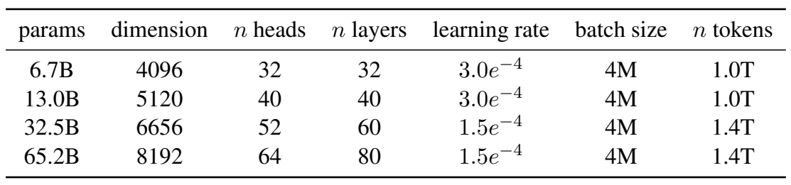
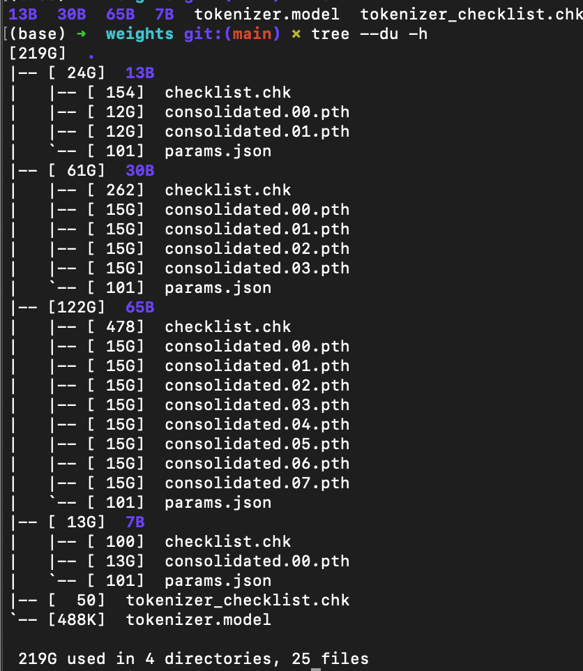
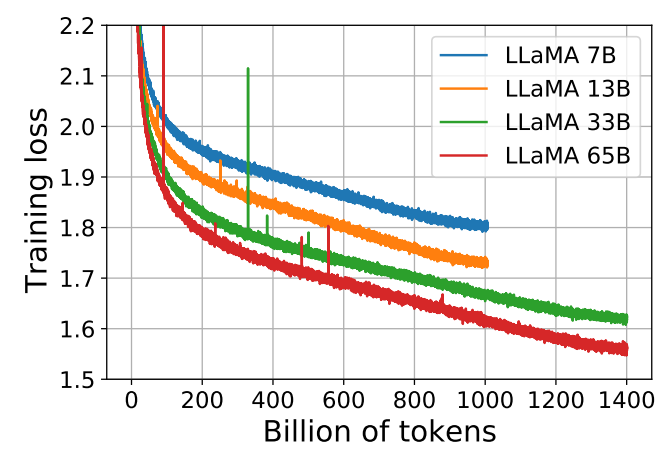

# LLaMA、Alpaca 与 Vicuna：文字如何一步步生成

你输入一句话，模型怎样接着写出下一段话？下面沿着文字、编号、向量和概率这条路径，解释 LLaMA 的生成过程。

论文原表、原图放在相关段落旁，配有中文说明和出处。原 notebook 与中文代码注释可用于对照具体语句。

## 1. 先把“语言模型”理解成一个接着写字的程序

你输入：

```text
我想喝一杯
```

模型可能接上“茶”，也可能接上“水”。接上一个片段后，再把刚刚写出的片段放回输入，继续预测下一个。这样反复进行，最后得到一句话或一段话。

这里的“模型”是一个带有许多数值的计算程序。这些数值会影响它更倾向于接什么；训练会改变这些数值，使用模型写回答时通常不改变它们。后面把这些数值叫作**参数**，把保存参数的文件叫作**权重文件**。

所以先记住两件事：

- **训练**：给它大量例子，调整参数，让它对后续文字的预测变好。
- **推理**：参数已经准备好，根据当前输入算出输出。你和模型对话时，主要就在做推理。

聊天软件负责保存会话，并把需要的历史对话再次传给模型，作为下一次推理的输入。

## 2. 为什么电脑先把文字变成数字？

计算程序不能直接拿“我”“想”“喝”这几个汉字做矩阵乘法，要先把文本转成整数编号。负责这件事的工具叫 **tokenizer，分词器**；它切出的片段叫 **token**。

为了看懂流程，假设我们自己做了一张很小的编号表：

| 文字片段 | 编号 |
|---|---:|
| 我 | 10 |
| 想 | 21 |
| 喝一杯 | 35 |
| 茶 | 42 |
| 水 | 43 |

按上面的自定义编号表，“我想喝一杯”变成 `[10, 21, 35]`。模型若选中编号 42，分词器再把它还原为“茶”。真实 tokenizer 按自己的规则切分文本，一个词也可能拆成几个 token。

把这一轮连起来：

```text
我想喝一杯 → 分词器 → [10, 21, 35]
                        ↓
                    语言模型计算
                        ↓
                 选择下一个编号 42
                        ↓
分词器把42还原为“茶” → 我想喝一杯茶
```

“编码 encode”是文字转编号；“解码 decode”是编号转文字。分词器必须与模型匹配：同一个编号在两张表中可能对应不同片段。

## 3. 向量、张量和 shape，先用一张小表理解

编号只是“查哪一项”，不是这个词的全部含义。模型先把每个编号查成一排小数，这一步叫 **embedding，嵌入**。先把“向量”理解成一排数就够了。

下面仍然是人为构造的例子，每个 token 用 4 个数表示：

| 输入位置 | token编号 | 查到的一排数 |
|---|---:|---|
| 第1个 | 10 | `[0.2, 0.1, -0.3, 0.8]` |
| 第2个 | 21 | `[0.4, -0.2, 0.5, 0.1]` |
| 第3个 | 35 | `[-0.1, 0.6, 0.3, 0.2]` |

把右边三排叠起来，就是 3 行、4 列的一张数表。**shape 是“各个方向有多长”**：这张表的 shape 是 `[3, 4]`。这些小数由模型参数决定，共同组成每个位置的内部表示。

PyTorch 把这种数表和它的多维扩展叫作 **Tensor，张量**。同时处理两句话时，可以把两句话的数表再叠起来。

源码常用下面几个字母：

| 记号 | 中文含义 | 用本例理解 |
|---|---|---|
| B | batch size，一次同时处理几条输入 | 只处理一句时 B=1 |
| S | sequence length，这一次输入几个 token | 本例 S=3 |
| D | 每个 token 用多少个数表示 | 本例 D=4 |
| V | vocabulary size，编号表有多少项 | 为了演示可假设 V=100 |

因此 `[B,S,D]=[1,3,4]` 表示“一句话、三个 token、每个四个数”。`[B,V]=[1,100]` 表示“这句话的下一个位置，对100个候选各给一个分数”。以后每次看到 shape，先用这两句中文读出来。

## 4. 模型怎样选中下一个 token？

模型最后先给候选打分。这些原始分数叫 **logits**，可以为负，也不要求相加等于1；分数还不是概率。

假设这一步只有三个候选：

| 候选 | 模型分数 | 变成概率后的近似值 |
|---|---:|---:|
| 茶 | 2 | 0.665 |
| 水 | 1 | 0.245 |
| 咖啡 | 0 | 0.090 |

把分数变成这列概率的操作叫 **softmax**。先看它的作用：三个结果都在0到1之间，相加为1；较高的分数得到较高的概率。

用普通 Python 算一遍 softmax：

```python
import math                         # 导入数学工具

scores = [2.0, 1.0, 0.0]            # 本例人为给出的三个分数
weights = []                        # 建一个空列表，准备装中间结果
for score in scores:                # 依次取出2、1、0
    weights.append(math.exp(score)) # exp计算e的score次方，并追加到列表

total = sum(weights)                # 三个正数加起来
probabilities = []
for weight in weights:
    probabilities.append(weight / total)  # 每项除以总和

print(probabilities)
# 约为 [0.665241, 0.244728, 0.090031]
```

`import` 导入工具，`[]` 建立列表，`for` 逐项重复，`append` 在列表末尾加一项。每行的作用可对照代码注释。

给定这三个分数，softmax 算出对应的三个概率。真实语言模型先经过多层计算得到 logits，再对整个词表计算概率。

拿到概率以后有两种常见选择：每次选概率最大的，或者按概率抽一个。前者较确定，后者允许不同结果。**选出的 token 会接回原输入，开始下一轮**。这个“用前面已经有的内容继续生成”的过程叫自回归。

例如第一轮输入 `[10,21,35]`，接上42；第二轮可见的内容就是 `[10,21,35,42]`。结束标记和长度限制决定最终保留的内容；本课引用的第一代旧源码在输出时裁剪结束标记。

## 5. 参数为什么会占十几 GB？先看论文原表

参数是计算过程里保存的可调整数值。7B 里的 B 是 billion，十亿；7B 表示约70亿个参数。

**下面直接截自 LLaMA 第一代论文第3页 Table 2，保留原表数值。**



来源：[LLaMA v1，第3页 Table 2](https://arxiv.org/pdf/2302.13971v1#page=3)。先看第一行的7B规格，再比较其他规模。

| 原表列名 | 现在怎样理解 |
|---|---|
| params | 参数数目；6.7B是通常简称7B的规模 |
| dimension | 每个位置内部表示的宽度D；这里是4096 |
| n heads | 注意力计算分成多少个头；可先理解成并行工作的多组特征比较 |
| n layers | 同类处理模块叠了多少层；这里是32层 |
| learning rate | 训练时控制参数更新幅度的设置，不是每秒生成多少字 |
| batch size | **这张训练表**以token计数，4M是约400万个token；不要套成前面“一次几句话”的B |
| n tokens | 训练总共处理多少token；T表示万亿，1.0T是约1万亿 |

“参数数”和“训练token数”是两件事：前者是模型要保存多少数，后者是训练处理了多少文本片段。把它们混起来，就会误读模型大小。

现在算一笔存储账。若每个参数用2字节存储，约70亿个参数只算权重就需要：

$$7\times10^9\times2=14\times10^9\ \text{字节}.$$

也就是约14GB，约13.0GiB。GiB按1024进位，GB按1000进位，所以两个数字不同。这是按约7B参数估算的权重存储量；运行还需要中间结果和缓存等空间。

### 实际下载目录里，各个文件做什么？



这张教程原图展示权重目录。按下面四类文件读：

| 文件 | 负责什么 | 缺少它会怎样 |
|---|---|---|
| Python源码 | 规定怎样计算 | 没有执行过程 |
| `params.json` | 告诉源码用多宽、多深等配置 | 无法按正确规格建模型 |
| `consolidated.*.pth` | 保存训练好的参数数值，可能分成几份 | 只有结构，没有对应的训练结果 |
| `tokenizer.model` | 规定文字与编号怎样对应 | 无法正确解释输入和输出 |

**checkpoint** 是保存参数等状态的文件，在这个旧推理入口中用来加载权重。权重分片把大文件拆成几份。图里的30B与某些命令的33B命名有历史差异，运行时按真实目录填写。

## 6. LLaMA、Alpaca、Vicuna 到底是什么关系？

现在可以把三个名字放回同一条学习路线：先用大量文本学会续写，再用任务例子训练“怎样回答”。

```text
大量普通文本 → 预训练 → LLaMA基础模型
                         ├─ 用指令—回答例子继续训练 → Alpaca
                         └─ 用多轮对话继续训练     → Vicuna
```

**预训练**是先在大量文本上学习预测；**微调 fine-tuning**是在已有参数的基础上继续训练；**SFT，监督微调**使用有目标回答的例子。先有“微调”的中文意思，再记这个缩写即可。

一个教学用SFT样本可以长这样：

```text
指令：把“谢谢”翻译成英文。
目标回答：Thank you.
```

推理时在提示中放几个示例，让模型照着完成任务，叫 few-shot 提示；不放示例叫 zero-shot。两者通过输入影响这次输出。微调则用训练数据更新模型参数。

Alpaca 的发布介绍以 LLaMA 7B 为基础，用约52K条合成指令数据微调；Vicuna 的初始发布使用约70K条共享对话。它们分别从基础权重出发，形成不同的微调分支。来源：[Stanford Alpaca介绍](https://crfm.stanford.edu/2023/03/13/alpaca.html)、[Vicuna初始介绍](https://www.lmsys.org/blog/2023-03-30-vicuna/)。这里讲的是2023年的初始版本。

## 7. “训练变好”是什么意思？配着论文原图看

训练时，可以把真实文本中的后续token暂时遮住，让模型预测，再看模型给正确答案多高的概率。例如真实下一项是“茶”：

| 给“茶”的概率 | 常见负对数损失的一项 | 怎样读 |
|---:|---:|---|
| 0.8 | 约0.223 | 正确答案被认为较可能，惩罚较小 |
| 0.1 | 约2.303 | 正确答案被认为不太可能，惩罚较大 |

这项计算写成 `−ln(正确token的概率)`。`ln` 是自然对数：给正确答案的概率越低，惩罚越大。把许多位置的惩罚汇总，就得到训练 loss；优化器依据梯度调整参数，使这个损失下降。

现在再看原图，轴上的词就有含义了：



来源：[LLaMA v1，第3页 Figure 1](https://arxiv.org/pdf/2302.13971v1#page=3)。

横轴 `Billion of tokens` 表示累计处理的训练 token 数，以十亿为单位，1000即1万亿。纵轴 `Training loss` 是训练损失，在相同定义下越低表示对训练文本的预测越好。蓝、橙、绿、红分别对应7B、13B、33B、65B。

随着处理的 token 增多，各条曲线总体下降。较小模型在1000附近结束，较大模型延伸到1400附近；比较时要一起看参数规模、训练量和其他设置。

这些曲线描述训练文本的预测误差。评价聊天回答，还要另外考察任务完成情况、事实准确性和人工反馈。

论文§2.2说明网络以 Transformer 为基础，使用 RMSNorm、SwiGLU 和 RoPE 等组件。本课先认识它们在模型中的职责，后续各讲再展开公式和实现。[原文位置：第3页§2.2](https://arxiv.org/pdf/2302.13971v1#page=3)

## 8. 回到这一讲的代码：为什么只有两行Python？

原 notebook 通过文字、图片和命令介绍模型。两个 Python 单元负责显示权重目录图：

```python
from IPython.display import Image
Image('../imgs/llama_weights.png', width=300)
```

第一行的意思是：从IPython的display模块拿来名叫Image的图片展示工具。第二行用它读取目录截图，并指定展示宽度为300。

`'../imgs/llama_weights.png'` 是字符串，也就是一段文本；引号里的内容在这里是路径。`..`表示当前工作目录的上一级。`width=300`按参数名字传值，控制显示宽度，不是模型宽度D。Jupyter会展示最后一个表达式的对象，所以这里没有`print()`也能看到图片。

`Image` 读取路径指定的图片，Jupyter 将它显示在单元下方。

真正启动旧版推理的命令写在原notebook的Markdown中。以7B命令为例：

```bash
torchrun --nproc_per_node 1 example.py --ckpt_dir ./weights/7B --tokenizer_path ./weights/tokenizer.model
```

先按中文读一遍：“用torchrun启动一个工作进程，让它执行example.py；从指定目录加载权重，从指定文件加载分词器。”

| 命令部分 | 作用 |
|---|---|
| `torchrun` | 启动程序运行所需的进程 |
| `--nproc_per_node 1` | 本机启动1个工作进程；不是一次处理1个token |
| `example.py` | 要执行的Python文件，是外部官方推理入口 |
| `--ckpt_dir ./weights/7B` | 把权重目录路径交给程序 |
| `--tokenizer_path ...` | 把分词器文件路径交给程序 |

在终端运行命令前，需要准备匹配的源码、依赖、权重、配置和设备。这份旧入口还要求进程数与权重分片数匹配。

## 9. 如果打开完整源码，先沿这条路找

先把程序看成几站，再记名字：

```text
启动入口example.py
  → 读配置、读权重、准备分词器
  → 接收输入文字
  → tokenizer.encode：转成编号
  → Transformer.forward：计算下一个位置的分数
  → 选择一个编号，接回已有输入
  → 重复上两步
  → tokenizer.decode：转回文字
```

`forward` 按当前参数计算输出。本课引用的第一代实现返回最后位置的分数，shape 为 `[B,V]`。

模型内部的Attention可以先理解成“当前这个位置从已有位置中取哪些信息”；FFN进一步处理每个位置的表示；层叠这些模块，让表示逐步变化。这里是帮助定位职责，具体计算还要看实现。论文和官方源码中的RMSNorm调节数值幅度，RoPE引入位置信息，SwiGLU用于FFN的门控计算。

生成下一个 token 时，可以复用之前位置的部分计算。**KV cache** 保存注意力中的 K、V 结果，减少重复运算。缓存形状、空间预算、温度和 top-p 算法放在下方“第二遍对照”中。

## 10. 先用三个问题检查自己有没有跟上

1. “输出‘茶’后为什么还能继续写？”——把‘茶’的编号接回已有输入，再预测下一项。
2. “有源码就有一个训练好的LLaMA吗？”——还需要匹配的配置、权重与分词器；源码本身不包含那些训练好的数值。
3. “调低temperature会重新训练吗？”——不会，它改变这次怎样从分数中选择token。训练改变参数，是另一种过程。

这三件事能解释清楚，就已经抓住本课主线。下面是保留的源码和公式细节，留到第二遍需要追某个函数时再打开。

<details>
<summary>第二遍再看：完整源码路径、公式、shape与旧验证记录</summary>

## 补充：原 notebook 与推理源码的详细对照

[全部单元与代码注释说明](代码单元解释.md) 覆盖原 notebook 全部9格、2个Python单元及6条启动命令。仓库直接提供[原 notebook](代码/tutorials/01_llama_intro.ipynb)、[详细中文注释 notebook](代码/tutorials/代码注释.ipynb)和[Python 阅读版](代码/tutorials/01_llama_intro_代码注释.py)；[生成和验证记录](复现/README.md) 用表格列出实际结果与执行边界。

## 1. 阅读对象、版本与边界

本次阅读对象是 `personal_chatgpt/tutorials/01_llama_intro.ipynb`。它有 **9 个单元，其中只有 2 个 Python 代码单元**。其余是概念说明、权重目录截图和放在 Markdown 中的启动命令。这个文件没有实现训练、Attention 或生成算法。

本次已补充对照附件 `b5cfecd6-1e77-4575-8a66-39f6c12f7505.txt`，字幕在本地 `资料/字幕原文.txt`。完整单元说明见 [代码单元解释.md](代码单元解释.md)，[原 notebook](%E4%BB%A3%E7%A0%81/tutorials/01_llama_intro.ipynb) 提供固定来源入口。原notebook、说明版、注释版与图片已直接发布在本讲 `代码` 目录；下面的完整仓库与外部源码地图指此前下载的本地配套资料。

为解释命令实际做什么，本文补充阅读官方 **LLaMA 第一代**的 `example.py`、`tokenizer.py`、`generation.py` 和 `model.py`。下面严格区分“原 notebook”与“外部源码补充”。

| 对象 | 来源与版本 |
|---|---|
| 主文件 | [原 notebook 固定提交](https://github.com/chunhuizhang/personal_chatgpt/blob/7fbc29824171fd07dc2c30fe922e61ebc018ad1d/tutorials/01_llama_intro.ipynb) |
| 教程仓库 | 已克隆；提交 `7fbc29824171fd07dc2c30fe922e61ebc018ad1d` |
| Notebook 历史信息 | 两个代码单元执行时间为 2023-05-15；元数据 Python 3.10.9，不能当成本机环境 |
| 补充实现 | `meta-llama/llama` 的 `llama_v1` 分支 |
| 分支 SHA | `57b0eb62de0636e75af471e49e2f1862d908d9d8`，通过 `git ls-remote` 查询 |
| 相关论文 | [LLaMA: Open and Efficient Foundation Language Models](https://arxiv.org/abs/2302.13971)，2023 年第一代 |
| 阅读范围 | Notebook 全部单元，外部推理入口和生成路径；模型核心模块提供公式与形状地图 |

论文关注如何用公开可获得的数据训练高效基础语言模型；本教程关注模型家族、权重文件及启动推理。2026-10-17已取得v1 PDF，核对本课引用的§2.2、Table 2和Figure 1并截取原表/原图放入正文。没有逐表复现论文实验，也未生成中文论文PDF。

## 2. 仓库地图与调用链

实际检查了克隆仓库的 README 与文件列表。相关文件如下：

```text
代码/personal_chatgpt/
├── README.md                         教程与视频索引
├── tutorials/01_llama_intro.ipynb     主阅读文件
├── imgs/llama_weights.png            本 notebook 的图片
├── tutorials/llama_tokenizer.ipynb   后续学习资料，本次不展开
└── tutorials/llama2_src_*.ipynb      第二代教程，不能直接混进第一代调用链

资料/llama_v1/
├── example.py                        外部入口与模型加载
├── llama/tokenizer.py                文本编码、解码
├── llama/generation.py               自回归生成、top-p
├── llama/model.py                    Transformer 和模型并行层
├── requirements.txt                 torch、fairscale、fire、sentencepiece
└── README.md                         官方第一代使用说明
```

在原教程仓库中，未找到命令所需的第一代 `example.py`、大模型 `.pth` checkpoint 或权重目录的 `params.json`。仓库确有 tokenizer 相关资料，但不能仅凭名字认定与任意权重兼容。

正确的阅读顺序沿着执行路径：

```text
torchrun → example.py → fire.Fire(main) → main()
  → setup_model_parallel()
  → load()
      → params.json + checkpoint + Tokenizer + Transformer
  → LLaMA.generate()
      → encode → forward → sampling → decode
  → 打印字符串
```

进入 `personal_chatgpt/tutorials` 照抄命令，不会自动得到这些外部源码和模型文件。

## 3. 第一个 Python 单元：导入 Image

原代码：

```python
from IPython.display import Image
```

一句话：导入一个能在 notebook 中展示图片的类。

`IPython` 提供交互式 Python 能力，`display` 模块处理显示对象，`Image` 是其中的类。`from A import B` 将模块 A 中的名字 B 引入当前会话，后续可以直接写 `Image`。

这一步只增加可用名字，没有创建 LLaMA 模型、加载权重或建立图像张量。先运行这一格，下一格才能找到 `Image`；否则会报 `NameError`。[IPython Image API](https://ipython.readthedocs.io/en/stable/api/generated/IPython.display.html#IPython.display.Image)

掌握等级：**【必须会】导入语句；【可以暂时不掌握】IPython 内部展示协议。**

## 4. 第二个 Python 单元：显示目录截图

原代码：

```python
Image('../imgs/llama_weights.png', width=300)
```

一句话：读取本地 PNG，构造展示对象，并设置显示宽度。

| 部分 | 类型 | 含义 |
|---|---|---|
| `Image` | 类 | 调用后创建一个具体对象，即实例化 |
| 第一个实参 | `str` | 图片路径，按照 Image API 读取本地文件 |
| `..` | 路径组成部分 | 当前工作目录的上一级 |
| `imgs` | 目录 | 插图存放位置 |
| `width=300` | 关键字实参，`int` | 展示宽度，不是模型特征维度 |
| 返回值 | `IPython.display.Image` | 保存图片数据和展示元数据的对象 |

位置实参按参数位置传递；关键字实参按名字传递。`Image(...)` 调用类的构造过程，这与调用一个已有对象的方法不同。

若当前工作目录是仓库的 `tutorials`，路径会指向仓库 `imgs/llama_weights.png`。**相对路径通常基于进程当前工作目录，不天然基于 notebook 文件所在目录。** 改变启动目录后可能出现 `FileNotFoundError`。

Jupyter 会显示代码单元最后一个表达式的值，因此不需要 `print()`。普通 Python 脚本不会仅因为末行出现 Image 对象就自动展示图片；交互环境可显式使用 `display()`。[IPython display API](https://ipython.readthedocs.io/en/stable/api/generated/IPython.display.html)

这里的数据流是 `文件路径 → PNG 字节 → Image 对象 → notebook 输出`，没有 GPU，没有 `[B,C,H,W]` 张量，没有视觉模型。宽度只控制展示，没有把原图文件重写成 300 像素。

掌握等级：**【必须会】相对路径、对象、位置实参与关键字实参；【建议会】当前工作目录与文件位置的区别。**

## 5. 概念说明：LLaMA、Alpaca、Vicuna

把名字放到训练阶段中理解：

| 名称 | 角色 | 本教程的历史含义 |
|---|---|---|
| LLaMA | 基础语言模型 | 用大量文本学习续写规律 |
| Alpaca | 指令微调模型 | 在 LLaMA 基础上用合成指令回答数据进行 SFT |
| Vicuna | 对话微调模型 | 在 LLaMA 基础上使用 ShareGPT 对话微调 |

更准确的权重关系是分支：

```text
LLaMA 基础权重
├── 指令数据微调 → Alpaca
└── 对话数据微调 → Vicuna
```

Vicuna 借鉴和扩展 Alpaca 的训练工程，不等于必须先加载 Alpaca 权重再训练 Vicuna。发布说明分别描述 52K 合成指令样本和约 70K 共享对话。[Alpaca 发布说明](https://crfm.stanford.edu/2023/03/13/alpaca.html)、[Vicuna 发布说明](https://www.lmsys.org/blog/2023-03-30-vicuna/)

预训练学习一般语言分布；SFT（Supervised Fine-Tuning）用监督样本改进指令或对话行为；推理使用既有参数生成文本。Self-Instruct 是构造指令数据的方法思想，SFT 是使用数据更新权重的过程，二者并不相同。合成指令数据也不能笼统当成任意 ChatGPT 对话日志。

原教程的许可描述属于 2023 年第一代的背景，不能推广到后来的全部模型。实际使用需核对具体权重版本的许可；本文不依据旧 notebook 给出当前商业使用结论。

基础模型与文字生成 API 可类比接口行为，但不能据此认定训练方式、对齐程度和能力完全相同。

掌握等级：**【必须会】预训练、SFT、推理的区别。**

## 6. 权重目录截图


它是文件目录截图，不是网络架构图。按根目录、模型子目录、内部文件的顺序读：

| 文件或目录 | 作用 | 去向 |
|---|---|---|
| `7B`、`13B` 等 | 不同参数规模；B 是 billion | `ckpt_dir` |
| `consolidated.00.pth` 等 | 已训练参数的 checkpoint 分片 | `torch.load` |
| `params.json` | 网络结构配置 | `ModelArgs` |
| `tokenizer.model` | SentencePiece 分词模型 | `Tokenizer` |
| `checklist.chk` | 配套校验文件 | 本次 `load()` 没有读取 |

代码描述计算结构，配置决定网络尺寸，checkpoint 提供参数数值，tokenizer 规定文字到整数的转换。分片是模型并行所用的参数切片，不是聊天记录片段，也不应将其中一份当成完整大模型。

图中出现 `30B`，命令出现 `33B`，说明历史材料有命名不一致。运行时应使用实际目录，程序不会自动修正名字。

### 6.1 权重空间估算【必须会】

$$M_{\mathrm{weight}}=N_{\mathrm{param}}b$$

$N_{\mathrm{param}}$ 是参数数量，$b$ 是每个参数的字节数；二者都是标量。FP16 的 b 为 2。按 70 亿参数估计：

$$7\times10^9\times2=14\times10^9\ \mathrm{bytes}\approx13.0\ \mathrm{GiB}.$$

这能解释截图体积，但不是精确参数数目，也不是全部推理显存。还要加 KV cache、激活与临时数据。量化能改变存储方式，但此旧入口没有实现量化加载。

## 7. 启动命令

将 notebook 的 7B 命令合成一行：

```bash
torchrun --nproc_per_node 1 example.py --ckpt_dir ./weights/7B --tokenizer_path ./weights/tokenizer.model
```

| 部分 | 处理者 | 含义 |
|---|---|---|
| `torchrun` | PyTorch 启动器 | 启动工作进程、提供分布式环境信息 |
| `--nproc_per_node 1` | 启动器 | 本机启动一个工作进程 |
| `example.py` | Python | 各工作进程执行的入口 |
| `--ckpt_dir` | 脚本的 Fire 解析器 | 权重目录 |
| `--tokenizer_path` | 同上 | 分词模型路径 |
| `./` | 文件路径 | 相对当前工作目录 |

脚本之前的选项属于启动器，之后的选项传入脚本。进程数不是 batch size，不表示模型层数或一次回答的问题数。[torchrun 文档](https://docs.pytorch.org/docs/2.14/elastic/run.html)

原文另一组使用 `--参数=值`，是同一意图的另一种写法；仍需分别看启动器和 Fire 的解析规则，不能推广为所有工具的规则。13B 示例使用 2 个进程，较大模型使用 4 个，并切换对应目录。这来自旧实现的权重分片要求，不是参数规模具有固定的 GPU 数定律。

**这些命令位于 Markdown 单元，未被 notebook 执行。** 原文反斜杠是 Bash 续行符；当前是 PowerShell，可合并成一行阅读，不能直接照搬 Bash 的多行语法。

`torchrun` 对应 `torch.distributed.run` 入口，不严格等于旧的 `torch.distributed.launch`。教程并列两者是历史使用背景。[PyTorch 启动器说明](https://docs.pytorch.org/docs/2.14/elastic/run.html)

| 环境变量 | 单机四进程例子 | 含义 |
|---|---|---|
| `LOCAL_RANK` | 每个进程分别是 0、1、2、3 | 节点内进程编号 |
| `RANK` | 单机时也是 0、1、2、3 | 全局进程编号 |
| `WORLD_SIZE` | 每个进程都看到 4 | 全局工作进程数量 |

多节点时局部编号与全局编号不同。本次旧代码用本地 rank 选择 checkpoint，应按单机模型并行用法理解，不直接扩展到任意多机拓扑。

掌握等级：**【必须会】启动器参数与脚本参数；【建议会】rank 与权重分片。**

## 8. 外部源码：`example.py`

本节来自 `资料/llama_v1/example.py`，是补充资料，不是 notebook 中已有的代码。

### 8.1 导入与入口

| 名字 | 职责 |
|---|---|
| `os`、`sys` | 环境变量、标准输出 |
| `time`、`json`、`Path` | 计时、解析配置、处理路径 |
| `torch` | 张量、CUDA、通信、权重加载 |
| `fire` | 将命令行参数映射到函数 |
| FairScale 初始化函数 | 建立模型并行环境 |
| `ModelArgs`、`Transformer` | 结构配置、网络对象 |
| `Tokenizer`、`LLaMA` | 文本转换、生成封装 |

底部通过 `__name__` 判断是否直接执行当前脚本。直接执行时运行 `fire.Fire(main)`；作为模块导入时不自动启动推理。Fire 将参数映射到 `main()`，不是 notebook 注入参数。

`main` 是普通函数。两个必需参数为字符串路径，其余默认参数如下：

| 参数 | 默认 | 控制对象 |
|---|---|---|
| `temperature` | 0.8，float | 采样分布 |
| `top_p` | 0.95，float | 采样候选集合 |
| `max_seq_len` | 512，int | 此次模型缓存与生成上限 |
| `max_batch_size` | 32，int | 最大批次与缓存预分配 |

`ModelArgs` 类自身的序列长度默认值不同；实际入口会传入运行参数。隐藏维度、头数、层数应读取权重配套 `params.json`，不能将类中的小尺寸默认值当成真实 7B 配置。

### 8.2 `setup_model_parallel()`

无显式输入，返回两个整数组成的元组 `(local_rank, world_size)`。`Tuple[int,int]` 是类型注解，不自动保证环境正确。

按执行顺序：读取环境变量字符串并转整数；以 NCCL 初始化通信组；用 FairScale 建立模型并行组；按 local rank 选择 GPU；为各进程设置相同随机种子；返回 rank 和 world size。

环境变量缺失时的 -1 备用值不是自动发现设备。这个函数修改通信环境、当前设备与随机状态，具有副作用。NCCL 是旧入口的 NVIDIA GPU 通信路线；可识别 GPU 不表示当前系统一定能运行此 backend。

### 8.3 `load()`：文件如何变成生成器

输入为两个路径、rank、world size、最大长度、最大 batch；返回 `LLaMA` 对象。

| 顺序 | 操作 | 类型与作用 |
|---|---|---|
| 1 | 搜索并排序 `.pth` | 目录 → `list[Path]`，建立稳定分片顺序 |
| 2 | 检查数量 | 要求 `world_size` 等于分片数量 |
| 3 | 按 local rank 选文件 | 文件列表 → 本进程的一份 checkpoint |
| 4 | 读取权重 | 文件 → 参数映射，先放 CPU |
| 5 | 读取 JSON | 文本 → 配置字典 `params` |
| 6 | 构造 `ModelArgs` | 配置字典与运行参数 → 配置对象 |
| 7 | 构造 `Tokenizer` | 分词文件 → 对象；取得词表大小 |
| 8 | 构造 `Transformer` | 创建结构、参数容器与缓存 |
| 9 | `load_state_dict` | 用 checkpoint 填入模型参数 |
| 10 | `LLaMA(model,tokenizer)` | 将模型和分词器封装成生成器 |

`with open(...) as f` 会在离开代码块时关闭文件；`json.loads` 将 JSON 文本解析为字典。`**params` 是字典展开：把 dim、n_layers 等键作为同名关键字实参传给构造器。重复或未知字段仍可能报错。

源码在建模型之前改变全局默认张量类型为 CUDA FP16，完成构造后恢复默认 CPU float 类型。恢复默认值不会把已经建好的模型移回 CPU。该方式具有全局副作用，是旧实现的写法。

`strict=False` 容许部分参数键不一致，不代表所有权重兼容；形状不匹配仍可能失败。真实运行应检查 missing/unexpected keys。

最关键的检查是**进程数等于分片数**。两份分片配一个进程，会在加载前报错；目录不存在则搜索到零份，也不能加载。

### 8.4 `main()` 如何使用生成器

非零本地 rank 将标准输出指向丢弃位置，避免重复打印；它们仍需参与计算。随后构造 5 条提示，包含自然续写和 few-shot 任务，调用 `generate`，本次最大新增长度为 256，再逐条打印。

Few-shot 是把示例放到上下文，没有更新权重。`main()` 没有显式返回结果，默认返回 None；文本列表来自 `generate()`。

掌握等级：**【必须会】配置、checkpoint、入口关系；【建议会】`with`、`**params`、全局状态。**

## 9. 外部源码：Tokenizer

`资料/llama_v1/llama/tokenizer.py` 定义 `Tokenizer` 类。类规定对象的行为，实例代表某个实际加载的分词器；`__init__` 在构造实例时执行，`self` 代表这个实例。

初始化验证文件存在，创建 SentencePieceProcessor，再记录词表大小和 BOS、EOS、PAD 的整数 ID。这些属性在实例中保存。

`encode` 是对象方法：输入字符串与两个必需布尔开关 bos、eos，输出 `List[int]`。先分词为词表 ID，再按开关添加开头/结尾标记。`decode` 输入整数列表，输出字符串；这两个操作不是模型训练。

生成器编码时启用 BOS、关闭 EOS，让模型继续输入序列。

```text
prompts: list[str]，长度 B
→ prompt_tokens: list[list[int]]，每条长度可不同
→ tokens: CUDA int64 tensor [B,L]
```

两条提示可以示意为 `[BOS,11,12]` 和 `[BOS,21,22,23,24]`。这些是人为 ID，不是实际分词结果。一个 token 不固定等于一个汉字、单词或字符；分词模型文件也不等于 Transformer checkpoint。

掌握等级：**【必须会】字符串、整数 ID、BOS/EOS、batch。**

## 10. 外部源码：`LLaMA.generate()`

位于 `资料/llama_v1/llama/generation.py`，属于 `LLaMA` 类。输入提示列表、必需最大新增长度、temperature（默认 0.8）和 top_p（默认 0.95）；输出字符串列表。它修改 token 容器，并通过 forward 更新模型 KV cache，不更新模型参数。

### 10.1 变量与形状

| 名字 | 含义 | 类型/shape |
|---|---|---|
| `bsz` | batch size，记为 B | int |
| `params` | 已加载模型配置 | `ModelArgs` |
| `prompt_tokens` | 每条提示的整数列表 | `list[list[int]]` |
| `min_prompt_size` | 最短提示长度 | int |
| `max_prompt_size` | 最长提示长度 | int |
| `total_len` | 容器长度，记为 L | int |
| `tokens` | 提示与生成 ID | int64 `[B,L]`，CUDA |
| `input_text_mask` | 原提示的位置 | bool `[B,L]` |
| `prev_pos` | 本轮输入片段起点 | int |
| `cur_pos` | 本轮预测的位置 | int |
| `logits` | 下一 token 的分数 | float32 `[B,V]` |
| `probs` | 词表概率 | float32 `[B,V]` |
| `next_token` | 本轮选择的 ID | int64 `[B,1]`，随后 reshape 为 `[B]` |
| `decoded` | 解码结果 | `list[str]`，长度 B |

### 10.2 分配与提示掩码

先检查 B 不超过最大 batch。列表推导式逐个编码 prompt，再计算最短与最长长度。容器长度：

$$L=\min(S_{\max},G+P_{\max}).$$

$S_{\max}$ 是允许的最大序列长度，G 是请求新增长度，$P_{\max}$ 是最长提示长度，均为标量整数。上限可能让实际新增数量少于 G。

用 PAD ID 创建 `[B,L]` 容器，再逐行放入提示。`enumerate` 取得行号和当前列表；`tokens[k,:len(t)]` 是第 k 行的前一段，右端不包含在切片内。`.cuda()` 放到 GPU，`.long()` 转为 int64。

提示填好后保存 `input_text_mask`，表示哪些位置原来是输入文本。这个掩码以后不随新 token 更新，用来保护提示；它与 Attention 的因果遮罩不同。

### 10.3 从最短提示开始的生成循环【必须会】

假设两条提示长度为 3、5，新增上限 G=2，上下文足够，则 L=7：

| `cur_pos` | forward 输入 | 第一行该位置 | 第二行该位置 |
|---|---|---|---|
| 3 | `tokens[:,0:3]`，`[2,3]` | 已超过提示，生成 | 属于提示，保留原 ID |
| 4 | `tokens[:,3:4]`，`[2,1]` | 生成 | 仍属于提示，保留 |
| 5 | `tokens[:,4:5]`，`[2,1]` | 继续计算 | 长提示开始生成 |
| 6 | `tokens[:,5:6]`，`[2,1]` | 继续计算 | 生成第二个 ID |

到位置 3 时输入只有位置 0、1、2，模型预测位置 3。不能把还未知的目标位置提前输入。

`torch.where` 按行选择：掩码为真取提示原 ID，否则取新采样 ID。它是逐元素条件选择，不是一个整体 Python if。选完写入 `tokens[:,cur_pos]`，再更新 prev_pos。

这个旧版本统一循环到 L，短提示可能在内部生成超过 G 的 token，最后按各行“提示长度 + G”裁剪；不是每行达到 G 就立刻停。

### 10.4 KV cache：只输入一个 token，为何还有上下文？

第一轮处理共同前缀，称为 prefill。后面只输入新 token，但各层已经缓存历史位置的 K、V，因此新 Q 仍能关注历史。输入 `[B,1]` 不表示丢失上下文。

若第一次输入长度 3，下一轮输入一个 token 时用 `start_pos=3` 写入对应缓存位置。起点、长度、缓存读取范围必须一起理解。

### 10.5 最后的后处理

将 tensor 转为列表，每条先截到“提示长度 + G”，再找到第一个 EOS 并截断，最后 decode。`list.index` 找不到 EOS 会报 ValueError；`try/except` 处理这一分支，保留当前序列。

这个旧实现没有在循环中采到 EOS 就立即停止，而是在最后裁剪。返回文字包含提示，不全是新生成的回答。对超过上下文的输入也缺少完善前置检查，不能仅凭 min() 认为已安全处理。

掌握等级：**【必须会】切片、自回归、提示保护和 KV cache；【建议会】变长 batch。**

## 11. Temperature 与 top-p

### 11.1 从分数到概率【必须会】

$$p_i=\frac{e^{z_i/T}}{\sum_{j=1}^{V}e^{z_j/T}}.$$

$z_i$ 是某样本第 i 个词表候选分数；V 是词表大小；$T>0$ 为温度；$p_i$ 为概率。整批输入输出均为 `[B,V]`，softmax 沿最后一维计算。这是通用解码公式，不是原 notebook 中的公式。

示意 logits `[2,1,0]`：T=1 时概率约 `[0.665,0.245,0.090]`；T=0.5 时约 `[0.867,0.117,0.016]`。较小正温度让分布集中。在此代码中 T≤0 走 argmax，不能直接把零代入除法公式。

### 11.2 `sample_top_p`【建议会】

这是普通函数，输入概率 `[B,V]` 和标量 p，返回原词表 ID `[B,1]`。依次做排序、累计求和、删掉候选、重新归一化、随机采样，再将排序位置映射回词表 ID。

源码的判断依据是“当前候选之前的累计概率是否已超过 p”。示意概率 `[0.50,0.30,0.15,0.05]`，p=0.75：累计为 `[0.50,0.80,0.95,1.00]`，之前累计为 `[0,0.50,0.80,0.95]`。保留前两项，归一化为 `[0.625,0.375]`。

它保留跨过阈值的候选，所以保留总概率可超过 p；不是保留 p 比例数量的 token。严格大于的比较还影响恰好等于阈值的边界。

`div_` 表示原地修改排序后的局部概率；`keepdim=True` 使行和保持 `[B,1]` 以便广播；`gather` 把采样位置映射回原索引。函数消耗随机状态，但不更新网络权重。

## 12. 模型核心的公式、shape 与代码地图

本节补充 `资料/llama_v1/llama/model.py`。设 B 为 batch，S 为本次输入片段长度，D 为隐藏维度，V 为词表大小，H 为总头数，P 为并行进程数，$H_l=H/P$、$d_h=D/H$。这些整除关系需与配置匹配。

| 操作 | 形状 | 代码对象 |
|---|---|---|
| token ID | int64 `[B,S]` | `Transformer.forward` 输入 |
| embedding | `[B,S,D]` | `tok_embeddings` |
| 多个 block | `[B,S,D] → [B,S,D]` | `TransformerBlock` |
| 最后归一化 | `[B,S,D]` | `norm` |
| 选择最后位置 | `[B,D]` | 最后时间步切片 |
| 输出词表分数 | `[B,V]`，返回 float32 | `output` |

**这里不是 `[B,S,V]` 的返回值：旧版 forward 只计算最后位置 logits。** 中间浮点张量通常 FP16，采样前转 float32。

`Transformer` 继承 `nn.Module`，让 PyTorch 管理参数与子模块；`super().__init__()` 初始化父类；`ModuleList` 注册多层网络；`@torch.inference_mode()` 是装饰器，关闭推理时相关 autograd 开销。

### 12.1 Attention 与缓存【建议会】

本进程 Q、K、V reshape 为 `[B,S,H_l,d_h]`，对 Q、K 应用 RoPE，再将 K、V 写入缓存。预分配缓存是 `[B_max,S_max,H_l,d_h]`；本次读取历史长度 $C=start\_pos+S$。

```text
Q: [B,H_l,S,d_h]
K、V: [B,H_l,C,d_h]
QKᵀ: [B,H_l,S,C]
加权 V: [B,H_l,S,d_h]
合并头并投影: [B,S,D]
```

$$A=\operatorname{softmax}(QK^\top/\sqrt{d_h}+M),\qquad O=AV.$$

M 是可广播的因果遮罩，禁止位置用负无穷让其概率趋于零。A 的 shape 为 `[B,H_l,S,C]`，O 为 `[B,H_l,S,d_h]`；对应 `Attention.forward`。

二维向量 `[1,0]` 与 `[1,1]` 点积为 1，缩放后为 $1/\sqrt2≈0.707$；随后还要与其他 key 的分数一起 softmax。缩放能避免特征维增加时分数幅度过大。

此生成器首次处理前缀时 start_pos=0，后续通常 S=1。旧版的多 token mask 应按此路径理解，不自动推广到任意非零起点的多 token 新块。第一代这里是 MHA，没有找到后续版本的 `n_kv_heads`/GQA 配置。

### 12.2 KV cache 显存【建议会】

$$M_{\mathrm{KV,rank}}=2N_{\mathrm{layers}}B_{\max}S_{\max}H_l d_h b.$$

2 表示 K、V 两份；层数、最大 batch、最大长度、头数、每头维度均为整数，b 是元素字节数。它对应每层 Attention 的缓存分配。

以常见第一代 7B 的示意结构（32 层、D=4096、单进程 FP16）和此入口 B_max=32、S_max=512 计算，缓存约 8 GiB。这是明确配置假设下的预算，不是读取真实权重配置得到的实测结果。实际仅传几条 prompt，预分配仍可能按最大 batch 占用空间。

### 12.3 RMSNorm【建议会】

$$y_i=\frac{x_i}{\sqrt{D^{-1}\sum_{j=1}^{D}x_j^2+\epsilon}}\gamma_i.$$

x、y 最后一维长 D；gamma 是长度 D 的可学习缩放向量；epsilon 是稳定计算的标量小正数。shape `[B,S,D]` 不变。与均值中心化不同，它按均方根规范幅度；代码先 float32 计算，再转回输入类型。对应 `RMSNorm._norm/forward`。

示意 x=[3,4]、gamma=[1,1]、忽略 epsilon：均方为 12.5，均方根约 3.536，输出约 `[0.849,1.131]`。

### 12.4 RoPE【建议会】

$$\begin{bmatrix}q'_{2j}\\q'_{2j+1}\end{bmatrix}=\begin{bmatrix}\cos\phi&-\sin\phi\\\sin\phi&\cos\phi\end{bmatrix}\begin{bmatrix}q_{2j}\\q_{2j+1}\end{bmatrix},\qquad\phi=m\theta_j.$$

m 是 token 的位置，j 标记一对相邻特征维度，theta_j 是该对维度的频率。每对两个实数旋转，整张 Q/K 的 `[B,S,H_l,d_h]` 形状不变。示意 `[1,0]` 旋转 π/2 得到 `[0,1]`。

代码把相邻实数对视为复数，与单位复数相乘，再还原为实数；对应 `precompute_freqs_cis`、`apply_rotary_emb`。它作用于 Q、K，不作用于 V。目的在于把位置信息加入注意力比较。

### 12.5 SwiGLU 和残差【建议会】

$$\operatorname{FFN}(x)=W_2(\operatorname{SiLU}(W_1x)\odot W_3x),\qquad\operatorname{SiLU}(u)=u\sigma(u).$$

采用数学列向量约定；源码 Linear 作用于最后一维。W1、W3 从 D 投影到中间维 F，W2 再从 F 回到 D；乘号为逐元素门控。单进程 shape `[B,S,D] → [B,S,F] → [B,S,D]`；并行时中间特征在各进程切分。对应 `FeedForward.forward`。

若两个分支的某个标量都为 1，则门控结果约 0.731，之后还需 W2 投影。`TransformerBlock` 先规范化、Attention、残差相加，再规范化、FFN、残差相加，外部 shape 始终 `[B,S,D]`。

这些公式是解释性重述，没有冒充原 notebook 的编号公式。**【可以暂时不掌握】**复数广播的完整细节与 FairScale 的具体通信实现。

## 13. 训练目标与推理的边界

语言模型把序列概率分解为：

$$p_\theta(x_1,\ldots,x_T)=\prod_{t=1}^{T}p_\theta(x_t\mid x_{<t}).$$

theta 是参数，x_t 是第 t 个整数 token，x_<t 是其前面的上下文。这解释生成器为何每次预测后续 token。

常见负对数似然训练目标为：

$$\mathcal L=-\sum_{t=1}^{T}\log p_\theta(x_t\mid x_{<t}).$$

若目标 token 概率是 0.8，损失项约 0.223；概率 0.1，约 2.303。真实训练可能采用平均、padding mask 或回答位置 mask；不能从这个推理入口推断所有微调设置。

原 notebook 与本次第一代推理代码中未找到 optimizer、backward、训练数据管线或 loss 实现。这里解释概念，不声称训练已实现。few-shot 示例也只是输入上下文。

掌握等级：**【必须会】下一 token 条件概率；【建议会】训练 loss 与推理采样的区别。**

## 14. 历史评估与资料的限制

原 notebook 没有自己的实验表或评估实现，只引用 Vicuna 博客。发布时的相对质量说法不是标准准确率、所有任务胜率或数学能力保证，发布说明也明确指出初步评估的局限。[Vicuna 评估说明](https://www.lmsys.org/blog/2023-03-30-vicuna/)

本次没有运行评估集，没有模型回答质量的观测。截图与保存的 notebook 输出都是历史资料，不能证明本机具有相同权重文件。

## 15. 实际验证与复现状态

此前主文统一验证入口为 `共享资料/verify_lessons.py`，本讲新结果位于 `复现/outputs/教学验证.json`；此前的两格代码和官方源码 AST 检查日志也保留在 `复现/outputs/verification.txt`。字幕核对补充见[字幕校正](../../资料/字幕校正.md)，包括 few-shot/zero-shot、启动器对应模块和显存预算的区别。

**状态：部分成功。仅 notebook 自身两个代码单元与补充源码语法验证成功；LLaMA 推理未复现，论文实验未复现。**

| 项目 | 实际观测 |
|---|---|
| 环境 | Windows、PowerShell |
| Python | `D:\anaconda\python.exe`，3.7.6 |
| IPython | 7.12.0 |
| GPU | RTX 4060 Laptop GPU，8188 MiB，来自 nvidia-smi |
| PyTorch | import 名字可解析，但没有 version、tensor、cuda API；不是可用安装 |
| PyTorch CUDA 状态 | 无法通过当前 torch 确认 |
| 模型 checkpoint | 本阅读目录未找到配套 .pth 和 params.json |
| RAM、剩余磁盘 | 未测量；没有据此开展模型运行 |

补齐全部单元注释时的执行命令（工作目录为本讲复现目录，其他机器需替换本地路径）：

```powershell
& 'D:/anaconda/python.exe' './scripts/verify_annotations.py' --directory 'G:/zzz/Personal ChatGPT 前七讲/01 LLaMA introduction/代码/tutorials' --record './outputs/annotation_verification.json'
```

脚本切换到仓库 tutorials，执行原始两个单元，结果为 Image 对象、展示宽度 300、PNG 数据 333093 字节，PNG 签名有效。随后 ast.parse 检查已保存补充 .py 的语法通过。完整输出见 `复现/outputs/verification.txt`。

语法通过不等于依赖可用、模型可加载或分布式通信可初始化。本次未修改现有 Python 环境。仅权重预算已超过本机约 8 GiB 显存，原版 FP16 7B 不能照这份入口直接运行；量化属于另一条实现路径。

## 16. 必须掌握的知识

1. Python 单元与 Markdown 命令的执行语义。
2. 代码、配置、checkpoint、tokenizer 四者的职责。
3. 此旧实现要求进程数匹配权重分片数。
4. `字符串 → token ID → logits → 新 ID → 字符串`。
5. `tokens: [B,L]`、`logits: [B,V]`，后者仅对应最后位置。
6. 自回归切片只能含已知 token；KV cache 保存历史。
7. 预训练、SFT、推理及 few-shot 提示的区别。

## 17. 第二遍学习的知识

变长提示与 torch.where、temperature 与 top-p、类型注解与 with、字典展开、self 与继承、装饰器、RMSNorm/RoPE/SwiGLU 的形状、rank 和缓存预算。

## 18. 可以稍后学习的工程细节

FairScale 内部通信、checkpoint 切分、采样同步、多节点部署、量化加载。它们不是理解原 notebook 两行图片代码的前提。

## 19. Paper ↔ Code 映射

| 概念 | 方法关系 | 代码位置 | 边界 |
|---|---|---|---|
| 基础模型 | LLaMA 预训练 | notebook 概念单元 | 训练实现未找到 |
| 权重/结构 | 参数与架构 | `example.py: load` | 外部补充 |
| Tokenization | 文本离散化 | `Tokenizer` | 外部补充 |
| 自回归 | 条件概率分解 | `LLaMA.generate` | 推理不是训练 loss |
| RMSNorm | LLaMA 架构 | `RMSNorm` | 外部补充 |
| RoPE | 位置编码 | `precompute_freqs_cis/apply_rotary_emb` | 外部补充 |
| Attention | 因果自注意力 | `Attention.forward` | 第一代 MHA |
| SwiGLU | 门控 FFN | `FeedForward.forward` | 外部补充 |
| KV cache | 推理加速 | `cache_k/cache_v` | 非可学习权重 |
| 模型并行 | 分布计算 | FairScale 层和入口 | 单机分片用法 |
| Alpaca/Vicuna SFT | 指令/对话训练 | 未找到 | 仅引用资料 |
| NLL、优化器 | 训练 | 未找到 | 未复现训练 |
| 实验指标 | 评估 | 未找到 | 未运行指标 |

## 20. 未解决的问题与置信边界

- Notebook 未给出当年官方入口的提交，本次选用官方 llama_v1，不能保证逐字等于 2023-05-15 的本地代码。
- 外部资料是固定 SHA 下载的源码快照，不是完整 Git checkout；网络重试与核验记录见 `资料/来源.md`。
- 30B/33B 命名差异已确认，但无法推断用户实际持有的权重目录。
- 原Python3.7环境中的torch缺少关键API；后来另建CPU PyTorch环境用于其他讲。本讲只使用IPython，不据此声称LLaMA推理已运行。
- 没有真实 7B params.json；缓存预算的结构值是注明的示意假设。
- 2026-10-17已补充读取论文v1与本课相关的段落和图表，并截图内嵌；未声称完成论文全文翻译或指标复现。

</details>

## 必须掌握

- 模型根据已有token预测下一项，再把新项接回输入。
- tokenizer负责文字与编号之间的转换；embedding把编号查成一排数。
- 参数是训练时调整、推理时使用的数值；代码、配置、权重和分词器各有职责。
- `[B,S,D]`先读成“几条输入、每条几个位置、每个位置几个数”。
- logits是分数，softmax把分数变成概率，选择策略决定接哪一个token。
- 预训练、监督微调和推理分别在什么时候发生。

## 第二遍学习

先追`encode → forward → 选择token → decode`，再看温度/top-p、变长输入和KV cache。需要理解某个形状时再打开折叠补充。

## 可以暂时不掌握的工程细节

【可以暂时不掌握】多GPU通信、模型分片算法、复数形式RoPE、完整RMSNorm/SwiGLU推导及显存优化。后续各讲会分别展开。

## Paper ↔ Code 对照

| 本文知识 | 论文或资料位置 | 对应代码 | 说明 |
|---|---|---|---|
| 模型参数规模 | 本文内嵌Table 2，第3页 | 外部`ModelArgs`/`Transformer` | 原表是论文规格，教学4维向量为人为例子 |
| Transformer组件 | 第3页§2.2；相关内容已在第7节说明 | 外部`RMSNorm`/`Attention`/`FeedForward` | 本课先认识职责，推导留后续 |
| 训练损失曲线 | 本文内嵌Figure 1，第3页 | 本课原训练实现未找到 | 论文训练结果 |
| 编号到下一项到文字 | 第一代官方推理源码 | `Tokenizer.encode`/`LLaMA.generate`/`Tokenizer.decode` | encode → generate → decode |
| Alpaca/Vicuna的不同训练分支 | 第6节内嵌发布资料的相关含义 | 本课对应训练实现未找到 | 2023年初始发布关系 |
| 显示权重目录图 | 原notebook两个Python单元 | `IPython.display.Image` | 仅展示图片 |

## 复现状态

**部分成功。** 正文 softmax 算例已执行；LLaMA v1 的 Table 2 和 Figure 1 已截取并内嵌。具体环境与结果见[复现记录](复现/README.md)，图片出处见[截图记录](复现/outputs/论文截图来源.json)。

## 未解决问题与置信边界

推理接口按本课引用的第一代源码解释。原7B权重推理、训练和论文指标尚未复现；正文中的小词表、向量和分数用于手算。
