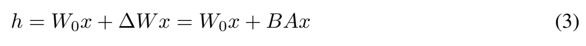
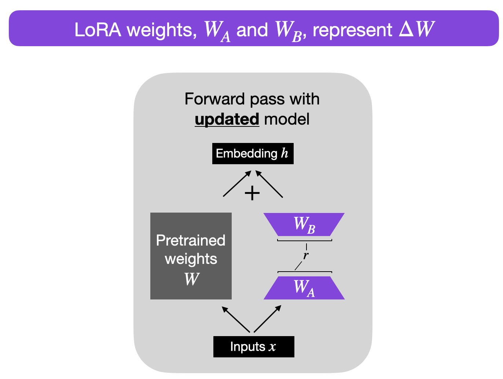
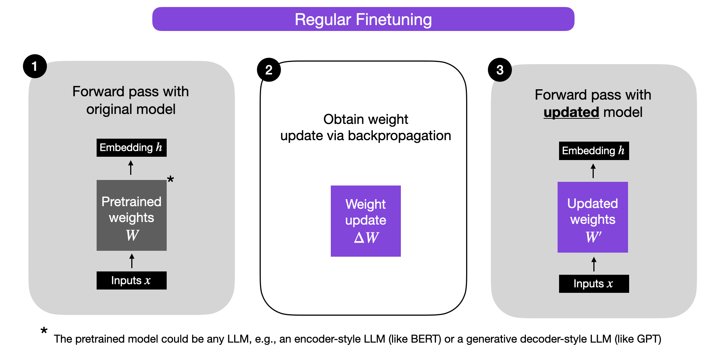
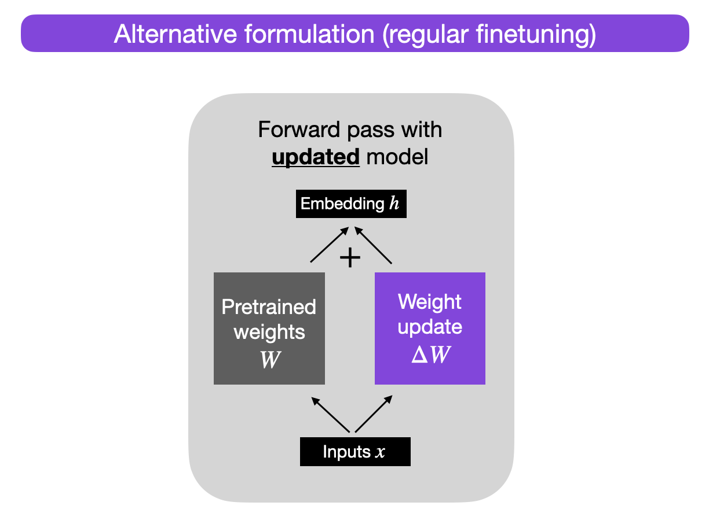
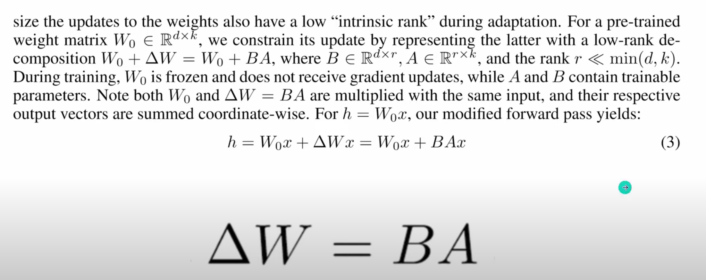
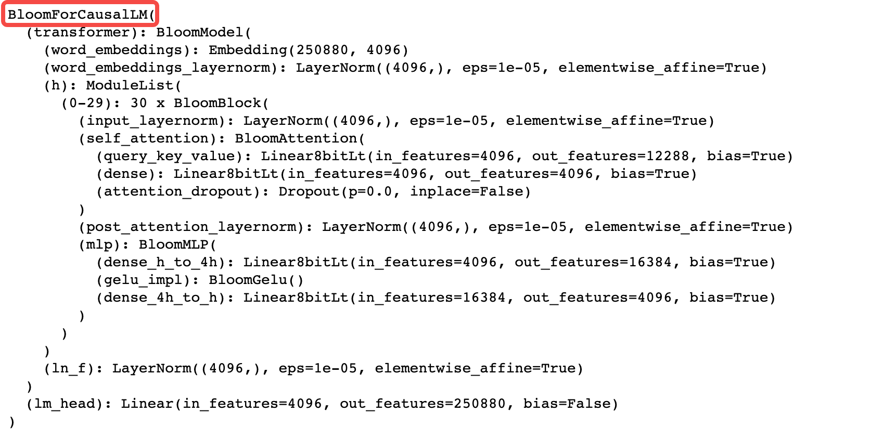
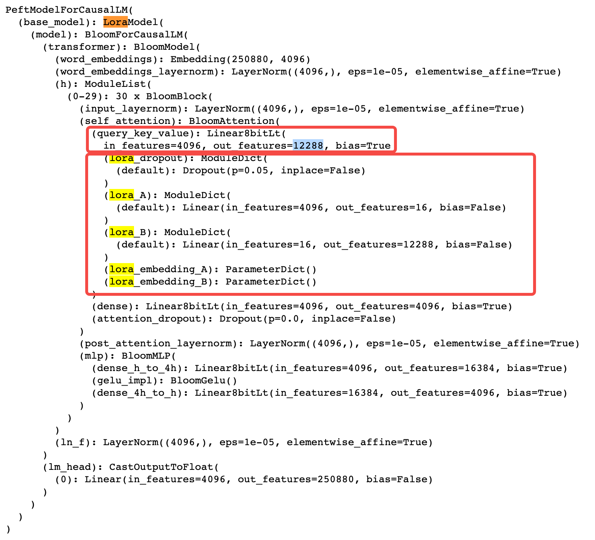

# 第 02 讲：LoRA 原理与矩阵代码

上一讲把模型参数理解成“计算时使用、训练时调整的数值”。这一讲看 LoRA 怎样在大模型旁接入少量可训练参数，让模型适应新任务。先手算一个小例子，再对照论文原图、公式和代码。

## 1. “微调”到底改了什么？

假设你拿到一个已经训练好的语言模型，希望它更适合回答某类问题。给它这类问题和期望回答，用训练过程继续调整参数，这叫**微调 fine-tuning**。

以一层为例：它接收一排数，乘一张参数表，输出另一排数。按行列排列的这张数表，在数学里叫**矩阵**，记为 W。

**全量微调**通常允许模型的大量原参数都更新；**LoRA微调**保留选定层原来的W，另外学习两个小矩阵，让它们提供修正。整个大模型还在，只是这一轮训练要调整的数变少了。

“冻结 W”指停止更新它的数值，同时保留它在前向计算中的作用。

## 2. 先会算一次矩阵乘法，再谈LoRA

用一个两维向量表示输入：`x=[1,2]`。

原参数表有两行两列：

```text
W = [[1, 0],
     [0, 1]]
```

`x @ W`里的`@`表示矩阵乘法。用x依次和W的每一列对应相乘、再相加：

```text
输出第1项 = 1×1 + 2×0 = 1
输出第2项 = 1×0 + 2×1 = 2
所以 x @ W = [1,2]
```

Python 用 `@` 表示矩阵乘法，用 `*` 表示逐元素乘法。这里沿矩阵乘法的规则，对每个输出位置分别求和。

如果同时传入一条样本，代码通常把它写成二维表`[[1,2]]`，shape为`[1,2]`：1行样本、每行2个特征。W的shape为`[2,2]`。相乘规则可读成：

```text
[1行, 2列] @ [2行, 2列] → [1行, 2列]
             ↑中间的两个2要相等
```

这里的列数和特征数是同一个意思；图里的“维度”先按这个意思理解即可。

## 3. “学习一个修正量”是什么意思？

把微调后的参数写成：

$$W_{\text{新}}=W+\Delta W.$$

`Δ`读delta，表示变化量；`ΔW`整块就是“参数要改多少”。例如原来某个数是1，变化量是0.2，新值就是1.2。矩阵相加也是各位置分别相加。

于是对同一个输入，有：

$$x(W+\Delta W)=xW+x\Delta W.$$

左边先把修正加到参数表，再计算输出；右边分别计算原分支和修正分支，再相加。两种写法相等，依据是矩阵乘法对加法的分配律。

如果直接学习一张与W一样大的ΔW，需要调整的数仍然很多。LoRA接着提出：**让ΔW由两个小矩阵相乘得到。**

## 4. 两个小矩阵怎样产生一张大修正表？

继续沿用`x=[1,2]`，选两个小表：

```text
W_A = [[1],       # 2行1列
       [2]]

W_B = [[3, 4]]   # 1行2列
```

为对应原 notebook，下面把两个小矩阵命名为 W_A 和 W_B。

先把输入的两个数变成一个数：

```text
x @ W_A = 1×1 + 2×2 = 5
```

再用这个数产生两项输出修正：

```text
[5] @ W_B = [5×3, 5×4] = [15,20]
```

加回原输出：

```text
原输出：[1,2]
修正量：[15,20]
新输出：[16,22]
```

这就是LoRA分支的计算方式。在真实任务中，小矩阵的数是训练学出来的；此处是我们人为指定的数字，只为看清乘法顺序。

把整条路用shape再读一遍：

```text
原分支：[1,2] @ [2,2]       → [1,2]
新分支：[1,2] @ [2,1] @ [1,2] → [1,1] → [1,2]
两路相加，输出仍为[1,2]
```

最后一行的`[1,2]`是shape，表示1行2列，**不是输出数值**。这个例子的实际输出数值是`[[16,22]]`。看代码时要分清“表有多大”和“表里装什么”。

## 5. “低秩”中的秩，先看行与行是否重复表达

两个小矩阵相乘，会得到：

```text
W_A @ W_B = [[3, 4],
             [6, 8]]
```

第二行只是第一行乘2。虽然有四个数，却没有两个彼此独立的行方向：知道第一行和倍数，就能得到第二行。对这个非零矩阵，数学上称它的**秩 rank 为1**。

单位矩阵 `[[1,0],[0,1]]` 的两行则有两个独立方向：第二行无法通过把第一行乘一个数得到，所以它的秩为2。

LoRA中的r控制中间通道有多宽。本例2个特征压成1个数，再变回2个数，r=1。一般可以写成：

```text
输入k个特征 → W_A → r个中间特征 → W_B → d个输出特征
```

乘积的秩**最多为 r**，也可能更小，例如 W_B 全零时乘积的秩为0。r 控制修正分支的表达空间；需要多少个独立方向，要结合任务选择。原 W 可以继续保持高秩。

这个2×2手算例里，A/B合计仍有4个参数。原矩阵较大、r相对较小时，参数节省才明显，第7节继续计算。

## 6. 现在看论文原图：两条路怎样走


来源：[LoRA v2，第1页Figure 1](https://arxiv.org/pdf/2106.09685v2#page=1)。

按从下向上的顺序读：

1. 黄色横条 x 是输入，同时送进两条路。
2. 左边蓝色块 `Pretrained Weights` 是预训练得到的 W，LoRA 训练时保持冻结。
3. 右边先经过 A，映射到较窄的 r 维；再经过 B，恢复输出宽度。橙色 A/B 是要学习的参数。
4. 顶部加号把两份同形状输出逐项相加，得到 h。
5. `B=0` 与 A 的分布记号说明初值：B 全零，A 随机初始化。随后训练会更新 A/B。

图中W的`d×d`表示这里画的是输入、输出宽度相同的例子；LoRA也能用于输入输出宽度不同的矩阵。图的A、B按论文的列向量约定书写；前面手算和原notebook按行向量书写。两者从输入出发的操作都是“先过A这一步，再过B这一步”，字母排列差别在第10节解释。

## 7. 到底少训练多少个数？

设原矩阵输入宽k=100、输出宽d=500：原W有100行500列，共`100×500=50000`个参数。

选r=5，两个小矩阵分别有：

| 参数表 | shape | 参数个数 |
|---|---|---:|
| 原W | `[100,500]` | 50000，冻结 |
| W_A | `[100,5]` | 500，可训练 |
| W_B | `[5,500]` | 2500，可训练 |

新增3000个可训练参数，是原50000个参数的6%，可训练参数量减少94%。计算时仍要保存和使用原50000个参数。

一般公式是：

$$P_{\text{原层}}=kd,\qquad P_{\text{LoRA}}=kr+rd=r(k+d).$$

P 表示参数个数。按各矩阵的行数乘列数，再相加，就能算出这一层忽略偏置时的参数量。

总显存还包括原权重、激活、梯度和优化器状态，因此需要分别估算这些部分。这里算出的是可训练参数量。

## 8. 用PyTorch真正算出刚才的结果

用 PyTorch 实现上面的手算。`torch.tensor` 把数表变成张量；`dtype=torch.float64` 指定浮点格式，方便核对结果。

```python
import torch

x = torch.tensor([[1., 2.]], dtype=torch.float64)
W = torch.tensor([[1., 0.], [0., 1.]], dtype=torch.float64)
W_A = torch.tensor([[1.], [2.]], dtype=torch.float64)
W_B = torch.tensor([[3., 4.]], dtype=torch.float64)

base = x @ W                     # 原分支，得到[[1,2]]
middle = x @ W_A                 # 中间只有1个特征，得到[[5]]
update = middle @ W_B            # 修正分支，得到[[15,20]]
h = base + update                # 相加，得到[[16,22]]

print(base)
print(middle)
print(update)
print(h)

merged_W = W + W_A @ W_B         # 把修正预先加进权重
merged_h = x @ merged_W          # 只做一条路，得到相同结果
print(merged_h)
```

`=` 把右边的结果赋给左边变量，括号决定计算分组，`print` 显示值。`base/middle/update/h` 依次保存原分支、中间窄向量、修正分支和最终输出。

这段前向计算展示给定 W、W_A、W_B 时怎样得到 h。训练时再由 loss 和梯度决定 A/B 怎样更新。

`merged_W` 对应**合并 merge**：关闭训练态随机 dropout、保持相同缩放时，可先把低秩修正加到 W，再通过一条线性路径推理。本例直接运用了分配律；使用量化或不同浮点格式时，还要考虑舍入。

## 9. 初始化、训练与alpha，分别在做什么？

### 为什么开始时一个随机、一个为零？

假设W_A已经有非零数值，W_B全为0，则`(x @ W_A) @ W_B`是0，初始输出就仍等于原模型输出。这样开始训练时不会先加上一个随意的非零修正。

训练会根据任务误差改变小矩阵。W_B为零的第一步，改变W_A仍不能改变这个零输出，因此W_A的初始梯度为零；W_B则通常可以先得到非零梯度。W_B更新后，W_A也可能得到梯度。梯度先理解成“输出误差怎样随某个参数变化”，它为优化器指示调整方向。

若两个因子都全零，它们的初始梯度也会为零，分支难以起步。论文采用随机 A、零 B；原 notebook 伪代码采用另一种 A 的随机分布，两者都通过零 B 保持初始增量为零。

### alpha/r为什么又乘一个数？

实际普通LoRA常把修正再乘一个缩放数：

$$h=xW+s(xW_A)W_B,\qquad s=\alpha/r.$$

这里s是缩放系数，α读alpha，是配置中的一个数；r还是中间宽度。若α=8、r=4，则s=2，修正分支的输出放大2倍，原分支不乘这个数。前面手算取s=1。

普通 LoRA 中，r 决定中间宽度，alpha/r 缩放修正输出，学习率决定优化器更新步长。这三个设置分别影响参数量、前向增量和训练过程。

训练时，将原参数设为 `requires_grad=False`，并让优化器管理要更新的参数。完整流程还包括准备样本与目标、计算 loss、清梯度、反向传播和参数更新；下一讲会把这些环节接起来。

## 10. 论文为什么写BAx，前面却写xW_AW_B？

先看从论文直接截出的公式：



来源：[LoRA v2，第4页§4.1公式(3)](https://arxiv.org/pdf/2106.09685v2#page=4)。这行写出两路相加的基础关系，后续正文说明 alpha/r 缩放。

读符号：W₀是原权重，下标0表示起始状态；ΔW是变化量；h是这一层输出。论文把x竖着写，运算从右往左作用：先`Ax`，再`B(Ax)`。原notebook把样本横着放，运算从左往右作用：先`x @ W_A`，再乘W_B。

两个约定的表方向不同：

| 方向 | 原权重 | 第一步小矩阵 | 第二步小矩阵 |
|---|---|---|---|
| 论文，列向量 | W₀为`[d,k]` | A为`[r,k]` | B为`[d,r]` |
| 本文代码，行向量 | W为`[k,d]` | W_A为`[k,r]` | W_B为`[r,d]` |

转置就是把行列交换，两套表正好需要这样对应。PyTorch `nn.Linear.weight`保存的是`[输出宽度,输入宽度]`，它的前向内部会处理转置；不要把手写`x @ W`的W形状直接套进`nn.Linear.weight`。

本课引用§4.1的相关内容已放在第6、9、10节：冻结原权重，用两个因子表示更新，初始化令增量为零，输出相加并按普通LoRA规则缩放。原论文一句“We only train A and B.”意为“我们只训练A和B”，这里说的是这个LoRA参数化设计；具体训练任务若额外训练偏置或任务头，需要另行说明。[论文Figure 1及§4.1](https://arxiv.org/pdf/2106.09685v2)

## 11. 原 notebook 的代码与伪代码

原文件共16格，其中7个代码格负责导入 Image 或展示图片。矩阵运算示例写在 **Markdown 第13格**中，按伪代码阅读。

这段伪代码包含 `W=...` 占位、未定义的 alpha、缺少导入和函数外 return。上面的 PyTorch 算例补齐了具体数值，便于直接运行；原语句的逐项说明可在代码阅读版中查看。

读原例子时只抓这几行的作用：

| 原例子名字 | 在做什么 |
|---|---|
| `input_dim/output_dim/rank` | 输入宽、输出宽、中间宽 |
| `torch.empty(...)` | 先分配数表；尚未初始化，不能直接当有效随机初值 |
| `nn.Parameter(...)` | 包装为参数；在Module里还需要注册，并交给优化器才会按预期训练 |
| `kaiming_uniform_` | 给第一个因子设置随机初值；名称末尾下划线表示原地写入 |
| `zeros_` | 把第二个因子的值设为0 |
| `regular_forward_matmul` | 只算原分支 |
| `lora_forward_matmul` | 原分支加修正分支 |

这一讲先掌握两分支、矩阵形状和参数量。下一讲把 LoRA 接进微调流程，再看参数注册、冻结和优化器管理。

## 12. 用三个问题检查是否读懂

1. 原 W 冻结后，输出怎样变化？——训练 W_A/W_B，由修正分支改变输出。
2. r 控制什么？——修正分支的中间宽度及其参数量、表达空间。
3. 手算结果是多少？——`[1,2]` 先得到 `[5]`，再得到 `[15,20]`，加回原输出后为 `[16,22]`。

下方补充了完整单元说明、梯度公式和运行记录，可按正在学习的函数查阅。

<details>
<summary>第二遍再看：全部单元、梯度公式与原验证证据</summary>

[全部单元与中文代码注释](代码单元解释.md) 覆盖16格、7个可执行单元及Markdown13全部伪代码语句。本仓库直接提供[原notebook](代码/tutorials/02_lora_baics.ipynb)、[详细中文注释notebook](代码/tutorials/代码注释.ipynb)及[Python阅读版](代码/tutorials/02_lora_baics_代码注释.py)，六张图片也随仓库提供。[生成与实际验证](复现/README.md) 用表格列出原单元、历史输出、AST及真实运行结果。

## 阅读地图

对应附件 `2bcdab08-efd6-4d00-840e-2d1130cfb3e1.txt`，原文保存在 `资料/字幕原文.txt`。Notebook 是 `02_lora_baics.ipynb`（文件名确实拼作 baics），共 16 个单元、7 个代码单元。Python 单元主要用于显示图片；LoRA 示例位于 **Markdown 单元 13**，是伪代码，未执行。

教程提交为 `7fbc29824171fd07dc2c30fe922e61ebc018ad1d`；[固定版本原文件](https://github.com/chunhuizhang/personal_chatgpt/blob/7fbc29824171fd07dc2c30fe922e61ebc018ad1d/tutorials/02_lora_baics.ipynb)。所有单元的新说明见 [代码单元解释.md](代码单元解释.md)，[原 notebook](%E4%BB%A3%E7%A0%81/tutorials/02_lora_baics.ipynb)提供来源与下载副本入口；原文件已直接放入本仓库，本文编号按原单元从0开始。

相关论文是 **LoRA: Low-Rank Adaptation of Large Language Models**，arXiv:2106.09685v2，2021-10-16 修订。原 notebook 将 Adaptation 拼成 Adaption；标准论文标题使用 Adaptation。[论文](https://arxiv.org/html/2106.09685v2)

论文地图：第 2 节定义适配任务；第 3 节讨论已有方案；第 4 节给出低秩更新；第 5 节做不同模型的实验；第 7 节分析目标矩阵和 rank。本文重点对应第 4 节和图 1，没有复现第 5 节指标。

## 1. 为什么学 LoRA？【必须会】

完整微调要为大量参数计算梯度并维护优化器状态，也会为每个任务保存大量独立参数。LoRA 固定原权重，只训练表示增量的两个小矩阵。它改变参数，不同于只在输入里提供例子的 in-context learning。

低秩限制施加在**更新量**上，不要求预训练权重本身低秩。它也不是先完整微调再对结果做 SVD，而是直接优化低秩因子。字幕把它解释为投影到小子空间有助于直觉，但“随机投影”不是完整算法定义：随机的是初始因子之一，随后因子通过训练变化。

LoRA 不保证总显存按可训练参数比例下降。被冻结的大模型仍然要做前向与必要的反向传播，激活也要占空间。

## 2. 论文符号与 notebook 的矩阵方向

论文采用列向量约定：

$$W_0\in\mathbb R^{d\times k},\quad A\in\mathbb R^{r\times k},\quad B\in\mathbb R^{d\times r},\quad x\in\mathbb R^k.$$

论文公式 (3)：

$$h=W_0x+\Delta Wx=W_0x+BAx.$$

$k$ 为输入特征数，$d$ 为输出特征数，$r$ 为低秩瓶颈维度；$W_0$ 冻结，A、B 可训练，h 长度为 d。乘积 BA 的 shape 为 `[d,k]`，与原权重一致，rank 不超过 r。实际更新通常再乘 $\alpha/r$。[LoRA 方法部分](https://arxiv.org/html/2106.09685v2#S4)

Notebook 的 `x @ W` 则使用行向量/批次约定：

$$X\in\mathbb R^{N\times k},\quad W\in\mathbb R^{k\times d},\quad W_A\in\mathbb R^{k\times r},\quad W_B\in\mathbb R^{r\times d},$$
$$H=XW+s(XW_A)W_B,\qquad s=\alpha/r.$$

N 表示样本数；若输入是 `[batch,sequence,k]`，矩阵乘法作用于最后一维，前两维保留。这里的 W 是 PyTorch `nn.Linear.weight` 的转置方向；Linear 实际保存 `[out_features,in_features]`。论文 B 对应行向量代码中后一个映射的转置，不能只看字母就认定相同方向。

| 代码对象 | notebook 行向量 shape | PEFT Linear 权重 shape |
|---|---|---|
| 原权重 | W `[k,d]` | `[d,k]` |
| 降维因子 | W_A `[k,r]` | lora_A.weight `[r,k]` |
| 升维因子 | W_B `[r,d]` | lora_B.weight `[d,r]` |
| 中间激活 | XW_A `[N,r]` | Linear A 输出 `[N,r]` |
| 最终输出 | `[N,d]` | `[N,d]` |

## 3. 图的方向与参数分工



从下向上读：输入 x 分成两路。左侧经过冻结的预训练权重 W；右侧先经过 W_A 降维到 r，再经过 W_B 升回输出维；两路在加号处逐元素相加，得到 h。

灰色 W 是冻结参数，紫色两块是可训练参数；箭头、加法没有可训练参数。左右输出必须有相同 shape，才能相加。训练和未合并推理都可用这条双分支路径；推理时关闭 dropout 后，可将增量合并入 W，省去独立分支。合并的精确性还依赖量化等实现条件，不能将未合并状态也说成完全没有额外计算。

其他图片：`regular-finetuning.png` 表示完整参数更新；`regular-finetuning-alt.png` 把更新写成增量分支；`lora.png` 是论文公式截图；BLOOM 的两张打印截图显示大 Linear 中插入小 Linear。它们是示意和历史模型打印，不是本次运行结果。



先看这一张：完整微调允许原参数表改变。图是计算关系示意，不是测量显存的实验。



这一张把同样的更新改写成原分支与增量分支之和；如果增量仍是完整大矩阵，就还没有体现LoRA的低秩约束。



这是教程随附的历史截图；本轮另从固定v2 PDF截出的公式原图已放在正文第10节。两者来源分开记录。



这张是模块的文字打印。Linear表示线性映射，in_features/out_features表示输入/输出特征数；不是一条样本生成了什么回答。



这一张在对应映射中出现LoRA小分支。它是原教程历史输出，不证明本机加载过BLOOM。实际注入与冻结方式会在第03/04讲说明。

## 4. 参数量算例【必须会】

$$P_{\mathrm{full}}=kd,\quad P_{\mathrm{LoRA}}=kr+rd=r(k+d),\quad\rho=\frac{r(k+d)}{kd}.$$

P 是参数个数，rho 是这一层新增可训练参数相对原权重的比值；不包括偏置，也不是整个网络可训练比例。

原文算例 k=100、d=500、r=5：原权重 50000，小矩阵 500+2500=3000，比例 6%。这是减少 94% 的**该层可训练参数量**，不是整个模型缩成原来的 6%。

768→768、r=8：原权重 589824，LoRA 为 12288，约 2.0833%。r 增大通常增加适配容量与训练成本，但更高 rank 不必然更准确；是否过拟合要看任务和实验。

## 5. 单元 13 的每一步及其缺陷

原伪代码入口见 [固定来源](%E4%BB%A3%E7%A0%81/tutorials/02_lora_baics.ipynb)，新增逐语句说明见 [单元说明](代码单元解释.md)。它的意义是演示两路相加，并不是能直接运行的实现。

| 语句/对象 | 一句话作用 | 输入输出与状态 |
|---|---|---|
| `input_dim/output_dim` | 规定输入输出宽度 | int，各为 768 |
| `rank` | 规定瓶颈宽度 | int，8 |
| `W = ...` | 占位预训练权重 | Ellipsis，不是 tensor |
| `torch.empty` | 分配未初始化张量 | `[768,8]`、`[8,768]` |
| `nn.Parameter` | 包装为可学习参数 | 默认 requires_grad=True；赋给Module属性后才注册 |
| Kaiming 初始化 | 给第一个因子随机初值 | 原地写入 W_A |
| 零初始化 | 使第二个因子为零 | 原地写入 W_B |
| `regular_forward_matmul` | 只计算基模型 | X、W → `[N,768]` |
| `lora_forward_matmul` | 基模型加增量 | 再输入两因子，返回同 shape |
| `h += ...` | 加入适配输出 | 原地修改 h |

`@` 是矩阵乘法，不是逐元素乘法；`nn.init` 函数名的下划线通常表示原地更新。`math.sqrt(5)` 是初始化函数的参数，不是 LoRA 的 rank。函数是独立定义，没有 self，不属于某个类。

**可执行性问题：**缺少 torch、nn、math 导入；W 只是省略号；alpha 未定义；两个 `return h` 的缩进位于函数外，会产生 SyntaxError；没有明确冻结 W，也没有 loss、optimizer 和训练循环。单元不是 Python code cell，所以这些问题未被 notebook 执行暴露。

修正后的核心关系可写为以下教学表达式，非原单元逐字代码：

```python
def lora_forward(x, W, W_A, W_B, scale):
    base = x @ W
    update = (x @ W_A) @ W_B
    return base + scale * update
```

必须给四个矩阵提供真实数据，设置 `scale=alpha/r`，并在 torch 实现中冻结 W。使用两个连续小乘法避免显式构造 `[k,d]` 大增量；此前小规模验证用Python列表；本轮新增真实CPU PyTorch的前向、梯度与少量教学参数更新，仍不冒充BLOOM或论文训练。

## 6. 为什么一个随机、一个为零？【建议会】

令 W_A 随机、W_B=0，则初始化增量为 0，开始时保留预训练函数。若两个都为 0，两个因子的初始梯度可能都为 0，分支无法正常起步。

对行向量关系，设输出梯度为 G `[N,d]`，不考虑 dropout：

$$\frac{\partial\mathcal L}{\partial W_B}=s(XW_A)^\top G,\qquad\frac{\partial\mathcal L}{\partial W_A}=sX^\top G W_B^\top.$$

前者 `[r,d]`，后者 `[k,r]`。W_B 初始为零时，W_A 初始梯度为零，而 W_B 一般可以先更新。随后 W_B 非零，W_A 也获得梯度。这不是说 W_A 永远被冻结。

## 7. 一次完整数值路径

设 x=[1,2]，W 为 2×2 单位矩阵，W_A=[[1],[2]]，W_B=[[3,4]]，scale=1。

基输出 [1,2]；降维得到 5；升维得到 [15,20]；相加得到 [16,22]。显式 W_AW_B=[[3,4],[6,8]]，x 乘它也为 [15,20]。验证的是线性代数等价，不是学到了某个任务。

## 8. 单元覆盖与阅读次序

| 单元 | 内容 | 阅读要点 |
|---|---|---|
| 0、4、7、8、10、14、15 | 导入与显示图片 | 同第 01 讲 Image API；无模型训练 |
| 1–3 | 概念与问题 | 冻结基权重，优化增量因子 |
| 5–6 | 完整微调关系 | W 变为 W+ΔW |
| 9 | 形状与参数量 | 明确行/列约定，不能混用 |
| 11–12 | 标题与 rank 讨论 | 标题提 alpha，正文实际重点是 r |
| 13 | 伪代码 | 缩进/占位/alpha 问题与修正关系 |

## 9. 实验和复现状态

本讲没有训练数据、指标表、优化器或评估脚本。参数比例算例不是准确率提升，也不是论文实验。论文第 5 节的任务、baseline 与结果本次未复现，不能据示意图断言每个任务都更好。

**状态：部分成功。** 此前的列表数学结果保留在 `复现/outputs/教学验证.json`。此前完整交付已完成16格说明、7/7中文代码注释及Markdown13逐语句注释；原版与两份注释版的7个展示单元全部实际执行，原单元/历史输出、AST和schema核对通过。原伪代码compile仍报函数外return，缺陷保留。

此前独立Python3.12.14、torch2.5.1+cpu环境中的教学脚本验证前向、合并、Linear方向及autograd，最大误差约3.55e-15；零B时A梯度为0，更新B后A梯度非零，冻结基权重无梯度且未变。单样本21次小型SGD更新的MSE从4降到1.11e-14，仅证明教学数据流；未加载/微调BLOOM或运行论文指标。这些是原有验证记录，不算作本轮重跑。完整环境、命令和输出见[复现README](复现/README.md)。

## 10. 必须掌握

W0 冻结而 ΔW 可学习；两个小矩阵的 shape；输出相加；alpha/r；参数量与总显存的区别；Markdown 伪代码不是执行结果。

## 11. 第二遍知识

两因子的初始梯度、rank 与表达容量、合并推理、PyTorch 权重转置约定。

## 12. 可暂缓的工程细节

量化权重合并、多 adapter 管理、分布式训练与目标层的系统消融。

## 13. Paper ↔ Code

| 论文/概念 | 对应对象 | 边界 |
|---|---|---|
| 第 4.1 节、公式 (3) | 单元 13 两分支伪代码 | 需修正才能执行 |
| alpha/r | 第 04 讲 PEFT scaling | 原伪代码仅写 alpha |
| 图 1 低秩更新 | lora-weights 配图 | 教学重绘，不是实验曲线 |
| 第 4.2 节目标矩阵 | BLOOM query_key_value 示意 | 后续第 03/04 讲落实 |
| 训练与实验结果 | 未找到 | 本讲无训练实现 |

## 14. 未解决问题

原伪代码未定义 alpha，也未锁定框架版本；维度字母 A/B 同时作名称和矩阵名会混淆。本文采用 k/d 区分维度。小矩阵验证不能证明 rank 选择最佳或论文性能成立。

</details>

## 必须掌握

- 原W不更新，两个小矩阵负责产生可学习的修正。
- 会手算`[1,2] → [5] → [15,20]`，并加回原输出。
- r控制中间宽度，更新矩阵的秩最多为r；原W不必低秩。
- 按行数乘列数比较参数量，不把可训练参数减少比例当成总显存减少比例。
- 随机A、零B让初始修正为0；s=alpha/r只缩放修正分支。
- 显示图片、执行前向、完成训练是三件不同的事。

## 第二遍学习

先看行/列约定和Linear权重方向，再看两因子初始梯度、训练时的冻结与优化器管理、合并的条件。需要时展开上面的完整单元说明和导数。

## 可以暂时不掌握的工程细节

【可以暂时不掌握】量化权重合并、分布式训练、多adapter切换、全模型目标层选择的消融、低秩更新的完整统计分析。后续对应课程会展开。

## Paper ↔ Code 对照

| 概念 | 本文内嵌依据 | 代码位置 |
|---|---|---|
| 两条输出分支相加 | 原论文第1页Figure 1、第4页公式(3)截图 | 正文第8节的PyTorch小算例；原notebook Markdown13为不完整伪代码 |
| 低秩因子与冻结 | §4.1相关内容已在正文第5/6/9节解释 | `W_A/W_B`；原W冻结须在完整训练实现中设置 |
| alpha/r与零初始增量 | 第9节说明 | 原伪代码alpha未定义；前向小算例明确取scale=1 |
| 行列方向与形状 | 第10节对照表 | 手写矩阵乘法不同于直接使用Linear.weight的方向 |
| 原训练和论文指标 | 对应完整实现本讲未找到 | 本讲提供矩阵运算示例 |

## 复现状态

**部分成功。** 正文前向与合并算例均得到 `[[16,22]]`，修正矩阵 rank=1。论文 Figure 1、公式(3)和六张课程图已内嵌。运行记录见[复现说明](复现/README.md)，图源见[截图记录](复现/outputs/论文截图来源.json)。

## 未解决问题与置信边界

本讲展示矩阵运算，原 BLOOM/GPT-3 训练及论文指标尚未复现。实际使用时，r、alpha、初始化和目标层应按任务与库版本选择。
