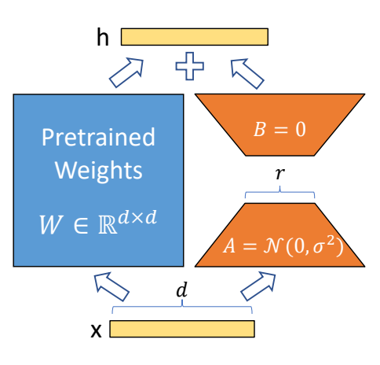

# 第 04 讲：PEFT 怎样把 LoRA 注入原模型

上一讲调用 `model = get_peft_model(model, config)` 接入 LoRA。这一讲沿着这个调用看模型内部的变化：怎样找到目标层、保留原权重，并让输入经过新增的修正分支。

先记住最终结果：找到需要改造的线性层，把它换成“原计算＋LoRA 修正”的新层；新层继续使用旧权重，额外拥有两个小矩阵；再把原权重设为不参与训练。外层对象负责提供任务接口和管理 adapter。Adapter 在这里就是新接入的适配参数及相关计算。

下面从 Python 对象和一条输入的计算路径讲起。论文原图、原公式都放在对应位置；[中文注释 Python 阅读版](代码/tutorials/04_PEFT_lora_代码注释.py)与[全部单元说明](代码单元解释.md)保留完整代码入口，[原 notebook](代码/tutorials/04_PEFT_lora.ipynb)可查看历史输出。

## 1. “层”“参数”“输入”分别是什么？

模型由许多层组成。PyTorch 用 `nn.Module` 组织这些接收、计算和返回数值的对象。**参数**是层中可学习的数字，例如 `weight` 和 `bias`；**激活**是当前输入经过计算得到的中间数字。

最简单的线性层接收两个数 x=[1,2]。若权重是单位矩阵、没有偏置，它输出的仍是 [1,2]。换成其他权重，输出就会变化。PyTorch 的 `nn.Linear(2,2,bias=False)` 表示输入宽度 2、输出宽度 2、不加偏置；它默认随机初始化，若要单位矩阵需要明确赋值，不能假定默认结果就是 [1,2]。

Token 编号保存在 `input_ids` 中。它们先经 embedding 查成向量，再经过各层；LoRA 投影层接收的就是这样的数值向量。

一层处理多条文本时，输入可记为 `[N,S,k]`：N 是批内文本条数，S 是每条文本的位置数，k 是每个位置的向量宽度。shape 就是数组各维的长度；张量 tensor 在此可以理解为装这些数字的多维数组。下面用 N 表示批大小，避免与 LoRA 矩阵 B 混淆。

## 2. Python 变量为什么不等于独立副本？

先不用深度学习，看一段实际可运行的 Python：

```python
original = {'weight': [1.0, 2.0]}
alias = original
wrapper = {'model': original}
wrapper['model']['weight'][0] = 9.0
print(original['weight'])                  # [9.0, 2.0]
print(alias is wrapper['model'])           # True
```

字典 `{}` 保存“名字：内容”；`['model']` 取对应的内容。`alias = original` 让两个变量引用同一个字典，没有创建第二个独立字典；`wrapper` 是新建的外层字典，但它保存的 `model` 仍指向原字典。`is` 检查是否为同一个对象，而不是只比较值是否相等。

外层包装可以是新对象，里面仍引用原对象。PEFT 对 PyTorch 模块的包装也有这种关系：**目标层被新层替换，而新层中的基权重沿用旧 Parameter 对象。** `Parameter` 是 PyTorch 登记模型参数的专用张量类型。

若先写 `old_model = model`，两个变量会引用同一个基模型。注入修改其内部层后，通过两个名字都能看到改动；要保留独立模型，需要复制对象及状态。

## 3. 原图中的两个分支，要怎样落进一个层？



来源：[LoRA，arXiv:2106.09685v2，PDF第1页Figure 1](https://arxiv.org/pdf/2106.09685v2)。下面把图中的两路计算对应到 PEFT 的模块结构。

从下往上，x 同时进入两路：左路经冻结的 W，右路经可训练的 A/B。A 将宽度缩到 r，B 恢复输出宽度，顶部加号将两个同形状结果相加得到 h。

`W∈R^{d×d}` 表示原图中的 W 是 d 行 d 列的实数矩阵。A 将 d 维变为 r 维，B 将 r 维变回 d 维；r 是中间宽度。`B=0` 表示初始 B 全零；`A=N(0,σ²)` 表示 A 用正态分布随机初始化，σ² 是方差。开始时右路输出零，原层的输出得以保留。论文图用正态分布说明A的随机初始化；本文固定PEFT v0.3.0的 `reset_lora_parameters` 实际对A使用Kaiming均匀初始化、对B使用零初始化。随机分布细节与图中记法不同，保持初始增量为零的关键仍是B全零。


来源：同一 [v2 PDF 第 4 页公式 (3)](https://arxiv.org/pdf/2106.09685v2)，直接截图。其含义可写成：

$$h=W_0x+\Delta Wx=W_0x+BAx.$$

W₀ 是原权重，ΔW 是想学习的修正矩阵；LoRA 将修正写成两个小矩阵 B 与 A 的乘积。x 是列向量，h 是输出。先算 Ax，再算 B(Ax)，最后和原计算 W₀x 相加。代码不必先构造一整个大 ΔW。

实际配置还带缩放 `s=alpha/r`，训练时可带 dropout。本讲 r=16、alpha=32，故 s=2。Dropout 是训练时随机置零部分输入并对保留部分作缩放的操作；原设置概率为 0.05，评估时关闭。若忽略偏置、关闭 dropout、先取 s=1，用 x=[1,2]，W₀ 为单位矩阵，A=[1,2]，B=[[3],[4]]，便有：Ax=5，BAx=[15,20]，最终 h=[16,22]。这是帮助读公式的数值例子，不是 BLOOM 的真实权重。

新层保留 W₀x，并增加低秩修正 B(Ax)。接下来追踪 PEFT 怎样把两路接回原模型。

## 4. 从 get_peft_model 追到真正的替换

原单元 15 只有一行：

```python
model = get_peft_model(model, config)
```

赋值右边先运行：接收模型和配置，修改目标子层，构造并返回外层 PEFT 对象。左边再把 `model` 绑定到这个返回对象。

这里有三种“类型”，它们回答不同问题：

| 配置/属性 | 本讲值 | 回答的问题 |
|---|---|---|
| `model.config.model_type` | `bloom` | 原模型结构是什么，默认改哪些层？ |
| `config.task_type` | `CAUSAL_LM` | 外层要提供哪种任务接口？这里是接着写文本 |
| `config.peft_type` | `LORA` | 使用哪种参数高效适配方法？ |

字典 mapping 是“名字→处理类”的查找表。`get_peft_model` 根据 task_type 选择 `PeftModelForCausalLM`；外层再创建负责 LoRA 的 `LoraModel`。在本讲选定的官方 v0.3.0 参照中，结构是：

```text
PeftModelForCausalLM              外层任务接口
└─ base_model: LoraModel          找层、替换层、管理adapter
   └─ model: BloomForCausalLM     原BLOOM对象，其目标子层已经改变
```

这些名字表示包装层次。`LoraModel` 引用原模型并接入它的 forward；输入沿原模型结构计算，到达被替换的投影层时，执行双分支计算。

| 固定源码位置 | 做什么 | 状态变化或返回结果 |
|---|---|---|
| `mapping.py:get_peft_model` | 根据任务选择包装类 | 返回 PEFT 外层对象；记录基模型标识 |
| `peft_model.py:PeftModel` | 选择 LoRA 管理对象 | 建立任务接口与基模型之间的包装关系 |
| `tuners/lora.py:LoraModel.add_adapter` | 准备配置，安排注入与冻结 | 记录 adapter 配置；通常不返回新模型 |
| `_prepare_lora_config` | 补齐默认目标层 | BLOOM 默认目标为 `query_key_value` |
| `_find_and_replace` | 扫描模块，选择合适的新层 | 改变基模型内部模块树 |
| `_replace_module` | 将新层放回原位置 | 继承旧参数引用，安排设备 |
| `mark_only_lora_as_trainable` | 冻结原参数 | 修改 `requires_grad` |

调用链参照[官方 PEFT v0.3.0 固定提交7120c9a…](https://github.com/huggingface/peft/tree/7120c9a2636f93c8db3fc4ae466e02f338ecead8)。

## 5. 怎样在很多层里找到目标？

模型的模块是嵌套的。一个目标的完整路径是：

```text
transformer.h.0.self_attention.query_key_value
```

点号分开父子关系；`h.0` 是层列表的第0个块，`query_key_value` 是其中注意力模块的融合投影子层。默认目标名随模型结构而定。

`named_modules()` 给出“模块路径、模块对象”；`named_parameters()` 给出“参数名字、参数张量”。前者用来定位要替换的层，后者用来冻结或统计数字。代码中这行先存下一份名字列表：

```python
key_list = [key for key, _ in self.model.named_modules()]
```

这是列表推导式：遍历返回的一对值，保留第一个 `key`；`_` 表示第二项暂时不用。先存路径，再替换模块，避免一边遍历变化中的模块树一边修改它。

此版本支持两种匹配写法，但语义不同：

| target_modules | 匹配方式 | 对上述完整路径的结果 |
|---|---|---|
| `['query_key_value']` 列表 | 路径是否以列表任一名称结尾 | 匹配 |
| `'query_key_value'` 字符串 | 正则表达式必须匹配完整路径 | 不匹配 |
| `'.*query_key_value'` 字符串 | `.*` 允许前面有其他字符 | 匹配 |

正则表达式是一种描述字符串模式的规则；`re.fullmatch` 要求从头到尾都符合。`endswith` 只检查结尾；`any` 表示有一个目标满足就行。原单元 9 中 `# target_modules=["q_proj","v_proj"]` 被注释掉，没有执行。BLOOM 未显式给目标时查模型类型映射，得到融合 QKV 层。

## 6. 替换层，为什么还能保留原来的能力？

扫描找到目标后，`_get_submodules` 取出父模块、旧子模块和子模块名。例如父对象为当前 BloomAttention，名字为 `query_key_value`。然后先根据旧层的类别建立兼容的新层，再执行：

```python
setattr(parent_module, child_name, new_module)
new_module.weight = old_module.weight
```

`setattr(对象,字符串名字,值)` 相当于用动态名字给属性赋值。例如 child_name 为 `query_key_value`，就是把父对象的该属性指向 new_module。PyTorch 会把新子模块登记进模型结构，以后执行前向时走这层。

第二行把旧权重对象交给新层，而不是重新训练一份大权重；旧 bias 若存在也会交过去。新层额外创建 `lora_A`、`lora_B`。它们是分开登记的小模块，adapter 名为 `default` 时可通过 `lora_A['default']` 取出。随后还要让新增参数位于合适的设备；设备 device 表示 CPU 或哪张 GPU。

普通 `nn.Linear` 被替换为 LoRA 版 Linear。原 notebook 的8bit加载会走 `Linear8bitLt` 分支，并保留量化 state；下面的运行例子采用 CPU 上的普通 Linear。

| 对象 | 替换前后是否为同一个对象？ |
|---|---|
| 原 BLOOM 基模型 | 是，内部子层被改动 |
| 目标子层 | 否，用新的 LoRA 层替换 |
| 基层的 weight/bias Parameter | 是，新层沿用旧引用 |
| LoRA A/B | 新创建，原模型没有这组参数 |
| 外层 PeftModel | 新对象，负责包装原模型 |

若 A/B 的初始增量为 0，且没有其他改变计算行为的随机操作，新层初始输出可以保持原层输出。训练后右路不再为零，输出随适配参数改变。这是由保存旧权重和零增量初始化共同实现的。

## 7. 一条输入经过新层时，shape 怎样变化？

BLOOM 的融合 QKV 层一次生成三组向量，输入宽度 k=4096，输出宽度 d=12288。对应的原权重是长方形，LoRA 的两个小矩阵也随之调整尺寸。

PyTorch Linear 的权重存为 `[输出宽度,输入宽度]`。用批次输入 X 写代码的计算关系：

$$Y_0=XW_0^\top+b,\qquad U=\operatorname{Dropout}(X)A^\top,$$
$$\Delta Y=sUB^\top,\qquad Y=Y_0+\Delta Y.$$

上标 T 表示转置，即交换矩阵行列；它解释了为何 PyTorch 的参数存储方向与上一张列向量公式不一样。b 是可选的原偏置，s 是缩放标量。

| 阶段/对象 | 原模型 shape | 含义 |
|---|---|---|
| X | `[N,S,4096]` | 每位置的输入向量 |
| W₀ / b | `[12288,4096]` / `[12288]` | 原参数，冻结 |
| Y₀ | `[N,S,12288]` | 原分支输出 |
| A / U | `[16,4096]` / `[N,S,16]` | 新参数与瓶颈激活 |
| B / ΔY | `[12288,16]` / `[N,S,12288]` | 新参数与修正输出 |
| Y | `[N,S,12288]` | 两路逐位置相加 |

b 的一组 12288 个数会重复用于每条样本的每个位置，这种按兼容维度使用数组的规则叫广播。`bias='none'` 表示不额外训练原偏置，**不是删除偏置**；原 b 仍参与前向计算。

`mark_only_lora_as_trainable` 将非 `lora_` 参数设为 `requires_grad=False`，冻结原权重。它们继续参与前向及输入梯度的计算；训练时优化器只管理需要更新的参数。

## 8. 一个真实 PEFT 小例子，把对象关系打印出来

用官方 v0.3.0 源码创建一个随机小 BLOOM：**1层、隐藏宽度4、词表8**，并设置 r=1、alpha=1、dropout=0。尺寸足够小，可以直接观察对象引用和每项增量。

运行时将固定 checkout 的 `src` 放在导入路径首位；[验证脚本](复现/scripts/verify_foundation_examples.py)已经准备了这一设置，环境步骤见复现说明。

```python
import torch
from transformers import BloomConfig, BloomForCausalLM
from peft import LoraConfig, get_peft_model

torch.manual_seed(4)                       # 固定随机初始化，便于重做
base = BloomForCausalLM(BloomConfig(vocab_size=8, hidden_size=4,
                                   n_layer=1, n_head=2,
                                   hidden_dropout=0., attention_dropout=0.))
base.eval()                               # 关闭训练时的随机dropout
old_layer = base.transformer.h[0].self_attention.query_key_value
old_weight = old_layer.weight
saved_weight = old_weight.detach().clone() # 真正复制数值，供事后核对
ids = torch.tensor([[1, 2, 3]])             # 教学编号，shape [1,3]
with torch.no_grad():
    before = base(ids).logits.clone()
config = LoraConfig(r=1, lora_alpha=1, lora_dropout=0., bias='none',
                    task_type='CAUSAL_LM', target_modules=['query_key_value'])
wrapped = get_peft_model(base, config)
wrapped.eval()
layer = base.transformer.h[0].self_attention.query_key_value
print('基模型相同:', wrapped.base_model.model is base)
print('目标层已替换:', layer is not old_layer)
print('基权重相同:', layer.weight is old_weight)
with torch.no_grad():
    assert torch.equal(wrapped(ids).logits, before)  # B初始为0
    layer.lora_A['default'].weight.fill_(1.)
    layer.lora_B['default'].weight.fill_(0.5)       # 人工赋值，不是训练结果
x = torch.tensor([[[1., 2., 3., 4.]]])      # 目标层输入，shape [1,1,4]
y0 = torch.nn.functional.linear(x, layer.weight, layer.bias)
y = layer(x)
print('修正量:', (y - y0).detach().flatten().tolist())
assert torch.allclose(y, y0 + 5.)           # A输出10，B每行输出5，scale=1
y.sum().backward()                         # 只检查一次梯度，不更新参数
trainable = [name for name, value in wrapped.named_parameters() if value.requires_grad]
print('可训练参数数:', sum(v.numel() for v in wrapped.parameters() if v.requires_grad))
assert len(trainable) == 2 and all('lora_' in name for name in trainable)
assert layer.weight.grad is None
assert torch.equal(layer.weight, saved_weight)
```

`BloomConfig(...)` 描述小模型尺寸，`BloomForCausalLM(config)` 随机建模；与 `from_pretrained` 读取已有大模型权重不同。`.eval()` 切换评估模式，**不会关闭梯度**；`with torch.no_grad()` 才让缩进范围内的运算不记录求导过程。因此最后在 no_grad 范围之外仍可执行 `backward()`。

`.detach()` 脱离当前求导关系，`.clone()` 复制数据；只写 `saved_weight=old_weight` 不会得到训练前数值快照。`.fill_()` 末尾下划线表示原位改数值，我们用它人为给 A/B 设值，方便手算。`torch.equal` 检查逐元素完全相等，`allclose` 用浮点容差比较；`assert` 不成立就报错。

这层输入宽度4、输出宽度12。A为 `[1,4]`，B为 `[12,1]`，合计 **16个可训练参数**。输入四个数相加为10，B每行乘0.5，所以12项增量都是5。`y.sum()` 将输出加成标量，供 `backward()` 展示梯度如何传到 A/B。

运行得到：原基模型和 weight 引用保留，目标层被替换；零 B 时输出保持一致，指定 A/B 后12项增量各为5。仅 A/B 的16个参数可训练，原 weight 没有梯度且数值保持不变。

## 9. 原 notebook 的源码节选

本 notebook 的 18 格中，8 格是代码格（含最后的空格）；类型映射、配置类和目标扫描等主要写在 Markdown 源码围栏里。Markdown 里的文字不会自动定义正在使用的 Python 类，真正实现来自导入的 PEFT 库。

单元 7 的 `@dataclass` 节选还省略了必要默认值。`class LoraConfig(PeftConfig)` 表示继承父类；装饰器 `@dataclass` 帮助生成初始化方法等代码。`r: int` 是类型注解，`field(default=8,...)` 明确给默认值；`Optional[...]` 只表示允许 None，**不会自动把字段赋为 None**。节选里的 target_modules 没有默认值，补齐依赖后仍会出现“无默认值字段跟在有默认值字段后”的 TypeError。官方完整类用 `field(default=None,...)` 处理了这个字段。

阅读版在节选旁说明了这些字段的作用和缺失项。先沿实际调用理解对象关系与双分支，再看 dataclass、类型注解、正则匹配和量化类。

| 原单元（从0编号） | 本页主线对应 |
|---|---|
| 0–4 | 阅读动机、类型映射、外层对象属性 |
| 5–8 | 配置类、目标层命名、扫描匹配 |
| 9 | 创建 r16、alpha32、dropout0.05 的配置 |
| 11–13 | 导入并加载原7B模型、打印结构 |
| 14–16 | get_peft_model 调用、打印替换后结构 |
| 10、17 | 标题及空代码格，不额外执行训练 |

<details>
<summary>第二遍对照：原版技术说明、量化路径与历史验证细节</summary>

### 旧版技术说明（保留查阅）

[全部单元与中文代码注释](代码单元解释.md)覆盖18格、8个代码单元（含空格）及6个Markdown源码围栏。仓库直接提供[原notebook](代码/tutorials/04_PEFT_lora.ipynb)、[详细中文注释版](代码/tutorials/代码注释.ipynb)、保留原代码的说明版及[Python阅读版](代码/tutorials/04_PEFT_lora_代码注释.py)；[真实固定源码验证](复现/README.md)用表格列出实际结果和未复现范围。

## 1. 阅读对象与版本地图

附件为 `73c84fa8-ad06-4912-86d9-08fb024f36b7.txt`，字幕仍在本地资料目录。主文件有18个单元、8个代码单元，其中最后一格为空。[固定提交notebook](https://github.com/chunhuizhang/personal_chatgpt/blob/7fbc29824171fd07dc2c30fe922e61ebc018ad1d/tutorials/04_PEFT_lora.ipynb)，[原 notebook](%E4%BB%A3%E7%A0%81/tutorials/04_PEFT_lora.ipynb)提供来源与本仓库副本入口；完整原notebook和历史输出已直接发布，新增逐格说明见 [代码单元解释.md](代码单元解释.md)。

课程记录的 PEFT 是 0.4.0.dev0，缺少具体 SHA。为使源码可核验，此前另克隆官方 **v0.3.0**，提交 `7120c9a2636f93c8db3fc4ae466e02f338ecead8`，位于本地配套 `共享资料/peft-v0.3.0`，对应[官方固定源码](https://github.com/huggingface/peft/tree/7120c9a2636f93c8db3fc4ae466e02f338ecead8)。这是同一时期的辅助参照，不能保证等于讲师开发环境。

相关论文是 LoRA，第 4 节低秩增量；本讲重点是库如何实现模块注入，不是完整论文实验。[LoRA 论文](https://arxiv.org/abs/2106.09685v2)

源码阅读顺序：

```text
LoraConfig → mapping.get_peft_model
→ PeftModelForCausalLM / PeftModel
→ LoraModel.__init__ → add_adapter
→ _prepare_lora_config → _find_and_replace → _replace_module
→ mark_only_lora_as_trainable
→ BLOOM.forward → 新 Linear8bitLt.forward
```

## 2. 三种 type，分别决定什么？【必须会】

| 名称 | 本讲值 | 决定的事情 |
|---|---|---|
| `model.config.model_type` | bloom | 原模型架构；帮助推断目标层 |
| `peft_config.task_type` | CAUSAL_LM | 任务外层包装接口 |
| `peft_config.peft_type` | LORA | 参数高效适配方法 |

不能把 CAUSAL_LM 当成模型名，也不能把 LORA 当成任务类别。Notebook 的两个 mapping 字典展示的是“任务 → 外层类”与“方法 → 实现类”，不是实际模型 tensor。

在已克隆版本的 `src/peft/mapping.py`，`get_peft_model` 先取得原模型配置，记录基模型名称，再按 task_type 创建对应包装对象。在 `peft_model.py` 中，非 prompt-learning 路线进一步选用 LoraModel。

最终结构可理解为：

```text
PeftModelForCausalLM              任务接口包装
└── base_model: LoraModel         注入与 adapter 管理
    └── model: BloomForCausalLM   原模型，部分子层已被替换
```

这不是串行运行三个独立大模型；包装器复用同一个基模型计算对象。属性名 base_model 在不同层含义不同，调试时应看当前对象的类。

## 3. LoraConfig：数据类和默认值

Notebook 单元 7 是源码节选，不是完整可执行定义。`@dataclass` 是装饰器，帮助自动生成初始化等常用方法；`LoraConfig(PeftConfig)` 是继承，保留父类配置字段；`field` 可以给字段设置默认值和说明；`Optional` 表示可为 None，`Union` 表示多种候选类型，类型注解不自动完成运行时校验。

| 字段 | 本讲设置 | 解释 |
|---|---|---|
| r | 16 | 低秩中间宽度 |
| lora_alpha | 32 | 缩放系数分子，scale=2 |
| lora_dropout | 0.05 | 适配分支输入 dropout |
| target_modules | None | 待库根据模型配置推断 |
| bias | none | 不训练原偏置 |
| task_type | CAUSAL_LM | 因果 LM 外层接口 |
| active_adapter | default | 模型运行状态，非LoraConfig构造字段；当前adapter名，不是任务名 |

原节选的target_modules只有类型注解，没有默认赋值；Optional不自动赋None。补齐真实导入/父类后，dataclass装饰阶段仍报“non-default argument target_modules follows default argument”。官方完整类实际使用field(default=None,...)，中文注释版保留原节选缺陷。

`__post_init__` 将 peft_type 设为 LORA。在已克隆版本里，部分字段默认 None；不能孤立复制一个没有 alpha/dropout 的缩略配置就假定数值已完整。

## 4. 目标层怎样找到？【必须会】

源码先准备 target_modules。没有显式提供时，查 `TRANSFORMERS_MODELS_TO_LORA_TARGET_MODULES_MAPPING`；此版本 bloom 映射到 `query_key_value`，llama 映射到 q_proj/v_proj。**query_key_value 不是所有模型的默认目标。**

然后遍历 `named_modules()` 获取完整路径。它与 `named_parameters()` 不同：前者给模块对象，后者给参数 tensor。

```python
key_list = [key for key, _ in self.model.named_modules()]
```

这是列表推导式；下划线表示暂时不使用模块值。先生成快照再遍历，可以避免遍历时替换模块导致集合变化的问题。

若 target_modules 为字符串，代码用 `re.fullmatch` 对**完整路径**匹配正则；若为列表，则检查路径是否以某目标名结尾，并由 `any` 合并判断。`['query_key_value']` 与正则字符串 `'query_key_value'` 并不保证相同匹配范围。

完整路径例如 `transformer.h.0.self_attention.query_key_value`。`_get_submodules` 将其拆为父模块 BloomAttention、旧子模块 target，以及局部名字 query_key_value。

## 5. 为什么融合 QKV 是 4096→12288？

BLOOM 用一个线性层一次产生 Q、K、V 所需特征。设隐藏维 H=4096，输出为 3H=12288，再拆成三个分支；这里 12288 不是词表大小。

| 对象 | shape | 是否新增训练参数 |
|---|---|---|
| 输入 x | `[B,S,4096]` | 激活，不是参数 |
| 原 weight | `[12288,4096]` | 冻结 |
| 原 bias | `[12288]` | bias=none 时冻结 |
| lora_A.weight | `[16,4096]` | 是 |
| A 输出 | `[B,S,16]` | 激活 |
| lora_B.weight | `[12288,16]` | 是 |
| 两路输出 | `[B,S,12288]` | 相加前 shape 一致 |

3H 的融合顺序还受架构 reshape 规则影响，不应只按连续三段盲目拆。此讲只解释线性映射和注入。

## 6. `_find_and_replace` 与 `_replace_module`

`_find_and_replace` 是 LoraModel 的方法，输入 adapter_name 字符串，从自身配置取得 r/alpha/dropout。它扫描并修改模块树，通常不显式返回结果。

找到目标后按旧层类型选择新类：8-bit 原层走 `Linear8bitLt`；普通 nn.Linear 走适配 Linear；Embedding 有其实现；Transformers `Conv1D` 需要处理权重方向。**这里的 Conv1D 是 Transformers 的投影类，不等于 torch.nn.Conv1d。** v0.3.0 的这一实现不能从字幕泛称“卷积也能用”推断支持任意 Conv2d。

`_replace_module(parent,child_name,new,old)` 的关键步骤是：

```python
setattr(parent_module, child_name, new_module)
new_module.weight = old_module.weight
```

`setattr` 用字符串名字替换父模块的属性；新的属性被 nn.Module 注册机制纳入模块树。第二行让新层使用旧权重对象，不是重新随机训练一份基权重。若旧偏置存在，也转交给新层；量化 state 同样需要保留。随后 LoRA 子模块移到原 weight 的设备。

这样，新模块保留原功能，又增加低秩分支。输入模型的内部对象已修改；只保存旧 Python 变量名并不能保留一份未注入的完整模型。

方法的参数是对象和名字，返回默认 None；副作用是父对象属性、参数引用、设备和模块树改变。第 03 讲调用 get_peft_model 时这些操作已经发生。

## 7. 注入后的 forward

使用 PyTorch Linear 约定：

$$Y_0=XW_0^\top+b,\quad U=\operatorname{Dropout}(X)A^\top,\quad \Delta Y=sUB^\top,\quad Y=Y_0+\Delta Y.$$

X `[B,S,k]`，W0 `[d,k]`，A `[r,k]`，B `[d,r]`，U `[B,S,r]`，Y `[B,S,d]`；b `[d]` 沿前面维度广播；$s=\alpha/r$ 是标量。不要把代码的两次 Linear 理解成先构造完整 ΔW。

手算示意：忽略bias、关闭dropout，X=[1,2]、W0为2×2单位矩阵、A=[1,2]（1×2）、B=[[3],[4]]（2×1）、s=1。先XA转置得到5，再乘B转置得到[15,20]，基输出[1,2]与增量相加为[16,22]。A/B按PyTorch权重方向保存；不要把它们直接当成行向量教程里的同名因子。

普通适配 Linear 在 `forward` 中处理 active adapter、禁用 adapter、merged 等分支，记住输入 dtype，必要时转换到 A 的 dtype，计算后恢复原 dtype。

**本讲量化加载 BLOOM，实际更相关的是 `Linear8bitLt.forward`：**先由量化基层算 result，再经 dropout→A→B→scaling 加入 adapter 输出。该类在 autocast 开启和未开启时有不同 dtype 处理。解释普通 Linear 有助于公式，但不能把其所有细节照搬成量化类行为。

初始化时 A 随机、B 零，adapter 增量为零。LoRA dropout 训练时随机、eval 时关闭。enable/disable adapter、merge 与正常前向是不同状态，调试时应同时查看。

掌握等级：**【必须会】双分支 shape；【建议会】dtype、active adapter、量化类分支。**

## 8. 谁被冻结？

`mark_only_lora_as_trainable` 是普通函数，扫描参数名，把不含 lora_ 的原参数设为 requires_grad=False，再根据 bias 配置处理偏置。bias=none 表示不训练原偏置，不表示旧层没有偏置或前向删除偏置。

输入为 model 与 bias 字符串，默认返回 None；它修改参数属性。仅仅替换模块不等于训练策略已正确，需要同时检查 requires_grad 和优化器实际参数。

## 9. 单元覆盖

0 学习动机；1–2 task/peft 类型；3–4 外层属性；5–8 LoraConfig、目标模块与扫描；9 真正创建配置；10 标题；11–13 加载 BLOOM；14–16 调 get_peft_model 并打印结果；17 空格。Markdown 源码片段不自动执行，真正的库定义来自安装版本。

## 10. 必须掌握

model_type/task_type/peft_type 的职责；包装不是复制；named_modules 与 named_parameters；目标层匹配；继承旧参数；两路相加；冻结策略。

## 11. 第二遍知识

dataclass、正则 fullmatch、getattr/setattr、adapter 状态、fan_in_fan_out 与 dtype。

## 12. 可暂缓工程细节

量化状态内部布局、多 adapter 合并、FSDP 与任意卷积适配。

## 13. Paper ↔ Code

| 方法/公式 | 已核验对象 | 说明 |
|---|---|---|
| LoRA BA 增量 | tuners/lora.py 的 update_layer、forward | 连续小 Linear |
| 冻结原 W | mark_only_lora_as_trainable | 参数属性改变 |
| Transformer 目标映射 | utils/other.py | 按模型类型选默认层 |
| 模块注入 | _find_and_replace/_replace_module | 工程实现，论文公式无模块树细节 |
| 任务外层 | mapping.py、peft_model.py | 适配 Transformers API |
| 训练 loss / 实验表 | 未找到 | 此 notebook 不含训练 |

## 14. 复现状态与未解决问题

**部分成功：**此前对象语义教学记录保留在 `复现/outputs/教学验证.json`。此前完成的18格说明、8代码格及6个Markdown源码块中文注释全部完成，原单元/历史输出、注释-only、AST和schema核对通过。

直接导入固定官方v0.3.0 checkout，在Python3.12.14、torch2.5.1+cpu、Transformers4.44.2、Accelerate0.34.2中运行真实普通Linear注入。7个原代码单元在CPU教学上下文执行（含原空格），原12的7B量化加载未执行。教学BLOOM为随机2层、H16、2头、V32；目标融合QKV两层，新增2048个可训练参数。

关键官方调用、两次模块替换、原模型身份与旧weight/bias身份保留、非LoRA参数冻结均已验证。零B初始化时logits[1,3,32]与注入前逐元素相等；A初始梯度为0、B梯度非零，基参数无梯度。人工设置非零B后，目标层输出[2,3,48]与手写双分支误差0；disable返回基分支；merge误差1.49e-7，unmerge在容差内恢复。没有进行模型训练。

原Markdown7补齐依赖后仍因默认字段顺序报TypeError；裸正则query_key_value及错误q_proj在真实注入中报找不到目标的ValueError。详细源哈希、命令、输入与结果见[复现README](复现/README.md)。

历史0.4.0.dev0仍没有SHA，v0.3.0加较新依赖不是老师完整环境。CPU普通Linear验证不能证明Linear8bitLt的量化state/CUDA kernel，原7B权重加载、显存/性能、任意卷积适配或论文指标仍未复现。此notebook没有训练loop、数据或独立评估，不能宣称完整微调成功。

</details>

## 10. 必须掌握

区分模块、参数与输入；知道赋值引用不等于复制；说清任务外层、LoRA管理对象与原模型的关系；理解找目标→替换子层→复用旧权重→添加A/B→冻结原参数；能把原图的两路相加对应到实际 forward。

## 11. 第二遍知识

列表后缀与完整正则匹配、dataclass字段默认值、模块注册机制、active_adapter状态、输入/参数dtype的区别，以及disable和merge/unmerge。合并会把增量加到基权重中，和“另存adapter文件”是不同操作。

## 12. 可暂缓工程细节

8bit state搬运、CUDA量化内核、多adapter管理、分布式封装、其他层类型的适配。这些内容可在掌握注入流程后继续阅读。

## 13. Paper ↔ Code

| 论文图/式或工程步骤 | 固定官方源码对象 | 对应含义 |
|---|---|---|
| Figure1 蓝色W | `_replace_module` 交接旧weight；冻结函数 | 保留原计算及旧参数引用 |
| Figure1 橙色A/B、中间r | `LoraLayer.update_layer` | 创建两个小线性层 |
| 公式3 两路相加 | LoRA `Linear.forward` | 基层结果＋缩放后的B(A(x))，训练时可加dropout |
| 8bit基层的同类方法 | `Linear8bitLt.forward` | 量化路径不同，待验证 |
| 找目标和替换子层 | `_find_and_replace`、`_replace_module` | PEFT工程实现，论文图不描述模块树操作 |
| 原论文实验指标/本讲训练数据 | 未找到 | 此notebook主要展示结构注入，没有训练与评估 |

## 14. 复现状态

**部分成功。** 字典引用和固定 PEFT 小 BLOOM 算例已执行：旧权重复用、零初始增量、每项修正为5、16个可训练参数及冻结行为均与说明一致。LoRA Figure 1 和公式3已内嵌。环境、命令及此前小模型记录见[复现说明](复现/README.md)，本例结果见[基础算例记录](复现/outputs/基础改写验证.json)。

## 15. 未解决问题与可信范围

讲师0.4.0.dev0的精确提交尚未找到，本文采用官方v0.3.0解释实现。原7B、8bit和CUDA路径，以及训练后的适配效果，仍待验证。
