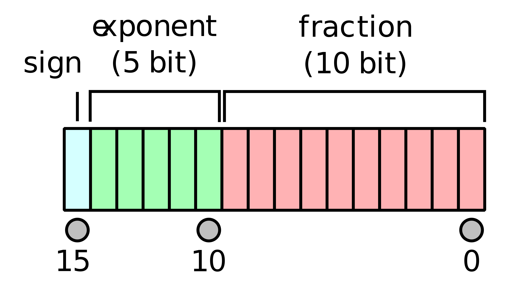
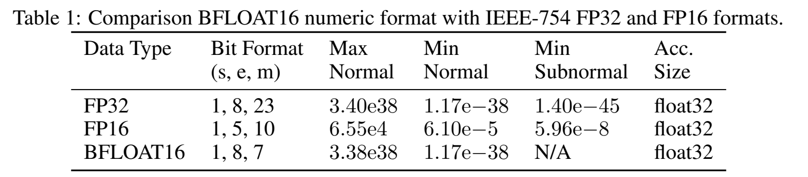
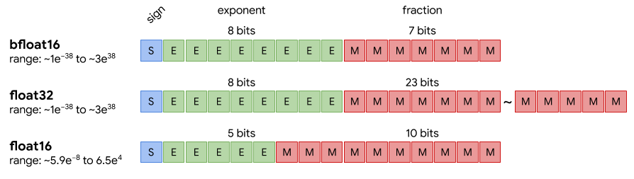

# 第 05 讲：FP16、BF16 的位表示与数值范围

前几讲反复出现“8bit加载”“转FP32”“FP16训练”。这些名字首先描述**怎样用有限的存储位表示一个数字**。本讲先回答：为什么同一个小数转成不同格式后会改变，为什么一种格式能存很大的数，却分不清两个很接近的数？

按“存储位→二进制→浮点数三部分→手算→格式差别→数值转换→原代码”阅读。[中文注释Python阅读版](代码/tutorials/05_float16_bf16_代码注释.py)、[全部27格说明](代码单元解释.md)和[原notebook](代码/tutorials/05_float16_bf16.ipynb)可用于对照；课程原图和补充论文原表放在相关段落旁。

## 1. 一个数占几个位置？先认识bit和byte【必须会】

**bit（位）**是只能存0或1的一个位置；**byte（字节）**包含8个位。因此16bit是2byte，32bit是4byte。FP来自floating point，意思是浮点数；FP16、FP32分别用16位、32位编码一个数。BF16也用16位，但分配这些位的方式不同。

一个位只有2种状态，两个位有00、01、10、11共4种状态；16个位一共只有2^16=65536种位串；2^16表示16个2相乘。有限种状态不可能一一表示无限多个实数，因此总要选择哪些数能精确存下，其余数如何取近似。

在PyTorch里，`dtype`表示数据格式，例如`torch.float16`、`torch.bfloat16`。`tensor`（张量）是装数字的数组，`shape`表示各维长度。例如shape `[3]`是一列3个数；不管这3个数用FP16还是FP32，shape都不变，只是每个数的编码和数据字节数改变。

| 格式 | 单个元素的存储 | 连续存3个元素的数据字节数 |
|---|---:|---:|
| FP16 | 2byte | 6byte |
| BF16 | 2byte | 6byte |
| FP32 | 4byte | 12byte |

这里计算数组本身的数据字节数。估算训练总显存时，还要加上梯度、优化器状态、激活以及框架管理开销。

## 2. 为什么要用二进制的“科学记数法”？【必须会】

十进制里`6500=6.5×10³`，10³就是10×10×10=1000；小数点可以随指数移动。二进制同样可以把一个数写成“有效数字×2的幂”，这就是本讲浮点编码的起点。

二进制每个整数位置从右到左代表1、2、4、8……，所以`101₂=1×4+0×2+1×1=5`。下标2表示这是二进制。小数点右边依次代表1/2、1/4、1/8……，所以：

$$1.101_2=1+\frac12+0\times\frac14+\frac18=1.625.$$

于是十进制6.5可以写成：

$$6.5=1.101_2\times2^2.$$

这里`1.101₂`决定这一量级上的细节，`2²`决定数量级。对正常的非零二进制数，总能移动小数点，把开头写成1；这个确定的1不必再占一个存储位。这是后面“隐含前导1”的含义。

浮点数通过调整指数覆盖不同数量级。指数越大，相邻可表示数的绝对间距通常也越大。

## 3. 原图里三段颜色分别存什么？【必须会】



来源：[课程原图float16.png](https://github.com/chunhuizhang/personal_chatgpt/blob/7fbc29824171fd07dc2c30fe922e61ebc018ad1d/imgs/float16.png)。从左到右是1位符号、5位指数、10位显式小数，每格代表一个bit。

**符号位s**：0表示正，1表示负。**指数域E**：把若干位当成整数读出，再减一个固定偏置，得到真正的指数。**小数域F**：保存前导1后面的二进制小数位；它不是十进制小数串。

| 格式 | 符号位数 | 指数位数e | 显式小数位数m | 指数偏置β |
|---|---:|---:|---:|---:|
| FP16 | 1 | 5 | 10 | 15 |
| BF16 | 1 | 8 | 7 | 127 |
| FP32 | 1 | 8 | 23 | 127 |

FP16指数域存17时，实际指数是17−15=2。β读作beta，是格式规定的偏置，用来把正负指数编码为非负整数。

### 补充论文的原表，就放在这里读



补充格式对照：[A Study of BFLOAT16 for Deep Learning Training，arXiv:1905.12322v3，第4页Table1](https://arxiv.org/pdf/1905.12322v3)。

表头依次给出数据类型、位分配(s,e,m)、最大正常数、最小正正常数、最小正次正规数和累加格式。`e38`表示乘10的38次方。FP32/BF16都有8位指数，覆盖的数量级接近；它们的小数位数决定各自的精度。末列float32说明论文方案采用FP32累加，BF16存储本身仍是每项2byte。

BF16最小次正规数一栏写为N/A。下面会按位模式解释次正规数，再说明设备和算子的实际处理方式。

## 4. 用6.5学会解码，再算课程里的26624【必须会】

对指数域既非全0、又非全1的**正常数**，解码公式是：

$$x=(-1)^s\times2^{E-\beta}\times\left(1+\frac{F}{2^m}\right).$$

s、E、F都是从位串读出的整数；β和m由格式决定，x是解码后的一个数。`(-1)^s`给出正负号，`2^(E−β)`给出数量级，括号是有效数字。这里的幂是数学记号，Python里计算乘方用`**`，不用`^`。

先把6.5编码为FP16：已经知道它是`1.101₂×2²`，所以s=0，E=2+15=17，即二进制10001；显式小数补足10位为1010000000，读作整数F=512+128=640。完整位串为：

```text
符号   指数      小数
 0    10001   1010000000
```

代回公式：`2^(17−15)×(1+640/1024)=4×1.625=6.5`。它能精确存下，因为这段二进制小数在有限位内已经结束。

课程单元13给出 `0 11101 1010000000`。小数位保持相同，指数域从17变成29，实际指数从2变成14，结果为 `2^14×1.625=26624`。

```python
s = 0
m = 10
beta = 15
F = int('1010000000', 2)                 # 按二进制读成整数640
for exponent_bits in ['10001', '11101']:
    E = int(exponent_bits, 2)
    value = (-1)**s * 2**(E-beta) * (1 + F/2**m)
    print(exponent_bits, '->', value)
# 10001 -> 6.5
# 11101 -> 26624.0
```

`int(字符串,2)` 按二进制转换；`for` 分别处理两个指数，缩进表示循环内部。F、E在这个例子中是普通整数，用来计算单个数的值。

## 5. 零、次正规数和特殊值【必须会】

指数域的全0和全1被保留作特殊编码。FP16有5个指数位，E可为0到31；正常数只用1到30。BF16和FP32有8个指数位，正常数只用1到254。

**E=0时没有隐含的前导1**，改用：

$$x=(-1)^s\times2^{1-\beta}\times\frac{F}{2^m}.$$

F=0表示零，符号位还区分+0和−0；F不为0叫次正规数（subnormal），用来填补零附近的一小段空隙。负指数表示倒数，例如2^-14=1/16384。FP16最小正正常数是`2^-14`，因为E=1、F=0；最小正次正规数是`2^-14/1024=2^-24`，因为E=0、F=1。

最负有限数、最小正正常数、最小正次正规数分别描述数轴上的不同位置。FP16的最负有限数为−65504，两个最小正值则描述零附近的范围。

**E全1时**：F=0表示正负无穷Inf，F非0表示NaN（Not a Number），常用于表示无效数值计算的结果。这些位串采用特殊规则解释。

按BF16位模式，最小正正常数是 `2^-126`，最小正次正规数是 `2^-133`。实际设备或算子也可能把次正规数置零，例如[Google TPU文档](https://docs.cloud.google.com/tpu/docs/bfloat16)说明了它的BF16转换规则。

## 6. 范围大，为什么还能更粗糙？【必须会】

先分清两个问题：**范围**问“能存到多大、多小的数量级”；**精度**问“在某个大小附近，相邻可表示数有多近”。指数位多有助于扩大数量级范围；小数位多有助于缩小相邻间距。



来源：[课程原图bf-float.png](https://github.com/chunhuizhang/personal_chatgpt/blob/7fbc29824171fd07dc2c30fe922e61ebc018ad1d/imgs/bf-float.png)。S、E、M依次表示符号、指数、显式小数。比较各段格子数：FP32的小数位最多，BF16与FP32的指数位一样多。

在1到2之间，正常数是`1+F/2^m`；F每增加1，数值增加`1/2^m`。所以从1向右的首个间距是：

| 格式 | 1的下一个更大可表示数 | 两者间距 |
|---|---:|---:|
| FP16 | 1.0009765625 | 2^-10=0.0009765625 |
| BF16 | 1.0078125 | 2^-7=0.0078125 |
| FP32 | 1.0000001192092896 | 2^-23≈0.0000001192 |

把1.001转为这两种16位格式：FP16可以取到附近的1.0009765625；BF16的下一个数离得太远，最近的是1.0。因此**相同数量级附近，BF16反而比FP16更粗**，尽管它能表示更大的数。

对正常数，处于`[2^q,2^(q+1))`这一段时，间距为：

$$\Delta x=2^{q-m}.$$

q是去掉偏置后的指数，m是小数位数，Δx是相邻间距。例如FP16在[1024,2048)里q=10，间距=1；它不能把这一范围内所有相差0.001的数都区分开。正常区间的绝对间距不是整条数轴统一的常量。

再看范围：FP16最大有限值由E=30、F=1023得到`2^15×(2−2^-10)=65504`。BF16最大有限值约3.3895×10^38，FP32约3.4028×10^38；它们数量级接近，最高有限值仍略有差别。100000转FP16会溢出为Inf；转BF16不会溢出，但会近似为99840。

很小的非零数转成目标格式后变成零，叫下溢到零。最近舍入下，FP16最小正次正规数的一半 `2^-25` 会舍入到零；本页CPU上的BF16转换仍保留这个值。范围描述能覆盖多大的数量级，间距描述相邻值分得多细。

## 7. 亲自转换三个数，查看结果【必须会】

用PyTorch在CPU上观察转换。先用FP64（每项8byte）保存源数字，尽量保留转换前的细节，再分别转成三种格式。

```python
import torch

source = torch.tensor([1.001, 100000., 2.**-25], dtype=torch.float64)
converted = {}
spacings = {}
for dtype in [torch.float16, torch.bfloat16, torch.float32]:
    values = source.to(dtype)                 # 数值转换，不是重解释同一组位
    converted[str(dtype)] = values.to(torch.float64).tolist()
    one = torch.tensor(1., dtype=dtype)
    two = torch.tensor(2., dtype=dtype)
    next_one = torch.nextafter(one, two)       # 从1朝2走一个可表示数
    gap = (next_one.to(torch.float64) - 1.).item()
    spacings[str(dtype)] = gap
    print(dtype, '转换结果:', converted[str(dtype)])
    print('shape:', list(values.shape), '数据字节数:', values.numel()*values.element_size())
    print('1以上的首个间距:', gap)
```

`torch.tensor`从列表创建张量；`dtype=...`是命名参数，指定格式。`.to(dtype)`返回转换结果；再次转到FP64是为了把已舍入后的数读清楚，**不能恢复之前丢掉的精度**。`.tolist()`返回普通Python列表。`numel()`是元素个数，`element_size()`是每个元素的数据字节数，两者相乘得到此数组数据量。

`nextafter(one,two)`找的是目标格式中从1朝2的下一个邻居；`.item()`从单元素张量取普通数值。`converted`、`spacings`是两个字典，分别按dtype名字记下结果与间距，供核对。

实际CPU执行的关键结果：

| 目标格式 | 1.001转换后 | 100000转换后 | 2^-25转换后 | shape `[3]`数据大小 |
|---|---:|---:|---:|---:|
| FP16 | 1.0009765625 | Inf | 0 | 6byte |
| BF16 | 1.0 | 99840 | 2^-25 | 6byte |
| FP32 | ≈1.0010000467 | 100000 | 2^-25 | 12byte |

相邻间距与上一节手算一致。所谓舍入，是映射到目标格式可表示的邻近数；不是简单地把十进制小数点后几位删掉。这一例同时展示了舍入、溢出和下溢，也展示了省空间与数值误差之间的关系。

## 8. 这些变化为什么会影响模型？【必须会】

模型参数、激活和梯度都由数字组成。梯度描述误差对参数的变化率，优化器据此更新参数。若小梯度被舍入为零，或中间结果溢出成Inf，就会影响后续计算，这也是训练需要选择数值格式的原因。

**混合精度让不同环节采用不同格式。** 例如16位乘法配FP32累加，或保留FP32参数副本做更新。前面论文表的最后一列给出了累加格式，后续AMP课程将把这些环节接进训练循环。

选择格式时，要同时考虑数值范围、舍入精度、设备支持和算子的实现方式。BF16的宽范围有助于缓解某些FP16的溢出或下溢问题，运算仍会发生舍入。

## 9. 原代码为什么大多在查询CUDA？【建议会】

CUDA是PyTorch访问NVIDIA GPU的接口。原notebook通过图片、公式和设备查询讲格式，8个代码格如下：

| 单元，从0编号 | 原代码/API | 输入、输出和作用 |
|---|---|---|
| 0 | `from IPython.display import Image` | 导入图片展示工具，不做张量计算 |
| 5、26 | `Image(...,width=400)`或默认宽度 | 读取图片并展示；显示宽度不会改变数值精度 |
| 16 | `torch.cuda.is_bf16_supported()` | 无参数查询当前环境，返回布尔值，用于检查设备支持 |
| 17 | `torch.bfloat16` | 查看BF16的dtype对象 |
| 18 | `current_device()`再`get_device_properties(...)` | 内层取设备编号，再由外层查属性；CPU构建在内层就会失败 |
| 19 | `torch.version.hip` | 查看ROCm/HIP构建相关版本，可能是None |
| 20 | `torch.cuda.is_bf16_supported??` | IPython查看实现源码的语法；普通.py中不能直接这样写 |

`Image('../imgs/float16.png')` 按相对路径读取图片。CUDA查询的CPU运行记录放在复现说明中，其中第18格需要CUDA设备。

查询接口的具体逻辑可继续读[PyTorch v2.5.1实现](https://github.com/pytorch/pytorch/blob/v2.5.1/torch/cuda/__init__.py)。

<details>
<summary>第二遍对照：原版公式、特殊编码、CUDA源码与历史验证细节</summary>

### 旧版技术说明（保留查阅）

## 阅读地图

附件 `f9302db7-aaad-4aa8-9ee2-9d2a7b21c714.txt` 对应 `05_float16_bf16.ipynb`，27 个单元、8 个代码单元。[固定提交原文件](https://github.com/chunhuizhang/personal_chatgpt/blob/7fbc29824171fd07dc2c30fe922e61ebc018ad1d/tutorials/05_float16_bf16.ipynb)，完整单元见 [原 notebook](https://github.com/chunhuizhang/personal_chatgpt/blob/7fbc29824171fd07dc2c30fe922e61ebc018ad1d/tutorials/05_float16_bf16.ipynb)。本讲是数值格式教学，没有唯一主论文或模型训练入口。

先看本页概念，再打开[详细中文代码注释](代码/tutorials/代码注释.ipynb)；喜欢纯文本代码时看[Python阅读版](代码/tutorials/05_float16_bf16_代码注释.py)。[全部单元说明](代码单元解释.md)覆盖27格、8个代码格、全部公式和标题；[原版对照](代码/tutorials/05_float16_bf16.ipynb)保留上游历史输出。

阅读链为 `位布局 → 正常数公式 → 特殊编码 → 范围与间距 → CUDA 支持查询`。原notebook和两张PNG已直接下载到本仓库，图位于`代码/imgs`，哈希及来源见[来源清单](来源清单.json)。字幕原文仍保留本地，作为参考，不执行其中口述命令。补充依据为 [Google BF16 说明](https://docs.cloud.google.com/tpu/docs/bfloat16) 与 [PyTorch 数值精度说明](https://docs.pytorch.org/docs/stable/notes/numerical_accuracy.html)。

## 1. 先分清三件事【必须会】

**占用空间**：每个数使用几个 bit/byte。**动态范围**：可表示的大小覆盖到哪里。**精度**：附近相邻可表示数有多细。

字幕中“BF16 实现 FP32 的水平”需要限定为指数范围接近，不能解读为保留 FP32 精度。16 bit 是 2 byte，不是 2 bit。

| 格式 | 符号位 | 指数位 | 显式小数位 | 每元素 byte |
|---|---:|---:|---:|---:|
| FP16/binary16 | 1 | 5 | 10 | 2 |
| BF16 | 1 | 8 | 7 | 2 |
| FP32/binary32 | 1 | 8 | 23 | 4 |

对于相同 `[B,S,D]` 元素数量，单独存这个 tensor 时 FP16/BF16 大小一致，约是 FP32 一半；这不保证完整训练显存减半，优化器和激活可能使用不同 dtype。

## 2. 从 bit 到正常数

将符号位 s、指数域整数 E、小数域整数 F 分别取出，设指数 bias 为 β，小数位数为 m：

$$x=(-1)^s2^{E-\beta}\left(1+\frac{F}{2^m}\right),\quad 0<E<2^e-1.$$

s∈{0,1}，e 为指数位数，E 范围为 0 到 2^e−1，F 范围为 0 到 2^m−1。它们是标量整数；输出 x 为标量实数。前导 1 隐含，不额外存一个 bit。beta 是格式定义，不应仅把“最大正常指数域除以二”当成一般设计规则。

FP16 使用 e=5、m=10、β=15。E=1…30，实际正常指数为 −14…15；F/1024 是二进制小数。[单元 6–8](https://github.com/chunhuizhang/personal_chatgpt/blob/7fbc29824171fd07dc2c30fe922e61ebc018ad1d/tutorials/05_float16_bf16.ipynb)。

### 原 notebook 的 26624 算例【必须会】

编码 `0 11101 1010000000`：s=0，E=29，F=640；E−15=14；有效数 1+640/1024=1.625；最后 16384×1.625=26624。

计算顺序是先解码整数域，再减偏置，最后乘指数与有效数。小数位不会按十进制 0.101…解释。

## 3. 全零/全一指数为什么特殊？

### 3.1 E=0：零与次正规数【建议会】

$$x=(-1)^s2^{1-\beta}\frac{F}{2^m}.$$

没有隐含 1；指数固定为 1−β。F=0 表示带符号的零；F>0 为 subnormal，常译次正规数。FP16 最小正次正规数为 $2^{-14}/1024=2^{-24}$。

### 3.2 E 全一：Inf 与 NaN

F=0 对应 ±Inf；F≠0 对应 NaN。字幕中相关词被转写为 none/nt，应根据位公式识别为 NaN，而不是 Python None。NaN 通常用于无效数值，不等于“极大的普通数”。

## 4. FP16 的范围与间距

| 项目 | 推导 | 数值 |
|---|---|---:|
| 最大有限正数 | E=30、F=1023 | 65504 |
| 最负有限数 | 改符号位 | −65504 |
| 最小正正常数 | E=1、F=0 | 2^-14≈6.1035e−5 |
| 最小正次正规数 | E=0、F=1 | 2^-24≈5.9605e−8 |
| 1 附近相邻正常数间距 | E−β=0 | 2^-10≈0.0009765625 |

原单元 11 将 2^-24 写在“精度”部分，它是最小正数/次正规区间距，不能代表整个数轴统一精度。

正常数在指数为 q 的区间，其相邻间距为：

$$\Delta x=2^{q-m}.$$

q 是去偏置后的指数，m 是小数位数。数值越大，绝对间距越大。例如 FP16 的 [1,2) 间距 2^-10，而 [1024,2048) 间距为 1。小数位固定并不表示小数点后位数固定。

掌握等级：**【必须会】最小正常/次正规、间距；【可以暂时不掌握】NaN payload 等编码细节。**

## 5. BF16 的公式与范围

正常数：

$$x=(-1)^s2^{E-127}(1+F/128),\quad E=1\ldots254.$$

正常指数为 −126…127；最大值使用 E=254、F=127，约 3.389531389e38。次正规数公式为 $(-1)^s2^{-126}(F/128)$，最小正次正规为 2^-133≈9.18355e−41；最小正正常为 2^-126≈1.17549e−38。

字幕疑问“为什么有的资料说 e−41，有的说 e−38”可以直接由这两个定义解释：前者是最小次正规，后者是最小正常。不是必然存在不同解码协议。

格式理论允许的次正规数与硬件实际算术行为需要区分；某些实现会将非常小的数 flush to zero。例如 Google TPU 的 BF16 文档说明其处理次正规数的限制，不能假设所有设备都完整保留。[Google BF16 文档](https://docs.cloud.google.com/tpu/docs/bfloat16)

## 6. BF16 与 FP32 不是同等精度

| 项目 | FP16 | BF16 | FP32 |
|---|---:|---:|---:|
| 最大有限值 | 65504 | ≈3.3895e38 | ≈3.4028e38 |
| 最小正正常 | 2^-14 | 2^-126 | 2^-126 |
| 理论最小正次正规 | 2^-24 | 2^-133 | 2^-149 |
| 1 以上的首个间距 | 2^-10 | 2^-7 | 2^-23 |

BF16 和 FP32 指数位相同，所以正常范围接近；最高有限值仍因小数位不同而略有差别。BF16 的小数位比 FP16 还少，因此在类似量级附近更粗。

示意 1.001：按最近舍入，FP16 可得到约 1.0009765625，而 BF16 得到 1.0。它们都用 2 byte，但一个更细，一个范围更大。采用 BF16 有助降低类似 FP16 的范围溢出风险，不保证没有所有 NaN、没有下溢或完全无损训练。

## 7. 配图怎样读


由左到右读各行：S 是符号，E 是指数，M 是显式尾数/小数位。BF16 和 FP32 的 E 段同样长；FP32 的 M 段最长；FP16 将更多有限 bit 分给 M，较少分给 E。每块是格式字段，非可训练网络层，没有 batch 或矩阵 shape。

`float16.png` 展示 FP16 位布局；Image 的宽度只控制显示，与计算精度无关。

## 8. CUDA 查询代码逐项解释

| 单元 | API | 输入/输出与作用 |
|---|---|---|
| 0、5、26 | Image | 导入、显示两幅图，无 GPU 计算 |
| 16 | `torch.cuda.is_bf16_supported()` | 对运行设备/框架环境查询，返回 bool |
| 17 | `torch.bfloat16` | dtype 对象，不创建 BF16 tensor |
| 18 | current_device/get_device_properties | 取得当前设备编号与属性对象 |
| 19 | `torch.version.hip` | 查看是否为 ROCm/HIP 构建相关版本，不是 NVIDIA 支持的单独判据 |
| 20 | `...??` | IPython 查看实现源码的语法，不是合法普通 Python |

这些 API 通常读取环境状态，是否初始化 CUDA 取决于运行时；没有训练参数更新。能访问 `torch.bfloat16` 名字不等于 GPU 高效支持其运算。查询结果也受 PyTorch 版本和实现策略影响，不可只看一句“CUDA≥11”就判定所有条件满足。

此前默认Python环境中的torch缺少实际CUDA API，旧记录保留。此前另用真实PyTorch2.5.1+cpu、IPython8.37.0执行原版及注释版全部8格代码：每份7格成功，单元18在内层current_device报`Torch not compiled with CUDA enabled`；外层设备属性查询未执行。单元16实际返回False，17返回dtype对象，19返回None，20真正查看了当前函数源码。两份执行结果一致，见[复现记录](复现/README.md)。本次未获取GPU属性或运行GPU BF16算术。

该版本`is_bf16_supported(including_emulation=True)`还包含ROCm、CUDA可用性、版本/compute capability及emulation路径，详见[固定官方源码](https://github.com/pytorch/pytorch/blob/v2.5.1/torch/cuda/__init__.py)。无参数调用使用默认值，但不能认为返回True必定等于原生高速BF16，也不能用当前实现代替老师未锁定的旧版本。

补充真实CPU验证另行构造shape[7]的int16位模式，再用`view(torch.float16/bfloat16)`重解释，不改变16位数据；转float64读数，与上面解码公式对照。`torch.finfo(...).tiny`核对最小正常数，`torch.nextafter(0,1)`核对最小正次正规，`nextafter(1,2)−1`核对1附近间距。原notebook没有这些tensor运算，它们是本仓库的补充证据。

其他单元 1–15、21–25 为参考、标题、位字段和算例，均见固定提交的上游 notebook，没有隐藏模型训练步骤。

## 9. 必须掌握

bit 与 byte；动态范围与精度；隐含前导 1；正常与次正规数；Inf/NaN；BF16 与 FP32 的指数相近但精度不同。

## 10. 第二遍知识

舍入模式、相邻数间距、硬件下溢行为、AMP 中不同算子的 dtype。

## 11. 可暂缓工程细节

NaN payload、二进制转换器所有交互操作、不同架构的底层 kernel。

## 12. Formula ↔ Code / Paper ↔ Code

| 概念 | 位置 | 边界 |
|---|---|---|
| FP16 解码 | 单元 8–13 | Markdown 公式，不是 tensor 运算代码 |
| BF16 解码 | 单元 23–24 | 同上 |
| CUDA环境与源码查询 | 单元 16–20 | 当前CPU构建真实执行；设备属性格按预期失败，无GPU算术 |
| 位格式图 | 单元 5、26 | 静态图片 |
| 解码/范围/舍入的真实数值核对 | 补充脚本verify_runtime.py | CPU tensor对照，不冒充原notebook运算 |
| 主论文/模型 forward/loss | 未找到 | 本讲非论文模型实验 |

## 13. 复现状态与未解决问题

**部分成功：**保留此前[纯Python算术记录](复现/outputs/教学验证.json)，此前新增[原版/注释版逐格执行及真实CPU tensor结果](复现/outputs/runtime_verification.json)。原文件与图片下载哈希匹配，27格都有说明，8格详注；[静态核对](复现/outputs/annotation_verification.json)证明原单元/历史输出保留、IPython转换后的AST相同及Python阅读版AST相同。

实际数值：26624解码与FP16位模式一致；1.001转FP16为1.0009765625、转BF16为1.0；100000转FP16为Inf、BF16为99840。两种dtype各核对正负零、最小正常/次正规、最大有限数、Inf/NaN、最近偶数舍入及最小次正规的一半舍入到0。固定shape[7]的数据分别为FP16/BF16的14byte与FP32的28byte。环境和可重做命令见[复现说明](复现/README.md)。

未运行GPU/TPU BF16算术、AMP训练、速度、显存或准确率实验；CPU可保留某种位模式不能自动证明其他设备或算子也保留它。没有改写原CUDA查询去掩盖CPU包失败，没有把作者历史GPU输出当作本次结果。原notebook未锁定完整环境，附带网页也不是格式协议的完整替代；对解码与当前CPU转换的证据置信度高，对跨硬件性能和训练质量没有本次证据。

</details>

## 10. 必须掌握

bit/byte；指数与小数各负责什么；用隐含1的正常数公式手算6.5和26624；区分最负有限数、最小正正常数与次正规数；区分范围、间距、舍入、溢出和下溢；知道BF16不是FP32的同精度压缩版。

## 11. 第二遍知识

最近偶数舍入、负零和NaN比较、CPU/TPU/GPU的次正规数处理差别、`view(dtype)`重解释位与`.to(dtype)`转换数值的区别，以及AMP中存储、乘法、累加、更新各用什么格式。

## 12. 可暂缓工程细节

NaN payload、硬件指令、各架构kernel和吞吐调优。先理解某个值为什么改变，再研究运算加速。

## 13. Paper ↔ Code / Formula ↔ Code

| 依据 | 本讲位置/代码对象 | 范围 |
|---|---|---|
| 课程FP16位图与正常/特殊数公式 | 原5–13格；本文标量解码例 | 位域→整数→实际数值 |
| 课程BF16公式与三格式位图 | 原21–26格；本文间距与转换例 | 解释指数范围和小数精度 |
| 补充BFLOAT16论文v3 Table1 | 本文第3节原表截图 | 格式、范围与累加方案对照 |
| 真实数值转换 | `.to(dtype)`、`nextafter` | 本文CPU转换例 |
| 环境支持查询 | 原16–20格 | 历史CPU执行有明确失败，未测GPU性能 |
| 唯一主论文、模型forward/loss/训练指标 | 未找到 | 浮点格式教学 |

## 14. 复现状态

**部分成功。** 标量解码和CPU张量转换算例已执行，得到6.5、26624，核对了三格式舍入、1附近间距及数据字节数。课程两张图和补充论文Table1已内嵌。结果见[基础算例记录](复现/outputs/基础改写验证.json)，环境与历史记录见[复现说明](复现/README.md)。

## 15. 未解决问题与可信范围

课程完整环境尚未锁定。GPU/TPU算术、AMP训练和性能仍待验证；次正规数的实际处理应按设备与算子查询。
