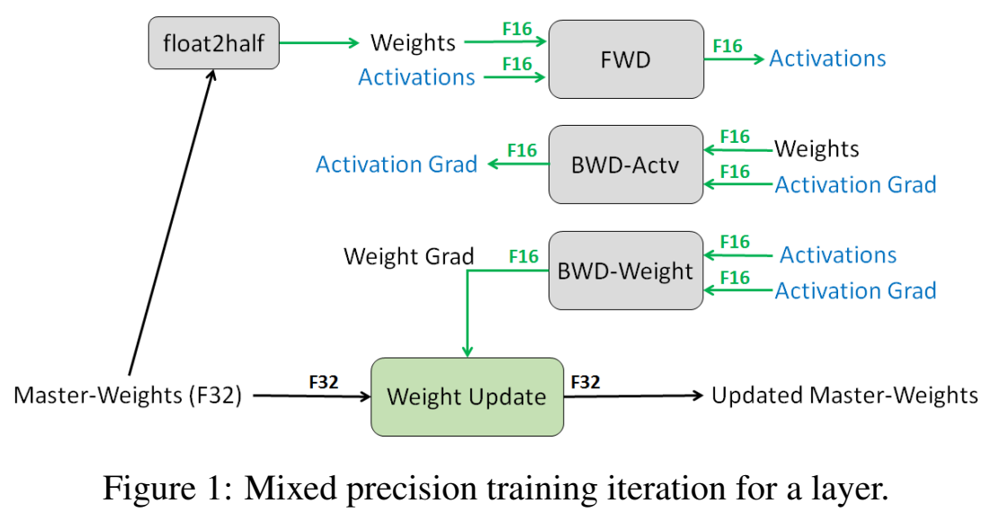

# 第 07 讲：CNN 输入形状与自动混合精度训练

这一讲用手写数字分类解释训练，再加入自动混合精度AMP。先沿一张数字图片理解“输入→预测分数→误差→梯度→参数更新”，然后分别看autocast和GradScaler。**autocast负责部分运算用什么精度；GradScaler负责放大、还原梯度并处理非有限值，两者不是同一功能。**

第4节配有《Mixed Precision Training》原图，用来说明低精度计算和FP32更新。原代码可对照[中文注释Python阅读版](代码/tutorials/07_fp16_mixed_precision_training_代码注释.py)、[全部19格说明](代码单元解释.md)和[原notebook](代码/tutorials/07_fp16_mixed_precision_training.ipynb)。

## 1. 训练模型，究竟在改变什么？

模型里面用于计算的可学习数字叫参数；把输入送进模型得到结果叫前向计算。训练时，我们知道正确答案，先计算预测与正确目标的误差，叫loss（损失）；再求误差怎样受到参数变化影响，这个变化率叫梯度。优化器根据梯度修改参数，完成一次更新。

先不用复杂网络：只有一个参数p，正确目标是0，预测直接等于p，用平方误差：

$$L=p^2,\qquad g=\frac{\partial L}{\partial p}=2p,\qquad p_{new}=p-\eta g.$$

L是标量误差，g是误差对p的梯度，η是学习率，即更新步子大小；标量就是单个数。偏导记号表示“只考察这个参数变化时，误差怎样改变”。p=1时L=1；让p增加0.01，L变为1.0201，说明往大处走误差会上升，小步变化率接近2。因此g=2，取η=0.1，更新为p=0.8，误差降为0.64。

这个单参数例子用简单梯度下降解释更新方向。后面的CNN使用分类交叉熵和Adam优化器，Adam还会保存历史梯度统计。

PyTorch中这三个动作必须分开：`optimizer.zero_grad()`清掉旧梯度，不改参数；`loss.backward()`沿计算关系求梯度；`optimizer.step()`按优化算法更新参数。梯度通常会累积，因此不是每次backward后自动清零。

## 2. 一张MNIST图片怎样进入CNN？

MNIST是手写数字图片数据；每张图28×28个灰度像素，标签是0到9中的一个整数。例如图片表示7，正确标签就是整数7，不是字符串`'7'`，也不是十维概率向量。

`ToTensor()`将这类图像转为浮点数组，常见uint8像素从0–255映射到0–1；单张shape为`[1,28,28]`。Tensor（张量）就是装数字的多维数组；shape描述各维长度。第一维1代表一个灰度通道，不是“一张图片”的数量维。

`DataLoader`按批次取样本；若一次取N张，图像为`[N,1,28,28]`、标签为`[N]`整数数组。N是batch size；一轮epoch表示遍历训练数据一遍，一个batch则只处理其中一批。原代码先batch32查看数据，后面的两次训练又各自重建为128和256，不是同一个loader一直没变。

CNN是卷积神经网络。卷积层用小窗口在图上做加权计算，产生不同特征通道；这些窗口权重是可学习参数。ReLU把负值改为0，本身没有可训练参数；2×2最大池化每次取窗口最大值，在这里把高宽各减半。最后把特征展开，用Linear线性层输出10个类别分数。

原类的实际数据shape是：

| 步骤 | shape | 含义 |
|---|---|---|
| 一批灰度图 | `[N,1,28,28]` | 样本、通道、高、宽，简称NCHW |
| 第1次3×3卷积，再ReLU | `[N,5120,28,28]` | stride1、padding1保留高宽，生成5120通道 |
| 第1次池化 | `[N,5120,14,14]` | 高宽各减半 |
| 第2次卷积，再ReLU | `[N,10240,14,14]` | 输入5120通道，输出10240通道 |
| 第2次池化 | `[N,10240,7,7]` | 再减半 |
| `reshape(N,-1)` | `[N,501760]` | 每张图展开10240×7×7个特征 |
| `fc1` | `[N,10]` | 每张图的10个类别分数 |

`stride`是窗口移动步长；`padding`是在边界补数；这里3×3、步长1、补1，使28仍为28。`reshape`重排数组形状，-1让框架按总元素数推算；它不会自动减少特征数量或修改fc1权重尺寸。

`class CNN(nn.Module)` 定义继承PyTorch模块基类的类型。`__init__`创建层，`self.conv1`等属性登记它们，`super(...).__init__()`初始化父类。`forward`定义计算顺序，调用 `model(batch_x)` 时执行。

原通道数为5120/10240，保存类共有476,938,250个参数，用来探索老师机器上的显存占用。下面先按表理解shape，再用小对象观察AMP各步骤。

## 3. 10个分数怎样变成一个loss？

模型输出logits，即尚未归一化的分数，shape `[N,10]`。标签是int64整数，shape `[N]`。`nn.CrossEntropyLoss()`接收这两者，内部完成相关对数概率计算；无需先手动softmax再送进去。

softmax把10个候选分数变成和为1的概率。若正确标签是7，就看模型给第7类的概率；单个样本的损失是：

$$\ell=-\log p_{correct}.$$

log是自然对数，p_correct是正确类概率。如果10个分数一样大，概率都为0.1，损失为−log(0.1)≈2.302585。正确类概率升高，损失就会下降；默认对批内样本取平均，得到用于backward的一个标量。

分类预测取分数最大的类别编号；准确率则统计“预测编号等于标签”的比例。loss不是准确率：例如两组分数都把第7类排第一，但给它的概率不同，准确率可能一样，loss却不同。

## 4. 直接读论文原图：为什么既有FP16又有FP32？



来源：[Mixed Precision Training，arXiv:1710.03740v3，PDF第3页Figure1](https://arxiv.org/pdf/1710.03740v3)。

先看底部：Master-Weights(F32)表示用于更新的FP32主权重，Weight Update是权重更新，右侧得到更新后的主权重。左侧斜箭头把主权重送给float2half，转换为供计算使用的FP16。F32和F16分别指32位、16位浮点格式，每个数通常占4byte、2byte。

再看上面三个灰框：FWD是前向，输入权重与激活（Activations），产生新的激活；BWD-Actv是反向求输入激活的梯度，信息方向与前向不同；BWD-Weight是反向求权重梯度，结果经绿色箭头送到底部更新框。Grad是gradient的缩写，即梯度。图中的绿线标FP16，黑线标FP32；颜色也用于区分激活和权重标记。

同一张图的shape可以这样对应：假设一层输入X为`[N,k]`，W为`[d,k]`，输出Y为`[N,d]`；N是样本数，k/d是输入/输出宽度。前向产生Y，反向的输入梯度仍为`[N,k]`、权重梯度仍为`[d,k]`。改变数值格式不改变这些shape。卷积层的激活是四维，图中的原则相同，但不应把它的shape硬写成二维。

论文§3.1讲保留FP32权重做更新；§3.2讲loss scaling，在反向前放大loss、更新前还原梯度。图中展示了前一部分，下面继续讲缩放。

AMP按算子选择精度。常规PyTorch autocast用法保留FP32参数，在某些运算中采用较低精度，按算子规则处理输入和输出。

## 5. Loss scaling怎样保留小梯度？

上一讲看到FP16不能精确保留任意小数。比如约1e−8的小梯度直接转FP16会变成0；先放大1024倍，转成低精度时更可能保留，更新前再除1024，就能近似恢复原尺度。1e−8表示10的−8次方。

数学关系为：

$$\widetilde L=aL,\qquad\widetilde g=a\frac{\partial L}{\partial w}=ag,\qquad g=\widetilde g/a.$$

a是本次反向中保持不变的正缩放因子，w是参数，g是梯度，波浪线表示缩放后的量。loss乘a，梯度随之乘a；更新前除回a，恢复优化器所需的原尺度。

先用一个数观察缩放和格式转换：

```python
import torch

small = torch.tensor(1e-8, dtype=torch.float32)
direct = small.to(torch.float16)
recovered = (small * 1024).to(torch.float16).to(torch.float32) / 1024
print('直接转FP16:', direct.item())
print('先放大再转换、再还原:', recovered.item())
assert direct.item() == 0.
assert recovered.item() > 0.
```

`torch.tensor`创建装一个数的张量；`.to(dtype)`转换格式，`.item()`取出普通数值。实际直接转换得到0，还原结果约1.00117e−8，接近原数但不完全相等，因为低精度舍入仍然存在。若先丢成零，再把零放大，无法找回原来信息；真实scaler因此要在反向传播前放大loss，而不是等梯度已经丢失后补救。

缩放过大也会造成Inf或NaN。因此GradScaler检查梯度，遇到非有限值就跳过这次优化更新，并调整下一步的缩放因子。

## 6. 用真实GradScaler观察一次更新和一次跳过

用PyTorch2.5.1+cpu的CPU GradScaler单独观察控制流程。沿用单参数平方误差，SGD学习率取0.1。

```python
import torch

p = torch.nn.Parameter(torch.tensor(1.))       # 一个FP32可学习参数
optimizer = torch.optim.SGD([p], lr=0.1)
scaler = torch.amp.GradScaler('cpu', init_scale=128, growth_interval=1)
optimizer.zero_grad()
loss = p.square()
scaler.scale(loss).backward()
scaled_grad = p.grad.item()
scaler.unscale_(optimizer)                    # 此例显式调用，便于看还原后的梯度
unscaled_grad = p.grad.item()
scaler.step(optimizer)
scaler.update()
print('放大梯度/还原梯度:', scaled_grad, unscaled_grad)
print('更新后参数/scale:', p.item(), scaler.get_scale())

saved_p = p.detach().clone()                  # 复制数值快照
optimizer.zero_grad()
scaler.scale(p.square()).backward()
p.grad.fill_(float('inf'))                    # 人工注入Inf，测试跳过分支
scaler.step(optimizer)
scaler.update()
print('Inf后参数/scale:', p.item(), scaler.get_scale())
assert torch.equal(p.detach(), saved_p)
```

`Parameter`登记可训练参数；`[p]`把它交给优化器管理；`square()`算平方。第一次梯度本来为2，scale128后为256；`unscale_`原位除回2，`scaler.step`执行SGD更新，p约为0.8。`growth_interval=1`是教学设置，使一次有限更新后scale从128增到256，方便观察；原默认策略不会每次都增长。

第二次先反向求导，再用 `fill_` 将梯度设为Inf。实际参数保持约0.8，scale从256退回128：控制器检测到非有限值，跳过该次更新。

`detach().clone()`把参数数值复制为独立快照；只写`saved_p=p`不是快照。通常可让`scaler.step()`内部完成还原；本例为打印才显式调用一次unscale_，step识别这一状态，不重复还原。同一轮不能无条件反复unscale，也不能在scaler.step之后再调用一次optimizer.step。

GradScaler在循环外创建，逐批保留并调整scale状态。实现可继续读[PyTorch v2.5.1源码](https://github.com/pytorch/pytorch/blob/v2.5.1/torch/amp/grad_scaler.py)。

## 7. Autocast又负责什么？看实际dtype

`dtype`是张量的数据格式。autocast是上下文管理器：进入`with`缩进区域时按该设备的规则选择运算精度，离开后恢复区域外规则。它通常包住前向和loss，不把整个backward也包进去；它不负责搬运CPU/GPU数据，也不等于永久把所有参数改成FP16。

用一个2输入、2输出的线性层查看autocast的精度选择：

```python
import torch

torch.manual_seed(7)
layer = torch.nn.Linear(2, 2)
x = torch.tensor([[1., 2.], [3., 4.]])     # FP32，两个样本各有两个特征
labels = torch.tensor([0, 1])              # int64，正确类别
with torch.amp.autocast('cpu', dtype=torch.float16):
    logits = layer(x)
    classification_loss = torch.nn.functional.cross_entropy(logits, labels)
print('参数/输入dtype:', layer.weight.dtype, x.dtype)
print('输出/loss dtype:', logits.dtype, classification_loss.dtype)
print('输出/loss shape:', list(logits.shape), list(classification_loss.shape))
```

本例CPU参数和输入保持FP32，输出logits为FP16 `[2,2]`，交叉熵loss为FP32标量。标量shape为 `[]`，表示单个值。

autocast支持范围随设备、版本和算子变化；使用时可查[PyTorch v2.5.1实现](https://github.com/pytorch/pytorch/blob/v2.5.1/torch/amp/autocast_mode.py)。CUDA版写法与CPU版需要按实际设备选择。

## 8. 把这两部分合回原训练循环

原单元17的CUDA训练写法按以下顺序执行：

```python
scaler = torch.cuda.amp.GradScaler()         # 在批次循环之外
# 以下为一个批次的核心步骤
with torch.cuda.amp.autocast():
    logits = model(batch_x)
    loss = criterion(logits, batch_y)
optimizer.zero_grad()
scaler.scale(loss).backward()
scaler.step(optimizer)
scaler.update()
```

两条路线的区别可以逐项对照：

| 环节 | 原14格FP32训练 | 原17格AMP训练 |
|---|---|---|
| 取批次、搬设备 | batch_x/batch_y `.to(device)` | 相同 |
| 前向与loss | 直接计算 | 放在autocast区域 |
| 清旧梯度 | optimizer.zero_grad | 相同 |
| 反向 | loss.backward | scale(loss).backward |
| 更新 | optimizer.step | scaler.step，可能因非有限梯度跳过 |
| scale调整 | 无 | scaler.update |
| 本讲的batch配置 | 128 | 256 |

`zero_grad` 在反向前清掉上一批梯度，放在前向之后也能完成这个作用。`torch.device(...)` 创建设备描述，`.to(device)` 将数据或模型搬到该设备；AMP接口也要与设备匹配。

学习率 `3e-4` 为0.0003，epochs为3。两段代码各自新建模型、loader和优化器，batch分别取128与256。比较AMP效果时，需要控制初始权重、数据顺序和更新次数等条件。

## 9. 评估、旧summary与显存结论怎样读？

原函数名`evalute`拼写保留。它先`model.eval()`改变训练/评估模式，再在`torch.no_grad()`中推理以不记录梯度；两者职责不同。`logits.max(1)`返回每行最大分数及类别编号，和标签比较计数，准确率=正确数/样本数。

评估函数结束时无条件调用 `model.train()`，返回后模型处于训练模式。原评估采用FP32，其显存需求要按评估时实际的精度和batch估算。

单元8给RGB224×224输入做summary，而保存类的fc1要求10240×7×7。224经两次池化后为56×56，尺寸无法衔接；旧summary还显示另一组通道与fc尺寸。两者说明保存源码与历史运行状态存在差异，详细尺寸推导见下方对照。

字幕记录了RTX3090上的两个测试点：FP32 batch128、AMP batch256。原15/18格的准确率输出为空，因此课程材料尚缺对应准确率和最大可用batch的测量。

原单元总览：0–2是主题与GradScaler片段；3–4导入和设备；5–8模型与summary；9–12数据；13–15 FP32训练/评估；16–18 AMP训练/评估。12格代码及Markdown1代码片段的详细说明均可在[单元索引](代码单元解释.md)查到。

<details>
<summary>第二遍对照：原版卷积公式、资源预算、全部训练参数与历史验证</summary>

### 旧版技术说明（保留查阅）

## 阅读地图

附件 `36bbde9f-3893-4df2-bd69-29457f17291f.txt`，对应 `07_fp16_mixed_precision_training.ipynb`，19 个单元、12 个代码单元。[固定提交文件](https://github.com/chunhuizhang/personal_chatgpt/blob/7fbc29824171fd07dc2c30fe922e61ebc018ad1d/tutorials/07_fp16_mixed_precision_training.ipynb)，[原 notebook](代码/tutorials/07_fp16_mixed_precision_training.ipynb)已直接下载到本仓库，原大网络、配置和历史输出均保留。

读完本页后看[详细代码注释notebook](代码/tutorials/代码注释.ipynb)或[纯文本Python阅读版](代码/tutorials/07_fp16_mixed_precision_training_代码注释.py)。[全部单元说明](代码单元解释.md)覆盖19格及Markdown1的GradScaler代码片段；[来源清单](来源清单.json)记录固定版本与哈希。字幕只作为参考，不执行口述命令。

本讲不训练语言模型，用 MNIST 分类演示 CNN 与 AMP。主线是 `Dataset/ToTensor → DataLoader → CNN → CrossEntropyLoss → backward → Adam → 分类评估`，再把训练中部分算子切换到低精度。没有指定主论文；API 依据为 [PyTorch AMP 示例](https://docs.pytorch.org/docs/2.14/notes/amp_examples.html)、[Conv2d](https://docs.pytorch.org/docs/2.14/generated/torch.nn.Conv2d.html)。

## 1. 导入、设备与数据（单元 3–4、10–12）

| 导入 | 本讲作用 |
|---|---|
| torch、nn | tensor 与模型层 |
| F | functional ReLU 等运算 |
| torchvision.datasets | MNIST/FashionMNIST 数据集 |
| transforms | 图像预处理 |
| optim | Adam 优化器 |
| DataLoader | 按批次读样本 |
| tqdm | 显示迭代进度 |

`torch.device('cuda' if ... else 'cpu')` 是条件表达式，创建设备对象；它本身不搬运模型。后面的 `.to(device)` 才移动模型/数据。CPU 备用分支不意味着 CUDA 专用 AMP 示例可以无改动高效运行。

MNIST 的图像是 28×28 灰度；`ToTensor()` 把图像转为 `[1,28,28]` 浮点张量，通常将像素映射到 [0,1]。标签为 0–9 整数。`download=True` 可能下载数据；本次没有执行下载。

`DataLoader(...,batch_size=32,shuffle=True)` 构造迭代器，`next(iter(train_loader))` 取一批。批次图像 `[B,1,28,28]`，标签 int64 `[B]`；末批 B 可能较小。test_loader 的 shuffle 也为 True，对整体准确率不应改变定义，但不是必须。

## 2. CNN 类与前向（单元 6）【必须会】

`class CNN(nn.Module)` 继承 PyTorch 模型基类；`__init__` 构造层并注册参数；`super` 初始化父类；`forward` 定义数据如何流动。`model(x)` 通过 Module 调用机制执行 forward，而不需要手工调用每层。

保存的代码使用极大通道：conv1 1→5120，conv2 5120→10240，两次池化；fc1 固定输入为 `10240*7*7`，输出 num_classes，默认 10。讲师解释这是为了探测特定机器的显存上限，不能把它当作推荐 MNIST 网络。

| 操作 | MNIST shape | 有无训练参数 |
|---|---|---|
| 输入 | `[B,1,28,28]` | 数据 |
| Conv1，3×3/s1/p1 | `[B,5120,28,28]` | 有 |
| ReLU | 同上 | 无 |
| MaxPool，2×2/s2 | `[B,5120,14,14]` | 无 |
| Conv2，3×3/s1/p1 | `[B,10240,14,14]` | 有 |
| ReLU | 同上 | 无 |
| 第二次 MaxPool | `[B,10240,7,7]` | 无 |
| reshape | `[B,501760]` | 无 |
| Linear | `[B,10]` | 有 |

NCHW 顺序是 batch、channel、height、width。第二层输入通道必须等于第一层输出通道；flatten 后特征数必须等于 Linear 的 in_features。

`reshape(x.shape[0],-1)` 保留 batch，-1 让框架根据元素总数推导其余维度。它不减少信息量，也不自动调整全连接权重尺寸。

## 3. 卷积输出尺寸怎么算？【必须会】

$$H_{out}=\left\lfloor\frac{H_{in}+2p-\delta(k-1)-1}{s}+1\right\rfloor.$$

H_in/H_out 为高度，p 为 padding，δ 为 dilation，k 为 kernel，s 为 stride；宽度同理，都是整数。此讲 k=3、p=1、δ=1、s=1，所以卷积不改变高宽。池化 k=2、s=2、p=0，使 28→14→7。[Conv2d 公式](https://docs.pytorch.org/docs/2.14/generated/torch.nn.Conv2d.html)

若输入 224，则池化后 224→112→56。此时 flatten 为 `[B,10240*56*56]`，而保存代码的 fc1 只接受 10240*7*7，不能相乘。

### 3.1 保存代码与单元 8 输出不一致

单元 8 调 `CNN(in_channels=3)` 并用 224×224 做 summary；但保存的类仍是 5120/10240 通道、7×7 的 fc。历史输出却显示 8/64 通道、56×56 的 fc，总参数 2011946。

这与字幕中临时改小网络来解释尺寸的过程对应：**可以确认源码和旧输出来自不同模型定义状态；“临时修改后又改回”是结合字幕得到的解释。** 因而不能把 summary 输出当成现在源码按顺序重跑的结果。

修复选择取决于目标：演示 RGB 224 输入时改成小通道并把 fc 对齐 56×56；训练当前 MNIST 时使用 1 通道、28×28、7×7。不要只改 in_channels 而忽略 fc 输入尺寸。

此前原类在meta设备（只有形状、无元素存储）实际得到28输入的logits[2,10]，224输入在fc处报[2,32112640]与[501760,10]的维度错误。另用小型教学模型核对torchsummary1.5.1：batch_size32是报告参数，实际虚拟forward使用2个样本；它不等于一个32样本性能测试。详见[复现记录](复现/README.md)。

## 4. 大网络的资源预算【建议会】

普通 Conv2d 的参数量为：

$$P=C_{out}(C_{in}k_hk_w+1)$$

其中 +1 是每个输出通道的 bias；默认 groups=1。Linear 参数为 input_features×output_features+output_features。

保存的 MNIST 大网络总参数约 4.769×10^8，单 FP32 参数约 1.78 GiB；若常规 Adam 同时保存参数、梯度和两份 FP32 moment，仅这些约需 7.1 GiB，还不包括激活与临时空间。这是静态预算，不是本机实测峰值，也未考虑框架分配策略。

第一层输出 `[256,5120,28,28]` 单独按 FP32 就约 3.83 GiB，FP16 约一半。由此可见，原批次 128/256 的大网络不能盲目在本机约 8 GiB 显存上运行。本次只验证尺寸与数学，没分配这些张量。

## 5. FP32 训练循环（单元 14）

原参数：lr=3e−4、batch=128、epochs=3。注释称 Karpathy's constant 是经验性昵称，不代表普遍最优常数。重建 Dataset/DataLoader/model 后创建 criterion 和 optimizer，所以这与前面 batch=32 的 loader 不是同一设置。

每个微批依次：搬数据 → model 计算 logits → criterion 算 loss → zero_grad → backward → step。zero_grad 放在 forward 后、backward 前仍可清除上一批梯度；不能因为位置不是循环首行就断言错误。

`optimizer.zero_grad()` 清参数已有梯度，不修改参数数值；`loss.backward()` 由计算图累计梯度；`optimizer.step()` 用梯度和 Adam 状态更新参数。这三个动作不能混称为反向传播。

训练函数无显式返回，默认 None；它使用外部作用域的模型、loader 和超参数，修改权重与 optimizer 状态。`tqdm(enumerate(...))` 显示批次进度。

### 5.1 CrossEntropyLoss 要什么输入？【必须会】

logits `[B,10]` 为未归一化分数，labels int64 `[B]` 为类别 ID。不要先对 logits 做 softmax 再传给此函数。[CrossEntropyLoss 文档](https://docs.pytorch.org/docs/2.14/generated/torch.nn.CrossEntropyLoss.html)

$$\mathcal L=-\frac1B\sum_{b=1}^{B}\log\frac{e^{z_{b,y_b}}}{\sum_{c=0}^{9}e^{z_{b,c}}}.$$

b 索引样本，c 索引类别，y_b 是正确类别。若模型对正确类给均匀概率 0.1，则单项损失 −log(0.1)≈2.303。输出 loss 是标量，backward 据此计算所有可训练参数梯度。

## 6. AMP 与 loss scaling（单元 17）

batch 改为 256，其余还有重新构造的网络与 optimizer。AMP 是 Automatic Mixed Precision，不是字幕误写的 mixed procession；它根据算子选择低精度或高精度，不是把所有 tensor 永久 half()。

经典 CUDA 写法：

```python
scaler = torch.cuda.amp.GradScaler()
with torch.cuda.amp.autocast():
    logits = model(batch_x)
    loss = criterion(logits, batch_y)
optimizer.zero_grad()
scaler.scale(loss).backward()
scaler.step(optimizer)
scaler.update()
```

scaler 创建在循环外，保留动态 scale 状态。autocast 是上下文管理器，控制该区域算子 dtype 选择；通常包住 forward 和 loss，不把整个 backward 都放进去。[PyTorch AMP 示例](https://docs.pytorch.org/docs/2.14/notes/amp_examples.html)

### 6.1 每个方法分别做什么

| 方法 | 输入输出 | 状态与意义 |
|---|---|---|
| autocast | 上下文 | 临时改变算子精度策略 |
| scaler.scale(loss) | 标量 loss → 放大 loss | 保持计算图，帮助梯度避免过小 |
| `.backward()` | 无显式输入 | 累计已放大的梯度 |
| scaler.step(optimizer) | 优化器 | 恢复梯度尺度、检查非有限值，必要时跳过更新 |
| scaler.update() | 无显式输入 | 动态调整 scale |

不能在 scaler.step 后再额外执行 optimizer.step，否则可能重复更新或绕过检查。若需要梯度裁剪，通常先 unscale_ 再 clip；原讲没裁剪，不虚构这一流程。

### 6.2 loss scaling 的数学【必须会】

$$\widetilde{\mathcal L}=a\mathcal L,\qquad\widetilde g=a\nabla\mathcal L,\qquad g=\widetilde g/a.$$

a 是正标量 scale，不是学习率；loss 为标量，g 的 shape 与对应参数相同。假设真实小梯度 1e−8，FP16 直接表示可能变零；乘 a=1024 后约 1.024e−5，更可能保留，恢复时再除 1024。

缩放不能修复所有数值问题，scale 太大也可能溢出，因此需要检查和动态调整。BF16 的指数更宽，通常不需要相同的 FP16 scaling 方案；不能以“BF16 也是 16 bit”就机械照搬。

当前 API 通常写 `torch.amp.autocast('cuda', dtype=torch.float16)` 和 `torch.amp.GradScaler('cuda')`；这是迁移提示，非声称历史版本支持同一调用，也未在本机执行。

此前在真实torch2.5.1+cpu中，原CUDA autocast/scaler会警告并禁用，原AMP函数执行结果退回FP32；不能把CPU上“没有报错”认作AMP已开启。补充明确把函数的autocast表达式改为`torch.amp.autocast('cpu',dtype=torch.float16)`，在函数外创建CPU GradScaler，其余train体原样。

补充真实两次Adam更新观察到logits FP16[4,10]、loss FP32标量、主参数/梯度FP32；scale128→256。注入Inf梯度后，scaler.step没有改权重或Adam步数，update把scale256→128。独立autograd例子loss=2p、p1、scale128，放大梯度256、还原为2，SGD lr0.1后p≈0.8。不是3090显存或速度证明。

## 7. 评估函数 `evalute`（原名拼写保留）

输入 model 与 test_loader，返回正确数/总样本数；在原实现中计数可能成为 CUDA scalar tensor。model.eval() 改模块的训练/评估行为，torch.no_grad() 关闭梯度记录，二者职责不同。

`logits.max(1)` 沿类别维取最大值和类别索引，preds `[B]`；与标签比较得到 bool `[B]`，sum 统计正确样本，累加 batch_y.size(0) 作分母：

$$\mathrm{accuracy}=N_{correct}/N_{samples}.$$

最后 model.train() 恢复为训练模式，但不是保存原模式后恢复；若调用前本来是 eval，也会被改成 train。原评估没有包 autocast，所以 AMP 训练能容纳某批次，不保证同批次 FP32 评估也容纳。

## 8. 字幕中的 128→256 能说明什么？

在讲师说明的 RTX 3090 24 GiB、特定大 CNN 和 MNIST 条件下，batch 从 128 到 256，是 +128、100% 增加。字幕承认没有系统搜索精确最大值，所以不能说 128 是严格最大 batch，也不能将翻倍推广到所有模型/机器。

这衡量的是某条件下可容纳的批次，不是准确率提高 100%，也没有提供同 batch、同随机种子、相同更新次数的公平速度/质量对照。两组 batch 不同，相同 epoch 的优化更新次数也不同。

单元 15/18 保存的准确率输出为空，本次没有新准确率结果，不能编造数值。

## 9. 全部单元定位

0–2 总览；3–4 导入设备；5–8 CNN 与 summary；9–12 数据；13–15 FP32 训练评估；16–18 AMP 训练评估。核心代码和反复重定义 train/evalute 已完整记录。

## 10. 必须掌握

NCHW、卷积/池化尺寸、flatten 与 Linear 对齐；logits/labels/loss；zero_grad/backward/step；autocast/scaler 的顺序；显存和准确率的区别。

## 11. 第二遍知识

动态 loss scaling、非有限梯度跳步、Adam 状态预算、eval 与 no_grad、比较实验的控制变量。

## 12. 可暂缓工程细节

Tensor Core kernel、分配器碎片、完整性能 profiling、所有 AMP 算子白名单。

## 13. Formula ↔ Code / Paper ↔ Code

| 概念 | 代码 | 范围 |
|---|---|---|
| 卷积尺寸 | CNN.conv1/conv2 | 第 2–3 节 shape |
| 分类 CE | criterion | 标量训练目标 |
| 梯度下降 | Adam、backward/step | 全 CNN 训练，不是 LoRA |
| 混合精度 | autocast | 部分算子低精度 |
| loss scaling | GradScaler | FP16 梯度数值处理 |
| 实验精确最大 batch | 未找到 | 字幕只给测试点 |
| 主论文 | 未找到 | 本讲是框架教学 |

## 14. 复现状态与未解决问题

**部分成功：**原文件哈希匹配，19格说明、12格代码及Markdown1片段详注完成。原单元/历史输出、三份schema、注释仅增加#以及原/注释版代码AST和Python阅读版AST核对通过，见[静态记录](复现/outputs/annotation_verification.json)。以前的[静态/数学记录](复现/outputs/教学验证.json)保留。

此前原大CNN仅在meta上核对numel476,938,250、默认前向shape及RGB224失败；没有分配真实大权重/激活。小型数值补充只改四处通道常量5120→8、10240→16，forward不变，9098参数；8个合成图、batch4、epoch1。提取原14/17格train/evalute定义在明确上下文真实执行，FP32与原CUDA AMP的CPU退回结果一致；明确改CPU API后的FP16 AMP真实更新、缩放增长、Inf跳步/回退与no_grad评估通过。原版与注释版各独立运行，结构和数值一致，见[训练证据](复现/outputs/training_verification.json)和[环境/命令/原格执行范围](复现/README.md)。

保存类与旧summary输出仍不一致，注释版没有静默修复；精确最大batch、速度和原MNIST准确率未提供。默认旧Python的torch缺少实际API，本次用另一个CPU环境完成上述验证；没有在约8GiB GPU上冒险运行原大配置。未下载MNIST、完成原3epoch训练或复现3090的128→256峰值显存实验。对shape/当前CPU训练和scaler状态结论的证据置信度高，对跨设备性能、显存极限及模型质量没有本次证据。

</details>

## 10. 必须掌握

能讲清图像/标签shape和CNN输出分数；区分loss、梯度与准确率；理解zero_grad/backward/step；区分autocast的算子精度选择与scaler的缩放/还原/检测；知道scaler.step可能跳过更新，不能再额外optimizer.step。

## 11. 第二遍知识

卷积输出公式、梯度累积与裁剪前unscale、动态scale状态、FP32主参数/低精度计算的关系、eval与no_grad、summary与保存源码不一致、比较不同batch实验时的控制变量。

## 12. 可暂缓工程细节

Tensor Core内核、分配器碎片、多GPU、完整性能profiling。原网络资源规模很大；先用明确小例子理解步骤，再按设备预算研究性能，不把meta形状验证当数值训练。

## 13. Paper ↔ Code / Formula ↔ Code

| 方法图/公式或步骤 | 原代码/本页例子 | 对应含义 |
|---|---|---|
| Mixed Precision Training v3 Figure1 | 原17格autocast和优化步骤 | 图说明低精度计算与FP32更新，非PyTorch内部模块图 |
| 论文3.2节loss scaling | GradScaler.scale/step | 放大loss后反向，更新前还原；动态图控制另由库管理 |
| 单参数梯度更新 | 本页p²+真实CPU GradScaler | 观察缩放、还原、有限更新和Inf跳过，不是CNN损失 |
| 分类误差 | CrossEntropyLoss | 原CNN为10类；新autocast例为2类，只验证dtype |
| 图像前向 | 原CNN.forward | 两卷积/池化、展开、10类分数 |
| 原精确最大batch/独立速度对照 | 未找到 | 字幕仅给测试点，未证明严格极限 |
| 原MNIST准确率或论文指标复现 | 未找到 | 原材料缺独立评估结果 |

## 14. 复现状态

**部分成功。** 三个CPU算例展示小数缩放、GradScaler和autocast：梯度256还原为2，参数1更新至约0.8，Inf触发跳过并降低scale；线性层输出FP16、交叉熵FP32。结果见[基础算例记录](复现/outputs/基础改写验证.json)。论文原图已内嵌，环境与此前CNN记录见[复现说明](复现/README.md)。

## 15. 未解决问题与可信范围

原summary与保存类尺寸不一致，讲师完整环境尚未锁定。原MNIST三轮训练、3090显存极限、速度和准确率仍待验证。
