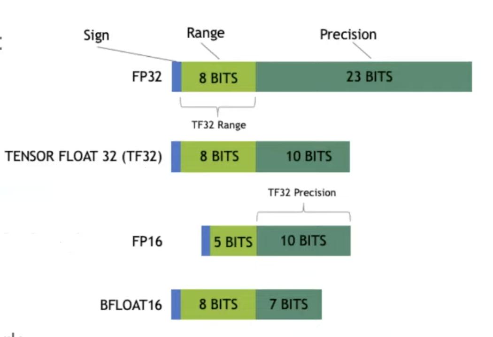
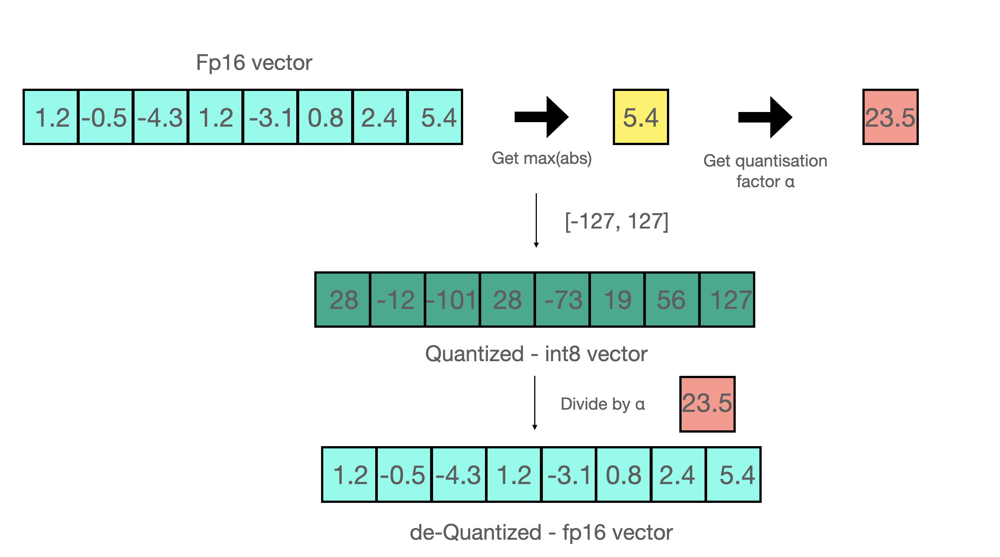
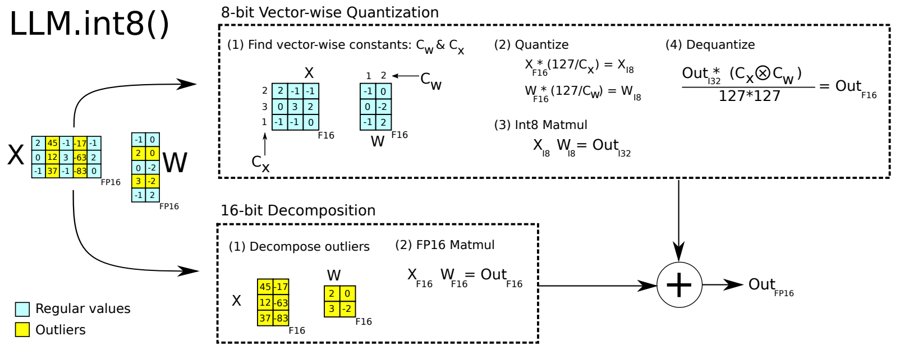
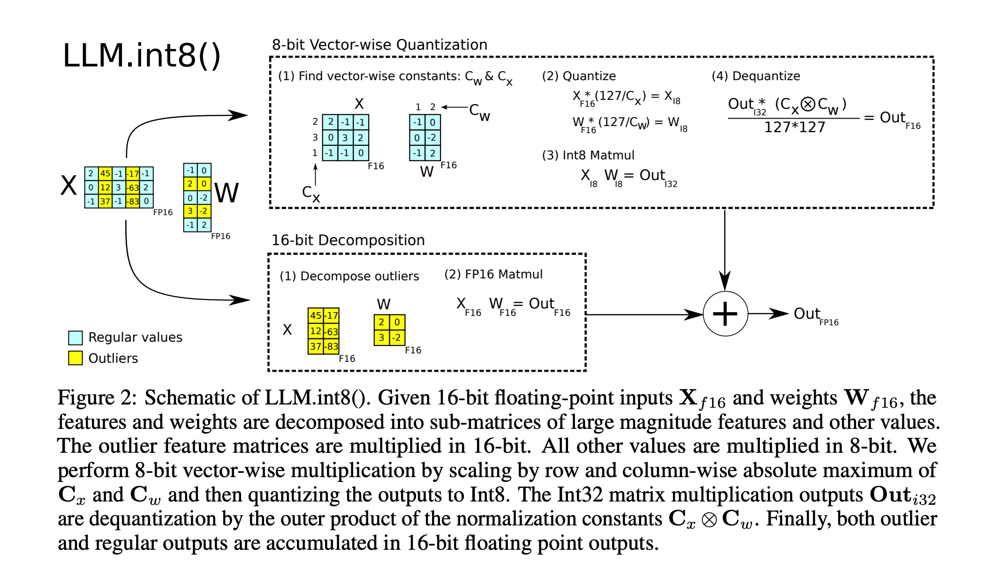
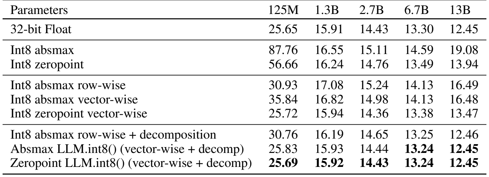

# 第 08 讲：LLM.int8() 量化与 bitsandbytes

这一讲先弄清一件事：**把小数用一个较短的整数编号保存，怎样找回它近似的大小？** 再看矩阵里少数特别大的数为什么会破坏这个近似，最后沿原 notebook 追到 OPT 模型加载和生成文本。

日常顺着本页读即可。需要看原语句时打开 [Python 中文注释版](代码/tutorials/LLM.int8_代码注释.py)；需要原保存输出时打开 [注释 notebook](代码/tutorials/代码注释.ipynb)。两份原 notebook 已下载在本仓库，原文件、历史输出与旧验证均保留。旧的完整源码分析收在文末“第二遍对照”，本轮的新算例证据在 [基础改写验证](复现/outputs/基础改写验证.json)。

## 1. 先区分数值与保存格式【必须会】

模型的权重是大量数值，例如某个线性层里的 `0.1`、`-0.2`。线性层用这些数乘输入并相加。**参数**是模型保存的权重；**激活**是当前输入经过模型时产生的中间数值。两者都占空间，但保存多久、能否预先处理不同。

一个 bit 只能表示 0 或 1；8 bit 是 1 byte。FP16 是用16 bit表达带小数的浮点数，一项占2 byte；有符号 int8 是8 bit整数，一项占1 byte，只能直接表示 −128 到127之间的整数。**不能直接把0.1转为int8然后期待它还是0.1。** 本讲用整数加一份“尺度”来间接记录小数。

原单元2先复习浮点格式，图已放在这里：



出处：固定课程仓库原 `imgs/floats-rep.png`，不是本次从 LLM.int8() 论文截取的图。Sign是符号，Range对应指数部分，Precision对应小数精度；TF32的图示表示计算精度，不能据此推导一个独立19 bit存储类型。这里先记住：浮点数的指数帮助表示不同数量级；int8没有同样的指数结构，需要额外尺度。

6.7B中的B是十亿，6.7B即约67亿个参数。仅按每项权重算，FP16需约13.4 GB，int8需约6.7 GB。实际还要尺度、少数浮点层、中间结果、生成时的缓存等空间，不能直接得出“整模型显存一定减半”或“8 GB卡一定能运行”。

## 2. 用三个数亲手做一次量化【必须会】

**量化（quantization）**是在有限的可表示值中，给原数找一个近似值。**反量化（dequantization）**是按尺度把整数编号换回浮点大小，不会自动找回已经舍掉的小数。

先取一行数 $x=[0.1,0.2,1.0]$。本讲的对称 absmax 方案用 −127 到127，正负两侧以0为中心；int8还可表示−128，但这里不用它。取绝对值就是去掉正负号，`absmax`就是绝对值中的最大数：

$$c=\max_k|x_k|=1,\qquad q_k=\operatorname{round}(127x_k/c),\qquad \widehat{x}_k=q_kc/127.$$

这里 $k$ 是位置编号，$x_k$ 是该位置原数；$c$ 是这行共同保存的最大绝对值；$q_k$ 是量化后的整数；`round`表示舍入到最近整数；帽子 $\widehat{x}$ 表示恢复出的近似值。先乘 $127/c$ 放大，再舍入，恢复时乘相反的 $c/127$。

| 原数 $x_k$ | 乘127后的数 | 整数 $q_k$ | 反量化 $\widehat{x}_k$ |
|---|---:|---:|---:|
| 0.1 | 12.7 | 13 | 0.102362… |
| 0.2 | 25.4 | 25 | 0.196850… |
| 1.0 | 127 | 127 | 1.0 |

两个相邻整数恢复后相差 $\Delta=c/127$，叫量化步长。在没有截断、尺度精确等理想条件下，最近舍入误差不超过半个步长。**尺度越大，格子越粗。** 只保存整数13、不保存尺度，无法知道它原来接近0.1还是10。

课程单元5的示意图也直接保留：



出处：固定课程原 `imgs/quant-freeze.png`。从左往右先求最大绝对值5.4，得到因子 $127/5.4\approx23.52$，往下换为整数，再除以因子。图用少量小数位展示恢复结果，**不能把画面相同的小数理解为逐位无损**。例如 $-4.3\times127/5.4\approx-101.13$，舍入为−101；再除回因子约得−4.2945，并非原数−4.3。

下面是补充教学代码，不改原单元7–17。`numpy`处理数值数组，`as np`给它起简称；`np.array`建立一行数，`dtype`指定保存类型，`float64`用64 bit浮点数以便看清误差。`.max()`取最大值，`np.rint`做最近舍入，恰好半整数时取偶数；`.astype`返回指定类型的新数组。

```python
import numpy as np

x = np.array([0.1, 0.2, 1.0], dtype=np.float64)
c = np.abs(x).max()
q = np.rint(x * 127 / c).astype(np.int8)
restored = q.astype(np.float64) * c / 127
print("整数、类型、字节:", q, q.dtype, q.nbytes)
print("恢复:", restored)
print("误差:", restored - x)

# 把最后一项变成100，其他小数没有变化。
x_large = np.array([0.1, 0.2, 100.0], dtype=np.float64)
c_large = np.abs(x_large).max()
q_large = np.rint(x_large * 127 / c_large).astype(np.int8)
restored_large = q_large.astype(np.float64) * c_large / 127
print("有大值后的整数、恢复:", q_large, restored_large)
```

前一行整数是 `[13,25,127]`，只含3个int8值的数组占3 byte；原三个float64值占24 byte，尺度等额外数据未算在3 byte里。换成100后得到 `[0,0,127]`，原来的0.1和0.2都恢复成0。因为此时一步约0.7874，它们都挤在0附近。异常值可以为负；关键是绝对值，不是“正数大才有问题”。

原单元10使用 `torch.round(scaled)`，这个函数舍入数值但仍返回浮点张量；还要 `.to(torch.int8)` 才真正变成int8存储。**变量名叫 `int8val` 不会改变数据类型。** 另外全零向量的 $c=0$ 不能直接当除数，后面的补充函数会处理。

## 3. 先会读一行乘一列，再读向量级量化【必须会】

**矩阵**是按行列排好的数表。输入矩阵 $X$ 的形状 `shape=[b,h]`，表示b行、每行h个特征；权重矩阵 $W$ 形状 `[h,o]`，把h个输入特征组合成o个输出。一次矩阵乘法写成：

$$Y=XW,\qquad [b,h]@[h,o]\longrightarrow[b,o],\qquad Y_{ij}=\sum_{k=0}^{h-1}X_{ik}W_{kj}.$$

`@`在Python里表示矩阵乘法；$i$选输入行，$j$选输出列，$k$遍历要配对相乘的特征。$\sum$表示把每一项相加。中间两个h要相同。这里b只是“待处理的行数”，语言模型可把一批（batch）样本里所有token的位置展开为这些行；token是分词器切出的文本单位，例如一个字、词或词片段，不能一律当batch size。

本讲沿用原单元25和论文图2的同一组数：

$$X=\begin{bmatrix}2&45&-1&-17&-1\\0&12&3&-63&2\\-1&37&-1&-83&0\end{bmatrix},\quad
W=\begin{bmatrix}-1&0\\2&0\\0&-2\\3&-2\\-1&2\end{bmatrix}.$$

$X$是 `[3,5]`，$W$是 `[5,2]`，结果是 `[3,2]`。例如第0行第0列：$2(-1)+45(2)+(-1)(0)+(-17)(3)+(-1)(-1)=38$。另一个输出列有另一组权重；最终原始参考值为 `[[38,34],[-167,124],[-174,168]]`。

**向量（vector）**在这里就是一行或一列数。向量级量化不给整个大矩阵只配一个尺度，而是给 $X$ 每一行一个尺度、给 $W$ 每一列一个尺度：

$$a_i=\max_k|X_{ik}|,\quad d_j=\max_k|W_{kj}|,\quad
Q^X_{ik}=\operatorname{round}(127X_{ik}/a_i),\quad Q^W_{kj}=\operatorname{round}(127W_{kj}/d_j).$$

$Q^X,Q^W$保存为int8。先作整数乘加 $I=Q^XQ^W$，再恢复 $\widehat Y_{ij}=I_{ij}a_id_j/127^2$。这里 $I$ 是int32累加结果，用32 bit有符号整数保存；两个127相乘已是16129，用int8存不下。真实内核可用int8输入、int32累加，下面CPU演示会显式转int32再相乘以保证累加宽度，不能据此测出GPU速度。

为什么恢复时要乘两个尺度？一行和一列都曾各乘一次127、各除一次自己的尺度，所以乘积要除 $127^2$、乘回 $a_id_j$。如果尺度数组是 `[b,1]` 和 `[1,o]`，相乘会**广播**：前者向每列重复，后者向每行重复，得到 `[b,o]`，每个位置正好是 $a_id_j$。这是外积，不是把两个一维数组直接作内积求一个数。

## 4. 原论文图2：把大值对应的特征另外计算【必须会】

即便按行、列分别量化，一个输入行里有极大值时，同行的小值仍会吃亏。LLM.int8()再做一步：把少数异常特征对应的贡献交给浮点分支，普通特征走整数分支，最后相加。下面是**直接从原PDF截下的图2**：



出处：[LLM.int8()，arXiv:2208.07339v2](https://arxiv.org/pdf/2208.07339v2)，2022-11-10，PDF第3页Figure2。原PDF直接渲染裁剪，未重画；图注的相关意思已放在下面，读本页即可。

沿箭头读，不需要先懂框内全部英文：

1. **左边两张表是原输入和权重。** 黄色选中的是输入 $X$ 的整列：0起算编号1、3，以及 $W$ 对应的整行1、3。不是只挑出数45单独计算，也不是挑权重自己最大的列。
2. **上方蓝色普通分支。** 留下输入列0、2、4，得到 $X_R:[3,3]$；权重取行0、2、4，得到 $W_R:[3,2]$。Find vector-wise constants求尺度，本例 $C_x=[2,3,1]^T$，$C_w=[1,2]$；上标T表示转置，即把横排的三个数竖成一列。Quantize缩放并舍入到int8；Int8 Matmul得到int32的 `[3,2]`；Dequantize乘回尺度，回到浮点 `[3,2]`。图中 $\otimes$在这里表示上述尺度外积。
3. **下方黄色异常分支。** 取 $X_O:[3,2]$ 与 $W_O:[2,2]$ 作FP16矩阵乘法，得到另一张 `[3,2]`。这里不再让这些输入大值挤占普通分支的量化刻度。
4. **右边加号。** 两张同形状的输出逐项相加；图示最终输出FP16。两条路都来自同一个原矩阵乘法，不是新增一套需要训练的LoRA参数。

$R$表示普通特征编号集合，$O$表示异常特征编号集合，两者不重叠且覆盖所有特征。矩阵乘法的求和可以拆成两组，因此在不做量化时严格成立：

$$XW=X_RW_R+X_OW_O.$$

本例第0个输出38可以拆成普通贡献 $2(-1)+(-1)(0)+(-1)(-1)=-1$，加异常贡献 $45(2)+(-17)(3)=39$，得到38。量化后普通贡献近似为−0.992126，再加39约为38.007874。因此**分解本身是等式，量化后的总结果通常仍是近似**。FP16支路也有自己的舍入，不能称数学上永远无损。

怎么选黄色列？本例以 $\max_i|X_{ik}|>6$ 为条件，$k$是一列特征，找出其中至少一项绝对值大于6的列，于是得到1、3。6是这里使用的阈值，不是列号，也不是适合所有模型的数学常数。论文§4研究跨层异常现象时还加了出现比例的统计筛选；不要把那些跨层统计条件当作本补充函数必须跑遍全模型的步骤。

课程单元24保存的原图如下，留作 notebook 的就地对照；它与上面的原PDF截图表达同一方法。



出处：固定课程原 `imgs/llm-int8.png`。图中文字F16、I8、I32分别表示16位浮点、8位整数、32位整数，名称需要与实际代码类型逐一核对。

## 5. 把图里的每条路真正算出来【必须会】

下面是本轮独立补充，输入仍是图2的原数。先定义函数再调用：`def`把一段操作命名；`return`把结果交给调用处；`axis=1`按每行、`axis=0`按每列求最大值；`keepdims=True`保留长度为1的维度以便广播。`np.where(条件,值1,值2)`按位置选择，将零尺度替换为1，只为避免除0；该行原本全0，仍会量化为0。`np.flatnonzero`给出条件为真的位置编号，`~mask`把真假反转，`X[:, O]`表示所有行、只取编号O的列；`W[O, :]`则只取那些行。

```python
import numpy as np

def quantized_product(A, B):
    # A[m,k]、B[k,n]；本例k很小，int32足够累加。
    ca = np.abs(A).max(axis=1, keepdims=True)
    cb = np.abs(B).max(axis=0, keepdims=True)
    ca = np.where(ca == 0, 1.0, ca)
    cb = np.where(cb == 0, 1.0, cb)
    qa = np.rint(A * 127 / ca).astype(np.int8)
    qb = np.rint(B * 127 / cb).astype(np.int8)
    accumulator = qa.astype(np.int32) @ qb.astype(np.int32)
    restored = accumulator.astype(np.float64) * (ca * cb) / (127 * 127)
    return restored, qa, qb, accumulator

X = np.array([[2,45,-1,-17,-1], [0,12,3,-63,2], [-1,37,-1,-83,0]], dtype=np.float64)
W = np.array([[-1,0], [2,0], [0,-2], [3,-2], [-1,2]], dtype=np.float64)
reference = X @ W
mask = np.abs(X).max(axis=0) > 6
O = np.flatnonzero(mask)
R = np.flatnonzero(~mask)
regular, qx, qw, acc = quantized_product(X[:, R], W[R, :])
# 显式FP16异常分支；其结果再转float64，便于观察合并后的细小误差。
outlier = X[:, O].astype(np.float16) @ W[O, :].astype(np.float16)
mixed = regular + outlier.astype(np.float64)
full, _, _, _ = quantized_product(X, W)
print("普通/异常编号:", R, O)
print("普通输入整数:\n", qx)
print("整数/累加/异常支路类型:", qx.dtype, acc.dtype, outlier.dtype)
print("参考:\n", reference)
print("分解后:\n", mixed)
print("全部量化最大误差:", np.abs(full - reference).max())
print("分解量化最大误差:", np.abs(mixed - reference).max())
```

这段函数不修改传入的A、B，返回四个新数组。对图2的普通支路，变量可以这样对照：

| 变量 | 来源/含义 | dtype | shape |
|---|---|---|---|
| `A`、`B` | 调用处取出的 `X[:, R]`、`W[R, :]` | float64 | [3,3]、[3,2] |
| `ca`、`cb` | 每输入行/权重列的尺度 | float64 | [3,1]、[1,2] |
| `qa`、`qb` | 舍入后的普通输入与权重编码，返回后命名 `qx`、`qw` | int8 | [3,3]、[3,2] |
| `accumulator` | 整数相乘相加，返回后命名 `acc` | int32 | [3,2] |
| `restored` | 乘回尺度，返回后命名 `regular` | float64 | [3,2] |
| `outlier` | 异常输入列与对应权重行的乘积 | float16 | [3,2] |
| `mixed` | 普通和异常贡献合并 | float64 | [3,2] |

`regular`是普通支路的近似浮点输出；`outlier`是异常支路输出；`mixed`是两者之和。`full`是不用分解、直接把全部特征作向量级量化的比较项。`full, _, _, _`只保留第一个返回值，后面不关心的返回值用变量 `_`接住；函数仍返回四项，并未省略内部计算。

本次CPU实际结果：普通编号 `[0,2,4]`，异常编号 `[1,3]`，`qx`为 `[[127,-64,-64],[0,127,85],[-127,-127,0]]`。分解后的输出约为：

$$\begin{bmatrix}38.007874&34\\-167.007874&124.015748\\-174&168\end{bmatrix}.$$

最大绝对误差从全部量化的约1.094054降到约0.015748。这里的“最大误差”是6个输出位置与参考值相减、取绝对值、再取最大一个；它不是语言模型的准确率。本函数是CPU教学实现，普通支路恢复与最终合并使用float64以看清误差；**没有模拟图中最终FP16舍入，也没有调用bitsandbytes的GPU内核**。本例至少有普通列与异常列，未将函数包装成覆盖空矩阵和所有模型设置的通用量化库。

### 原单元为什么会让你误以为“完全没有误差”

原单元36写 `X_i8 = X_reg * (127 / Cx)`，没有舍入，也没有 `.astype(np.int8)`；`W_i8`同样如此。接下来单元38的 `Out_i32`、43的 `Out_f16_1`实际上也都是float64。只缩放再按相反因子恢复，代数上会抵消，这不能验证“真正8bit无损”。原单元45也没有转换FP16；其实际类型记录见旧验证，不能靠 `Out_f16_2`这个变量名判断。

单元22的伪代码还把 $W$形状写成 `[b,o]`，按矩阵相乘应为 `[h,o]`；恢复尺度需要 `[b,1]`与`[1,o]`的外积。原 notebook 和中文注释文件已经保留这些原语句，并明确指出差异；上面的代码是带真实舍入与类型转换的独立补充。

## 6. 论文表1究竟证明了什么【建议会】

数值小例子只证明这组数的误差变小，还需要看完整语言模型预测有没有变差。**语言模型**根据前文给下一个token分配概率；**perplexity（困惑度）**把真实后续token的预测概率汇总成一个指标，同一数据和评测流程下通常越低越好。它不是百分比，也不是聊天回答的人工满意度。



出处：[同一固定原PDF](https://arxiv.org/pdf/2208.07339v2)，第6页Table1，直接截图。原表注的要点是比较125M到13B模型的量化退化与分解后的恢复；M是百万、B是十亿。C4是用于语言建模的文本数据集，这里报告其验证集上的预测表现。

先只看最右13B一列，再回来看其他大小：32-bit Float基线为12.45；Int8 absmax vector-wise为16.48；加入分解的Absmax LLM.int8()为12.45。两种量化方法在这个指标上相差4.03，分解版与浮点基线在表中保留的两位小数相同。这支持“在该C4验证设置里，分解有效缓解量化退化”，不能推出所有样本的原始预测分数（logits）逐位相同、所有任务都无损或所有设备都更快。

`row-wise`与`vector-wise`是不同尺度划分；`zeropoint`是再引入偏移量的量化，区别于正文只讲的对称absmax。比较时应看同一个模型大小、同一个数据和指标，不能拿125M的一格和13B的一格只归因于算法。表中没有给出所有硬件延迟和误差条；量化、反量化本身有开销，本讲没有测速度。本文问题/动机在§1，量化基础§2.1，向量级与分解§3.1–3.2，评测§3.3–3.4，异常现象§4，限制和速度补充在§6及附录D。

## 7. 回到原 notebook：模型是怎样用上这个方法的【必须会】

单元0–46是上面的数值教学。单元48–54才走文本推理：`sample`文字 → tokenizer得到整数ID → 加载OPT及量化层 → `generate`产生后续ID → `decode`变回文字。这里没有训练dataset、loss或optimizer，也没有新adapter训练。

| 代码位置 | 名称和调用者 | 输入、输出与需要理解的变化 |
|---|---|---|
| 主0 | `import`、`Image` | 导入库；`Image`用于显示本地图片，不做量化 |
| 主2/5/24 | 三张图片 | 已在本页对应位置内嵌 |
| 主7–17 | `torch.randn/abs/max/round/float` | 随机5个数→最大绝对值→缩放→舍入→恢复→平均绝对误差；不等于int8存储 |
| 主25–46 | NumPy矩阵操作 | 原3×5和5×2→按列/行拆分→缩放→相乘→恢复→求和；真实类型区别见上一节 |
| 主48 | 注释掉的 `pip install` | 是环境安装提示，注释状态不会执行，不能据此确定讲师精确版本 |
| 主49/51 | `AutoTokenizer.from_pretrained` | 类的加载方法，根据模型名拿分词器；`input_ids`通常是int64的 `[1,L]`，L是prompt token数 |
| 主52 | `AutoModelForCausalLM.from_pretrained` | 根据模型名建立用于预测后续token的模型；课程传 `load_in_8bit=True` 和 `device_map="auto"`，后者让加载器安排设备 |
| 主53 | `model.generate` / `tokenizer.decode` | 实例方法；输入ID产生更长的ID序列，再转文字，不直接给文本小数作量化 |
| 主54 | `model.named_parameters()` | 逐个返回参数名和对象，查看dtype/device；单看一个参数的类型不足以说明所有中间计算 |
| 辅助1–2 | `BitsAndBytesConfig` | 导入配置类，说明4bit/8bit开关互斥，不是另一份完整量化算法 |

`类`是对象的结构定义，例如分词器类；加载方法创建并返回实际对象；`model.generate(...)`是对某个模型对象调用方法。`from_pretrained`会访问外部模型文件，不能把它当一个无需资源的数学函数。本轮没有执行下载大模型。

原单元50会设置HTTP/HTTPS代理为 `127.0.0.1:7890`，这是讲师本机配置；本轮不执行它，也不要求读者照抄。单元51模型名 `facebook/opt-6.7b`指基础模型，不是本地已经加载的模型。

### 量化层与生成开关分别管什么

在固定的 [Transformers v4.30.0集成源码](https://github.com/huggingface/transformers/blob/v4.30.0/src/transformers/utils/bitsandbytes.py) 中，加载器用 `replace_with_bnb_linear`替换符合条件的线性层。替换后的计算路径是 `Linear8bitLt.forward → bnb.matmul → MatMul8bitLt.forward`；`Int8Params`承载权重及量化相关状态。这些具体类属于bitsandbytes，实现参照固定 [0.39.1提交](https://github.com/bitsandbytes-foundation/bitsandbytes/tree/4395d68cf6beda911c1c3e5633debf15652e2902)。这些历史版本用于解释，未找到讲师精确安装版本，不声称完全一致。

`forward`是层对输入做计算的方法。PyTorch `Linear`保存的weight形状是 `[o,h]`，使用时有转置；论文写 $W:[h,o]$，两者方向不同但可表达同一乘法。`lm_head`等跳过项、embedding、归一化以及其他操作不一定量化；token ID仍是整数索引，不能把它们变成int8导致词表编号溢出。推理时当前激活才被观察并量化，和“预先把所有权重永久转换好”也有区别。

配置 `llm_int8_threshold`决定激活异常值分流阈值，HF相关配置默认6；直接构造历史bitsandbytes层时threshold默认0，不能混为同一默认。`has_fp16_weights`影响是否另留浮点权重；若只存量化权重，异常支路所需的权重可能从量化状态恢复，不能保证每个权重一直保有原FP16数。底层状态、布局与内核细节第二遍再读。

生成参数是另一件事。原单元51定义 `MAX_NEW_TOKENS=128`，但53实际传的是 `max_length=MAX_NEW_TOKENS`，它限制**输入加输出的总token数**；`max_new_tokens=128`才是最多新生成128个。变量名不会改变API含义。原decode解码整个返回序列，因此包括prompt；`skip_special_tokens=True`只跳过特殊token，不负责去掉prompt。

辅助 notebook 提示的互斥也可以直接理解：想用8bit就开启 `load_in_8bit`，想用4bit就开启 `load_in_4bit`，不能同时开。两者都关则不选这两种量化。配置对象只是参数集合，创建它不等于GPU已完成量化。本轮CPU没有安装bitsandbytes，不评价真实OPT6.7B量化加载效果。

## 8. 本次读到哪里、实际验证到哪里

本页新算例直接提取后实际执行，核对整数编码、异常列选择、真实dtype、参考矩阵、两种误差与全零尺度；两张原论文截图和三张课程原图已逐张查看。截图来源和哈希见 [论文截图来源](复现/outputs/论文截图来源.json)。

此前已完成原/注释notebook各32主格CPU执行，并在随机小OPT上下文核对生成长度、辅助配置等，证据原样保留在 [复现目录](复现/README.md)。那些历史实验没有在本轮重跑；本轮补充算例也不冒充原OPT6.7B/CUDA/C4论文复现。完整单元定位在 [代码单元解释](代码单元解释.md)，原56格加辅助3格全部保留。

<details>
<summary>第二遍对照：旧版完整单元、历史源码与复现细节（保留）</summary>

# 第 08 讲：LLM.int8() 量化与 bitsandbytes

本讲回答三个问题：浮点数怎样压缩成整数、异常特征为什么使普通量化失效、`load_in_8bit=True` 怎样改变模型里的线性层。最需要记住的是：LLM.int8() 将普通特征与异常特征分开计算，再把贡献相加；整个 Transformer 并没有变成纯整数网络。

**阅读入口：**[详细中文代码注释 notebook](代码/tutorials/代码注释.ipynb) · [Python代码阅读版](代码/tutorials/LLM.int8_代码注释.py) · [全部单元说明](代码单元解释.md)。主notebook全部56格、辅助bitsandbytes全部3格均已说明；37+1个代码格（含空格）、Markdown22伪代码及三张原图都覆盖。原文件下载字节与历史输出保留，实际新结果见本讲复现目录。

## 1. 阅读地图、原材料与版本

论文为 Tim Dettmers 等人的 **LLM.int8(): 8-bit Matrix Multiplication for Transformers at Scale**，本次核对 [arXiv v2，2022-11-10](https://arxiv.org/html/2208.07339v2)。方法主线在 §2.1、§3.1、§3.2；图 2 对应本讲拆分矩阵示例；§3.3–3.4 检查量化后的指标；§4 分析异常特征；§6 与附录 D 讨论限制和速度。没有制作中文论文 PDF。

课程代码固定在提交 `7fbc29824171fd07dc2c30fe922e61ebc018ad1d`：

- [LLM.int8.ipynb](https://github.com/chunhuizhang/personal_chatgpt/blob/7fbc29824171fd07dc2c30fe922e61ebc018ad1d/tutorials/LLM.int8.ipynb)：56 个单元，包含数值示意与 OPT 加载入口。
- [bitsandbytes.ipynb](https://github.com/chunhuizhang/personal_chatgpt/blob/7fbc29824171fd07dc2c30fe922e61ebc018ad1d/tutorials/bitsandbytes.ipynb)：只有 3 个单元，导入 `BitsAndBytesConfig` 并提示 4/8-bit 配置互斥，没有完整底层实现。
- [Transformers v4.30.0 集成代码](https://github.com/huggingface/transformers/blob/v4.30.0/src/transformers/utils/bitsandbytes.py)：解释课程时代的模型替换。
- [bitsandbytes 0.39.1 源码](https://github.com/bitsandbytes-foundation/bitsandbytes/tree/4395d68cf6beda911c1c3e5633debf15652e2902)：固定 SHA `4395d68cf6beda911c1c3e5633debf15652e2902`，辅助解释 `Linear8bitLt`、`Int8Params`、`MatMul8bitLt`。这是可核验的历史参照，不能断言讲师当时安装的就是这个版本。

此前检查E:\ 根目录现有文本的开头与关键词时，未找到明确对应第08讲的字幕；本篇不把其他讲的量化片段冒充本讲字幕。原文件已直接放入本仓库：[LLM.int8.ipynb](代码/tutorials/LLM.int8.ipynb) · [bitsandbytes.ipynb](代码/tutorials/bitsandbytes.ipynb)。两份说明/注释主notebook各113格，辅助各7格；原格保持原编号。原保存输出与本次验证分开记录。

### 仓库与执行路径

| 层次 | 入口/对象 | 本讲作用 |
|---|---|---|
| 教程入口 | notebook 单元 0–46 | 看浮点缩放与矩阵分解，不训练模型 |
| 文本数据 | 单元 51 的 `sample` | 一条英文 prompt，无训练 dataset |
| tokenizer | `AutoTokenizer.from_pretrained` | 文本变成 token ID |
| 加载配置 | `from_pretrained(load_in_8bit=True)` | 加载时替换可量化线性层 |
| 层替换 | `replace_with_bnb_linear` | 建立 `Linear8bitLt` 层结构 |
| 参数状态 | `Int8Params` | 保存量化值、尺度等状态 |
| 核心计算 | `Linear8bitLt.forward → bnb.matmul → MatMul8bitLt.forward` | 量化、整数累加、反量化、异常支路求和 |
| 解码 | `generate → tokenizer.decode` | 自回归生成 ID，再还原文本 |
| loss/optimizer/checkpoint | 本 notebook 未找到 | 没有训练 loop 或完整论文评测 |

阅读顺序是 `sample → input_ids → model load → OPT Linear → 量化矩阵乘法 → logits → generate → decode`。每生成一个 token 会多次经过这些线性层；量化算法不负责 BPE 分词，也不定义生成采样策略。

## 2. 单个向量：量化是有损编码【必须会】

单元 0 导入 `Image`、`numpy as np`、`torch`、`nn`。`as np` 是给模块起简写；`from torch import nn` 只取命名空间，后面的示意没有定义网络。单元 2、5 展示图片，不执行量化。

单元 7–12 的原代码主线：

```python
a = torch.randn(5)
a_max = torch.abs(a).max()
scaled = (a/a_max)*127
int8val = torch.round(scaled)
fp32val = int8val.float() * a_max / 127
torch.abs(fp32val - a).mean()
```

`torch.randn(5)` 生成形状 `[5]` 的标准正态随机向量；未设 seed，重跑的值与误差会变。`abs` 取绝对值，`max()` 不传维度时把整个向量缩成标量。标量除法通过 broadcasting 应用到每个元素。`round` 舍入到最近整数，但**不改变张量 dtype**：默认 FP32 输入的 `int8val` 仍为 FP32。名字里出现 `int8` 并不能证明占一个字节；真正存储需要 `.to(torch.int8)`。这里的 `.float()` 也不能反过来证明前一步是整数 dtype。

设原向量为 $x\in\mathbb R^n$，$c=\max_{0\le i<n}|x_i|$ 为绝对最大值。采用对称量化：

$$
q_i=\operatorname{round}\left(127\frac{x_i}{c}\right),\qquad
\hat x_i=\frac{c}{127}q_i.
$$

$q_i$ 是整数编码，$\hat x_i$ 是重建的浮点值；$c$ 必须随编码保存，否则无法知道整数 64 原来代表多大的数。这里用 `[-127,127]`，虽然有符号 int8 可表示 `[-128,127]`，对称方案不使用 -128。`factor=127/c` 是量化的放大倍数；反量化乘的是倒数 $c/127$，不要混淆。

例如 $x=[0.1,0.2,1]$，$c=1$，编码为 `[13,25,127]`，重建约 `[0.102362,0.196850,1]`。舍入导致前两个数不再精确；最后一个恰好落在端点。量化步长为 $\Delta=c/127$，理想实数运算中舍入误差不超过 $\Delta/2$；实际浮点和溢出还会带来额外误差。

| 变量 | 来源/含义 | 类型与 shape | 下一步 |
|---|---|---|---|
| `a` | 随机浮点向量 | 默认 FP32 `[5]` | 求 absmax |
| `a_max` | 绝对值最大的幅度 | FP32 标量 `[]` | 缩放 |
| `scaled` | 映射到整数编码范围 | FP32 `[5]` | 舍入 |
| `int8val` | 原代码的整数值浮点容器 | FP32 `[5]` | 反量化 |
| `fp32val` | 重建向量 | FP32 `[5]` | 与原值比较 |
| `.mean()` | 所有位置绝对误差均值 | FP32 标量 | 教学误差指标 |

修正后的实际存储示意：

```python
c = a.abs().max()
safe_c = c.clamp_min(1e-12)
q = torch.round(a / safe_c * 127).clamp(-127, 127).to(torch.int8)
recovered = q.float() * c / 127
```

`clamp` 限制范围；`clamp_min` 为全零向量防止除零。固定很小的保护常数只是教学实现，在低精度 dtype 下要考虑这个常数是否可表示；正式库有自己的零尺度处理。`q.float()` 是为后续浮点计算转换容器，不会恢复已经舍入丢掉的信息。

单元 13 把前几步合并并打印；单元 16–17 用 `a[-1] = -5` 修改最后一个元素。`-1` 是 Python 从尾部索引。`int7val` 只是变量拼写，不是 7-bit 算法。加入大值后 $c$ 变大，普通值的编码间距变粗。例如 `0.1` 与幅度 `100` 共用尺度时，步长约 `0.7874`，`0.1` 会编码成 0。因此不能直接把异常值裁掉：它可能承载重要预测信息。

## 3. 向量级量化：每个内积用合适的尺度【必须会】

线性层的主计算是 $C=XW$。令输入 $X\in\mathbb R^{b\times h}$，权重 $W\in\mathbb R^{h\times o}$，输出 $C\in\mathbb R^{b\times o}$。$b$ 是当前参与乘法的 token/样本行数，$h$ 是输入特征数，$o$ 是输出特征数。LLM 原始激活常为 `[B,S,h]`，可展平为 `[B*S,h]`；所以这里的 $b$ 不一定等于 batch size。

每个 $C_{ij}=\sum_{k=0}^{h-1}X_{ik}W_{kj}$ 都是输入一行和权重一列的内积。定义输入行 absmax 与权重列 absmax：

$$
a_i=\max_k|X_{ik}|,\quad d_j=\max_k|W_{kj}|,
\quad Q^X_{ik}=\operatorname{round}(127X_{ik}/a_i),
\quad Q^W_{kj}=\operatorname{round}(127W_{kj}/d_j).
$$

先计算整数累加 $I=Q^XQ^W$，再按输出位置恢复尺度：

$$
\hat C_{ij}=I_{ij}\frac{a_i d_j}{127^2}.
$$

这是论文式 (7) 的 absmax 形式。论文用放大倍数 $c_x,c_w$，教程 `Cx,Cw` 存的是 absmax，两者互为含 127 因子的倒数，不能仅凭变量名混用。$a\in\mathbb R^{b\times1}$ 和 $d\in\mathbb R^{1\times o}$ 做外积，得到 `[b,o]` 的恢复尺度。这里不是两个一维数组做 `@` 的内积。

原 Markdown 单元 22 的问题：`B: [b,o]` 应为 `[h,o]`；`absmax_A_vec @ absmax_B_vec` 必须明确二维列向量与行向量才是外积；代码还须舍入、dtype 转换与零尺度保护。公式结构正确不代表该 Markdown 能直接运行。

PyTorch 的 `nn.Linear(h,o)` 保存 `weight.shape == [o,h]`，forward 相当于 `X @ weight.T + bias`。因此 paper 的 $W$ 对应库权重的转置。bitsandbytes 若对保存的 `[o,h]` 权重按行取尺度，恰好对应 paper 的 `[h,o]` 按列取尺度。

为什么累加器需要 int32？单个 int8 乘积最多达 $127^2=16129$，许多特征乘积相加很快超过 int8。**存储 dtype、乘法输入 dtype、累加 dtype、返回 dtype 是四件事。**普通量化支路的整数累加结果通常为 int32，反量化后又回到浮点。

## 4. Mixed-precision decomposition：拆特征，再相加【必须会】

用输入幅度判定异常特征集合：

$$
O=\{k\mid 0\le k<h,\ \max_i|X_{ik}|>\alpha\},\qquad R=\{0,\ldots,h-1\}\setminus O.
$$

$\alpha$ 是阈值，$O$ 记录特征列的下标，不记录需要删除的 token。选中某一特征后，这一列所有 token 的贡献都进入异常支路。相应的权重需要选行，因为 paper 的 $W$ 以输入特征为行。阈值 6.0 是论文方法的经验设置，HF 的 `llm_int8_threshold` 默认也为 6.0；它不是“第 6 个特征”，也不是对整数编码阈值作比较。[官方配置说明](https://huggingface.co/docs/transformers/en/quantization/bitsandbytes)

矩阵乘法可以沿求和维度精确拆开，然后仅对普通支路近似：

$$
C=X_{:,R}W_{R,:}+X_{:,O}W_{O,:}
\approx \operatorname{Dequant}(Q(X_{:,R})Q(W_{R,:}))+X_{:,O}W_{O,:}.
$$

这是式 (8) 的分块写法。异常分支使用浮点乘法，并不把重要特征置零丢弃；整数分支中置零，是为了避免它们被重复计算。FP16 支路本身仍有浮点舍入，因此“高精度保留”不意味着数学上的无误差。

图 2 可按以下方向读：左侧输入 $X$ 与 $W$ → 按特征拆分 → 上方普通支路求行/列尺度、量化、整数乘法、反量化 → 下方异常支路浮点乘法 → 两路 `[b,o]` 结果求和。尺度不是可训练参数；特征索引也不是新神经网络层。量化权重可以缓存，而激活随着 prompt/生成步骤变化，不能当成永远固定的数组。


图中左侧黄色列是异常输入特征，权重对应黄色行，青色部分送入上方普通支路。两路箭头指向加号，均返回同一输出shape。图中FP16/int8/int32标识是算法预期；原NumPy代码没有实现全部dtype转换，应以真实变量dtype判断。

## 5. 完整走通 notebook 的 3×5 数值例子

单元 25–27：

```python
X = np.asarray([[2, 45, -1, -17, -1],
                [0, 12, 3, -63, 2],
                [-1, 37, -1, -83, 0]])
W = np.asarray([[-1, 0], [2, 0], [0, -2], [3, -2], [-1, 2]])
X_reg = X[:, [0, 2, 4]]
W_reg = W[[0, 2, 4], :]
X_out = X[:, [1, 3]]
W_out = W[[1, 3], :]
```

`np.asarray` 将嵌套列表转换成 ndarray；这里列表只有整数，没有声明 `float16`。`:` 表示这一轴全部保留，列表 `[0,2,4]` 为高级索引。`X[:, ids]` 取列，`W[ids,:]` 取行；两者沿同一特征维拆开。教程手工选择 `[1,3]`，本次脚本用阈值自动得到相同结果。

| 变量 | shape | 本例的维度含义 |
|---|---|---|
| `X` | `[3,5]` | 3 行输入，5 个特征 |
| `W` | `[5,2]` | 5 输入特征，2 输出特征 |
| `X_reg / W_reg` | `[3,3] / [3,2]` | 3 个普通特征 |
| `X_out / W_out` | `[3,2] / [2,2]` | 2 个异常特征 |
| 两个支路输出 | 都是 `[3,2]` | 求和恢复同一个输出空间 |

直接算第一行第一列：`2*(-1)+45*2+(-1)*0+(-17)*3+(-1)*(-1)=38`。完整基准为：

```text
[[  38,  34],
 [-167, 124],
 [-174, 168]]
```

单元 33 求尺度：

```python
Cx = np.max(np.abs(X_reg), axis=1)[:, np.newaxis]
Cw = np.max(np.abs(W_reg), axis=0)[np.newaxis, :]
```

对 `[3,3]` 使用 `axis=1`，沿列压缩，保留每一行的最大幅度，得到 `[3]`，再插入新轴变成 `[3,1]`。本例 `Cx=[[2],[3],[1]]`。对 `[3,2]` 使用 `axis=0` 沿行压缩，得到每列最大幅度 `[1,2]`，再变成 `[1,2]`。`np.newaxis` 只改变维度，方便广播，不新增数值。

单元 36、38、43 的原代码：

```python
X_i8 = X_reg * (127/Cx)
W_i8 = W_reg * (127/Cw)
Out_i32 = X_i8.dot(W_i8)
Out_f16_1 = Out_i32 * np.kron(Cx, Cw) / (127*127)
```

这段完成缩放、乘法和逆缩放，但**没有 `round`，也没有 `astype(np.int8)`**。因此 `X_i8`、`W_i8`、`Out_i32` 的名字不对应真实 dtype；由于除法是浮点，通常结果为 float64。没有舍入时，缩放与逆缩放代数上抵消，自然近乎精确恢复原结果，不能据此说明真实量化没有误差。`Out_f16_1` 也没有转换成 float16。

`np.kron` 一般是 Kronecker product；只有本例 `[3,1]` 与 `[1,2]` 的特殊形状，结果恰好是所需 `[3,2]` 外积。更直观地写 `Cx * Cw`，用广播得到相同矩阵。

可执行的 NumPy 修正版如下；教学脚本另用标准库实现，使本机无需 torch 即可验证。

```python
sx = np.where(Cx == 0, 1, Cx)
sw = np.where(Cw == 0, 1, Cw)
X_i8 = np.clip(np.rint(X_reg * 127 / sx), -127, 127).astype(np.int8)
W_i8 = np.clip(np.rint(W_reg * 127 / sw), -127, 127).astype(np.int8)
Out_i32 = X_i8.astype(np.int32) @ W_i8.astype(np.int32)
regular = Out_i32.astype(np.float64) * (Cx * Cw) / 127**2
outlier = X_out.astype(np.float64) @ W_out.astype(np.float64)
result = regular + outlier
```

先转 int32 再 `@`，防止 NumPy 在 int8 容器中累加溢出；这验证整数算术，不是调用 GPU int8 kernel。为了把量化误差与 FP16 舍入误差分开，这里反量化和异常支路使用 float64。

普通输入编码成为 `[[127,-64,-64],[0,127,85],[-127,-127,0]]`。例如第一行 `-1/2*127=-63.5` 舍入为 -64，重新缩放后不再恰好是 -1。本次结果：

```text
混合分解 + 真正舍入：
[[  38.007874,  34.000000],
 [-167.007874, 124.015748],
 [-174.000000, 168.000000]]

最大绝对误差：0.0157480315
不拆异常特征、直接向量级量化最大绝对误差：1.0940541881
```

这个例子证实舍入误差确实存在，并且在**这一组数据**上分解降低误差；它没有验证 OPT 准确率，也不证明任何输入的误差一定减少。原示例 5 个特征中 2 个异常，占 40%，为方便讲解而夸大比例，不能拿这个比例估计真实大模型显存。

单元 29–31 只是查看数组或沿轴最大值；单元 34、40–42 检查尺度及其 shape；单元 45 算异常支路；单元 46 求和。`dot` 在二维数组上执行矩阵乘法，与 `*` 的逐元素乘法不同。

## 6. bitsandbytes 底层对象与状态【建议会】

以下定位均对应已固定的 0.39.1，不能直接套到所有未来版本。

### `Linear8bitLt`：被替换的线性层

`nn/modules.py` 的 `class Linear8bitLt(nn.Linear)` 表示继承：该类保留普通线性层的输入/输出特征概念，又重写行为。`__init__` 建立对象，`self` 指当前层，`super().__init__` 调用父类初始化。`Lt` 与使用的低层矩阵乘法实现有关，不代表低秩 LoRA。

构造器主要参数 `input_features`、`output_features` 为整数，`bias=True` 决定是否保留偏置；`has_fp16_weights=True` 决定是否保留浮点主权重；**库层构造器的 `threshold` 默认是 0.0，HF 集成传入的配置默认是 6.0**，两层默认值不同。不要把手工直接创建层与 `from_pretrained` 混为同一配置。

`forward(self,x)` 接受 `[b,h]` 或 `[B,S,h]` 浮点激活，设置 `state.is_training`，根据需要移动 `CB/SCB` 等量化状态，调用：

```python
out = bnb.matmul(x, self.weight, bias=self.bias, state=self.state)
```

返回 `[b,o]` 或 `[B,S,o]` 浮点输出，且可能改变缓存状态及权重布局。这是有状态方法，不是无副作用的纯函数。原始 `weight` 的逻辑方向为 `[o,h]`。

### `Int8Params`：权重不仅有整数值

它继承 `torch.nn.Parameter`，除了参数数据，还有量化的 `CB` 和尺度 `SCB`。在 `has_fp16_weights=False` 的历史路径，迁移到 CUDA 时会量化权重并保存状态。层读取这些缓存可减少重复工作。是否保留 FP16 主副本影响显存与计算路径；仅看到一条 `param.dtype` 不能还原全部量化状态。

### `MatMul8bitLt.forward`：落实两条支路

该类继承 `torch.autograd.Function`，`@staticmethod` 表示 `forward` 不通过层对象的 `self` 调用，`ctx` 用于给 backward 保存上下文。参数 `A` 为激活，`B` 为库方向权重，`bias=None` 可选，`state` 为 `MatmulLtState`。关键步骤：

1. 三维 `A` 用 `view(-1,A.shape[-1])` 展平；`-1` 让框架根据元素总数推断行数。`contiguous()` 保证后续内存布局要求。
2. `F.double_quant(A.to(torch.float16), threshold=state.threshold)` 返回量化的行/列表示、尺度与异常项稀疏信息。这里的 `double_quant` 不是 QLoRA “对量化常数再次量化”的概念。
3. `torch.unique(coo_tensorA.colidx)` 取异常项列索引的去重集合，建立 `state.idx`；普通支路对应列清零。
4. 若保留 FP16 权重，`B[:,idx].t()` 直接提供异常支路权重；若仅保留量化权重，则提取量化列，并通过 `SCB/127` 反量化形成 `state.subB`。因此这种实现的异常支路权重不一定是完全未量化的原始权重。
5. 支持整数内核时，`F.transform` 改变物理布局，`F.igemmlt` 得到整数累加输出，`F.mm_dequant` 恢复尺度并可融合 bias。
6. `output += torch.matmul(subA,state.subB)` 加回异常贡献，最后恢复三维输出结构。

`subA:[b,|O|]`，`state.subB:[|O|,o]`，支路结果 `[b,o]`。`+=` 会更新已有输出，而非建立一个完全独立的层。若没有异常，支路跳过。若硬件/状态不走 `igemmlt`，该版本还有以浮点 `linear` 计算的 fallback；所以不能只凭类名判断每次都运行整数 CUDA kernel。低层 CUDA 实现没有在本机编译或性能验证。

## 7. `load_in_8bit` 的完整调用链【必须会】

单元 48 的三条 `pip install` 是注释，不会执行；原材料没有严格锁版本。单元 49 导入 Auto 类，其作用是从 checkpoint 的 config 选择对应 tokenizer/model 类。

单元 50 把 HTTP/HTTPS 代理设为 `127.0.0.1:7890`，会修改当前 Python 进程的环境。这个端口必须真的有代理服务；读者没有相同服务时不应照搬。本次没有执行这段代理设置。

单元 51–53 原代码：

```python
MAX_NEW_TOKENS = 128
ckpt = 'facebook/opt-6.7b'
sample = 'hello, who are you?'
tokenizer = AutoTokenizer.from_pretrained(ckpt)
input_ids = tokenizer(sample, return_tensors='pt').input_ids
model = AutoModelForCausalLM.from_pretrained(
    ckpt, device_map='auto', load_in_8bit=True)
generated_ids = model.generate(input_ids, max_length=MAX_NEW_TOKENS)
tokenizer.decode(generated_ids[0], skip_special_tokens=True)
```

`ckpt` 是模型标识，不是已经存在的本地 checkpoint；加载可能下载配置、tokenizer 和权重。`return_tensors='pt'` 返回 PyTorch 张量，`input_ids` 为整型 `[1,S]`，这些词表索引不会因模型量化变成 int8。`device_map='auto'` 让加载机制决定模块设备分布，不等于训练数据并行，也不保证显存足够。

加载内部通过 Transformers 的 `replace_with_bnb_linear` 递归遍历子层，为可转换的 `nn.Linear` 建立 `Linear8bitLt`；`modules_to_not_convert` 决定跳过哪些层，默认会保留 `lm_head` 等需要处理的模块。`with init_empty_weights()` 是上下文管理器，在建层结构时避免先分配完整普通权重。然后加载器把 checkpoint 数值放进相应参数与设备。量化结构替换不等于随机初始化后即可推理。

词嵌入、归一化、偏置、未转换层等可能仍是浮点。量化主要作用于大块线性层权重与乘法路径；softmax、KV cache、激活、中间输出不因此全部变成 int8。第 03–04 讲的 LoRA 可以与冻结量化底座组合，但这一讲自身没有 LoRA 训练。

原代码另一个问题是 **变量叫 `MAX_NEW_TOKENS`，实际传给 `max_length`**。`max_length=128` 限制 prompt 加输出的总 token 数；`max_new_tokens=128` 才是最多新增 128 token。`generated_ids:[1,S+T]` 包括输入，因此 decode 整行通常同时返回 prompt 与回答。

`input_ids` 默认在 CPU，而模型可能在 GPU；不同版本的 hook 可能代为搬运，但容易出现设备警告或错误。修正示例保留 attention mask，并明确输入设备。

### 使用配置对象的参考写法

下面是参考模板，未在本机运行；依赖版本、checkpoint revision 和硬件支持需要运行者固定。[当前官方用法](https://huggingface.co/docs/transformers/en/quantization/bitsandbytes)

```python
import torch
from transformers import AutoTokenizer, AutoModelForCausalLM, BitsAndBytesConfig

ckpt = 'facebook/opt-6.7b'
config = BitsAndBytesConfig(load_in_8bit=True, llm_int8_threshold=6.0)
tokenizer = AutoTokenizer.from_pretrained(ckpt)
model = AutoModelForCausalLM.from_pretrained(
    ckpt, quantization_config=config, device_map='auto')
model.eval()
inputs = tokenizer('hello, who are you?', return_tensors='pt')
device = model.get_input_embeddings().weight.device
inputs = {name: value.to(device) for name, value in inputs.items()}
with torch.no_grad():
    ids = model.generate(**inputs, max_new_tokens=128, do_sample=False)
new_ids = ids[0, inputs['input_ids'].shape[1]:]
print(tokenizer.decode(new_ids, skip_special_tokens=True))
```

`model.eval()` 关闭 dropout 等训练行为，不关闭 autograd；`torch.no_grad()` 才避免建立梯度图。字典推导式保留每个输入名称并搬运张量；`**inputs` 将字典展开为命名参数；`ids[0,S:]` 取第一个样本的新增 token。若 embedding 被放在 meta 或复杂 offload 场景，不能直接把 meta 当输入目标设备，应检查 `hf_device_map` 与 dispatch hook。本模板针对输入 embedding 实际已落在可用设备的场景。

单元 54 的 `model.named_parameters()` 迭代 `(name, parameter)`，`enumerate` 额外给出序号。原代码 `para[0]` 是名字，`para[1]` 是参数，打印设备与 dtype 用于观察混合存储；量化尺度可能在状态对象，打印参数列表不能单独证明整个模型占用。单元 55 为空。

## 8. 显存、速度与评测如何判断【建议会】

仅按 6.7×10⁹ 参数估算：FP16 原始参数约 13.4 GB，即 12.48 GiB；全部 int8 参数理想约 6.7 GB，即 6.24 GiB。这不是 OPT 的实测总显存。未量化层、尺度、异常缓存、KV cache、临时 workspace、运行时和加载峰值都会增加占用，因此 8 GB 卡不能仅凭这个乘法保证成功。8-bit optimizer 压缩的是优化器状态，LLM.int8() 压缩的主目标是模型线性层推理，两者不是同一功能。

读论文指标要分别看 C4 验证集 perplexity（越低越好）与 OPT 零样本任务 accuracy（越高越好）。Table 1 在 13B 的 C4 perplexity：普通 absmax vector-wise 为 16.48，FP32 基准与 absmax LLM.int8() 都为 12.45；分解方法相对前者下降 4.03。这是量化后语言建模比较，不是本次运行得到的数值，也不是所有模型输出逐 token 一致的承诺。[论文 Table 1](https://arxiv.org/html/2208.07339v2)

图 1 对比同系列模型的零样本趋势；图 3–4 分析异常特征随模型规模/困惑度的关系。应区分观察到的统计规律与普遍定理，不能写成“任意 6.7B 模型一定有完全相同异常列”。速度还取决于量化、布局转换、异常支路的额外开销与矩阵尺寸；节省显存不自动意味着每个模型都更快。

## 9. 复现与证据

状态：**部分成功**，完成静态代码核对与确定性教学算术。实际执行 [verify_quantization.py](复现/scripts/verify_quantization.py)，输出 [教学验证.json](复现/outputs/教学验证.json)。检查真实舍入产生误差、异常列自动识别、普通与异常贡献不重复、零尺度输入处理，并与不分解的量化对照。脚本用 Python 整数无限精度累加，普通支路输出浮点，**没有模拟全部 FP16 舍入、硬件 int32 溢出与 CUDA 内核布局**。

以上是早期标准库验证；原Python3.7.6的torch命名空间问题记录保留，不能代表当前CPU框架不可用。**本次补充仍为部分成功**：原字节/图片SHA256、全部59格说明、38个代码格AST、6份notebook schema、原元数据/历史输出和两份Python阅读版均通过。真实执行 [verify_runtime.py](复现/scripts/verify_runtime.py)，两版结果见 [runtime_verification.json](复现/outputs/runtime_verification.json)。原与注释版各执行32个主代码格；原53/54另在明确的随机CPU小OPT上下文执行，原50代理、51远程tokenizer、52大模型加载跳过。辅助bitsandbytes的原/注释代码格1均真实导入，补充构造默认/8bit配置并验证双True的ValueError。

本次环境为Windows11/Python3.12.14/PyTorch2.5.1+cpu/NumPy1.26.4/Transformers4.44.2。原矩阵缩放支路实际float64、异常支路int32，原合并误差0.0；这是没有round的原程序行为。独立补充显式使用int8存储/int32累加，自动识别异常列[1,3]，混合误差0.01574803149605941、全矩阵量化误差1.0940541881083732；另实测NumPy/PyTorch CPU FP16异常支路、零尺度保护、舍入和int8累加溢出反例。恢复/合并采用float64，未模拟全部内核FP16融合/布局。

随机小OPT为1层/H16/2heads/FFN32/vocab10、2960参数。真实本地词表生成int64[1,4]输入，原generate语句max_length=8返回[1,8]，补充max_new_tokens=8返回[1,12]；原参数枚举真实执行，生成前后权重哈希一致。模型全CPU FP32、未量化，随机重复文本不表示预训练语言能力。

未安装bitsandbytes、未下载OPT6.7B权重/tokenizer、未运行CUDA整数内核或C4/零样本指标。原notebook保存结果均为历史记录。精确执行格、上下文、环境与命令见 [复现说明](复现/README.md)。

## 10. 必须掌握

- 【必须会】区分舍入后的数值与真正的 int8 dtype；理解尺度必须保存。
- 【必须会】输入 `[b,h]`、paper 权重 `[h,o]`、PyTorch 保存权重 `[o,h]` 的对应。
- 【必须会】按输入行、权重列量化，用尺度外积反量化整数累加结果。
- 【必须会】按特征拆分两条支路，恢复同一个 `[b,o]` 输出，异常信息不丢弃。
- 【必须会】识别原矩阵示例缺少舍入，以及 `max_length` 与 `max_new_tokens` 的区别。

## 11. 第二遍知识

- 【建议会】`Linear8bitLt`、`Int8Params`、`MatmulLtState` 的状态关系。
- 【建议会】`has_fp16_weights` 改变异常支路权重的来源；配置对象与直接建层默认不同。
- 【建议会】把 tokenizer、device dispatch、量化、KV cache 与生成策略放在正确位置。

## 12. 可暂缓的工程细节

【可以暂时不掌握】Turing/Ampere 内核布局、CUDA 编译、梯度实现、跨设备 offload、完整性能调优。先通过数值算例解释两支路，再追踪低层优化。

## 13. Paper ↔ Code 映射

| 论文概念 | 课程位置 | 官方参照 | 对齐边界 |
|---|---|---|---|
| absmax 量化 | 单元 7–17 | `functional.double_quant` | 教程先用单向量；原 `round` 不转换 dtype |
| 式 (7) vector-wise | 单元 21–43 | `double_quant / igemmlt / mm_dequant` | 原矩阵示例缺少舍入与转换 |
| 式 (8) decomposition | 单元 27、45–46 | `MatMul8bitLt.forward` | 原例手工选列；库动态识别并缓存 |
| 图 2 两分支合并 | `X_reg/X_out` 和输出求和 | `output += matmul(subA,subB)` | 本次教学脚本不执行 FP16 CUDA |
| 模型集成 | 单元 51–54 | `replace_with_bnb_linear / Linear8bitLt` | 有跳过层与硬件路径差异 |
| C4/零样本评测 | 未找到 | 论文 §3.3–3.4 | 本 notebook 没有完整评测入口 |
| 论文全部 kernel | 未找到 | 项目另有 csrc | 本次只保存相关 Python 辅助源码 |

## 14. 未解决问题与可信度边界

第 08 讲完整字幕未找到，讲师实际环境版本未锁定，OPT checkpoint revision 未锁定。核心 notebook 单元与两套历史源文件已直接核对，公式与教学输出可重新计算；设备兼容、真实权重加载峰值、生成质量及速度没有实测。后续得到本讲字幕时可补术语校正，但不改变本次验证范围。

</details>

## 必须掌握

能用0.1、0.2、1手算缩放、舍入和恢复；说明为什么要保存尺度；区分数值舍入和int8类型转换；沿图2指出普通列/异常列、对应权重行、两路输出同为[3,2]及最后相加；解释原浮点示例为什么不能证明8bit无损。

## 第二遍再掌握

向量级尺度的广播外积、int32累加边界、threshold与异常统计的区别、Linear权重转置、Int8Params状态与浮点权重保留选项，以及表1同规模同指标的比较。

## 可以暂缓的工程细节

CUDA矩阵布局、打包和内核选择、跨设备调度、量化状态缓存、GPU性能调优。先不要用这些细节打断“数值如何被编码、恢复、相加”的主线。

## Paper ↔ Code

| 论文或图表 | 本讲原代码 | 本页解释与边界 |
|---|---|---|
| §2.1 absmax量化 | 主7–17 | 单向量尺度/舍入；原round后仍浮点 |
| §3.1向量级尺度 | 主22、33–43 | 输入行/权重列尺度、外积恢复；22形状有误，36缺舍入与类型转换 |
| §3.2、Figure2分解 | 主24–27、45–46 | 对应列/行拆分；补充代码真正int8/int32和FP16异常支路 |
| Table1 C4 perplexity | 完整评测入口未找到 | 原表直接截图并解读，本地未重跑 |
| 具体模型加载 | 主49–54、辅助1–2 | HF到bnb的线性层路径；不是训练流程 |
| 论文GPU内核与完整性能测试 | 本notebook未找到 | 参照固定外部源码，CPU补充未运行它们 |

## 复现状态：部分成功

本轮正文两个Python块实际执行，证据见[基础改写验证](复现/outputs/基础改写验证.json)，可用[验证脚本](复现/scripts/verify_foundation_examples.py)重做。原notebook、注释文件、旧输出保持不变。CPU算例只核对编码和分解逻辑；原OPT6.7B、bitsandbytes CUDA、C4指标与速度未复现，不能标为整篇论文复现成功。

## 尚未解决与置信边界

未找到本讲独立字幕和讲师精确环境；未测GPU量化层、模型质量或运行时间。原课程图中的小数只作示意，本页代码输出是本轮重新执行的数值证据。阈值6并非对所有模型最优；教学函数不覆盖所有空分支/异常输入。旧记录中的模型实验与本轮补充分别列出，不把历史输出当成当前重新运行的结果。
