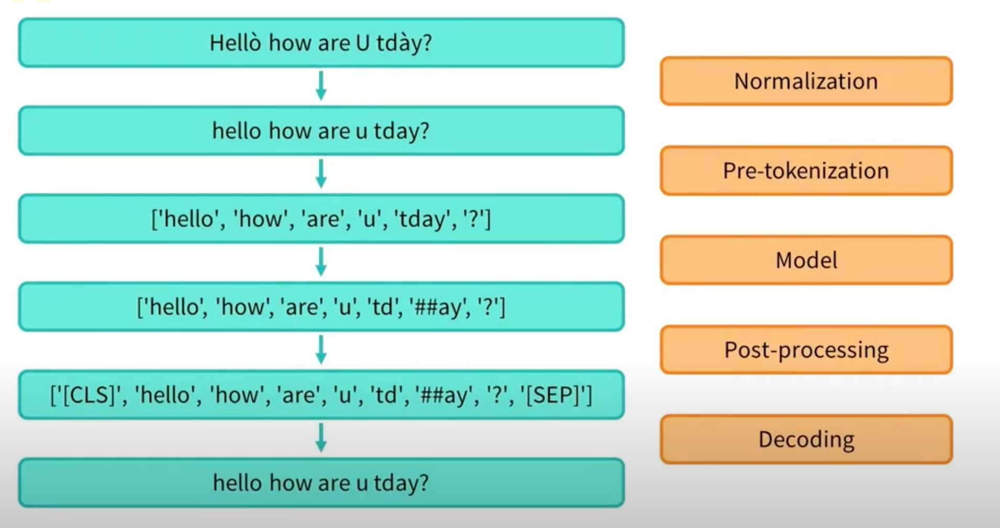

# 第 09 讲：BPE、GPT-2 tokenizer 与训练新词表

先沿着一句话走：**文本怎样变成一串编号？这些编号的切分规则又是怎样学来的？** 本讲用三个短词手算BPE，再读GPT-2字节映射、课程代码和新词表训练。论文原合并图与算法截图就在对应讲解旁，相关含义也写在本页。

需要对照代码时看 [基础 Python 中文注释版](代码/tutorials/tokenizer_basics_代码注释.py) → [训练 Python 中文注释版](代码/tutorials/gpt2_train_tokenizer_代码注释.py)。三份原notebook共72格全部保留，旧源码细节与历史实验折叠在后半页；新算例证据见 [复现记录](复现/README.md)。

## 1. 模型为什么需要分词器【必须会】

人可以直接读 `hello`，模型需要数值。**Tokenizer（分词器）**先把文本分成若干 **token（文本单位）**，再用**词表（vocabulary）**把每个单位查成一个整数ID。例如我们自己约定 `a→0`、`b→1`、`ab→2`，那么 `ab`可对应 `[2]`。编号是词表索引，不是“ab的意思等于数值2”，也不表示词频排名。

为什么不把所有完整单词都存起来？词太多，还会遇到新名字、新代码变量。为什么不永远一个字母一个token？句子会很长。**子词（subword）**取中间办法：常见片段整体保存，不常见的词拆成较小片段。BPE（Byte Pair Encoding）是一种学习这些片段的方法。它不保证每个token都是完整词，也不保证一个汉字恰好一个token。

模型拿到ID后还要查**embedding（嵌入表）**：每个ID对应一行可训练的浮点数。分词器负责查编号，embedding属于模型参数。若词表大小为 $V$，每个向量有 $d$ 个数，嵌入表形状是 `[V,d]`；一批 $B$ 条文本、补齐到每条 $S$ 个token后，ID为整数 `[B,S]`，查表后才得到浮点 `[B,S,d]`。本讲tokenizer训练没有建立这个模型，也没有更新这些向量。

| 数据在哪一步 | 小例子 | Python类型/形状 |
|---|---|---|
| 原文 | `"ab"` | `str`字符串 |
| 切分 | `["ab"]` 或 `["a","b"]` | `list[str]`，按顺序存文本片段 |
| 词表 | `{"a":0,"b":1,"ab":2}` | `dict[str,int]`，按键查ID的字典 |
| 编码 | `[2]` 或 `[0,1]` | `list[int]`，长度就是token数 |
| 模型查表 | ID2对应嵌入表第2行（0起算） | 浮点向量，本讲未训练 |

**训练分词器**是从语料学词表/规则；**使用分词器**是按已有规则编码；**训练语言模型**才更新embedding、Transformer等权重。三件事不要混在一起。

## 2. 先手算三轮BPE【必须会】

先用字符为起点，稍后换到GPT-2的字节起点。语料有 `aa` 4次、`ab` 3次、`aba` 2次。频次就是出现次数。先拆成 `a a`、`a b`、`a b a`，只统计同一片段内部、当前相邻的两个符号（pair），乘上片段出现次数：

| 第一轮相邻对 | 从哪里来 | 总次数 |
|---|---|---:|
| `a,a` | `aa`各贡献1对，共4次 | 4 |
| `a,b` | `ab`的3次，加`aba`的2次 | 5 |
| `b,a` | `aba`各贡献1对，共2次 | 2 |

选最高频的 `a,b`，把相邻a、b粘成新符号 `ab`，记下有顺序的**合并规则（merges）**。现在切分变为 `a a`、`ab`、`ab a`。**第二轮重新计数**：`a,a`为4，`ab,a`为2，选 `a,a→aa`。第三轮剩 `ab,a`出现2次，合并为 `aba`。后来的符号能含多个字符，pair不意味着每次只能得到两个字符长的token。

三轮后按教学约定编号：`a:0, b:1, ab:2, aa:3, aba:4`。词表记录“有哪些单位、ID多少”，merges记录“先后怎样合并”。实际库有自己的编号/并列选择规则，这张表不是GPT-2词表。

编码没见过的 `abaab`：`a b a a b`按规则成为 `ab a ab`，第二条 `a,a`已无可合并处，第三条成为 `aba ab`，ID为 `[4,2]`。使用时不对新句子重新统计频次，也不是随意先取词表里最长字符串。

若用一个式子记第一轮，就是 $f(a,b)=3+2=5$，$f$是相邻对的出现次数。规则是选择当前次数最大的pair；并列如何决定要看实现，本例每轮最高频都唯一。

下面把手算写成Python。`Counter`是计数字典，`.items()`逐个给出键和值；`for`循环依次处理，`zip(parts, parts[1:])`将列表和去掉第一项的列表配对，得到相邻项。`def`定义函数，`return`返回结果；`while`在条件成立时重复；`append`在列表末尾加项，`i += 2`跳过已合并的两个位置。`tuple`将切片转元组，`"".join(...)`把片段拼成字符串。

```python
from collections import Counter

word_freq = {"aa": 4, "ab": 3, "aba": 2}
splits = {word: list(word) for word in word_freq}

def merge_parts(parts, pair):
    result = []
    i = 0
    while i < len(parts):
        if tuple(parts[i:i+2]) == pair:
            result.append("".join(pair))
            i += 2
        else:
            result.append(parts[i])
            i += 1
    return result

merges = []
for step in range(3):
    counts = Counter()
    for word, freq in word_freq.items():
        parts = splits[word]
        for pair in zip(parts, parts[1:]):
            counts[pair] += freq
    best = max(counts, key=counts.get)
    print("轮次、计数、选择:", step + 1, dict(counts), best)
    merges.append(best)
    for word in splits:
        splits[word] = merge_parts(splits[word], best)

vocab = {"a": 0, "b": 1, "ab": 2, "aa": 3, "aba": 4}
parts = list("abaab")
for pair in merges:
    parts = merge_parts(parts, pair)
ids = [vocab[part] for part in parts]
print("新词切分、编号、拼回:", parts, ids, "".join(parts))
```

`max(counts, key=counts.get)`按每对的计数挑最大项，不是按字母排序。字典推导式 `{word: list(word) ...}`给每词建立字符列表；列表推导式 `[vocab[part] ...]`逐项查ID。`merge_parts`返回新列表，不改传入列表；循环替换 `splits[word]`。实测与手算一致：三条规则为 `a+b`、`a+a`、`ab+a`，新词得到 `["aba","ab"]`、`[4,2]`，拼回原文。

## 3. 论文原图：未见过的词也能用旧规则处理【必须会】


出处：Sennrich、Haddow、Birch，[Neural Machine Translation of Rare Words with Subword Units](https://aclanthology.org/P16-1162.pdf)，ACL2016正式论文P16-1162，PDF第4页/印刷页1718 Figure1，原PDF直接截图。这是机器翻译稀有词的BPE示例，不是GPT-2网络结构图。

从上到下是四条已学规则，每行箭头把左侧两个符号拼成右侧一个：`r + · → r·`、`l + o → lo`、`lo + w → low`、`e + r· → er·`。点号 `·`在图里标记词尾，不是原词里的标点；也常将词尾写为 `</w>`。箭头是拼接，不是神经网络层，不涉及矩阵shape或反向传播。

图注的训练词是 `low、lowest、newer、wider`。原文用未见过的 `lower`说明：加词尾，拆为 `l o w e r ·`，依次变为 `l o w e r·` → `lo w e r·` → `low e r·` → `low er·`。因此整个新词没出现过，也能用已知片段表示。图未给四词频次，不能仅凭图重新推导为什么r与词尾最先合并。


出处同上，PDF第4页Algorithm1。算法的词频示例是 `low:5、lower:2、newest:6、widest:3`，与Figure1图注那组词不同，不要混为同一算例。

`get_stats`中的 `+= freq`解释为何加频次；`max(pairs, key=pairs.get)`选当前高频对；`merge_vocab`得到新切分，外层循环继续统计。`collections.defaultdict(int)`让新pair从0计数，`re`是正则工具，用来只替换完整相邻符号边界。工程实现会优化计数效率，主线相同。截图是阅读材料，本轮执行的是上面的独立教学例，不把截图代码冒充已经逐字执行。

## 4. GPT-2为什么从256种byte出发【必须会】

刚才把a、b当基本单位，但还有中文、emoji和很多文字。**Unicode码点**给字符编号，例如 `€`是8364；**UTF-8编码**把文本变成一串bytes，每个byte只能取0–255，共256种值。一字符可能需要多个bytes，所以字符数、byte数、token数不能混用。

[GPT-2原报告](https://cdn.openai.com/better-language-models/language_models_are_unsupervised_multitask_learners.pdf) §2.2，PDF第4页，解释了这项选择：从字节建立基本单位，再合并常见序列，减少对巨大初始字符表的依赖；为避免常见词与各种标点组合反复占用词表，预切分限制哪些类别可跨界合并，并对空格作特殊处理。相关含义就在这里，本讲不展开报告其他任务结果。

GPT-2的 `bytes_to_unicode()`还做一层**可逆展示映射**：把每个byte值映射为一个可放进词表的字符。空格byte32显示为 `Ġ`，换行byte10为 `Ċ`，回车byte13为 `č`。这些是显示符号，不是把空格翻译成拉丁字母，也不是embedding向量。

```python
from transformers.models.gpt2.tokenization_gpt2 import bytes_to_unicode

text = "€😀"
raw = text.encode("utf-8")
print("字符数、bytes:", len(text), list(raw))
print("欧元码点、欧元bytes:", ord("€"), list("€".encode("utf-8")))
byte_map = bytes_to_unicode()
reverse_map = {shown: value for value, shown in byte_map.items()}
shown = "".join(byte_map[value] for value in raw)
recovered_bytes = bytes(reverse_map[ch] for ch in shown)
print("映射项数、空格/换行/回车:", len(byte_map), byte_map[32], byte_map[10], byte_map[13])
print("byte映射后显示:", shown)
print("完整恢复:", recovered_bytes.decode("utf-8"))
```

`.encode("utf-8")`将字符串转bytes，`.decode("utf-8")`反向恢复；`ord`取单字符码点，`bytes(...)`把0–255整数收成字节串。大括号推导式交换映射方向，小括号中 `... for ...`逐项提供值给`join`或`bytes`。实测：2字符、7 bytes；欧元是 `[226,130,172]`三字节，emoji是 `[240,159,152,128]`四字节，整体恢复为 `€😀`。256项只覆盖所有byte单项，不是GPT-2完整50257项词表。

原basics14把欧元标成4 bytes，实际为3。basics24中byte160的展示映射，也不能直接当Unicode不换行空格的完整UTF-8编码；`U+00A0`实际需要 `[194,160]`两字节。

## 5. 预切分、合并、编号分别是哪一步【必须会】



出处：固定课程 `imgs/token_steps.png`，不是本次论文截图。左侧从上往下是数据，右侧是处理名称：

1. **Normalization（规范化）**：图里将大写变小写、去重音，原信息会丢失。GPT-2这里normalizer为None，不照图先小写。
2. **Pre-tokenization（预切分）**：把长文本切成允许内部继续处理的片段，GPT-2处理字母、数字、标点和空白边界。预片段还不是最终token。
3. **Model（分词算法）**：应用已学子词规则、查ID。图中 `td`、`##ay`是WordPiece式展示，不是GPT-2的`##`规则。此处Model是分词算法对象，不是Transformer。
4. **Post-processing（后处理）**：图里加`[CLS]`、`[SEP]`，不是GPT-2默认行为；GPT-2有自己的`<|endoftext|>`特殊token。
5. **Decoding（解码）**：将完整ID序列恢复为文本；若前面有损规范化，不能凭空找回被删信息。

课程basics9是一段含四空格缩进、换行、引号的Python代码。三引号字符串保留多行，前缀`r`让反斜杠按原字符处理；缩进有意义，不能随便删。basics10的 `tokenizer(python_code)`返回含 `input_ids`的结果，`.tokens()`展示内部token字符串；12/31的 `pre_tokenize_str`仅展示预片段与原文区间。区间 `(start,end)`左含右不含，例如 `(0,3)`对应位置0、1、2，不是ID。

basics4逐个ID调用decode；一个字符的bytes分散在多个token时会显示 `�`替代字符。**单个token未必能独立解成完整Unicode字符**，还原原文应一次decode整个ID序列。下面真实GPT-2例子会显示两种结果。

## 6. 加载已有GPT-2分词器，再训练一个小词表【必须会】

`AutoTokenizer`是按配置选择分词器的入口类，`.from_pretrained`是其加载方法，返回分词器对象；只加载tokenizer配置/词表，不加载GPT-2模型权重。历史实现参照 [Transformers v4.30.0](https://github.com/huggingface/transformers/blob/v4.30.0/src/transformers/tokenization_utils_fast.py)，本轮实际用4.44.2、tokenizers0.19.1、Python3.12.14。GPT-2资产revision为 `607a30d783dfa663caf39e06633721c8d4cfcd7e`，本次不重新下载。

下面是独立小语料补充，并非原codeparrot十万/二十万条。`CACHE`指已有本地资产，换电脑须准备同一revision文件；`local_files_only=True`禁止加载时另去网络找文件，`use_fast=True`选择带Tokenizers后端的实现。

`batches`用 `yield`分批交出字符串列表；调用函数先得到生成器，训练器索取下一批才继续执行。`rows[start:start+2]`每批最多两条，末批不必凑满。`train_new_from_iterator`返回新对象，继承处理设置、重学词表/merges，不是给原词表追加几个词。`vocab_size=300`是包括基础byte和特殊token的目标大小，合并空间不足等情况可提前停止，要看实际结果。

```python
from pathlib import Path
from tempfile import TemporaryDirectory
from transformers import AutoTokenizer

CACHE = Path("G:/zzz/Personal ChatGPT 系列/09 BPE 与 GPT-2 tokenizer/资料/验证tokenizer缓存/gpt2")
base = AutoTokenizer.from_pretrained(str(CACHE), local_files_only=True, use_fast=True)
base_vocab_before = base.get_vocab().copy()
emoji_ids = base("😀", add_special_tokens=False)["input_ids"]
print("原emoji编号:", emoji_ids)
print("逐个解码:", [base.decode([i]) for i in emoji_ids])
print("整体解码:", base.decode(emoji_ids))

corpus = [
    "def add(a, b):\n    return a + b\n",
    "def hello(name):\n    print('Hello', name)\n",
    "for i in range(10):\n    print(i)\n",
    "if x > 0:\n    value = x * 2\n",
    "class Example:\n    pass\n",
    "import math\nprint(math.sqrt(4))\n",
    "# 中文注释 €😀\n    print('你好')\n",
]

def batches(rows):
    for start in range(0, len(rows), 2):
        yield rows[start:start+2]

new = base.train_new_from_iterator(
    batches(corpus), vocab_size=300, initial_alphabet=list(byte_map.values()))
probe = "€😀\n    print('你好')\n"
new_ids = new(probe, add_special_tokens=False)["input_ids"]
print("旧/新词表大小:", len(base), len(new))
print("新编码与完整恢复:", new_ids, new.decode(new_ids, clean_up_tokenization_spaces=False))
print("旧词表是否原样保留:", base.get_vocab() == base_vocab_before)
print("旧/新结束标记ID:", base.eos_token_id, new.eos_token_id)
with TemporaryDirectory() as directory:
    new.save_pretrained(directory)
    reloaded = AutoTokenizer.from_pretrained(directory, local_files_only=True)
    same_ids = reloaded(probe, add_special_tokens=False)["input_ids"] == new_ids
    print("保存/重载编号一致:", same_ids)
```

`Path`管理路径，`.copy()`给字典留快照；`with TemporaryDirectory()`建立临时目录，代码块退出时自动清理。`save_pretrained`保存词表、merges、特殊token及处理配置，只存一个token→ID字典不足以代替全部文件。这里不改全局代理，不发布Hub；第三块代码承接上一节的 `byte_map`。

`new_ids`是变长整数列表，不是固定`[B,S]`张量；`corpus`是7条字符串，分为2、2、2、1条四批；`base`、`new`、`reloaded`是三个对象。`add_special_tokens=False`避免处理器额外添加标记；`clean_up_tokenization_spaces=False`避免解码额外整理空白，便于逐字符核对。

本次实测：旧词表50257，新词表300；原对象不变，结束标记ID从旧50256变为新0；完整往返和保存重载一致。原GPT-2将emoji切为两个ID，单独decode出现两个替代字符，整体decode恢复emoji。新词表能编码不代表生成代码能力强，本讲没有语言模型训练或质量评测。

### 为什么不能直接换掉旧模型的词表

若旧ID2对应A、新ID2对应B，旧embedding第2行仍按A训练，模型却拿它理解B；即使词表大小相同也会错位。`resize_token_embeddings`只调整表的行数，不能自动处理任意ID重排的含义。若从头训练语言模型，应让分词器、模型词表大小、embedding和输出头一起匹配，本讲未做这一步。

## 7. 沿原训练代码追数据，防止“读了多少”算错【必须会】

原train2是 `load_dataset('./codeparrot/', split='train', streaming=True)`，路径相对于当时工作目录；这份本地语料未找到。`streaming=True`表示按需迭代读取，不会让缺失目录自动出现。train3的 `iter_dataset=iter(dataset)`建立一个有当前位置的迭代器；`next(iter_dataset)`消费一行字典，再用 `['content']`取代码字符串。

原train7关键语句如下，完整定义见Python注释版；这是摘录，不是本轮已运行的十万条实验：

```text
length = 100000
for _ in tqdm(range(0, length, batch_size)):
    yield [next(iter_dataset)['content'] for _ in range(batch_size)]
```

默认 `batch_size=1000`，`range(0,100000,1000)`有100轮，每轮1000行，共10万。`tqdm`显示外层进度；`_`是表示不关心值的普通变量，不会重置数据。

用6行、每批2行想象：第一次取0/1，再取2/3，游标已在4。复用迭代器，下一轮从4/5继续，不会回到0/1。train20把length改为20万，却没重建迭代器；顺序执行就是继续读后续20万。同时目标词表12500改为32768，不能把历史关键字覆盖变化只归因于“词表更大”。

length=5、每批2时原循环会试图读6条；数据不足，内部next抛出StopIteration，生成器可报 `RuntimeError: generator raised StopIteration`，未凑满一批可能丢失。稳妥做法是在函数内建立可重新遍历数据的迭代器，最后一批只取剩余条数。旧版折叠补充已有修正版和历史边界验证，本轮不重复运行；上面的7行补充训练使用切片，保留了末批1条。

### 排序和“关键字进词表”该怎么看

train11的 `sorted(..., key=lambda x:x[1])`按 `(token,ID)`中的ID升序排；`lambda`是一小段返回排序依据的函数。`tokens[257:280]`取左含右不含的23项，不意味着所有词表都从257开始放合并token。原 `base_vocab`只有256个byte展示字符，`base_vocab[10]`是列表第11项，查byte10应写 `byte_map[10]`。

train18/21用 `keyword.kwlist`检查Python关键字是否以裸字符串存在于词表。`return`与带前导空格的 `Ġreturn`不是同一表示；裸词在表里不保证所有上下文都只占一个token，也不证明代码生成准确率。basics36按token展示字符串长度排，37按ID排，长度/ID都不是词频的直接排名。

## 8. 全部原文件怎样对应，以及本轮边界

课程固定来源为 `chunhuizhang/personal_chatgpt@7fbc29824171fd07dc2c30fe922e61ebc018ad1d`，三份原notebook、注释与历史输出保持原样：

| 原文件/单元（0起算） | 本页对应内容与注意 |
|---|---|
| basics0–6 | 导入、设置、单ID decode、T5；T5不是GPT-2的byte-level BPE，仅凭词被切开不能证明语料过滤 |
| basics7–14 | 原Python文本、GPT-2编码/预切分、UTF-8及欧元注释错误 |
| basics15–22 | 流程图、Wikitext/WordPiece片段；22悬空逗号是真实SyntaxError，保留原错，删逗号也未补全trainer |
| basics23–32 | 256-byte双向映射、空白、原文区间 |
| basics33–38 | 对象、特殊token、两种排序、空单元 |
| train0–8 | 数据入口、游标、基础alphabet、1000条一批、新词表训练 |
| train9–21 | 词表切片、关键字检查、第二轮继续消费 |
| train22–26 | 建Hub仓库的注释、讲师本机代理、上传、空单元；本轮未执行外部写入 |
| 辅助gpt2共6格 | Linux shell/本地缓存探查；子shell中的 `!cd`不改变后续内核目录，缓存路径不等于数据已完整读取 |

basics2只是Markdown里的设置：先设left又设right，最终有效值为right。pad、EOS和attention mask要结合训练/生成任务，不把历史FP16注释当通用修复。`push_to_hub`会向远端发布；用户授权的是本GitHub学习仓库，不是讲师的Hugging Face组织，本轮未执行课程上传。逐格对照见 [全部72格解释](代码单元解释.md)。

本轮只执行本页三块补充：手写三轮BPE、UTF-8/byte可逆映射、已有本地GPT-2资产上的7行小语料训练与临时保存重载。图片已逐张查看。历史2000行IterableDataset、原/注释格运行、T5、异常生成器和早期16片段实验未在本轮重跑。原codeparrot十万/二十万条、GPT-2权重训练、完整翻译论文实验及下游质量指标都未复现。

<details>
<summary>第二遍对照：旧版完整源码、单元定位与历史实验（保留）</summary>

# 第 09 讲：BPE、GPT-2 tokenizer 与训练新词表

本讲把“字符串怎样成为 token ID”和“怎样从语料学习词表”连起来。Tokenizer 的训练会统计子词、学习合并规则，并不训练 Transformer 权重。词表重新训练后，ID 的含义可能改变；新 tokenizer 不能直接替换已有模型的 tokenizer 而期待模型仍正确工作。

**代码阅读：**[基础中文注释 notebook](代码/tutorials/代码注释.ipynb) → [训练新词表注释 notebook](代码/tutorials/gpt2_train_tokenizer_代码注释.ipynb)；纯文本对应[基础Python版](代码/tutorials/tokenizer_basics_代码注释.py)与[训练Python版](代码/tutorials/gpt2_train_tokenizer_代码注释.py)。[全部72格说明](代码单元解释.md)还包含辅助gpt2的6格、Markdown2设置块、空格及原语法错误；原语句、元数据、历史输出保留。

## 1. 阅读地图与材料边界

主材料来自 `chunhuizhang/personal_chatgpt`，固定提交 `7fbc29824171fd07dc2c30fe922e61ebc018ad1d`：

- [tokenizer_basics.ipynb](https://github.com/chunhuizhang/personal_chatgpt/blob/7fbc29824171fd07dc2c30fe922e61ebc018ad1d/tutorials/tokenizer_basics.ipynb)，39 个单元：处理流水线、UTF-8、byte 映射与 GPT-2 示例。
- [gpt2_train_tokenizer.ipynb](https://github.com/chunhuizhang/personal_chatgpt/blob/7fbc29824171fd07dc2c30fe922e61ebc018ad1d/tutorials/gpt2_train_tokenizer.ipynb)，27 个单元：流式代码语料、训练新 tokenizer、检查词表、上传 Hub。
- [gpt2.ipynb](https://github.com/chunhuizhang/personal_chatgpt/blob/7fbc29824171fd07dc2c30fe922e61ebc018ad1d/tutorials/gpt2.ipynb)，6 个单元：本地数据路径与缓存探查，属于辅助材料。

三份原文件已下载到本仓库：[基础原版](代码/tutorials/tokenizer_basics.ipynb) · [训练原版](代码/tutorials/gpt2_train_tokenizer.ipynb) · [辅助原版](代码/tutorials/gpt2.ipynb)。按固定提交下载字节核对SHA256，不用本地Git换行后的哈希冒充远程原字节；原图在`代码/imgs/token_steps.png`。说明版/注释版分别增加原单元前的说明，三组各79/55/13格。历史输出不替换为本次小语料结果。

本讲字幕对应附件 `232e8b13-7415-4397-92b7-4ecdb4cfd749.txt`，原文保留在本地。字幕里 “GTA”“BP”“best pair encoding”“UNICORDE 0–255” 应结合代码理解为 GPT-2、BPE/Byte Pair Encoding、256 个 byte 值的可逆字符映射。口述的训练时长与语料大小属于讲师当时环境，没有在本次重测。

本讲不是单篇论文的完整复现。理论参照包括 GPT-2 报告 [Language Models are Unsupervised Multitask Learners](https://cdn.openai.com/better-language-models/language_models_are_unsupervised_multitask_learners.pdf) 的输入表示部分；没有重讲报告的全部任务表格。算法与 API 以 [Hugging Face BPE 课程](https://huggingface.co/learn/llm-course/en/chapter6/5)、[新 tokenizer 训练说明](https://huggingface.co/learn/llm-course/en/chapter6/2)、[Transformers v4.30.0 GPT-2 源码](https://github.com/huggingface/transformers/blob/v4.30.0/src/transformers/models/gpt2/tokenization_gpt2.py) 和 [fast tokenizer 源码](https://github.com/huggingface/transformers/blob/v4.30.0/src/transformers/tokenization_utils_fast.py) 为依据。没有生成不存在的中文论文译本。

### 数据路径与仓库地图

训练路径：`代码文本 → dataset iterator → batch_iterator → train_new_from_iterator → BPE trainer → 新词表和 merges → 保存`。

使用路径：`str → normalization → pre-tokenization → byte 映射/BPE → token IDs → embedding`；反方向为 `IDs → token 表示 → byte 序列 → UTF-8 decode → str`。

| 模块 | 对应位置 | 本讲边界 |
|---|---|---|
| 入口与配置 | 两个主 notebook | 确定 tokenizer 类型、词表目标大小 |
| 数据 | `load_dataset('./codeparrot/', streaming=True)` | 相对路径；本次未找到对应语料目录 |
| 字节映射 | `bytes_to_unicode()` | 256 个 byte 值的可逆映射 |
| 训练器 | `PreTrainedTokenizerFast.train_new_from_iterator` | 清空旧 BPE vocab/merges，保留处理配置 |
| fast 后端 | `tokenizers.Tokenizer / BpeTrainer` | Rust 后端负责真正统计与训练 |
| 模型权重/loss/optimizer | 未找到 | 不涉及 Transformer forward/backward |
| 保存与发布 | `save_pretrained / push_to_hub` | 本次只保存/重载测试；未执行课程 Hub 上传 |

## 2. token、字符串、ID 与 embedding【必须会】

普通 Python `str` 表示 Unicode 文本；UTF-8 是将它序列化成 bytes 的一种编码。Tokenizer 把文本分成 token，再用词表将 token 映射为整数 ID。Token 可以是完整词、子词、标点、空白或若干 byte 对应的片段，不等于“一个汉字”或“一个英文单词”。

| 数据 | 类型/shape | 用途 |
|---|---|---|
| `python_code` | `str` | 保留代码中的换行、缩进、符号 |
| 单条 `input_ids` | `list[int]`，长度 $S$ | 每个位置索引一个词表项 |
| batch padded IDs | 常为 int64 `[B,S]` | 模型输入；本讲不创建模型张量 |
| `vocab` | `dict[str,int]`，大小 $V$ | token 表示到 ID 的映射 |
| embedding 权重 | 浮点 `[V,d]` | ID 对应一行 $d$ 维向量 |
| embedding 输出 | 浮点 `[B,S,d]` | 进入 Transformer |

`tokenizer(text)['input_ids']` 的默认结果通常是 Python 列表。输入批次的序列长度不同会形成变长列表，只有显式 padding 后才便于组成规则矩阵。文本长度、UTF-8 byte 数、token 数是不同计数。

`tokenizer_basics` 单元 4：

```python
def tokenize_str(tokenizer, text):
    input_ids = tokenizer(text, add_special_tokens=False)['input_ids']
    return [tokenizer.decode(token_id) for token_id in input_ids]
```

`def` 定义普通函数；参数 tokenizer 是对象、text 是字符串；字典索引取出编码结果。列表推导式逐个 ID 解码并返回 `list[str]`，没有修改模型权重。`add_special_tokens=False` 避免处理器自动插入模型专用标记。

这个函数适合展示某些词的分段，却不保证每个 ID 可独立解成一个完整 Unicode 字符。Byte-level token 可能只携带一个字符的部分 UTF-8 bytes。本次 GPT-2 对 `😀` 编码后，分别 decode 各个 ID 得到两个 `�`，而整体 decode 可还原 emoji。想看原 token 表示应使用 `convert_ids_to_tokens` 或 fast `BatchEncoding.tokens()`；还原完整文本应一次 decode 全序列。

单元 5–6 用 T5 对常见词作比较。字幕把某个词被拆分推测为训练语料过滤，但**仅凭 token 拆分不能证明语料过滤原因**；还可能涉及词表预算、统计频率及 tokenizer 算法。T5 tokenizer 与 GPT-2 tokenizer 也不是同一个算法，不能把 T5 的结果归给 byte-level BPE。

## 3. UTF-8 与 GPT-2 的 byte 映射【必须会】

`tokenizer_basics` 单元 13–14：

```python
a, e = u'a', u'€'
byte = ord(a.encode('utf-8'))
byte = [ord(chr(i)) for i in e.encode('utf-8')]
```

Python 3 中 `u'a'` 与 `'a'` 都是 Unicode 字符串。`ord('a')=97` 取字符码点；`ord(b'a')` 也能接受一个 byte。`'€'.encode('utf-8')` 是三个 bytes：`[226,130,172]`，不是注释写的 4 bytes；`ord` 不能直接接受这三个 bytes。迭代 `bytes` 得到的 `i` 已经是整数，所以 `ord(chr(i))` 绕了一圈，可以直接写 `list(e.encode('utf-8'))`。Unicode 码点是 `8364`，UTF-8 三个 byte 是 `226,130,172`，不要混用。

GPT-2 要表示任意文本而避免为所有 Unicode 字符预设巨大词表，便从 256 个 byte 值出发。为了在词表文件里安全展示这些 bytes，`bytes_to_unicode()` 构造可逆映射：常见可打印范围尽量保留，其余 byte 映射到额外字符。名称虽然叫 unicode，但它不是对自然文字进行语义转换。

```python
bytes_to_unicode_map = bytes_to_unicode()
unicode_to_bytes_map = dict((v, k) for k, v in bytes_to_unicode_map.items())
base_vocab = list(unicode_to_bytes_map.keys())
```

`dict.items()` 返回 `(key,value)` 对；`(v,k)` 交换顺序；`dict(...)` 把生成的对收集成反向字典。正向键是 byte 整数，值是一个用于展示的字符；反向键是展示字符，值是原 byte。`base_vocab` 长 256，但不是 Unicode 码点 0–255 的列表，也不是已经训练好的 GPT-2 完整词表。

本次直接验证：空格 byte 32 → `Ġ`，换行 byte 10 → `Ċ`，回车 byte 13 → `č`。这些显示字符代表 byte，并非用户文本里真的输入了拉丁字母 G/C。`base_vocab[10]` 是映射字典的第 11 个插入项，**不是** byte 10；要查询换行写 `bytes_to_unicode_map[10]`。

原表格把 byte 160 与不换行空格联系起来，必须注意编码层次：实际 Unicode `U+00A0` 的 UTF-8 是 bytes `194,160`，不能在整个 UTF-8 流程中只拿 160 当完整字符。正向/反向 byte 映射可逆，整体文本解码仍须拼回全部 bytes。

## 4. BPE 怎样学习合并规则【必须会】

先有初始符号集合，再统计**当前切分中的相邻 pair**；挑选高频 pair、合并、加入新符号，然后重新统计。后来的 pair 可以包含已经合并的长片段，绝非永远只合并两个原始字符。Byte-level BPE 用映射后的 bytes 作初始符号；BPE 本身并不限于 byte 作为初始单位。

用本讲自建词频例子说明：`aa` 出现 4 次，`ab` 出现 3 次，`aba` 出现 2 次。对于当前字符切分 `a,a`、`a,b`、`a,b,a`，pair 频数为：

$$
f(u,v)=\sum_{w\in\mathcal W} n_w
\sum_{j=0}^{|s_w|-2}\mathbf 1[(s_{w,j},s_{w,j+1})=(u,v)].
$$

$\mathcal W$ 是预切分后片段集合，$n_w$ 是片段频数，$s_w$ 是当前符号序列，$j$ 遍历相邻位置，$\mathbf1$ 是条件成立时为 1 的指示函数。这个式子是本讲教学表达，不冒充论文中的编号公式。

于是 `f(a,a)=4`、`f(a,b)=3+2=5`、`f(b,a)=2`，本轮选择 `a+b→ab`。`aba` 从三个符号变为 `ab,a`；下一轮必须统计 `ab,a` 等新 pair。选择规则可记为 $\arg\max_{(u,v)}f(u,v)$，出现并列时还需具体实现的 tie-break，不能假设所有库总会得到相同 ID 顺序。

训练阶段不断学习 merges；使用阶段按已经学好的 merge 优先级切分新文本，不重新用每个 prompt 训练。未知片段仍可退回更小单位；256-byte 覆盖的是可编码字符的字节，不代表对每种语言都同样高效。

目标词表大小 $V_{\text{target}}$ 包含基础字符和特殊 token，通常还包含学习的合并项。本次小实验得到 `256 + 1 + 63 = 320`。语料中可合并内容不足或最小频率限制等情况可能使训练提前停下，因此目标值不能脱离实际结果检查。

## 5. 预切分、空白与处理流水线【必须会】

`tokenizer_basics` 单元 9 定义 `r'''...'''` 多行 Python 示例。三引号保留换行；`r` 让字符串内反斜杠按原字符处理，不会自动删除缩进。对代码来说空白有语义，不应照搬用于普通文字的空白折叠。

单元 10–12、31：

```python
tokenizer = AutoTokenizer.from_pretrained('gpt2')
tokenizer(python_code)['input_ids']
tokenizer(python_code).tokens()
tokenizer.backend_tokenizer.normalizer
tokenizer.backend_tokenizer.pre_tokenizer.pre_tokenize_str(python_code)
```

`AutoTokenizer` 依据 checkpoint 配置选择 tokenizer 类；默认偏好可用的 fast 实现。`backend_tokenizer` 和 `.tokens()` 是 fast 路径的接口，不能假设 slow 对象也有相同属性。`normalizer` 可为 `None`；GPT-2 这一路没有像 BERT 示例那样先小写、去重音。

预切分返回 `list[tuple[str,tuple[int,int]]]`，每项是处理片段与原文位置区间。它不等于最终 BPE token；一个预片段后面可能分成多个 token。对齐区间用于追踪文本位置；处理后的映射字符长度与原文 Unicode 字符长度也不必相同。

普通 GPT-2 的 regex/ByteLevel 预切分会区分字母、数字、符号与空白，并可能把一个词前面的空格纳入片段。四个缩进空格可能表现为换行加前三个空格的一段，以及末个空格加 `print` 的一段；这是预切分结果，不保证最后一定只生成两个 token。字幕的“保留空格”与“最终 token 边界”应分开理解。

单元17的流程图按左侧从上到下的箭头读，右侧文字标注阶段：原始文本 → normalization → pre-tokenization → tokenizer model（子词规则与ID）→ post-processing（模型专用标记），最后decode回展示文本。图中的小写/去重音、WordPiece的`##ay`及`[CLS]`/`[SEP]`是类似BERT的示例，不是所有tokenizer都执行这些步骤；有损normalization后不保证恢复原重音/大小写。GPT-2使用`<|endoftext|>`，不自动变成BERT标记。


单元 21 的 Wikitext batch 函数用于示意；单元 22 的 `from tokenizers import Tokenizer, models,` 有悬空逗号，作为普通 Python 代码会 `SyntaxError`。这一格也只建立 `WordPiece` 对象，没有完整 trainer 与保存流程；不要把它当可运行的 BPE 实现。可修为 `from tokenizers import Tokenizer, models`，但仍需完成它缺失的配置才能训练。

单元 2 中连续赋值 `padding_side='left'` 又赋值 `'right'`，最终有效的是 right；那段 Markdown 也没有执行。Decoder-only 批量生成通常需要适当左 padding，训练可因 collator/model 选择右 padding，不能把一句“fix fp16 overflow”当成任意任务的规则。将 pad token 指向 EOS 还要求 attention mask/loss masking 与任务一致。

## 6. 训练代码的数据消费【必须会】

`gpt2_train_tokenizer` 单元 1–4：

```python
from transformers import AutoTokenizer
from datasets import load_dataset
from tqdm import tqdm
dataset = load_dataset('./codeparrot/', split='train', streaming=True)
iter_dataset = iter(dataset)
tokenizer = AutoTokenizer.from_pretrained('gpt2')
```

`./codeparrot/`相对于notebook当前工作目录，而非固定指向公开数据集；原仓库没有附上这份本地语料。早期Python3.7验证时datasets未安装；本次CPU环境已有datasets2.19.2，真实读取的是另建的2000行小JSONL，仍未运行原缺失数据入口。`streaming=True`不会让缺失文件自动出现；不同版本的本地解析规则也应核对。

`iter(dataset)` 得到有当前位置的迭代器，`next(iter_dataset)` 返回下一条 `dict`。`content` 应是字符串字段，需要根据实际 dataset schema 检查，不能假设任意数据集都有它。

单元 7 原函数：

```python
length = 100000
def batch_iterator(batch_size=1000):
    for _ in tqdm(range(0, length, batch_size)):
        yield [next(iter_dataset)['content'] for _ in range(batch_size)]
```

`yield` 把函数变成生成器，每次请求下一项时才计算下一批；它交出 `list[str]`，不是 token 张量。`range(0,100000,1000)` 有 100 次循环，每次 1000 条，合计 10 万；`tqdm` 包装外层循环，所以进度单位是 batch。两个 `_` 都是普通变量名，只是约定表示“不关心值”。

三类容易忽略的问题：

1. **重用进度**：单元 20 改成 `length=200000`，却没有重建 `iter_dataset`；顺序执行会从第一轮后继续读取后续 20 万，不能称为“同一前 20 万”。Notebook 乱序重跑还会进一步改变范围。
2. **最后一批**：`length` 不整除 batch_size 时，原函数仍读满最后一批，超出声明上限。例如 length=5、batch_size=2 会请求 6 条。
3. **提前耗尽**：`next` 没有处理不足数据。Python 3.7 的生成器内部冒出 `StopIteration` 会变为 `RuntimeError: generator raised StopIteration`，可能丢掉正在构造的不满一批。

修正版将迭代器放在函数内部，并限制最后一批：

```python
from itertools import islice
def batch_iterator(dataset, length, batch_size=1000):
    it = iter(dataset)
    for start in range(0, length, batch_size):
        rows = list(islice(it, min(batch_size, length-start)))
        if not rows:
            return
        yield [row['content'] for row in rows]
```

这里默认传入的是可以重新开始遍历的 dataset；如果传进来的就是一次性迭代器，`iter` 不会神奇地重置它。真正复现还应固定数据 revision、顺序、过滤、抽样与训练批次范围。

## 7. `train_new_from_iterator` 的对象与状态【必须会】

单元 6 建立 256-byte alphabet，单元 8：

```python
new_tokenizer = tokenizer.train_new_from_iterator(
    batch_iterator(), vocab_size=12500, initial_alphabet=base_vocab)
```

这是 fast tokenizer 对象的方法。`batch_iterator()` 返回可迭代的字符串批次；`vocab_size` 是期望词表大小；`initial_alphabet` 通过额外关键字参数传入后端 trainer。返回一个**新** fast tokenizer；原 tokenizer 的词表并不被这个方法就地替换。

历史 `tokenization_utils_fast.py` 的关键流程是：序列化原后端配置 → 清空 BPE `vocab` 与 `merges` → 暂存/调整特殊 token 与后处理 ID → 创建新的后端 Tokenizer → 选择 `BpeTrainer` → `train_from_iterator` → 包回 fast tokenizer 类。这种“从旧 tokenizer 训练”继承的是处理方式与特殊 token 设置，**没有继承 GPT-2 模型权重，也不是继续扩充旧 merges**。[固定源码](https://github.com/huggingface/transformers/blob/v4.30.0/src/transformers/tokenization_utils_fast.py)

该历史版本发现 pre-tokenizer 类型为 ByteLevel 时，会用 `ByteLevel.alphabet()` 设置 trainer 的 `initial_alphabet`。因此这里手动传基础字符与该路径的默认覆盖是一致意图，不能把它当 GPT-2 完整词表初始化。普通 BPE 情况下传入的参数行为还应对照具体版本。

从变量链看：`dataset row dict → content str → list[str] batch → backend trainer 统计 → dict[str,int] vocab + ordered merges → tokenizer object`。没有 `[B,S,d]` 模型激活，也没有可反向传播的 loss。

重要工程后果：假设新旧词表中同一个 ID 对应不同 token，已有 embedding 仍按旧 ID 解释。即使新词表大小与原词表相同，也不保证兼容。`resize_token_embeddings` 只调整行数，不会自动完成任意词表语义重排或重新训练。若目标是保留已有模型，考虑增补 token 与适当训练；若从头训练语言模型，则要把新 tokenizer、模型 vocab_size、embedding、输出头一起固定。

## 8. 排序、关键字检查与“retrain”实验【建议会】

单元 11：

```python
tokens = sorted(new_tokenizer.vocab.items(), key=lambda x: x[1], reverse=False)
```

词表字典按 token→ID 存储；`sorted` 返回新列表，`lambda x:x[1]` 是返回 ID 的匿名函数，`reverse=False` 表示 ID 升序。`tokens[257:280]` 取左闭右开的 23 项；`tokens[-15:]` 取最后 15 项。原切片假设特殊 token 与基础符号占据前 257 项，但具体 ID 排布仍应检查，不能将 257 当所有 BPE 的固定常数。原 GPT-2 `<|endoftext|>` ID 是 50256，本次重新训练后变成 0。

单元 13–14 的 `convert_tokens_to_string([t])` 将一个 token 的表示转换成可展示字符串；它同样可能遇到不完整 UTF-8 byte 片段。`tokenizer_basics` 单元 36 按 token 表示的 Python 字符串长度排序，单元 37 按 ID 降序排序；前者不是按原文 UTF-8 byte 数或频数排序，后者也不能直接当成常用词频排名。

本次原/注释执行发现：单元36仅按长度，没有并列第二排序键，词表字典遍历次序可变，前10项的同长度列表可能不同。两次实际输出保留，核对前10项长度序列及转换契约；不把这种排序并列差异算作注释改代码，也不把不同原始列表写成完全相同。

单元 16–18：`keyword.kwlist` 为当前 Python 版本的硬关键字列表；`kw not in new_tokenizer.vocab` 只检查裸字符串是否直接作为词表项。本机 Python 3.7.6 有 35 个，不能据此断言所有 Python 版本都有 35 个。

“关键字有单独 token”与“在代码上下文中只占一个 token”也不完全相同。例如 `return` 与带空格的 `Ġreturn` 是不同表示。更好的检查是：在有代表性的代码上下文中统计编码长度，并计算平均 token/字符或 token/byte、未知处理、换行缩进往返，以及后续任务的指标。关键字是否进入词表不是代码生成能力评测。

单元 20 同时把读入条数改为 20 万、目标词表改为 32768；语料范围、样本数和词表预算同时变了。字幕说两种关键字从缺失变为出现，是历史观察，不能归因于某一个变量；`32768=32×1024=2^15`，不是字幕错念的 `8×1024`。更大词表可能缩短序列，但会增大 embedding/输出层，并非无代价。

## 9. 保存、发布与辅助 notebook

单元 23 创建仓库的两行是注释，未执行；单元 24 设置进程代理到 `127.0.0.1:7890`，只有这个端口确实存在服务时才适用。单元 25 的 `push_to_hub` 会向讲师账号/组织写入；本次没有执行这条命令。用户授权的是发布本学习仓库，不是向讲师的 Hugging Face 组织上传资产。

本地保存用：

```python
new_tokenizer.save_pretrained('./my-tokenizer')
reloaded = AutoTokenizer.from_pretrained('./my-tokenizer', local_files_only=True)
```

保存应包括词表、merges、特殊 token 与处理配置，而非只保存一个 token→ID 字典。`local_files_only=True` 用于验证本地文件足够重载。本次在临时目录实际验证保存与重载，编码结果完全一致；这一步不需要 Transformer 权重或 GPU。

辅助 `gpt2.ipynb` 的 `!cd /media/whaow/` 是 Linux 路径且运行在单次 shell 中，通常不改变后续 notebook 内核工作目录；要改变内核目录应使用适合的 `%cd` 或 Python 路径设置。`!pwd` 不是普通 Python 语法。`load_dataset_builder(...).cache_dir` 仅探查构建器缓存，不能证明 dataset 已完整加载。原缓存路径属于讲师环境，不应当成读者必备路径。

## 10. 本次实际验证与状态

**部分成功**：小规模 tokenizer 的真实训练、编码/解码与保存/重载成功；课程 10/20 万代码文件训练与语言模型训练未复现。

早期独立实验环境：Windows、Python3.7.6、Transformers4.30.2、tokenizers0.13.3；以下16片段实验及失败修复记录保留。历史源码参考v4.30.0与早期运行4.30.2明确分开。GPT-2 tokenizer资产锁定 [revision `607a30d783dfa663caf39e06633721c8d4cfcd7e`](https://huggingface.co/openai-community/gpt2/tree/607a30d783dfa663caf39e06633721c8d4cfcd7e)，只下载tokenizer/config，没有模型权重。

实际运行 [verify_tokenizer.py](复现/scripts/verify_tokenizer.py)：原 GPT-2 50257 项，16 条自建代码片段训练目标 320，实际得到 320 项、63 条 merges、一个特殊 token；原对象保持不变。中文、欧元、emoji、tab、换行、四空格缩进整体往返成功；临时保存重载编码一致。流式小例子验证第二轮接着读取、提前耗尽报错与修正版保留末尾不足一批。结果见 [教学验证.json](复现/outputs/教学验证.json)。

首次直接 `decode` 失败：Transformers 框架检查认为 torch 可用，但本机 torch 模块缺少 `Tensor`。修正是在独立验证进程导入库前设置 `USE_TORCH=0`、`USE_TF=0`；没有修改全局安装。提示“Models won't be available”在本实验中符合预期，因为只训练 tokenizer。失败与修复记录见 [复现说明](复现/README.md)。

**本次补充仍为部分成功**：Windows11/Python3.12.14/Transformers4.44.2/tokenizers0.19.1/datasets2.19.2。实际脚本 [verify_runtime.py](复现/scripts/verify_runtime.py)直接读取原/注释文件，加载固定本地GPT2/T5资产；加载格只改路径并增加local_files_only，逆变换AST核对。基础21格原语句成功、22预期SyntaxError，其余数据/加载补充范围逐项列在[复现说明](复现/README.md)，没有mock库调用。

三份原与六份派生notebook的schema/原单元历史保持通过；全部72格详解、52代码格审计，51可解析AST相等（含两条shell转换），错误22仍为同一SyntaxError，Markdown2只增注释且实际执行；三个Python阅读版AST与可解析原代码对应。Python版将错误22整格原文注释，不把它偷偷修成原代码；多行字符串同值排版保留原空白。

真实IterableDataset提供2000行JSONL小语料，原生成器默认每批1000和函数体保持；第一轮0–999目标320得到320项/63merges，第二轮1000–1999目标336得到336项/79merges。第一轮仅改vocab，第二轮只改两常量，旧模板及第一轮新对象都未就地变化。两份新对象的Unicode完整往返、临时保存/重载、IDs与decode一致；原错误、末批丢失/超读也真实触发。长度排序并列按契约比较，其余受控结果一致。详见 [runtime_verification.json](复现/outputs/runtime_verification.json)和[全部单元审计](复现/outputs/annotation_verification.json)。没有复现课程数据、Hub发布或语言模型指标。

## 11. 全部单元定位

| notebook | 单元索引 | 阅读位置 |
|---|---|---|
| basics | 0–3 | Image、通用设置与 tokenizer 导入 |
| basics | 4–6 | 单 ID decode 与 T5 示例 |
| basics | 7–12 | Python 代码、fast tokens 与预切分 |
| basics | 13–17 | bytes、训练流水线与图 |
| basics | 18–22 | BERT/WordPiece 片段与语法错误 |
| basics | 23–32 | GPT-2 byte 映射及空白保留 |
| basics | 33–37 | 对象展示、特殊 token、排序 |
| basics | 38 | 空单元 |
| train | 0–8 | 导入、流式数据、alphabet、batch、训练 |
| train | 9–18 | 词表展示、排序、关键字检查 |
| train | 19–21 | 第二次训练与关键字检查 |
| train | 22–25 | Hub 注释、代理与上传 |
| train | 26 | 空单元 |
| gpt2 | 0–5 | 数据标题、shell、导入、注释与缓存 |

## 12. 必须掌握

- 【必须会】字符、UTF-8 byte、token 表示、token ID、embedding 各处于什么层次。
- 【必须会】byte 映射的可逆性，以及单 ID decode 不能替代整体 decode。
- 【必须会】BPE 统计当前相邻 pair，训练 merges 后再按规则编码。
- 【必须会】`train_new_from_iterator` 重建 vocab/merges，不训练模型，也不保留旧 ID 语义。
- 【必须会】迭代器有消费位置，第二轮训练与最后一批必须显式处理。

## 13. 第二遍知识

【建议会】fast/slow tokenizer 接口差异、offset、特殊 token 与后处理 ID；词表大小和语料范围的受控比较；代码缩进与空白保留；词表统计不能直接代表下游能力。

## 14. 可暂缓的工程细节

【可以暂时不掌握】Rust BPE 的高效计数与并列规则、超大语料调度、复杂 tokenizer 序列化兼容、完整 WordPiece/Unigram 训练。先把当前 byte-level 数据路径走通。

## 15. Paper ↔ Code 映射

| 理论/概念 | 课程位置 | 实现 | 边界 |
|---|---|---|---|
| GPT-2 byte-level 输入 | basics 13–14、24–30 | `bytes_to_unicode` | byte→展示字符，并非 embedding |
| BPE 高频相邻合并 | basics 8、16 | Tokenizers `BpeTrainer` | 教程没有手写完整计数器 |
| 四阶段 pipeline | basics 17 | fast backend 配置 | 图为通用流程，不全是 GPT-2 设置 |
| 流式训练数据 | train 2–3、7、20 | dataset iterator / generator | 原本地代码语料未找到 |
| 学习新词表 | train 8、20 | `train_new_from_iterator` | 原 ID 不保留；模型未训练 |
| 关键字覆盖 | train 16–21 | `keyword.kwlist`、vocab membership | 不是代码生成评测 |
| GPT-2 完整模型实验 | 未找到 | 本讲 notebook 无入口 | 未复现报告的语言模型指标 |

## 16. 未解决问题与可信度边界

课程本地 codeparrot 数据目录、精确数据 revision、讲师依赖版本未锁定；两次历史训练的消费顺序只能根据代码推断，无法恢复其全部 notebook 执行历史。BERT 片段不完整，已标明语法错误。小语料实验真实运行并可重跑，但训练内容与课程不同，不能称为 32768 词表的同配置复现。尚未评测不同 tokenizer 对真实代码生成质量或速度的影响。

</details>

## 必须掌握

区分字符、UTF-8 byte、token表示、ID与embedding；手算每轮相邻对并解释为什么重新计数；将未见过的abaab按旧规则变为[4,2]；理解完整decode与单ID decode的区别，以及新词表不能直接替换旧模型词表的原因。

## 第二遍再掌握

预切分边界和offset、byte展示映射、fast后端状态、新旧对象与ID变化、迭代器消费位置、末批超读/耗尽及关键字覆盖实验的比较条件。

## 可以暂缓的工程细节

Rust计数与并列策略、大语料并行训练、跨版本序列化、完整WordPiece/Unigram实现和Hub配置。先顺着一条文本看清数据和规则。

## Paper ↔ Code

| 理论/材料 | 课程位置或对象 | 对应与边界 |
|---|---|---|
| ACL2016 BPE Figure1/Algorithm1 | basics8/16，训练调用后端trainer | 原图/算法直接截图；手写三轮是本轮补充，课程未手写完整BPE |
| GPT-2报告§2.2 | basics13–14/24–30，bytes_to_unicode | 256-byte起点与可逆展示，不是一个Unicode字符只占1byte |
| 课程处理流程图 | basics17，fast backend | 通用示意，WordPiece/小写设置不是GPT-2配置 |
| 新分词器训练 | train6–8/20，train_new_from_iterator | 新vocab/merges与对象，不是模型训练 |
| 原数据消费 | train2–3/7/20 | 本地codeparrot未找到，保留范围限制 |
| GPT-2/翻译论文完整评测 | 本讲notebook未找到 | 不以小词表实验替代质量评测 |

## 复现状态：部分成功

本轮三块正文补充代码实际执行，代码哈希/输出见[基础改写验证](复现/outputs/基础改写验证.json)，用[新验证脚本](复现/scripts/verify_foundation_examples.py)重做；裁剪记录见[论文截图来源](复现/outputs/论文截图来源.json)。原文件、派生注释和历史输出不变。小BPE训练/往返/重载成功，原完整数据和语言模型实验未复现。

## 尚未解决与置信边界

未找到课程本地数据与精确环境；并列合并和ID顺序不能跨实现作普遍保证。7行语料只检查流程与字节覆盖，不证明生成质量或优于旧GPT-2分词器。本讲用BPE算法论文和GPT-2输入表示解释课程，不声称复现整篇论文，未制作不存在的中文论文PDF。
