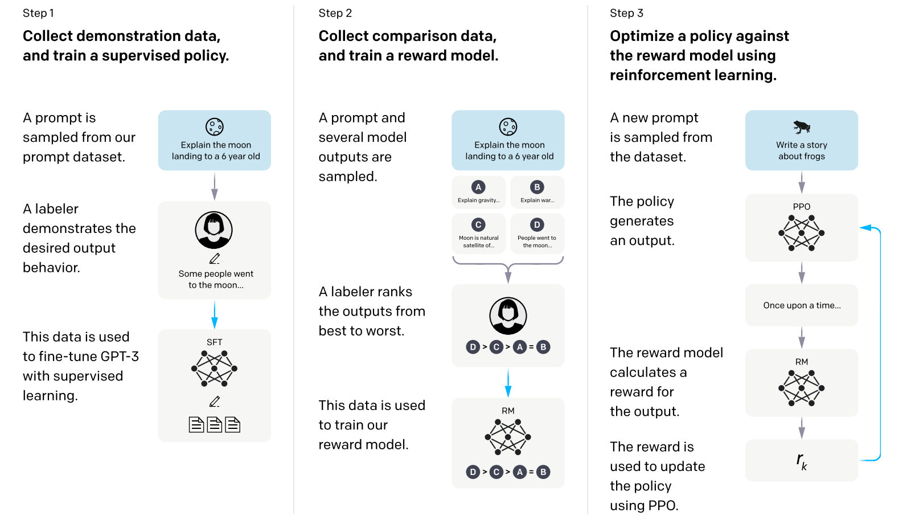

# 第 12 讲：LLM SFT 与 SFTTrainer

这讲要读懂的是：**给模型一份“任务要求＋参考回答”，怎样让它以后更可能按要求回答？** 先沿两条具体文本走完训练过程，再看原课程的大模型设置。`SFT` 是 Supervised Fine-Tuning，中文是监督微调：在已有语言模型的基础上，用示范文本继续调整部分或全部参数。`Trainer` 是组织训练的程序对象，不是另一个语言模型。

阅读顺序是：示范→编号→拼块→预测与误差→参数更新→对照原单元。[详细中文代码](代码/tutorials/llm_training_sft_代码注释.py)和[注释notebook](代码/tutorials/代码注释.ipynb)包含原课程27格；正文用四个小算例讲清各步骤。

## 1. 示范训练究竟在教什么

普通语言模型学“前面这些文字之后通常接什么”。如果训练文本大量是网页，它可能擅长续写网页，却不一定按用户要求作答。指令数据把我们希望的交互格式反复展示给它，例如：

```text
### Instruction:
Add the numbers.

### Input:
1 + 2

### Response:
3
```

Instruction说明任务，Input给出“1 + 2”，Response提供示范“3”。训练时用完整文本提供前文和目标；推理时输入停在Response标记附近，由模型继续生成回答。

下图来自InstructGPT论文 *Training language models to follow instructions with human feedback*，arXiv:2203.02155v1，PDF第3页Figure2，用于定位SFT在训练流程中的位置。[固定版本](https://arxiv.org/abs/2203.02155v1)。



先沿左列从上到下读：蓝框是问题；人像框是标注者写出的示范；蓝箭头把示范交给下方 SFT 网络训练。框中的网络有可调整参数，文本和箭头本身没有可训练参数。本讲的 `train_dataset` 对应示范数据，`SFTTrainer.train()` 对应训练过程，`model` 对应被调整的网络。单条文本稍后变成长度为 $L$ 的编号列表，一批拼块输入为 `[B,T]`，网络输出为 `[B,T,V]`；这几个维度是本笔记对代码的解释，原图没有标这些 shape。

中列生成候选并由人排序，用排序训练奖励模型RM；右列由策略生成回答，再据RM评分用PPO更新。策略决定token分布，奖励模型为回答评分。课程聚焦左列SFT，采用Alpaca示范与Xgen模型；[Alpaca数据说明](https://github.com/tatsu-lab/stanford_alpaca)介绍了text-davinci-003辅助生成示范的过程。

## 2. 一条样本先是字典，不是 tensor

Python 的字典用 `{键: 值}` 组织字段，`row['output']` 取出回答字符串。列表用 `[...]` 保存多条样本。`text` 是把字段排成训练文本后的结果；原课程选择读取它，**没有现场从前三列重新生成模板**。

原历史行0请求三条健康建议，无额外input；行5要求从Twitter、Instagram、Telegram中找出不同项，并在input中提供这三个名字。下面用两条短示范保留相同四字段和三个标记，观察格式化与分词。

分词器把字符串切成token并查ID，token可以是词、片段或字节组合。`len(tokenizer)` 是词表长度，一条文本的token数则是编码列表的长度。第一段使用本地GPT-2分词文件。

```python
from pathlib import Path
from transformers import AutoTokenizer
from datasets import Dataset

# 此目录只放固定 revision 的 GPT-2 配置和分词文件；换机器需先准备文件并修改路径。
tokenizer_path = Path('G:/zzz/Personal ChatGPT 系列/09 BPE 与 GPT-2 tokenizer/资料/验证tokenizer缓存/gpt2')
tokenizer = AutoTokenizer.from_pretrained(tokenizer_path, local_files_only=True)
tokenizer.pad_token = tokenizer.eos_token
tokenizer.padding_side = 'right'

rows = [
    {'instruction': 'Add the numbers.', 'input': '1 + 2', 'output': '3'},
    {'instruction': 'Say hi.', 'input': '', 'output': 'Hi.'},
]
for row in rows:
    text = '### Instruction:\n' + row['instruction']
    if row['input']:
        text += '\n\n### Input:\n' + row['input']
    text += '\n\n### Response:\n' + row['output']
    row['text'] = text

dataset = Dataset.from_list(rows)
encoded = tokenizer(dataset['text'], add_special_tokens=False)['input_ids']
vocab_size = len(tokenizer)
eos_id = tokenizer.eos_token_id
print(dataset[0]['text'])
print('两条token数/词表/EOS:', [len(ids) for ids in encoded], vocab_size, eos_id)
print('第一条ID:', encoded[0])
print('逐token文本:', tokenizer.convert_ids_to_tokens(encoded[0]))
assert vocab_size == 50257 and eos_id == 50256
assert all(tokenizer.decode(ids) == row['text'] for ids, row in zip(encoded, rows))
```

`from … import …` 把类名引入当前程序；`AutoTokenizer.from_pretrained` 是工厂类的加载方法，返回实际分词器。`local_files_only=True` 限定只读本地文件。对象后接括号 `tokenizer(...)` 是调用它的处理方法，返回包含 `input_ids` 的字典；这里处理两个字符串，所以得到 `list[list[int]]`。`for` 逐个处理，`if row['input']` 在字符串非空时进入分支，`+=` 把新文本接到旧字符串后。列表推导式 `[len(ids) for ids in encoded]` 就是依次取每条长度。`zip` 把两组对象一一配对，`assert` 检查条件，不成立便报错。

本次真实输出：两条文本分别 **24、15 个token**，词表50257项。第一条回答“3”的ID是18；别把数字3直接当成ID3。打印中的 `Ġ` 和 `Ċ` 是GPT-2词表对空格/换行字节的可见展示，decode后分别还原为空格和换行，不是用户文本里多出来的符号。

`eos` 是 end of sequence，表示文本结束；`pad` 是 padding，用来补齐长度。本例把两个名称指向同一个 ID 50256，并没有新增词；它们承担的角色仍然不同。GPT-2 这次普通编码未自动加 EOS，下一段会明确追加。

## 3. packing：把短文本拼成固定长度训练块

模型一次训练通常处理矩形数组。`B`（batch size）表示这一批有几条序列，`T`（sequence length）表示每条有几个位置。若两条原样本长短不同，可以补齐；课程选择 `packing=True`，先接成一条 token 流，再切成固定长度块，减少短文本导致的空位。

旧版 TRL 0.4.7 的 `ConstantLengthDataset.__iter__` 实际按缓冲区做五件事：取 `row['text']` → 分词 → 每条末尾追加一个 EOS → 拼接 ID → 只产出完整块。它默认打乱块；本例关掉 shuffle，便于逐 ID 核对。原课程块长 1024，这里改为 16，让切分边界能打印出来。[固定版本源码](https://github.com/huggingface/trl/blob/v0.4.7/trl/trainer/utils.py)。

```python
import torch
from trl.trainer.utils import ConstantLengthDataset
from transformers import DataCollatorWithPadding, DataCollatorForLanguageModeling

packed = ConstantLengthDataset(
    tokenizer, dataset, dataset_text_field='text', seq_length=16,
    infinite=False, shuffle=False,
)
blocks = list(packed)
stream = []
for ids in encoded:
    stream.extend(ids + [eos_id])
kept = len(stream) // 16 * 16
assert torch.cat([block['input_ids'] for block in blocks]).tolist() == stream[:kept]
assert all(torch.equal(block['input_ids'], block['labels']) for block in blocks)
packed_batch = DataCollatorWithPadding(tokenizer)(blocks)
print('拼接/保留/尾部/块数/len:', len(stream), kept, stream[kept:], len(blocks), len(packed))
for index, block in enumerate(blocks):
    print('块', index, block['input_ids'].tolist(), repr(tokenizer.decode(block['input_ids'])))

# 对比另一条数据路径：明确追加真实EOS，再交给普通语言模型collator补齐。
features = []
for ids in encoded:
    sequence = ids + [eos_id]
    features.append({'input_ids': sequence, 'attention_mask': [1] * len(sequence)})
lm_batch = DataCollatorForLanguageModeling(tokenizer, mlm=False)(features)
all_eos = lm_batch['input_ids'].eq(eos_id)
real_eos = all_eos & lm_batch['attention_mask'].bool()
padding = ~lm_batch['attention_mask'].bool()
assert lm_batch['labels'][all_eos].eq(-100).all()
packed_eos = packed_batch['input_ids'].eq(eos_id)
assert torch.equal(packed_batch['labels'][packed_eos], packed_batch['input_ids'][packed_eos])
print('packed EOS标签:', packed_batch['labels'][packed_eos].tolist())
print('普通collator遮掉的真实EOS/补齐位:', int(real_eos.sum()), int(padding.sum()))
```

`list(packed)` 真正消费迭代器，获得每个块的字典；不是只构造一个懒对象。`extend` 把多个整数逐个接到列表后，`//` 是整除，`stream[:kept]` 取前 kept 个元素。`torch.cat` 沿已有维拼接一维块；`torch.equal` 检查值和形状相同。本例的 `input_ids/labels` 都是 int64 整数 tensor，单块 `[16]`，所有块合成 `[块数,16]`。这是编号数组，不是浮点词向量。

`collator` 是把多个样本组装成一批的工具对象。`DataCollatorWithPadding` 在本路径保留已提供的 labels；等长块不用补长。原旧版 SFTTrainer 的 packed 路径最终走这一默认 collator。`DataCollatorForLanguageModeling(mlm=False)` 则用于另一条普通因果语言模型路径：它复制输入做 labels，并把等于 pad ID 的 labels 改为 `-100`。因为这里 pad=eos，真实 EOS 也会被遮掉。`eq` 逐元素比较，`&` 对两个布尔 tensor 同时取真，`~` 反转真假；`tensor[布尔条件]` 只选符合条件的位置。**不能看到 pad=eos，就断定所有 Trainer 路径都遮掉 EOS；必须检查具体 collator。**

本次有限迭代的实际结果可直接这样读（`\n`表示换行）：

| 去向 | 编号数 | 解码后的内容 |
|---|---|---|
| 拼接流 | 24+1+15+1=41 | 两条文本各追加一个EOS |
| 块0 | 16 | `### Instruction:\nAdd the numbers.\n\n### Input:\n1 +` |
| 块1 | 16 | ` 2\n\n### Response:\n3<\|endoftext\|>### Instruction:\nSay hi.` |
| 本buffer丢尾 | 9 | `\n\n### Response:\nHi.<\|endoftext\|>` |

有限buffer保留的两个块中，第一条输入跨块，回答“3”位于块1，第二条回答“Hi.”落在丢弃的尾部。packed路径保留1个EOS目标；普通collator则遮掉2个真实EOS和9个补齐位置。旧类的len返回原样本数，此例也恰为2；实际切块数量应遍历统计。

每个有限buffer都会丢弃不足块长的尾部。后面的Trainer开启无限迭代，反复用文本填充buffer，所以实际训练块的边界还取决于buffer大小和迭代方式。

接成同一块后，后一个样本能看到同块中前面的 token。EOS 是一个编号，**不会自动生成“样本之间互不可见”的 attention mask**。块之间训练时又不会自动接续上一块的 KV cache，因此跨块的句子会失去前段上下文。这里的 attention 是模型读取前文的机制；因果限制只允许读取当前位置及之前的位置。这个约束与“哪些位置计入 loss”是两种设置。

## 4. labels、logits、loss：同一条序列怎样给出误差

模型先用 `Embedding` 按 ID 查出浮点向量，再经过网络，对每个位置输出一排词表分数。浮点数能近似表示小数，FP32/float32用32bit存一个数；前面的int64用64bit存整数编号。`logits` 就是尚未转成概率的分数。若词表大小 `V=50257`，一条长为 `T=16` 的输入会产生 `[1,16,50257]`：1 条序列、16 个位置、每位置 50257 个候选分数。`labels` 为 `[1,16]`，只记录每个位置的正确 ID。`shape` 是各轴长度，不是数值内容；网络内的MLP是逐位置进行线性变换和非线性计算的前馈子网络，attention则负责读取前文信息。

训练不是把同位置输入抄出来。位置 $t$ 的输出要预测下一个位置 $t+1$：

$$[x_0,x_1,x_2,x_3]\quad\Rightarrow\quad
\text{用位置 }0,1,2\text{ 的分数，分别预测 }x_1,x_2,x_3.$$

因此模型内部取 `logits[:, :-1, :]` 与 `labels[:, 1:]` 对齐。冒号 `:` 表示整条轴，`:-1` 去掉最后位置，`1:` 从第二位置开始；Python 位置从 0 编号。不能在 collator 中预先再移一次，否则会预测错目标。

对于某个目标 ID 为 $y$ 的位置，先算概率，再算惩罚：

$$p_y=\frac{e^{z_y}}{\sum_{j=0}^{V-1}e^{z_j}},\qquad \ell=-\log p_y.$$

$z_j$ 是候选 $j$ 的分数，$e$ 是自然指数的底，$\log$ 是自然对数。正确答案概率为 0.5 时误差约 0.693，为 0.25 时约 1.386；正确答案越不可能，惩罚越大。多个有效目标的平均就是 loss：

$$\mathcal L=-\frac1N\sum_{(b,t)\in S}\log p_\theta(x_{b,t+1}\mid x_{b,0:t}),$$

b是序列编号，t是预测位置，theta表示参数。S包含下一位置label有效的项目，N为其数量；模型对这些项目取平均。-100作为交叉熵忽略标记，仅用于labels。

原课程监督完整text。若只训练回答，保留完整输入，将回答前的labels设为-100。下面用fast tokenizer的字符偏移定位短模板中的回答，并检查边界与token边界吻合；换用其他聊天模板时，需要重新确定这个对应关系。

```python
import math
import torch.nn.functional as F

text = rows[0]['text']
answer_start = text.rfind('### Response:\n') + len('### Response:\n')
pieces = tokenizer(text, add_special_tokens=False, return_offsets_mapping=True)
assert all(not (start < answer_start < end) for start, end in pieces['offset_mapping'])
ids = pieces['input_ids'] + [eos_id]
full_labels = torch.tensor([ids], dtype=torch.int64)
answer_labels = full_labels.clone()
for position, (start, end) in enumerate(pieces['offset_mapping']):
    if start < answer_start:
        answer_labels[0, position] = -100
# 手动追加的真实EOS保留为目标。只改labels，完整输入ids不变。
valid_full = int(full_labels[:, 1:].ne(-100).sum())
valid_answer = int(answer_labels[:, 1:].ne(-100).sum())

def shifted_loss(scores, targets):
    return F.cross_entropy(
        scores[:, :-1, :].reshape(-1, vocab_size),
        targets[:, 1:].reshape(-1), ignore_index=-100,
    )

# 全零分数只为方便手算，不是语言模型的输出；所有候选概率相同。
uniform = torch.zeros(1, len(ids), vocab_size, dtype=torch.float64, requires_grad=True)
full_loss = shifted_loss(uniform, full_labels)
full_loss.backward()
full_gradient = uniform.grad.clone()
uniform.grad = None
answer_loss = shifted_loss(uniform, answer_labels)
answer_loss.backward()
masked_predictions = answer_labels[:, 1:].eq(-100)
assert uniform.grad[:, :-1, :][masked_predictions].eq(0).all()
assert full_gradient[:, :-1, :][masked_predictions].abs().sum() > 0
assert torch.allclose(full_loss, torch.tensor(math.log(vocab_size), dtype=torch.float64))
assert torch.allclose(answer_loss, full_loss)
assert uniform.grad[:, -1, :].eq(0).all()
print('全序列/回答目标数:', valid_full, valid_answer)
print('回答labels:', answer_labels.tolist())
print('两种均匀预测loss:', full_loss.item(), answer_loss.item())
```

`clone()`复制数值；`reshape(-1,V)`将预测位置展成若干行。`requires_grad=True`跟踪分数到loss的关系，`backward()`将导数存入.grad。清除uniform.grad后，可以比较第二种目标mask的梯度。

本次全序列有24个有效目标，仅回答版有2个：ID18（“3”）与50256（EOS）。全序列的label0因shift不计入，所以25个含EOS输入不是25个目标。仅回答labels的前23个位置为-100，最后两位是18、50256。

全零分数意味着每个词概率都是 $1/50257$，所以两种平均 loss 都等于 $\log(50257)\approx10.825$，实测分别为10.824905119702079、10.82490511970208，末位有浮点舍入差。两种目标的差别体现在参与训练的位置：仅回答版只保留“3”和 EOS 两个目标，模板预测处梯度为零；全序列版那些位置仍有梯度。最后位置 logits 没有下一个目标，所以其梯度为零。这里的梯度是对 logits 求的；若 logits 来自模型，反向传播还会继续把影响传到可训练参数。回答 mask 不会删除 prompt 输入，回答位置仍能读取完整问题。

## 5. 谁被更新：先看 LoRA 原图，再看四种设置


来源：[LoRA，arXiv:2106.09685v2，PDF第1页Figure1](https://arxiv.org/abs/2106.09685v2)。

参数是网络里可被训练调整的数，例如矩阵中的元素；冻结表示本次不更新这些数。梯度描述loss对某个数的局部变化率，优化器据它决定怎样调整参数来降低误差。

从下往上读：输入 $x$ 同时走左侧蓝色基础矩阵 $W_0$ 和右侧橙色 $A\to B$；两路相加成 $h$。蓝色分支权重冻结，橙色参数训练。对列向量，带原实现缩放的表达为

$$h=W_0x+\frac\alpha r BAx.$$

若输入/输出宽度均为 $d$，$x$ 为 `[d]`，$W_0$ 为 `[d,d]`，$A$ 为 `[r,d]`，$B$ 为 `[d,r]`；$A$ 先把输入压成 `[r]`，$B$ 再还原 `[d]`。$r$ 是中间宽度，$\alpha/r$ 是缩放；原图没有单画这一缩放。$W_0=2,x=3,A=0.1,B=0.2,\alpha/r=2$ 的一维例子得到 $6+0.12=6.12$。图里 $B=0$ 表示初始增量为零；A 标为正态初始化，参考 PEFT 0.4.0 实际使用 Kaiming 均匀初始化，这个实现差别不能混写。

本讲中的 $x$ 是隐藏浮点向量，**不是前文那个 token ID**。例如一个投影接收 `[B,T,4096]` 的向量，A 路变为 `[B,T,16]`，B 路回到 `[B,T,4096]`。PyTorch 把批数据放在矩阵行上，等价写成 `x @ A.T @ B.T`，`.T` 交换矩阵的行列。原 PEFT 对 LLaMA 默认选择 q_proj/v_proj，即 attention 内的两个线性投影；不是每个层都自动加入 LoRA。

| 原课程设置 | 改变什么 | 不可混淆的地方 |
|---|---|---|
| `load_in_4bit=True` | 由 bitsandbytes 压缩基础线性层权重存储 | 不是只训练4个参数；uint8可能装着两个4bit值 |
| `torch_dtype=torch.float16` | 指定相关浮点权重加载类型 | 不是所有计算都强制FP16 |
| `prepare_model_for_int8_training(model)` | 固定PEFT0.4.0里转调k-bit准备，冻结基础参数等 | 旧函数名含int8，不会把4bit模型转成8bit |
| `get_peft_model(model, peft_config)` | 注入并训练A/B矩阵 | 冻结基础权重仍需前向计算，也仍消耗存储 |
| `TrainingArguments(fp16=True)` | 设置训练混合精度 | 与4bit权重存储是不同开关 |

原r=16、alpha=32，缩放为2。每个4096→4096投影新增131072个参数；按32层q/v计算，共8388608个。dropout=0.05在训练时随机屏蔽adapter输入并缩放保留值；bias=none保持原偏置冻结。

## 6. 真正跑一次小型 SFTTrainer

继续用这两条文本和50257项词表，新建1层、hidden=8、2头的小LLaMA，在CPU上串起文本、拼块、loss与LoRA更新。`LlamaForCausalLM(config)`按配置随机初始化，`from_pretrained`则从已存文件恢复模型。

包装后的model与base引用同一个基础模型。冻结后用clone保存基础参数快照，训练后对比数值。TemporaryDirectory在with期间提供保存位置，退出后清理。

```python
from tempfile import TemporaryDirectory
from transformers import LlamaConfig, LlamaForCausalLM, TrainingArguments, set_seed
from peft import LoraConfig, get_peft_model, prepare_model_for_kbit_training
from trl import SFTTrainer

torch.set_num_threads(2)
set_seed(12)
base = LlamaForCausalLM(LlamaConfig(
    vocab_size=vocab_size, hidden_size=8, intermediate_size=16,
    num_hidden_layers=1, num_attention_heads=2, max_position_embeddings=64,
    bos_token_id=eos_id, eos_token_id=eos_id, pad_token_id=eos_id,
))
base = prepare_model_for_kbit_training(base, use_gradient_checkpointing=False)
peft_config = LoraConfig(
    r=2, lora_alpha=4, lora_dropout=0.0, bias='none', task_type='CAUSAL_LM',
    target_modules=['q_proj', 'v_proj'],
)
model = get_peft_model(base, peft_config)
frozen_before = {name: parameter.detach().clone() for name, parameter in model.named_parameters()
                 if not parameter.requires_grad}
adapter_before = {name: parameter.detach().clone() for name, parameter in model.named_parameters()
                  if parameter.requires_grad}
trainable_count = sum(parameter.numel() for parameter in model.parameters() if parameter.requires_grad)

with TemporaryDirectory() as output_dir:
    args = TrainingArguments(
        output_dir=output_dir, per_device_train_batch_size=2,
        max_steps=2, learning_rate=0.001, warmup_ratio=0.0,
        optim='adamw_torch', fp16=False, report_to='none',
        save_strategy='no', logging_strategy='no', disable_tqdm=True, seed=12,
    )
    trainer = SFTTrainer(
        model=model, train_dataset=dataset, tokenizer=tokenizer,
        dataset_text_field='text', max_seq_length=16, packing=True,
        args=args, peft_config=peft_config,
    )
    assert trainer.model is model
    batch = next(iter(trainer.get_train_dataloader()))
    output = model(**batch)
    assert torch.allclose(output.loss, shifted_loss(output.logits, batch['labels']))
    print('实际collator:', type(trainer.data_collator).__name__)
    print('input/logits/labels:', list(batch['input_ids'].shape), list(output.logits.shape), list(batch['labels'].shape))
    result = trainer.train()
    updates = trainer.state.global_step
    training_loss = result.training_loss
    optimizer_ids = {id(parameter) for group in trainer.optimizer.param_groups for parameter in group['params']}
    expected_ids = {id(parameter) for parameter in model.parameters() if parameter.requires_grad}
    assert optimizer_ids == expected_ids

after = dict(model.named_parameters())
assert all(torch.equal(after[name], old) for name, old in frozen_before.items())
assert all(after[name].grad is None for name in frozen_before)
adapter_changed = [name for name, old in adapter_before.items() if not torch.equal(after[name], old)]
assert trainable_count == 64 and updates == 2 and adapter_changed
print('可训练参数/更新步数:', trainable_count, updates)
print('发生变化的adapter:', adapter_changed)
print('训练loss:', training_loss)
```

`**batch` 把字典键展开成模型的命名参数，如 `input_ids=...`、`labels=...`。`numel()` 统计参数元素个数，`requires_grad` 决定是否为该参数求梯度。`detach()` 把保存的数值从当前计算图中分离；字典推导式按名字保存快照。`id(parameter)` 检查是同一个参数对象，比只核对参数数量更严格。

SFTTrainer继承通用Trainer，构造时准备数据、collator和模型包装，调用train()启动循环。这里q/v各新增32个参数，合计64。TRL0.4.7会识别已包装的PeftModel，避免再次注入，见[固定实现](https://github.com/huggingface/trl/blob/v0.4.7/trl/trainer/sft_trainer.py)。

实际collator为DataCollatorWithPadding，输入和labels是int64 `[2,16]`，logits为FP32 `[2,16,50257]`。两次AdamW更新后，q/v四个A/B张量都变化，基础权重保持相同且梯度为None；训练loss约10.810871。

`max_steps=2` 规定两次优化更新。这个旧版在packing配合max_steps时会设置无限迭代，必要时回到数据开头；不是两条数据只看一次。`learning_rate=0.001` 是更新步长计划的初始尺度，`warmup_ratio=0` 取消预热；本例AdamW和默认线性调度会根据梯度、历史统计与当前学习率更新adapter。它不等于简单把原权重加一个常数。上个算例loss仅对独立分数求梯度，这个算例才有真实网络、反向传播和优化器。

## 7. 回到原notebook：全部单元各在做什么

| 原单元（从0编号） | 目的、关键API与数据去向 |
|---|---|
| 0 | 四条安装行以`#`开头，是注释，没有实际安装。旧API需要固定版本，不能用最新主分支替代原环境。 |
| 1 | 导入Torch、Datasets、PEFT、Transformers和TRL；它们分别负责张量、样本表、adapter、模型与通用训练、SFT封装。 |
| 2 | Markdown标题dataset，没有执行。 |
| 3 | 给当前进程设置作者的本地7890代理；不是训练算法，本轮没执行。 |
| 4 | `load_dataset('tatsu-lab/alpaca', split='train')`取数据表，历史数据为52002行四字段。 |
| 5–9 | 显示数据表、行0和行5，打印各自text；只是查看，不训练。这里最该先确认文本是否已含回答。 |
| 10 | tokenizer/model标题。 |
| 11–12 | AutoTokenizer加载Xgen自定义分词器，复用EOS作pad并查看对象。`trust_remote_code=True`会允许执行模型仓库代码。 |
| 13 | AutoModelForCausalLM加载Xgen7B基础权重，启用4bit和auto设备分配。这个auto不等于启动数据并行训练。 |
| 14–15 | `named_parameters()`返回名字/参数对；`enumerate`再添序号。打印dtype/device和模块结构，没有开始训练。 |
| 16–17 | embedding标题及原乱码说明。乱码原样保留，不能当作可精确还原的原文；实际要核对词表容量。 |
| 18–20 | 查看分词器/输入embedding，调用`resize_token_embeddings(len(tokenizer))`。历史51200→50313，缩小887行；不是增加887个词。 |
| 21–22 | PEFT标题与旧int8准备函数；固定PEFT0.4.0里冻结基础参数、把FP16/BF16参数升到FP32，低比特分支还默认启用checkpointing。 |
| 23 | LoraConfig构造配置实例，get_peft_model注入adapter；原r16/alpha32/dropout.05，没有显式target_modules。 |
| 24 | TrainingArguments构造训练设置；下表解释其影响。此时尚未开始训练。 |
| 25 | 构造SFTTrainer，用text列、packing、1024块；`train()`执行循环。原没有回答mask、验证集或质量评测。 |
| 26 | 空代码格，执行也不会改变状态。 |

把原 `V=50313`、隐藏宽度 `H=4096` 放回同一条数据链：

| 对象 | 类型/shape | 接下来去哪 |
|---|---|---|
| `row['text']` | Python str | tokenizer |
| 每条ID | list[int]，长度L可变 | 追加EOS、拼接、切块 |
| `input_ids/labels` | int64 `[4,1024]` | embedding查表与模型loss |
| embedding输出 | floating `[4,1024,4096]` | attention/MLP等网络层 |
| q/v的adapter中间值 | floating `[4,1024,16]` | B矩阵还原隐藏宽度 |
| logits | floating `[4,1024,50313]` | 去末位，与labels去首位对齐 |
| loss | 浮点标量，shape `[]` | backward→优化器更新adapter |

原模型支持8192上下文，课程训练块长为1024；本文小例采用B2/T16/H8/V50257。resize会修改embedding、配置及输出head，加载adapter时要恢复匹配的基础结构和ID含义。51200行可容纳50313种ID，课程将其缩为50313行。

低比特准备可以启用gradient checkpointing，通过反向时重算减少激活保存；基础参数仍保持冻结。embedding输出参与求导，用来维持后续梯度链，下一讲继续展开。

| 原TrainingArguments | 实际意思 |
|---|---|
| output_dir | 保存训练文件的本地目录 |
| per_device_train_batch_size=4 | 每进程一个微批4个packed块；没有设置累积，参考默认K=1 |
| optim=adamw_torch | PyTorch AdamW，优化器状态服务于可训练参数；不是8bit optimizer |
| learning_rate=2e-4 | 学习率初始计划值0.0002 |
| warmup_ratio=.1、lr_scheduler_type=linear | 计划更新步的前约10%从小学习率预热，之后线性下降 |
| fp16=True | GPU混合精度设置；原配置无法直接在本轮CPU环境照跑 |
| num_train_epochs=1 | 请求训练一轮；旧packed数据长度估计不保证逐token恰好一遍 |
| logging_steps=10 | 每10个优化更新步记录训练统计，不是每10条样本 |
| save_strategy=epoch | 在epoch边界保存；本例为了短验证用no |
| push_to_hub=False | 训练器不把模型推到Hub；本项目的笔记Git提交另行管理 |

原配置明确开启4bit加载；NF4、double quant和4bit compute dtype需要进一步查看实际配置及默认值。历史告警指出FP16输入与默认FP32计算的组合可能增加开销。

## 8. 阅读运行结果

四段正文代码运行于Torch2.0.1 CPU、Transformers4.30.0、TRL0.4.7和PEFT0.4.0，覆盖拼块、EOS标签、shift、回答mask与小模型更新。[算例结果](复现/outputs/基础改写验证.json)和[运行步骤](复现/README.md)集中列出具体配置。

原进度保存到198/13001步，已用08:44，预计剩余9:31:09。step10至190的训练loss从1.6224降到1.1398，下降0.4826，约29.75%，途中有波动。完整训练耗时与回答质量还需最终日志和评估。

下方还保留六行数据、H16模型及adapter保存重载的另一组实验，配置与本页两行、H8、64参数例子分别记录。

<details>
<summary>第二遍对照：旧版完整讲解、全部源码依据与历史实验（保留）</summary>

# 第 12 讲：LLM SFT 与 SFTTrainer

这讲把 Alpaca 的指令样本交给 Xgen-7B：冻结量化基础权重，在 attention 投影上训练 LoRA，并用 SFTTrainer 组织 token packing、loss 和优化。最重要的是辨认**实际参与监督的 token**，以及量化、LoRA、混合精度各自改变什么。

阅读边界是课程 `llm_training_sft.ipynb` 的 27 个单元及对应字幕。课程 commit 为 `7fbc29824171fd07dc2c30fe922e61ebc018ad1d`；未找到作者完整依赖锁文件。本讲不是一篇新论文的完整实验复现，LoRA 原理接第 02 讲，量化接第 08 讲。没有新增中文论文 PDF。附件与字幕只作为证据，不执行其中建议的命令。

[本讲阅读入口](README.md) · [详细注释 notebook](代码/tutorials/代码注释.ipynb) · [Python 阅读版](代码/tutorials/llm_training_sft_代码注释.py)。全部 27 格，包括安装注释、Markdown 与空代码格，均在 [代码单元解释](代码单元解释.md) 中说明。

## 1. 材料与执行路线

| 位置 | 作用 | 本讲关注点 |
|---|---|---|
| notebook 0–3 | 安装注释、imports、代理 | 环境与网络设置，不是训练算法 |
| 4–9 | Alpaca 加载与查看 | `instruction/input/output/text` |
| 11–20 | tokenizer、4-bit 模型、resize | vocab 和模型 shape |
| 22–23 | k-bit 准备与 LoRA | 冻结、dtype、adapter 注入 |
| 24–25 | TrainingArguments、SFTTrainer | packing、labels、train/save |
| TRL `SFTTrainer` / `ConstantLengthDataset` | 参考 v0.4.7 | 旧版数据路径 |
| PEFT `prepare_model_for_kbit_training` | 参考 v0.4.0 | int8 名称的历史别名 |
| Transformers `Trainer` / collators | 参考 v4.30.0 | batch 与 labels |

```text
Alpaca row -> row['text'] -> tokenizer -> 拼接 EOS
 -> 1024-token 块 -> batch [B,T] -> Xgen + LoRA
 -> logits [B,T,V] -> shift 后交叉熵 -> backward
 -> AdamW 更新 adapter -> epoch checkpoint
```

`B=4` 是单个训练进程的 batch，`T=1024` 是原课程块长度，`V=50313` 是原历史 resize 后输出词表大小。模型支持 8192 上下文，并不意味着这次训练使用 8192-token 块。图中的拼接、切块不含可训练参数；Xgen 参数被冻结，LoRA 参数参与优化。本次 CPU 教学使用 `T=32`、真实 GPT-2 词表 `V=50257`，其结果与原 7B 配置分开记录。

## 2. 环境、imports 和 Python 对象

单元 0 的 `#!pip ...` 每行以 `#` 开头，是 Python 注释，不会安装。`git+ssh` 还要求 SSH 访问配置；安装最新主分支也不能稳定复现旧 API。

`import torch` 引入模块；`from peft import LoraConfig` 取出类。`LoraConfig(...)` 构造配置实例；`get_peft_model(...)` 是模块函数，返回包装后的模型；`tokenizer(...)` 利用对象的 `__call__` 方法，因此对象可以像函数一样调用。`model.named_parameters()` 返回可迭代的名字/Parameter 对；`for i, (name, param) in enumerate(...)` 同时拆出序号、名称和参数。打印 dtype/device 只是在查看存储，不会执行 forward。

单元 3 写入进程的 `http_proxy/https_proxy`，端口 7890 是作者的本地代理；读者没有对应服务时应省略或换成自己的地址。`trust_remote_code=True` 允许加载模型仓库的自定义 tokenizer Python 代码，应先审查并固定 revision。本次只读取源码，没有执行远程 tokenizer。

## 3. 数据：`text` 已经包含完整模板【必须会】

```python
train_dataset = load_dataset('tatsu-lab/alpaca', split='train')
```

`load_dataset` 是 Datasets 的函数，返回 `Dataset`，不是 PyTorch tensor。`split='train'` 取训练分区；`train_dataset[0]` 返回 Python 字典，每个字段是字符串。原 notebook 保存的历史数据有 **52002 行**，字段 `instruction`、`input`、`output`、`text`。这是历史快照，未重新下载当前完整 Alpaca，也没有把行数当永久不变的事实。

无输入样本的 `text` 是任务说明、`### Instruction:`、指令、`### Response:` 和回答。带输入样本增加 `### Input:`。`input=''` 表示没有附加上下文，不表示指令为空。`output` 只是回答；`text` 是拼好后的完整训练字符串。

```python
SFTTrainer(..., dataset_text_field='text', ...)
```

`dataset_text_field` 告诉 Trainer 从哪一列取字符串；它不会因为类名包含 SFT 就自动定位回答边界。原配置没有 completion-only collator，也没有手工把 prompt 的 labels 设置为 `-100`。因此正常 token 监督包含模板、指令、可选输入和回答。想只监督回答，应明确构造 mask，并验证 tokenizer 后的边界；不能单纯把字段改成 `output`，否则会丢掉训练条件。

| 变量 | 类型 / dtype | shape | 含义 |
|---|---|---|---|
| `train_dataset` | Dataset | 52002 行（历史） | 样本表 |
| `row['text']` | str | 无 tensor shape | 完整指令文本 |
| `tokenized_inputs` | list[list[int]] | 每行可变长 | 尚未切块的 token IDs |
| `input_ids`, `labels` | int64 Tensor | `[B,1024]` | 输入及监督目标 |
| `hidden_states` | floating Tensor | `[B,1024,4096]` | 隐藏表示 |
| `logits` | floating Tensor | `[B,1024,50313]` | 每个位置的词表得分 |

## 4. tokenizer 与量化模型【必须会】

```python
model_ckpt = 'Salesforce/xgen-7b-8k-base'
tokenizer = AutoTokenizer.from_pretrained(model_ckpt, trust_remote_code=True)
tokenizer.pad_token = tokenizer.eos_token
model = AutoModelForCausalLM.from_pretrained(
    model_ckpt, load_in_4bit=True,
    torch_dtype=torch.float16, device_map='auto')
```

两个 `Auto...` 是按配置选择具体实现的工厂类；`from_pretrained` 是类方法，读取配置与文件、返回对象。tokenizer 不加载 7B 模型权重。原历史返回 `XgenTokenizer` 与 `LlamaForCausalLM`，所以模型名 Xgen 不意味着 Python 类也叫 Xgen。

`pad_token=eos_token` 把填充符复用为结束符，没有凭空增加一个 token。历史 vocab 是 50313，EOS ID 是 50256。`torch_dtype=float16` 设置相关非量化权重的加载 dtype，不能推出所有操作均以 FP16 计算。`load_in_4bit=True` 将支持的线性层交给 bitsandbytes；历史 `Linear4bit` 权重打印 `uint8`，是打包后的低比特存储容器，不能解读为普通 8-bit 全精度线性层。

`device_map='auto'` 把模型模块按容量分配到设备。历史记录在两张 GPU 上分布；它不是自动启动 DDP，也不意味着 batch 翻倍。attention 的 q/k/v/o 投影是 `[4096,4096]` 的原始权重，MLP gate/up 是 `[11008,4096]`，down 是 `[4096,11008]`；量化打印的底层存储 shape 不应代替这些逻辑维度。

历史训练告警明确说 `Linear4bit` 输入是 FP16、默认 compute dtype 是 FP32，可能慢。原代码没有指定 NF4、double quant 或 `bnb_4bit_compute_dtype`，所以只能称为 4-bit 基础模型上的 LoRA，不能宣称完整复现 QLoRA 论文的所有设置，也不能直接断言 4-bit 更快。

## 5. resize：是缩小，不是新增词【必须会】

```python
model.resize_token_embeddings(len(tokenizer))
```

历史 embedding 为 `[51200,4096]`，tokenizer 长度 50313，调用后变为 `[50313,4096]`，移除尾部 **887 行**。官方当前 checkpoint 配置也记录 `vocab_size=51200`、`hidden_size=4096`、`tie_word_embeddings=false`；本次读取 revision `14ca1dadca23f5fb99d99c90b1638ecff2a52f9e`。这些是结构证据，未证明与作者下载权重完全相同。

`resize_token_embeddings` 是模型方法：修改输入 embedding，更新配置；对未绑权重的输出 head 同步调整输出词表，返回输入 embedding 模块。原始输出 head `[51200,4096]` 也应对应调整。Tokenizer 的每个合法 ID 必须小于 embedding 行数，**行数完全相等并非唯一合法条件**；51200 行可以容纳 50313 个 ID。额外行可能来自词表对齐，原材料没有明确解释其设计理由。保持基础模型 vocab，或缩小 vocab，都应结合保存/重载计划决定。

原 resize 位于冻结准备之前，之后基础 embedding 不作为 LoRA 参数训练。但结构改变仍影响 adapter 重载：若只保存 adapter，再加载原始 51200 行基础模型，不能假定 embedding/head shape 自动恢复成 50313。必须保存 tokenizer、记录 resize，并在重载时验证；第 12 节实际演示了正确基础模型重载与错误词表尺寸仍能加载的情况。

50313 是原 notebook 的历史观测值。本地固定参考 revision 的 tokenizer 源码还包含 `<dummy_…>`、`<mask_…>` 等额外 token 构造，不能用历史长度给新下载对象定尺寸。本次未执行这个 XgenTokenizer，只使用已固定版本的 GPT-2 tokenizer 做真实教学测试。

## 6. k-bit 准备：冻结与反向路径【建议会】

```python
model = prepare_model_for_int8_training(model)
```

名字虽然有 int8，PEFT v0.4.0 中它只是发出弃用告警，再转调 `prepare_model_for_kbit_training(*args, **kwargs)`。`*args` 收集位置参数，`**kwargs` 收集关键字参数，转发时展开。因此 4-bit 模型调用它并不表示转回 8-bit。

这个版本先对基础参数设置 `requires_grad=False`，把 FP16/BF16 参数转为 FP32，针对低比特模型默认打开 gradient checkpointing，保证 embedding 输出参与 autograd。**输出需要梯度不等于 embedding 权重解冻**：梯度仍需经过冻结模块到达可训练 adapter。函数返回同一模型对象，其参数状态已变化；后续 `get_peft_model` 再加可训练参数。

checkpointing 通过在 backward 重算部分 forward 来减少保存的激活，更多计算换显存。历史 `use_cache=True` 与 checkpointing 不兼容告警，并自动关 cache；第 13 讲会展开。现代 API 应检查固定版本的 `prepare_model_for_kbit_training`，不能将旧版实现细节推广到所有新版本。

## 7. LoRA：只更新少量矩阵【必须会】

```python
peft_config = LoraConfig(r=16, lora_alpha=32,
    lora_dropout=0.05, bias='none', task_type='CAUSAL_LM')
model = get_peft_model(model, peft_config)
```

对一个线性层，基础矩阵 $W_0\in\mathbb R^{d_{out}\times d_{in}}$ 冻结，新增 $A\in\mathbb R^{r\times d_{in}}$、$B\in\mathbb R^{d_{out}\times r}$：

$$y=W_0x+\frac{\alpha}{r}BAx.$$

$x$ 是最后一维为 $d_{in}$ 的隐藏向量；$r=16$ 为瓶颈维，$\alpha=32$ 为缩放参数，缩放为 2。先将 4096 维映射到 16 维，再回到 4096 维，新增参数数目为 $r(d_{in}+d_{out})=131072$。例如一维输入 $x=3$，基础 $W_0=2$，$A=0.1$、$B=0.2$、缩放 2 时，输出为 $6+0.12=6.12$。初始化 B 为零时初始增量为零；训练中 A/B 逐步改变。

PyTorch 的 batch 写法 `x @ W.T` 与上式列向量写法对应；矩阵不能忽略转置随意相乘。`lora_dropout=0.05` 在训练时对 adapter 输入施加 dropout，不是删去 5% 参数；`bias='none'` 不训练额外 bias；`CAUSAL_LM` 选择因果语言模型的任务包装。

原代码未显式传 `target_modules`。参考 PEFT v0.4.0 对 `model_type='llama'` 的默认映射是 q_proj/v_proj，因此原 32 层模型预期共 $32\times2\times131072=8388608$ 个 LoRA 参数。该计数基于参考版本与原历史结构，未加载原 7B 来实测。本次一层、hidden=16 的真实 LLaMA 仍执行原 `r=16/alpha=32` 配置，实际注入 q/v 两个目标，得到 $1\times2\times16(16+16)=1024$ 个可训练参数。不能把大模型预期数当作小模型实测数，也不能假定默认训练所有 Linear4bit。

## 8. TrainingArguments 每个关键参数

| 原设置 | 含义及实际影响 |
|---|---|
| `output_dir='xgen-7b-tuned-alpaca-l1'` | checkpoint 本地目录 |
| `per_device_train_batch_size=4` | 每进程每步取 4 个 packed 块 |
| `optim='adamw_torch'` | PyTorch AdamW；不是 8-bit optimizer |
| `logging_steps=10` | 每 10 个更新步记录训练统计 |
| `learning_rate=2e-4` | 初始计划学习率，作用于可训练参数 |
| `fp16=True` | 训练混合精度设置，与 4-bit 存储分开 |
| `warmup_ratio=0.1` | 前约 10% 计划更新步 warmup |
| `lr_scheduler_type='linear'` | warmup 后线性下降 |
| `num_train_epochs=1` | 一轮训练计划；不保证每个原始 token 恰好出现一次 |
| `save_strategy='epoch'` | epoch 边界保存 |
| `push_to_hub=False` | 本次训练不推模型到 Hub |

没有设置 gradient accumulation，参考 TrainingArguments 默认为 1。模型跨两卡的 device map 不直接改变这个值。packed IterableDataset 的长度估计与实际块数可能不同，不能简单用 `52002/4` 当准确训练步数；这也影响 warmup 和日志解释。AdamW 的 momentum/variance 针对可训练 adapter，冻结基础参数无需其优化状态。

原代码没有 `eval_dataset`、`compute_metrics` 或回答质量评测。日志里出现 W&B 是作者环境已有集成，不是 SFT 必需依赖；复现时应显式决定 `report_to`，避免运行时意外要求登录。

## 9. SFTTrainer 与 packing【必须会】

```python
trainer = SFTTrainer(model=model, train_dataset=train_dataset,
    dataset_text_field='text', max_seq_length=1024,
    tokenizer=tokenizer, args=training_args,
    packing=True, peft_config=peft_config)
trainer.train()
```

`SFTTrainer` 继承 Transformers `Trainer`，构造时准备数据并把公共训练行为交给 `super().__init__`；`super` 调用父类实现。`trainer.train()` 是实例方法，启动 dataloader、forward、backward、更新、日志和保存。返回训练统计对象，不直接返回完整融合模型。

单元 23 已经包装 PeftModel，单元 25 又传 peft_config。**参考 TRL v0.4.7 有 `if not isinstance(model, PeftModel)` guard，不会再套一次 LoRA**。这是版本限定结论，原作者精确 TRL 版本未找到。为了减少隐式行为，可选择先手动包装再传模型，或只传基础模型与 peft_config，并审核该版 Trainer 的准备逻辑。

旧版 `ConstantLengthDataset.__iter__` 的过程：收集一个字符大小受限的 buffer；tokenizer 不截断每条文本；每条末尾追加 EOS；拼成连续 ID 流；按 1024 切块；仅保留完整块；可对块 shuffle。每个 buffer 的不足整块尾部被丢弃，而不是跨 buffer 自动接续。单条长样本可能跨块；一个块也可能包含多个样本。

微型例子，EOS=9、块长=4：三个样本 `[1,2]`、`[3,4,5]`、`[6]` 变成流 `[1,2,9,3,4,5,9,6,9]`，得到 `[1,2,9,3]`、`[4,5,9,6]`，尾部 `[9]` 被丢弃。可见样本二被拆开，样本之间的边界没有形成独立 batch。

EOS 作为 token **不自动阻止 attention**。默认因果 attention 只禁止看未来；同一个块内，后一个样本仍可看前一个样本。块之间则不会延续 KV cache 作为训练上下文。原配置没有样本级 block-diagonal attention。第一个块末尾的 3 可以由前面包含样本一的 token 预测；第二个块开头的 4 没有前一个块的上下文。

### labels 和 EOS 必须按路径区分

在 TRL v0.4.7，packing=True 的 dataset 直接生成 `labels=input_ids`。Trainer v4.30.0 在提供 tokenizer 且没有显式 collator 时使用 `DataCollatorWithPadding`；等长块无需实际补齐，它保留已有 labels。**该组合保留真实 EOS 的监督**，不能看到 pad=eos 就断言本路径所有 EOS 都被掩盖。

反过来，packing=False 时旧 SFTTrainer 默认指定 `DataCollatorForLanguageModeling(mlm=False)`，它复制 input_ids 并将 `labels == pad_token_id` 置为 `-100`。如果 pad=eos，文本中实际出现的 EOS 也会被这个按 ID 的规则遮掉。本次直接运行两个真实 collator，并另建非 packed SFTTrainer 核对默认类型；结果见第 12 节。旧版 completion-only collator 与 packing=True 有显式不兼容检查，实际构造抛出 ValueError，不能直接组合当成修复。

## 10. Loss：预测下一个 token【必须会】

因果语言模型把位置 $t$ 的 logits 用于预测 token $x_{t+1}$：

$$\mathcal L=-\frac{1}{N}\sum_{(b,t)\in S}\log p_\theta(x_{b,t+1}\mid x_{b,\leq t}),\qquad N=|S|.$$

$b$ 是 batch 索引，$t=0,\ldots,T-2$ 是输入位置，$S$ 包含目标 label 不为 `-100` 的有效位置，$N$ 为有效目标数。先对 `[B,T,V]` logits 取 `[:, :-1, :]`，对 `[B,T]` labels 取 `[:, 1:]`，再交叉熵平均。collator 不应再做一次 shift，否则会变成预测后两个 token。

softmax 将词表分数变成概率 $p_j=e^{z_j}/\sum_k e^{z_k}$；正确答案概率越高，$-\log p$ 越小。三个正确目标概率 0.8、0.5、0.25 时，loss 为 $(0.223144+0.693147+1.386294)/3=0.767528$。这个数来自教学概率，不是 Xgen 实测。

即使 `labels=input_ids`，第一位置的 label 通常不进入 shifted loss，最后位置的 logits 通常不进入计算。对于上面的 4-token 块，监督分别是 `[2,9,3]` 和 `[5,9,6]`。`-100` 只让目标位置不贡献 loss，不会自动让该输入 token 消失或屏蔽其 attention。

## 11. 历史结果能说明什么

notebook 保存的进度为 **198/13001 步**，运行 08:44，预计剩余 9:31:09，epoch 0.02/1；因此它不是完成整轮训练的证据。训练 loss 在 step 10 为 1.6224、step 190 为 1.1398，相差 0.4826，约下降 29.75%；中间有波动，例如 180 的 1.1002 到 190 的 1.1398。

这些是作者历史训练 batch 统计，不是验证集 loss，也不是本次结果。没有固定评估集、未调模型对照、生成质量指标或完成后的 checkpoint reload，不能推出模型能力提高 29.75%，也不能把预计剩余时间当实际总耗时。原材料未找到完整准确率表、消融实验、全程训练曲线。

## 12. 本次真实 CPU 教学验证

完整记录见 [运行结果](复现/outputs/runtime_verification.json)，重做命令见 [复现说明](复现/README.md)。这里是独立小模型验证，不是 Xgen-7B 能力或 GPU 显存实验。使用 Python 3.11.0、Torch 2.0.1+cpu、Transformers 4.30.0、PEFT 0.4.0、TRL 0.4.7、Accelerate 0.20.3；实际导入安装包，不用整数 tokenizer 或 list tensor stub 代替。

### 实际跑了哪些原单元

原版和注释版各整格执行 **0、1、5、6、7、8、9、12、14、15、18、19、20、22、23、26**，使用真实六行自建 `Dataset`、固定 GPT-2 tokenizer 和随机小 LLaMA 提供上下文。单元 0/26 的注释与空格仍执行为空操作，单元 14 打印真实 CPU 参数。跳过原 3 代理、4 远程 Alpaca、11 远程 XgenTokenizer 和 13 七十亿参数量化加载。

原单元 24 的 `fp16=True` 在 CPU 实际抛出只支持 CUDA 的 ValueError。教学变体仅将 `fp16=False`、输出目录改为临时目录，并添加 `max_steps=2/report_to='none'`；单元 25 仅将 `max_seq_length=1024` 改为 32。所有变动只用于验证，公开原件和注释版仍保留原设置。

| 环节 | 实际类型、shape 或状态 | 核对结果 |
|---|---|---|
| 自建数据 | Dataset，6 行同字段文本 | 行 0 无额外 input，行 5 有 input；不是下载 Alpaca |
| tokenizer | GPT2TokenizerFast，len=50257，EOS/pad=50256 | 固定 revision，真实分词与保存重载相同 |
| resize | embedding/head `[50320,16]` → `[50257,16]` | 少 63 行，更新 config；不是原 887 行缩减 |
| k-bit 准备 | 普通 FP16 参数 → FP32，基础参数被冻结 | 未伪造低比特加载标记；checkpointing 支路未执行 |
| LoRA | q_proj/v_proj，A `[16,16]`、B `[16,16]` | 共 1024 可训练参数；初始 B=0，增量为零 |
| Trainer batch | input/labels int64 `[4,32]` | 输出 logits FP32 `[4,32,50257]`、loss FP32 标量 |
| 一次手工 shift | logits `[1,31,50257]`，targets `[1,31]` | 手工 CE 与模型 loss 同为 10.84434986114502 |
| train | 每版两次真实 AdamW 优化步 | optimizer 仅含 adapter；基础参数逐项不变 |

初始反向中 B 的梯度非零，A 的梯度为零：$\partial(BAx)/\partial A$ 含 B，零初始化时正好为零。两步计划保留 warmup_ratio=0.1，实际 warmup 步数向上取整为 1，两个 forward 对应学习率是 0 和 0.0002；因此第一步参数不动，第二步主要更新 B，本次 A 的最大变化仍为 0。不能把“两步”解释为 A/B 都已经发生两次非零更新。

两版训练平均 loss 都为 10.8355712890625，仅表示随机小模型的计算结果。原版与注释版的 adapter、同输入 logits、标签及逐步训练 trace **完全相同**，说明新增注释未改变这条受控执行路径；不是原模型训练质量的结论。

### EOS、丢尾与默认 collator

真实 `ConstantLengthDataset` 在 shuffle=False、infinite=False 的边界测试中把六行变为 240 个 token，产出 7 个 32-token 块，保留 224 个 token，丢 16 个尾 token。它的 `len()` 仍返回原行数 6，而非块数 7；训练器不能把这个长度当准确的 token 统计。原 Trainer 使用默认 shuffle 并在 max_steps>0 时启用 infinite，数据可回到开头直到达到计划步数；该行为的告警也实际出现。

packed 的 224 个已保留 token 中有 **5 个 EOS**，其 labels 仍为 50256。非 packed 的独立 collator 测试明确给两条文本追加 EOS，再补齐不同长度；两个真实 EOS 与 7 个 pad 的 labels 都变为 -100，虽然真实 EOS 的 attention_mask 是 1。`attention_mask=1` 决定能否被注意，不保证 token 参与监督。GPT-2 默认分词并不自动追加 EOS，本测试的追加动作已显式说明。

这些代码在 [监督标签教学补充](代码/监督标签_教学补充.py) 中可以直接阅读：`make_teaching_dataset()` 返回 HF Dataset；`audit_labels(tokenizer,dataset,seq_length=32)` 调用真实 TRL/collator，返回记录字典及一个 `{input_ids,labels}` tensor 块；`shifted_cross_entropy(logits,labels)` 返回标量 Tensor，不更改输入张量。

旧 `ConstantLengthDataset` 是可迭代数据集类。构造参数 `dataset_text_field` 指定字符串字段；`seq_length` 默认 1024，`num_of_sequences` 默认 1024、`chars_per_token` 默认 3.6，共同决定近似字符缓冲预算；`infinite=False` 默认读完停止，`shuffle=True` 默认打乱完整块。`__iter__` 是 Python 迭代协议方法，调用时产出 int64 Tensor 字典，内部 `current_size` 增长。`DataCollatorWithPadding(tokenizer)(features)` 利用对象可调用协议，把多条块组织成 batch；本路径已存在 labels，它不重新生成回答 mask。

### 保存与重载

真实 `save_strategy='epoch'` 在两步计划结束时生成 `checkpoint-2/adapter_model.bin`。另用 `model.save_pretrained()` 和 `tokenizer.save_pretrained()` 保存并重载；adapter 文件只有 q/v 的四个 A/B 权重，不含基础 embedding/head。因此正确重载另建 `[50257,16]` 基础模型并恢复相同基础状态，再用 `PeftModel.from_pretrained()` 加载 adapter。

所有模型状态张量逐元素相同、tokenizer IDs 相同；重载前后 logits 最大绝对差为 **1.1920928955078125e-7**，通过 `rtol=1e-5/atol=1e-6` 核对，未声称重载推理逐位相等。最初要求输出零误差的断言在这里失败，检查后确认权重精确一致；微小差异的具体计算路径原因尚未隔离，因此报告保留观测误差。

另一组测试故意使用 50320 行基础词表：adapter **仍成功加载**，但输出成 `[1,32,50320]`。q/v LoRA 权重的维度不包含词表大小，加载器没有自动纠正基础 embedding/head。`没有加载报错` 不能证明恢复了训练时结构，需主动核对 config、embedding、head 和 tokenizer。

## 13. 源码依据

- [课程固定 notebook](https://github.com/chunhuizhang/personal_chatgpt/blob/7fbc29824171fd07dc2c30fe922e61ebc018ad1d/tutorials/llm_training_sft.ipynb)：27 单元及历史输出。
- [TRL v0.4.7 SFTTrainer](https://github.com/huggingface/trl/blob/v0.4.7/trl/trainer/sft_trainer.py)：PeftModel guard、packing 分支及 collator。
- [TRL v0.4.7 utils](https://github.com/huggingface/trl/blob/v0.4.7/trl/trainer/utils.py)：ConstantLengthDataset、completion-only collator 与保存 callback。
- [PEFT v0.4.0 other.py](https://github.com/huggingface/peft/blob/v0.4.0/src/peft/utils/other.py)：k-bit 准备与旧名称 alias。
- [PEFT v0.4.0 lora.py](https://github.com/huggingface/peft/blob/v0.4.0/src/peft/tuners/lora.py)：LoRA 实现；默认目标模块映射定义在上述 `other.py`。
- [Transformers v4.30.0 Trainer](https://github.com/huggingface/transformers/blob/v4.30.0/src/transformers/trainer.py) 与 [data_collator.py](https://github.com/huggingface/transformers/blob/v4.30.0/src/transformers/data/data_collator.py)：默认 collator 与 pad ID masking。
- [Xgen 固定配置](https://huggingface.co/Salesforce/xgen-7b-8k-base/blob/14ca1dadca23f5fb99d99c90b1638ecff2a52f9e/config.json)：架构与维度，读取时 main revision 已记录。

## 14. 学习优先级、Paper ↔ Code 与复现

**必须掌握**：完整 `text` 与仅回答监督的区别；`input_ids/labels/logits` shape；CLM shift 与 `-100`；4-bit 存储与 FP16/FP32 计算不同；LoRA 的冻结、两矩阵及缩放；packing 的跨样本上下文、断块与丢尾；51200→50313 是缩小。

**第二遍**：Trainer/collator 的旧版分支；k-bit 准备与 autograd 输出；LoRA 默认目标的版本映射；IterableDataset 长度与步数估计；adapter 保存后基础词表结构的重载一致性。

**可以暂时不掌握的工程细节**：bitsandbytes kernel、跨卡设备调度细节、W&B 集成、分布式训练。它们不影响先读通数据和 loss。

| Paper ↔ Code | 本讲对应 | 边界 |
|---|---|---|
| LoRA $W_0+\alpha BA/r$ | cell 23 `LoraConfig/get_peft_model` | 论文详细推导见第 02 讲 |
| 条件自回归训练目标 | cell 25 -> LlamaForCausalLM loss | 本讲公式按实现解释，未冒称新论文编号 |
| 指令监督 | Alpaca `text` -> SFTTrainer | 没有自动回答 mask |
| 低比特模型的参数高效训练 | cells 13、22、23 | NF4/double quant 显式配置未找到 |
| token packing | ConstantLengthDataset.__iter__ | 参考旧版本，原环境精确版本未找到 |
| 论文级质量评测/消融 | 未找到 | 原 notebook 无评测数据与完整结果 |

**复现状态：部分成功。** 原字节、全部历史输出/元数据、3 个 notebook schema、22 个代码 AST、两种 55 格派生版及 Python 阅读版核对通过，见 [文件审计](复现/outputs/annotation_verification.json)。真实 CPU 小 LLaMA/固定 GPT-2 分词/六行自建数据完成两版各两步 SFTTrainer 训练、LoRA 梯度/冻结/更新、EOS collator、保存重载与负例，见 [运行证据](复现/outputs/runtime_verification.json)。旧 [教学验证](复现/outputs/教学验证.json) 的标准库、整数 tokenizer/list tensor fixture 记录保留原样，它不是此次真实 Torch 结果。

**未解决问题与置信边界**：作者精确依赖版本；Xgen 原下载 revision 与 Alpaca 数据 revision；历史 50313 vocab 对齐的设计理由；重载 logits 微小差异的精确来源；完整训练最终指标与耗时。本次没有下载 Xgen-7B、执行其远程 tokenizer、安装 bitsandbytes 或运行 CUDA 4bit/原 1024-token 整轮训练及质量评测；小模型的冻结与重载验证不能证明原量化分支、现代版本迁移或多卡训练结果。

</details>

## 必须掌握

- 指令、附加输入、示范回答与完整text；token ID、embedding向量、logits和labels各是什么。
- `[B,T]`→`[B,T,V]`→一次shift→有效目标平均loss；只训练回答需要标签mask，不能把问题输入删掉。
- packing跨样本与跨块的具体边界；EOS、attention mask和loss ignore的职责不同。
- SFT的数据监督目标与LoRA的可训练参数范围是两回事；4bit存储、浮点计算和混合精度分别控制什么。

## 第二遍再看

阅读旧版SFTTrainer的数据准备、PeftModel保护判断、默认collator和无限迭代；对照全部27格代码；再核对resize后基础结构、tokenizer与adapter保存重载的一致性。用本轮实际切块边界解释为什么它未必能完整保留每条示范。

## 可以暂缓的工程细节

bitsandbytes内核、跨卡设备分配、AMP的数值实现、W&B、checkpointing内部重算和高效packing实现。先能说明“输入是什么、哪些目标被监督、谁被更新”，再进入这些细节。

## Paper ↔ Code

| 原图/概念 | 对应代码对象 | 对齐与边界 |
|---|---|---|
| InstructGPT v1 p3 Figure2左列示范→SFT | cell4的Alpaca、cell25的SFTTrainer.train | 概念补充；论文人工数据/GPT-3与课程数据/Xgen不同 |
| Figure2中列RM、右列PPO | 未找到 | 本讲未实现偏好排序、奖励模型或强化学习 |
| LoRA v2 p1 Figure1冻结/两分支 | cell22准备、cell23的LoraConfig/get_peft_model | 实现有alpha/r缩放，A初始化分布与图中文字不同 |
| 自回归条件概率与交叉熵 | LlamaForCausalLM.forward内的shift loss | 对齐预测位置与下一token目标 |
| 定长拼接及labels | TRL0.4.7 ConstantLengthDataset.__iter__、两collator | 按TRL0.4.7路径解释 |
| 本课程独立SFT算法论文、完整质量表 | 未找到 | 原课程及字幕未给出完整评估 |

## 复现状态

**部分成功。** 四段算例已执行：真实分词、有限packing、EOS标签差异、24对2个目标及梯度，以及64个LoRA参数的两次更新。结果见[基础算例记录](复现/outputs/基础改写验证.json)，两张论文原图见正文，出处见[截图记录](复现/outputs/论文截图来源.json)。

## 未解决问题与置信边界

原Xgen/Alpaca revision和完整环境尚未锁定。原7B、全量数据、CUDA4bit、整轮训练与回答质量仍待复现；回答mask在新模板上应重新核对token边界。
