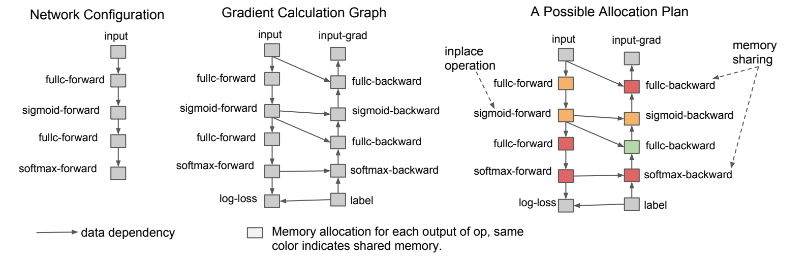
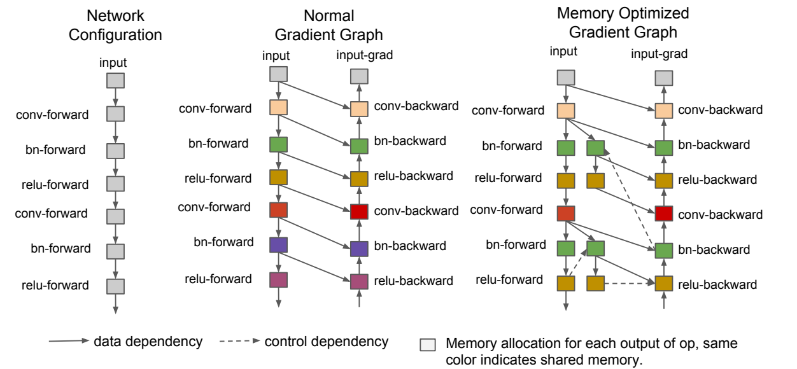
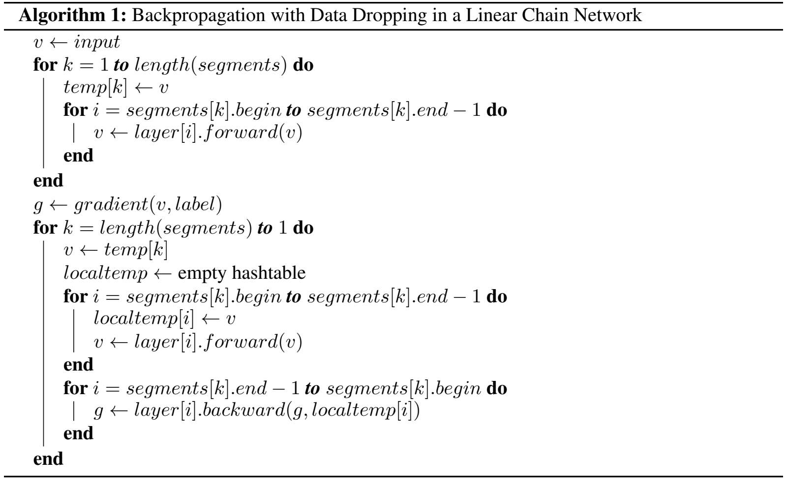
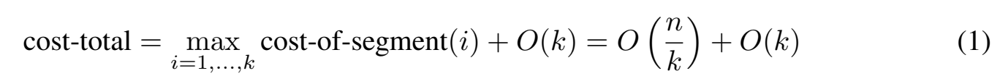

# 第 13 讲：Gradient checkpointing

训练时，模型算完一个中间结果，往往还不能把它扔掉：稍后的求导还要用它。网络很深或序列很长，这些中间结果会占很多存储。**Gradient checkpointing（梯度检查点）选择保留一部分边界值，需要内部值时重新算一次，用额外计算换取较少的保存量。** 它不把权重压成低比特，也不靠减少可训练参数工作。

这篇先算一个只有几个数的例子，再读论文原图和伪代码，最后回到原课程的BERT训练。原件固定为课程提交`7fbc29824171fd07dc2c30fe922e61ebc018ad1d`的`gradient_checkpointing.ipynb`，23格；[详细中文代码](代码/tutorials/gradient_checkpointing_代码注释.py)、[注释notebook](代码/tutorials/代码注释.ipynb)与全部历史输出保留。旧完整讲解折叠放在文末，正文新增四段Python另行执行，不改原代码。

论文是Chen等的 *Training Deep Nets with Sublinear Memory Cost*，**arXiv:1604.06174v2，2016-04-22**。[固定论文版本](https://arxiv.org/abs/1604.06174v2)。阅读重点是第3节的计算依赖和第4节的分段重算；本讲不复现论文CNN/LSTM训练结果。下面四幅截图全部来自这一版PDF，并注明页码；相关英文含义就在图旁解释。

## 1. 一个数也能说明为什么要留中间结果【必须会】

先不考虑BERT，设输入$x=0.5$，可训练参数$w=2$。参数是训练会调整的数，输入是本次给定的数据。依次计算：

$$h=wx=1,\qquad y=h^2=1,\qquad\mathcal L=\tfrac12 y^2=0.5.$$

$h$和$y$是中间结果，通常叫激活值（activation），不一定特指某一种激活函数。这里的目标是把输出$y$推向0，所以误差$\mathcal L$选择平方损失。forward（前向）指从输入算到误差；backward（反向）指从误差往回求每个数的影响程度。

导数表示一个数小幅改变时结果怎样变化。链式法则把沿途影响相乘：

$$\frac{\partial\mathcal L}{\partial w}
=\frac{\partial\mathcal L}{\partial y}\frac{\partial y}{\partial h}\frac{\partial h}{\partial w}
=y\cdot 2h\cdot x=1\cdot2\cdot0.5=1.$$

符号$\partial\mathcal L/\partial w$表示loss对参数w的导数；参数很多时，这些导数组合成梯度。求这条梯度要用$y$、$h$和$x$，因此它们不是“输出算完就都没用了”。同理，输入梯度为$y\cdot2h\cdot w=4$。若用最简单的SGD、学习率0.1更新一次，w将从2变成1.9；本节代码只求梯度，不执行更新。

现在假设只保存段入口$x$。反向要用$h$时，再算$wx$，接着得到$y$，就能继续用同一个公式求导。前提是w仍为2；若在重算前先改成1.9，重算的函数就变了。

```python
import torch
from torch.utils.checkpoint import checkpoint

scalar_runs = {}
for mode in ('ordinary', 'checkpoint'):
    w = torch.tensor(2.0, dtype=torch.float64, requires_grad=True)
    x = torch.tensor(0.5, dtype=torch.float64, requires_grad=True)
    calls = []

    def segment(value):
        calls.append(torch.is_grad_enabled())
        hidden = w * value
        return hidden.square()

    if mode == 'ordinary':
        prediction = segment(x)
    else:
        prediction = checkpoint(segment, x, use_reentrant=True)
    loss = 0.5 * prediction.square()
    loss.backward()
    scalar_runs[mode] = {
        'prediction': prediction.item(), 'loss': loss.item(),
        'w_grad': w.grad.item(), 'x_grad': x.grad.item(),
        'w_unchanged': w.item(), 'calls_grad_enabled': calls.copy(),
    }
print(scalar_runs)
assert scalar_runs['ordinary']['w_grad'] == scalar_runs['checkpoint']['w_grad'] == 1.0
assert scalar_runs['ordinary']['x_grad'] == scalar_runs['checkpoint']['x_grad'] == 4.0
assert scalar_runs['ordinary']['calls_grad_enabled'] == [True]
assert scalar_runs['checkpoint']['calls_grad_enabled'] == [False, True]
```

`torch.tensor`构造保存数值的张量；这里只含一个数，shape是`[]`，与长度1的数组`[1]`不同。float64用64bit近似存小数，`requires_grad=True`让自动求导跟踪它；`.square()`求平方，`.item()`读出单个Python数。`loss.backward()`把导数存到叶子张量的`.grad`，不会自动执行参数更新。字典`scalar_runs`按名字保存两种结果，`for`依次跑两条路径，`assert`检验结论。

这里也给输入x开启求导，用来观察输入梯度并满足这个旧reentrant例子的边界条件；**输入有梯度不等于要训练输入**。真正更新哪些对象由优化器接收的参数集合决定，本段根本没有优化器。

`def segment(value)`定义一个可重复调用的函数；`return`交回输出。`checkpoint(segment, x, …)`传入的是**函数本身**，wrapper才能以后再调用它；若写`segment(x)`就先算出了结果。函数还读取外面的w，本例中每次backward都在该轮循环内完成，w不被替换或更新。日志只记布尔值，不改模型结果。

本次固定PyTorch2.0.1、显式`use_reentrant=True`：普通段只执行一次，记录`[True]`；检查点段第一次在不记录内部求导图的环境下执行，反向时重新记录计算图，记录`[False, True]`。输出都是1，loss都是0.5，w梯度1、x梯度4，w仍是2。**不记录第一次内部图，不等于最终没有梯度。** 两种checkpoint实现有差别，这里的执行次数和输入梯度要求都限定于这一选择。[对应源码](https://github.com/pytorch/pytorch/blob/v2.0.1/torch/utils/checkpoint.py)。

## 2. 原论文Figure 1：箭头表示以后还需要什么【必须会】



来源：**原PDF第3页Figure 1**，直接渲染裁切，未重绘。

左栏从上往下是普通前向：输入→全连接`fullc`→sigmoid→全连接→softmax。全连接把输入向量乘权重矩阵并加偏置；sigmoid把数压到0与1之间；softmax把候选分数转成和为1的概率。训练还用`label`给出正确类别，用`log-loss`惩罚正确类别概率太低的预测。

中栏补出右侧的backward路径。底部loss发起求导，梯度沿右侧往上回传；左侧连到右侧的实线说明“这个反向操作还需要那个前向值”。例如sigmoid的导数可以由它的输出$h$算成$h(1-h)$。因此不能只看前向值是否已经传给下一层，还要看反向是否会用它。图中省略了权重及其梯度节点；不是网络没有权重或不训练它们。

右栏的相同颜色表示可以复用同一块存储。`inplace operation`指用结果覆盖允许覆盖的旧值，`memory sharing`指不同生命周期的结果使用同一存储区域。**相同颜色不表示数值相等，也不表示可以同时互相覆盖。** 只有旧值确实不再被任何后续计算需要时才能复用。第一个图主要解释依赖和复用，还没有画出下一节的重算分支。

图里是一般的全连接网络，原课程则是BERT。若全连接层输入向量`[d_in]`，权重`[d_out,d_in]`，输出`[d_out]`；d_in/d_out分别是输入和输出宽度。小数例里的$x,h,y$都是标量，是这条依赖关系的最小例子，不是声称BERT只有一个节点。

Python里`del hidden`只删除一个名字；autograd若仍为反向保存着tensor，它的存储还在。`empty_cache()`也不会释放仍活跃的张量。检查点改变的是“哪些内部求导信息现在保留、哪些稍后重新构建”，不能用删变量替代。

## 3. 原论文Figure 3与Algorithm 1：丢掉后从哪里补回来【必须会】



来源：**原PDF第6页Figure 3**。

仍从左往右比较：左栏是`conv→bn→relu`重复两次的前向网络；conv是卷积，bn是BatchNorm归一化层，relu把负数截成0。中栏保存反向需要的结果；右栏增加了某些bn/relu的前向副本，用来在反向需要时恢复丢弃结果，而保留较昂贵的卷积结果。这展示的是可选择算子的图重写，不等于“所有模型统一每两层重算”。

实线仍表示数据依赖；虚线在原图图例中是**控制依赖**，规定执行先后，不能简单翻译成“虚线就是又传了一份数据”。相同颜色仍表示可共享存储，不能由颜色推出所有副本一直同时驻留。重算副本用相同参数执行原运算，没有多出一套独立训练权重。原BERT开关只做每层包装，并未实现论文的通用图规划器；本轮代码也不执行图中的卷积或BatchNorm。

把复杂图暂时缩成一条顺序链，可以按论文的Algorithm 1分段：



来源：**原PDF第5页Algorithm 1**。这是伪代码，不是可直接交给Python执行的代码。`←`表示赋值，`segments`是分段表，`begin/end`表示段的起止层，end是排他边界；论文这里的k是当前段索引。

1. 上半部从第一段到最后一段：`temp[k] ← v`保存本段入口，然后前向经过该段。内部临时结果不必全程留到整个网络反向结束。
2. `g ← gradient(v,label)`由最终输出和正确标签得到末端梯度g。若是前节平方损失，末端梯度就来自该平方公式；实际BERT分类用交叉熵。
3. 下半部从最后一段往回：拿`temp[k]`恢复入口，重新执行本段forward，把本次反向要用的值存入局部表`localtemp`。
4. 再在本段内部从最后一层往前求导，把g传给更早一层。该段完成后，局部中间值不再需要，接着处理上一段。

例如16层分成4段，边界是0、4、8、12层之后的值；初次forward走16层。反向处理最后4层时，从保留的第12层输出重算13–16层；处理9–12层时，从第8层输出重算。这个伪代码把每段都重算，因此额外再走16层forward。反向计算本身还照常存在，不能把“多一遍forward”说成“训练总时间恰好翻倍”。保存边界增加存储，重算局部段也临时需要存储；不是全程只剩4个值。

## 4. 公式(1)：为什么不能只留一个点，也不能处处都留【建议会】



来源：**原PDF第5页公式(1)**。用数学排版重写同一关系：

$$\text{cost-total}
=\max_{i=1,\ldots,k}\text{cost-of-segment}(i)+O(k)
=O(n/k)+O(k).$$

$n$是总层数，$k$是分成几段，此处i才是段索引。`cost-of-segment(i)`是处理第i段反向时需要的局部空间，max取其中最大的；另外还需存k个量级的段边界。$O(\cdot)$说的是随规模增长的量级，隐藏常数、单位和较小项，**不是测得的字节数**。

假设每层激活大小接近，均匀分段：每段约$n/k$层，于是局部空间随$n/k$增长，边界空间随k增长。段很少，边界少，但每段重算时要暂存很多层；段太多，段内小，却要保存许多边界。令$k\approx\sqrt n$可把两项平衡到根号量级。n=16时，用相同“每层单位”粗看：k=1是16+1，k=4是4+4，k=16是1+16；这里的17/8/17只是代入近似量级的示意，**不是精确活跃tensor数量**。

原论文还讨论不同层大小的规划与递归策略；普通BERT开关没有自动保证最优k或根号级整卡内存。权重、权重梯度、优化器历史统计、临时工作区等也要占存储，不能靠减少激活保存让它们消失。显存就是GPU上的这类存储；本轮只在CPU计算，不报告GPU节省比例。

## 5. 真正调用checkpoint_sequential：最后一段会怎样【必须会】

原notebook第19格只导入这个函数，没运行示例。下面独立补充一个4块网络，每块`Linear(2,2)→sigmoid`，输入浮点tensor `[1,2]`：1条样本、每条2个特征。Linear有权重`[2,2]`和偏置`[2]`；四块共24个参数，每块都返回`[1,2]`，最终loss取两个输出平方的平均值。

`nn.Module`是PyTorch管理参数的模型基类，`class Block(nn.Module)`声明自己的子类；`__init__`构造时运行，`super().__init__()`先初始化父类管理机制。把Linear放进`self.linear`会注册参数。`forward`定义被调用时的计算，`self`表示当前实例。`nn.Sequential`按顺序调用里面各块，`*列表`把列表元素展开成多个构造参数。

```python
import copy
from torch import nn
from torch.utils.checkpoint import checkpoint_sequential

class Block(nn.Module):
    def __init__(self):
        super().__init__()
        self.linear = nn.Linear(2, 2)
        self.calls = []

    def forward(self, value):
        self.calls.append(torch.is_grad_enabled())
        return self.linear(value).sigmoid()

torch.manual_seed(13)
template = nn.Sequential(*[Block() for _ in range(4)]).double()
sequential_runs = {}
for mode in ('ordinary', 'checkpoint'):
    model = copy.deepcopy(template)
    value = torch.tensor([[0.5, -1.0]], dtype=torch.float64, requires_grad=True)
    if mode == 'ordinary':
        output = model(value)
    else:
        output = checkpoint_sequential(model, segments=2, input=value, use_reentrant=True)
    output.square().mean().backward()
    sequential_runs[mode] = {
        'output': output.detach().clone(), 'input_grad': value.grad.clone(),
        'parameter_grads': {name: parameter.grad.clone() for name, parameter in model.named_parameters()},
        'calls': [block.calls.copy() for block in model],
    }
plain, checked = sequential_runs['ordinary'], sequential_runs['checkpoint']
torch.testing.assert_close(plain['output'], checked['output'], rtol=0, atol=0)
torch.testing.assert_close(plain['input_grad'], checked['input_grad'], rtol=0, atol=0)
for name in plain['parameter_grads']:
    torch.testing.assert_close(plain['parameter_grads'][name], checked['parameter_grads'][name], rtol=0, atol=0)
print('普通/分段的每块调用:', plain['calls'], checked['calls'])
assert checked['calls'] == [[False, True], [False, True], [True], [True]]
```

`.double()`把浮点参数改为float64；`copy.deepcopy`复制独立模型，两条路径从同一初始值开始，没有拿上一轮训练后的模型继续比较。`manual_seed`固定随机初始化序列，不是训练一轮的意思。`.detach().clone()`保存独立结果副本且不再追踪它的求导图；这里只为验证等价，额外快照不能拿去做内存节省测量。字典推导式逐个保存参数梯度，`named_parameters()`提供名字和参数。`assert_close`的零容差要求此受控例逐元素相同。

本次普通每块调用一次；分段为`[2,2,1,1]`次，总计4→6次。`segments=2`表示分成两段，不是每两层都会重算。**固定PyTorch2.0.1的checkpoint_sequential只包装前segments−1段，最后一段普通执行**，因此后两块仍保留普通求导路径。论文Algorithm1重算每一段，与这个API的调度并不完全相同。输出、输入梯度和全部参数梯度在这个例子中精确相同；本段没有执行优化更新或测峰值内存。

## 6. 有随机操作时，“同样输入”还不够【必须会】

Dropout训练时随机把部分位置置零，并对保留位置缩放。若原forward保留位置1，而重算时保留了位置2，重算结果就不是原结果，对应梯度也会变。checkpoint默认保存并恢复相关随机数生成器（RNG）状态，就是为了重放同一次随机选择；它不是取消Dropout。

```python
import torch.nn.functional as F

rng_runs = {}
for mode in ('ordinary', 'preserve', 'no_preserve'):
    weight = torch.ones(8, dtype=torch.float64, requires_grad=True)
    value = torch.arange(1, 9, dtype=torch.float64, requires_grad=True)
    replay = []

    def random_segment(input_value):
        result = F.dropout(weight * input_value, p=0.5, training=True)
        replay.append(result.detach().clone())
        return result

    torch.manual_seed(13)
    if mode == 'ordinary':
        output = random_segment(value)
    else:
        output = checkpoint(random_segment, value, use_reentrant=True,
                            preserve_rng_state=(mode == 'preserve'))
    output.sum().backward()
    rng_runs[mode] = {'first_output': output.detach().clone(),
                      'weight_grad': weight.grad.clone(), 'replay': replay}
for mode in ('preserve', 'no_preserve'):
    assert torch.equal(rng_runs['ordinary']['first_output'], rng_runs[mode]['first_output'])
assert torch.equal(rng_runs['ordinary']['weight_grad'], rng_runs['preserve']['weight_grad'])
assert not torch.equal(rng_runs['ordinary']['weight_grad'], rng_runs['no_preserve']['weight_grad'])
print('保留随机状态的两次结果:', [item.tolist() for item in rng_runs['preserve']['replay']])
print('不保留随机状态的两次结果:', [item.tolist() for item in rng_runs['no_preserve']['replay']])
print('三种参数梯度:', {mode: run['weight_grad'].tolist() for mode, run in rng_runs.items()})
```

`torch.ones(8)`构造8个1，`arange(1,9)`构造1到8；逐元素乘法得到`[8]`，不是矩阵乘法。`F.dropout`是函数，`training=True`明确启用随机屏蔽；p=.5表示每个位置以一半概率被屏蔽，保留者乘2。`sum()`把8个输出加成标量以便反向。每条路径前都重设同一seed，因此三种初始输出相同；不保留RNG状态的路径仍可能在重算时变了。本轮实际比较了梯度，并非只看第一次loss。

本次第一次结果是`[0,0,6,0,0,0,14,0]`；保留RNG时第二次仍是这一组，不保留时重算成`[2,0,0,0,10,12,14,16]`。因为本例loss就是输出求和，参数初值都是1，参数梯度恰好也等于这些数：是否保留第1、3、5、6、8个位置改变了对应梯度；第7个位置两次都保留。不保留RNG的最大参数梯度差为16。这个可见反例说明只比较第一次forward输出不足以验证重算正确。

日志中的clone仅为观察重放，额外占用本例的CPU存储；不据此估算节省。保存RNG也不能修复任意副作用：如果函数重算时修改全局变量、累计统计、换权重或做不可重复I/O，仍可能改变训练语义。图里有BatchNorm，不意味着带运行统计的任意PyTorch模块可不经检查直接包装。

## 7. 开关怎样到BERT层：一个真实分类例子【建议会】

BERT先把token ID查成向量，再经过多层encoder读取上下文，最后给整条序列分类。本课程是二分类，不是第12讲逐token预测：`labels` shape为`[B]`，logits为`[B,2]`，不做next-token shift。`B`是批内样本数，`T`是每条序列长度，`H`是隐藏向量宽度。

`BertConfig`描述结构；`BertForSequenceClassification(config)`用配置新建随机模型，不加载预训练权重。下面固定B2/T4/H8、两层、词表32，关闭dropout便于比较。两条路径只有checkpoint开关不同，各完成一次SGD更新。hook是注册在模块上的观察回调，本例只记录该层执行时是否在记录求导图，不修改输出。

```python
from transformers import BertConfig, BertForSequenceClassification

torch.set_num_threads(2)
torch.manual_seed(13)
bert_template = BertForSequenceClassification(BertConfig(
    vocab_size=32, hidden_size=8, intermediate_size=16,
    num_hidden_layers=2, num_attention_heads=2, max_position_embeddings=16,
    hidden_dropout_prob=0.0, attention_probs_dropout_prob=0.0, num_labels=2,
))
batch_ids = torch.tensor([[1, 2, 3, 4], [4, 3, 2, 1]], dtype=torch.int64)
batch_labels = torch.tensor([0, 1], dtype=torch.int64)
bert_runs = {}
for enabled in (False, True):
    model = copy.deepcopy(bert_template)
    if enabled:
        assert model.gradient_checkpointing_enable() is None
    model.train()
    traces, handles = [], []
    for layer in model.bert.encoder.layer:
        layer_trace = []
        traces.append(layer_trace)

        def observe(module, inputs, result, trace=layer_trace):
            trace.append(torch.is_grad_enabled())

        handles.append(layer.register_forward_hook(observe))
    before = {name: parameter.detach().clone() for name, parameter in model.named_parameters()}
    optimizer = torch.optim.SGD(model.parameters(), lr=0.1)
    output = model(input_ids=batch_ids, labels=batch_labels)
    output.loss.backward()
    assert all(torch.equal(parameter, before[name]) for name, parameter in model.named_parameters())
    assert all(parameter.grad is not None for parameter in model.parameters())
    gradients = {name: parameter.grad.clone() for name, parameter in model.named_parameters()}
    optimizer.step()
    assert any(not torch.equal(parameter, before[name]) for name, parameter in model.named_parameters())
    for handle in handles:
        handle.remove()
    bert_runs[enabled] = {
        'loss': output.loss.item(), 'logits': output.logits.detach().clone(),
        'gradients': gradients, 'state': copy.deepcopy(model.state_dict()), 'calls': traces,
        'parameters': sum(parameter.numel() for parameter in model.parameters()),
    }
for name in bert_runs[False]['state']:
    torch.testing.assert_close(bert_runs[False]['state'][name], bert_runs[True]['state'][name], rtol=0, atol=0)
for name in bert_runs[False]['gradients']:
    torch.testing.assert_close(bert_runs[False]['gradients'][name], bert_runs[True]['gradients'][name], rtol=0, atol=0)
assert bert_runs[False]['calls'] == [[True], [True]]
assert bert_runs[True]['calls'] == [[False, True], [False, True]]
print('BERT loss/参数数:', bert_runs[True]['loss'], bert_runs[True]['parameters'])
print('BERT关闭/开启的层调用:', bert_runs[False]['calls'], bert_runs[True]['calls'])
```

`gradient_checkpointing_enable()`是模型方法，修改支持模块的开关，返回None；不能写成`model = model.gradient_checkpointing_enable()`，那会把model变量改成None。`model.train()`设置训练模式，既不执行一轮训练，也不冻结参数。`state_dict()`列出模型状态，`optimizer.step()`才使用梯度更新权重。此处每轮模型新建、只backward一次，初始grad为空；训练多个batch则需按累积策略清零。

`trace=layer_trace`在定义回调时绑定当前层的列表，避免多个回调最后都写入同一个层日志。`register_forward_hook`返回可移除的句柄；`remove()`结束观察。本例日志只保存布尔值，参数/梯度快照则为验证占了额外存储，不作资源benchmark。

在固定Transformers4.30.0中，启用方法遍历模块，把`BertEncoder.gradient_checkpointing`设为True；训练状态下，`BertEncoder.forward`给**每个BertLayer**套`torch.utils.checkpoint.checkpoint`。普通两层各执行一次，开启后各执行两次；不像上节sequential那样保留最后一段普通执行。参数集合没有增加，也不是复制一套BERT。[固定模型源码](https://github.com/huggingface/transformers/blob/v4.30.0/src/transformers/models/bert/modeling_bert.py)。

本例ID为int64 `[2,4]`，embedding输出为FP32 `[2,4,8]`，两层保持这一shape，分类logits为`[2,2]`，loss是标量`[]`。整数ID自身不能开启普通浮点求导；其后embedding输出在本例会因可训练embedding参与求导。旧reentrant对边界梯度有要求，冻结embedding后需另外核对encoder是否仍得到梯度，不能只看loss.backward没有报错；旧完整实验保留在下方，本轮不重跑该负例。

本次随机小BERT共1706个参数，两条路径loss均为0.6932495832443237；全部参数均有梯度，反向结束前权重仍等于初值。一次SGD后确有参数变化，两条路径的全部参数梯度和更新后状态都精确相同。这里只证明该受控计算一致，没有使用有意义的分类语料或评测模型能力。

## 8. 原notebook所有单元与历史资源结果【必须会】

| 原单元，从0编号 | 在做什么，以及容易误读的地方 |
|---|---|
| 0 | basics标题。 |
| 1 | 论文、计算图文章与旧HF性能材料链接；O(n)/O(1)/O(n²)是不同保存/重算策略的简化量级，不是测得整卡内存。 |
| 2 | 解释保存部分激活、反向按需重算。英文相关含义已在本文第1–4节展开。 |
| 3–5 | Trainer标题、`CUDA_VISIBLE_DEVICES='0'`、dataset标题；环境变量限定进程可见卡，应在CUDA初始化前设置。 |
| 6–7 | 随机生成512×512个ID和512个0/1类别，建HF Dataset并设置返回Torch格式，再打印shape。没有真实文本或tokenizer。 |
| 8–9 | 定义NVML查询/训练摘要并查询整张物理卡0；这些时点读数不是训练峰值。 |
| 10–11 | 加载BERT-large并移到CUDA；`AutoModelForSequenceClassification`按配置选分类模型，新分类头在历史日志中随机初始化。 |
| 12–14 | 普通训练：共享参数字典、micro-batch=4、Trainer构造、train及摘要。 |
| 15–16 | 检查点训练：micro-batch=1、累积4、checkpoint=True；同时改三个因素，不能将总差异全归因于checkpoint。 |
| 17 | `512/((1*1)*4)`为128.0，按单卡有效批4估算更新次数；不是该配置只有128次micro-forward。 |
| 18–19 | pytorch标题、导入checkpoint_sequential；没有调用，本文第5节是新增教学例。 |
| 20–21 | huggingface标题、Markdown中的`BertPreTrainedModel`开关片段；Markdown不会执行或重定义真实模型。 |
| 22 | 空代码格，无动作。 |

`np.random.randint(100,30000,(512,512))`的上界不含30000；labels在0/1之间。`Dataset.from_dict`把列构成数据表，`set_format('pt')`改变取样的返回格式，不是提前把整个数据搬到GPU。BERT-large原结构是24层、H1024、16个attention头；原batch `[B,512]`经过embedding成为`[B,512,1024]`，常规attention分数为`[B,16,512,512]`，最终分类为`[B,2]`。随机ID和随机标签只能用于观察计算流程/资源，不能说明语义分类能力。

为什么序列变长后存储压力明显？FP32每个元素占4字节，原B4时，一个`[4,512,1024]`张量有2097152个数，单份8MiB；按显式`[4,16,512,512]`分数矩阵估算，单份64MiB。后者有两个序列长度轴，T翻倍时元素数会变成4倍。网络还会有其他中间结果，具体attention实现也可能避免显式保存整张矩阵；这些只是形状对应的存储算术，不能把各项直接相加当成训练峰值。

原普通组B4、累积K1；另一组B1、K4。单个数据并行进程下，每次更新各汇集4个样本；第二组要做4次更小的forward/backward才更新一次。checkpoint改变每次backward内的重算，累积改变什么时候更新，二者不是一个开关。`**default_args`把共享字典展开成命名参数：output_dir保存路径，epochs=1训练计划，log_level改日志，report_to='none'关闭外部统计上报。

`evaluation_strategy='steps'`却未提供eval_dataset是原配置的缺口；本轮教学没有照搬它。原注释还要求比较第二组时注释第一组，否则按“运行全部”会接着使用已经训练过的同一model，不是同初始化比较。单卡visible设置不等于模型并行或数据并行；本轮也未执行原GPU环境设置。

| 历史保存的结果 | 普通B4/K1 | B1/K4+checkpoint | 能说明的范围 |
|---|---:|---:|---|
| 训练秒数 | 23.78 | 38.96 | 本次历史记录增加15.18秒，约63.84% |
| 样本/秒 | 21.53 | 13.14 | 降低约38.97%，没有重复运行误差条 |
| 结束时整卡MiB | 12917 | 9305 | 当时读数减少3612MiB、约27.96%，不是峰值节省率 |

MiB是$2^{20}$字节，原打印写MB但实际除1024²。NVML报告整张物理卡当时占用，包含其他活动，不能当作本进程PyTorch峰值。原两组同时变更微批/累积/检查点，又缺同初始化对照，因此不能分离各自贡献；本轮不重新运行这个资源实验。

## 9. 这一轮实际验证了什么

四段正文代码从当前解释.md直接提取、原样执行，固定CPU Torch2.0.1与Transformers4.30.0。小数例核对手算梯度与重算；四块网络核对最后一段例外与全部梯度；Dropout例核对RNG重放；随机小BERT核对实际逐层重算、梯度和一次更新后状态。没有下载模型权重，没有NVML查询或训练内存/速度结论。[本轮结果](复现/outputs/基础改写验证.json)、[复现命令](复现/README.md)。

此前四组Trainer/H16小BERT、保存引用字节、冻结embedding和eval失败等实验都在下方旧讲解与旧输出中保留，**本轮没有重跑这些旧脚本或覆盖记录**。现代non-reentrant与目标版本迁移也不在本轮实测范围；理解本讲不必先掌握所有新API。

<details>
<summary>第二遍对照：旧版完整公式、全部源码依据与历史实验（保留）</summary>

# 第 13 讲：Gradient checkpointing

gradient checkpointing 用重算换激活显存：forward 时保留边界输入，丢掉某段内部的临时结果；backward 进入该段时，从边界重跑 forward，恢复求导所需的值。它通常不改变目标函数，但要求重算与原计算一致。这里的 checkpoint 是激活边界，与保存到磁盘的模型 checkpoint 是两个用途。

阅读对象是课程 `gradient_checkpointing.ipynb` 的 23 个单元和对应字幕；课程固定 commit `7fbc29824171fd07dc2c30fe922e61ebc018ad1d`。论文背景是 Chen 等的 **Training Deep Nets with Sublinear Memory Cost**，arXiv:1604.06174v2，2016-04-22；本讲聚焦分段重算，不宣称复现论文 ImageNet/LSTM 实验。作者完整 Python/CUDA/依赖锁文件未找到。

[本讲阅读入口](README.md) · [详细代码注释](代码/tutorials/代码注释.ipynb) · [Python 阅读版](代码/tutorials/gradient_checkpointing_代码注释.py)。全部 23 格、12 个代码格及 Markdown21 的类片段都有 [单元说明](代码单元解释.md)。

## 1. 论文地图与代码地图

论文讨论计算图依赖、内存共享，再引入丢弃/重算、分段与递归内存规划，最后在 CNN/LSTM 上实验。本讲使用第 4 节分段思想；原课程没有实现通用图优化器或自动预算搜索。

| 对象 | 位置 | 用途 |
|---|---|---|
| 理论与链接 | cells 0–2 | 计算/显存折中 |
| 单卡选择 | cell 4 | CUDA_VISIBLE_DEVICES |
| 随机数据 | cells 6–7 | 512 个长度 512 的序列 |
| NVML 工具 | cells 8–9 | GPU 当时总占用 |
| BERT 加载 | cell 11 | 序列二分类 |
| 普通训练 | cells 13–14 | batch=4 |
| 累积与 checkpoint | cells 16–17 | batch=1、累积=4 |
| PyTorch 接口 | cell 19 | 仅 import checkpoint_sequential |
| BERT 开关片段 | cell 21 Markdown | 对 BertEncoder 设置 flag |

```text
随机 IDs/labels -> Dataset -> Trainer dataloader
 -> BERT embeddings -> 24 个 BertLayer -> pooler/classifier
 -> logits[B,2] -> classification loss -> backward/recompute
 -> 累积梯度 -> optimizer step -> metrics/NVML
```

参考源码固定为 Transformers v4.30.0 与 PyTorch v2.0.1，不代表作者精确安装版本。Trainer 控制开关；BertEncoder 决定包装哪些层；torch checkpoint 处理重算与 autograd。论文级调度与这些接口相关，但不能等同为同一完整实现。

## 2. 为什么 backward 需要 forward 值【必须会】

对一层 $z_i=W_i h_{i-1}+b_i$、$h_i=\sigma(z_i)$，设 $g_i=\partial\mathcal L/\partial h_i$：

$$\delta_i=g_i\odot\sigma'(z_i),\quad
\frac{\partial\mathcal L}{\partial W_i}=\delta_i h_{i-1}^{\mathsf T},\quad
g_{i-1}=W_i^{\mathsf T}\delta_i.$$

$i$ 是层索引，$W_i$ shape 为 `[d_out,d_in]`，$h_{i-1}$ 为 `[d_in]`，$\delta_i$ 为 `[d_out]`，$\odot$ 表示逐元素乘法。batch 实现还要对样本贡献求和/平均。求权重梯度需要输入 $h_{i-1}$；非线性导数也需要相应结果，因此 forward 临时值在 backward 前不能随意删除。sigmoid 可由输出计算导数 $h_i(1-h_i)$，不同算子所需保存值不同，不是所有节点都必须保存所有输入输出。

最小例子：$h=\sigma(wx)$，$w=2$、$x=0.3$，$h\approx0.645656$，$\mathcal L=\tfrac12(h-0.1)^2$。先得到 $g=h-0.1$，再算 $\partial\mathcal L/\partial w=g h(1-h)x\approx0.03745$。如果丢了 h，重算 $\sigma(2\times0.3)$ 能恢复它；参数 w 在当前 backward 完成前不能先更新，否则重算的函数变了。

在神经网络里 activation 是中间 tensor。PyTorch autograd 保存的 tensor 可能因导数需要而继续存在，即使 Python 局部变量已离开作用域。单纯 `del hidden_states` 或 `empty_cache()` 不能代替 checkpoint；后者无法清理仍被计算图引用的活跃 tensor。

## 3. 计算图、pebbles 与分段【必须会】

字幕中 `PBS` 对应图示的 pebbles（棋子/存储槽）概念：节点放一个 pebble 表示它的值当前可用。它不是某个 PyTorch 参数名。对 $x_3=x_1+x_2$、$x_5=x_3+x_4$，forward 最后不再依赖 x1/x2 时可以释放它们；训练还需检查 backward 的依赖。加法导数不依赖输入值，但乘法、非线性等通常需要，不能拿加法图推出所有层都可以直接删。

以下为原创分段示意，实线是原 forward，虚线表示 backward 时重算：


forward 由左向右，只保留段输入；backward 由右向左，在当前段重建局部计算图、求梯度，然后释放局部中间值。箭头不是模型参数，段内神经网络层有参数，checkpoint wrapper 自身不增加可训练参数。全保存的链需要线性增长的激活空间；若只留输入，每求一个早期/后期梯度都从头重算，极端朴素策略可能带来平方级计算。分段减少这种反复重跑。

论文式 (1) 给均匀层的近似激活内存关系：

$$M(n,k)=O(n/k)+O(k).$$

$n$ 为层数，$k$ 为段数。第一项是在一个段里恢复并求导的局部激活，第二项是保留的段边界。令 $k\approx\sqrt n$ 可得根号级激活空间，并增加约一遍 forward。例子 n=16、k=4，段长=4；教学程序计入输入/边界后，全保存17个逻辑槽，分段重算峰值8个。这不是 GPU 字节测量。该复杂度假定层大小相近，**不含参数、优化器状态及其他显存**；通用 BERT 开关没有承诺整机显存变为 $O(\sqrt n)$。

## 4. 数据代码：随机分类不是语言建模【必须会】

```python
seq_len, dataset_size = 512, 512
dummy_data = {
    'input_ids': np.random.randint(100, 30000, (dataset_size, seq_len)),
    'labels': np.random.randint(0, 2, (dataset_size)),
}
ds = Dataset.from_dict(dummy_data)
ds.set_format('pt')
```

`np.random.randint(low,high,size)` 的上界不包含 high，所以 token IDs 是 100–29999，labels 是 0 或 1。`(dataset_size)` 只是带括号的整数，不是单元素 tuple；创建单元素 tuple 要写 `(dataset_size,)`。`Dataset.from_dict` 是类方法，把等长列构造为表；`set_format('pt')` 改变取样返回格式，使 `ds[i]` 返回 torch tensor，未运行它不意味着已创建所有 GPU 数据。

原代码没有 tokenizer、真实文本或固定 seed。IDs 在 BERT 词表范围内，但随机序列没有语言规律；标签也随机。数据没有显式 attention_mask、token_type_ids，BERT 会用默认处理；这里没有 padding，全部位置可参与 attention。本实验适合测资源，不适合报告分类能力。

| 变量 | dtype / 类型 | shape | 去向 |
|---|---|---|---|
| `dummy_data['input_ids']` | NumPy integer（平台相关） | `[512,512]` | Dataset |
| `dummy_data['labels']` | NumPy integer | `[512]` | 每序列一个类别 |
| batch `input_ids` | torch integer | `[B,512]` | embedding lookup |
| batch `labels` | torch integer | `[B]` | 分类交叉熵 |
| hidden states | floating | `[B,512,1024]` | 24 层 encoder |
| attention scores（常规路径） | floating | `[B,16,512,512]` | softmax/attention |
| pooled output | floating | `[B,1024]` | classifier |
| logits | floating | `[B,2]` | sequence loss |
| loss | floating | scalar `[]` | backward |

本讲 labels shape `[B]`，与第 12 讲语言模型 `[B,T]` 不同；分类不做 next-token shift。BERT Large 的 hidden=1024、24 层、16 heads，head_dim=64；attention 内部张量可能比单个 hidden state 大很多，所以显存不能只按 `[B,T,H]` 算。

## 5. 单卡与模型加载【建议会】

```python
os.environ['CUDA_VISIBLE_DEVICES'] = '0'
model = AutoModelForSequenceClassification.from_pretrained(
    'bert-large-uncased').to('cuda')
```

环境变量应在 CUDA 初始化前设；否则在 notebook 重跑这一格不保证隐藏已经初始化的 GPU。进程只看到所选物理 GPU，进程内编号从 0 开始。它不把模型量化，也不自动采用模型并行。

`from_pretrained` 按 checkpoint 构造 BertForSequenceClassification，载入基础权重；`.to('cuda')` 是实例方法，移动参数与 buffers，并返回模块对象。历史告警指出 classifier.weight/bias 新初始化，因为基础 BERT checkpoint 没有这次分类头。没有设置 fp16，因此原默认流程以 FP32 参数训练，而非第 12 讲的量化 LoRA。

NVML 历史初始355 MiB，模型加载后2511 MiB，差值2156 MiB；这些含 CUDA context、分配与其他驱动级占用，不能拿差值直接当精确参数字节数。

## 6. 两组 TrainingArguments 逐项解释【必须会】

```python
default_args = dict(output_dir='tmp', evaluation_strategy='steps',
    num_train_epochs=1, log_level='error', report_to='none')
TrainingArguments(per_device_train_batch_size=4, **default_args)
TrainingArguments(per_device_train_batch_size=1,
    gradient_accumulation_steps=4, gradient_checkpointing=True,
    **default_args)
```

`dict(...)` 与花括号都是字典构造；`**default_args` 将字典展开成关键字参数，不会创建两个不同算法。`output_dir` 为本地输出位置；epochs=1 为遍历计划；log_level 改日志级别，report_to='none' 关闭报告集成。`gradient_checkpointing=True` 让 Trainer 在训练准备阶段调用模型开关，默认普通模型仍更新所有可训练参数。

单卡情况下有效更新 batch 为：

$$B_{effective}=B_{micro}\times K\times D.$$

$B_{micro}$ 是每次 forward 的样本数，$K$ 是累积步数，$D$ 是数据并行进程数。两组分别为 $4\times1\times1=4$ 和 $1\times4\times1=4$。数据有512条，因此都计划128次 optimizer 更新；第二组有512次 micro-forward/backward，第一组128次。cell17 的512/4输出128.0是 Python `/` 的浮点结果，概念是更新次数，不是第二组 dataloader 的总 batch 数。

`evaluation_strategy='steps'` 却没有 eval_dataset 是潜在问题。旧版本默认评估步长通常继承 logging_steps，原短训练可能未触发，因此保存的成功运行不能证明该配置一般合法；更长训练/不同默认值/现代版本可能失败。资源测量应设 evaluation_strategy='no'，或明确提供评估集并记录开销。

原课程要求跑第二组时注释第一组，这是合理的运行意图；按“运行全部”则第二组会继续使用已训练一次的同一 model，优化器等对象也可能仍被变量引用。显存缓存与初始参数均不一致。公平比较应新进程重新加载相同模型并固定数据和 seed，不能靠删除一个 trainer 变量就假定完全清空环境。

## 7. 开关怎样到达真实重算【建议会】

参考调用链：`Trainer.train` 的训练准备 -> `model.gradient_checkpointing_enable()` -> `model.apply(...)` -> `BertPreTrainedModel._set_gradient_checkpointing` -> `BertEncoder.gradient_checkpointing=True` -> `BertEncoder.forward` 的训练分支 -> `torch.utils.checkpoint.checkpoint`。

原 cell21 是 Markdown 中的代码片段，没有在 notebook 里重新定义模型类。`isinstance(module,BertEncoder)` 检查模块类型；只给 encoder flag 赋值，不把 embedding、pooler、classifier 一起包装。`nn.Module.apply` 遍历子模块并调用给定函数；启用方法修改状态、返回 None，不能写 `model=model.gradient_checkpointing_enable()`。

旧版 BertEncoder 对每个 `BertLayer` 包装 checkpoint，而不是自动每根号层分一段。判定是 `self.gradient_checkpointing and self.training`：flag 开启且处于训练模式才走重算路径；`model.eval()` 下普通 forward 不因此重算。`output_hidden_states=True` 仍会收集每层输出，可能抵消部分节省，所以不应只检查 flag。

源码里的 `create_custom_forward(module)` 返回嵌套函数 `custom_forward(*inputs)`，把当前 layer、past_key_value 和 output_attentions 绑定进可调用对象。`*inputs` 接收多个输入，再展开传给层。checkpoint 的函数参数是“如何重新执行这一层”，其余参数包括 hidden_states、masks、可选encoder状态；返回与正常层相容的 tensor/tuple。

PyTorch v2.0.1 默认 reentrant 实现第一次 forward 在 `torch.no_grad()` 中执行，只保存边界输入/RNG等必要信息；backward 恢复随机状态，在 `enable_grad` 与原 autocast 环境下重跑该函数，再求导。`no_grad` 是上下文管理器，只在其代码块关闭图记录，不表示基础参数永久冻结。这个版本对输入/输出 requires_grad 有约束；第 12 讲冻结基础 embedding 的 LoRA 因此需要留意输入激活的梯度通路。

## 8. checkpoint_sequential、随机性与现代 API

原 cell19 **仅导入** `checkpoint_sequential`，没有调用，不存在已完成 sequential 示例的证据。该函数适合顺序层序列，`segments` 是段数，不是每段层数。PyTorch v2.0.1 的实现给前 segments-1 段包装 checkpoint，最后一段普通执行；不应照搬成“每层必定计算两次”。BERT 的多参数 layer 则用自己的 custom_forward。

dropout 等随机算子重算必须恢复相应 RNG 状态。否则同一个输入可能得到不同 mask，导数不再对应原 forward。教学脚本用随机 mask 说明此事；旧 checkpoint 默认 preserve_rng_state=True。若前向还写全局变量、更新缓存、产生不可重复副作用，RNG恢复也不够，需保证函数重放的语义一致。

当前 PyTorch 文档推荐明确指定 `use_reentrant=False`，并解释两种路径的图记录、支持范围与提前停止差别。本讲原旧源码依赖 reentrant 默认；迁移应查看目标版本，不能直接把所有旧封装和约束当现代默认。现代选择性重算也可能无需完整重跑所有操作。使用 decoder 模型时还需检查 KV cache，旧 BERT 参考实现会在训练 checkpoint 路径关闭 use_cache；本讲为 encoder 分类，不能把推理 KV cache 当作主要训练显存来源。

## 9. 原实验数值及证据边界

| 项目 | 普通 B4/K1 | B1/K4 + checkpoint | 变化 |
|---|---:|---:|---:|
| 训练时间（秒） | 23.78 | 38.96 | 增加15.18，约63.84% |
| 样本/秒 | 21.53 | 13.14 | 下降约38.97% |
| 结束时 NVML（MiB） | 12917 | 9305 | 减少3612，约27.96% |
| 有效更新 batch | 4 | 4 | 相同 |

越少显存越好、越高吞吐越好，但代价之间要权衡。这里同时减小 micro-batch、增加累积并开 checkpoint，无法分离各自贡献。没有四组消融、重复实验、误差条或同初始化验证；随机数据也不支持学习质量结论。

`info.used//1024**2` 是整张物理 GPU 的当时 used memory，单位 MiB；print 文本的 MB 标记不精确。它不是当前进程 PyTorch allocated，更不是训练峰值。缓存、其他进程、前次实验都会影响结果；`print_gpu_utilization` 在训练返回后调用，漏掉短暂峰值。原数字说明这一保存运行的配置占用差异，不能保证读者同样节省27.96%。

对照应包含固定 B4/K1 只切开关，以及固定 B1/K4 只切开关；先核对数据、模型初始化、optimizer、dtype、设备、训练步数，再测 peak allocated/reserved、wall time 与吞吐。本次已运行这四组 CPU 小模型对照来验证状态与重算次数，尚未运行四组 GPU 峰值/速度实验。

## 10. 本次真实 Torch 与 BERT 验证

[运行记录](复现/outputs/runtime_verification.json) 来自 Python3.11.0、Torch2.0.1+cpu、Transformers4.30.0、Accelerate0.20.3、Datasets2.13.1 的实际安装包。没有下载 BERT-large，也没有把手写导数或类提取 fixture 当作 Torch 执行。可阅读 [重算与梯度教学补充](代码/重算与梯度_教学补充.py)，重做命令在 [复现说明](复现/README.md)。

### 分段函数实际执行了哪些层【必须会】

补充构造 4 个 `Linear(8,8)→sigmoid` 块，输入 float64 `[2,8]`，loss 为输出平方的均值。每个块继承 `nn.Module`；`__init__` 用 `super().__init__()` 初始化模块管理，再注册线性层；`forward(x)` 是模型被调用时执行的方法，返回 `[2,8]` Tensor。列表 `calls` 仅记录 `torch.is_grad_enabled()` 的布尔值，不修改模型输出。

普通 forward 每块调用一次，记录 `[True]`。`checkpoint_sequential(model,segments=2,input=x,use_reentrant=True)` 的前两块记录 `[False,True]`，后两块仍是 `[True]`：总层调用从 4 增到 6，**最后一段不重算**。这与旧标准库 16 层手写实验将每段都重算、总调用32次不同，两者没有混用。

两种路径的输出精确相同，参数梯度最大差 0、输入梯度最大差 0。第一次 forward 的 saved-tensor hooks 观测到保存事件从 12 降到 7；去重后非参数 storage 字节从 640 降到 512。这个统计只包括初次 forward 保存引用到的输入/中间 storage，排除模型参数 storage，不包含重算阶段、梯度/优化器或 Python 开销；它不是当前活跃总内存、进程 RSS 或 GPU 峰值，不能据此声称整机节省20%。

`saved_tensors_hooks(pack,unpack)` 是上下文管理器，`pack(tensor)` 在 autograd 保存时记录 shape/dtype/storage 元数据并返回真实 tensor，`unpack` 返回它用于 backward。日志不额外持有观测 tensor；模型的 `calls` 和报告仍有 Python 开销，所以仅把字节数解释为所声明范围的引用统计。

| 旧 Torch2.0.1 接口 | 关键输入/默认值 | 返回与状态 |
|---|---|---|
| `checkpoint(function,*args,…)` | 可重放函数与边界输入；`use_reentrant=True`，`preserve_rng_state=True` | 返回函数输出，建立重算反向路径；不增加模型参数 |
| `checkpoint_sequential(functions,segments,input,…)` | 顺序模块/函数、段数、单 Tensor | 输出与普通顺序执行相容，前若干段包装 checkpoint |
| `model.gradient_checkpointing_enable()` | 模型实例方法，无位置输入 | 返回 None，修改支持模块的开关 |
| `model.enable_input_require_grads()` | 模型实例方法 | 注册输入 embedding 输出 hook，不把权重解冻 |

### dropout 重放与输入梯度边界【必须会】

真实 `Linear→Dropout(p=0.5)` 测试用相同初始化、同输入和 seed777。普通、保留 RNG、不保留 RNG 三条路径的初始输出都相同；`preserve_rng_state=True` 重算输出和参数梯度仍一致。关闭恢复后，重算 mask 改变，参数梯度最大差 **0.710811140920421**。检查初始输出相同并不足以证明反向正确，必须看重算的函数结果或梯度。

另一个测试的 Linear 参数可训练，但边界输入 `requires_grad=False`。旧 reentrant 输出不参与 autograd，出现 `None of the inputs have requires_grad=True` 告警，随后 backward 实际失败。将输入设为 requires_grad=True，或在这个简单函数中使用旧版已支持的 `use_reentrant=False`，均恢复参数梯度，与普通路径精确相同。这个小函数结果不证明所有 BERT 封装可直接迁移到现代 API。

真实小 BERT 进一步说明“backward没报错”也可能漏梯度：冻结 embedding、启用旧 reentrant checkpoint 后，分类头仍可求导，loss.backward() 能完成，但两层 encoder 的 **32 个参数张量全部没有 grad**。调用 `enable_input_require_grads()` 后，32 个 encoder 参数张量恢复梯度；embedding 的参数依然冻结且 grad=None。需要梯度的激活和需要更新的权重是两个不同概念。

### 同初始化、同数据的四组 Trainer 对照【建议会】

两份 notebook 各实际执行全部可行的 10 个原代码格：6、7、8、9、13、14、16、17、19、22。单元6的原 `[512,512]` 随机表先完整构造并核对，再用仅改变长度/样本数的独立变体构造 `[8,16]` 教学数据。原4设备环境设置跳过；原11的远程/CUDA加载不执行，变体只替换为随机 BertConfig 构造与 CPU 移动。Markdown21两份片段在隔离环境定义类、操作真实 BertEncoder 并核对开关，未把它冒充原执行格。

小 BERT 为词表30000、hidden16、2层/2heads、intermediate32、位置512、两类分类，共 **493010 参数**。所有组恢复同一初始化，使用相同数据、样本顺序与 Trainer seed42；dropout设0用于受控等价比较。原13共享字典完整执行后，教学上下文显式改临时目录、evaluation_strategy=no、max_steps=2、save_strategy=no。原14与16的训练语句整格保留；另两组只切 checkpoint flag。

| CPU组 | 每版模型 forward 次数 | 每层总调用 | 每版优化步 | 训练平均loss |
|---|---:|---:|---:|---:|
| B4/K1/off | 2 | 2 | 2 | 0.6900777816772461 |
| B4/K1/on | 2 | 4 | 2 | 0.6900777816772461 |
| B1/K4/off | 8 | 8 | 2 | 0.6900777816772461 |
| B1/K4/on | 8 | 16 | 2 | 0.6900777816772461 |

优化器是该旧 TrainingArguments 的默认 `transformers.optimization.AdamW`，外层由 Accelerate 包装；不是原代码显式指定 PyTorch AdamW。固定 B/K 时只切 checkpoint，训练后所有参数精确相同；B4/K1 与 B1/K4 的最大参数差约 **1.862645149230957e-9**。两份 notebook 对应四组的参数状态、forward loss trace 和逐层调用 trace 全部精确一致。

这证明受控小模型中计算路径与新增注释一致，没有证明原 BERT-large 的速度、峰值或准确率。告警与运行统计保存在报告中，不使用毫秒级 CPU 时间去外推原 GPU 吞吐。

还实际构造 `evaluation_strategy=steps/eval_steps=1/max_steps=1` 且不传 eval_dataset 的 Trainer，训练后第一次计划评估抛出 `Trainer: evaluation requires an eval_dataset.`。原默认短训练可能不触发该分支，不能把成功历史日志当成评估配置完整。

原NVML函数也真实执行，能看到1张RTX4060 Laptop物理卡，CPU Torch 的CUDA可用性为False。两者查询的是不同对象：NVML返回整卡当时占用，不能归为本次CPU训练显存。没有用stub替代，也未把可变读数作为两份代码结果相等的条件。

## 11. 依据与验证入口

- [课程固定 notebook](https://github.com/chunhuizhang/personal_chatgpt/blob/7fbc29824171fd07dc2c30fe922e61ebc018ad1d/tutorials/gradient_checkpointing.ipynb)：代码与历史统计。
- [论文 v2](https://arxiv.org/abs/1604.06174v2)：分段思想、式 (1) 与适用假设；完整原论文 PDF 本地保存，没有中文译稿。
- [Transformers v4.30.0 modeling_bert.py](https://github.com/huggingface/transformers/blob/v4.30.0/src/transformers/models/bert/modeling_bert.py)、[modeling_utils.py](https://github.com/huggingface/transformers/blob/v4.30.0/src/transformers/modeling_utils.py)、[Trainer](https://github.com/huggingface/transformers/blob/v4.30.0/src/transformers/trainer.py)：模型开关与层包装。
- [PyTorch v2.0.1 checkpoint.py](https://github.com/pytorch/pytorch/blob/v2.0.1/torch/utils/checkpoint.py)：旧默认、RNG、reentrant 和 sequential 细节。
- [PyTorch 2.14 checkpoint 文档](https://docs.pytorch.org/docs/2.14/checkpoint.html)：本次查阅的现代 API 差异，不能用于反推作者旧环境。

## 12. 学习优先级与 Paper ↔ Code

**必须掌握**：为什么梯度依赖激活；checkpoint保存边界/重算内部；目标函数与梯度应保持一致；参数/优化器显存不会凭开关消失；micro-batch 与累积的区别；NVML时点不是峰值；原实验不是只改一个开关。

**第二遍**：链式求导、分段复杂度假设、reentrant/non-reentrant、RNG重放、Module.apply、BertEncoder 的真实包装边界、output_hidden_states 对内存的影响。

**可以暂时不掌握的工程细节**：通用计算图的镜像/预算规划、递归调度、CUDA allocator 内部实现、选择性 checkpoint 与 compiler 优化。这些在原课程中没有完整实现。

| Paper ↔ Code | 对应 | 限制 |
|---|---|---|
| 第4节丢弃并重算 | torch CheckpointFunction forward/backward | 框架实现相关思想 |
| Alg.1 分段 backward | 本讲原创 verify_checkpointing.py | 手写标量导数，不是原论文代码 |
| 式(1)段内与边界空间 | 教学16层/4段 slot统计 | 不等于BERT整机显存复杂度 |
| 通用图规划/预算搜索 | 未找到课程实现 | 模型flag不自动实现论文调度 |
| CNN/LSTM论文实验 | 未找到课程复现 | 原实验是随机BERT分类 |
| 工程模型开关 | cells16/21 -> BertEncoder | 原 cell21 只作说明 |
| 分段边界/重算与梯度 | 教学补充 `sequential_experiment` | 实际Torch4块/2段，末段不重算，非论文全实验 |
| RNG重放与autograd输入约束 | 教学补充 `rng_experiment/input_gradient_boundary/frozen_bert_embeddings` | 旧Torch2.0.1/真实小BERT边界，不自动推广现代API |

**复现状态：部分成功。** 原字节、全部元数据/历史输出、3schema、12代码AST、Markdown21与Python阅读版核对通过，见 [文件审计](复现/outputs/annotation_verification.json)。真实Torch sequential/梯度/RNG/输入边界、两版四组CPU BERT各两步训练、真实层重算及评估失败测试通过，见 [实际运行](复现/outputs/runtime_verification.json)。旧 [标准库脚本](复现/scripts/verify_checkpointing.py) 与 [教学验证](复现/outputs/教学验证.json) 保留手写导数/有限差分/逻辑槽统计证据，没有覆盖成新的Torch结果。重做见 [复现说明](复现/README.md)。没有GPU峰值/原BERT-large或论文CNN/LSTM完整指标复现。

**未解决问题与置信边界**：作者精确版本和硬件型号、随机种子、是否全新进程、原训练峰值及单独checkpoint显存贡献未找到。本次小CPU实验验证同初始化的计算与训练状态，不能补全原GPU证据；dropout实际训练、非整除累积窗口、现代checkpoint迁移、CUDA/AMP/DDP与论文完整实验未验证。

</details>

## 必须掌握

- 前向值为什么会被反向需要；参数、激活、参数梯度是不同对象。
- 保存边界、丢弃段内部、反向重算的顺序；当前反向完成前不能任意更新权重。
- 重算应保持函数语义与梯度；有随机操作时要检查RNG重放。
- 原图颜色是存储复用，虚线是控制依赖；公式量级不是显存字节数。
- checkpoint、梯度累积、减小micro-batch分别改变什么；NVML结束读数不是峰值。

## 第二遍再看

逐段对照Algorithm1与checkpoint_sequential末段例外；沿Trainer→模型开关→BertEncoder→BertLayer重算读取固定旧版源码。再看旧完整实验的冻结embedding边界、输入梯度要求和保存引用统计。

## 可以暂缓的工程细节

通用图镜像、预算搜索、递归调度、CUDA分配器、现代选择性重算和编译器优化。先把本篇四个实算例子讲通，再研究这些实现。

## Paper ↔ Code

| 论文位置 | 代码/本讲对应 | 边界 |
|---|---|---|
| v2 p3 Figure1：反向依赖与存储复用 | PyTorch autograd保存值；第1节手算链 | 原图省略参数，不是无参数网络；本轮不测存储分配 |
| v2 p6 Figure3：增加前向副本 | CheckpointFunction.forward/backward | 通用图优化器未在课程中实现；本轮不执行图中卷积/BN |
| v2 p5 Algorithm1：保存段入口、逐段重算 | 第5节checkpoint_sequential | PyTorch2.0.1末段普通执行，与伪代码全部重算不同 |
| v2 p5公式(1) | 段内n/k和k边界的量级解释 | 层大小相近的估计，不是整卡根号级保证 |
| 原cell16/21开关 | BertPreTrainedModel→BertEncoder.forward | cell21仅Markdown；本轮真实小BERT观察每层重算 |
| 原论文完整CNN/LSTM结果、通用预算规划 | 未找到课程完整复现 | 本轮没有执行论文训练或资源测量 |

## 复现状态

**部分成功。** 四段正文代码原样提取执行：标量梯度、4块分2段的调用与全梯度、Dropout RNG重放、真实随机小BERT的逐层调用/全梯度/一次SGD更新状态均核对。四幅原PDF截图逐张检查，见[截图来源](复现/outputs/论文截图来源.json)；[本轮结果](复现/outputs/基础改写验证.json)记录代码与文档哈希、环境、源码哈希和实际输出。

原notebook、注释代码、旧文件审计与历史实验输出保留。本轮未重跑旧Trainer四组、保存引用字节、冻结embedding/评估负例；未运行原BERT-large、CUDA/NVML、AMP/DDP、现代API迁移、原论文CNN/LSTM、显存速度或质量实验。

## 未解决问题与置信边界

作者完整依赖锁、GPU实验精确硬件/seed/进程状态与原训练峰值未找到；原记录无法分离微批、累积和checkpoint贡献。本轮关闭小BERT dropout，另以8元素Dropout函数独立检验RNG，不能代替复杂模型训练状态一致性、任意副作用或跨设备重放验证。公式中的量级假设也不能用小CPU例外推到原GPU节省比例。
