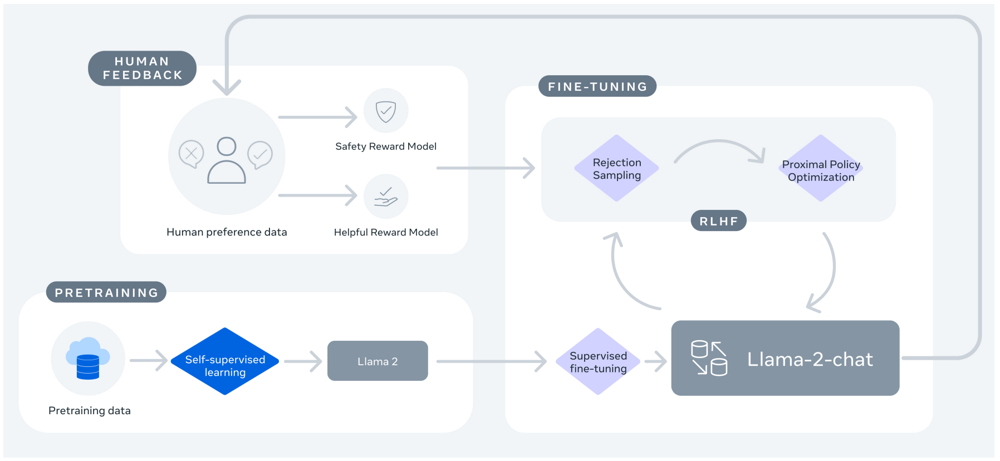
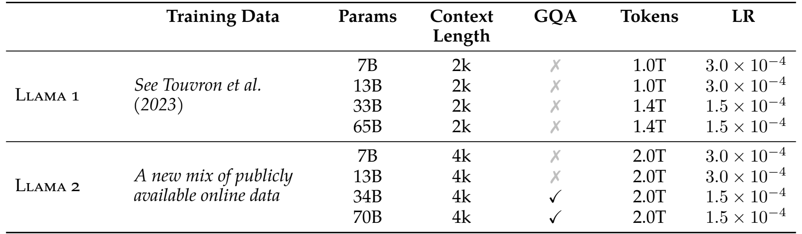

# 第 14 讲：Llama 2 introduction 与 Guanaco 微调

这讲要回答两个问题：怎样让现成的聊天模型接着你的话生成文字？怎样拿示范对话继续训练一个基础模型？先沿这两条路读，不必先掌握整个大模型架构。下面把相关原图直接放在讲解旁边，英文内容也就地解释。

阅读对象是固定课程提交 `7fbc29824171fd07dc2c30fe922e61ebc018ad1d` 的 `llama2_introduction.ipynb`，23个单元从0编号。背景论文是 [Llama 2: Open Foundation and Fine-Tuned Chat Models，2307.09288v2](https://arxiv.org/abs/2307.09288v2)，另用 LoRA v2 解释适配器。只讨论本讲涉及的使用和监督训练，论文的完整预训练、安全评估与强化学习仍未复现。原 notebook、逐格注释、历史输出均保留；原来的完整讲解放在后半篇折叠栏。

## 1. 先分清四个名字，再看论文图【必须会】

**模型**是一组做数值计算的规则和参数。参数也叫权重，可以暂时理解为训练时反复调节的数。**checkpoint** 是这些数连同配置保存成的文件。输入文字不会直接乘权重：先由 **tokenizer（分词器）**把文字切成 token，再把每个 token 编成整数 ID。token 可能是一个词、一段词、标点或字节片段，并不固定等于一个汉字。

| 本讲名字 | 是什么 | 做什么 |
|---|---|---|
| `Llama-2-7b-hf` | 约70亿参数的基础模型，HF加载格式 | 主要学过继续写文本，作为后半讲训练起点 |
| `Llama-2-7b-chat-hf` | 官方训练过的聊天模型 | 前半讲加载它，直接生成回答 |
| `timdettmers/openassistant-guanaco` | 对话示范数据集 | 后半讲把它的 `text` 字段变成训练样本 |
| LoRA adapter | 附加到模型里的少量可训练参数 | 基础权重固定，通过训练附加参数改变输出 |

`7b` 是参数规模，不是7GB文件。`hf` 表示与 Hugging Face 工具衔接的文件格式；`chat` 才是这里区分模型训练用途的部分。数据集名称中的 Guanaco 不会自动把模型变成官方 Llama 2 Chat，也不能仅凭这个名称确认某个训练成品的能力。



**出处：Llama 2 v2，PDF第5页 Figure 4，原页直接截图。** 从左下往右看：预训练数据经过 self-supervised learning（自监督学习）得到 Llama 2；此处文本自身提供“下一 token”目标，不需要每句都由人手工写答案。再经 supervised fine-tuning（监督微调，SFT），用示范对话教它怎样回应。图左上是人类偏好数据，产生 safety/helpful reward model（安全/有帮助程度的评分模型）；右上 rejection sampling 是从候选中挑选，PPO 是利用奖励继续调参数的方法。右侧大回环表示进一步收集反馈、迭代改进。

所以官方 Chat 的来历包含多阶段。课程前半段直接用这个成品；后半段命令从 **base** 出发做 Guanaco SFT，并未实现左上评分模型或右上 PPO。图中的训练箭头会改变参数；普通聊天推理只读取参数并产生新 token。图没有规定本讲的 batch/token 张量尺寸，具体尺寸要看下面代码。

## 2. 4k上下文和7B参数，分别在数什么？【必须会】



**出处：Llama 2 v2，PDF第6页 Table 1，原页直接截图。** 表是配置表，不是质量排行榜。逐列读：Training Data 是预训练数据来源；Params 是参数个数；Context Length 是一次可处理的上下文长度；GQA 是是否采用分组查询注意力；Tokens 是预训练见过的 token 总量；LR 是预训练学习率（每次调整权重的步幅）。表中 Llama 2 使用新的公开在线数据混合，2.0T 指约两万亿预训练 token，不能当作 Guanaco 的行数。7B/13B 的 LR 是 $3\times10^{-4}=0.0003$，也不能当成本讲微调命令的学习率。

Llama 1 的2k是2048 token，Llama 2 的4k是4096 token。这里的上限计算“输入已有 token + 新生成 token”，不是4096个汉字，也不是输入4096后还能另写4096。如果输入3500个 token，理论剩余 $4096-3500=596$，实际还要遵守模板、结束符及生成配置。7B这一行 GQA 是叉号，不能把70B使用的GQA套到本讲7B。34B被论文列出，v2正文说明当时未发布；课程三种发布规模×base/chat×两种格式的12项是当年的发布整理，并非今天模型目录的保证。

参数数与句子长度无关。以7B的隐藏维度 $H=4096$、中间层维度 $I=11008$、词表大小 $V=32000$、层数 $L=32$ 为例：一个 token 先查表变成4096个数，再经过32层，最后给32000种下一 token 计算分数。这些数字的轴写成 **shape（张量各维的长度）**。一批 $B$ 句、每句 $T$ 个 token：ID是 `[B,T]`，中间表示 `[B,T,H]`，下一 token 分数 logits 是 `[B,T,V]`。logits 还不是概率；softmax 将同一位置的32000个分数变成总和为1的概率。

本模型无偏置、MHA、输入词表和输出词表权重不共享时，参数数为

$$
N=2VH+L(4H^2+3HI+2H)+H=6,738,415,616.
$$

`2VH` 是输入查表和输出打分两张表；每层 `4H²` 对应四个注意力投影，`3HI` 对应前馈网络三个投影，`2H` 对应两个归一化权重，末尾 `H` 是最终归一化。暂时只需理解这是**数权重**，不是运行时内存公式。每个数用FP16的2byte保存，仅这些权重约 $N\times2/2^{30}=12.55$ GiB；推理缓存、临时结果及训练状态另外占内存。后面用很小的随机模型验证流程，不下载7B。

## 3. 一条话怎样变成模型输入？【必须会】

课程 `AutoTokenizer.from_pretrained(model_name)` 是按配置找合适的分词器类；`from_pretrained` 是类提供的方法，参数可以是模型名称或本地目录，返回 tokenizer 对象。变量名是自己起的，赋值只是让名字指向对象。`AutoModelForCausalLM` 对应“按已有 token 预测后面的 token”的模型；导入它并不等于已下载权重。

输入普通句子和输入聊天格式不是一回事。此模型常用 `[INST] … [/INST]` 包裹用户指令，系统要求放在 `<<SYS>> … <</SYS>>` 中。系统要求说“简短回答”，用户内容说“推荐太空电影”。标记只是训练格式的一部分，不是Python语法；不要把它们和 Guanaco 的 `### Human:` 混为一种格式。

下面四块 Python 按顺序在同一进程执行。`import` 导入工具；`from … import …` 只取指定名字；`with` 规定临时资源的生命周期；列表 `[...]` 按次序存东西；字典 `{键: 值}` 用键找东西；`assert` 检查事实，不满足就报错。先准备课程固定提交中的 `tutorials/llama/llama2_tokenizer.model`，把路径放进环境变量 `LESSON14_TOKENIZER`；这是使用本地文件，未请求远程tokenizer。具体命令见复现记录。

```python
import os
import shutil
import tempfile
from pathlib import Path
import torch
from transformers import LlamaTokenizerFast

torch.set_num_threads(2)
torch.manual_seed(14)
results = {}
# SentencePiece在此Windows环境不接受中文路径；只把分词文件复制到ASCII临时目录。
with tempfile.TemporaryDirectory(prefix='lesson14-tokenizer-') as temporary:
    token_path = Path(temporary) / 'tokenizer.model'
    shutil.copyfile(os.environ['LESSON14_TOKENIZER'], token_path)
    tokenizer = LlamaTokenizerFast(vocab_file=str(token_path))
tokenizer.pad_token = tokenizer.eos_token
tokenizer.padding_side = 'right'
user = 'Recommend a film about space.'
prompt = '[INST] <<SYS>>\nAnswer briefly.\n<</SYS>>\n\n' + user + ' [/INST]'
plain_ids = tokenizer(user)['input_ids']
prompt_ids = tokenizer(prompt)['input_ids']
double_bos = tokenizer('<s>' + prompt)['input_ids']
assert (len(tokenizer), tokenizer.bos_token_id, tokenizer.eos_token_id) == (32000, 1, 2)
assert prompt_ids.count(1) == 1 and double_bos[:2] == [1, 1]
N = 2*32000*4096 + 32*(4*4096**2 + 3*4096*11008 + 2*4096) + 4096
assert N == 6738415616 and 4096-3500 == 596
results['tokenization'] = dict(plain_length=len(plain_ids), formatted_length=len(prompt_ids),
    formatted_ids=prompt_ids, duplicate_bos=double_bos[:2],
    human_marker_ids=tokenizer('### Human:', add_special_tokens=False)['input_ids'],
    logical_7b_parameters=N, fp16_weight_gib=N*2/2**30)
print(results['tokenization'])
```

`tokenizer(text)` 返回字典；`['input_ids']` 取整数列表。默认加BOS（beginning of sequence，序列开始编号1），EOS（结束编号2）默认不会自动加在这些文本尾部。手写 `<s>` 再默认添加会得到两个BOS。上面 `+` 把字符串拼接，`len` 数长度，`**` 是乘方。PAD是为了批处理补齐长度的标记；此处让PAD和EOS共用编号2，后面必须留意哪些位置被监督。

本次普通句子9token，带格式32token，包含一个BOS；`### Human:`切为`[835,12968,29901]`。完整ID和默认行为见下面验证记录；不要用字符长度猜token数。聊天标记也会被切成若干token，不是每个角色字符串都对应一个专门ID。课程 cell10/12直接给普通英/中文字符串，并没有上述模板；固定 Transformers 4.31 的 `TextGenerationPipeline` 不会自动替字符串套 `[INST]`。

## 4. 从输入到三个候选回答，发生了什么？【必须会】

课程 cell6 的 `transformers.pipeline('text-generation', model=model_name, torch_dtype=torch.float16, device_map='auto')` 是快捷创建入口：识别任务、加载模型和配套tokenizer、预处理、生成、解码。`torch_dtype` 请求权重数值类型；`device_map` 决定模型放在哪里，不是训练开关。原先单独赋给变量的 `tokenizer` **没传给 pipeline**，不能假设二者是同一个Python对象。下面为本地验证明确传入同一对象，但仍检查pipeline究竟用了哪些ID。

模型每一步输出 `[B,V]` 分数，再选一个token接到末尾，直到达到长度或遇到结束条件。`do_sample=True` 允许随机抽样；`top_k=10` 指每一步保留分数最高的10个候选token，并非输出10句话；`num_return_sequences=3` 才是返回三个续写候选。原 `max_length=200` 限制输入加输出的总长，若输入60则最多再添140（还可能提前EOS）；下面用 `max_new_tokens=3` 单独限制新增，并强制最少3个来固定验证形状。

```python
import copy
import transformers
from transformers import LlamaConfig, LlamaForCausalLM

# config是结构配置；这里H=8、1层、随机权重，绝无预训练语言能力。
config = LlamaConfig(vocab_size=32000, hidden_size=8, intermediate_size=16,
    num_hidden_layers=1, num_attention_heads=2, max_position_embeddings=128,
    bos_token_id=1, eos_token_id=2, pad_token_id=2)
model = LlamaForCausalLM(config).eval()
before_inference = {name: value.detach().clone() for name, value in model.state_dict().items()}
generator = transformers.pipeline('text-generation', model=model, tokenizer=tokenizer, device=-1)
pipeline_ids = generator.preprocess(prompt)['input_ids'][0].tolist()
assert pipeline_ids == tokenizer(prompt, add_special_tokens=False)['input_ids']
assert prompt_ids == [1] + pipeline_ids
generation = dict(do_sample=True, top_k=10, num_return_sequences=3,
    min_new_tokens=3, max_new_tokens=3, eos_token_id=2, pad_token_id=2)
torch.manual_seed(14)
full = generator(prompt, return_full_text=True, **generation)
torch.manual_seed(14)
tails = generator(prompt, return_full_text=False, **generation)
torch.manual_seed(14)
raw = generator(prompt, return_tensors=True, **generation)
for index in range(3):
    assert full[index]['generated_text'] == prompt + tails[index]['generated_text']
    ids = raw[index]['generated_token_ids']
    assert ids[:len(pipeline_ids)] == pipeline_ids and len(ids) == len(pipeline_ids)+3
assert all(torch.equal(value, before_inference[name]) for name, value in model.state_dict().items())
count = sum(parameter.numel() for parameter in model.parameters())
assert count == 512664 and all(parameter.requires_grad for parameter in model.parameters())
results['generation'] = dict(parameters=count, input_shape=[1,len(pipeline_ids)],
    returned_shape=[3,len(pipeline_ids)+3], all_requires_grad=True, weights_unchanged=True,
    generated_ids=[row['generated_token_ids'][-3:] for row in raw])
print(results['generation'])
```

这里 `num_attention_heads=2` 把8个隐藏数分成两头、每头4个，`max_position_embeddings=128` 是小教学结构的配置，不是原7B的4096。`.eval()` 切换评估行为，不会冻结 `requires_grad`。`state_dict()` 按名称取模型保存的张量；`detach().clone()` 做不连求导图的独立副本。`all(...)` 要求每项都成立；`for` 循环逐个检查。`**generation` 把字典展开成命名参数，不是乘方。本次固定seed后分别调用三次以比较三种返回格式；一般连续调用会消耗随机数，不能期望自然重复。

本次pipeline实际输入`[1,31]`，三个结果ID合起来是`[3,34]`，每个恰好多3token。默认返回是“列表里面装字典”：`full[0]['generated_text']` 取第一个候选的文字，默认含原输入。三个候选都从同一prompt出发，不是三轮聊天。此随机模型ID只说明形状和流程。虽然所有参数 `requires_grad=True`，前后权重逐项相同：没有训练损失、反向求导、优化器更新，数“可求导参数比例1”不等于发生了训练。

本次发现并核对：固定旧pipeline预处理不自动加BOS，外面直接调用tokenizer默认会加一个，输入差一个编号。模板格式也不自动补齐。这里检查的是旧版本实现，不外推所有新版本；读原notebook时要分别追踪 `tokenizer`、`pipeline.tokenizer` 和实际 `input_ids`。

## 5. Guanaco的text字段，怎样变成训练目标？【必须会】

数据集可以理解为一张表：每行一条记录，每个字段一列。`load_dataset(..., split='train')` 取训练部分；`dataset[0]['text']` 取第一行对话字符串。课程 cell21的 `.split('###')` 只是按字符拆列表，便于观察，并不是可靠角色解析器，也没有设置“只学Assistant回答”的掩码。

固定来源的真实前五行里有三行以Human结束，这只是五行样本的观察，不能推算整个数据集比例。第一行先问劳动经济学的monopsony（单一买方市场），Assistant答复后又有Human要求“向一只狗解释”。所以一行可能包含多个回合，并不总以答案结尾；其中链接和引文也未经本项目逐项核验。以下用**两条自编极短对话**演示数据形状，不把它们称为原数据。

```python
from datasets import Dataset
from transformers import DataCollatorForLanguageModeling

texts = ['### Human: What is 1 + 2?### Assistant: 3.',
         '### Human: Say hi.### Assistant: Hi.### Human: Say it in French.']
dataset = Dataset.from_dict({'text': texts})
lengths = [len(tokenizer(text)['input_ids']) for text in texts]
encoded = tokenizer(texts, truncation=True, max_length=24, padding=False)
features = [{'input_ids': encoded['input_ids'][i], 'attention_mask': encoded['attention_mask'][i]}
            for i in range(2)]
collator = DataCollatorForLanguageModeling(tokenizer=tokenizer, mlm=False)
batch = collator(features)
active = batch['labels'] != -100
assert torch.equal(batch['labels'][active], batch['input_ids'][active])
assert torch.equal(batch['labels'] == -100, batch['input_ids'] == 2)
human_ids = tokenizer('### Human:', add_special_tokens=False)['input_ids']
assert batch['input_ids'][0,1:1+len(human_ids)].tolist() == human_ids
assert batch['labels'][0,1:1+len(human_ids)].tolist() == human_ids
assert texts[1].split('###')[-1].startswith(' Human:')
results['supervision'] = dict(raw_lengths=lengths, truncated_lengths=[len(row) for row in encoded['input_ids']],
    batch_shape=list(batch['input_ids'].shape), padding_count=int((batch['attention_mask']==0).sum()),
    labels=batch['labels'].tolist(), human_text_supervised=True, automatic_eos=False)
print(results['supervision'])
```

`Dataset.from_dict` 从“列名→该列所有值”的字典建表；这里是两行一个 `text` 列。列表推导式 `[表达式 for ...]` 是逐条计算并收集结果。分词得到变长列表，`truncation=True` 丢掉超过上限的尾部；`padding=False` 此时不补齐。collator 是组批函数，把几条变长记录补成等长张量，这里明确采用**右补齐**，与旧验证中左补齐设置分开。24是本教学上限，固定参考训练脚本默认512，原模型上下文4096，是三种不同层次的设置。

本次两行原长20和23，均未达到24，**这两行未发生截断**；组批结果`[2,23]`，短行右侧补3位。`input_ids` 是 `[2,T]` 的整数；`attention_mask` 同形，1表示文本、0表示补齐；`labels` 同形，`-100` 是交叉熵忽略的目标编号，不是一个词。`mlm=False` 表示不用遮词填空训练。这个普通collator复制整段ID为labels，并把所有PAD编号位置改为−100：上面断言证明 **Human正文也被监督**。因为PAD与EOS同号，如果样本本来含真实EOS，这个旧collator也会遮掉它；不能仅凭attention_mask认为labels一定只忽略补齐。此两段文本默认未自动追加EOS。

模型把IDs查表、逐层计算，输出 `[2,T,32000]` logits。因果语言模型内部用位置 `0…T−2` 的分数预测 labels位置 `1…T−1`，也就是右移一位后的“下一个token”。一个目标ID为 $y$、模型给它的概率为 $p_y$，该目标损失是 $-\log p_y$：答对越有把握，损失越小。例如从0.1升到0.5，损失从约2.303降到0.693。对有效目标平均，再反向求导求每个权重的梯度：梯度描述把该数稍微增大时损失如何变化，优化器通常沿减小损失的方向调整。`-100` 目标不进入该平均；“忽略目标”和“完全删掉该输入token”是两回事。截断可能割掉答案或最后一轮，普通全段SFT也不是自动的仅答案训练。

## 6. LoRA图里到底训练哪条路？【必须会】


**出处：LoRA，2106.09685v2，PDF第1页 Figure 1，原页直接截图。** 下方输入向量 $x$ 分两路向上走。左蓝框已有权重 $W$ 固定；右橙框先经 $A$ 压到 $r$ 个数，再经 $B$ 还原，顶部加号把两路结果加成 $h$。冻结只是不更新W，左路依然计算。图的 $B=0$ 是初值，训练后可以非零；图标注A正态初始化，而本讲固定PEFT0.4使用Kaiming均匀初始化，不能说代码完全照搬该分布。

数学写作 $h=Wx+(\alpha/r)BAx$。列向量约定下，$x\in\mathbb R^d$、$W\in\mathbb R^{d\times d}$、$A\in\mathbb R^{r\times d}$、$B\in\mathbb R^{d\times r}$。$d$ 是输入/输出长度，$r$ 是压缩维度，$\alpha$ 是缩放参数。例如 $d=8,r=2,\alpha=4$，附加参数是 $2\times8+8\times2=32$ 个，缩放为2。q是query（查询），v是value（提供被汇总的内容），投影是线性变换；只在q、v两个投影加LoRA就有64个可训练数。PyTorch批数据按行存，所以线性层计算写成输入乘权重转置，shape并未矛盾。真正7B、32层、q/v、r64时才是33,554,432个LoRA参数、alpha16/r64=0.25。

下面四步对应：准备一个基础模型副本→挂LoRA→训练两次优化更新→保存和重载。`copy.deepcopy` 复制模型，避免覆盖前面的推理对象；`prepare_model_for_kbit_training` 在这里确实冻结基础参数，但**没有把FP32权重变成4bit**。名字里有kbit不代表已量化。`target_modules` 指明目标层，`LoraConfig` 只是配置，`get_peft_model` 才把附加层接进去。`SFTTrainer` 负责分词、组批、loss、反向和优化器；`packing=False` 不跨样本拼块。

```python
from peft import LoraConfig, get_peft_model, prepare_model_for_kbit_training, PeftModel
from transformers import TrainingArguments
from trl import SFTTrainer

torch.manual_seed(14)
base = copy.deepcopy(model)
base = prepare_model_for_kbit_training(base, use_gradient_checkpointing=False)
adapted = get_peft_model(base, LoraConfig(r=2, lora_alpha=4, lora_dropout=0.0,
    target_modules=['q_proj', 'v_proj'], bias='none', task_type='CAUSAL_LM'))
trainable = {name: parameter for name, parameter in adapted.named_parameters() if parameter.requires_grad}
assert sum(parameter.numel() for parameter in trainable.values()) == 64
before_training = {name: value.detach().clone() for name, value in adapted.named_parameters()}
with tempfile.TemporaryDirectory(prefix='lesson14-train-') as temporary:
    work = Path(temporary)
    trainer = SFTTrainer(model=adapted, tokenizer=tokenizer, train_dataset=dataset,
        dataset_text_field='text', max_seq_length=24, packing=False,
        args=TrainingArguments(output_dir=str(work/'training'), per_device_train_batch_size=1,
            gradient_accumulation_steps=2, max_steps=2, learning_rate=0.001,
            warmup_steps=0, report_to=[], logging_strategy='no', save_strategy='no',
            fp16=False, disable_tqdm=True, seed=14))
    trained = trainer.train()
    changed = [name for name, parameter in adapted.named_parameters()
               if not torch.equal(parameter, before_training[name])]
    assert changed and set(changed) <= set(trainable)
    assert all(parameter.grad is None for name, parameter in adapted.named_parameters() if name not in trainable)
    optimizer_ids = {id(parameter) for group in trainer.optimizer.param_groups for parameter in group['params']}
    assert optimizer_ids == {id(parameter) for parameter in trainable.values()}
    assert trainer.state.global_step == 2
    model.save_pretrained(work/'base')
    adapted.save_pretrained(work/'adapter')
    files = sorted(path.name for path in (work/'adapter').iterdir())
    restored = PeftModel.from_pretrained(LlamaForCausalLM.from_pretrained(work/'base'), work/'adapter')
    adapted.eval()
    restored.eval()
    assert all(torch.equal(value, restored.state_dict()[name]) for name, value in adapted.state_dict().items())
    with torch.no_grad():
        probe = {'input_ids': batch['input_ids'], 'attention_mask': batch['attention_mask']}
        expected = adapted(**probe).logits
        actual = restored(**probe).logits
    torch.testing.assert_close(actual, expected, rtol=1e-5, atol=1e-6)
    results['training'] = dict(trainable_parameters=64, updates=trainer.state.global_step,
        changed_parameters=changed, frozen_unchanged=True, optimizer_matches=True,
        training_loss=trained.training_loss, adapter_files=files,
        reloaded_state_equal=True, logits_shape=list(actual.shape),
        reload_max_logit_difference=float((actual-expected).abs().max()))
print(results['training'])
```

`named_parameters()` 同时给名字和权重对象；`requires_grad` 筛出允许求导的权重。`trainer.train()` 实际计算loss、累积梯度和调用优化器更新：每次微批1行，累积2次才更新，2条数据需要反复遍历以完成2个更新。`max_steps=2` 在此优先于按epoch训练；epoch意为把训练数据过一遍。示例r2/alpha4/24token/FP32是教学改动，不是原4bit/r64/512token。

`save_pretrained` 是对象的保存方法：前一个保存匹配的随机基础模型，后一个保存adapter。适配器文件需要配套基础权重才可恢复完整计算。重载后逐项比较状态，再比较同一批输入的logits；只检查“有文件”不能证明输出一样。`torch.no_grad()` 使这段前向不建立求导图。临时目录在 `with` 结束后删除，因此发布的是脚本与实际结果记录，不是假称发布了7B权重。小随机数据损失不是语言质量分数。

## 7. 原训练命令每个选项控制什么？【必须会】

原notebook cell15是Markdown说明，不是已执行的Python单元。三条命令依次安装TRL、克隆源码、调用示例脚本；克隆未锁版本，讲师修改后的脚本**未找到**。为解释可核验行为，本项目另有官方 **TRL v0.5.0** 固定参考文件，不把它称为讲师确切脚本。

```bash
python trl/examples/scripts/sft_trainer.py \
  --model_name meta-llama/Llama-2-7b-hf \
  --dataset_name timdettmers/openassistant-guanaco \
  --load_in_4bit --use_peft \
  --batch_size 16 --gradient_accumulation_steps 2
```

这是Bash续行写法，PowerShell续行符不同；本轮未直接运行该7B命令。`--model_name` 选base，`--dataset_name` 选数据；`--load_in_4bit` 请求bitsandbytes量化加载基础权重，`--use_peft` 启用LoRA，二者分工不同。`--batch_size 16` 每张卡一次处理16条，`--gradient_accumulation_steps 2` 累积两次再更新。4bit主要压基础权重存储，不表示所有激活、梯度和LoRA参数都4bit，也不保证任意显卡能放下训练。

固定参考脚本没在命令中列出的默认值同样重要：

| 设置 | 参考v0.5.0行为 | 影响 |
|---|---|---|
| `dataset_text_field='text'` | 取整段对话 | 默认不专门mask Human |
| `seq_length=512` | 分词最长512 | 不能因为模型支持4096就认为训练用满4096 |
| SFTTrainer不传packing | 默认False | 不同于上一讲跨样本拼块路径 |
| r64/alpha16/bias none/CAUSAL_LM | 由配置创建LoRA | 固定PEFT为Llama匹配q/v；缩放0.25 |
| lr1.41e−5、3epoch、max_steps−1 | 默认训练计划 | 不是表1的预训练LR，也不是本次2步教学设置 |
| `trust_remote_code=True`、`use_auth_token=True` | 允许对应加载/认证行为 | 阅读时认识含义，本次不触发远程加载 |

参考量化分支还会传 `torch_dtype=bfloat16`、`device_map={'':0}`；这与 `TrainingArguments(bf16=True)` 并不相同，不能据此宣称整个训练都用BF16 AMP。本次实际只提取参考脚本的参数类、用真实解析器解析原CLI选项来验证默认值，没有重新执行完整7B脚本；旧完整脚本CPU小模型运行保留在历史记录。

假设9846行、单卡、未拼块、每批16、累积2：直接除得到 $9846\times3/(16\times2)=923.0625$，它不是整数更新次数。一轮有 $\lceil9846/16\rceil$=616个微批，两两一组为308次更新，三轮924次；最后两个微批是16行加6行，共22行。此估算依赖实际训练器的尾批规则和数据行数，不是已完成924步的证据。课程notebook称4090约5小时，字幕又提3090，缺可核验完整运行日志，不能推广为本机耗时。

## 8. 回到原notebook，每格接在哪一步？

| 原单元 | 现在怎样理解 | 数据/副作用 |
|---|---|---|
| 0–2 Markdown | 简介、历史发布整理、生成入口 | 没有训练 |
| 3 | 导入Auto类、pipeline相关库、量化配置与Torch | 导入名字不代表全部用到 |
| 4 | Chat模型名称字符串 | `str`，前半段加载源 |
| 5 | 本机代理设置 | 会改进程环境，原样保留，本轮跳过 |
| 6 | tokenizer与pipeline加载 | 外部对象未传入pipeline，可能下载大文件 |
| 7–8 | 显示tokenizer和模型结构 | 展示对象，不更新参数 |
| 9 | 遍历参数、累加numel/可求导比例 | Python整数/比例，不能证明训练 |
| 10 | 英文prompt，采样3候选 | 字符串→`[1,P]`→3份续写 |
| 11 | 遍历返回列表、打印generated_text | 默认含prompt，换行只影响显示 |
| 12 | 中文prompt与打印 | 同一路径；中文字符数不等于ID数 |
| 13–15 Markdown | 微调简介、SFTTrainer、三条Shell命令 | 切换base；命令不等于执行日志 |
| 16 Markdown | Guanaco数据标题 | 不创建模型 |
| 17–18 | 导入并调用load_dataset | 请求数据train部分 |
| 19–20 | 显示表、第一行text | Dataset→字典→字符串 |
| 21 | split后打印角色片段 | 字符串→列表，无mask/训练副作用 |
| 22 | 粗除训练次数 | 返回小数923.0625，需结合尾批规则 |

完整语句、API参数和历史输出另见 [Python注释版](代码/tutorials/llama2_introduction_代码注释.py) 与 [23格索引](代码单元解释.md)，不需要在JSON里查。训练数据路线归纳为：`text` 字符串→变长整数ID→补齐的 `[B,T]` ID/mask/labels→基础模型加LoRA→`[B,T,V]` logits→移位有效目标平均loss→累积/优化更新→adapter文件；生成路线则止于按概率选新token和decode文字。

## 9. 本轮实际验证与阅读边界

下面是2026-10-17本轮正文四块原样执行的结果，细节由 [本轮验证记录](复现/outputs/基础讲解验证.json) 和 [原图来源记录](复现/outputs/论文截图来源.json) 保存。使用Python3.11、Torch2.0.1 CPU、Transformers4.31、TRL0.5、PEFT0.4；固定真实分词器、随机512664参数小LLaMA。它和折叠栏内旧的H16模型、真实Guanaco前五行、完整参考脚本2步实验是不同批次，旧结果未重跑。

<!-- BEGIN_CURRENT_RESULTS -->
| 本轮检查 | 实际结果及含义 |
|---|---|
| 真实分词器 | 普通句9、格式句32token含1个BOS；手写再自动添加得到`[1,1]` |
| 真实pipeline | 实际输入`[1,31]`，3候选ID总形状`[3,34]`；三种返回格式相互吻合，基础权重完全不变 |
| 自编两行监督 | 长度20/23、未截断，右补3PAD成为`[2,23]`；labels保留Human，PAD处为−100 |
| 真实PEFT/SFTTrainer | 随机基础512664参数、64可训练，2更新；q/v的4个A/B张量均变化，所有基础权重不变且grad None；optimizer集合与可训练集合相同 |
| 保存与重载 | 保存adapter_config.json、adapter_model.bin、README.md；匹配基础重载后全状态精确相同，`[2,23,32000]` logits最大差0 |
| 训练loss | 约10.374217，来自随机模型和两行教学数据，不是原7B能力、论文指标或速度结果 |
| 原命令参数解析 | 固定官方dataclass+真实HfArgumentParser验证512/r64/alpha16/3epoch；未执行该命令的远程加载与训练 |
<!-- END_CURRENT_RESULTS -->

三张截图已逐张检查，来自原PDF渲染裁剪，未重绘或改字。未运行原7B预训练权重、4bit/CUDA、Guanaco全量三轮、官方Chat的奖励/PPO或论文质量/速度测量。你可以用本篇读懂输入、监督和保存过程；不能从随机小模型的数值判断电影推荐能力。


<details>
<summary>第二遍阅读：此前完整讲解与历史验证（原文保留，本轮未重跑）</summary>

# 第 14 讲：Llama 2 introduction 与 Guanaco 微调

这一讲有两条路径：用 Llama-2-7b-chat-hf 做文本生成，再从 Llama-2-7b-hf 基础权重出发，使用 Guanaco 对话数据训练 LoRA。两条路径使用不同 checkpoint，推理结果不能当成微调后效果。读懂本讲的关键，是区分模型权重、prompt 格式、数据监督范围和训练脚本默认值。

阅读范围是课程 `llama2_introduction.ipynb` 的23个单元与对应字幕；课程固定 commit `7fbc29824171fd07dc2c30fe922e61ebc018ad1d`。背景论文为 **Llama 2: Open Foundation and Fine-Tuned Chat Models**，arXiv:2307.09288v2。原论文 PDF 本地保存，未找到中文译稿。本讲解释使用与 SFT，不展开论文全部预训练/RLHF实验；后续17–22讲继续结构和推理细节。

## 1. 论文与仓库地图

论文主线是预训练模型、chat模型的监督微调与人类偏好对齐、能力/安全评估。本讲调用已经发布的权重，没有重建预训练或 reward/PPO 系统。课程依赖 Hugging Face 的 factory、pipeline、TRL 示例和 PEFT；没有自己的完整模型训练实现。

| 原位置 | 做什么 | 本讲审计点 |
|---|---|---|
| cells0–1 | 模型简介与链接 | 三种规模、base/chat、HF格式 |
| cells3–8 | imports、tokenizer、pipeline、结构打印 | 权重dtype、模型逻辑维度 |
| cell9 | 数参数 | requires_grad 与实际训练分开 |
| cells10–12 | 英/中文生成 | prompt、采样、长度、返回值 |
| cell15 Markdown | TRL命令与耗时估计 | 只提供命令，不在notebook执行 |
| cells17–21 | Guanaco加载与文本查看 | 多轮角色与未完成结尾 |
| cell22 | 粗算更新步数 | fractional结果与实际dataloader |

```text
推理：字符串 -> tokenizer -> IDs -> chat模型 forward/generate
     -> 采样新token -> decode -> generated_text
训练：Guanaco text -> tokenizer/截断/padding -> labels
     -> 4-bit base + LoRA -> CLM loss -> 累积/backward
     -> AdamW更新adapter -> 保存adapter
```

训练示例参考固定 **TRL v0.5.0**，对应 `examples/scripts/sft_trainer.py`；v0.4.7 的同路径不存在。字幕说作者稍作修改，但修改后的脚本未找到，因此本讲把参考版本默认值与作者行为分开。资料附官方脚本 hash；精确作者 Transformers/PEFT/bitsandbytes版本未锁定。

## 2. 12个发布入口与4K上下文【必须会】

7B、13B、70B 是参数规模；base 与 chat 是训练阶段/用途；原始与 `-hf` 是文件及生态格式，因此课程发布时有 $3\times2\times2=12$ 个入口。`-hf` 不代表模型更强或参数更少。chat经过对话对齐，base适合继续训练或通用补全。7B/13B 不应因为同属Llama 2就被讲成70B的GQA设置；本notebook打印的7B q/k/v均为4096维投影。

标准上下文4096 tokens包括输入与生成后续的总序列，不能给4096输入后再默认生成4096。设输入长度 $P$、新增长度 $G$、上下文预算 $C=4096$，正常预算要求 $P+G\le C$；若P=3500，最多还剩596个位置。具体实现可能发告警、报错或采用额外扩展设置，不能仅用 tokenizer 的 `model_max_length` 巨大哨兵数推断无限上下文。历史 tokenizer 打印约 $10^{30}$，表示未在该处设置可靠上限，而非模型能力。

Llama2权重获取可能需要已有访问权限；原训练脚本 `use_auth_token=True` 使用登录环境。这里没有请求账户权限或下载模型。实际使用按模型仓库访问状态取得权重，并固定 revision；课程代理端口7890只适用于作者机器。

## 3. 模型加载与参数数目【必须会】

```python
model_name = 'meta-llama/Llama-2-7b-chat-hf'
tokenizer = AutoTokenizer.from_pretrained(model_name)
pipeline = transformers.pipeline('text-generation', model=model_name,
    torch_dtype=torch.float16, device_map='auto')
```

`AutoTokenizer.from_pretrained` 是类方法，按元数据返回具体tokenizer对象；历史为 LlamaTokenizerFast。`transformers.pipeline` 是工厂函数，返回 TextGenerationPipeline，其内部有 model/tokenizer。原代码先独立加载tokenizer，却没有把它作为参数传进pipeline；pipeline会自己加载对应tokenizer，不能假定修改外部对象就同步修改pipeline内部状态。

`device_map='auto'` 按设备容量分配模块，不是数据并行；FP16 只涉及权重/浮点表示，原推理没有4-bit量化。仅6738415616个参数的两字节权重就约12.55 GiB，尚未加KV cache/临时tensor；本机8 GiB单卡不能直接承载全部FP16权重。自动映射可能利用其他设备，但速度和完整可运行性未验证。

历史结构：vocab=32000，hidden=4096，32层，intermediate=11008，32 attention heads。标准PyTorch Linear权重shape是 `[out_features,in_features]`：q/k/v/o为 `[4096,4096]`，gate/up为 `[11008,4096]`，down为 `[4096,11008]`；embedding/head各 `[32000,4096]`。

cell9 中 `named_parameters()` 迭代名称与Parameter；`numel()` 数张量元素；`requires_grad` 表示是否允许被自动求导。`trainable_params*1./all_param` 中 `1.` 强制浮点比例。历史全参数数量 **6,738,415,616**、requires_grad数量相同，比值1.0，但pipeline推理不据此更新权重；没有loss/backward/optimizer就不是训练。`model.eval()` 控制dropout等模式，与requires_grad开关不同。

参数数目可以独立推导，设H=4096、I=11008、V=32000、L=32：

$$N=2VH+L(4H^2+3HI+2H)+H=6738415616.$$

两套embedding/head贡献 $2VH$；每层四个attention投影贡献 $4H^2$，三套MLP投影贡献 $3HI$，两个RMSNorm各有H个scale；末尾RMSNorm再加H。此计算依赖历史未绑embedding/head、无projection bias的结构，不是所有Llama变体的通用公式。原创公式与真实Transformers的meta模型结构均得到同一数值，未分配7B权重。

## 4. 生成参数与返回值【必须会】

```python
sequences = pipeline(prompt, do_sample=True, top_k=10,
    num_return_sequences=3, eos_token_id=tokenizer.eos_token_id,
    max_length=200)
for seq in sequences:
    print(seq['generated_text'])
```

`pipeline(...)` 调用对象的 `__call__`；返回列表，每个元素为字典。三个return sequences是同一prompt的三个候选，不是连续三轮聊天。`do_sample=True` 进行随机抽样；`top_k=10` 保留每一步得分最高10个候选并在其中采样，不是“返回最好的10条回答”。temperature/top_p等未在此覆盖，还受对应generation配置影响。EOS=2可结束生成；没有生成EOS时长度上限也会停止。

`max_length=200` 是包含输入的总token长度；更清晰的新增预算是 `max_new_tokens`。若P=40、max_length=200，最多新增160；不是输出200。文本字符数不能直接作为P，中文与英语切词不同。

历史pipeline默认为 `return_full_text=True`，所以 generated_text 含prompt；重复出现用户输入不一定表示模型又生成了它。`return_full_text=False` 可只返回后续，但只改变后处理，不能修复模型的续写方向。参考v4.31 TextGenerationPipeline把输入当普通字符串tokenize，`add_special_tokens=False`；它没有因为model名字带chat就自动插入 `[INST]`。

## 5. chat权重仍需要正确prompt【必须会】

原英文输入为普通推荐问题，历史输出有继续以用户身份自述、随后出现Answer、或结束书信；中文例子有英语与异常字符。首先应检查输入格式和生成配置，不能凭三个样例得出“chat checkpoint失效”或“中文tokenizer损坏”。

Llama2-chat单轮典型格式是把system与user放在instruction区，留出assistant续写位置：

```text
<s>[INST] <<SYS>>
Answer briefly.
<</SYS>>

Recommend a film about space. [/INST]
```

`<s>` 是BOS token；`[INST]` 等格式标记是tokenizer可切分的字符串。多轮还要正确连接assistant回答、EOS与下一轮BOS。不要手工拼好 `<s>` 又让tokenizer自动加一次BOS；本次验证选择显式BOS ID加普通prompt编码，恰好一份。训练格式与推理格式应匹配，否则模型可能继续整段对话或模仿Human语气。

本次真实SentencePiece加载课程仓库的tokenizer.model（hash记录在报告），vocab32000、unk=0/BOS=1/EOS=2。两个原创字符串分别编码8和20个token，decode往返一致；这说明所用词表可表示该中文，不证明模型会流利中文。`### Human:`、`### Assistant:` 分别编码3、4个token；`[INST]`、`[/INST]`分别3、4个token，均不能视为一个新增special ID。早期记录运行SentencePiece processor，BOS/default/padding由验证脚本显式处理；新增验证从同一词表构造真实LlamaTokenizerFast，检查本讲的分词、padding和pipeline路径。未证明作者Hub tokenizer全部配置等价。

## 6. Guanaco数据：一行可能有多个角色【必须会】

```python
dataset = load_dataset('timdettmers/openassistant-guanaco', split='train')
print(dataset[0]['text'])
for part in dataset[0]['text'].split('###'):
    print(part)
```

`load_dataset` 返回Dataset表，`dataset[0]` 是字典，`text` 是字符串。历史train9846行。原数据卡说明其来自OpenAssistant高评分对话路径，并用于Guanaco训练；这是数据来源说明，不等于每条事实/引用已被校验。它不是 `mlabonne/guanaco-llama2-1k`，也不是已经转好 `[INST]` 的同名子集。

原首行角色是 **Human -> Assistant -> Human**，最后新的用户请求没有assistant回答。`split('###')` 只是字符串分隔，第一项可能为空，内容本身出现###也可能误切；它并没有可靠构造 messages、mask 或多轮边界。

本次固定数据revision `831dabac2283d99420cda0b673d7a2a43849f17a` 读取前五行，实际发现三行以Human结尾。这样一行可以用于整段对话语言模型训练，但不能称为“每个用户请求都有成对答案”。如果只监督assistant，最后Human应不产生回答loss；如果整段监督，它仍作为token序列被学习。要评估完整数据分布需扫描全体，本次五行不能代表比例。

这五行用本地SentencePiece加BOS长度分别407、468、775、715、544。旧脚本默认512上限，会对后三条示例分别移除263、203、32个token；可能截断回答或后续轮次。它不是4096-context训练，也不是packing自动补全；这组长度只对本次处理方式和样本有效。

## 7. 训练命令怎样进入脚本【建议会】

原cell15为Markdown中的shell命令：

```bash
python trl/examples/scripts/sft_trainer.py \
  --model_name meta-llama/Llama-2-7b-hf \
  --dataset_name timdettmers/openassistant-guanaco \
  --load_in_4bit --use_peft \
  --batch_size 16 --gradient_accumulation_steps 2
```

`python` 启动解释器，脚本path是入口，`--...` 提供参数，反斜杠为Bash续行；PowerShell不能照搬这个续行符，可用一行命令或自身语法。`pip install trl` 安装库，`git clone` 取示例源码；若分别从不同日期获取，脚本与库可能不匹配。固定tag和依赖后再运行才可复现。

参考v0.5.0定义 `@dataclass class ScriptArguments`，dataclass装饰器据字段生成初始化等方法；`field(default=...)` 记录默认值；`Optional[str]` 是类型说明，不自动读取命令行。`HfArgumentParser(ScriptArguments).parse_args_into_dataclasses()[0]` 将CLI值填入配置对象。

| 参数 | 原命令/参考默认 | 实际意义 |
|---|---|---|
| model_name | 覆盖为base 7b-hf | 与前面的chat推理不同 |
| dataset_name | openassistant-guanaco | 原始text列 |
| load_in_4bit | True | 量化基础线性层 |
| use_peft | True | 传LoRA配置给SFTTrainer |
| batch_size | 16 | micro-batch，不是最终更新batch |
| gradient_accumulation_steps | 2 | 累积两个micro-batch |
| seq_length | 默认512 | 训练token截断上限 |
| num_train_epochs | 默认3 | 三轮数据计划 |
| learning_rate | 默认1.41e-5 | 作用于可训练adapter |
| peft_lora_r / alpha | 默认64 / 16 | rank与缩放 |
| max_steps | 默认-1 | 用epoch计划 |

这些默认值已从固定脚本AST读取，并用真实HfArgumentParser解析原命令核对；完整参考CLI的CPU运行见第10节。不能据此证明作者没有其他修改。

## 8. 量化、LoRA和监督路径【必须会】

参考脚本禁止同时指定4-bit与8-bit；量化分支构造 BitsAndBytesConfig，并设 `device_map={'':0}` 将整个模型分配到GPU0，`torch_dtype=torch.bfloat16`。这与推理的auto多设备分配不同；BF16加载dtype也不等于bnb_4bit_compute_dtype设置。原示例未明确指定NF4、double quant或4-bitcompute dtype，不能宣称完整复制QLoRA论文配置。

TrainingArguments使用batch、累积、学习率、epochs；它没有显式 `bf16=True`。参考SFTTrainer在低比特模型准备中调用k-bit准备，冻结基础参数、启用相关梯度路径，再创建PeftModel。实际浮点算子dtype需检查固定PEFT/bitsandbytes行为，不能看到torch_dtype就概括全部训练以BF16执行。

LoRA线性层为：

$$y=W_0x+\frac{\alpha}{r}BAx.$$

$W_0$为冻结基础权重，$A$为 `[r,d_in]`，$B$为 `[d_out,r]`。本脚本r=64、alpha=16，缩放 **0.25**；不要把alpha16读成缩放16。参考PEFT v0.4.0的llama默认目标q_proj/v_proj，所以原字幕看到q/v有adapter、k没有并不奇怪。32层两个4096方形投影对应 $32\times2\times64\times(4096+4096)=33554432$ 个LoRA参数；真实配置仍需打印审核。

字幕的总参数约35亿、比例读数不一致，不能照抄成确定结论。低比特Param的 `numel()` 可能反映打包容器而非逻辑权重；参考旧PEFT参数打印方法只累加numel，不显式修正Params4bit，所以**约一半逻辑元素的存储计数**是35亿的一种合理解释，尚未在作者环境验证。不能说量化把网络规模从7B变3.5B，也不能据该读数断言训练参数比例是7.5%或90%。

与第12讲不同，参考script未传packing，SFTTrainer默认 **packing=False**，将text逐行tokenize、截断，再collate padding。默认DataCollatorForLanguageModeling(mlm=False)生成labels，pad位置为-100；若pad复用eos，其按ID屏蔽规则也可能去掉真实EOS监督。原text没有completion-only mask，因此Human、Assistant及格式标记都会参与正常token监督。

| 阶段 | 类型/shape | 转换 |
|---|---|---|
| text | Python str | 单行多轮对话 |
| input_ids | integer `[B,T]`, T≤512 | tokenization、截断、补齐 |
| attention_mask | integer `[B,T]` | 区分实际输入与pad |
| hidden_states | floating `[B,T,4096]` | base与adapter计算 |
| logits | floating `[B,T,32000]` | 词表分类 |
| labels | int64 `[B,T]` | pad=-100，整段监督 |
| loss | floating scalar | shifted next-token CE |

对每个有效位置t，预测 $x_{t+1}$，loss为 $-\frac1N\sum\log p_\theta(x_{t+1}\mid x_{\le t})$，N为未ignore目标数。logits取`[:-1]`，labels取`[1:]`，只shift一次；例如正确目标概率0.5就贡献约0.693。loss下降表示训练token更容易预测，不直接证明回答真实性提高。

## 9. 924步的正确推导与训练证据

原cell22表达式 `9846*3/(16*2*1)` 实际为 **923.0625**，不是整数924。单卡有效更新batch=16×2=32；不丢尾dataloader每epoch有 $\lceil9846/16\rceil=616$ 个micro-batch，再按K=2得到308更新、3epochs为924。每轮最后两个micro-batch合计22条，不能当所有更新都严格32条。

如果更换packing、drop_last、分布式world size、max_steps或Trainer版本，实际计划可能改变，应读trainer记录。这里静态推导对指定数据大小、batch与旧计划有效，未实际启动924更新。

notebook写4090约五小时，字幕说3090约五小时，硬件描述不一致；字幕调试最后还出现疑似内存问题。没有完整运行日志、最终loss、保存checkpoint、adapter重载或同prompt前后比较，故“五小时完成三epochs”是历史估计，未证实的本次结果。原英/中文生成只来自chat模型，不是Guanaco微调产物；没有公平实验表、能力指标或消融。

## 10. 原 notebook 注释与实际 CPU 验证【建议会】

### 10.1 文件与执行范围

原 notebook 共23格、16个代码单元，编号从0开始。原版按固定上游 Git blob 字节保存；说明版与注释版各47格，每个原单元前插入中文说明，历史输出、执行编号与元数据保留。说明版不修改原单元；注释版只增加注释。Markdown15的三条shell命令也完整注释，注释放在逻辑命令前，没有打断反斜杠续行。

[注释 notebook](代码/tutorials/代码注释.ipynb) · [Python 阅读版](代码/tutorials/llama2_introduction_代码注释.py) · [全部单元说明](代码单元解释.md)。阅读版仍含原代理、远程7B与FP16配置，CPU验证由独立脚本提供明确上下文。

| 原位置 | 实际执行 | 与原配置的区别 |
|---|---|---|
| 3、4、7–12、17、19–22 | 原版与注释版各13格原语句整格执行 | 上下文提供本地随机模型与五行数据，不是原7B结果 |
| 6 | 真实 AutoTokenizer 与 TextGenerationPipeline | model_name上下文改成本地目录，FP16改FP32，auto改None |
| 18 | 真实 load_dataset 加载五行JSONL | 改为json/data_files，未下载全量Hub数据 |
| 5 | 跳过代理设置 | 不改变本机网络环境 |
| Markdown15 | 原命令参数核对，完整固定参考CLI的CPU变体 | 未执行原pip/clone或7B量化配置 |

两版真实生成与预处理结果精确一致。原英/中文prompt、top_k=10、三候选、max_length=200均保留；只固定相同seed进行比较。pipeline输入分别28/60 tokens，最多剩172/140个新增位置；外部tokenizer默认加BOS，分别29/61 tokens。pipeline对普通字符串不加BOS，也不自动插入INST模板。真实验证确认内外tokenizer为不同实例，修改外部pad后内部对象没有跟着变化。

随机模型为真实 Transformers LlamaForCausalLM，V=32000、H=16、I=32、L=1、heads=2，基础参数1,026,608。随机输出用于验证调用和注释等价，不能作为Llama-2-chat的语言能力。另在meta设备构造H4096/I11008/L32的模型，只核对逻辑参数量6,738,415,616，没有分配7B权重或执行forward。

### 10.2 完整参考训练脚本的真实路径

验证通过runpy.run_path执行完整官方TRL v0.5.0示例：临时设置sys.argv，由脚本自身HfArgumentParser解析，再走真实模型加载、Dataset、TrainingArguments、LoraConfig、SFTTrainer、train和save_model。没有模拟API或只抽取训练片段。参考脚本SHA256为 `e75c36b75daa03445ef9e763847b8e1450b561fbc222f345e1daa65f46687aec`；作者修改稿仍未找到。

CPU变体明确覆盖本地模型/数据/output路径、micro-batch=1、累积2、max_steps=2、use_auth_token=False、trust_remote_code=False，启用PEFT，不指定4/8-bit。参考默认seq512、r64、alpha16、lr1.41e-5保留；epochs3仍在配置里，但实际由max_steps=2截止。packing保持False，基础权重为FP32，无bitsandbytes量化层。

实际注入q_proj/v_proj，各A为[64,16]、B为[16,64]，共4096个可训练参数，缩放16/64=0.25。r比小模型H大仍可构造矩阵；这是保留参考配置的教学上下文，不能据此选择真实7B的rank。两次优化后B确实非零，基础权重精确不变，optimizer参数集合恰好等于adapter可训练集合。日志loss为10.3809/10.3817，不是一条改善曲线，也没有证明问答效果提升。

保存文件只有q/v的四个A/B tensor，基础权重另在匹配目录中。使用相同基础模型加载adapter后，全部状态tensor精确一致，同输入logits最大绝对差为0。临时随机checkpoint在验证结束后释放，公开保留可重做脚本和报告。

### 10.3 五行数据怎样进入loss

真实Fast tokenizer和SFTTrainer得到长度407、468、775、715、544，与早期SentencePiece处理这五行的结果相同；截断后为407、468、512、512、512。前两行经默认collator得到IDs、attention_mask、labels，shape均为[2,468]，有61个pad位置。

实际pad=eos=2，padding_side为left。有效位置labels复制input_ids，Human标记三个ID [835,12968,29901]没有被忽略，证明默认整段监督包含Human和格式文本。另给两个短样本追加真实EOS，再collate，两处真实EOS也被屏蔽为-100，验证了pad/eos复用的ID屏蔽行为。这五行实际样本中没有EOS，不能说此次Guanaco训练已发生真实EOS丢失。

初次验证机械截取第一行前32位，因左padding，labels全是-100，cross_entropy的mean得到NaN，使验证断言失败。修正验证从有效token区取32位，同时保留“全部目标被忽略则NaN”的负例。没有因此改成右padding，也不是两步训练出现NaN；左右padding不能据此认为总是等价。SFTTrainer实际提示左padding在半精度下可能有问题，本次FP32没有验证该半精度后果。

32个有效token进入真实训练后的模型，float32 logits为[1,32,32000]。模型内部shift与手算均得到loss 10.363436698913574，精确一致：31个logits位置预测后31个labels，只shift一次。此检查不等于完整训练batch的loss。

[分词与监督补充](代码/分词与监督_教学补充.py) 是独立教学代码，不冒充原单元：

| 对象 | 输入 / 返回 | 状态及作用 |
|---|---|---|
| parameter_formula | 整数V/H/I/L，返回整数参数量 | 纯函数，限定无bias且embedding/head不绑权重 |
| inspect_supervision | 真实SFTTrainer、原Dataset，返回检查字典 | 使用真实tokenizer/collator/model，调用eval，不再次优化 |
| tokenizer.__call__ | str或一批str，返回BatchEncoding | 本次自动BOS，padding与return_tensors决定shape |
| trainer.data_collator | 非等长样本list，返回tensor字典 | 动态pad、复制labels、按pad ID屏蔽 |
| model.forward | IDs/attention_mask/labels [1,32] | 返回loss和logits，内部一次shift |
| PeftModel.from_pretrained | 匹配基础模型与adapter目录 | 加载增量权重；adapter不是完整模型 |

### 10.4 覆盖边界

3份notebook schema、16代码格AST、Python整文件AST、23格说明、历史输出/元数据/原语句，以及Markdown15三命令逻辑参数等价均通过。原shell参数由真实parser核对；同时传4-bit和8-bit时，完整参考脚本在模型加载前真实抛出互斥ValueError。此负例不证明量化kernel成功。

未运行原7B/base/chat权重、代理、bitsandbytes/CUDA4-bit、完整9846行、924次更新、五小时估计或质量benchmark。参考脚本在这套CPU依赖和局部数据上成功，不代表现代版本或作者环境兼容。证据与重做方式见[复现记录](复现/README.md)。

## 11. 来源与当前验证

- [课程固定notebook](https://github.com/chunhuizhang/personal_chatgpt/blob/7fbc29824171fd07dc2c30fe922e61ebc018ad1d/tutorials/llama2_introduction.ipynb)：原代码、结构与输出。
- [Llama2论文v2](https://arxiv.org/abs/2307.09288v2)：论文身份与模型训练背景。本讲未复现其完整评估。
- [Hugging Face发布说明](https://huggingface.co/blog/llama2)：原发布入口与chat格式；文中动态更新榜单没有当成本讲实测。
- [TRL v0.5.0示例](https://github.com/huggingface/trl/blob/v0.5.0/examples/scripts/sft_trainer.py)及[SFTTrainer](https://github.com/huggingface/trl/blob/v0.5.0/trl/trainer/sft_trainer.py)：实际CLI/默认/数据路径。
- [固定Guanaco数据](https://huggingface.co/datasets/timdettmers/openassistant-guanaco/tree/831dabac2283d99420cda0b673d7a2a43849f17a)：只读取前五行，不是全量评估。
- [PEFT v0.4.0 peft_model.py](https://github.com/huggingface/peft/blob/v0.4.0/src/peft/peft_model.py)及[other.py](https://github.com/huggingface/peft/blob/v0.4.0/src/peft/utils/other.py)：旧参数计数与目标模块映射。
- [TextGenerationPipeline v4.31.0](https://github.com/huggingface/transformers/blob/v4.31.0/src/transformers/pipelines/text_generation.py)：字符串preprocess与full_text返回；已实际运行此版本pipeline，使用随机小模型。

## 12. 学习优先级、Paper ↔ Code与边界

**必须掌握**：base/chat与HF格式不同；context预算是输入加生成；prompt模板是模型使用的一部分；生成参数/返回值；Guanaco多轮text与回答mask；4-bit存储与计算dtype；LoRA A/B shape和alpha/r；batch累积与实际步数；历史生成不能作为微调效果。

**第二遍**：pipeline内外tokenizer；BOS重复风险；未完成Human结尾及截断影响；旧Param.numel的打包计数；SFTTrainer准备与collator分支；checkpoint保存后adapter重载。 

**可以暂时不掌握的工程细节**：跨设备offload、CUDA量化kernel、全部预训练/RLHF基础设施、模型分片格式。本讲以使用路径为主，这些未完整实现。

| Paper ↔ Code | 本讲映射 | 边界 |
|---|---|---|
| Llama2预训练模型 | base `7b-hf` | 未复现2T token预训练 |
| 已对齐chat模型 | `7b-chat-hf` pipeline | 正确模板仍需用户提供 |
| 因果监督微调 | Guanaco text -> SFTTrainer | 不等于Meta完整SFT/RLHF流程 |
| LoRA增量矩阵 | CLI use_peft -> LoraConfig | 对应第02讲基础 |
| 全量reward/PPO/安全评估 | 未找到本课程实现 | 后续相关讲次继续 |
| 论文评估与消融 | 未找到本讲复现 | 只有历史生成样例与耗时估计 |

**复现状态：部分成功。** 原23格、16代码格及Markdown15命令已完整交付注释；原字节、AST、schema与历史输出通过。真实Fast tokenizer/pipeline两版生成一致，完整固定参考CLI在随机小LLaMA和五行Guanaco上完成两步LoRA，标签/shift、冻结/更新、adapter保存重载通过。见[新增运行报告](复现/outputs/runtime_verification.json)、[注释审计](复现/outputs/annotation_verification.json)与[重做命令](复现/README.md)。早期[SentencePiece教学验证](复现/outputs/教学验证.json)保留，不能混同其Python3.12环境与新增Python3.11框架运行。

**未解决问题与置信边界**：作者修改后的script/精确依赖、原模型revision、硬件与耗时、完整质量指标、异常参数比例、全数据截断分布。本次tokenizer是课程仓库文件，hash可核验，未证明与作者Fast tokenizer的全部配置等价；五行检查不能外推全数据；真实7B训练与现代CLI兼容性仍未验证。

</details>

## 必须掌握

分清base、Chat、Guanaco数据与LoRA；读懂文字→ID→分数→续写及文字→labels→loss→参数更新两条路径。能指出全段SFT包含Human目标、截断可能丢答案、max_length含输入、requires_grad不证明训练，以及adapter需要匹配基础权重。

## 第二遍再看

重算7B参数公式、逐项核对BOS/模板/tokenizer对象与pipeline版本；检查移位后有效目标数、PAD与EOS同号的掩码影响、q/v LoRA参数量、尾批与累积更新次数。将这几处与23格注释对照。

## 可以暂缓的工程细节

4bit算子实现、模型分片、自动设备映射、GQA内部结构、官方奖励模型/PPO、安全评估与多卡通信。本篇说明了它们在流程中的位置，不需要靠先实现这些才能理解本讲。

## Paper ↔ Code

| 原图/内容 | 本讲代码与边界 |
|---|---|
| Llama 2 v2 p5 Figure4：pretraining→SFT→偏好对齐 | cell6加载已训练Chat；cell15命令只做base的Guanaco SFT，reward/PPO实现未找到 |
| Llama 2 v2 p6 Table1：4k/7B/GQA/训练token与LR | model_name与配置解释；正文仅理论数参数，未重跑预训练或质量评估 |
| LoRA v2 p1 Figure1：冻结W、附加A/B | 参考脚本LoraConfig/SFTTrainer和正文第4块真实PEFT；正文r2/alpha4不同于原r64/alpha16 |
| 因果语言建模：移位下一token目标 | collator→LlamaForCausalLM内部loss；普通全段监督不是仅Assistant |
| 讲师修改的实际训练脚本/完整环境 | 未找到；使用固定官方TRL0.5参考源码，并保留该不确定性 |

## 复现状态

**部分成功**。正文四块代码从当前笔记提取并实际执行；具体形状、更新、重载误差、脚本/材料哈希见本轮JSON。原notebook、注释代码及旧验证记录保留。原7B/全量数据/GPU量化训练和论文的能力、安全结果未复现，不能把教学断言通过称为整篇论文复现成功。

## 尚未解决的问题与置信边界

讲师修改版脚本与准确依赖未找到；9846行和924步是课程口径及参考计算，缺原完整训练日志。4090/3090耗时说法不能消除；真实数据内引用未经逐项核验；本次仅自编两行，不推断Guanaco全量分布。固定旧版本pipeline行为有实测，不推广到所有版本。没有新远程Chat调用或质量评估；三张原图来源有PDF版本、页码、裁剪与hash记录。
