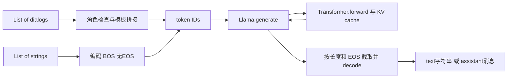

# 第 15 讲：Llama 2 text 与 chat completion 源码

`text_completion` 和 `chat_completion` 是同一个自回归生成器的两个输入/输出包装。text把字符串编码后继续写；chat先检查角色、拼接模板，再让模型继续写assistant。对话能力来自chat权重与正确模板，而非另一个神秘的聊天解码算法。

本讲读课程 `llama2_src_01.ipynb` 的12个单元、对应字幕和Meta官方推理实现。课程固定commit为 `7fbc29824171fd07dc2c30fe922e61ebc018ad1d`；官方源码固定为 **7565eb6fee2175b2d4fe2cfb45067a61b35d7f5e**，2023-09-01，来自llama_v2分支。作者演示时的精确commit未找到，以下源码行为只对该参考版本负责。背景论文同第14讲Llama2；本讲不新增论文译稿、不复现全量模型评测。

## 1. 路线图与文件分工

| 文件/单元 | 责任 | 本讲边界 |
|---|---|---|
| notebook cells2–4 | 参数介绍、权重目录截图 | 不是实际加载权重 |
| cells7/9 Markdown | torchrun命令 | 不随notebook执行 |
| example_text_completion.py | 四条文本与CLI入口 | 用base权重 |
| example_chat_completion.py | 六个dialog与CLI入口 | 用chat权重 |
| llama/generation.py: Llama.build | 分布式、分片、模型初始化 | 未实际执行 |
| Tokenizer.encode/decode | SentencePiece及BOS/EOS | 实际方法已验证 |
| Llama.text_completion/chat_completion | 模板与输出字典 | 官方方法直接执行验证 |
| Llama.generate | token buffer、采样、EOS/切片 | 静态阅读，未跑模型 |
| llama/model.py | Transformer forward、cache | 结构概览；后续讲细读 |



模板与decode没有可训练参数，Transformer包含权重，KV cache是推理状态。一个dialog中有多条消息，仍是一个batch样本；六个dialog不是六个单独token，也不是六张卡。

## 2. 权重文件与torchrun【必须会】

课程截图显示base/chat各有7B、13B、70B三种：7B一个 `consolidated.00.pth`，13B两个，70B八个；每目录有params.json/checklist，公共tokenizer.model在外层。截图总331G是作者下载目录的显示，不是单模型显存需求，也不是当前下载量。原始分片与HF safetensors目录不同，`Llama.build` 不直接读取HF格式。

原命令核心是：

```bash
torchrun --nproc_per_node 1 example_text_completion.py \
  --ckpt_dir ./weights/llama-2-7b/ \
  --tokenizer_path ./weights/tokenizer.model \
  --max_seq_len 128 --max_batch_size 4
```

`torchrun` 启动分布式worker并设置WORLD_SIZE/LOCAL_RANK；`--nproc_per_node` 是本机进程数，不是batch。示例官方原始分片要求7B MP=1、13B MP=2、70B MP=8；原代码把每个rank匹配一个分片。不能因机器只有一张卡就把两分片13B命令改成进程1而期望自动合并。HF device_map的路径则不同。

`ckpt_dir` 指向含 `.pth` 和params.json的目录；tokenizer_path为单独词表；max_seq_len/max_batch_size约束推理buffer与cache预分配。Bash反斜杠是续行符，在PowerShell应改语法或写一行。下载权重是单独步骤，源码clone不包含权重。原字幕的“申请很快”只代表当时经验，本次没有申请、下载或发送邮件。

## 3. Llama.build逐步建立模型【建议会】

`build` 是 `@staticmethod`，通过 `Llama.build(...)` 调用，不需要已有self，返回Llama实例。它先初始化NCCL process group与FairScale模型并行，再用LOCAL_RANK选择GPU。所有worker设同一个seed=1，避免采样不一致；非零local rank屏蔽stdout是减少重复打印，不是该进程没工作。

随后按名称排序 `*.pth`，断言分片存在并且分片数等于MP，按model_parallel_rank选一个，torch.load先读到CPU。读取params.json后，用 `ModelArgs(max_seq_len=...,max_batch_size=...,**params)` 构造配置；`**params` 把字典展开为关键字参数。tokenizer提供vocab_size，再设置CUDA HalfTensor默认类型，构造Transformer并加载state_dict。

`strict=False` 允许missing/unexpected keys，返回值在这里未审计；它不保证任意错误checkpoint都兼容，也不保证shape冲突被忽略。这里没有bitsandbytes、LoRA或optimizer，是FP16推理初始化。旧API设置默认tensor类型会改变后续默认创建tensor的行为，不能把它当仅影响局部一行的变量设置。

`Llama.__init__` 保存model/tokenizer引用；它没有再训练模型。NCCL/FairScale/CUDA原路径不能由“方法存在”推断在当前Windows/8GiB环境可运行；本次只验证不涉及此build的包装方法。

## 4. 模型维度与cache预算【必须会】

课程7B参数dim=4096、n_layers=32、n_heads=32，因此：

$$d_{head}=\frac{d_{model}}{n_{heads}}=4096/32=128.$$

13B为5120维、40层/40heads，也得到128。`multiple_of=256` 用于FFN隐藏维度取整，不是attention头数，后续SwiGLU讲细读。模型并行时 `n_local_heads=n_heads/MP`，原 `ColumnParallelLinear` / `RowParallelLinear` 分布投影与聚合，不能把local head数误当全模型head数。

参考每层cache_k/cache_v shape为 `[B_max,T_max,H_kv_local,D_head]`。总分配近似：

$$M_{KV}=2L B_{max}T_{max}H_{kv,local}D_{head}\,s.$$

2代表K/V，L为层数，s为每元素字节数；这是每进程cache，不含模型、logits、临时attention等。7B/MP1、FP16 s=2、Bmax=8/Tmax=512/Hkv=32/D=128时，约2GiB；Bmax4/Tmax128时约0.25GiB。源码静态预分配，即使本次实际batch较小也可能占最大cache。它没有自动只按最长实际prompt分配。

| 变量 | 类型/dtype | shape | 作用 |
|---|---|---|---|
| prompts | list[str] | 长度B | 文本入口 |
| dialogs | list[list[Message]] | B个对话，消息数可变 | chat入口 |
| prompt_tokens | list[list[int]] | 各行P_i可变 | 生成输入 |
| tokens | int64 CUDA tensor | `[B,total_len]` | prompt/生成buffer |
| input_text_mask | bool tensor | 同上 | 保护长prompt位置 |
| 当前forward输入 | int64 | `[B,cur_pos-prev_pos]` | 只输入尚未计算部分 |
| hidden states | floating | `[B,S,dim]` | 当前chunk隐藏状态 |
| logits | FP32（此模型输出cast） | `[B,S,32000]` | 词表分数 |
| returned generation | list[int] -> str | 各行变长 | 去prompt/截EOS |

原生pad_id通常为-1，不是EOS=2。buffer未填写处用-1作标记，输入mask确保每个位置在送入embedding前被prompt或生成填好；不能任意把-1当合法词表ID输入模型。

## 5. text_completion：BOS、echo与字典【必须会】

核心代码是：

```python
prompt_tokens = [self.tokenizer.encode(x, bos=True, eos=False) for x in prompts]
generation_tokens, generation_logprobs = self.generate(..., echo=echo)
return [{'generation': self.tokenizer.decode(t)} for t in generation_tokens]
```

`encode` 是Tokenizer实例方法，输入字符串、BOS/EOS两个布尔开关，返回list[int]；内部SentencePiece编码普通内容，然后显式前置BOS=1、追加EOS=2。text prompt末尾不加EOS，留给模型继续写。列表推导式对每条prompt独立编码；这里原prompt列表不会被修改。

`text_completion` 的max_gen_len默认None时改为max_seq_len-1；而**example_text_completion.main默认max_gen_len=64**，会显式传64。这两个层级的默认值不同，是字幕里把max_seq_len从128改256却不明显变长的一个可检查原因：生成上限仍64，还可能提前EOS。不是仅把上下文调大就必须输出更长。

默认echo=False只返回新生成；echo=True包含prompt。官方例子自己先print(prompt)，再print带`>`的generation；`>`是展示符号，不是模型模板或token。与第14讲HF pipeline默认full_text=True正好不同。

返回 `list[CompletionPrediction]`，无logprobs时每项只有generation字符串；logprobs=True增加tokens字符串列表与logprobs数值列表。TypedDict描述字段类型，不是会自动执行验证的实体模型；total=False表示键可选。token片段单独decode可能显示不完整字节/空格，不能把它当逐词翻译。

## 6. chat_completion：角色规则与system合并【必须会】

`Message` 是字典，含role/content；role类型说明为system/user/assistant。`Dialog=List[Message]`，`dialogs=List[Dialog]`。chat输入没有专门的二维token张量，先由包装层转换成prompt_tokens。

合法输入可以为 `[user]`、`[user,assistant,user]`，也可最前加一条system。源码若首项system，就把system文本包入 `<<SYS>>` / `<</SYS>>`，合并到下一条user的content，之后删去这条独立system：

```text
[INST] <<SYS>>
system内容
<</SYS>>

user内容 [/INST]
```

这是创建新的局部list/字典，不会改调用者原dialog；验证已检查深拷贝前后相等。随后要求偶数位置为user、奇数位置为assistant，并且最后为user。`dialog[::2]` 从0开始每两项取一项，`dialog[1::2]` 从1开始每两项取一项。

本次固定版本**没有自动补默认system消息**。只有user也能编码；默认system与某些其他版本/教程的说法不能混在一起。例子的长system提示是显式写入输入的，不是build自动加入。

非法顺序会AssertionError；空dialog与只有system在这个旧实现中先索引越界，产生IndexError，不能称为完整友好的输入校验。完整产品接口应在调用前检查非空、system后有user和正确交替，但本讲保留原行为以便理解源码。

## 7. 多轮模板：历史EOS，最后一轮无EOS【必须会】

完整历史user/assistant对编码：

```text
<s>[INST] user [/INST] assistant </s>
```

对最后只有user的待答轮编码：

```text
<s>[INST] latest user [/INST]
```

`zip(dialog[::2],dialog[1::2])` 配对完整历史，最后user由于没有assistant不会进入zip；`sum(list_of_token_lists, [])` 用空list起步拼接token列表，不是对ID做数值求和。随后编码最后user并追加。prompt/answer `.strip()` 去掉外层空白，源码另外保留格式之间的空格和system换行，不能把所有空白无条件删光。

每个完整历史对显式BOS=True/EOS=True，最后轮BOS=True/EOS=False。一次两轮测试得到2个BOS、1个历史EOS，41个token；最后没有EOS。模型看到已给历史回答后续写新assistant，历史回答本身不会重新问模型生成。对话状态作为完整历史重新传入，不由函数在不同调用间永久记住。

chat输出是 `{'generation': {'role':'assistant','content':...}}`；assistant role由包装代码赋值，并非从生成文本中解析出来。调用者可把这条消息加入历史、再追加新user，开始下一轮，但需同时留意上下文预算。

## 8. 特殊标签检查到底做什么【建议会】

编码前，源码搜索每条原content是否含 `[INST]`、`[/INST]`、`<<SYS>>`、`<</SYS>>`。四个保留字符串用于模板结构，用户content里出现时该dialog被标记。该检测也检查system/assistant内容，不能概括为“只禁止用户使用system级词语”。

标记后仍构造tokens并调用generate，再在返回时用预设错误字符串替换content。它是应用层结构保护，**不代表模型识别了恶意意图或训练得到了拒答能力**；字面讨论这些标签也会触发。开启logprobs时tokens/logprobs字段仍返回生成元数据，只有content被替换。本次官方包装方法fixture验证了这一路径；不将此函数当成完整输入/输出安全过滤器。

## 9. generate入口、采样与结果切片【必须会】

两种包装最终传 `prompt_tokens` 给同一个generate。`@torch.inference_mode()` 是装饰器，令方法在推理上下文运行，减少autograd记录；与训练loop分开。模型权重是否base/chat由build的ckpt_dir决定，方法名不会替换权重。

开头断言B≤max_batch_size、最长prompt≤max_seq_len，然后：

$$T_{total}=\min(T_{max},P_{max}+G_{max}).$$

$T_{max}$为本次配置缓存/序列上限，$P_{max}$为batch最长prompt，$G_{max}$为新增上限；全部以token为单位。prompt过长直接断言，源码不自动截掉旧消息。各行最后再按自己的P_i+Gmax截取，不能让短prompt无条件得到与最长prompt一样多的输出。

循环从最短prompt长度开始。batch里较长prompt当前位置仍有真实输入时，用 `torch.where(input_text_mask,...,next_token)` 保留原token；短prompt已结束的行才采用采样结果。因此padding/批量对齐不能覆盖原输入。EOS只在生成区域更新完成状态，所有行EOS才退出；某行先结束后仍可能在buffer里写其他内容，最终按第一次EOS截断。

temperature>0时把最后位置logits除以temperature再softmax，调用top-p；temperature≤0时argmax。softmax公式为 $p_j=e^{z_j/\tau}/\sum_k e^{z_k/\tau}$，j为词表索引、tau为温度，z为最后位置32000维分数。温度较低通常更集中，但不能保证回答质量。

top-p源码排序概率、计算累积、按**之前累计概率>p**遮掉后续候选，再归一化采样。例子概率0.5、0.3、0.2、p=0.7保留前两个，归一化为0.625、0.375；这不同于top-k固定保留个数。此严格比较在恰好等于阈值时可能额外保留一个，读源码时不能只背“最小集合”。第22讲再展开完整生成与概率计算。

输出先根据echo设起点0或P_i，切到P_i+Gmax，再遇EOS截掉EOS及后面内容，decode返回。整数例子完整buffer为 `[1,7,8,10,2,11]`、prompt长3，默认得到 `[10]`，EOS不出现在返回文本。chat不开放echo参数，使用generate默认False，否则历史EOS可能截掉后续。logprobs的数值正确性本次没有执行真实generate验证，fixture中的值是合成值，不能用于报告真实置信度。

## 10. 六个dialog为什么batch4报错

官方chat例子有六个独立dialog：单轮、带历史、Haiku system、emoji system、一般system、包含保留标签的测试。原字幕中batch4导致断言，改8后运行；课程命令已写8。要求至少6来自B=len(dialogs)，并不表示一条dialog有6个消息，也不需要再乘GPU数。

真实tokenizer编码本次官方六例长度分别18、248、38、38、145、21，都在512上限内。fixturegenerate复用同样的B/T断言，确认batch4拒绝、batch8接受；这不证明真实GPU有足够缓存/权重显存。fixture只用于可复核输入路径，不产生真实蛋黄酱配方、诗歌或emoji回答。

notebook没有文本/聊天生成保存输出；字幕展示的加载约10秒、13B加载/卡顿和GPU占用是当时机器运行描述，未提供完整日志或性能统计。模型加载耗时受磁盘、缓存、设备和进程影响，不是能力指标；六个定性demo没有baseline、准确率、误差或重复试验，不能变成论文评测表。

## 11. 依据

- [课程固定notebook](https://github.com/chunhuizhang/personal_chatgpt/blob/7fbc29824171fd07dc2c30fe922e61ebc018ad1d/tutorials/llama2_src_01.ipynb)：命令、参数、图片。
- [官方固定generation.py](https://github.com/meta-llama/llama/blob/7565eb6fee2175b2d4fe2cfb45067a61b35d7f5e/llama/generation.py)：build、两类completion与generate。
- [tokenizer.py](https://github.com/meta-llama/llama/blob/7565eb6fee2175b2d4fe2cfb45067a61b35d7f5e/llama/tokenizer.py)与[model.py](https://github.com/meta-llama/llama/blob/7565eb6fee2175b2d4fe2cfb45067a61b35d7f5e/llama/model.py)：词表边界及cache。
- [text example](https://github.com/meta-llama/llama/blob/7565eb6fee2175b2d4fe2cfb45067a61b35d7f5e/example_text_completion.py)与[chat example](https://github.com/meta-llama/llama/blob/7565eb6fee2175b2d4fe2cfb45067a61b35d7f5e/example_chat_completion.py)：CLI默认与样例。
- [固定README](https://github.com/meta-llama/llama/blob/7565eb6fee2175b2d4fe2cfb45067a61b35d7f5e/README.md)：原始模型并行与推理说明。课程“main就是llama2”是历史描述，本次明确使用llama_v2固定commit。

## 12. 学习优先级、Paper ↔ Code与复现

**必须掌握**：text/chat共享generate；权重和模板各自作用；原始分片的MP；prompt总长度与新增预算；BOS/EOS；角色交替与历史拼接；echo/输出结构；batch个数；特殊标签错误来自包装层。

**第二遍**：static method与instance method、TypedDict、切片/zip/list相加、分布式rank、cache预算、异长prompt mask、每行EOS、temperature/top-p细节、版本差异。

**可以暂时不掌握的工程细节**：FairScale通信内核、NCCL初始化、完整KV/GQA/RoPE计算、signed URL下载与终端tmux配置。后续模型结构讲继续细读。

| Paper ↔ Code | 映射 | 边界 |
|---|---|---|
| Llama2自回归模型 | Transformer.forward -> generate | 未运行真实权重 |
| 对话输入格式 | chat_completion模板 | 没有额外chat解码器 |
| base续写 | text_completion | 正确使用base checkpoint |
| 模型并行推理 | build + FairScale线性层 | 不是HF auto分配 |
| 预训练/SFT/RLHF完整流程 | 未找到本讲实现 | 这里仅推理接口 |
| 论文质量/安全评测 | 未找到本讲复现 | demo与预设错误不等同评测 |

**复现状态：部分成功。** 直接执行固定官方Tokenizer和completion包装方法，使用真实SentencePiece与明确fake generate；验证模板、边界、角色异常、6例batch与输出字典，见 [教学验证](复现/outputs/教学验证.json)和[命令记录](复现/README.md)。没有执行build、torch generate、Transformer forward、真实采样/logprobs或GPU性能测试。

**未解决问题与置信边界**：作者精确源码commit、全部环境、checkpoint、演示硬件和真实耗时未找到；tokenizer文件来自课程仓库且hash已记录，未证明与作者运行文件完全一致。包装层行为已实际验证，真实模型输出、数值概率、缓存正确性和Windows兼容性仍未验证。
