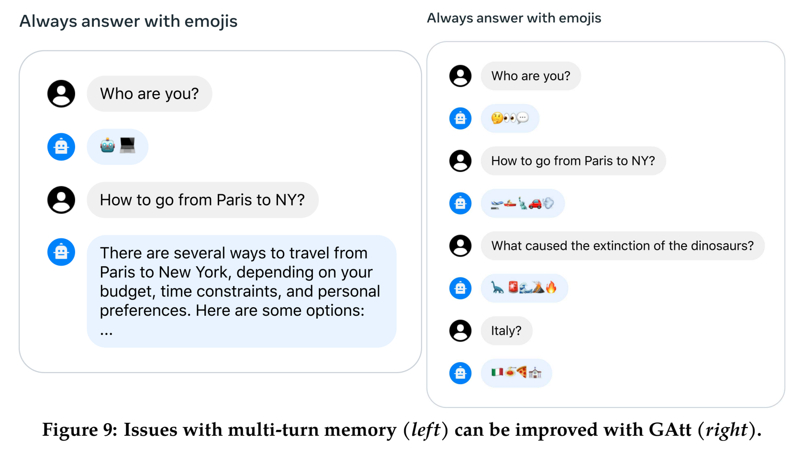
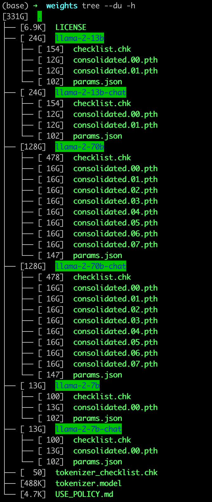
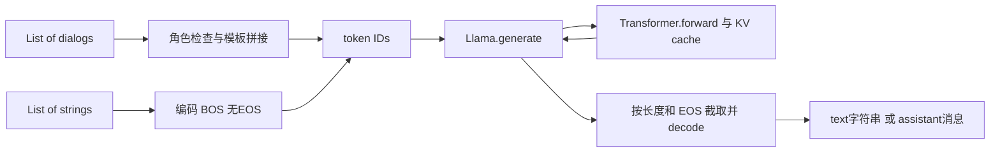

# 第 15 讲：Llama 2 text 与 chat completion 源码

这一讲用一条“说声你好”的消息，串起三个方法：`text_completion` 处理普通文本，`chat_completion` 整理对话，两者都交给 `generate` 续写。我们按文字→整数→模型输出→返回字典的顺序读。

本讲对照主教程 `llama2_src_01.ipynb` 和接口补充 `llama2_src_text_chat.ipynb`，共28个单元。论文原图和课程截图放在相关段落，配上中文说明。

## 1. 文字、消息、对话、批次，分别是什么？

**text completion（文本续写）**的输入是字符串，例如 `Say hi.`。**chat completion（对话回复）**的输入是带角色的消息，例如“user说Say hi.”。角色标签帮助程序组织上下文。

先认识Python的容器：`'Say hi.'` 是字符串 `str`；`{'role': 'user', 'content': 'Say hi.'}` 是字典 `dict`，用键取值；`[消息1, 消息2]` 是有顺序的列表 `list`。下标从0开始，`dialog[0]` 取第一条消息，`dialog[0]['content']` 再取正文。一次请求可以装多个独立对话，称为batch（批次）；每段独立对话计一个样本。

| 名字 | 容器怎样嵌套 | 这个例子表示什么 |
|---|---|---|
| `message` | 一个字典 | 一个人说的一句话 |
| `dialog` | 消息列表 | 同一段对话的完整历史 |
| `dialogs` | 对话列表 | 多段互不相关的对话一起处理 |
| `prompts` | 字符串列表 | 多段普通文本一起续写 |

`role='system'` 是希望整段对话遵守的要求；`user` 是用户话语；`assistant` 是已给出的模型回答。最后一条user后没有assistant，正是在等本次生成。下一轮要继续，就由调用者把新assistant和下条user加进历史，重新传入。对话历史由调用者管理。

模型本体只会处理数字。**tokenizer（分词器）**把字符串切成token（词或词的一部分、符号、字节片段），每个token对应一个整数ID；**encode** 是文字→ID，**decode** 是ID→文字。词表大小32000表示可选的token编号共有32000种。BOS是序列开始，EOS是结束；PAD是补齐占位。此官方Tokenizer实测BOS=1、EOS=2、PAD=−1，**与上一讲HF把PAD设置成EOS=2的配置不同**。

下面四块Python按顺序执行。`tokenizer` 负责分词；`llama` 包装模型和生成方法；`generation_calls` 与 `forward_calls` 记录实际输入输出，便于对照步骤。[复现脚本](复现/scripts/verify_beginner_note.py) 准备这些对象并执行正文代码。

```python
results = {}
message = {'role': 'user', 'content': 'Say hi.'}
dialog = [message]
dialogs = [dialog]
prompts = [message['content']]
assert len(dialogs) == 1 and len(dialogs[0]) == 1
ordinary_ids = tokenizer.encode(prompts[0], bos=False, eos=False)
started_ids = tokenizer.encode(prompts[0], bos=True, eos=False)
finished_ids = tokenizer.encode(prompts[0], bos=True, eos=True)
assert started_ids == [1] + ordinary_ids
assert finished_ids == started_ids + [2]
assert (tokenizer.n_words, tokenizer.bos_id, tokenizer.eos_id, tokenizer.pad_id) == (32000,1,2,-1)
assert tokenizer.encode('[INST]', bos=False, eos=False) == [518,25580,29962]
assert tokenizer.encode('[/INST]', bos=False, eos=False) == [518,29914,25580,29962]
results['containers_and_ids'] = dict(batch=len(dialogs), messages=len(dialogs[0]),
    content=prompts[0], ordinary_ids=ordinary_ids, bos_ids=started_ids, eos_ids=finished_ids,
    decoded=tokenizer.decode(ordinary_ids))
print(results['containers_and_ids'])
```

本次这句话普通编码是`[14891,7251,29889]`，加BOS后4个ID，再加EOS后5个。

`len` 数列表长度；`assert` 是事实检查，不成立即报错；`+` 在这里拼列表，不是把ID相加。`bos=True`、`eos=False` 是命名参数，明确开/关边界。`tokenizer.encode` 是这个对象的方法，返回 `list[int]`；`[INST]` 在模板里表示指令开始，分词后对应三个普通编号。

## 2. 先看论文原图：system要求为什么要和聊天能力分开？



**来源：Llama 2 v2，PDF第16页 Figure 9，原页直接渲染裁剪。** 图顶端的要求是“一直用emoji回答”。灰色气泡是用户，浅蓝色气泡是助手。左边问“你是谁”时回答仍为emoji；接着问“从巴黎怎样到纽约”，模型转成了普通文字。右边经过论文GAtt方法后，多个问题仍用emoji，包括交通、恐龙灭绝与意大利等主题。阅读重点是**跨回合是否保留要求**。

论文第3.3节的相关意思是：有些要求应当适用于后面每一轮，但早期模型会逐渐忘记；Ghost Attention（GAtt）通过改造微调数据改善这种情况。其训练构造先把同一要求附到各轮用户话语上，用模型采样对话，再在训练输入中只让首轮保留该要求；此前回合的token不计训练损失，把学习目标集中到后面的回答。GAtt在微调阶段学习这种多轮约束；接下来看的推理函数负责整理并传入对话。

`chat_completion` 把system要求和对话历史整理成模型输入。模型怎样利用这些文字，取决于已有权重和上下文。图中的气泡在程序里先是消息字典，下一节会把它们变成一条整数序列。

## 3. chat_completion怎样把四条消息拼成一条输入？

**类 `class`**可以理解为对象的定义，实例是按该定义创建的具体对象。`Llama`类的实例 `llama` 保存 `model` 和 `tokenizer` 两个引用；`llama.chat_completion(...)` 是调用实例方法，函数定义中的 `self` 就指这个实例。`__init__` 在实例创建时保存这两个对象的引用。名字中的completion是“把未完成部分补全”。

固定源码接受可选的首条system，之后必须user/assistant交替，且以user结束。它先把system内容合进第一条user，再拼完整历史与待答轮。以英文短句演示，中文意思依次是“简短回答”“说声你好”“你好”“用法语说”：

```text
<s>[INST] <<SYS>>
Answer briefly.
<</SYS>>

Say hi. [/INST] Hi. </s>
<s>[INST] Say it in French. [/INST]
```

这里换行显示边界：`<s>`表示ID1，`</s>`表示ID2，由Tokenizer显式加上，不是再把这两个字符串手工传入。第一组是已完成历史，因此两端都有边界；最后一组只有user，末尾没有EOS，好让模型继续写。这四条消息属于同一个样本。system由调用者显式提供。

```python
import copy

dialog = [{'role':'system', 'content':'Answer briefly.'},
          {'role':'user', 'content':'Say hi.'},
          {'role':'assistant', 'content':'Hi.'},
          {'role':'user', 'content':'Say it in French.'}]
unchanged = copy.deepcopy(dialog)
history = '[INST] <<SYS>>\nAnswer briefly.\n<</SYS>>\n\nSay hi. [/INST] Hi. '
latest = '[INST] Say it in French. [/INST]'
expected_ids = tokenizer.encode(history, bos=True, eos=True) + tokenizer.encode(latest, bos=True, eos=False)
chat = llama.chat_completion([dialog], temperature=0, max_gen_len=3)
chat_call = generation_calls[-1]
assert chat_call['prompt_tokens'] == [expected_ids]
assert expected_ids.count(1) == 2 and expected_ids.count(2) == 1
assert expected_ids[-1] != 2 and dialog == unchanged
assert chat[0]['generation']['role'] == 'assistant'
assert chat[0]['generation']['content'] == tokenizer.decode(chat_call['result'][0][0])
results['chat'] = dict(batch=1, original_messages=4, input_length=len(expected_ids),
    input_ids=expected_ids, bos_count=2, historical_eos_count=1, caller_unchanged=True,
    output_keys=list(chat[0]), generation_keys=list(chat[0]['generation']),
    forward_shapes=[row['input_shape'] for row in chat_call['forward_calls']],
    generated_ids=chat_call['result'][0][0])
print(results['chat'])
```

本次4条消息仍是**1个样本**，实际输入45token、2个BOS和1个历史EOS；模型forward形状依次`[1,45]→[1,1]→[1,1]`，最后返回3个新ID。

`import copy` 导入复制工具，`deepcopy` 把嵌套列表和字典也复制，便于检查原输入有没有被改。实际源码system合并使用新的局部列表和字典，断言确认调用者原来的四条消息没变。`history/latest` 写出了源码使用的两段模板，`assert`将它们的ID与 `chat_completion` 实际传给生成器的ID逐项比较。

原实现用 `dialog[::2]` 取user位置，用 `dialog[1::2]` 取assistant位置，`zip` 成对读取已完成历史；最后一条user没有搭档，单独编码。`sum(token_lists, [])` 从空列表开始逐个拼接，结果是一条ID序列；`.strip()` 仅去掉每条消息外侧空白，模板内的system换行仍保留。返回的assistant角色由包装代码写入字典，内容才来自模型解码。

## 4. text_completion与chat_completion共用什么？

两条路最后都是 `Llama.generate(prompt_tokens, ...)`。text把每段字符串加BOS、不加EOS；chat先完成角色检查和模板，再变成同样的 `list[list[int]]`。官方例子给text加载base权重、给chat加载Chat权重；下面的两个入口共用一个模型对象，便于观察输入输出差异。

`generate` 每次把尚未算过的一段ID送进 `Transformer.forward`，得到下一token的分数logits。**shape**就是张量各个轴的长度：一批 $B$ 个样本、本次输入 $S$ 个token、词表 $V=32000$，ID是 `[B,S]` 的int64整数，模型内部是 `[B,S,D]` 的浮点表示，输出logits是 `[B,S,V]` 的浮点分数。此例 $D=8$、1层、2个注意力头，每头4个数。

生成只看当前最后位置的 `[B,V]` 分数，选一个ID接到末尾，再计算下一步。这里 `temperature=0` 走argmax（取最大分数的编号），可重复比较两种返回方式。原默认temperature0.6时先把分数除温度再softmax成概率，按top_p0.9保留概率高的一部分后抽样；top-p根据累计概率确定候选集合。第22讲展开采样过程。

```python
prompts = ['Hi', 'A short story']
input_ids = [tokenizer.encode(text, bos=True, eos=False) for text in prompts]
text = llama.text_completion(prompts, temperature=0, max_gen_len=3)
text_call = generation_calls[-1]
new_ids = text_call['result'][0]
assert text_call['prompt_tokens'] == input_ids
assert text_call['forward_calls'][0]['ids'] == [row[:2] for row in input_ids]
assert text_call['forward_calls'][1]['ids'][1] == [input_ids[1][2]]
assert text_call['forward_calls'][2]['ids'][1] == [input_ids[1][3]]
assert [row['generation'] for row in text] == [tokenizer.decode(row) for row in new_ids]
assert all(len(row) <= 3 for row in new_ids)
echoed = llama.text_completion(prompts, temperature=0, max_gen_len=3, echo=True)
echo_ids = generation_calls[-1]['result'][0]
assert echo_ids == [prefix + suffix for prefix, suffix in zip(input_ids,new_ids)]
assert [row['generation'] for row in echoed] == [tokenizer.decode(row) for row in echo_ids]
assert all(list(row) == ['generation'] for row in text)
results['text'] = dict(input_lengths=[len(row) for row in input_ids],
    output_lengths=[len(row) for row in new_ids], output_keys=list(text[0]),
    echo_id_lengths=[len(row) for row in echo_ids],
    forward_trace=text_call['forward_calls'], same_greedy_suffix=True)
print(results['text'])
```

本次输入分别2/4token，两行各返回3个新ID；echo后分别5/7个ID。真实forward先是`[2,2]`，再四次`[2,1]`，start_pos为0/2/3/4/5；两次中间输入还保留长prompt的原ID，所以上面显式检查它们没有被采样盖掉。

列表推导式 `[表达式 for ...]` 是逐项计算并收集结果；`zip` 把两份列表按位置配对。无logprobs时text每项只有 `generation: 字符串`，chat每项则是 `generation: {'role':'assistant','content':字符串}`。`echo=False` 默认只返回新内容，`echo=True` 包含输入；这与上一讲HF pipeline默认含完整输入的行为不同。对token列表比对比只看decode后的文字更准确，因为单token的空格/字节片段并不总等于完整词。

**KV cache**是保存已经算过的键/值，供下一步继续用的临时推理状态，后面第20讲细读；第一次一般输入一段prompt（prefill），后面每步只送一个新token，`start_pos` 标记它应写入缓存的起始位置。batch里prompt长短不同时，循环从最短长度开始：短行开始生成，长行仍在读原输入；`input_text_mask`让真实输入位置保留原token，不能被采样覆盖。因此一次批量循环次数不一定等于每个样本的新token数。本轮记录每次实际forward输入和start_pos来核对这件事。

## 5. 三种长度、两个batch概念，不要混着数

用 $P_i$ 表示第i条prompt长度，$P_{max}$为批次最长prompt，$G_{max}$为要求最多新增多少token，$T_{max}$为这次推理允许的总长度，则官方buffer分配：

$$T_{total}=\min(T_{max},P_{max}+G_{max}).$$

先把原输入填进 `[B,T_total]` 的整数buffer，其余用−1占位。每行最终最多返回自己 $P_i+G_{max}$ 范围内的部分，再截到首次EOS之前，EOS自身也不返回。比如完整ID是 `[1,7,8,10,2,11]`，prompt长3、默认不echo，结果只有 `[10]`。这个整数例子展示了结果切片的顺序。−1不是32000项词表中的合法ID，未填位置必须在送入embedding前被填好。

例如配置128、最长输入100、最多新写64，总buffer只有128而非164；长行最多剩28个新位置。调大 `max_seq_len` 只是放宽总上限，不会强迫生成变长。固定 `text_completion` 方法的 `max_gen_len=None` 会改为 `max_seq_len−1`；官方 `example_text_completion.main` 却默认传64。读原字幕中“调大上下文后输出仍短”的现象时，可以同时检查脚本传入的64和EOS停止条件。

`max_batch_size=4` 表示最多同时装四个独立prompt/dialog；`torchrun --nproc_per_node 2` 是启动两个本机worker进程，二者无倍数关系。官方chat例子有六段dialog，因此batch4会断言，batch8才通过容量检查；下面用五个短prompt碰到本轮容量4的边界。

## 6. 输入错误与“特殊标签拒绝”，发生在哪一层？

固定旧实现要求user/assistant交替且末尾user。空对话或只有system会先索引越界；顺序不对或以assistant结尾触发断言，旧代码通过这些异常报告输入问题。Python的 `try/except` 是尝试执行、捕获指定异常；下面故意验证错误类型，正常路径仍在前两节实际执行。

```python
from llama.generation import UNSAFE_ERROR

unsafe = [[{'role':'user','content':'Explain the [INST] label.'}]]
before_unsafe = len(forward_calls)
blocked = llama.chat_completion(unsafe, temperature=0, max_gen_len=1)
assert blocked[0]['generation']['content'] == UNSAFE_ERROR
unsafe_forward_count = len(forward_calls)-before_unsafe
assert unsafe_forward_count > 0
bad = [[], [{'role':'system','content':'Be brief.'}],
       [{'role':'assistant','content':'Hi.'}],
       [{'role':'user','content':'Hi.'},{'role':'assistant','content':'Hello.'}]]
expected_errors = [IndexError, IndexError, AssertionError, AssertionError]
errors = []
before_bad = len(forward_calls)
for sample, error_type in zip(bad,expected_errors):
    try:
        llama.chat_completion([sample], temperature=0, max_gen_len=1)
    except error_type as error:
        errors.append(type(error).__name__)
    else:
        raise AssertionError('Expected the original input error')
try:
    llama.text_completion(['Hi']*5, temperature=0, max_gen_len=1)
except AssertionError:
    batch_rejected = True
else:
    raise AssertionError('Expected batch capacity error')
try:
    llama.generate([[1]*129], temperature=0, max_gen_len=1)
except AssertionError:
    length_rejected = True
else:
    raise AssertionError('Expected prompt length error')
assert len(forward_calls) == before_bad
results['input_boundaries'] = dict(unsafe_forward_count=unsafe_forward_count,
    reserved_tag_replaced=True, role_errors=errors, batch5_capacity4_rejected=batch_rejected,
    prompt129_capacity128_rejected=length_rejected, invalid_inputs_forward_count=0)
print(results['input_boundaries'])
```

本次保留标签样本实际做了1次forward才换错误内容；四个角色反例依次得到IndexError、IndexError、AssertionError、AssertionError。batch5对容量4、输入129对上限128都被拒绝，这六个非法输入没有新增forward。

`['Hi']*5` 重复列表，`[1]*129` 创建129个ID；`type(error).__name__` 取异常类名称。`else` 放在try后表示“没有异常”，此处就主动报测试失败。检查证明确认非法角色/容量在模型forward前被拒绝，但带保留标签的有效对话**确实先计算了模型**，然后才替换返回content。

四个保留字符串是 `[INST]`、`[/INST]`、`<<SYS>>`、`<</SYS>>`。源码搜索每条原消息正文，不只搜索user；字面讨论标签也会触发。`UNSAFE_ERROR` 是代码预设的错误内容，中文意思是“提示中不允许含这些特殊标签”，这条内容由包装层写入。logprobs选项及其元数据在后面的源码详解中继续说明。

## 7. 两张原课程截图：源码、权重、词表是三种文件


**课程主notebook cell3的原PNG，第一代目录，对比用。** 图中7B一份权重、13B两份、30B四份、65B八份；219G是作者整个目录的磁盘合计。`consolidated.00.pth` 等是权重分片，`params.json` 是尺寸配置，`tokenizer.model` 是分词规则，`checklist.chk` 是检查信息。



**课程主notebook cell4的原PNG，Llama 2目录。** base/chat各自有7B、13B、70B；对应原始分片数分别1、2、8。331G是作者整个目录的磁盘合计。本图使用Meta原始权重格式；第14讲使用适配HF加载器的格式，各自读取对应文件。

`git clone` 下载源码，权重与词表另行准备。固定原 `Llama.build` 按分片建模，每个模型并行rank（进程编号）选自己的分片；MP为model parallel，表示一个模型分给几个进程。7B用1、13B用2、70B用8，要求分片数与模型并行数相等。这是本讲Meta原始加载器的分片规则。

```bash
torchrun --nproc_per_node 1 example_text_completion.py --ckpt_dir ./weights/llama-2-7b/ --tokenizer_path ./weights/tokenizer.model --max_seq_len 128 --max_batch_size 4
torchrun --nproc_per_node 2 example_text_completion.py --ckpt_dir ./weights/llama-2-13b/ --tokenizer_path ./weights/tokenizer.model --max_seq_len 128 --max_batch_size 4
torchrun --nproc_per_node 1 example_chat_completion.py --ckpt_dir ./weights/llama-2-7b-chat/ --tokenizer_path ./weights/tokenizer.model --max_seq_len 512 --max_batch_size 8
torchrun --nproc_per_node 2 example_chat_completion.py --ckpt_dir ./weights/llama-2-13b-chat/ --tokenizer_path ./weights/tokenizer.model --max_seq_len 512 --max_batch_size 8
```

这四行把原Markdown7/9命令改成单行，方便对照。`torchrun` 是启动器；其后进程数配置与示例脚本名确定怎么启动；`--ckpt_dir` 是权重目录，`--tokenizer_path` 是词表文件；末两个参数限制总序列与批次。四个示例都调用build，但切换base/chat和规模。原路径用NCCL做GPU进程通信。

## 8. Llama.build与cache预算，先知道各步作用【第二遍】

build前的 `@staticmethod` 表示它不需要已有实例的self，可通过 `Llama.build(...)` 建新对象；与已经有 `llama` 再调用completion方法不同。固定源码依次做：初始化NCCL/FairScale模型并行→按LOCAL_RANK选GPU→各进程同seed→排序权重分片并匹配rank→读取params.json→建Tokenizer并设词表大小→设置CUDA FP16默认tensor类型→建Transformer→加载state_dict→返回 `Llama(model,tokenizer)`。

`**params` 是把配置字典展开成命名参数，`load_state_dict(...,strict=False)` 允许缺失/额外键，权重shape冲突仍会报错；它的返回值列出缺失和额外的键。改默认tensor类型会影响后面的默认创建操作，不只是一个局部变量。

原7B的dim4096/n_heads32给出每头维度 $D_{head}=4096/32=128$；13B是5120/40，同样128。`multiple_of=256` 用于前馈中间维度取整，不是头数。每层两份KV cache的单份shape为 `[B_max,T_max,H_kv_local,D_head]`，local表示该进程负责的KV头；若一共L层、每个浮点数占s字节，每进程这部分存储约：

$$M_{KV}=2L B_{max}T_{max}H_{kv,local}D_{head}s.$$

2是K和V两份，其他符号依次是层数、最大批次、最大长度、本地KV头数、每头维度、元素字节。7B/单进程、FP16、32层、Bmax4/Tmax128/Hkv32/Dhead128，算得268435456byte，即0.25GiB；Bmax8/Tmax512为2GiB。这是cache的容量估算。源码按最大批次与长度预分配；总显存还要加上权重和计算中的临时数据。

## 9. 两份原notebook的28格，分别在主线上哪里？

| 原单元（0起编号） | 代码说明 |
|---|---|
| 主0 | 导入IPython Image展示工具，用于显示图片 |
| 主1–2 | basics、历史分支/下载地址、7B配置与head_dim片段；“main是Llama2”只指当时，不当作今天分支承诺 |
| 主3–4 | Image读上面两张原PNG；width只是显示宽度，不修改权重 |
| 主5–6 | text/chat标题 |
| 主7 | base的两条torchrun命令，7B进程1/13B进程2，128/4 |
| 主8–9 | chat标题与两条命令，Chat权重，512/8 |
| 主10–11 | 终端使用经验与扩展链接 |
| 补0–1 | 两入口共享结构/generate、权重和prompt不同；构造片段需要配置/checkpoint上下文 |
| 补2 | 导入SentencePieceProcessor，从相对tokenizer.model读词表 |
| 补3–5 | 显示BOS/EOS/PAD：1/2/−1 |
| 补6–7 | 两种completion签名；只有声明、没有body，需要函数体才能执行 |
| 补8–9 | Message/TypedDict/Dialog、四标记和预设错误常量；类型提示不是运行时完整校验器 |
| 补10 | print包含换行的system结束标记；`\n`表示换行，并非两个普通字母 |
| 补11–15 | 标签标题、[INST]/what/[/INST]/整条蛋黄酱问题的实际SP编码，返回整数ID列表 |

完整语句注释按顺序见 [主教程Python阅读版](代码/tutorials/llama2_src_01_代码注释.py) 与 [接口补充Python阅读版](代码/tutorials/llama2_src_text_chat_代码注释.py)，需要对照单元时看 [28格索引](代码单元解释.md)。TypedDict是字典字段的类型说明，Optional表示允许None，List[str]表示字符串列表；这些注解帮助读代码，不能代替角色、容量、长度等实际检查。

## 10. 把四个例子连起来看

这四个例子使用同一个随机小模型和真实Llama词表，依次观察分词、对话模板、生成返回和输入检查。代码已经运行，结果如下。

<!-- BEGIN_CURRENT_RESULTS -->
| 本轮实际检查 | 结果与含义 |
|---|---|
| 真实词表与容器 | 一条消息属于一段对话、batch1；Say hi.普通3token、加BOS4、再加EOS5；词表32000/BOS1/EOS2/PAD−1 |
| 真正的chat方法 | 4条消息→45token、2BOS/1历史EOS；模板ID逐项相等，调用者原字典列表不变；forward `[1,45]`后两次`[1,1]`，返回assistant消息 |
| 真正的text方法 | 输入2/4token，各续写3个；默认只含新增，echo含输入后5/7；真实ID前缀及长行原prompt保留检查通过 |
| 异长batch轨迹 | 五次forward，起点0/2/3/4/5，首块`[2,2]`、其余`[2,1]`；并非两条都写了5个新token |
| 结构保护 | 含保留标签的一条实际运行1次forward，再由包装层换错误文字 |
| 负例 | 空/仅system为IndexError，顺序错/末尾assistant为AssertionError；B5>4和P129>128均拒绝，这些负例没有运行forward |
| 模型状态 | 512856个随机FP32参数前后逐项相同，无训练/优化更新 |
<!-- END_CURRENT_RESULTS -->

完整运行条件和源码版本见 [复现记录](复现/README.md)，详细输出见 [验证结果](复现/outputs/基础讲解验证.json)。论文原图来自Llama 2 v2第16页Figure9，截图信息见 [原图来源](复现/outputs/论文截图来源.json)。
<details>
<summary>第二遍阅读：此前完整讲解与历史实验（原文保留，本轮未重跑）</summary>

# 第 15 讲：Llama 2 text 与 chat completion 源码

`text_completion` 和 `chat_completion` 是同一个自回归生成器的两个输入/输出包装。text把字符串编码后继续写；chat先检查角色、拼接模板，再让模型继续写assistant。对话能力来自chat权重与正确模板，而非另一个神秘的聊天解码算法。

本讲读课程 `llama2_src_01.ipynb` 的12个单元及 `llama2_src_text_chat.ipynb` 的16个接口补充单元、对应字幕和Meta官方推理实现。课程固定commit为 `7fbc29824171fd07dc2c30fe922e61ebc018ad1d`；官方源码固定为 **7565eb6fee2175b2d4fe2cfb45067a61b35d7f5e**，2023-09-01，来自llama_v2分支。作者演示时的精确commit未找到，以下源码行为只对该参考版本负责。背景论文同第14讲Llama2；本讲不新增论文译稿、不复现全量模型评测。

## 1. 路线图与文件分工

| 文件/单元 | 责任 | 本讲边界 |
|---|---|---|
| notebook cells2–4 | 参数介绍、权重目录截图 | 不是实际加载权重 |
| cells7/9 Markdown | torchrun命令 | 不随notebook执行 |
| example_text_completion.py | 四条文本与CLI入口 | 用base权重 |
| example_chat_completion.py | 六个dialog与CLI入口 | 用chat权重 |
| llama/generation.py: Llama.build | 分布式、分片、模型初始化 | 未实际执行 |
| Tokenizer.encode/decode | SentencePiece及BOS/EOS | 实际方法已验证 |
| Llama.text_completion/chat_completion | 模板与输出字典 | 官方方法直接执行验证 |
| Llama.generate | token buffer、采样、EOS/切片 | 新增明确CPU变体、真实随机小模型执行 |
| llama/model.py | Transformer forward、cache | 实际小模型执行；后续讲细读结构 |



模板与decode没有可训练参数，Transformer包含权重，KV cache是推理状态。一个dialog中有多条消息，仍是一个batch样本；六个dialog不是六个单独token，也不是六张卡。

## 2. 权重文件与torchrun【必须会】

课程截图显示base/chat各有7B、13B、70B三种：7B一个 `consolidated.00.pth`，13B两个，70B八个；每目录有params.json/checklist，公共tokenizer.model在外层。截图总331G是作者下载目录的显示，不是单模型显存需求，也不是当前下载量。原始分片与HF safetensors目录不同，`Llama.build` 不直接读取HF格式。

原命令核心是：

```bash
torchrun --nproc_per_node 1 example_text_completion.py \
  --ckpt_dir ./weights/llama-2-7b/ \
  --tokenizer_path ./weights/tokenizer.model \
  --max_seq_len 128 --max_batch_size 4
```

`torchrun` 启动分布式worker并设置WORLD_SIZE/LOCAL_RANK；`--nproc_per_node` 是本机进程数，不是batch。示例官方原始分片要求7B MP=1、13B MP=2、70B MP=8；原代码把每个rank匹配一个分片。不能因机器只有一张卡就把两分片13B命令改成进程1而期望自动合并。HF device_map的路径则不同。

`ckpt_dir` 指向含 `.pth` 和params.json的目录；tokenizer_path为单独词表；max_seq_len/max_batch_size约束推理buffer与cache预分配。Bash反斜杠是续行符，在PowerShell应改语法或写一行。下载权重是单独步骤，源码clone不包含权重。原字幕的“申请很快”只代表当时经验，本次没有申请、下载或发送邮件。

## 3. Llama.build逐步建立模型【建议会】

`build` 是 `@staticmethod`，通过 `Llama.build(...)` 调用，不需要已有self，返回Llama实例。它先初始化NCCL process group与FairScale模型并行，再用LOCAL_RANK选择GPU。所有worker设同一个seed=1，避免采样不一致；非零local rank屏蔽stdout是减少重复打印，不是该进程没工作。

随后按名称排序 `*.pth`，断言分片存在并且分片数等于MP，按model_parallel_rank选一个，torch.load先读到CPU。读取params.json后，用 `ModelArgs(max_seq_len=...,max_batch_size=...,**params)` 构造配置；`**params` 把字典展开为关键字参数。tokenizer提供vocab_size，再设置CUDA HalfTensor默认类型，构造Transformer并加载state_dict。

`strict=False` 允许missing/unexpected keys，返回值在这里未审计；它不保证任意错误checkpoint都兼容，也不保证shape冲突被忽略。这里没有bitsandbytes、LoRA或optimizer，是FP16推理初始化。旧API设置默认tensor类型会改变后续默认创建tensor的行为，不能把它当仅影响局部一行的变量设置。

`Llama.__init__` 保存model/tokenizer引用；它没有再训练模型。NCCL/FairScale/CUDA原路径不能由“方法存在”推断在当前Windows/8GiB环境可运行；新增CPU验证另行构造随机小Transformer和单进程Gloo，未执行build。

## 4. 模型维度与cache预算【必须会】

课程7B参数dim=4096、n_layers=32、n_heads=32，因此：

$$d_{head}=\frac{d_{model}}{n_{heads}}=4096/32=128.$$

13B为5120维、40层/40heads，也得到128。`multiple_of=256` 用于FFN隐藏维度取整，不是attention头数，后续SwiGLU讲细读。模型并行时 `n_local_heads=n_heads/MP`，原 `ColumnParallelLinear` / `RowParallelLinear` 分布投影与聚合，不能把local head数误当全模型head数。

参考每层cache_k/cache_v shape为 `[B_max,T_max,H_kv_local,D_head]`。总分配近似：

$$M_{KV}=2L B_{max}T_{max}H_{kv,local}D_{head}\,s.$$

2代表K/V，L为层数，s为每元素字节数；这是每进程cache，不含模型、logits、临时attention等。7B/MP1、FP16 s=2、Bmax=8/Tmax=512/Hkv=32/D=128时，约2GiB；Bmax4/Tmax128时约0.25GiB。源码静态预分配，即使本次实际batch较小也可能占最大cache。它没有自动只按最长实际prompt分配。

| 变量 | 类型/dtype | shape | 作用 |
|---|---|---|---|
| prompts | list[str] | 长度B | 文本入口 |
| dialogs | list[list[Message]] | B个对话，消息数可变 | chat入口 |
| prompt_tokens | list[list[int]] | 各行P_i可变 | 生成输入 |
| tokens | int64 CUDA tensor | `[B,total_len]` | prompt/生成buffer |
| input_text_mask | bool tensor | 同上 | 保护长prompt位置 |
| 当前forward输入 | int64 | `[B,cur_pos-prev_pos]` | 只输入尚未计算部分 |
| hidden states | floating | `[B,S,dim]` | 当前chunk隐藏状态 |
| logits | FP32（此模型输出cast） | `[B,S,32000]` | 词表分数 |
| returned generation | list[int] -> str | 各行变长 | 去prompt/截EOS |

原生pad_id通常为-1，不是EOS=2。buffer未填写处用-1作标记，输入mask确保每个位置在送入embedding前被prompt或生成填好；不能任意把-1当合法词表ID输入模型。

## 5. text_completion：BOS、echo与字典【必须会】

核心代码是：

```python
prompt_tokens = [self.tokenizer.encode(x, bos=True, eos=False) for x in prompts]
generation_tokens, generation_logprobs = self.generate(..., echo=echo)
return [{'generation': self.tokenizer.decode(t)} for t in generation_tokens]
```

`encode` 是Tokenizer实例方法，输入字符串、BOS/EOS两个布尔开关，返回list[int]；内部SentencePiece编码普通内容，然后显式前置BOS=1、追加EOS=2。text prompt末尾不加EOS，留给模型继续写。列表推导式对每条prompt独立编码；这里原prompt列表不会被修改。

`text_completion` 的max_gen_len默认None时改为max_seq_len-1；而**example_text_completion.main默认max_gen_len=64**，会显式传64。这两个层级的默认值不同，是字幕里把max_seq_len从128改256却不明显变长的一个可检查原因：生成上限仍64，还可能提前EOS。不是仅把上下文调大就必须输出更长。

默认echo=False只返回新生成；echo=True包含prompt。官方例子自己先print(prompt)，再print带`>`的generation；`>`是展示符号，不是模型模板或token。与第14讲HF pipeline默认full_text=True正好不同。

返回 `list[CompletionPrediction]`，无logprobs时每项只有generation字符串；logprobs=True增加tokens字符串列表与logprobs数值列表。TypedDict描述字段类型，不是会自动执行验证的实体模型；total=False表示键可选。token片段单独decode可能显示不完整字节/空格，不能把它当逐词翻译。

## 6. chat_completion：角色规则与system合并【必须会】

`Message` 是字典，含role/content；role类型说明为system/user/assistant。`Dialog=List[Message]`，`dialogs=List[Dialog]`。chat输入没有专门的二维token张量，先由包装层转换成prompt_tokens。

合法输入可以为 `[user]`、`[user,assistant,user]`，也可最前加一条system。源码若首项system，就把system文本包入 `<<SYS>>` / `<</SYS>>`，合并到下一条user的content，之后删去这条独立system：

```text
[INST] <<SYS>>
system内容
<</SYS>>

user内容 [/INST]
```

这是创建新的局部list/字典，不会改调用者原dialog；验证已检查深拷贝前后相等。随后要求偶数位置为user、奇数位置为assistant，并且最后为user。`dialog[::2]` 从0开始每两项取一项，`dialog[1::2]` 从1开始每两项取一项。

本次固定版本**没有自动补默认system消息**。只有user也能编码；默认system与某些其他版本/教程的说法不能混在一起。例子的长system提示是显式写入输入的，不是build自动加入。

非法顺序会AssertionError；空dialog与只有system在这个旧实现中先索引越界，产生IndexError，不能称为完整友好的输入校验。完整产品接口应在调用前检查非空、system后有user和正确交替，但本讲保留原行为以便理解源码。

## 7. 多轮模板：历史EOS，最后一轮无EOS【必须会】

完整历史user/assistant对编码：

```text
<s>[INST] user [/INST] assistant </s>
```

对最后只有user的待答轮编码：

```text
<s>[INST] latest user [/INST]
```

`zip(dialog[::2],dialog[1::2])` 配对完整历史，最后user由于没有assistant不会进入zip；`sum(list_of_token_lists, [])` 用空list起步拼接token列表，不是对ID做数值求和。随后编码最后user并追加。prompt/answer `.strip()` 去掉外层空白，源码另外保留格式之间的空格和system换行，不能把所有空白无条件删光。

每个完整历史对显式BOS=True/EOS=True，最后轮BOS=True/EOS=False。一次两轮测试得到2个BOS、1个历史EOS，41个token；最后没有EOS。模型看到已给历史回答后续写新assistant，历史回答本身不会重新问模型生成。对话状态作为完整历史重新传入，不由函数在不同调用间永久记住。

chat输出是 `{'generation': {'role':'assistant','content':...}}`；assistant role由包装代码赋值，并非从生成文本中解析出来。调用者可把这条消息加入历史、再追加新user，开始下一轮，但需同时留意上下文预算。

## 8. 特殊标签检查到底做什么【建议会】

编码前，源码搜索每条原content是否含 `[INST]`、`[/INST]`、`<<SYS>>`、`<</SYS>>`。四个保留字符串用于模板结构，用户content里出现时该dialog被标记。该检测也检查system/assistant内容，不能概括为“只禁止用户使用system级词语”。

标记后仍构造tokens并调用generate，再在返回时用预设错误字符串替换content。它是应用层结构保护，**不代表模型识别了恶意意图或训练得到了拒答能力**；字面讨论这些标签也会触发。开启logprobs时tokens/logprobs字段仍返回生成元数据，只有content被替换。本次官方包装方法fixture验证了这一路径；不将此函数当成完整输入/输出安全过滤器。

## 9. generate入口、采样与结果切片【必须会】

两种包装最终传 `prompt_tokens` 给同一个generate。`@torch.inference_mode()` 是装饰器，令方法在推理上下文运行，减少autograd记录；与训练loop分开。模型权重是否base/chat由build的ckpt_dir决定，方法名不会替换权重。

开头断言B≤max_batch_size、最长prompt≤max_seq_len，然后：

$$T_{total}=\min(T_{max},P_{max}+G_{max}).$$

$T_{max}$为本次配置缓存/序列上限，$P_{max}$为batch最长prompt，$G_{max}$为新增上限；全部以token为单位。prompt过长直接断言，源码不自动截掉旧消息。各行最后再按自己的P_i+Gmax截取，不能让短prompt无条件得到与最长prompt一样多的输出。

循环从最短prompt长度开始。batch里较长prompt当前位置仍有真实输入时，用 `torch.where(input_text_mask,...,next_token)` 保留原token；短prompt已结束的行才采用采样结果。因此padding/批量对齐不能覆盖原输入。EOS只在生成区域更新完成状态，所有行EOS才退出；某行先结束后仍可能在buffer里写其他内容，最终按第一次EOS截断。

temperature>0时把最后位置logits除以temperature再softmax，调用top-p；temperature≤0时argmax。softmax公式为 $p_j=e^{z_j/\tau}/\sum_k e^{z_k/\tau}$，j为词表索引、tau为温度，z为最后位置32000维分数。温度较低通常更集中，但不能保证回答质量。

top-p源码排序概率、计算累积、按**之前累计概率>p**遮掉后续候选，再归一化采样。例子概率0.5、0.3、0.2、p=0.7保留前两个，归一化为0.625、0.375；这不同于top-k固定保留个数。此严格比较在恰好等于阈值时可能额外保留一个，读源码时不能只背“最小集合”。第22讲再展开完整生成与概率计算。

输出先根据echo设起点0或P_i，切到P_i+Gmax，再遇EOS截掉EOS及后面内容，decode返回。整数例子完整buffer为 `[1,7,8,10,2,11]`、prompt长3，默认得到 `[10]`，EOS不出现在返回文本。chat不开放echo参数，使用generate默认False，否则历史EOS可能截掉后续。早期fixture的logprobs是合成值；新增真实generate检查发现固定旧源码的生成区域logprobs异常为0，详见第12节，不能当作置信度。

## 10. 六个dialog为什么batch4报错

官方chat例子有六个独立dialog：单轮、带历史、Haiku system、emoji system、一般system、包含保留标签的测试。原字幕中batch4导致断言，改8后运行；课程命令已写8。要求至少6来自B=len(dialogs)，并不表示一条dialog有6个消息，也不需要再乘GPU数。

真实tokenizer编码本次官方六例长度分别18、248、38、38、145、21，都在512上限内。fixturegenerate复用同样的B/T断言，确认batch4拒绝、batch8接受；这不证明真实GPU有足够缓存/权重显存。fixture只用于可复核输入路径，不产生真实蛋黄酱配方、诗歌或emoji回答。

notebook没有文本/聊天生成保存输出；字幕展示的加载约10秒、13B加载/卡顿和GPU占用是当时机器运行描述，未提供完整日志或性能统计。模型加载耗时受磁盘、缓存、设备和进程影响，不是能力指标；六个定性demo没有baseline、准确率、误差或重复试验，不能变成论文评测表。

## 11. 依据

- [课程固定notebook](https://github.com/chunhuizhang/personal_chatgpt/blob/7fbc29824171fd07dc2c30fe922e61ebc018ad1d/tutorials/llama2_src_01.ipynb)：命令、参数、图片。
- [官方固定generation.py](https://github.com/meta-llama/llama/blob/7565eb6fee2175b2d4fe2cfb45067a61b35d7f5e/llama/generation.py)：build、两类completion与generate。
- [tokenizer.py](https://github.com/meta-llama/llama/blob/7565eb6fee2175b2d4fe2cfb45067a61b35d7f5e/llama/tokenizer.py)与[model.py](https://github.com/meta-llama/llama/blob/7565eb6fee2175b2d4fe2cfb45067a61b35d7f5e/llama/model.py)：词表边界及cache。
- [text example](https://github.com/meta-llama/llama/blob/7565eb6fee2175b2d4fe2cfb45067a61b35d7f5e/example_text_completion.py)与[chat example](https://github.com/meta-llama/llama/blob/7565eb6fee2175b2d4fe2cfb45067a61b35d7f5e/example_chat_completion.py)：CLI默认与样例。
- [固定README](https://github.com/meta-llama/llama/blob/7565eb6fee2175b2d4fe2cfb45067a61b35d7f5e/README.md)：原始模型并行与推理说明。课程“main就是llama2”是历史描述，本次明确使用llama_v2固定commit。

## 12. 完整注释与真实官方CPU路径【建议会】

### 12.1 原件与单元覆盖

[阅读入口](README.md) 提供两份notebook及两份Python阅读版。主教程12格/3代码，补充16格/9代码，共28格；说明版与注释版分别25格、33格。两张原PNG和原notebook按固定Git blob字节保存；历史输出和元数据保留。原说明版不改原单元，注释版只增加注释，阅读版代码AST与原代码串联等价。全部Markdown片段、4条torchrun命令与链接均有说明。

补充Markdown7只给两个方法签名，没有函数体，按原文保留并标出不完整，不能编造body后声称执行原源码。其他构造片段也需要ModelArgs、checkpoint、self等上下文。Python阅读版将Markdown作为注释，避免把介绍片段误当独立可运行代码。

两版主3代码格均真实执行，Image实际读取PNG，数据hash/宽度一致，展示所需相对目录有效。补充两版各9代码格在ASCII临时目录执行，先复制对应词表到tokenizer.model，原SentencePiece加载语句不改。BOS/EOS/pad实测1/2/-1，标签编码和打印换行精确一致。

| 字符串 | SentencePiece实际ID列表 | 含义 |
|---|---|---|
| [INST] | [518,25580,29962] | 三个普通片段 |
| what | [825] | 单个普通词片段 |
| [/INST] | [518,29914,25580,29962] | 四个普通片段 |

这组encode默认不自动BOS/EOS，完整instruction字符串实测17个ID；调用词表不等于模型生成。官方Tokenizer.encode的布尔边界开关负责另加BOS/EOS。

### 12.2 执行了哪些真实对象

新增验证加载完整固定官方tokenizer/model/generation源码，没有使用固定答案的fake generate。模型采用真实FairScale0.4.13的ParallelEmbedding/ColumnParallelLinear/RowParallelLinear，Torch2.0.1+cpu单进程Gloo初始化，MP=1。没有调用Llama.build，未加载真实checkpoint或启动原torchrun/NCCL。

设备改动只有model中两个cache构造的.cuda()改.to('cpu')，generation中三个显式device='cuda'改'cpu'，AST统计断言数量为2/3；其他计算和包装保持参考代码。ModelArgs设dim16、1层、2heads、vocab32000、multiple_of8、max_seq_len512、max_batch_size8。基础参数 **1,027,376**，FP32；每头8，FFN隐藏48。官方权重初始化函数lambda x:x本来用于随后加载checkpoint；没有checkpoint时不能使用未初始化内存，所以另显式随机初始化所有矩阵，norm scale置1，seed42。随机参数和受控EOS参数均不是Llama2权重。

真实text两条不等长prompt以temperature0生成，第一次forward IDs为[2,2]，logits为[2,2,32000]；随后增量输入一列，start_pos实际依次0、2、3……10，共10次forward。较长prompt仍在输入时，较短prompt已生成，原mask保护输入。各样本返回至多4个新增token，不能把batch总循环次数当每个样本的生成长度。

真实chat含system、历史assistant与新user，以temperature0.6/top_p0.9生成，实际4次forward；原dialog深拷贝前后相同。text echo=True也真实核对输出包含prompt。六个官方dialog在batch4触发断言、batch8真实接受，共232次forward，特殊标签样本仍先运行模型再替换content。random输出只核对接口与数据路径，不展示配方、诗歌或emoji能力。

另设置真实参数作EOS边界例子：嵌入全1、其他变换矩阵0、最终norm scale1、输出EOS行全1，使EOS成为唯一最高分。没有替换forward或generate；greedy生成一次forward即结束，返回空新增ID列表，证明实际EOS被切掉。此受控权重例子只检查停止机制，不代表语言能力。

### 12.3 旧源码logprobs的实测问题

三步greedy实际generate返回的新增logprobs是[-0.0,-0.0,-0.0]；从每次真实logits计算log_softmax并取实际greedy ID，得到约[-10.06455,-10.06923,-10.05871]。这些负数才是对应当前分布的log概率，0不能解读为模型100%确信。

原因是这个固定版本先对目标tokens[:,prev_pos+1:cur_pos+1]计算CE，之后才填入当前位置采样结果。新增位置仍是pad=-1，被ignore_index=-1忽略，loss为0，取负仍是-0。长prompt的已知位置行为可能不同，不能把整个返回表一概说全0。此处保留原算法，新增验证明确断言这个反例，没有偷偷修正源码；后续完整generate讲再分析如何调整计算顺序。

### 12.4 证据与限制

[注释审计](复现/outputs/annotation_verification.json) 与 [真实运行报告](复现/outputs/runtime_verification.json) 记录全部单元、6schema、12代码AST、两份阅读版、Markdown仅加注释/命令等价、原件hash、实际forward输入/形状、源码hash与设备改动。早期[教学验证](复现/outputs/教学验证.json)仍为SentencePiece+fake generate包装测试，未覆盖模型；两个报告不能混同。

未执行原7B/13B权重、NCCL/CUDA/FP16、MP2及以上、真实加载耗时或质量/性能benchmark。CPU MP1成功不证明原Windows NCCL路径或真实GPU显存足够。后续17–22讲仍需分别完成RMSNorm、SwiGLU、RoPE、cache、GQA及完整生成的精读。

## 13. 学习优先级、Paper ↔ Code与复现

**必须掌握**：text/chat共享generate；权重和模板各自作用；原始分片的MP；prompt总长度与新增预算；BOS/EOS；角色交替与历史拼接；echo/输出结构；batch个数；特殊标签错误来自包装层。

**第二遍**：static method与instance method、TypedDict、切片/zip/list相加、分布式rank、cache预算、异长prompt mask、每行EOS、temperature/top-p细节、版本差异。

**可以暂时不掌握的工程细节**：FairScale通信内核、NCCL初始化、完整KV/GQA/RoPE计算、signed URL下载与终端tmux配置。后续模型结构讲继续细读。

| Paper ↔ Code | 映射 | 边界 |
|---|---|---|
| Llama2自回归模型 | Transformer.forward -> generate | 未运行真实权重 |
| 对话输入格式 | chat_completion模板 | 没有额外chat解码器 |
| base续写 | text_completion | 正确使用base checkpoint |
| 模型并行推理 | build + FairScale线性层 | 不是HF auto分配 |
| 预训练/SFT/RLHF完整流程 | 未找到本讲实现 | 这里仅推理接口 |
| 论文质量/安全评测 | 未找到本讲复现 | demo与预设错误不等同评测 |

**复现状态：部分成功。** 全部28格/12代码格注释、两份原件和两PNG、四份派生notebook及两Python阅读版交付。原件/历史/schema/AST通过，两版原代码实际展示与分词一致。新增完整固定官方模型与generate的CPU设备变体，真实FairScale/Gloo随机小模型验证text/chat、采样、echo、EOS、角色异常、batch边界和logprobs旧版问题，见[实际运行](复现/outputs/runtime_verification.json)与[命令记录](复现/README.md)。早期fake generate报告保留。原build、checkpoint、CUDA/MP2+及质量/性能未运行。

**未解决问题与置信边界**：作者精确源码commit、全部环境、checkpoint、演示硬件和真实耗时未找到；tokenizer来自课程仓库且hash可核对，未证明作者运行文件完全一致。新增随机小模型证明指定CPU路径可运行，不能外推真实权重输出、原GPU缓存/并行正确性或完整Windows兼容性；旧版logprobs问题限定本次固定参考源码。


## 原始源码来源

- [Meta Llama commit 7565eb6](https://github.com/meta-llama/llama/tree/7565eb6fee2175b2d4fe2cfb45067a61b35d7f5e)

</details>

## 必须掌握

文字、消息、对话、batch各自的容器和计数；token/ID/BOS/EOS/PAD；system合并与历史EOS/最后user无EOS；两种completion共享generate但权重/模板用途不同；返回字符串对返回消息、echo与新增上限；特殊标签预设错误不等于模型拒答能力。

## 第二遍再看

class/self/staticmethod与类型注解；zip/切片/列表拼接、脚本和方法默认值；不等长prompt的mask、start_pos/cache；原权重分片与模型并行、每进程cache公式、旧logprobs顺序问题。结合折叠栏和完整注释继续，不用先实现所有结构才能读懂入口。

## 可以暂缓的工程细节

NCCL/FairScale通信实现、多机配置、完整RoPE/GQA/SwiGLU算子、签名URL下载与终端管理。当前先理解谁调用谁、数据形状怎么变；第17–22讲分别展开模型和生成细节。

## Paper ↔ Code

| 论文/参考内容 | 代码对应 | 边界 |
|---|---|---|
| Llama 2 v2 p16 Figure9及§3.3：多轮保留system要求 | chat_completion传入system与历史 | 只组织输入；GAtt训练数据/损失实现未找到本讲代码 |
| 自回归下一token生成 | text/chat→generate→Transformer.forward | 本轮随机小模型greedy |
| 对话消息格式 | Message/Dialog→B_SYS/B_INST模板→Tokenizer.encode | 模板细节对应固定推理源码 |
| 原始权重并行推理 | Llama.build→分片/ModelArgs/FairScale | 原始权重按模型并行rank加载；执行条件见复现记录 |
| 论文的预训练/RLHF和质量、安全评估 | 未找到本讲复现 | 评估路径在后续方法中展开 |

## 复现状态

**部分成功**。四块正文代码在固定官方方法的CPU变体上运行，核对了模板、真实生成、echo、对话输入保留和错误边界。使用H8、1层、512856参数的随机FP32模型、真实SentencePiece词表及单进程FairScale/Gloo；版本、命令与输出集中在复现记录。

## 尚未解决的问题与置信边界

讲师的精确源码commit和演示环境未找到，本篇以固定官方revision解释行为。原大模型权重、GPU多卡与GAtt训练待验证；旧源码logprobs计算顺序的问题在历史详解中保留。本篇代码运行覆盖输入整理和推理接口。
