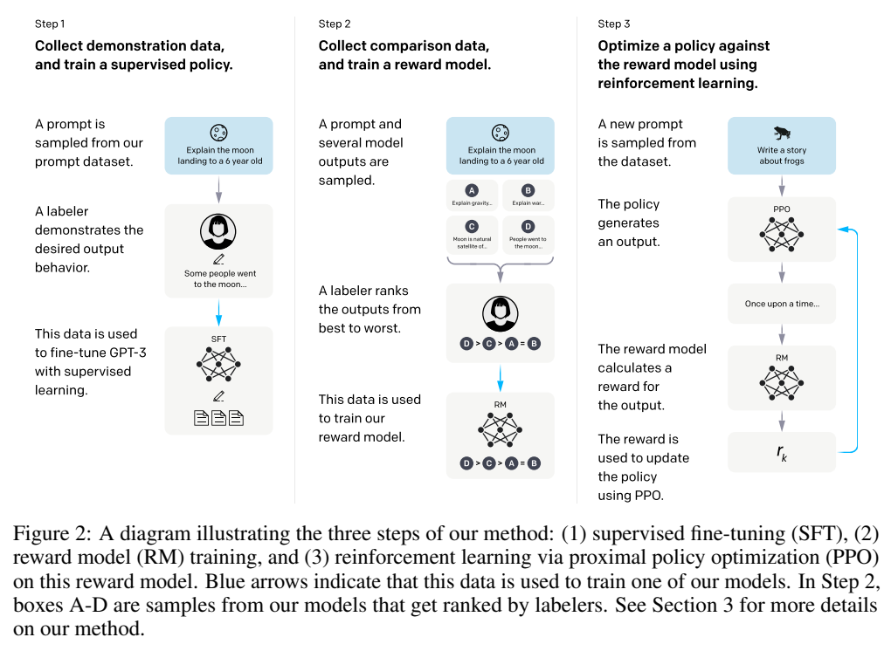
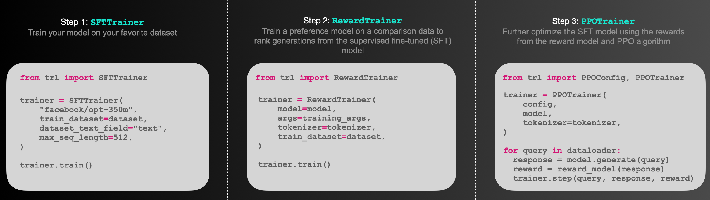
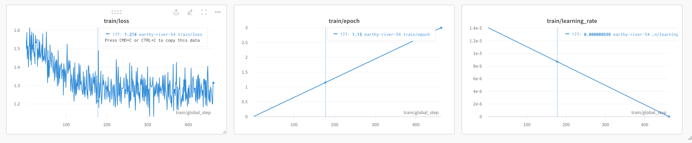
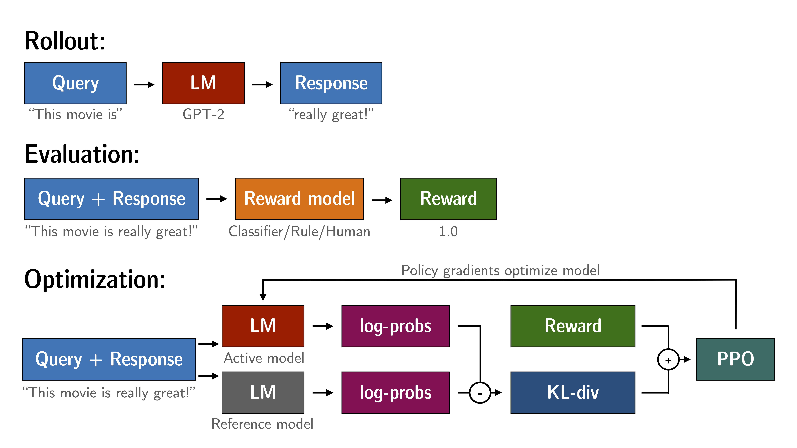
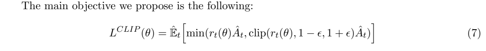
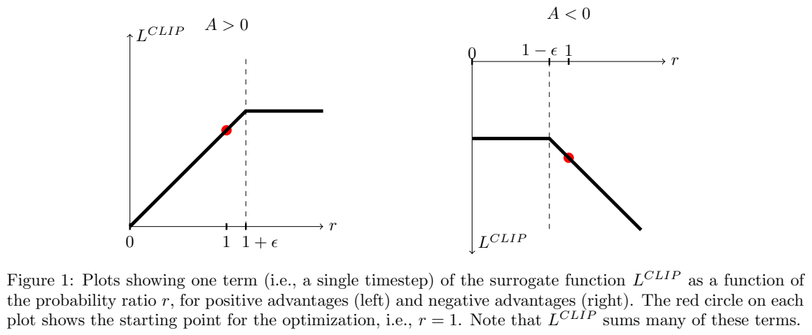
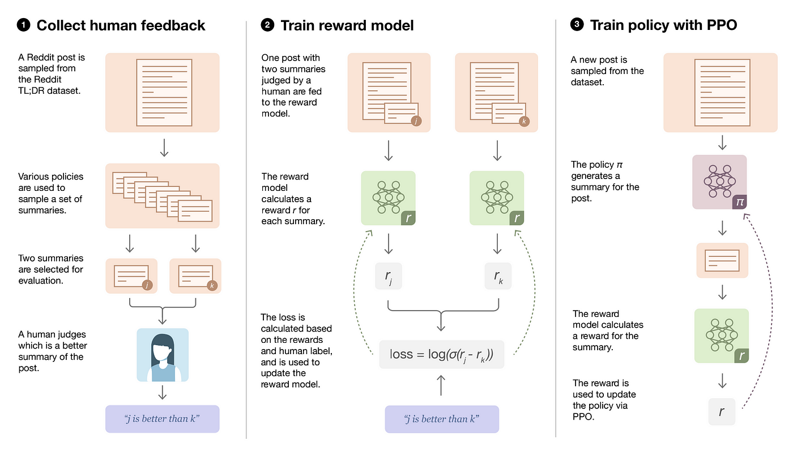
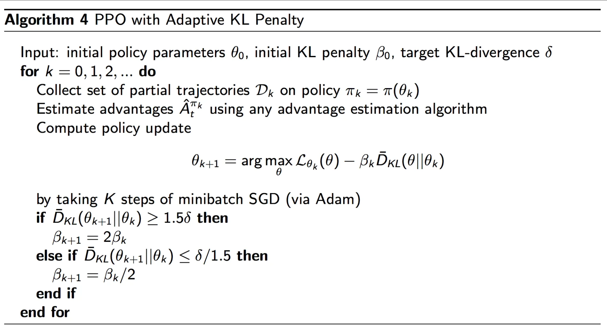

# 第16讲：TRL、奖励模型与PPO训练

模型写出两段回答，一段贴合问题，另一段绕开了问题。我们希望它以后更常写出前一种回答。前面SFT用示范答案告诉模型“照这样写”；这一讲继续看：**先让模型自己写，再给这次回答评分，怎样用评分调整下一次生成？**

先看完整流程，再用三个token手算，最后跟随真实TRL接口运行一个小模型。论文原图和相关英文含义放在对应段落旁。原课程42格可对照[Python中文注释版](代码/tutorials/trl_hf/trl_basics_代码注释.py)和[逐格说明](代码单元解释.md)。

## 1. 三种训练：示范、比较和反馈

假设问题是“把Hello翻译成法语”。

- **SFT，监督微调**：提供“问题→Bonjour”这样的示范，用正确后续token计算误差，更新生成模型。
- **奖励模型训练**：给同一问题准备几个回答，由人比较好坏；打分模型学习让较好的回答得分更高。
- **PPO，近端策略优化**：生成模型自己回答，评分器给反馈，训练程序据此调整生成概率，同时约束更新幅度。

这里的**策略 policy**就是决定下一token概率分布的模型。**强化学习**使用行动后的奖励来更新策略；在语言生成中，一个行动是选择一个token，状态是当前已经写出的前缀，一次完整回答构成一条生成轨迹。



出处：[InstructGPT，arXiv:2203.02155v1，第3页Figure2](https://arxiv.org/pdf/2203.02155v1)。

从左向右读这三列：

1. 左列蓝框是问题，人像框表示标注者写示范，蓝箭头把这些数据送去训练SFT网络。
2. 中列先为同一问题生成A–D候选，人把它们排成好坏顺序，再用比较数据训练RM（Reward Model，奖励模型）。RM接收问题与回答，输出一个分数。
3. 右列策略先写回答，RM打分，分数送回PPO更新；右侧回环表示继续生成、评分、更新。

蓝色箭头在图注中表示数据用于训练相应模型。人提供的排序决定偏好方向；网络中的权重则通过训练调整。将它映射到张量：问题先成为长度Q的整数列表，回答成为长度R的列表，打分器每条回答给一个标量。原图以流程为主，具体shape由下面的代码给出。

课程的这张图把三个入口并排列出来：



**Trainer是组织训练的程序对象。** 它安排取数据、调用模型、算损失、求梯度和更新权重。TRL是把这些步骤封装起来的库，本讲实际使用PPOTrainer；SFTTrainer和RewardTrainer分别对应前两列。

课程还保存了SFT训练曲线：



三幅图横轴都是global_step，即优化更新步。左图是训练loss，总体从约1.6降到1.2附近并持续波动；中图epoch逐渐接近3；右图学习率从约1.41×10^-5线性降至0。第177步的悬停值分别为loss1.214、epoch1.15和学习率0.000008698。这张图帮助读SFT日志；本讲PPO的优化器与配置在第10节单独说明。

## 2. 打分模型怎样学会比较？

对同一问题x，设人偏好的回答为y_w，另一条为y_l；下标w/l分别表示比较中的优胜与落后。奖励模型r_phi给两条文本各打一个分数，其中phi表示其可训练参数。

把分差变成偏好概率：

$$p(y_w\succ y_l\mid x)=\sigma\big(r_\phi(x,y_w)-r_\phi(x,y_l)\big),\qquad
\sigma(z)=\frac{1}{1+e^{-z}}.$$

符号“优于”表示人的排序，sigma叫sigmoid，将任意分差映射到0至1。两分相同时，概率为0.5；分差为2时，概率约0.881。对应的训练损失为负对数：分差0时约0.693，分差2时约0.127。训练让正确排序获得更高概率。这是InstructGPT第3.3节的成对偏好思路，具体奖励训练在第23讲展开。

本讲原单元28直接写 `reward=[torch.tensor(1.0,...)]`，每条样本都从外部取得1.0，用于演示PPO接口。换成真实任务时，这个位置可以接奖励模型、规则或人工评分；评分依据决定模型往什么方向调整。

## 3. 四个角色：谁生成，谁评分，谁更新？

| 名称 | 输入与输出 | 本讲的作用 |
|---|---|---|
| active policy，当前策略 | 前缀→词表候选分数 | 生成回答，并接受PPO更新 |
| reference policy，参考策略 | 同一前缀→候选概率 | 保持固定，提供偏离程度的参照 |
| value head，价值头 | 每位置隐藏向量→一个数 | 预测从该状态继续的预期回报，与策略一起更新 |
| reward，外部评分 | 问题与完整回答→一个数 | 评价这次回答；原代码使用固定1.0 |

**参数**是模型保存、用于计算的数；**梯度**表示损失随参数变化的局部变化率；**优化器**根据梯度调整参数。PPO更新的是当前策略和它的value head，参考策略保持原值。

还有一个稍后要用的名称：**old policy，本轮采样时的策略**。回答刚生成时，把所选token当时的概率记录下来。同一回答可以用来更新几次，每次都与这份旧概率比较。reference是较长期的参照，old是本轮开始时的快照；代码可以直接保存old logprob，无须另建第三份模型。

## 4. 从文字到logits，再到value

原问题末尾有空格：`This morning I went to the `。分词器把文本切成token，再查整数ID。固定GPT-2词表中，这条输入的7个ID为：

`[1212,3329,314,1816,284,262,220]`

这里的整数用于查表。模型的embedding把每个ID查成一排浮点数，再经过Transformer各层处理。**隐藏状态 hidden state**就是当前位置处理后的内部向量。

设一批有B条序列，每条补齐到T个位置，隐藏宽度d，词表大小V：

| 数据 | 类型与shape | 每个位置保存什么 |
|---|---|---|
| input_ids | 整数 `[B,T]` | 一个token编号 |
| hidden | 浮点 `[B,T,d]` | d个内部特征数 |
| lm_logits | 浮点 `[B,T,V]` | V个候选分数 |
| value | 浮点 `[B,T]` | 一个预期回报估计 |

logits经softmax得到候选概率；LM head负责从隐藏向量产生这组分数，value head则把同一隐藏向量变成一个数。关闭dropout时，价值头写成：

$$V_t=w^\mathsf T h_t+b.$$

h_t有d个数，w也有d个数，对应相乘求和，再加偏置b。例如h=[1,2]、w=[0.5,−0.25]、b=0.1，得到0.5−0.5+0.1=0.1。它预测从当前状态往后的回报，RM则评价实际完整回答。

原GPT-2的d=768，因此线性value head有768+1=769个参数。TRL包装的forward返回 `(lm_logits, loss, value)`；未提供语言模型labels时，中间loss通常为None。PPO随后根据评分与概率构造自己的损失。

## 5. 问题和新增回答，要在token边界分开

原单元26设置 `return_prompt=True`，所以返回“问题＋新生成内容”。原单元28又分别传入query和这个完整返回值，旧版Trainer会将二者拼接：

```text
问题7 + [问题7 + 新增20] = 34个token
```

传给step的response应当是新增部分：

```text
问题7 + 新增20 = 27个token
```

最直接的写法是让generate设置 `return_prompt=False`。若需要显示完整文本，也可以先保留完整结果，再按query的token长度切出新增部分。

为什么这关系到训练？模型用当前位置预测下一个位置。设简化问题ID为 `[1,2]`，回答为 `[3,4,5]`：

| 模型读取到的位置 | 接下来预测的目标 | 是否计入本次回答更新 |
|---|---|---|
| 1 | 2 | 否，问题内部 |
| 1,2 | 3 | 是，第一个回答token |
| 1,2,3 | 4 | 是 |
| 1,2,3,4 | 5 | 是 |

因此长度5的完整输入对应4个预测目标，回答mask为 `[0,1,1,1]`。**mask是逐位置的选择标记**，用来让损失只汇总需要的部分。原错误写法把第二份问题当成回答，也会把它计入优化目标。

## 6. 一个回答分数，怎样分配到各步？

外部score评价整条回答，策略更新还需要每个生成步骤的reward。旧版TRL先计算所选token在采样策略与参考策略下的对数概率差：

$$k_t=\log\pi_{\rm old}(a_t\mid s_t)-\log\pi_{\rm ref}(a_t\mid s_t),\qquad
r_t=-\beta k_t+\mathbf1[t=t_{\rm last}]R.$$

s_t是已有前缀，a_t是实际选中的token；pi表示选择概率，log是自然对数。R是外部完整回答得分，beta控制偏离参照的代价，指示项只在最后一个有效回答位置为1。代码把R加在末尾，其余位置通过后面的回报估计获得影响。

例如两个候选的采样概率为 `[0.8,0.2]`，参考概率为 `[0.5,0.5]`：两个log-ratio分别约0.4700和−0.9163。按采样概率加权，完整分布KL约0.1927。单个所选token的差值可正可负，KL的非负性质来自对完整分布的加权求和。

课程总览图把这些角色接成了循环：



Rollout是采样一段回答，Evaluation计算外部得分，Optimization将概率、value与得分组成损失。图中reward和KL汇合处，对应代码 `score − beta×偏离项`。更新时，固定reference提供参照，active重新计算同一段回答的概率。

## 7. Advantage：这一步比原先预期好多少？

value预测未来回报，实际reward提供反馈。把二者比较，可以得到**优势 advantage**，记为A：正值倾向于增加这个行动的概率，负值倾向于减小它。

本讲旧实现使用GAE（广义优势估计），从末尾向前递推：

$$\delta_t=r_t+\gamma V_{t+1}-V_t,\qquad
A_t=\delta_t+\gamma\lambda A_{t+1},\qquad
\widehat R_t=A_t+V_t.$$

delta比较“眼前reward＋下一步价值”与当前价值。gamma为折扣因子，lambda控制向前传递后续误差的程度，末尾下一value与下一advantage取0。returns即上式的R帽，是价值头要拟合的目标。

取reward=[−0.1,0,0.9]、value=[0.2,0.3,0.4]，gamma=1、lambda=0.95。最后一项A=0.9−0.4=0.5；前一项delta=0+0.4−0.3=0.1，A=0.1+0.95×0.5=0.575；再往前得到0.54625。returns为 `[0.74625,0.875,0.9]`。

下面先核对这组三步计算，再观察PPO裁剪的正负两种情况：

```python
import torch

rewards = torch.tensor([-0.1, 0.0, 0.9], dtype=torch.float64)
values = torch.tensor([0.2, 0.3, 0.4], dtype=torch.float64)
advantages = torch.zeros_like(values)
carry = torch.tensor(0.0, dtype=torch.float64)
for t in reversed(range(3)):  # 从最后一个回答位置往前算
    next_value = values[t + 1] if t < 2 else 0.0
    delta = rewards[t] + next_value - values[t]  # gamma=1
    carry = delta + 0.95 * carry
    advantages[t] = carry
returns = advantages + values
torch.testing.assert_close(advantages, torch.tensor(
    [0.54625, 0.575, 0.5], dtype=torch.float64))
print('raw advantages:', advantages.tolist())
print('returns:', returns.tolist())

clip_results = []
for advantage in (2.0, -2.0):
    ratio = torch.tensor(1.5, dtype=torch.float64, requires_grad=True)
    gain = torch.minimum(ratio * advantage,
                         ratio.clamp(0.8, 1.2) * advantage)
    policy_loss = -gain  # 优化器最小化loss，相当于最大化gain
    policy_loss.backward()
    clip_results.append([advantage, policy_loss.item(), ratio.grad.item()])
assert clip_results == [[2.0, -2.4, 0.0], [-2.0, 3.0, 2.0]]
print('advantage, policy loss, derivative:', clip_results)
```

`tensor`建立数值数组，float64便于核对小数；`reversed(range(3))`依次给出2、1、0；`zeros_like`建立同形状全零数组。`backward()`将损失对ratio的导数存入.grad。最后这个导数例子单独展示裁剪函数的斜率，下一节对照原图解释。

旧TRL在PPOTrainer.loss里还会对有效位置的advantage做masked_whiten，即按有效位置中心化和缩放，再detach作为策略损失的固定权重。上面打印的是这一步之前的原始GAE。

## 8. PPO为什么要裁剪概率变化？

同一段回答生成后，我们会重复更新几次。让当前选择概率与采样时概率相比：

$$\rho_t=\frac{\pi_\theta(a_t\mid s_t)}{\pi_{\rm old}(a_t\mid s_t)}
=\exp(\log\pi_\theta-\log\pi_{\rm old}).$$

rho=1表示概率相同，rho=1.5表示当前概率是原来的1.5倍。对于正优势，希望提高概率，但也希望一次更新适度。PPO采用下面的目标：



出处：[Proximal Policy Optimization Algorithms，arXiv:1707.06347v2，第3页公式(7)](https://arxiv.org/pdf/1707.06347v2)。论文用r_t表示概率比，这里写rho_t，避免与逐token奖励r_t重名。theta为当前参数，A帽为优势估计，epsilon为裁剪范围，E帽表示在采样位置上取经验平均。



同页Figure1分别画正优势和负优势。横轴是概率比r，纵轴是单个位置对最大化目标的贡献；红点为更新开始时r=1。

- 左图A>0：提高这个行动的概率会增加目标，超过1+epsilon后进入平台，继续增大不再获得额外收益。
- 右图A<0：减小该行动概率会改善目标，低于1−epsilon后进入平台；若反而提高概率，目标继续下降。

epsilon=0.2时，上一节A=2、rho=1.5的loss为−2.4且导数为0；A=−2时loss为3、导数为2。负优势下提高坏行动概率仍受惩罚，这正对应右图向右下降的线。

TRL返回策略loss和价值loss，后者拟合returns，并带独立的value clipping。两项加权后反向求导，再由Adam更新策略与value head。完整数学在第27讲继续，这里先将三个角色接起来：R给反馈，V作预测，A指导策略。

## 9. 用真实小模型跑通生成接口

下面两个代码块连续运行，采用TRL0.4.7、Transformers4.30.0和Torch2.0.1 CPU。用本地真实GPT-2词表，新建隐藏宽度8、1层、2头的小型随机GPT-2；每条只生成3个新token，方便观察边界。分词文件路径通过环境变量 `LESSON16_TOKENIZER` 指定，命令见[复现说明](复现/README.md)。

```python
import os
from copy import deepcopy
from transformers import GPT2Config, GPT2LMHeadModel, GPT2TokenizerFast
from trl import AutoModelForCausalLMWithValueHead, PPOConfig, PPOTrainer

torch.manual_seed(16)
torch.set_num_threads(1)
tokenizer = GPT2TokenizerFast(tokenizer_file=os.environ['LESSON16_TOKENIZER'])
tokenizer.pad_token = tokenizer.eos_token
base = GPT2LMHeadModel(GPT2Config(
    vocab_size=len(tokenizer), n_positions=64, n_embd=8, n_layer=1, n_head=2,
    resid_pdrop=0.0, embd_pdrop=0.0, attn_pdrop=0.0,
    bos_token_id=tokenizer.eos_token_id, eos_token_id=tokenizer.eos_token_id))
model = AutoModelForCausalLMWithValueHead.from_pretrained(base, summary_dropout_prob=0.0)
reference = deepcopy(model)
reference.eval()
reference.requires_grad_(False)
config = PPOConfig(batch_size=1, mini_batch_size=1, ppo_epochs=4,
                   learning_rate=1e-5, seed=16, log_with=None)
trainer = PPOTrainer(config, model, reference, tokenizer)
query = tokenizer.encode('This morning I went to the ', return_tensors='pt')[0]
assert query.tolist() == [1212, 3329, 314, 1816, 284, 262, 220]
before_generation = {name: value.detach().clone()
                     for name, value in model.state_dict().items()}
full = trainer.generate([query], return_prompt=True, do_sample=False,
                        max_new_tokens=3, eos_token_id=None,
                        pad_token_id=tokenizer.eos_token_id)[0]
response = full[len(query):]  # 切下新增回答，后面step只接收这一段
assert len(full) == 10 and len(response) == 3
assert torch.equal(full[:len(query)], query)
assert all(torch.equal(value, model.state_dict()[name])
           for name, value in before_generation.items())
print('query/full/response lengths:', len(query), len(full), len(response))
```

`from … import …`导入类名；调用配置类得到尺寸设置，调用模型类按设置创建随机权重。这个旧版包装器通过from_pretrained接收已有模型对象，完成价值头和内部状态准备。deepcopy复制独立参考模型，eval关闭其训练态行为，requires_grad_(False)冻结其参数。字典推导式逐项clone保存快照，后面可以比较生成前后的权重。

分词结果先是 `[1,7]`，取 `[0]` 得到一维 `[7]`；外面套列表 `[query]`，表示一批一条样本。模型生成返回10个ID，切出后3个就是response。这个例子采用贪心选择，原课程则启用采样、最多新增20个。

## 10. 观察mask和四次实际更新

先分别把完整生成结果与纯回答交给数据准备函数，再比较真实mask。接着，用纯回答执行一次PPO step。

```python
def inspect_response(candidate):
    inputs = trainer.prepare_model_inputs([query], [candidate])
    with torch.no_grad():
        logprobs, _, values_now, mask = trainer.batched_forward_pass(
            model, [query], [candidate], inputs)
    return inputs, logprobs, values_now, mask

wrong_inputs, _, _, wrong_mask = inspect_response(full)
inputs, logprobs, values_now, mask = inspect_response(response)
assert wrong_inputs['input_ids'].shape == (1, 17)
assert int(wrong_mask.sum()) == 10
assert inputs['input_ids'].shape == (1, 10)
assert logprobs.shape == values_now.shape == mask.shape == (1, 9)
assert mask[0].tolist() == [0, 0, 0, 0, 0, 0, 1, 1, 1]
with torch.no_grad():
    logits, lm_loss, token_values = model(**inputs)
    ref_logprobs, _, _, _ = trainer.batched_forward_pass(
        reference, [query], [response], inputs)
    shaped, penalty = trainer.compute_rewards(
        torch.tensor([1.0]), logprobs, ref_logprobs, mask)
assert logits.shape == (1, 10, 50257) and token_values.shape == (1, 10)
assert lm_loss is None
assert torch.allclose(shaped - penalty, torch.tensor(
    [[0, 0, 0, 0, 0, 0, 0, 0, 1.0]]))
before_update = {name: value.detach().clone()
                 for name, value in model.state_dict().items()}
ref_before = {name: value.detach().clone()
              for name, value in reference.state_dict().items()}
trainable = {id(p) for p in model.parameters() if p.requires_grad}
optimized = {id(p) for group in trainer.optimizer.param_groups for p in group['params']}
assert optimized == trainable
step_count = [0]
real_step = trainer.optimizer.step
def counted_step(*args, **kwargs):  # 记录次数，然后调用真实优化器
    step_count[0] += 1
    return real_step(*args, **kwargs)
trainer.optimizer.step = counted_step
stats = trainer.step([query], [response], [torch.tensor(1.0)])
trainer.optimizer.step = real_step
changed = [name for name, value in model.state_dict().items()
           if not torch.equal(value, before_update[name])]
assert step_count[0] == 4
assert any(not name.startswith('v_head.') for name in changed)
assert any(name.startswith('v_head.') for name in changed)
assert all(torch.equal(value, ref_before[name])
           for name, value in reference.state_dict().items())
assert all(p.grad is None for p in reference.parameters())
print('wrong/correct targets:', int(wrong_mask.sum()), int(mask.sum()))
print('logits/value shapes:', list(logits.shape), list(token_values.shape))
print('optimizer steps:', step_count[0], 'changed tensors:', len(changed))
print('policy/value loss:', stats['ppo/loss/policy'], stats['ppo/loss/value'])
```

`def`定义函数，return交回结果；`with torch.no_grad()`只观察前向而不记录求导图。prepare_model_inputs拼接ID并补齐，batched_forward_pass返回移位后的logprob、value和mask。这里mask的三个1落在6、7、8号预测位置，对应7、8、9号回答token。

生成阶段权重保持相同；训练阶段先调用step，内部计算四轮PPO损失，每轮都用同一条回答完成一次Adam更新。上面的计数函数调用真实optimizer.step并记录次数：`*args`接收位置参数，`**kwargs`接收命名参数，再原样交给real_step。`param_groups`列出优化器管理的参数组，`id(p)`取得对象身份，用来核对优化器管理的正是active参数。更新后，策略骨干和value head都变化，reference逐项保持相同。compute_rewards则显示，外部1.0只加在末尾有效位置。

## 11. 回到原42格代码

| 单元（从0起算） | 做什么 | 与本文对应 |
|---|---|---|
| 0–15 | 三阶段图、SFT命令和概念 | 第1–3节；SFT命令写在Markdown10中 |
| 16–17 | 导入、设置随机数种子 | 本文导入与manual_seed；原函数还设置Python/NumPy/CUDA种子 |
| 18–21 | 加载GPT-2、reference、tokenizer，查看value head | 第3–4节；原来从gpt2标识恢复预训练权重 |
| 22–23 | 配置并创建PPOTrainer、查看设备 | 原只覆盖batch_size=1，其余按库默认 |
| 24–27 | 编码7个问题ID，采样20个token并decode | 第5、9节；原return_prompt=True返回完整序列 |
| 28–30 | 固定score=1.0、step、查看统计 | 第6、10节；原step传入含问题的response |
| 31 | PPO调用链的源码概览 | 结合prepare_model_inputs、compute_rewards、loss阅读 |
| 32–38 | 手工拼接，查看hidden/logits/value映射 | 第4–5节；原打印的是不带显式batch轴的一维输入 |
| 39–40 | no_grad下查看value | 观察每位置预期回报 |
| 41 | 空代码格 | 无额外计算 |

原示例的seed也值得对照：外面先设42，而TRL0.4.7的PPOConfig默认seed=0，Trainer初始化再调用set_seed。本文将config.seed显式设为16，使随机模型和训练配置的选择清楚可查。

原生成参数 `do_sample=True` 表示按概率采样，`top_p=1.0` 保留全部累计概率范围，`max_new_tokens=20` 限制新增长度。原 `top_k=0.0`、`min_length=-1` 属于旧接口设置；本文用固定版本解释。设备device标明CPU或GPU位置，张量与模型应放在匹配设备。

课程另两张图用于连接后续专题：



左侧偏好对训练打分器，右侧用打分器反馈更新策略。图中若写log-sigmoid的偏好目标，最小化loss时取负号，对应第2节的负对数。完整成对数据与RewardTrainer在第23讲展开。

### 补充读图：自适应KL系数



这张课程伪代码图先给定策略参数theta、初始惩罚系数beta和目标KL值delta。每轮采样轨迹、估计优势、用Adam做K个小批次更新；测得KL高于1.5倍目标就增大惩罚，低于目标/1.5就减小惩罚。这里k数外层采样轮次，K数内部更新步。原图中的KL比较当前与上一轮策略；本讲TRL还用固定reference约束偏离，并用第8节clip目标比较当前与old概率。这两处参照各有用途。

### 本页运行所得

| 观察对象 | CPU小模型结果 |
|---|---|
| 模型尺寸 | 隐藏宽度8、1层、403465参数，value head有9参数 |
| 生成 | query7、完整10、纯response3，生成前后权重一致 |
| 输入边界 | 完整结果误作response时拼17，正确拼10 |
| 有效目标 | 错误10、正确3；logprob/value/mask为 `[1,9]` |
| 原始输出 | logits `[1,10,50257]`，value `[1,10]` |
| PPO更新 | 四次真实Adam；策略骨干与value head变化，reference保持相同 |

## 第二遍对照：原有完整讲解

<details>
<summary>展开：固定源码、原单元细节和此前运行记录</summary>


# 第16讲：TRL 基础与 reward/PPOTrainer

TRL把模型训练分成可调用的接口，但“调用了PPOTrainer”不等于已经完成RLHF。本讲先区分policy、reference、reward和value，再读一个GPT-2单样本示例。最重要的代码问题是：原response已经含query，Trainer又把query拼了一遍，导致重复prompt进入优化区。

阅读范围为课程 `tutorials/trl_hf/trl_basics.ipynb` 的42单元及对应字幕；课程commit `7fbc29824171fd07dc2c30fe922e61ebc018ad1d`。参考TRL **v0.4.7**，因其方法签名与原伪代码一致；作者精确安装版本未找到。PPO论文是 **Proximal Policy Optimization Algorithms**（2017），RLHF背景是 **Training language models to follow instructions with human feedback**（2022）。本讲属于接口与计算路线概览，完整RewardTrainer/PPO/InstructGPT分析分别在后续23/27/30讲，没有新增完整论文译稿或论文实验复现。

## 1. 地图：训练的三个阶段与四种角色

课程图 `trl_steps.png` 从左向右是SFTTrainer、RewardTrainer、PPOTrainer。第一阶段用目标文本监督生成；第二阶段用偏好对训练打分模型；第三阶段由生成、打分、策略更新组成循环。它们可以分开运行，不是PPOTrainer初始化就自动把前两步都训练完。

| 角色 | 输入/输出 | PPO阶段更新吗 | 原示例情况 |
|---|---|---|---|
| active policy | token前缀 -> 词表logits | 更新 | GPT-2 backbone/LM head |
| value head（critic） | 同一hidden state -> 每位置标量 | 更新 | active模型上另加线性层 |
| reference policy | 相同token -> 参考log probabilities | 固定，不由active optimizer更新 | 第二个GPT-2包装 |
| reward model/规则/人 | query+response -> 样本得分 | 通常固定 | **没有实例化RM，直接给1.0** |

课程概述图的Rollout上半部是query经过LM生成response；Evaluation把query+response交给打分器；Optimization再把同一序列给active/reference，比较log probabilities并更新active。图里Reward和KL的加号代表带权组合，代码是reward **减去** KL惩罚，不能读成正向奖励偏离reference。value head在计算优势时提供基线，不是图中的RM。

`rm_ppo.png` 来自摘要任务示意，展示偏好数据、打分训练和策略更新；不是这个notebook实际运行摘要任务。图中log-sigmoid表达若用于最小化loss需要负号，后续RewardTrainer课会详细解释。图的存在不能作为本例训练出reward model的证据。

## 2. 文件与执行数据路线

| 原单元/官方对象 | 责任 |
|---|---|
| cells0–15 | 理论图与SFT命令；cell10仅Markdown |
| cells16–22 | imports、seed、GPT-2/value head/ref/tokenizer、Trainer |
| cells24–27 | query编码与generate |
| cell28 | 固定score并step |
| cell31 | 从源码抽出的伪代码，未在该格执行 |
| cells32–40 | 手工拼接、hidden/logits/value形状 |
| modeling_value_head.py | hidden -> ValueHead及返回tuple |
| ppo_trainer.py | generate、拼接/mask、score shaping、loss/更新 |
| ppo_config.py/core.py | 默认、GAE参数、mask/whitening等 |

```text
query字符串 -> tokenizer -> query IDs
 -> active.generate -> 纯response IDs
 -> 外部score（本例=1.0）
 -> PPOTrainer.step(query,response,score)
 -> 拼接query+response -> active与reference前向
 -> 每token logprob / value -> KL shaped rewards
 -> GAE / returns -> PPO policy/value losses
 -> backward -> optimizer -> 训练统计字典
```

原代码偏离这条规范路线：generate返回了完整输入+输出，step仍当它是纯response。下面先读各接口，再解释修正边界。

## 3. 模型、seed与tokenizer【必须会】

```python
model = AutoModelForCausalLMWithValueHead.from_pretrained('gpt2')
model_ref = AutoModelForCausalLMWithValueHead.from_pretrained('gpt2')
tokenizer = GPT2Tokenizer.from_pretrained('gpt2')
tokenizer.pad_token = tokenizer.eos_token
```

`from_pretrained` 是类方法，载入GPT-2并构造额外head。`model.pretrained_model` 是GPT2LMHeadModel；`model.v_head` 是ValueHead，两个对象共同构成active包装。第二次加载的LM基础权重来源相同，但新增value head通常随机初始化，不应概括为两个包装的所有参数数值必然完全相等。reference主要用于LM logprob，不需要靠其value输出监督active。

GPT-2历史vocab50257、hidden768、12层、context1024。pad复用EOS ID50256，未增加词表。mask需要区分真实EOS与padding，不能只按字符数切response。

cell17的setup_seed同时设置Python/NumPy/torch/CUDA和cudnn deterministic，但参考v0.4.7 PPOConfig默认seed=0，Trainer初始化调用set_seed(config.seed)，可能覆盖前面42的随机序列。设一次seed不保证所有后续随机状态恒定；复现应显式把PPOConfig seed也设成目标值并记录版本。dropout、多次generate、不同设备和kernel还影响结果。

`PPOConfig(**{'batch_size':1})` 的 `**` 展开字典为关键字参数，其他值仍来自库默认。`PPOTrainer(config,model,model_ref,tokenizer)` 是位置参数调用，现代API迁移应先核对签名。无dataset告警表示需要调用者自行供给batch；本例确实只手工送一个样本。

## 4. ValueHead：每token预测一个value【必须会】

对于最后hidden state $H\in\mathbb R^{B\times T\times d}$，value head为：

$$V_{b,t}=w^\mathsf T\operatorname{Dropout}(H_{b,t})+b_v.$$

$b$为batch索引、t为位置、d=768；w长度768，bias为一个标量，共 **769参数**。Linear逻辑把最后一维768映射成1，得到 `[B,T,1]`，`.squeeze(-1)`去掉最后大小为1的维度，得到 `[B,T]`。它没有先把vocab50257维概率映射成value，输入是hidden state。

例如hidden向量 `[1,2]`、w=`[0.5,-0.25]`、bias0.1、关闭dropout时，value=`0.5-0.5+0.1=0.1`。value可正可负，不经过sigmoid成为“好回答概率”。它估计从当前状态继续的预期回报，用于减少策略梯度噪声，不是人类对完成答案的直接打分。

官方包装 `forward()` 返回 `(lm_logits, loss, value)`，lm_logits `[B,T,50257]`，有labels时可能有语言模型loss，没有labels时通常None。PPO准备输入主动去掉labels，所以不是直接最小化SFT的next-token CE。ValueHead打印有Flatten成员，但参考forward未调用它，不能根据模块repr推断一定把B/T铺平。

原cell35给GPT-2的是一维input_ids `[34]`，因此保存hidden `[34,768]`、logits `[34,50257]`，没有显式batch轴；后面value `[34]`。标准Trainer前向使用带batch张量，与这些教学打印应区分。

cell39用 `with torch.no_grad()` 禁止梯度记录，不自动令dropout失效。若模型仍处train模式，value仍可能因dropout改变；要确定性检查应同时明确eval模式。这里只是观测value，不能把34个数当RM奖励或质量评估。

## 5. query编码、generate与原参数【必须会】

原query字符串末尾含空格：`This morning I went to the `。GPT2Tokenizer.encode(...,return_tensors='pt')给 `[1,7]` tensor，`.to(device)`移到active设备。`[item for item in query_tensor]` 按batch行迭代为一个 `[7]` tensor的列表，符合此版generate列表输入路径。

早期真实tokenizers加载固定GPT-2 tokenizer.json，得到历史7个ID `[1212,3329,314,1816,284,262,220]` 并decode往返通过。新增验证从同一固定文件导出vocab和merges，构造真实GPT2Tokenizer slow类，原query和pad/eos行为实际核对；不据此证明作者Hub全部配置一致。

| 原generation设置 | 含义与边界 |
|---|---|
| `max_new_tokens=20` | 新增上限，不含query |
| `do_sample=True` | 随机采样 |
| `top_k=0.0` | 原意关闭top-k；某些版本要求整数，应显式用0 |
| `top_p=1.0` | 不做额外nucleus截取 |
| `min_length=-1` | 原旧例设置，兼容性需固定版本核对 |
| `pad_token_id=eos_token_id` | 解码padding复用EOS |
| `return_prompt=True` | **返回query和生成续写** |

reference不负责生成rollout；active生成后，reward函数可以给分数。原cell27 decode整段27token，含query7和实际续写20，不能因为变量叫response_tensor就假定只有response。

## 6. 重复prompt怎样进入PPO【必须会】

原cell28执行 `step([query_tensor[0]],[response_tensor[0]],reward)`。参考 `prepare_model_inputs` 对decoder-only模型执行每行 `torch.cat([q,r])`，因此原输入是：

```text
query(7) + [query(7) + continuation(20)] = 34 tokens
```

cells32–33保存shape7/27/34以及解码后两次重复开头，直接支持这一诊断。原cell31虽是概览伪代码，也不能消除重复。PPO的response mask从shift后 `len(query)-1=6` 起，覆盖response长度27；因此**第二遍query也被当作策略生成内容参与loss**，不只是展示多印一次。

正确边界是query7、response20，拼后27。可以改原generate：

```python
responses = ppo_trainer.generate(
    [query_tensor[0]], return_prompt=False, **generation_kwargs)
train_stats = ppo_trainer.step([query_tensor[0]], responses, reward)
```

或者保留return_prompt=True，然后按每条query的**token长度**切去前缀。batch长度不同不能用一个统一字符数截取。早期只有列表验证；新增真实旧版Trainer分别执行原错误输入与return_prompt=False修正版，mask覆盖27/20目标，均完成四次优化更新，证据见第11节。修正版能运行不证明回答质量改善。

## 7. reward、reference与old policy【必须会】

原 `reward=[torch.tensor(1.0,device=...)]` 是每样本一个0维float tensor，列表长度等于batch；它不是27个token的打分，更没有RM forward。模型不会从一个固定1.0学到“偏正向电影评论”的具体区分。KL、value拟合与随机估计仍可使参数变化，但不构成已学到人类偏好的证据。

reference用于约束偏离，通常代表初始SFT语言模型。该版提供ref_model时直接使用它，相关forward放在no_grad区，active optimizer只由active参数构成；不能笼统说传入任何ref对象都自动被永久requires_grad=False。未提供ref时的create_reference_model另有冻结/eval逻辑。工程上应显式确认reference eval/冻结状态，避免dropout令相同权重logprob比较带噪声。

PPO还有“old policy”概念：本轮rollout开始时active的logprobs被无梯度保存，再对同一批rollout做多个ppo_epochs更新。**old policy不是reference**：old用于本轮比率，reference是较长期KL锚点。原示例没有额外第三套old模型，保存旧logprob即可。

## 8. logprob与KL shaped reward【必须会】

Trainer拼接后对active/reference分别forward，取 `logits[:, :-1, :]` 预测 `input_ids[:, 1:]`，获得每个实际token的logprob，不是保留全部词表概率用于每一步loss。prompt区域与padding通过mask排除。对T长序列，logprobs/value/mask在该实现通常为 `[B,T-1]`，概念上的有效response仅其中一段，不应照搬docstring就说张量只长R。

默认 `_kl_penalty` 的每token值为：

$$k_t=\log\pi_{old}(a_t\mid s_t)-\log\pi_{ref}(a_t\mid s_t),\qquad
r_t=-\beta k_t+\mathbf1[t=t_{last}]\,R.$$

$s_t$是token前缀，$a_t$是采样token，R为外部完整回答score，beta初始0.2；只有最后一个未mask目标位置加R。compute_rewards同时返回rewards和不含score的non_score_rewards。R不必广播到每个token，内部r_t也不等于value head输出。

这里单个采样log-ratio可为负；完整分布KL $\sum_a\pi(a)\log[\pi(a)/\pi_{ref}(a)]$ 才保证非负。教学分布pi=`[0.8,0.2]`、ref=`[0.5,0.5]`的两种log-ratio为0.470004/-0.916291，加权KL约0.192745。beta0.2、最后score1时，两token shaped rewards为-0.094001、1.183258。负log-ratio使该token项正向，但不意味着算法的完整KL负了。

该版支持kl/abs/mse选项，配置初始KL系数、自适应target/horizon影响后续；不要把这几个对象都叫“一个KL loss”而忽略reward shaping与policy优化的区别。

## 9. advantage与PPO目标概览【建议会】

value学习的是回报估计；优势比较实际shaped回报与value基线。参考GAE计算：

$$\delta_t=r_t+\gamma V_{t+1}-V_t,\quad
A_t=\delta_t+\gamma\lambda A_{t+1},\quad
\hat R_t=A_t+V_t.$$

t是有效目标位置，gamma默认1、lambda默认0.95，末尾下一value=0；mask先消除无效位置贡献。V、A、returns均为每token标量；returns是value拟合目标，不是模型decode文本。rewards=`[-0.1,0,0.9]`、values=`[0.2,0.3,0.4]`时，逆序算A得到`[0.54625,0.575,0.5]`，returns=`[0.74625,0.875,0.9]`。代码之后masked_whiten并detach advantages，不能把这里raw A数值当最终优化输入。

令rho为当前active对同一token的概率与old概率之比：

$$\rho_t=\exp(\log\pi_\theta(a_t\mid s_t)-\log\pi_{old}(a_t\mid s_t)),\qquad
L_{policy}=-\mathbb E_{mask}\min\{\rho_t A_t,\operatorname{clip}(\rho_t,1-\epsilon,1+\epsilon)A_t\}.$$

epsilon默认0.2，clip是保守更新约束，原实现用两个负loss的max，等价于上式。A=2、rho=1.5时loss=-2.4而不是-3；A=-2、同rho时loss=3，不能错误地总把比率限制成1.2。原创数值验证还用有限差分检查正优势超clip区域梯度为0。

value loss另比较新value与returns，并按旧value附近clip取保守项；总优化有vf_coef默认0.1权重。`ppo_epochs=4` 表示同一批rollout复用四次，不是四次重新采样，也不等于只做一次optimizer更新。batch_size、mini_batch_size与gradient_accumulation_steps控制不同层级。新增小模型真实step已经执行反向与Adam更新；完整数学及mask细节后续第27讲继续。

## 10. 默认、结果与复现能证明什么

参考v0.4.7默认mini_batch_size=1、ppo_epochs=4、learning_rate=1e-5、gamma=1、lambda=0.95、cliprange=0.2、vf_coef=0.1、seed=0。本例覆盖batch_size=1。PPOTrainer默认优化器是 **Adam**；课程cell11说的AdamW/linear/warmup0对应前面SFT路径，不能挪给本PPO初始化。未显式scheduler时该版也不能宣称默认用了SFT的linear schedule。

生成前后没有质量评估或多轮训练对照。train_stats单元未保存可读统计，原文可读输出主要是生成句子、shape和值。随机续写不流畅、value为负均不能独立判断PPO是否正确；一轮固定score不能证明提高偏好对齐。没有论文基线、实验表、准确率曲线或最终保存/重载记录。

图片路径也需核对：上游notebook位于tutorials/trl_hf，`Image('../imgs/...')` 依赖当时工作目录，而图片在根imgs。公开交付保留五张上游原图字节与来源，放到本讲代码/tutorials/imgs，使从代码/tutorials/trl_hf启动时原调用有效；没有改原图片语句或把图当新实验结果。

## 11. 完整注释与真实PPO验证【建议会】

原42格、28代码格（含空41）全部说明；Markdown10三条shell命令及31缩略概览均注释。原版按固定Git blob字节保存；说明版/注释版各85格，原历史输出和元数据保持。原根tutorials/trl_basics.ipynb与trl_hf版是同一Git blob，公开只保存一份。Python阅读版将Markdown作为注释，保留原远程GPT2与重复query语句。

Markdown31混合不同函数层级、缩进与省略上下文，本身不是可独立执行的完整PPO代码。本次只增加注释，解释真实调用链，不补成另一套算法后声称执行原片段。28个真实代码格则全部实际执行并核对注释等价。

### 11.1 唯一原代码变体与真实对象

环境为Python3.11.0、Torch2.0.1+cpu、Transformers4.30.0、TRL0.4.7。除格18的三个gpt2加载标识改为本地目录，其他27格原语句完整执行；格17的CPU/CUDA设种函数、格25历史top_k0.0/min_length-1、格26新增20采样、格28固定score1.0和step均保留。固定版本接受这些生成设置，不能外推新版也接受。

本地基础是随机GPT2LMHeadModel：V50257、H16、1层、2heads、128位置；value包装共 **809,489参数**，value head只有17个参数。词表从第09讲固定tokenizer.json导出vocab/merges，由真实GPT2Tokenizer加载，pad=eos50256；没有生成简化假词表或使用假API。保存基础模型再让原from_pretrained类方法加载，两个新增value head仍是各自初始化。

原版与注释版均执行全部28格：原图Image字节一致、query为真实7ID、完整rollout长27、拼接长34。两版rollout、有效mask、数值stats及最终active全状态精确一致；运行时间等字段不作为数值等价依据。原代码不改正重复query，以便保留问题证据。

### 11.2 原错误输入与修正版的实际差别

| 范围 | 原错误路径 | 独立修正版 |
|---|---|---|
| query | 7个ID | 同一7个ID |
| step的response | query7+实际续写20，共27 | 实际续写20 |
| prepare_model_inputs | int64 [1,34] | int64 [1,27] |
| shifted logprob/value/mask | [1,33] | [1,26] |
| 有效mask目标数 | 27，包含第二份query | 20，只含续写 |
| optimizer | Adam，实际4次step | Adam，实际4次step |

mask通过真实prepare_model_inputs和batched_forward_pass取得，不是仅用列表自算；labels已从输入删除。诊断时保存/恢复Torch随机状态，避免额外dropout前向改变原代码后续执行。修正版重新加载相同随机基础、同样seed/配置生成，实际20个续写ID与原rollout去前7位精确相同，再单独训练。

原active和value head参数确实更新，reference全状态保持精确不变；optimizer参数ID集合恰好为active可训练集合。显式传入reference仍有18个Parameter的requires_grad=True，但所有grad为None，它没进入active optimizer；这验证了“参考权重未更新”不等于“属性永久冻结”。不能因此认为任何自定义reference模式都已自动安全配置。

初始objective/kl为0，两套LM基础来源相同；原policy loss约-0.00050334、value loss约0.43586147，修正版分别约-0.00040191、0.54162878。两组数值只是这一随机样例的训练统计，目标区长度已经改变，不用于判断谁的问答更好或偏好更强。四个ppo_epochs都消费同一rollout，reward始终外部固定1.0。

### 11.3 hidden与value真实形状

原格35用一维34 IDs，不带显式batch；真实小模型hidden为float32 [34,16]，logits为[34,50257]。v_head Linear(16,1)返回[34,1]，squeeze后[34]，原格39的no_grad使结果不记录梯度。历史[34,768]只属于原GPT2规格，原历史输出保留，不能改名当新结果。

[新增运行报告](复现/outputs/runtime_verification.json) 和 [注释审计](复现/outputs/annotation_verification.json)记录原件/元数据/schema/AST、全部执行格、实际图像、query/rollout、mask、更新次数和源码hash。首次独立修正检查遇到TRL0.4.7不接受pathlib.Path加载参数，已转为str再通过；原格加载本来就是字符串，不是原PPO算法错误。

**未运行**原预训练GPT2权重、Llama2/Guanaco SFT shell、learned reward model、GPU/多卡及完整人类偏好评估。随机续写和固定score训练不能证明RLHF有效。早期数学/列表[tokenizer]报告保留，不扩大其运行范围。

## 12. 来源

- [固定课程notebook](https://github.com/chunhuizhang/personal_chatgpt/blob/7fbc29824171fd07dc2c30fe922e61ebc018ad1d/tutorials/trl_hf/trl_basics.ipynb)：原执行/历史shape/伪代码。
- [TRL v0.4.7 PPOTrainer](https://github.com/huggingface/trl/blob/v0.4.7/trl/trainer/ppo_trainer.py)：generate、query拼接、mask、KL、GAE及loss。
- [ValueHead](https://github.com/huggingface/trl/blob/v0.4.7/trl/models/modeling_value_head.py)、[PPOConfig](https://github.com/huggingface/trl/blob/v0.4.7/trl/trainer/ppo_config.py)、[core](https://github.com/huggingface/trl/blob/v0.4.7/trl/core.py)：hidden映射、默认及masked_whiten。
- [PPO论文](https://arxiv.org/abs/1707.06347)与[InstructGPT论文](https://arxiv.org/abs/2203.02155)：算法背景；本讲未复现论文实验。

## 13. 学习优先级、Paper ↔ Code与复现

**必须掌握**：RM与value head不同；active/ref/old三种角色；query与纯response边界；逐样本score与逐tokenreward；LMlogits/hidden/value的shape；mask/next-token shift；单点log-ratio不等于完整KL；固定1.0不是偏好模型。

**第二遍**：PPOConfig默认/seed覆盖、GAE、whitening/detach、policy clipping的正负优势、value clipping、ppo_epochs与mini-batch、显式reference的冻结/eval行为。

**可以暂时不掌握的工程细节**：Accelerate多卡、完整RM数据构建、PPO统计的所有字段、CUDA缓存优化及现代TRL迁移；后续专题继续细读。

| Paper ↔ Code | 映射 | 边界 |
|---|---|---|
| RLHF分阶段训练 | 课程三Trainer示意 | 本例只调用PPO路径 |
| learned reward | 原cell28固定1.0 | 真正RM训练/forward未找到 |
| actor-critic value | AutoModelForCausalLMWithValueHead | 不是奖励分类器 |
| KL regularization | compute_rewards/_kl_penalty | sampled estimator与完整KL区分 |
| PPO clipped surrogate | PPOTrainer.loss | 新增真实CPU小模型更新，不是完整偏好训练 |
| 人类偏好/论文评估 | 未找到本例 | 无真实对齐结论 |

**复现状态：部分成功。** 原42格/28代码、五原图、两85格派生版与Python阅读版完整交付，原字节/历史/schema/AST通过。真实slow GPT2Tokenizer、随机小GPT2/value head和旧PPOTrainer执行两版全部代码，四次Adam更新及参数精确一致；独立纯response修正也跑通并核对27→20目标mask。见[新增运行](复现/outputs/runtime_verification.json)与[命令记录](复现/README.md)。早期[教学验证](复现/outputs/教学验证.json)的tokenizers/列表/数学范围保留。没有运行原GPT2权重、learned RM或完整RLHF评测。

**未解决问题与置信边界**：作者精确依赖、原step是否完成及完整统计、原两模型模式、权重revision和训练日志未锁定。新增实际随机模型验证了此套旧依赖的修正版路径，不能证明作者环境或最新版兼容、真实偏好效果。早期二十个continuation ID是整数fixture，新报告的二十个ID来自实际随机模型rollout，两类证据严格区分。


## 原始源码来源

- [TRL v0.4.7](https://github.com/huggingface/trl/tree/v0.4.7)


</details>

## 必须掌握

能讲清SFT示范、偏好比较和PPO反馈各用什么数据；区分策略、reference、value与外部score；沿文字→ID→hidden→logits/value→mask→奖励→优势→更新追踪数据；按token边界提取response；在原图上解释正、负优势的裁剪方向。

## 第二遍再看

对照固定PPOTrainer.loss读GAE、masked_whiten、value clipping和detach；检查old与reference的概率分别用在哪里；再读随机种子、batch/mini-batch、四个ppo_epochs及reference模式设置。

## 可以暂缓的工程细节

多卡Accelerate、完整奖励数据构建、PPO统计字典各字段、缓存优化与现代TRL接口迁移。先跑通一条回答的生成、计分和更新。

## Paper ↔ Code

| 原理或图表 | 本讲对象 | 对应内容 |
|---|---|---|
| InstructGPT v1第3页Figure2 | SFTTrainer、RewardTrainer、PPOTrainer | 示范、比较、策略反馈的分工 |
| InstructGPT§3.3偏好比较 | 原单元28的评分入口 | 本例手工给1.0；奖励模型训练和forward未找到 |
| 每位置价值估计 | AutoModelForCausalLMWithValueHead、ValueHead | hidden→线性投影→value |
| KL惩罚 | PPOTrainer.compute_rewards | 所选token的对数概率差，末尾加入完整回答score |
| GAE与价值目标 | PPOTrainer.loss | 反向递推优势、returns及标准化 |
| PPO v2第3页公式7/Figure1 | PPOTrainer.loss的ratio和clamp | 取保守目标、改变符号后最小化 |
| 回答边界 | generate、prepare_model_inputs、batched_forward_pass | 切去query，选择实际回答预测位置 |

## 复现状态

**部分成功。** 正文三块代码已在CPU执行：手算优势与裁剪导数，真实GPT-2分词与小模型生成，实际PPO mask、末位score和四次Adam更新。结果见[基础讲解验证](复现/outputs/基础讲解验证.json)，命令及此前原单元实验见[复现说明](复现/README.md)。三张论文截图的版本、页码和裁剪坐标见[图源记录](复现/outputs/论文截图来源.json)。

## 尚未解决的问题

讲师精确依赖、原模型revision和完整PPO统计尚未锁定。原预训练GPT-2、学习得到的奖励模型、偏好质量和GPU性能仍待复现。本文例子使用随机小模型与固定score，展示数据和更新流程。
