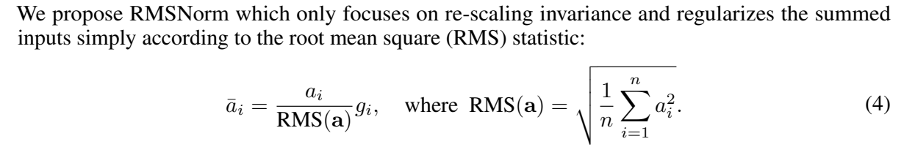
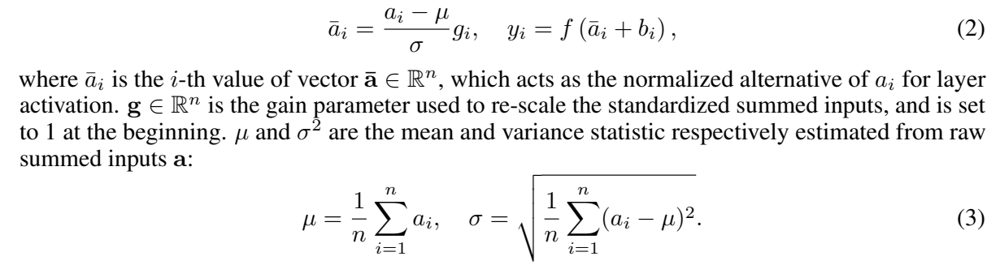
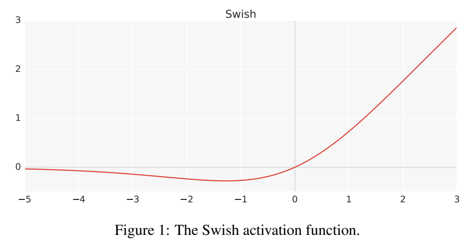
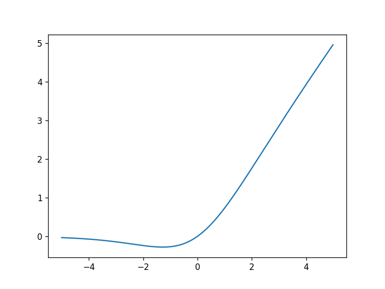
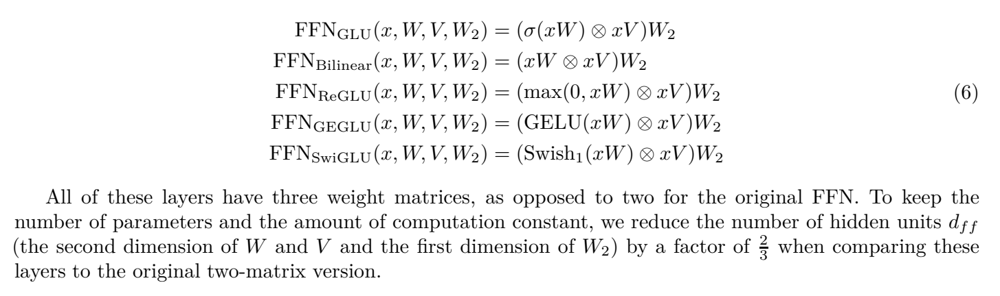
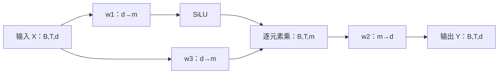
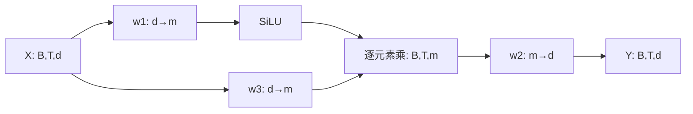

# 第17讲：RMSNorm 与 SwiGLU

读这一讲时，可以把一个 token 想成“一小排数字”。RMSNorm 调整这排数字的尺度；SwiGLU 把它送入两条线性分支，用一条分支的结果调节另一条，再变回原来的宽度。本讲先用两个数字算明白，再对照原 notebook 和 Llama 的实现。

阅读路线：**向量与形状 → 均方根 → RMSNorm 类 → SiLU 曲线 → SwiGLU 双分支 → Transformer 中的位置**。[原 notebook 的 Python 注释版](代码/tutorials/llama2_src_02_RMSNorm_SwiGLU_代码注释.py)可配合阅读；按编号查找时打开[全部单元说明](代码单元解释.md)。单元编号从0开始。

## 1. 模型中的“一排数字”是什么

前面讲过，tokenizer 先把文本切成 token，并给出整数编号。embedding 把编号变成向量；经过后续各层，这个向量会不断改变，成为该位置的**隐藏状态**。RMSNorm 和 SwiGLU 接收的就是浮点隐藏状态。

例如用 `[3,4]` 表示一个位置的隐藏状态：这里有两个通道，宽度为2。通道是向量中可被模型组合使用的数值分量。下面的数字是便于手算的例子。

原 notebook 第5格用 `torch.randn(20,5,10)` 创建演示输入。`randn` 从标准正态分布抽取随机数；三个维度依次表示：

| 维度 | 本讲符号 | 原代码取值 | 含义 |
|---|---|---|---|
| batch | B | 20 | 一次处理20条样本 |
| sequence | T | 5 | 每条样本包含5个位置 |
| hidden width | d | 10 | 每个位置用10个浮点数表示 |

整个输入的 shape 为 `[B,T,d]=[20,5,10]`。`x[0,0,:]` 取第一条样本、第一个位置的全部10个通道；`:` 表示取这一轴的所有元素。归一化时，每个位置单独用自己的10个数计算分母。

## 2. 先算出 RMS：平方、平均、开平方

【必须会】RMS 是 root mean square，即均方根。它把一排数概括成一个非负尺度。平方让正负数都能贡献幅度，平均让统计量适应不同宽度，最后开平方把量纲恢复回来。

给定向量 $x=[x_1,\ldots,x_d]$，

$$q=\frac{1}{d}\sum_{i=1}^{d}x_i^2,\qquad
\operatorname{RMS}(x)=\sqrt q.$$

这里 $d$ 是通道数，$i$ 从1数到 $d$；$q$ 是平方后的平均值。对 `[3,4]`：

| 步骤 | 计算 | 结果 |
|---|---|---|
| 各自平方 | $3^2,4^2$ | `[9,16]` |
| 求平均 | $(9+16)/2$ | 12.5 |
| 开平方 | $\sqrt{12.5}$ | 约3.535534 |
| 全部除以这个数 | $[3,4]/3.535534$ | 约`[0.848528,1.131371]` |

前后两个分量的比例都为3:4，整体幅度被调整了。如果原向量变成 `[30,40]`，RMS 也变成十倍，除完仍得到同一结果。

### 2.1 把论文公式放在手算旁边

下面直接截自 [RMSNorm 论文v1，第3页公式(4)](https://arxiv.org/pdf/1910.07467v1)。



图中的 $a_i$ 对应刚才的 $x_i$，$n$ 对应通道数 $d$；上横线的 $\bar a_i$ 表示归一化后的分量。右侧先求整个向量的 RMS，左侧让每个分量除以它，再乘自己的 $g_i$。$g_i$ 是可学习的通道增益，初始化为1。

这段论文的意思是：用均方根控制数值尺度，省去均值居中的步骤。Llama 在分母中再加一个很小的稳定项 $\epsilon$：

$$s=\sqrt{\frac{1}{d}\sum_{i=1}^{d}x_i^2+\epsilon},\qquad y_i=g_i\frac{x_i}{s}.$$

$\epsilon$ 读作 epsilon，代码名为 `eps`。当所有输入为0时，加上正的 `eps` 可避免除以0。它加在**开平方里面**；`sqrt(q+eps)` 与 `sqrt(q)+eps` 是两种计算。

### 2.2 一整个 batch 怎样做同样的计算

`mean(dim=-1)` 表示沿最后一轴求平均，也就是沿通道计算。`keepdim=True` 保留长度为1的轴：`[B,T,d] → [B,T,1]`。乘除时，PyTorch 会把每个位置的这一个分母用于它的全部通道，这叫**广播**。

```python
import torch
from torch import nn

# 一条样本、两个位置、每位置两个通道：[B,T,d]=[1,2,2]
x = torch.tensor([[[3.0, 4.0], [0.0, 5.0]]])
mean_square = x.square().mean(dim=-1, keepdim=True)
rms = mean_square.sqrt()
rms_result = x / rms  # 此例两排数均非零，先用 eps=0 手算
print(mean_square.tolist())  # [[[12.5], [12.5]]]
print(rms_result.tolist())   # 两个位置各用自己的统计量

ln = nn.LayerNorm(2, eps=1e-5)
ln_result = ln(x)
print(ln_result.tolist())
```

两个位置的平方和碰巧相同，所以 RMS 也相同；它们的归一化结果分别约为 `[0.848528,1.131371]` 和 `[0,1.414214]`。`square()`逐元素平方，`sqrt()`逐元素开平方。代码中的 `x / rms` 把 `[1,2,1]` 的分母广播到 `[1,2,2]`，输出保留原形状。

## 3. LayerNorm 还多做了一步：减去均值

原 notebook 第7–9格先演示 LayerNorm。对同一排 `[3,4]`，先求均值 $\mu=3.5$，减去均值得 `[-0.5,0.5]`；方差为0.25，标准差为0.5；忽略稳定项和可学习偏移时，结果为 `[-1,1]`。

下面是同一篇论文第3页的 LayerNorm 公式(2)(3)，可与上一张 RMSNorm 截图直接比较。



图中 $\mu$ 表示均值，$\sigma$ 表示标准差，$g_i$ 表示增益。式(2)右边的 $f$ 和 $b_i$ 是论文背景中接在归一化后的激活与偏置。课程的 `nn.LayerNorm` 本身计算的是：

$$\mu=\frac1d\sum_i x_i,\quad
v=\frac1d\sum_i(x_i-\mu)^2,\quad
 y_i=\gamma_i\frac{x_i-\mu}{\sqrt{v+\epsilon}}+\beta_i.$$

这里 $v$ 是方差，$\gamma$、$\beta$ 分别是逐通道增益和偏移，初始为1和0。方差除以 $d$，对应第9格 `std(unbiased=False)` 的统计口径。

| 对 `[3,4]` 的操作 | LayerNorm | RMSNorm |
|---|---|---|
| 先减均值 | 减3.5 | 保留原值 |
| 分母的统计量 | 中心化后的方差 | 原值的平方平均 |
| 初始单位增益、忽略eps的结果 | `[-1,1]` | `[0.848528,1.131371]` |
| 本课实现的可学习参数 | 增益和偏移，共2d个数 | 增益，共d个数 |

给 `[3,4]` 的两个分量都加10，LayerNorm 的中心化结果仍是 `[-0.5,0.5]`；RMSNorm 则会重新计算 `[13,14]` 的尺度。统一平移与统一缩放，是两种不同的变化。

第9格打印 `[1,3,:]` 的均值、`[1,2,:]` 的标准差，取的是两个位置。初始化时常看到约0、约1；实际值还受 `eps`、增益与偏移影响。

## 4. 读懂原 notebook 的 RMSNorm 类

【必须会】下面保留第11格的完整类，并在后面接上小例子。

```python
class RMSNorm(torch.nn.Module):
    def __init__(self, dim: int, eps: float = 1e-6):
        super().__init__()
        self.eps = eps
        self.weight = nn.Parameter(torch.ones(dim))

    def _norm(self, x):
        return x * torch.rsqrt(x.pow(2).mean(-1, keepdim=True) + self.eps)

    def forward(self, x):
        output = self._norm(x.float()).type_as(x)
        return output * self.weight

norm = RMSNorm(dim=2)
y = norm(x)
print(y.tolist())
print(norm.weight.tolist())  # 初始逐通道增益 [1,1]

# 设置增益，观察它如何调节各通道。
with torch.no_grad():
    norm.weight.copy_(torch.tensor([2.0, 1.0]))
y_with_gain = norm(x)
print(y_with_gain.tolist())
```

### 4.1 class、self 和 Parameter 各负责什么

`class` 定义一种对象；`RMSNorm(torch.nn.Module)` 继承 PyTorch 模块的参数管理与调用能力。`__init__` 在创建 `RMSNorm(dim=2)` 时执行；`super().__init__()` 初始化父类。`self` 指当前这个实例，因而 `self.eps`、`self.weight` 都保存在该实例中。

`dim: int`、`eps: float` 是类型标注；`eps=1e-6` 给出默认值，即0.000001。`torch.ones(dim)` 创建初值全为1的张量；`nn.Parameter(...)` 将它登记为可学习参数，让 `norm.parameters()` 能找到它。`weight` 的 shape 是 `[d]`，在所有样本和位置间共享。

`norm(x)` 会通过 Module 的调用机制进入 `forward`。`_norm` 是这个类的辅助方法，下划线用于提示“内部使用”。三种方法都通过 `self` 访问同一实例。

### 4.2 一行 return 实际做了五步

| 原语句片段 | 作用 | 输入为`[B,T,d]`时的结果shape |
|---|---|---|
| `x.pow(2)` | 逐个平方 | `[B,T,d]` |
| `.mean(-1,keepdim=True)` | 每个位置求通道平方平均 | `[B,T,1]` |
| `+self.eps` | 加稳定项 | `[B,T,1]` |
| `torch.rsqrt(...)` | 计算平方根的倒数 | `[B,T,1]` |
| `x * ...` | 对各通道做同尺度缩放 | `[B,T,d]` |

`rsqrt(z)` 就是 $1/\sqrt z$。最后 `output * self.weight` 给每个通道乘自己的增益。把 `[1,1]` 改为 `[2,1]`，第一通道变成此前的两倍，第二通道保持原值。

`with torch.no_grad()` 临时关闭梯度记录，这里用于明确设置演示权重。`copy_` 末尾的下划线表示原地写入。平时训练由 optimizer 更新参数；调用一次 `norm(x)` 只计算输出。

### 4.3 float、eps 与输出长度

【建议会】`x.float()` 让平方与统计用 float32 计算；`type_as(x)` 把中间结果转回输入的数据类型。最后还要乘 `weight`，因此输出类型取决于这次乘法的类型提升。例如低精度输入配 FP32 的 `weight`，最终输出为 FP32；两者都是同种低精度时则保留该类型。

课程类默认 `eps=1e-6`。固定 Meta 实现的 `ModelArgs.norm_eps` 为 `1e-5`，构造 TransformerBlock 时会显式传给两个归一化模块。读代码时，先看调用方传入的值。

向量的 L2 长度是 $\sqrt{\sum_i x_i^2}$。它与 RMS 相差 $\sqrt d$：

$$\|x\|_2=\sqrt d\,\operatorname{RMS}(x).$$

当 $x\ne0$、$\epsilon=0$、增益全为1时，除以 RMS 后长度为 $\sqrt d$。加上正的 $\epsilon$ 后，长度平方变为 $dq/(q+\epsilon)$；学习后的各通道增益还会进一步改变结果。第16格手算省略了 `eps`，第17–18格比较长度与 $\sqrt{10}$，读到这里就能解释它们接近的原因。

## 5. SiLU：先看一条曲线，再算三个点

【必须会】线性层把输入数字按权重做加权求和。如果始终只叠加线性变换，整体仍可合并成一次线性变换。激活函数引入非线性，使网络能够表达更丰富的关系。

SiLU 对每个数 $z$ 计算：

$$\sigma(z)=\frac1{1+e^{-z}},\qquad \operatorname{SiLU}(z)=z\,\sigma(z).$$

$\sigma$ 叫 sigmoid，值在0与1之间。SiLU 用这个因子乘回原值。Swish 通常写作 $z\sigma(\beta z)$；本讲的 SiLU 对应 $\beta=1$。

下面直接截自 [Swish论文v1第2页Figure1](https://arxiv.org/pdf/1710.05941v1)。



横轴为输入，纵轴为激活值。沿曲线从左向右看：很负的输入被压到接近0的负数；在约−1附近出现小幅下凹；经过原点后，正侧逐渐接近直线 $y=z$。这段论文讨论的是激活函数的形状与平滑性。

| 输入z | sigmoid(z)约为 | SiLU(z)约为 |
|---|---|---|
| −2 | 0.119203 | −0.238406 |
| 0 | 0.5 | 0 |
| 2 | 0.880797 | 1.761594 |

sigmoid 给出乘数，SiLU 给出相乘后的值。因此 SiLU 可以输出负数，也可以大于1。

原 notebook 第21格用 NumPy 定义 `sigmoid`、`swish`；第23格在 `[−5,5)` 内取1000个点绘图。下面是原单元实际执行产生的曲线，和论文图放在一起读即可。



第24格把变量 `x` 重新赋为长度5的 Torch 张量；第25格手写 `x/(1+torch.exp(-x))`，第27格用 `F.silu(x)` 计算同一函数。函数逐元素作用，输入与输出 shape 相同。

## 6. SwiGLU：两个投影相乘，再投影回来

【必须会】SiLU 是一个逐元素函数；SwiGLU 是使用它的前馈网络结构。先看 [GLU Variants论文v1第2页公式(6)](https://arxiv.org/pdf/2002.05202v1) 的原截图，重点读最后一行。



最后一行先算两个投影 $xW$、$xV$，给第一支用 Swish，再用 $\otimes$ 将两支逐元素相乘，最后乘 $W_2$。图下的段落说明：这种结构用三个权重矩阵，所以比较参数量时，将中间宽度缩为原来的2/3。

为了对应 PyTorch，将输入记作 $X$，把中间宽度记作 $m$：

$$U=XW_1^\top,\qquad V=XW_3^\top,\qquad
H=\operatorname{SiLU}(U)\odot V,\qquad Y=HW_2^\top.$$

$W_1,W_3$ 的 PyTorch 存储shape为 `[m,d]`，$W_2$ 为 `[d,m]`；上标 $\top$ 表示转置。`nn.Linear(in_features,out_features)` 按 `[out_features,in_features]` 存权重，计算时等价于输入乘权重的转置。$\odot$ 与图中的 $\otimes$ 在这里都表示对应位置相乘。



箭头从同一个输入分叉。w1与w3是独立权重，分别学习两种投影；SiLU支路调节另一支的数值，再由w2组合成输出。三层都有可学习权重；SiLU和相乘这两个步骤本身没有参数。门控分支可以取负值，读它时应按数值调节理解。

| 步骤 | 输入shape | 输出shape |
|---|---|---|
| w1投影并用SiLU | `[B,T,d]` | `[B,T,m]` |
| w3投影 | `[B,T,d]` | `[B,T,m]` |
| 两支逐元素乘 | 两个`[B,T,m]` | `[B,T,m]` |
| w2投影 | `[B,T,m]` | `[B,T,d]` |

B、T始终保留，每个位置都用同一套权重处理自己的向量。跨位置的信息交互由 attention 等模块承担。

### 6.1 用两维权重把整条路径算一遍

取 $X=[1,-1]$，让w1、w2为单位矩阵，w3为两倍单位矩阵。单位矩阵保留向量各分量；两倍单位矩阵让各分量变成两倍。

$$U=[1,-1],\quad V=[2,-2],\quad
\operatorname{SiLU}(U)\approx[0.731059,-0.268941],$$
$$H\approx[0.731059\times2,(-0.268941)\times(-2)]
=[1.462117,0.537883],\qquad Y=H.$$

下面用普通 `nn.Linear` 写出这个两维教学模块，方便直接查看权重。`bias=False` 表示只做权重乘法，省去附加的偏移向量。

```python
import torch.nn.functional as F

class TinySwiGLU(nn.Module):
    def __init__(self):
        super().__init__()
        self.w1 = nn.Linear(2, 2, bias=False)
        self.w3 = nn.Linear(2, 2, bias=False)
        self.w2 = nn.Linear(2, 2, bias=False)

    def forward(self, x):
        return self.w2(F.silu(self.w1(x)) * self.w3(x))

ffn = TinySwiGLU()
with torch.no_grad():
    ffn.w1.weight.copy_(torch.eye(2))
    ffn.w3.weight.copy_(2 * torch.eye(2))
    ffn.w2.weight.copy_(torch.eye(2))

ffn_input = torch.tensor([[[1.0, -1.0]]])  # [1,1,2]
u = ffn.w1(ffn_input)
v = ffn.w3(ffn_input)
ffn_output = ffn(ffn_input)
print(u.tolist(), v.tolist())
print(F.silu(u).tolist())
print(ffn_output.tolist())  # 约 [[[1.462117, 0.537883]]]
```

`torch.eye(2)` 创建2×2单位矩阵。`*` 把两支同位置的数字相乘；矩阵乘法已在 `Linear` 内完成。这里w2是最后一步，代码执行顺序为w1/w3、SiLU、相乘、w2。

### 6.2 梯度怎样流进两条分支

为了观察参数更新，给小模块一个教学目标：把输出推向0，用输出平方的平均值作为 loss。loss 越小，输出整体越接近0。

```python
optimizer = torch.optim.SGD(ffn.parameters(), lr=0.01)
optimizer.zero_grad()
before_step = {name: p.detach().clone() for name, p in ffn.named_parameters()}
loss = ffn(ffn_input).square().mean()
loss.backward()

# backward 算出梯度，此时参数仍等于更新前的值。
for name, p in ffn.named_parameters():
    assert p.grad is not None
    assert torch.equal(p.detach(), before_step[name])
    print(name, p.grad.tolist())

optimizer.step()
with torch.no_grad():
    loss_after = ffn(ffn_input).square().mean()
print(float(loss), float(loss_after))
```

梯度表示loss对某个参数微小变化的敏感程度。SGD按“新权重 = 旧权重 − 学习率 × 梯度”更新。这个例子实际运行时，loss从约1.213552降至1.001973。

`ffn.parameters()`把三个线性层的参数交给优化器；`lr`是学习率。`zero_grad()`清空旧梯度，`backward()`沿计算图求导，`step()`再按梯度更新权重。相乘使梯度分别流到两支，最终w1、w3、w2都参与学习。

字典推导 `{name: ... for ...}` 保存各参数的副本，`detach()`脱离梯度图，`clone()`复制数值。`named_parameters()`逐个给出参数名及参数，便于检查哪一个发生变化。这段教学更新用于理解梯度与optimizer；原 notebook 演示的是前向计算。

## 7. 对照 Llama 的真实 FeedForward

固定的 [Meta model.py](https://github.com/meta-llama/llama/blob/7565eb6fee2175b2d4fe2cfb45067a61b35d7f5e/llama/model.py)中，`FeedForward.forward(self,x)`也是：`self.w2(F.silu(self.w1(x)) * self.w3(x))`。[完整源码注释版](代码/SwiGLU_源码阅读.py)保留原类，包含宽度计算与构造过程。

官方w1/w3使用FairScale的 `ColumnParallelLinear`，w2使用 `RowParallelLinear`，用于把较大矩阵分到模型并行组中。单rank时，可以与普通线性层核对相同的数值路径。构造字段依次为：

| 字段 | 含义 | Llama 2 block 中怎样传入 |
|---|---|---|
| dim | 输入与输出宽度d | `args.dim` |
| hidden_dim | 待调整的中间宽度 | 先传`4*dim` |
| multiple_of | 调整后的宽度向上对齐的倍数 | `args.multiple_of` |
| ffn_dim_multiplier | 可选的额外缩放系数 | 配置可取None；调用仍显式传入 |

原类 `init_method=lambda x:x` 保留已分配张量的内容，实际模型随后加载检查点。测试小模块时，应明确填入权重。验证脚本加载完整官方文件，用与上面相同的单位矩阵初始化，核对前向、输入与全部参数梯度，以及一次SGD更新。

### 7.1 中间宽度为什么常见11008

普通两矩阵FFN先从d投影到4d，再投影回来，共 $d(4d)+(4d)d=8d^2$ 个权重数。三矩阵SwiGLU共 $3dm$ 个。令两者近似相等：

$$3dm\approx8d^2\quad\Rightarrow\quad m\approx\frac83d=\frac23(4d).$$

以d=4096、multiple_of=256、额外系数None为例：先传入4d=16384，再算 `int(2*16384/3)=10922`，最后向上取256的倍数，得到11008。这正对应论文截图中把中间宽度缩为2/3的说明。

对齐后参数数为 $3\times4096\times11008=135266304$，两矩阵4d版本为134217728。这里算的是权重元素数；向上对齐使两者差约0.78125%。我们手算用的d=m=2是为展示两个分量，官方对照测试显式传候选hidden_dim=4、multiple_of=1得到m=2；真实block的4d规则按上面的4096例子理解。

## 8. 放回 TransformerBlock，看输入从哪里来到哪里去

Llama 的每层先处理 attention，再处理前馈网络；每个子层前各有一个 RMSNorm。代码关系可写成：

$$h=x+\operatorname{Attention}(\operatorname{RMSNorm}_{attn}(x)),$$
$$out=h+\operatorname{SwiGLU}(\operatorname{RMSNorm}_{ffn}(h)).$$

第一步让归一化后的隐藏状态参与注意力；第二步把归一化后的h送进SwiGLU。外面的加法叫**残差连接**，把子层输出加回输入。加法两边都为 `[B,T,d]`，这也是SwiGLU最后要投影回d的原因。两个RMSNorm是不同实例，各有自己的增益参数。

这个“先归一化再进子层”的安排叫 pre-norm。完整路径为：文本 → token ID → embedding → 多个block → 最终RMSNorm → 词表投影logits → 生成下一个token。RMSNorm与SwiGLU在训练、推理中使用同一前向公式；训练时还会反向求梯度并更新参数。

## 9. 对照原 notebook 的28个单元

| 原单元 | 阅读时看什么 | 对应上文 |
|---|---|---|
| 0–3 | 主题、来源、RMSNorm背景及Markdown中的类示例 | 第1–4节 |
| 4–5 | NumPy/Torch/nn导入；随机输入`[20,5,10]` | 第1–2节 |
| 6–9 | LayerNorm构造、调用与统计打印 | 第3节 |
| 10–13 | RMSNorm标题、完整类、创建实例与调用 | 第4节 |
| 14–16 | 同一位置的原值、归一化结果和省略eps的手算 | 第2、4节 |
| 17–18 | L2长度与平方根通道数的比较 | 第4.3节 |
| 19–20 | SwiGLU标题与SiLU公式 | 第5–6节 |
| 21–23 | NumPy的sigmoid/swish与曲线 | 第5节 |
| 24–27 | Torch随机输入、手写SiLU与F.silu | 第5节 |

原 notebook 最后演示到SiLU。完整SwiGLU的双投影与第三矩阵在Meta的FeedForward中，本讲第6–7节把这条路径接起来。

<details>
<summary>第二遍阅读：原讲解中的源码细节与历史运行记录</summary>

# 第 17 讲：RMSNorm 与 SwiGLU 论文及代码阅读

本讲追踪 Llama 2 的归一化与前馈网络。RMSNorm 调整每个 token 隐藏向量的整体幅度；SwiGLU 将两个可学习投影逐元素相乘，再投影回模型维度。原 notebook 完成了 RMSNorm 演示和 SiLU 演示，完整 SwiGLU 的代码来自本篇补充核对的 Meta 官方实现。**SiLU 是激活函数，SwiGLU 是含双分支的门控结构，两者不能作为同义词。**

## 1. 论文与代码入口

课程为 [llama2_src_02_RMSNorm_SwiGLU.ipynb](https://github.com/chunhuizhang/personal_chatgpt/blob/7fbc29824171fd07dc2c30fe922e61ebc018ad1d/tutorials/llama2_src_02_RMSNorm_SwiGLU.ipynb)，固定提交 `7fbc29824171fd07dc2c30fe922e61ebc018ad1d`，28 个单元，编号从 0 开始。[全部单元说明](代码单元解释.md)、[代码内注释](代码/tutorials/代码注释.ipynb)和[Python阅读版](代码/tutorials/llama2_src_02_RMSNorm_SwiGLU_代码注释.py)已覆盖全部28格及20代码格。历史输出只作为上游运行证据。课程没有锁定老师当时的 torch 版本。

| 论文 | 版本、问题与阅读位置 | 本讲对应内容 |
|---|---|---|
| [Root Mean Square Layer Normalization](https://arxiv.org/html/1910.07467v1)，Biao Zhang、Rico Sennrich | 2019-10-16 v1；§3 LayerNorm，§4 公式(4)与尺度性质，§5 partial RMSNorm，§6 实验 | 去掉减均值，保留均方根缩放；Meta 加 epsilon 和 FP32 计算 |
| [GLU Variants Improve Transformer](https://arxiv.org/html/2002.05202v1)，Noam Shazeer | 2020-02-12 v1；§2 公式(5)(6)，§3 T5 实验 | SwiGLU 双投影、逐元素乘法及三矩阵 FFN |
| [Swish: a Self-Gated Activation Function](https://arxiv.org/abs/1710.05941v1)，Ramachandran 等 | 2017-10-16 v1；课程链接的版本，后续 v2 标题为 Searching for Activation Functions | Swish 的 β=1 情况为这里使用的 SiLU |

本讲围绕归一化公式、模块源码和小规模计算展开。资料文件见[来源清单](来源清单.json)。

官方实现固定为 [Meta model.py](https://github.com/meta-llama/llama/blob/7565eb6fee2175b2d4fe2cfb45067a61b35d7f5e/llama/model.py)，提交 `7565eb6fee2175b2d4fe2cfb45067a61b35d7f5e`。仓库地图如下：README/requirements 说明模型与依赖；示例 `example_text_completion.py`、`example_chat_completion.py` 调用 generation.py；tokenizer.py 处理文本；model.py 包含模型参数、Embedding、Attention、RMSNorm、FeedForward 与 TransformerBlock。损失、训练数据、optimizer 和完整训练入口在这个推理实现中未找到；权重由外部检查点提供。

实际调用链是 `示例 → Llama.build 加载配置和检查点 → completion/generate → Transformer.forward → TransformerBlock.forward → RMSNorm/Attention/FeedForward → 最终 norm 和 output → logits → 采样`。第 15 讲覆盖前后包装，本讲只展开 block 内两种模块。

## 2. LayerNorm 与 RMSNorm 在什么维度上计算

【必须会】课程单元 4 导入 NumPy、torch 与 `torch.nn as nn`。`as` 只是给模块一个短名称。单元 5 定义 batch_size=20、seq_len=5、embedding_dim=10，`torch.randn(20,5,10)` 返回通常为 float32 的随机张量 X。

| 变量 | 含义 | 类型及 shape |
|---|---|---|
| X / 代码 x | 20 个样本，每个含 5 个位置，每位置 10 个隐藏通道 | Tensor `[B,T,d]=[20,5,10]` |
| x[b,t,:] | 某个 token 的整个隐藏向量 | `[10]` |
| μ、v、RMS 分母 | 每个 token 的统计量 | 保留维度时 `[20,5,1]` |
| g / weight | 每个通道可学习的增益，所有样本和位置共享 | Parameter `[10]` |
| x_ln、x_rms | 归一化结果 | `[20,5,10]` |

最后维度 d 是通道，不是 batch。`mean(-1, keepdim=True)` 的 `-1` 指最后一轴；`keepdim=True` 保留长度为 1 的轴，便于将一个分母广播到该 token 的 10 个通道。广播是按兼容维度重复参与计算，不会把不同 token 的统计量混合。

LayerNorm 先将向量的中心移到 0，再调整幅度。本篇用工程表达式说明课程 API：

$$\mu_{bt}=\frac1d\sum_{i=1}^d X_{bti},\quad
v_{bt}=\frac1d\sum_{i=1}^d(X_{bti}-\mu_{bt})^2,$$
$$Y_{bti}=\gamma_i\frac{X_{bti}-\mu_{bt}}{\sqrt{v_{bt}+\epsilon_{LN}}}+\beta_i.$$

其中 b 是样本索引，t 是位置索引，i 是通道索引；γ、β 为 `[d]` 参数，默认初始化为 1、0。单元 7 的 `nn.LayerNorm(embedding_dim)` 只归一化最后的 10 维；默认 epsilon 为 1e-5。这里方差分母为 d，对应课程 `std(unbiased=False)`，不是样本统计常见的 d−1。

单元 8 的 `ln(x)` 会经过 Module 调用机制执行 forward。单元 9 分别打印 `[1,3,:]` 的均值和 `[1,2,:]` 的标准差，这实际上是两个不同 token。历史输出约 0、1，仅验证初始化时的一部分性质：加 epsilon 后标准差通常略小于 1，训练改变 γ、β 后不保证输出均值为 0、标准差为 1。不要把显示到四位小数的 1.0000 当作精确等式。

## 3. RMSNorm 公式与长度条件

【必须会】RMSNorm 不减均值。RMS 依次表示 Root、Mean、Square，但计算顺序是平方、平均、开平方。[论文 §4 公式(4)](https://arxiv.org/html/1910.07467v1#S4) 写为：

$$\operatorname{RMS}(\mathbf a)=\sqrt{\frac1n\sum_{i=1}^{n}a_i^2},\qquad
\bar a_i=\frac{a_i}{\operatorname{RMS}(\mathbf a)}g_i.$$

这里 a 是待归一化向量，n 是长度，g 是通道增益，均为实数；Llama 的 x 对应 a，dim=d 对应 n，weight 对应 g。Meta/课程实际实现多一个 epsilon：

$$s=\sqrt{q+\epsilon},\quad q=\frac1d\sum_{i=1}^{d}x_i^2,\quad y_i=g_i x_i/s.$$

例如 x=[3,4]，d=2，q=12.5，epsilon=0、g=[1,1] 时，s≈3.535534，y≈[0.848528,1.131371]。y 的均值约 0.989949，不为 0；长度为 √2。它保留方向，统一缩放幅度。

课程单元 3、17–18 关于 √n 的结论需要限定：x≠0、epsilon=0、g 全为 1 时，

$$\|\mathbf{x}/\operatorname{RMS}(\mathbf{x})\|_2^2
=\frac{\sum_i x_i^2}{(\sum_i x_i^2)/d}=d.$$

epsilon>0、仍取 g=1 时，长度平方为 `d q/(q+epsilon)`，非零向量的长度略小于 √d；x=0 时输出为 0。g 若全为 2，epsilon=0 时长度变成 2√d；g 各通道不同则会改变方向，长度不再由 d 单独决定。**学习后的 weight 不保证单位增益。**

课程单元 16 手动写 `x / sqrt(sum(x**2)/embedding_dim)`，省略 epsilon，和 `_norm` 严格不同。普通随机输入上差异很小，四位小数可能一致；接近零的输入差异会明显放大。早期NumPy float64验证得到长度范围约3.162268695–3.162277192；新执行原notebook的Torch float32结果为3.162271261–3.162277222，√10≈3.162277660。两者使用不同随机生成器，不能逐值比较；分别核验各自公式。

【建议会】忽略 epsilon 时，正比例放大 c>0 不改变归一化结果；c<0 会翻转符号，因为 `RMS(c x)=|c| RMS(x)`。加 epsilon 后正比例不变性也只是近似。统一加常数通常改变 RMSNorm 输出，因为它没有去中心操作。LayerNorm 的去均值部分可以消除这种平移。不要把输入不变性扩大到任意通道独立缩放。

## 4. RMSNorm 类逐段解释

课程单元 11 的核心实现与官方对象一致。公开文档只保留这些必要语句，完整单元入口见 [原代码](https://github.com/chunhuizhang/personal_chatgpt/blob/7fbc29824171fd07dc2c30fe922e61ebc018ad1d/tutorials/llama2_src_02_RMSNorm_SwiGLU.ipynb)：

```python
self.eps = eps
self.weight = nn.Parameter(torch.ones(dim))
output = self._norm(x.float()).type_as(x)
return output * self.weight
```

`class RMSNorm(torch.nn.Module)` 表示这个类继承 Module 的参数注册和调用能力。`__init__` 为构造方法，`self` 是当前实例，`super().__init__()` 初始化基类。`nn.Parameter` 将长度 dim 的 ones 注册成可训练参数；普通 Tensor 属性不会自动作为优化器参数。`self.eps` 是常量配置，不是可学习参数。

`_norm(self,x)` 是实例方法，名字前的下划线表示内部辅助方法约定。它的核心步骤如下：

1. `x.pow(2)`：逐元素平方，`[B,T,d]`。
2. `.mean(-1,keepdim=True)`：求通道平均，`[B,T,1]`。
3. `+self.eps`：在均方上加稳定项。
4. `torch.rsqrt(...)`：平方根的倒数，`[B,T,1]`。
5. 原 x 乘倒数：广播缩放，`[B,T,d]`。

`forward(self,x)` 接受浮点 Tensor；返回同 shape 的归一化张量。`.float()` 将统计计算提升到 float32，降低低精度平方/累加的风险；`.type_as(x)` 将归一化中间结果转回输入 dtype，再乘 weight。最终乘法的 dtype 还受 weight dtype 与类型提升规则影响，不能仅凭 `type_as` 保证最终输出一定为 x.dtype。新验证已实际测试FP16、BF16、FP32输入：weight保留FP32时输出FP32；weight转成相同低精度时，输出保留该低精度。六个组合的真实前向/反向均有限，详细记录见完整交付验证。即便把模块与输入设为float64，原forward仍先转float32计算，不能声称它执行严格float64统计或用double gradcheck证明该公式。

默认构造 `RMSNorm(dim,eps=1e-6)` 有 dim 个参数，没有 beta/bias，也没有 BatchNorm 的 running_mean。forward 不修改 weight 或 eps；训练时 autograd 记录运算，optimizer 在后续 step 更新 weight。train/eval 切换不会在这个模块中启用不同统计规则。课程独立类默认eps=1e-6；固定官方ModelArgs.norm_eps默认1e-5，TransformerBlock会把这个配置显式传给两个norm。因此“类的默认值”与“整模型使用值”需要区分。单元 12–13 用 dim=10 创建模块并调用；14–18 展示一个 token 的原值、结果、手算及 L2 长度。

【建议会】归一化会把各通道通过公共分母关联起来。对单向量，用 `s=sqrt(mean(x²)+epsilon)`，Kronecker delta δij 在 i=j 时为 1，其余为 0：

$$\frac{\partial y_i}{\partial x_j}
=g_i\left(\frac{\delta_{ij}}s-\frac{x_i x_j}{d s^3}\right).$$

Jacobian 是 `[d,d]`；上游梯度与它相乘得到输入梯度 `[d]`。本次用 d=3、非统一 g 与中心差分验证，最大绝对误差约 1.84e-10。该数字是早期NumPy中心差分结果。新补充实际调用官方RMSNorm与torch.autograd.functional.jacobian，用独立NumPy解析矩阵对照，FP32最大误差8.35e-8；实际weight梯度误差8.34e-8。两种验证的精度及实现不同，不能混成同一结果。

## 5. SiLU 曲线与 notebook 20–27

【必须会】激活函数让模型超出线性变换的表达范围。SiLU 对每个输入标量 z 计算：

$$\sigma(z)=\frac1{1+e^{-z}},\qquad \operatorname{SiLU}(z)=z\sigma(z).$$

σ 是 sigmoid，z 是标量或任意 shape 的张量，输出 shape 不变。一般 Swish 写为 `z sigmoid(βz)`，β 是斜率系数；Llama `F.silu` 使用 β=1，没有可学习 β 参数。可计算 SiLU(−2)≈−0.238405844，SiLU(0)=0，SiLU(2)≈1.761594156。sigmoid 在 (0,1)，但 SiLU 自身可以为负，也不限制在 (0,1)。

单元 21 定义 NumPy `sigmoid` 与 `swish` 普通函数，无 self，因为不属于类。`np.exp(-x)` 对数组逐元素指数。单元 22 设置 matplotlib dpi=120；23 的 `np.arange(-5,5,.01)` 生成横坐标（右端不包含 5），画 `swish(x)`。原历史曲线展示负侧下凹、正侧渐近直线；坐标是输入/激活值，不是训练 loss、准确率或速度。

单元 24 重新将变量 x 赋为 `torch.randn(5)`，它此时是 `[5]` torch Tensor，不再是绘图用 NumPy 数组。25 手写 `x/(1+torch.exp(-x))`，26 导入 functional 为 F，27 `F.silu(x)` 展示相同历史结果。默认 `inplace=False`，不会将 x 原地覆盖；函数没有持久参数或训练/推理分支。

【建议会】其导数为 `σ(z)+zσ(z)(1−σ(z))`。负半轴并非始终单调；它和 ReLU 的负半轴直接归零不同。这个数学差异不足以证明它在所有任务中都更好。对于很大的负输入，朴素 NumPy `exp(-x)` 可能溢出；本篇固定的小值范围不测试极值，生产实现应依赖稳定 kernel。

## 6. 完整 SwiGLU：三个 Linear 与 shape 流

【必须会】论文公式(6)包含三个矩阵，无 bias；Llama 对应为：

$$U=XW_1^\top,\quad V=XW_3^\top,\quad
H=\operatorname{SiLU}(U)\odot V,\quad Y=HW_2^\top.$$

X 为 `[B,T,d]`，m 是 FFN 的中间宽度；PyTorch 权重存储为 W1、W3 `[m,d]`，W2 `[d,m]`。⊙ 为逐元素乘，矩阵投影则是 matmul。论文用行向量乘矩阵的另一种记号，不要据此把 PyTorch 存储方向写反。

| 步骤 | 官方对象 | shape / 意义 |
|---|---|---|
| 投影 1 | w1(x) | `[B,T,d]→[B,T,m]`，门控分支 |
| 非线性 | F.silu | `[B,T,m]`，逐元素激活 |
| 投影 3 | w3(x) | `[B,T,d]→[B,T,m]`，内容分支 |
| 相乘 | `*` | 两个 `[B,T,m]` 对位相乘 |
| 投影 2 | w2 | `[B,T,m]→[B,T,d]`，恢复残差通道数 |

官方 `FeedForward.forward(self,x)` 的核心是 `self.w2(F.silu(self.w1(x)) * self.w3(x))`。命名 w2 对应最终投影，执行顺序并不是 w1→w2→w3。两个分支都从同一个 x 出发，权重独立；这里的门控不是 sigmoid 概率，也没有 softmax。



箭头表示张量流，不表示参数共享；w1/w2/w3 有参数，SiLU 和乘法没有可学习状态。B、T 均保留，所以每个位置使用同一套权重独立计算；不同 token 之间的信息交互主要由 attention 完成。训练和推理前向相同，反向时梯度分别流入两个分支。

最小例子取一个 token x=[1,−1]，m=2，w1 为单位矩阵，w3 为 2 倍单位矩阵，w2 为单位矩阵。U=[1,−1]、V=[2,−2]、SiLU(U)≈[0.731059,−0.268941]，Y≈[1.462117,0.537883]。单独 SiLU(x) 与这个 Y 不同，第二个投影分支对结果有实质影响。

官方 w1/w3 用 FairScale `ColumnParallelLinear(...,gather_output=False)`，w2 用 `RowParallelLinear(...,input_is_parallel=True)`。上表给出模型逻辑维度；若模型并行组大小为 p，中间分支各 rank 一般保留 m/p 通道，再由最终投影完成所需通信。单rank的FairScale/Gloo运行验证了类构造与自动求导；p>1时还涉及分片和跨rank通信。

构造函数的 `dim` 为 d，`hidden_dim` 先收到 `4*dim`，`multiple_of` 控制对齐，`ffn_dim_multiplier` 允许None，ModelArgs的配置默认None；FeedForward构造签名本身没有给这个参数默认值，调用时需要显式提供。三个权重均 `bias=False`。forward 返回 `[B,T,d]`，不在内部更新参数；optimizer 更新发生在训练调用方。`init_method=lambda x:x` 是原实现留给检查点载入路径的初始化设置，不能把随意创建的未加载模型当成有效的随机初始化实验。

## 7. 4096 为什么得到 11008

【建议会】普通两矩阵 FFN 中间宽度 4d，无 bias 时参数为 `d(4d)+(4d)d=8d²`。三矩阵 SwiGLU 的参数为 3dm。令两者近似相等，得到 `m=(8/3)d=(2/3)(4d)`。官方先将 hidden_dim 乘 2/3、取整数，再应用可选 multiplier，最后向上对齐 multiple_of。

对 d=4096、multiple_of=256、multiplier=None：`int(2*16384/3)=10922`，向上取 256 的倍数为 11008。因此单层参数为 135,266,304，普通 4d FFN 为 134,217,728；对齐增加 1,048,576，约 0.78125%。这是参数量推导，不是 FLOPs、耗时或显存测量。

这些构造字段需要与真实检查点配置匹配。不要将此宽度公式未经核对地用于 Llama 2 所有规模或后续 Llama 版本。

## 8. 放回 TransformerBlock 与实验依据

【必须会】官方 block 使用 pre-norm：`h=x+Attention(attention_norm(x),...)`，接着 `out=h+FeedForward(ffn_norm(h))`。残差加法两边都必须为 `[B,T,d]`。两个 norm 是不同实例、各有自己的 weight。归一化在子层前；官方部分说明字符串称“output normalization”，应以执行语句为准。Transformer 所有 block 后还有最终 RMSNorm，再接输出词表投影。

RMSNorm 论文图 1 分别按训练步数和实际时间画出 loss，读图时要区分收敛步数与运行时间。SwiGLU 论文在 T5/C4 的 span-filling 任务中比较不同前馈结构，并缩小三矩阵结构的中间维度，使参数量和计算量相近。这里的 SiLU 曲线展示激活函数的形状；两篇论文的任务结果见各自实验部分。

## 8.1 新补充：真实官方模块的执行与反例

[完整SwiGLU源码阅读版](代码/SwiGLU_源码阅读.py)保留固定官方FeedForward类的所有原语句和docstring，只增加中文注释。实际验证加载完整未修改的model.py，不抽取方法或替换FairScale类。

小配置为d=4、候选hidden_dim=16、multiple_of=4、multiplier=None，计算得m=12。先建立CPU Gloo进程组与FairScale模型并行组，world_size=1；原初始化lambda x:x不能提供可靠初值，所以明确用seed17、normal(std=0.2)填入全部144个参数。输入float64[2,3,4]经过两支[2,3,12]，输出[2,3,4]。独立NumPy公式的前向误差2.43e-17，输入梯度中心差分误差6.43e-12；w1/w2/w3全部权重梯度误差最大1.89e-11。没有替换官方算子，也没有optimizer训练或检查点加载。

RMSNorm还核验了零输入带eps输出0，eps=0时全部NaN；近零输入省略eps最大差约1.26489；增益全2确实使输出加倍；train/eval结果完全一致。SiLU真实自动求导与独立导数相符。4096→11008只在meta设备构造权重shape、核验135266304个参数，不分配真实7B前馈权重或执行它的forward。

新曲线由原单元23重新执行生成，横轴输入、纵轴SiLU值。负区间有小幅下凹，正区间渐近y=x；它没有数据集、baseline、准确率或速度指标，不能解释为训练收益。


## 9. 学习优先级与 Paper ↔ Code

**必须掌握**：统计量沿最后通道轴计算；RMS 与 L2 的 √d 因子；epsilon/weight 破坏无条件定长结论；SiLU 与 SwiGLU 区别；三个矩阵的 shape、逐元素乘法与 pre-norm 残差路径。

**第二遍**：广播、FP32 统计与 dtype 回转；RMSNorm Jacobian；SiLU 导数；参数公平比较及 11008 宽度推导；为什么平移和缩放是不同性质。

**可以暂时不掌握的工程细节**：FairScale 的具体通信、融合 kernel、低精度误差、论文训练全集复现、pRMSNorm 的抽样估计。本版本 Llama 使用完整 RMS，不是 pRMSNorm。

| Paper ↔ Code 项目 | notebook / 官方位置 | 证据与边界 |
|---|---|---|
| RMSNorm 公式(4) | 单元 11；官方 RMSNorm._norm | 同类归一化，工程实现增加 epsilon |
| 增益 g | RMSNorm.weight | `[d]` 可学习 Parameter，无输出定长保证 |
| partial RMSNorm §5 | 未找到 | notebook 和此版官方 _norm 都用最后维度全部通道 |
| Swish β=1 / SiLU | 单元 21、25、27 | 手写与 F.silu；无可学习 β |
| GLU 公式(5)(6) | 官方 FeedForward.forward | 两投影相乘再投影；原 notebook 未找到完整实现 |
| 中间宽度 2/3 | FeedForward.__init__ | 额外 multiplier 与倍数对齐需核对配置 |
| 训练/benchmark | 未找到 | 课程本讲没有 loss/optimizer/数据训练链 |
| 中文论文译本与独立字幕 | 未找到 | 保留上述检查范围，来源待补充 |

## 10. 复现状态、证据和未解决问题

**复现状态：部分成功。** [复现命令及环境](复现/README.md)、[完整交付脚本](复现/scripts/verify_delivery.py)及[新验证结果](复现/outputs/完整交付验证.json)记录实际范围。28个原格与全部元数据/输出/执行计数保留；20代码格只加注释，Markdown3类与阅读版AST一致；三份notebook schema通过。两份派生版各57格。原版与注释版各20格真实执行，同外置seed17的数组、张量、标量、打印与曲线数据逐项精确一致，不覆盖历史输出。

固定完整Meta模块的真实RMSNorm/SiLU与FairScale SwiGLU前向及自动求导通过，详细误差和dtype条件见8.1节及结果。早期[NumPy教学验证](复现/outputs/教学验证.json)与[原脚本](复现/scripts/verify.py)仍保留：其官方forward绑定NumPy fixture仅验证连接顺序，不能用那份旧报告证明真实Torch/FairScale运行。

运行环境为 Python3.12.14、Torch2.5.1+cpu、FairScale0.4.13、NumPy1.26.4、matplotlib3.9.4、nbformat5.10.4，测试对象是 CPU 上的模块与算例。原 notebook 未设置随机种子，复查时以公式关系和形状为准。讲师依赖、检查点配置和独立字幕尚待补充；原模型评测与多卡运行留待后续。


</details>

## 必须掌握

每个位置沿通道计算统计量；RMS是平方、平均、开平方；增益是逐通道可学习参数；SiLU与SwiGLU的关系；三个矩阵的形状与两支相乘；残差要求前后宽度相同。

## 第二遍再看

广播与dtype转换、eps对接近零输入的影响、RMS与L2长度、SiLU导数与RMSNorm的Jacobian、2/3宽度和向上对齐。

## 可以暂时不掌握的工程细节

FairScale跨rank通信、融合kernel、pRMSNorm抽样统计和整模型吞吐测试。先用本讲的小向量追清前向与梯度。

## Paper ↔ Code

| 论文内容 | 对应代码 | 本讲阅读位置 |
|---|---|---|
| RMSNorm公式(4) | 第11格RMSNorm._norm/weight；工程式加eps | 第2、4节 |
| LayerNorm背景公式(2)(3) | 第7格nn.LayerNorm，增益/偏移和eps按API理解 | 第3节 |
| Swish的beta=1 | 第21/25/27格；F.silu | 第5节 |
| GLU公式(6)的SwiGLU | Meta FeedForward.forward | 第6–7节 |
| 中间宽度2/3 | Meta FeedForward.__init__及multiple_of | 第7.1节 |
| pRMSNorm | 本课实现未找到；当前类使用所有通道 | 第二遍资料 |
| 原论文任务训练 | 本notebook未找到对应训练入口 | 论文实验部分 |

## 复现状态

**部分成功。** 正文四个代码块在CPU上顺序执行；完整官方RMSNorm与FairScale FeedForward用于核对数值、梯度和更新。详细环境、命令与结果见[复现记录](复现/README.md)、[基础讲解验证](复现/outputs/基础讲解验证.json)。四张论文截图的版本、页码和截取位置见[图片来源](复现/outputs/论文截图来源.json)。原notebook和旧运行记录保留。

## 资料与后续问题

讲师的精确依赖、独立第17讲字幕与实际检查点配置尚待补充。本次使用CPU小模块；原Llama权重、论文任务训练、GPU性能和多rank通信留待后续。
