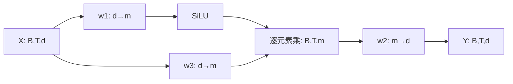

# 第 17 讲：RMSNorm 与 SwiGLU 论文及代码阅读

本讲追踪 Llama 2 的归一化与前馈网络。RMSNorm 调整每个 token 隐藏向量的整体幅度；SwiGLU 将两个可学习投影逐元素相乘，再投影回模型维度。原 notebook 完成了 RMSNorm 演示和 SiLU 演示，完整 SwiGLU 的代码来自本篇补充核对的 Meta 官方实现。**SiLU 是激活函数，SwiGLU 是含双分支的门控结构，两者不能作为同义词。**

## 1. 阅读边界、论文地图与版本

课程为 [llama2_src_02_RMSNorm_SwiGLU.ipynb](https://github.com/chunhuizhang/personal_chatgpt/blob/7fbc29824171fd07dc2c30fe922e61ebc018ad1d/tutorials/llama2_src_02_RMSNorm_SwiGLU.ipynb)，固定提交 `7fbc29824171fd07dc2c30fe922e61ebc018ad1d`，28 个单元，编号从 0 开始。历史输出只作为上游运行证据。课程没有锁定老师当时的 torch 版本。

| 论文 | 版本、问题与阅读位置 | 本讲对应内容 |
|---|---|---|
| [Root Mean Square Layer Normalization](https://arxiv.org/html/1910.07467v1)，Biao Zhang、Rico Sennrich | 2019-10-16 v1；§3 LayerNorm，§4 公式(4)与尺度性质，§5 partial RMSNorm，§6 实验 | 去掉减均值，保留均方根缩放；Meta 加 epsilon 和 FP32 计算 |
| [GLU Variants Improve Transformer](https://arxiv.org/html/2002.05202v1)，Noam Shazeer | 2020-02-12 v1；§2 公式(5)(6)，§3 T5 实验 | SwiGLU 双投影、逐元素乘法及三矩阵 FFN |
| [Swish: a Self-Gated Activation Function](https://arxiv.org/abs/1710.05941v1)，Ramachandran 等 | 2017-10-16 v1；课程链接的版本，后续 v2 标题为 Searching for Activation Functions | Swish 的 β=1 情况为这里使用的 SiLU |

课程不是上述论文实验的完整实现。本篇重点为公式、源码及可检验的小规模计算，未展开所有附录与下游评测。原论文 PDF 只保留本地；未找到现成中文论文译本。检查当前 E:/ 下 21 个 txt 后，未找到可可靠对应第 17 讲的独立字幕；`8771b843` 的内容对应第 15 讲，因此不将它冒用为本讲字幕。来源和文件哈希见 [来源清单](来源清单.json)。

官方实现固定为 [Meta model.py](https://github.com/meta-llama/llama/blob/7565eb6fee2175b2d4fe2cfb45067a61b35d7f5e/llama/model.py)，提交 `7565eb6fee2175b2d4fe2cfb45067a61b35d7f5e`。仓库地图如下：README/requirements 说明模型与依赖；示例 `example_text_completion.py`、`example_chat_completion.py` 调用 generation.py；tokenizer.py 处理文本；model.py 包含模型参数、Embedding、Attention、RMSNorm、FeedForward 与 TransformerBlock。损失、训练数据、optimizer 和完整训练入口在这个推理实现中未找到；权重由外部检查点提供。

实际调用链是 `示例 → Llama.build 加载配置和检查点 → completion/generate → Transformer.forward → TransformerBlock.forward → RMSNorm/Attention/FeedForward → 最终 norm 和 output → logits → 采样`。第 15 讲覆盖前后包装，本讲只展开 block 内两种模块。

## 2. LayerNorm 与 RMSNorm 在什么维度上计算

【必须会】课程单元 4 导入 NumPy、torch 与 `torch.nn as nn`。`as` 只是给模块一个短名称。单元 5 定义 batch_size=20、seq_len=5、embedding_dim=10，`torch.randn(20,5,10)` 返回通常为 float32 的随机张量 X。

| 变量 | 含义 | 类型及 shape |
|---|---|---|
| X / 代码 x | 20 个样本，每个含 5 个位置，每位置 10 个隐藏通道 | Tensor `[B,T,d]=[20,5,10]` |
| x[b,t,:] | 某个 token 的整个隐藏向量 | `[10]` |
| μ、v、RMS 分母 | 每个 token 的统计量 | 保留维度时 `[20,5,1]` |
| g / weight | 每个通道可学习的增益，所有样本和位置共享 | Parameter `[10]` |
| x_ln、x_rms | 归一化结果 | `[20,5,10]` |

最后维度 d 是通道，不是 batch。`mean(-1, keepdim=True)` 的 `-1` 指最后一轴；`keepdim=True` 保留长度为 1 的轴，便于将一个分母广播到该 token 的 10 个通道。广播是按兼容维度重复参与计算，不会把不同 token 的统计量混合。

LayerNorm 先将向量的中心移到 0，再调整幅度。本篇用工程表达式说明课程 API：

$$\mu_{bt}=\frac1d\sum_{i=1}^d X_{bti},\quad
v_{bt}=\frac1d\sum_{i=1}^d(X_{bti}-\mu_{bt})^2,$$
$$Y_{bti}=\gamma_i\frac{X_{bti}-\mu_{bt}}{\sqrt{v_{bt}+\epsilon_{LN}}}+\beta_i.$$

其中 b 是样本索引，t 是位置索引，i 是通道索引；γ、β 为 `[d]` 参数，默认初始化为 1、0。单元 7 的 `nn.LayerNorm(embedding_dim)` 只归一化最后的 10 维；默认 epsilon 为 1e-5。这里方差分母为 d，对应课程 `std(unbiased=False)`，不是样本统计常见的 d−1。

单元 8 的 `ln(x)` 会经过 Module 调用机制执行 forward。单元 9 分别打印 `[1,3,:]` 的均值和 `[1,2,:]` 的标准差，这实际上是两个不同 token。历史输出约 0、1，仅验证初始化时的一部分性质：加 epsilon 后标准差通常略小于 1，训练改变 γ、β 后不保证输出均值为 0、标准差为 1。不要把显示到四位小数的 1.0000 当作精确等式。

## 3. RMSNorm 公式与长度条件

【必须会】RMSNorm 不减均值。RMS 依次表示 Root、Mean、Square，但计算顺序是平方、平均、开平方。[论文 §4 公式(4)](https://arxiv.org/html/1910.07467v1#S4) 写为：

$$\operatorname{RMS}(\mathbf a)=\sqrt{\frac1n\sum_{i=1}^{n}a_i^2},\qquad
\bar a_i=\frac{a_i}{\operatorname{RMS}(\mathbf a)}g_i.$$

这里 a 是待归一化向量，n 是长度，g 是通道增益，均为实数；Llama 的 x 对应 a，dim=d 对应 n，weight 对应 g。Meta/课程实际实现多一个 epsilon：

$$s=\sqrt{q+\epsilon},\quad q=\frac1d\sum_{i=1}^{d}x_i^2,\quad y_i=g_i x_i/s.$$

例如 x=[3,4]，d=2，q=12.5，epsilon=0、g=[1,1] 时，s≈3.535534，y≈[0.848528,1.131371]。y 的均值约 0.989949，不为 0；长度为 √2。它保留方向，统一缩放幅度。

课程单元 3、17–18 关于 √n 的结论需要限定：x≠0、epsilon=0、g 全为 1 时，

$$\|\mathbf{x}/\operatorname{RMS}(\mathbf{x})\|_2^2
=\frac{\sum_i x_i^2}{(\sum_i x_i^2)/d}=d.$$

epsilon>0、仍取 g=1 时，长度平方为 `d q/(q+epsilon)`，非零向量的长度略小于 √d；x=0 时输出为 0。g 若全为 2，epsilon=0 时长度变成 2√d；g 各通道不同则会改变方向，长度不再由 d 单独决定。**学习后的 weight 不保证单位增益。**

课程单元 16 手动写 `x / sqrt(sum(x**2)/embedding_dim)`，省略 epsilon，和 `_norm` 严格不同。普通随机输入上差异很小，四位小数可能一致；接近零的输入差异会明显放大。本次 `[20,5,10]` 验证得到长度范围约 3.162268695–3.162277192，√10≈3.162277660，记录保留更多精度。

【建议会】忽略 epsilon 时，正比例放大 c>0 不改变归一化结果；c<0 会翻转符号，因为 `RMS(c x)=|c| RMS(x)`。加 epsilon 后正比例不变性也只是近似。统一加常数通常改变 RMSNorm 输出，因为它没有去中心操作。LayerNorm 的去均值部分可以消除这种平移。不要把输入不变性扩大到任意通道独立缩放。

## 4. RMSNorm 类逐段解释

课程单元 11 的核心实现与官方对象一致。公开文档只保留这些必要语句，完整单元入口见 [原代码](https://github.com/chunhuizhang/personal_chatgpt/blob/7fbc29824171fd07dc2c30fe922e61ebc018ad1d/tutorials/llama2_src_02_RMSNorm_SwiGLU.ipynb)：

```python
self.eps = eps
self.weight = nn.Parameter(torch.ones(dim))
output = self._norm(x.float()).type_as(x)
return output * self.weight
```

`class RMSNorm(torch.nn.Module)` 表示这个类继承 Module 的参数注册和调用能力。`__init__` 为构造方法，`self` 是当前实例，`super().__init__()` 初始化基类。`nn.Parameter` 将长度 dim 的 ones 注册成可训练参数；普通 Tensor 属性不会自动作为优化器参数。`self.eps` 是常量配置，不是可学习参数。

`_norm(self,x)` 是实例方法，名字前的下划线表示内部辅助方法约定。它的核心步骤如下：

1. `x.pow(2)`：逐元素平方，`[B,T,d]`。
2. `.mean(-1,keepdim=True)`：求通道平均，`[B,T,1]`。
3. `+self.eps`：在均方上加稳定项。
4. `torch.rsqrt(...)`：平方根的倒数，`[B,T,1]`。
5. 原 x 乘倒数：广播缩放，`[B,T,d]`。

`forward(self,x)` 接受浮点 Tensor；返回同 shape 的归一化张量。`.float()` 将统计计算提升到 float32，降低低精度平方/累加的风险；`.type_as(x)` 将归一化中间结果转回输入 dtype，再乘 weight。最终乘法的 dtype 还受 weight dtype 与类型提升规则影响，不能仅凭 `type_as` 保证最终输出一定为 x.dtype。模型参数与输入精度通常一致，但本次 NumPy float64 验证没有测试这个行为。

默认构造 `RMSNorm(dim,eps=1e-6)` 有 dim 个参数，没有 beta/bias，也没有 BatchNorm 的 running_mean。forward 不修改 weight 或 eps；训练时 autograd 记录运算，optimizer 在后续 step 更新 weight。train/eval 切换不会在这个模块中启用不同统计规则。单元 12–13 用 dim=10 创建模块并调用；14–18 展示一个 token 的原值、结果、手算及 L2 长度。

【建议会】归一化会把各通道通过公共分母关联起来。对单向量，用 `s=sqrt(mean(x²)+epsilon)`，Kronecker delta δij 在 i=j 时为 1，其余为 0：

$$\frac{\partial y_i}{\partial x_j}
=g_i\left(\frac{\delta_{ij}}s-\frac{x_i x_j}{d s^3}\right).$$

Jacobian 是 `[d,d]`；上游梯度与它相乘得到输入梯度 `[d]`。本次用 d=3、非统一 g 与中心差分验证，最大绝对误差约 1.84e-10。这是对带 epsilon 工程公式的推导，不是运行 torch.autograd。

## 5. SiLU 曲线与 notebook 20–27

【必须会】激活函数让模型超出线性变换的表达范围。SiLU 对每个输入标量 z 计算：

$$\sigma(z)=\frac1{1+e^{-z}},\qquad \operatorname{SiLU}(z)=z\sigma(z).$$

σ 是 sigmoid，z 是标量或任意 shape 的张量，输出 shape 不变。一般 Swish 写为 `z sigmoid(βz)`，β 是斜率系数；Llama `F.silu` 使用 β=1，没有可学习 β 参数。可计算 SiLU(−2)≈−0.238405844，SiLU(0)=0，SiLU(2)≈1.761594156。sigmoid 在 (0,1)，但 SiLU 自身可以为负，也不限制在 (0,1)。

单元 21 定义 NumPy `sigmoid` 与 `swish` 普通函数，无 self，因为不属于类。`np.exp(-x)` 对数组逐元素指数。单元 22 设置 matplotlib dpi=120；23 的 `np.arange(-5,5,.01)` 生成横坐标（右端不包含 5），画 `swish(x)`。原历史曲线展示负侧下凹、正侧渐近直线；坐标是输入/激活值，不是训练 loss、准确率或速度。

单元 24 重新将变量 x 赋为 `torch.randn(5)`，它此时是 `[5]` torch Tensor，不再是绘图用 NumPy 数组。25 手写 `x/(1+torch.exp(-x))`，26 导入 functional 为 F，27 `F.silu(x)` 展示相同历史结果。默认 `inplace=False`，不会将 x 原地覆盖；函数没有持久参数或训练/推理分支。

【建议会】其导数为 `σ(z)+zσ(z)(1−σ(z))`。负半轴并非始终单调；它和 ReLU 的负半轴直接归零不同。这个数学差异不足以证明它在所有任务中都更好。对于很大的负输入，朴素 NumPy `exp(-x)` 可能溢出；本篇固定的小值范围不测试极值，生产实现应依赖稳定 kernel。

## 6. 完整 SwiGLU：三个 Linear 与 shape 流

【必须会】论文公式(6)包含三个矩阵，无 bias；Llama 对应为：

$$U=XW_1^\top,\quad V=XW_3^\top,\quad
H=\operatorname{SiLU}(U)\odot V,\quad Y=HW_2^\top.$$

X 为 `[B,T,d]`，m 是 FFN 的中间宽度；PyTorch 权重存储为 W1、W3 `[m,d]`，W2 `[d,m]`。⊙ 为逐元素乘，矩阵投影则是 matmul。论文用行向量乘矩阵的另一种记号，不要据此把 PyTorch 存储方向写反。

| 步骤 | 官方对象 | shape / 意义 |
|---|---|---|
| 投影 1 | w1(x) | `[B,T,d]→[B,T,m]`，门控分支 |
| 非线性 | F.silu | `[B,T,m]`，逐元素激活 |
| 投影 3 | w3(x) | `[B,T,d]→[B,T,m]`，内容分支 |
| 相乘 | `*` | 两个 `[B,T,m]` 对位相乘 |
| 投影 2 | w2 | `[B,T,m]→[B,T,d]`，恢复残差通道数 |

官方 `FeedForward.forward(self,x)` 的核心是 `self.w2(F.silu(self.w1(x)) * self.w3(x))`。命名 w2 对应最终投影，执行顺序并不是 w1→w2→w3。两个分支都从同一个 x 出发，权重独立；这里的门控不是 sigmoid 概率，也没有 softmax。



箭头表示张量流，不表示参数共享；w1/w2/w3 有参数，SiLU 和乘法没有可学习状态。B、T 均保留，所以每个位置使用同一套权重独立计算；不同 token 之间的信息交互主要由 attention 完成。训练和推理前向相同，反向时梯度分别流入两个分支。

最小例子取一个 token x=[1,−1]，m=2，w1 为单位矩阵，w3 为 2 倍单位矩阵，w2 为单位矩阵。U=[1,−1]、V=[2,−2]、SiLU(U)≈[0.731059,−0.268941]，Y≈[1.462117,0.537883]。单独 SiLU(x) 与这个 Y 不同，第二个投影分支对结果有实质影响。

官方 w1/w3 用 FairScale `ColumnParallelLinear(...,gather_output=False)`，w2 用 `RowParallelLinear(...,input_is_parallel=True)`。上表给出模型逻辑维度；若模型并行组大小为 p，中间分支各 rank 一般保留 m/p 通道，再由最终投影完成所需通信。不能把本次单机 NumPy 等式验证称为验证了这种分布式行为。

构造函数的 `dim` 为 d，`hidden_dim` 先收到 `4*dim`，`multiple_of` 控制对齐，`ffn_dim_multiplier` 可选且默认 None。三个权重均 `bias=False`。forward 返回 `[B,T,d]`，不在内部更新参数；optimizer 更新发生在训练调用方。`init_method=lambda x:x` 是原实现留给检查点载入路径的初始化设置，不能把随意创建的未加载模型当成有效的随机初始化实验。

## 7. 4096 为什么得到 11008

【建议会】普通两矩阵 FFN 中间宽度 4d，无 bias 时参数为 `d(4d)+(4d)d=8d²`。三矩阵 SwiGLU 的参数为 3dm。令两者近似相等，得到 `m=(8/3)d=(2/3)(4d)`。官方先将 hidden_dim 乘 2/3、取整数，再应用可选 multiplier，最后向上对齐 multiple_of。

对 d=4096、multiple_of=256、multiplier=None：`int(2*16384/3)=10922`，向上取 256 的倍数为 11008。因此单层参数为 135,266,304，普通 4d FFN 为 134,217,728；对齐增加 1,048,576，约 0.78125%。这是参数量推导，不是 FLOPs、耗时或显存测量。

这些构造字段需要与真实检查点配置匹配。不要将此宽度公式未经核对地用于 Llama 2 所有规模或后续 Llama 版本。

## 8. 放回 TransformerBlock 与实验依据

【必须会】官方 block 使用 pre-norm：`h=x+Attention(attention_norm(x),...)`，接着 `out=h+FeedForward(ffn_norm(h))`。残差加法两边都必须为 `[B,T,d]`。两个 norm 是不同实例、各有自己的 weight。归一化在子层前；官方部分说明字符串称“output normalization”，应以执行语句为准。Transformer 所有 block 后还有最终 RMSNorm，再接输出词表投影。

RMSNorm 论文图 1 对照按训练步数与按时间观察 loss：同一步数的收敛改善不直接等于同样的墙钟效率。论文并未提供本讲机器上 Llama 2 的速度数据。SwiGLU 论文的比较在 T5/C4 span-filling 环境进行，三矩阵版本缩小中间维度以匹配参数和计算量。本讲未复现该实验；其结果只支撑论文所研究条件下的效果，不能据此给当前 Llama 2 推理速度或所有任务质量下结论。这里的 SiLU 曲线更不能充当质量评测。

## 9. 学习优先级与 Paper ↔ Code

**必须掌握**：统计量沿最后通道轴计算；RMS 与 L2 的 √d 因子；epsilon/weight 破坏无条件定长结论；SiLU 与 SwiGLU 区别；三个矩阵的 shape、逐元素乘法与 pre-norm 残差路径。

**第二遍**：广播、FP32 统计与 dtype 回转；RMSNorm Jacobian；SiLU 导数；参数公平比较及 11008 宽度推导；为什么平移和缩放是不同性质。

**可以暂时不掌握的工程细节**：FairScale 的具体通信、融合 kernel、低精度误差、论文训练全集复现、pRMSNorm 的抽样估计。本版本 Llama 使用完整 RMS，不是 pRMSNorm。

| Paper ↔ Code 项目 | notebook / 官方位置 | 证据与边界 |
|---|---|---|
| RMSNorm 公式(4) | 单元 11；官方 RMSNorm._norm | 同类归一化，工程实现增加 epsilon |
| 增益 g | RMSNorm.weight | `[d]` 可学习 Parameter，无输出定长保证 |
| partial RMSNorm §5 | 未找到 | notebook 和此版官方 _norm 都用最后维度全部通道 |
| Swish β=1 / SiLU | 单元 21、25、27 | 手写与 F.silu；无可学习 β |
| GLU 公式(5)(6) | 官方 FeedForward.forward | 两投影相乘再投影；原 notebook 未找到完整实现 |
| 中间宽度 2/3 | FeedForward.__init__ | 额外 multiplier 与倍数对齐需核对配置 |
| 训练/benchmark | 未找到 | 课程本讲没有 loss/optimizer/数据训练链 |
| 中文论文译本与独立字幕 | 未找到 | 保留上述检查范围，不补造来源 |

## 10. 复现状态、证据和未解决问题

**复现状态：部分成功。** [复现命令及环境](复现/README.md)、[验证脚本](复现/scripts/verify.py)、[结果](复现/outputs/教学验证.json) 可查。本次 CPU NumPy 1.26.4 验证 shape、均值、长度条件反例、零输入、尺度/平移性质、完整 SwiGLU 和两种输入梯度。RMSNorm 与 SwiGLU 梯度最大绝对误差分别约 1.84e-10、4.16e-10。

官方 FeedForward.forward 从固定源码 AST 提取后绑定 NumPy 线性/SiLU fixture，输出与公式计算最大差为 0。这验证连接顺序，不验证官方类构造、torch kernel 或 FairScale 通信。本次使用 float64、seed=17；原 notebook 随机数未固定。历史结果与本次结果分别记录，没有冒称重跑原 notebook。

未运行真实 PyTorch forward/autograd、FP16/BF16、模型生成或论文训练评测。默认 Anaconda torch 缺少 Tensor 接口，当前采用独立 NumPy 环境；没有下载大模型权重。仍未确定老师当时的依赖版本、独立第17讲字幕与实际检查点配置，也没有证据报告本机吞吐提升。公式及固定源码映射置信度高；低精度行为、训练收益和速度结论尚无本次运行证据。
