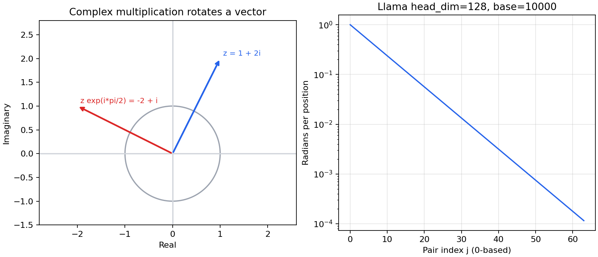

# 第 18 讲：RoPE 复数形式与频率预计算

复数在这里提供二维旋转的简洁计算方式：把相邻两个实数通道看作一个复数，乘以模长为 1 的复数，就能按指定角度旋转这两个通道。Llama 2 将位置映射为旋转角，再对 Q/K 使用这个旋转。本讲先读复数表示与频率表；第 19 讲继续展开 `apply_rotary_emb` 的完整张量操作。

**本讲两个重要区别**：传统位置表 `[sin,cos]` 可以用复数表示重建，但重建位置表不等于完成 RoPE；复数写法减少了数组维数中的元素个数，却没有自动减少实数存储量。

## 1. 论文与代码入口

[主讲详细注释](代码/tutorials/代码注释.ipynb)、[主讲Python阅读版](代码/tutorials/llama2_src_03_RoPE_01_complex_position_encoding_代码注释.py)和[全部58格说明](代码单元解释.md)已发布；配套总览同样有[注释notebook](代码/tutorials/代码注释_RoPE总览.ipynb)及[Python阅读版](代码/tutorials/llama2_src_03_RoPE_代码注释.py)。

主材料是 [complex_position_encoding notebook](https://github.com/chunhuizhang/personal_chatgpt/blob/7fbc29824171fd07dc2c30fe922e61ebc018ad1d/tutorials/llama2_src_03_RoPE_01_complex_position_encoding.ipynb)，固定提交 `7fbc29824171fd07dc2c30fe922e61ebc018ad1d`，29 个单元，编号从 0 开始。配套 [RoPE 总览](https://github.com/chunhuizhang/personal_chatgpt/blob/7fbc29824171fd07dc2c30fe922e61ebc018ad1d/tutorials/llama2_src_03_RoPE.ipynb) 也有 29 个单元，用来核对公式与频率示例，用于配套阅读。

关联论文为 Su 等的 [RoFormer: Enhanced Transformer with Rotary Position Embedding](https://arxiv.org/abs/2104.09864v4)，课程指定 v4，2022-08-09。§2 是绝对/相对位置背景，§3.1 提出相对位置目标，§3.2 给出二维和多维旋转，§3.3–3.4 讨论性质及推导，§4 为实验。本篇关注 §3.1–3.2 与实际频率计算，长距离性质、实验全集不作为本次复现目标。原论文 PDF 保留本地，未找到现成中文论文译本。

实现固定为 [Meta model.py](https://github.com/meta-llama/llama/blob/7565eb6fee2175b2d4fe2cfb45067a61b35d7f5e/llama/model.py)，提交 `7565eb6fee2175b2d4fe2cfb45067a61b35d7f5e`。本文的代码追踪对象是 Llama 2 推理实现；论文作者的 [RoFormer 仓库](https://github.com/ZhuiyiTechnology/roformer) 是另一条实现路线，README 指向 bert4keras，不能把它与本篇 torch 代码的依赖或检查点混用。

本讲使用 Python3.12.14、torch2.5.1+cpu、NumPy1.26.4、matplotlib3.9.4。来源见[来源清单](来源清单.json)，逐格阅读从[原代码](https://github.com/chunhuizhang/personal_chatgpt/blob/7fbc29824171fd07dc2c30fe922e61ebc018ad1d/tutorials/llama2_src_03_RoPE_01_complex_position_encoding.ipynb)开始。

## 2. 仓库地图与数据路径

| 文件/对象 | 所处位置与作用 | 本讲范围 |
|---|---|---|
| 课程 notebook | 导入 torch/NumPy，构造位置表，画单位圆 | 全部代码单元真实运行 |
| Meta README、requirements | 模型加载与依赖说明 | 依赖没有完整版本锁定 |
| example_text_completion / example_chat_completion | 文本示例入口 | 参见第 15 讲 |
| tokenizer.py、generation.py | 文本编码、加载配置、迭代生成 | 本讲不运行 tokenizer 或生成 |
| Transformer.__init__ | 调用 precompute_freqs_cis | 核对 head_dim 与 end |
| Transformer.forward | 按 start_pos 切出当前频率段 | 核对绝对位置索引 |
| Attention.forward | Q/K/V 投影、按 head reshape、旋转 Q/K | 只定位调用关系 |
| precompute_freqs_cis | 生成单位复数频率表 | 本讲核心函数 |
| apply_rotary_emb / reshape_for_broadcast | 通道配对、广播、复数乘法 | 详细代码归第 19 讲 |
| 数据训练、loss、optimizer | 在本讲和 Meta 推理入口中未找到 | 本讲聚焦推理 |

模型路径为 `文本 → tokenizer → tokens → embedding → Q/K 投影 → head reshape → RoPE → attention → logits → 采样`。频率表沿另一条路径提前构造：`配置 → head_dim/end → 频率向量 → 位置×频率 → 单位复数表 → 当前位置切片 → Q/K 旋转`。频率表不来自训练数据，也不是学习得到的 embedding 参数。

## 3. 为什么注意力需要位置

【必须会】如果只用内容投影 Q/K/V，在没有位置机制与其他顺序约束时，自注意力对 token 排列具有置换等变性：重排输入会对应重排输出，无法单凭内容辨别顺序。Llama 还使用 causal mask，但本讲要解释的是显式的位置旋转。

取一个 head，位置 m 的 query 为 q，位置 n 的 key 为 k，二者都为实数向量 `[d]`。注意力分数的核心是点积 `qᵀk`，通常再除以 √d。目标是让内容和位置共同影响分数，而且显式位置因子可以写成位置差的函数。这不表示注意力分数只由位置差决定：q/k 内容仍然参与计算，上层隐藏状态也可能已含位置信息。

记 m、n 为整数位置，d 为 head 通道数；大模型模型宽度记为 D，避免把二者混淆。Llama 2 7B 的 D=4096、head 数 H=32，因此 d=D/H=128。主 notebook 的教学例子使用 d_model=6，它是独立演示维度；实际传给 `precompute_freqs_cis` 的 dim 是 head_dim，不是 4096。

## 4. 复数、单位圆和二维旋转

【必须会】复数 `z=a+ib` 表示平面点 `[a,b]`，a 为实部、b 为虚部、i²=−1。Python 为避免与普通变量 i 混淆，使用 `1j` 表示虚数单位。`1+2j` 与二维向量 `[1,2]` 对应；`np.real`、`np.imag` 取出两部分。

Euler 关系为

$$e^{i\alpha}=\cos\alpha+i\sin\alpha,$$

α 是弧度；两部分的平方和等于 1，因此它在单位圆上。`e^(a+ib)=e^a(cos b+i sin b)`，实部指数 a 控制半径，虚部 b 控制角度。单元 2 的 `e^(iπ)+1=0` 是 α=π 的特殊情况，并非模型的额外计算步骤。

单元 5 用 `np.linspace(0,2*np.pi,500)` 生成含两端的 500 个角度；`np.exp(1j*thetas)` 返回 `[500]` complex128 数组。实部 xs、虚部 ys 都为 `[500]` float64。`plt.plot(xs,ys)` 画轨迹，`axis('equal')` 保持两轴单位长度一致，避免视觉上将圆拉成椭圆。这里没有训练参数、样本标签或质量指标。

为什么复数乘法是旋转？直接展开：

$$ (a+ib)(\cos\alpha+i\sin\alpha)
=(a\cos\alpha-b\sin\alpha)+i(a\sin\alpha+b\cos\alpha). $$

等价的实数运算是

$$\begin{bmatrix}a'\\b'\end{bmatrix}
=\underbrace{\begin{bmatrix}\cos\alpha&-\sin\alpha\\\sin\alpha&\cos\alpha\end{bmatrix}}_{R(\alpha)}
\begin{bmatrix}a\\b\end{bmatrix}.$$

R 是 `[2,2]` 正交矩阵，只旋转，不改变长度；正角按通常的实轴向右、虚轴向上约定逆时针旋转。例如 z=1+2i，α=π/2，乘以 i 得到 −2+i，即 `[1,2]→[−2,1]`，长度都为 √5。

这张图由本篇脚本计算绘制。左图蓝箭头是输入 z，红箭头是乘 `exp(iπ/2)` 后的结果，灰圆表示半径 1，不是 z 的长度。右图横轴是 0 起始的通道对编号，纵轴为每前进一个位置旋转的弧度，对数坐标呈下降直线。两幅图都是数学示意，不是论文实验曲线。

## 5. 单元 8–15：实数 sin/cos 位置表

【必须会】传统位置表对相邻通道用同一频率。为避免把虚数单位 i 与通道索引混淆，下面用 j 表示通道对编号：

$$\omega_j=b^{-2j/d},\quad j=0,\ldots,d/2-1,$$
$$PE(t,2j)=\sin(t\omega_j),\qquad PE(t,2j+1)=\cos(t\omega_j).$$

这里 b=10000 是正数频率基数，t=0,…,T−1 是位置，d 为偶数。ω `[d/2]` 是弧度/位置；PE `[T,d]` 是 float32 位置特征。本例 T=10、d=6，有三个频率，约为 `[1,0.046415884,0.002154434]`。位置 0 的一行是 `[0,1,0,1,0,1]`；位置 1 的首对约为 `[0.841471,0.540302]`。

| 单元/API | 一句话作用与 shape | 关键语法 |
|---|---|---|
| 8 | max_sequence_length=10，d_model=6 | Python int 配置 |
| 9：arange | 偶数索引 `[0,2,4]`，奇数索引 `[1,3,5]`，均 `[3]` | 右端不包含；`.float()` 转 float32 |
| 10：position | 位置 `[0,…,9]`，shape `[10]` | 指定 `dtype=torch.float32` |
| 11：pow、倒数 | `1/10000^(even_i/d_model)` 得到 ω `[3]` | `/d_model` 必须保留 |
| 11：outer、sin | `[10]` 与 `[3]` 外积成 `[10,3]` 角度，再逐元素 sin | outer 不是点积；不会对 j 求和 |
| 12：outer、cos | odd_i−1 得到同一 `[0,2,4]`，生成 `[10,3]` cos | 奇偶配对共用频率 |
| 13：stack | 两张表在新轴 dim=2 上堆叠，`[10,3,2]` | 最后一轴是 `[sin,cos]` |
| 13：flatten | 合并轴 1、2，`[10,6]` | 保留位置轴，不做数值归约 |

这段代码只返回位置表，不含输入 token embedding。若在传统 Transformer 中使用，还需在外部将 PE 加到表示上。它不会因为同时有 sin/cos 就自动变成 RoPE。

### SinPositionEncoding 类是什么

单元 14 的 `class SinPositionEncoding(nn.Module)` 继承 Module，`__init__` 接收 max_sequence_length、d_model 和默认 base=10000。`self` 指实例；`super().__init__()` 初始化父类。三个字段为普通配置，没有 `nn.Parameter`，本次参数计数确认为 0。

`forward(self)` 没有输入 x，返回 float32 `[T,d]` 表，不修改配置。`spe=SinPositionEncoding(10,6)` 创建对象，单元 15 的 `spe()` 通过 Module 调用机制执行 forward。每次调用重新构造 arange 与表，并非将结果缓存成 buffer。源码没有显式 device 参数，依赖 torch 默认设备；本次默认 CPU。`train()`/`eval()` 不改变这段代码的计算规则。

【建议会】d 必须为正偶数。单元 14 未检查这个条件：d=5 时 even_pe 有三列、odd_pe 两列，stack 无法堆叠，本次真实报错已保存。这不是 torch 不支持奇数模型宽度，而是此处按二通道配对实现需要偶数维。

## 6. 单元 19：precompute_freqs_cis 一行一行追踪

【必须会】该函数生成的是单位旋转因子，不是已经旋转的 Q/K。名字 `precompute` 表示提前算好，`freqs` 表示频率/相位表；`cis` 为 cosine + i sine。源码变量 freqs 中途复用，第一次是频率、第二次是角度，不能一直把它理解为同一张量。

| 对象 | 输入、默认值与返回 | 状态和调用位置 |
|---|---|---|
| precompute_freqs_cis | dim:int 偶数维度，end:int 位置数量，theta:float=10000.0 | 普通模块级函数，无 self、无参数更新 |
| 返回 freqs_cis | complex64 `[end,dim/2]`，每元素模长约 1 | 由 Transformer 初始化调用；主 notebook 添加了两次 shape 打印 |

这里参数 theta 是频率基数 b，**不是每个通道的旋转角**。论文中 θj 常表示频率；相同字母在源码里换了含义。角度真正为 tωj，单位是弧度。

1. `torch.arange(0,dim,2)` 产生偶数通道索引 `[0,2,…,dim−2]`。`[:dim//2]` 取前 dim/2 项，`//` 是整数除法，偶数 dim 时本来就有这么多项。
2. `.float()/dim` 给出指数 `[0,2/d,…,(dim−2)/dim]`，float32 `[dim/2]`。
3. `1.0/(theta**指数)` 得 ω `[dim/2]`。`**` 为逐元素幂，1.0 与张量的运算返回张量。
4. `torch.arange(end,device=freqs.device)` 得 t `[end]`，本次 int64 CPU。`.device` 使位置与频率处于同一设备。`# type: ignore` 只影响静态类型检查，不改变运行。
5. `torch.outer(t,freqs).float()` 得角度 A `[end,dim/2]`，A[t,j]=tωj。它重新赋值给 freqs。
6. `torch.ones_like(freqs)` 得同 shape、dtype 和设备的半径 1；`torch.polar(半径,角度)` 返回 `cos(A)+i sin(A)`。float32 两部分组成 complex64。

单元 21 调用 dim=6、end=10，打印两次 `[10,3]`：一次为实数角度表，一次为复数表。shape 相同，dtype 不同。t=0 行是 `[1+0j,1+0j,1+0j]`；t=1 行首个元素是 `0.540302+0.841471j`。函数不是把 dim 变小后丢掉一半信息，而是把两个分量放进一个复数元素。

### 为什么指数不能漏掉 /dim

配套总览单元 21 的公式省略 `/dim`，单元 25 手写 `10000**arange(0,6,2)`，频率变成 `[1,1e-8,1e-16]`。正式函数的 `[1,约0.0464,约0.00215]` 与之不同。第二、三对通道几乎不随位置变化，并非新的等价写法。本次用同一位置范围比较，早期验证统一end10时复数表最大差约0.414711982；新验证直接比较总览原end5两份表，差约0.185396954。两者的位置范围不同，数值不能混用。

正式代码的正确零起始公式为 `b^(-2j/d)`。论文一始编号写 `10000^(-2(j−1)/d)`；只要索引约定一致，它们相同。配套总览所写 `0<epsilon<2π/N` 也不是 Meta 函数的条件：这里没有单一 epsilon 参数，不要求所有频率在整个序列内不足一圈。

## 7. 单元 22、26–27：flip 为什么只属于重建位置表

【必须会】`torch.view_as_real(freqs_cis)` 使 `[10,3]` complex64 变成 `[10,3,2]` float32，最后两项按 `[实部,虚部]=[cos,sin]` 排列。它是张量的实数视图，通常共享底层数据，并非求实部丢弃虚部。

要与第 5 节传统 PE 的 `[sin,cos]` 顺序一致，单元 22 在轴 2 做 `torch.flip(...,dims=(2,))`，得到 `[sin,cos]`，再 flatten 为 `[10,6]`。`(2,)` 是含一个元素的 tuple，尾逗号用于保留元组语法。flip 是反转指定轴，不是转置轴。

单元 26 **重新定义同名类** `SinPositionEncoding`，后面的名字指向新类，旧 spe 对象不会自动改变实现。新 forward 用一次 outer/polar/view_as_real/flip/flatten 得到传统表。单元 27 再新建 spe 调用它。本次将两个类版本分别保存后比较，最大误差约 5.96e-8，属于 float32 三角计算路径的微小差异；不能要求逐 bit 相等。

Llama 实际把 q 的通道对 `[q0,q1]` 看作 `q0+iq1`。乘 `cos+i sin` 后，`view_as_real` 返回 `[旋转后q0,旋转后q1]`，**不要额外 flip**。若为了复用传统表随意交换顺序，就会改变通道配对约定。本讲重建传统表的成功，不表示 notebook 已运行真实模型的 apply_rotary_emb。

### 第二个类依赖了外部d_model

【必须会】单元26原句是 `freqs = torch.outer(position, 1./torch.pow(self.base, even_i/d_model))`。even_i根据self.d_model创建，分母却读取模块外的全局d_model。构造时保存的self.d_model和全局同名变量是两个对象引用，Python不会自动把裸名字解释成实例字段。

本例全局和实例都为6，错误没有显现。本次实际构造实例d=4、全局仍6，相比正确实数表最大误差0.315820；把全局改成12，同一实例输出又改变约1.27394；删除全局时真正抛出NameError。它不是一个可独立使用的完整位置表类。

注释版原语句不改。验证脚本在单独教学变体中，只将forward里的这一处Name(d_model)替换为Attribute(self.d_model)，构造函数及其他原语句保持不变。实例宽度2、4、6、8均与正确实数类在float32容差内一致，最大误差5.96e-8。这个修正仍不提供奇数维检查：原实数类d5因stack列数3与2不同而报错，原复数类d5输出[10,6]，官方precompute dim5返回[10,2]；均不构成正确的完整五维配对。

【建议会】complex64 的一个元素含两个 float32，共 8 字节；两个 float32 也共 8 字节。本例 `[10,3]` complex64 为 240 字节，`[10,3,2]` float32 视图同样为 240 字节。数组元素个数减半，不等于内存减半；视图共享和后续 flip 的额外分配要分别考虑。

## 7.1 原配图中的两种通道布局

配套总览单元19展示的是[原代码截图](代码/imgs/hf_llama_rope.png)，不是结构箭头图。截图函数已经[转录并加中文注释](代码/配图_RoPE源码阅读.py)，来源是固定上游PNG；未找到截图对应的HuggingFace commit，不把它当作当前HF版本或Meta源码。

`rotate_half(x)`沿末维取前后各d/2个通道，返回cat(-x2,x1)。例如d6的通道对为(0,3)、(1,4)、(2,5)，而Meta复数view使用相邻(0,1)、(2,3)、(4,5)。两种写法可以在一致的基底排列下等价，但直接混用会旋转错误的通道。

截图的q/k布局为[B,H,T,d]；cos/sin初始[1,1,L,d]经过squeeze成为[L,d]，position_ids[B,T]选取后为[B,T,d]，unsqueeze(1)插入head轴为[B,1,T,d]，广播到不同head。q*cos+rotate_half(q)*sin输出同shape；k同理，不旋转V或更新权重。这里cos/sin的d列须为频率前后两半重复，不能把交错的传统位置表直接传入。

本次实际运行转录函数，q[2,2,3,6]、k[2,1,3,6]，位置[[1,3,7],[2,4,9]]。把相邻布局按[0,2,4,1,3,5]转为半区布局，旋转后再用逆排列[0,3,1,4,2,5]恢复，与复数相邻旋转的q/k结果精确一致。直接混用布局的最大差为1.59950。此结果验证这两段小函数与排列关系，没有执行HF或Meta完整模型。

## 8. 绝对旋转为何产生相对位置

【必须会】取二维内容向量 q=[a,b]、k=[c,d0]，其复数为 zq=a+ib、zk=c+id0。实数点积需写成

$$q^\top k=\operatorname{Re}(z_q\overline{z_k}).$$

横线表示共轭，将虚部变号。直接 `Re(zq zk)=ac−bd0`，不是点积 `ac+bd0`。配套总览单元 3 的简写遗漏内容共轭和取实部，不能按普通乘法照抄。

按绝对位置分别旋转：zq'=zq exp(imω)，zk'=zk exp(inω)。于是

$$\operatorname{Re}(z_q'\overline{z_k'})
=\operatorname{Re}\left(z_q\overline{z_k}e^{i(m-n)\omega}\right).$$

每个频率 ω 是固定常数，显式位置因子只剩 m−n。实数矩阵写法则是

$$ (R(m\omega)q)^\top(R(n\omega)k)
=q^\top R((n-m)\omega)k.$$

这里一个式子出现 m−n、另一个出现 n−m，是共轭乘积和“把相对旋转作用于 k”的表示差异，两式等价。若在固定的同一写法里随意改符号则通常错误。对偶数 d，将各相邻二通道的贡献求和；不同通道对各自有 ωj，不需要构造完整 `[d,d]` 稀疏矩阵。

本次数值例取 d=6，q=[0.3,−1.2,2,0.5,−0.7,0.8]，k=[1.1,0.4,−0.6,1.5,2,−0.3]，m=3、n=7。分别旋转后点积约 −1.491560535；复数相对式和矩阵相对式给同一结果。把两位置都加 11，点积仍在误差内相同。去掉内容共轭的错误表达得到约 −2.183718050，证明共轭不是可省略的装饰。

相对点积的推导固定 q/k 内容和旋转规则，只改变位置编号。完整模型还会使用 mask、窗口边界和历史上下文。

## 9. 回到 Llama 的 dim、end 与切片

【必须会】官方 Transformer 初始化传入 `params.dim//params.n_heads` 和 `params.max_seq_len*2`。前者是 head_dim，后者是预计算表的行数。例如 D=4096、H=32、运行配置 max_seq_len=1024，频率表为 `[2048,64]` complex64。

end 表示位置 `0,…,end−1`，不是包含 end 的端点。乘 2 是这版代码的预留表大小，不能把它直接视为允许生成两倍长度的模型保证。运行时约束还涉及 max_seq_len、KV cache、生成参数和训练长度。单元 20 把 end 简述为 max_sequence_len，只是本 notebook 独立调用的设定，不能代替官方调用方。

Transformer.forward 取 `freqs_cis[start_pos:start_pos+seqlen]`，得到 `[当前T,d/2]`。start_pos 是当前片段的绝对起始位置。随后 Attention 先用 wq/wk/wv 投影，再 reshape 为 `[B,T,H,d]`（GQA 的 K/V head 数可以不同），仅对 Q/K 调用旋转；此版不将 RoPE 作用于 V。每个 head 共享相同的固定频率规则，不是每个 head 学一张不同位置表。

固定官方ModelArgs默认max_seq_len=2048，因此本次真正运行官方函数时，默认D4096/H32得到[4096,64] complex64，大小2097152bytes；这只是频率表，不加载7B权重，也不实例化Transformer。另核验start_pos7、当前长度3的切片为[3,3]；把这段错误重置为位置0..2会使旋转因子最大差0.701566，增量计算仍需绝对位置一致。

【建议会】本篇真正运行了单位表与小型旋转，以及 `torch.polar` 对角度的 autograd与complex gradcheck。它没有运行 Attention、KV cache 或 CUDA kernel。FP32 的 complex64 用于预计算，本篇验证相对位置等式采用 float64/complex128 以减少舍入误差；这不等于检验了实际 FP16/BF16 模型输出。

## 10. 论文实验应如何理解

论文图 1 说明成对旋转及 Q/K 在 attention 处汇合；本篇自绘图只说明二维几何与频率。原 notebook 单位圆图和打印的 PE 表，没有数据集、任务标签、baseline 或性能指标，因此不是证明模型更准确的实验。

RoFormer 的任务实验还包括模型、数据和训练设置。本节关注频率与旋转：位置表可按公式延长，模型能用多长的上下文则要结合训练配置和评测判断。单频率例子 q=k=[1,0] 给出 cos(Δω)，分数随距离振荡。

## 11. 必须掌握、第二遍与 Paper ↔ Code

**必须掌握**：复数与实数二通道对应；Euler 公式和单位模长旋转；频率 `base^(-2j/d)`；outer/stack/flatten 的 shape；重建 `[sin,cos]` 表与旋转 Q/K 的区别；共轭、取实部及位置差；dim 是 head_dim。

**第二遍**：float32/complex64 存储、view 与 flip；同名类重新定义；偶数维前提、end 非包含端点；m−n 与 n−m 的等价约定；位移不变性的适用范围；实际 torch.autograd 的证据。

**可以暂时不掌握的工程细节**：模型并行、复数 tensor stride 约束、低精度 kernel、长上下文缩放策略、论文完整训练。第 19 讲会展开广播与 apply_rotary_emb。

| Paper ↔ Code / 概念 | notebook / 官方对象 | 对应与缺口 |
|---|---|---|
| 二维复数表示 | 单元 2、5 | Euler 与单位圆，没有模型参数 |
| sin/cos 基础位置表 | 单元 7–15 | 作为对照；尚未加到任何 token embedding |
| §3.2 二维旋转形式 | 单元 19 的 cis，本文数值旋转补充 | 频率因子对应 exp(itω)，原主 notebook 未执行 Q/K 旋转 |
| §3.2 多频率配对 | precompute_freqs_cis | dim/2 个频率，指数保留 /dim |
| 传统表的复数重建 | 单元 22、26–27 | flip恢复sin/cos；26的全局d_model依赖另以一处AST替换变体验证 |
| 截图半区配对 | 总览19；rotate_half/apply_rotary_pos_emb转录 | 截图HF版本未找到；两函数实际执行，布局排列一致时与复数旋转相同 |
| 绝对位置到相对点积 | 本文验证脚本 | 内容共轭和取实部缺一不可，完整 apply 源码归第19讲 |
| Llama 调用配置 | Transformer.__init__/forward | head_dim、max_seq_len*2、start_pos 切片 |
| 训练 loss / optimizer / 评测入口 | 本讲及 Meta 推理代码中未找到 | 不将小型计算称为论文实验复现 |
| 中文论文译本 / 独立第18讲字幕 | 未找到 | 来源待补充 |

## 12. 复现状态与运行条件

**复现状态：部分成功。** 两份原notebook共58格/35代码格（包括两格空28）均有逐格说明和代码注释；四份派生notebook各59格、两份Python阅读版已交付。两原件固定字节/原图哈希、六schema、comment-only token/AST、Markdown函数AST、全部元数据/执行计数/历史输出和阅读版AST核对通过。

新验证真正执行主原/注释各16格、总览原/注释各19格；同一notebook的张量/数组摘要、打印、返回值、曲线与图片字节完全一致。不同实现路径的float32结果不要求bit相同：实数outer与总览broadcast位置表最大差2.98e-8，实数与复数重建差5.96e-8，均在声明容差内。

完整未修改固定Meta model.py已实际导入，官方precompute与两个notebook函数结果精确一致；没有用fixture替换Torch。转录的原图两函数也实际运行，布局一致时输出相同。全局变量错误、缺少/dim、缺少共轭、相位符号混用、奇数维与存储共享均有直接数值证据。小型float64旋转的相对点积/共同位移最大误差1.11e-15，真实q/k反向梯度对矩阵解析式最大差2.22e-16；polar角度梯度和complex gradcheck通过。

证据见[复现命令与边界](复现/README.md)、[新脚本](复现/scripts/verify_delivery.py)、[完整交付验证](复现/outputs/完整交付验证.json)。[早期教学验证](复现/outputs/教学验证.json)、[旧stdout](复现/outputs/notebook_stdout.txt)与[旧环境快照](复现/outputs/environment-lock.txt)保留：早期只运行主notebook，官方函数经AST提取使用真实Torch，不以它证明总览或完整官方模块执行。新单位圆来自原单元5实际运行，已视觉检查；历史输出不被新图覆盖。

本讲运行了数学算例、频率函数与截图中两段旋转函数，环境为 CPU；完整 Attention/Transformer、模型检查点、低精度和 RoFormer 任务评测留待后续。讲师版本、独立字幕及 HF 截图版本尚待补充。
