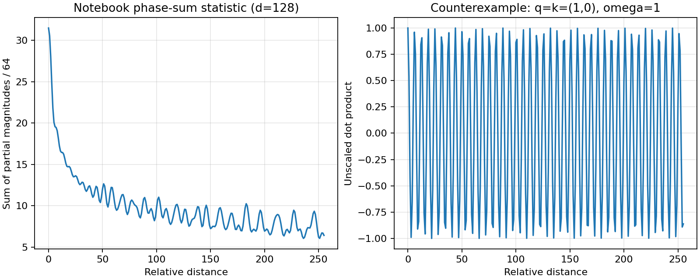

# 第 19 讲：apply_rotary_emb 与相对位置

`apply_rotary_emb` 接受已经投影、分 head 的 Q/K，把相邻两通道组成复数，乘以按绝对位置预计算的单位复数，再还原实数通道。显式位置在两向量的点积中合并成位置差。它不计算 softmax、不更新 KV cache，也没有自己的可学习参数。

本篇配套 [全部代码单元说明](代码单元解释.md)，覆盖原 notebook 的全部15个代码单元，包括只有注释和空内容的单元。本地带说明的 notebook 在原代码前插入解释，保留原始单元与历史输出。主文解释原理和官方调用路径，配套文档按原编号解释语句、变量、输出与缺口。

## 1. 版本、论文与仓库地图

课程为 [llama2_src_03_RoPE_apply_rotary_emb.ipynb](https://github.com/chunhuizhang/personal_chatgpt/blob/7fbc29824171fd07dc2c30fe922e61ebc018ad1d/tutorials/llama2_src_03_RoPE_apply_rotary_emb.ipynb)，提交 `7fbc29824171fd07dc2c30fe922e61ebc018ad1d`，27个单元，编号从0开始。相关论文 [RoFormer v4](https://arxiv.org/html/2104.09864v4) 为2022-08-09版本：§3.1 提出相对位置条件，§3.2 分二维和多维旋转，§3.3–3.4 讨论性质，§4 为实验。本讲重点是旋转在 Q/K 张量上的应用，不复现整套论文评测。

实现固定为 [Meta model.py](https://github.com/meta-llama/llama/blob/7565eb6fee2175b2d4fe2cfb45067a61b35d7f5e/llama/model.py)，提交 `7565eb6fee2175b2d4fe2cfb45067a61b35d7f5e`。原课程没有锁定依赖，本次使用 torch 2.5.1+cpu。两个 notebook 字节哈希分别记录本地 CRLF 和上游 LF，确认归一行尾后内容相同，见 [来源清单](来源清单.json)。原论文与完整源码在本地，未找到现成中文论文译本；检查 E:/ 21个txt，未找到独立第19讲字幕，未将第28讲回顾字幕冒用。

| 位置 | 数据或职责 |
|---|---|
| 示例、generation.py、tokenizer.py | 文本编码、配置/检查点加载和生成循环；第15讲已读 |
| Transformer.__init__ | 按 head_dim 预计算频率表 |
| Transformer.forward | 按 start_pos 取当前频率段 |
| Attention.forward | wq/wk/wv 投影、分 head、调用旋转、写缓存、计算注意力 |
| precompute_freqs_cis | 每个位置和通道对的单位复数；第18讲已读 |
| reshape_for_broadcast / apply_rotary_emb | 本讲核心 |
| tokenizer.model | 课程分词示例需要，不是神经网络检查点 |
| 训练入口、loss、optimizer | 本讲及这版 Meta 推理代码中未找到 |

执行链为 `tokens → embedding → block → attention_norm → wq/wk/wv → reshape → apply_rotary_emb → cache/repeat_kv → QKᵀ/√d → mask → softmax → 加权V → 输出投影`。本次只真实运行 tokenizer、数学示例与三个 RoPE 函数，不将它标为整个 Attention 前向成功。

## 2. 数学：绝对旋转到相对位置

【必须会】对一个 head 的二通道列向量 q=[q0,q1]，位置 m，固定频率 ω，旋转为

$$f(q,m)=R(m\omega)q,\quad
R(\alpha)=\begin{bmatrix}\cos\alpha&-\sin\alpha\\\sin\alpha&\cos\alpha\end{bmatrix}.$$

α=mω 为弧度。q `[2]`、R `[2,2]`、输出 `[2]`，都为实数；使用复数时 zq=q0+iq1，乘 `exp(imω)` 即得到相同两分量。R 正交，长度保持，转置 Rᵀ(α)=R(−α)。例如 q=[1,0]、mω=π/2，输出[0,1]。

位置 n 的 k 同样旋转，得到

$$f(q,m)^\top f(k,n)=q^\top R(m\omega)^\top R(n\omega)k
=q^\top R((n-m)\omega)k.$$

这是单元3–5的核心关系。单元6–11用30°/60°矩阵作数值示范，但函数内部将度转换成弧度；实际 RoPE 相位直接是弧度。公式中 q/k 已投影，不能将 Wq/Wk 再乘一次。多维情况将偶数 head_dim=d 配成 d/2 个子向量，各自使用 `ωj=10000^(-2j/d)`，j从0开始，再对各对贡献求和。

复数点积必须取 `Re(zq conj(zk))`。旋转后可写为 `Re(zq conj(zk) exp(i(m−n)ω))`，与上面的 n−m 矩阵写法等价：一个把共轭与位置差放在乘积中，另一个把相对旋转作用于 k。不能在同一表达式中随意更换差值符号。

【建议会】公式只消除了固定 q/k 的显式绝对位置因子；真实多层内容表示、causal mask、上下文边界仍会影响输出。绝对位置旋转本身存在，只有形成点积时才表现为相对差值，并不是函数提前对每对 token 生成了一张相对位置表。

## 3. 输入 shape 和变量轨迹

【必须会】B 为batch，T为当前输入片段长度，Hq为query头数，Hkv为key/value头数，d为每头通道数；D为模型总宽度。7B例中D=4096、Hq=32，d=128。模型并行时本地head数可能少于逻辑总数。

| 变量 | 来源/含义 | dtype与shape，以7B示例说明 |
|---|---|---|
| xq | wq 投影后按head reshape | 浮点 `[1,8,32,128]` |
| xk | wk 投影后按head reshape | 浮点 `[1,8,Hkv,128]` |
| freqs_cis | 预计算表按当前位置切片 | complex64 `[8,64]` |
| q配对视图 | 通道两两分组 | float32 `[1,8,32,64,2]` |
| xq_ | 配对的复数视图 | complex64 `[1,8,32,64]` |
| 广播频率 | 插入batch/head单例轴 | complex64 `[1,8,1,64]` |
| 乘积 | 单位复数乘法 | complex64 `[1,8,32,64]` |
| 恢复实数 | 实部/虚部末轴 | float32 `[1,8,32,64,2]` |
| xq_out | flatten 后转回原dtype | 原输入dtype `[1,8,32,128]` |

xk轨迹相同，只需把32换成Hkv。Hq不必等于Hkv：频率的head轴为1，所以可以给不同头数广播相同相位。后续 GQA 的K/V重复在另外函数里完成，第21讲继续解释。

## 4. apply_rotary_emb 的每一步

完整原始单元逐段说明见 [代码单元16](代码单元解释.md#单元-16定义-apply_rotary_emb)。它是模块级普通函数，不是类的方法；输入xq、xk、freqs_cis都没有默认值；返回两个Tensor的tuple，没有参数注册或持久状态。

【必须会】第一步对Q/K各做 `.float().reshape(*shape[:-1],−1,2)`：将数值转float32，保留前三轴，将末轴d拆成d/2对。`shape[:-1]` 是去掉最后轴的tuple，星号将其展开为多个参数，−1根据元素总数推断长度。类型注解不会帮用户验证输入，d必须偶数。

第二步 `view_as_complex` 把每对 `[a,b]` 看成a+ib，减少一个长度2的shape轴，底层仍有两个实数分量。第三步辅助函数把频率补成 `[1,T,1,d/2]`，第四步逐元素复数乘法进行旋转。第五步 `view_as_real` 恢复末轴2，`.flatten(3)` 合并第3轴起的维度，最后各自 `.type_as` 返回输入dtype。

【必须会】这里的 `*` 是广播复数乘法，不是矩阵乘；没有求和，不在此处计算 QKᵀ。`flatten(3)` 使用0起始索引，隐含预期四维Q/K输入。不要把这个函数称为适用于任意rank的通用旋转器。第18讲为重建 `[sin,cos]` 表加的flip，在这里不应加入。

函数不原地改变xq/xk/freqs_cis；本次实际保存调用前后的输入作比较，确认为不变。局部变量freqs_cis重新绑定到广播视图，不会把调用方的属性改成新的shape。参数更新、cache写入都由外部完成。

## 5. reshape_for_broadcast：为何必须显式对齐轴

【必须会】该辅助函数接收频率表 `[T,P]` 和复数张量 `[B,T,H,P]`，其中P=d/2。它没有默认参数、不修改输入数值、返回频率表的视图。

`ndim=x.ndim` 为4。第一条assert确认第1轴存在，第二条确认 `freqs.shape==(x.shape[1],x.shape[-1])`，即位置长度与复数通道对数一致。列表推导用 `enumerate(x.shape)` 遍历轴编号和长度：只保留轴1以及最后轴，其余变1。因此 `[B,T,H,P]` 导出目标shape `[1,T,1,P]`，`view(*shape)` 将频率表解释为这个shape。

广播从右向左对齐，维度长度相等或为1才兼容。省略reshape、直接用 `[T,P]` 乘 `[B,T,H,P]` 时，T会对齐到H，通常报错；若恰好T=H则可能静默成功，却按head而不是位置选择角度。本次T=H=3反例产生最大误差约3.839912，说明“结果shape没变”不能证明广播正确。

assert不是完整输入验证：它主要围绕xq检查频率，xk若不满足同样的T/P条件可能到乘法时才报错；在Python优化模式中assert也可能被移除。可靠调用方需保证同设备、相同d和相容位置段。

## 6. dtype、stride 与真实反向传播

【建议会】`.float()`使低精度输入在旋转内部以float32/complex64计算，最后转回FP16/BF16；这减少中间计算的低精度影响，但不能避免最终量化误差。输入为float64也先转float32，返回float64不代表中间保留了64位精度。

本次独立sin/cos参考与官方输出相同；对固定随机样本，输出长度相对输入的最大误差约为：float32 4.77e-7、FP16 7.85e-4、BF16 6.77e-3。数学上旋转保长，有限精度实际输出只近似保长。这些是小样本CPU数据，不是精度格式在大模型中优劣的评测。

`view_as_complex` 还需要符合布局条件：末轴长度2、stride=1，其他stride为偶数；它不只是查看shape。[PyTorch v2.5.1 官方定义](https://github.com/pytorch/pytorch/blob/v2.5.1/torch/_torch_docs.py) 可核对这些条件。reshape可能返回视图或复制，而`.float()`在已经float32时不保证复制成连续布局。本次 `[...,::2]` 输入末stride=2，真实报错；先 `.contiguous()` 后成功。但不是所有非连续Tensor都会失败，关键是上述stride约束。

【建议会】二维旋转y=Rx的输入梯度为 `∂L/∂x=Rᵀ ∂L/∂y`。对每对上游梯度[u,v]，输出梯度为 `[u cos+v sin,−u sin+v cos]`。本次Q/K同时参与标量损失，真实autograd与独立逆旋转参考最大差0；这是对本样本运算路径的验证，不是训练收敛复现。

## 7. 调用方：投影、位置切片和缓存

【必须会】Transformer初始化生成 `[2*max_seq_len,d/2]` 表，forward按 `start_pos:start_pos+seqlen` 切出 `[T,d/2]`。end是非包含的右端位置数量；预留两倍行数不构成两倍上下文质量保证。

Attention先wq/wk/wv，再reshapeQ/K/V，之后仅旋转Q/K，才将旋转后的K和原V写入cache。此版V不应用RoPE。相同token在位置3的相位不应在增量推理时重新用位置0的行。对应本次样本，把非零start的表错换成从0起的表，Q输出最大差约7.085379。缓存完整行为留给第20讲验证。

本次Q为`[2,4,4,8]`、K为`[2,4,2,8]`，heads不同而d/T相同，验证函数支持GQA形状；没有执行完整Attention或repeat_kv。对固定内容，旋转点积与独立float64相对旋转参考最大差约7.47e-7，共同平移位置后的点积最大差约4.77e-7。

## 8. notebook的执行缺口与tokenizer

【必须会】单元16引用但未定义`reshape_for_broadcast`，而原 notebook 没有调用`apply_rotary_emb`。本次所有原代码单元执行成功后，明确调用原函数首先得到NameError。补入同提交官方helper后，原函数与官方函数结果一致。这里要区分“定义成功”“原代码单元运行成功”与“核心函数调用成功”。

单元18的SentencePiece需要相对路径tokenizer.model。本次在临时工作目录放入课程原文件，不改写该单元；单元19真实编码得到8个ID，与上游历史一致。分词只是构造输入ID，不是运行embedding或旋转。原单元17全是注释、26为空，也纳入代码覆盖统计。

## 9. 远距曲线不是任意attention分数的单调下降

【建议会】单元23定义频率相位的部分和。令Δ为相对距离，P=d/2，

$$S_j(\Delta)=\sum_{r=0}^{j-1}e^{i\Delta\omega_r},\qquad
C(\Delta)=\frac1P\sum_{j=0}^{P-1}|S_j(\Delta)|.$$

S_j为复数标量，S_0=0；r是通道对索引，i是虚数单位，不能混用。d=128时P=64，代码包含j=0但不包含S_64。它与论文的远距分析有关，但未包含q/k内容，没有softmax，不能视为实际attention概率。

Δ=0时S_j=j，C(0)=31.5。距离0–255末点约6.412620，总体下降且有振荡：本次相邻256点中有113步上升。单个通道对q=k=[1,0]、ω=1的点积为cosΔ，更直接反驳“每个分数必须随距离严格下降”。

左图是自己按原代码定义重绘的数学统计量，横轴为距离、纵轴是部分和模长之和除64；右图是同距离范围的未缩放点积反例。没有训练数据集、baseline准确率或在线指标。原图和本图都不能证明Llama实际长文本质量。论文§4实验不在本次复现范围内。

## 10. 学习优先级与 Paper ↔ Code

**必须掌握**：先投影再旋转Q/K；相邻通道配成复数；每一步shape与广播轴；共轭与位置差；非零start_pos；原notebook缺helper且未调用核心函数。

**第二遍**：星号解包、列表推导、tuple类型注解；dtype往返；stride与视图；GQA不同head数；逆旋转梯度；曲线统计量与attention区别。

**可以暂时不掌握的工程细节**：FairScale通信、CUDA融合kernel、量化长上下文、论文全量训练。cache与GQA完整实现分属第20、21讲。

| Paper ↔ Code | 原单元或官方对象 | 核对结果 |
|---|---|---|
| §3.2二维旋转 | 单元3–11 | 度制演示，实际相位为弧度 |
| 多维配对旋转 | 单元16；apply_rotary_emb | d/2对子空间，不需构造完整矩阵 |
| 按位置与head广播 | reshape_for_broadcast | 原notebook未找到；从官方版本补足验证 |
| 相对点积性质 | 单元5；本文独立参考 | n−m作用于k的公式与复数共轭形式等价 |
| 远距部分和 | 单元22–25 | 代码统计量C，不是任意实际点积单调衰减 |
| 输入分词 | 单元18–19 | 真实ID复核，不等于模型前向 |
| 训练入口与评测 | 本讲/Meta推理代码中未找到 | 未复现RoFormer全量实验 |
| 独立字幕、中文论文译本 | 未找到 | 保留检查范围 |

## 11. 复现状态和未解决问题

**复现状态：部分成功。** 原15个代码单元真实执行，分词与矩阵关系成功；之后显式补helper并调用原/官方旋转。独立参考、autograd、不同头数、dtype往返、输入不变、相对点积和错误反例通过。图已生成并视觉检查，见 [复现记录](复现/README.md)、[脚本](复现/scripts/verify.py)、[结果](复现/outputs/教学验证.json)。

没有大模型权重、完整Attention/FairScale运行、CUDA、吞吐测试或论文训练。尚未确定老师实际依赖、独立字幕和本课运行配置；本次shape/数学/CPU torch证据置信度高，训练质量、速度和长上下文效果没有本次证据。代码逐单元说明与本地带说明notebook是本讲新增交付，前18讲的同类覆盖将逐篇核验补齐。

## 原始源码来源

- [课程 tokenizer](https://github.com/chunhuizhang/personal_chatgpt/blob/7fbc29824171fd07dc2c30fe922e61ebc018ad1d/tutorials/tokenizer.model)
