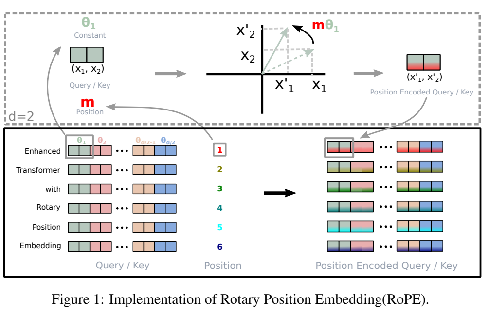
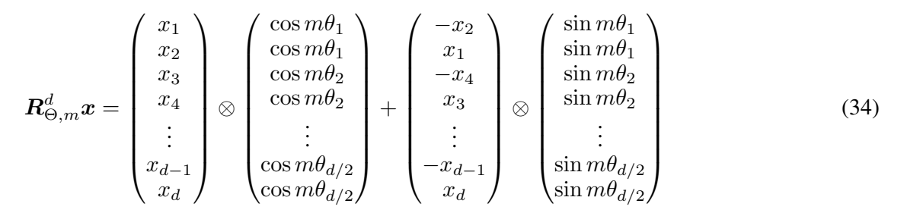
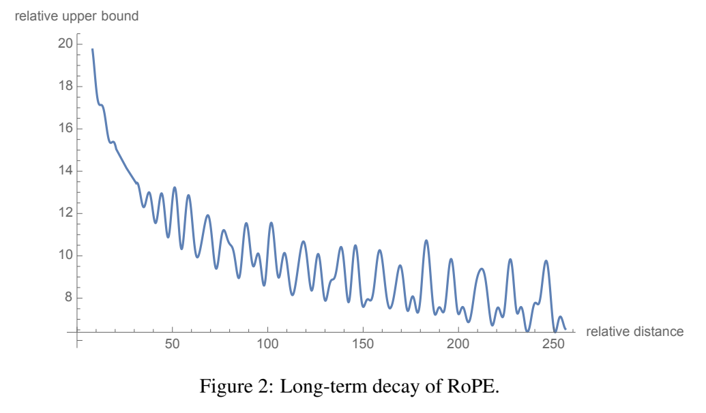
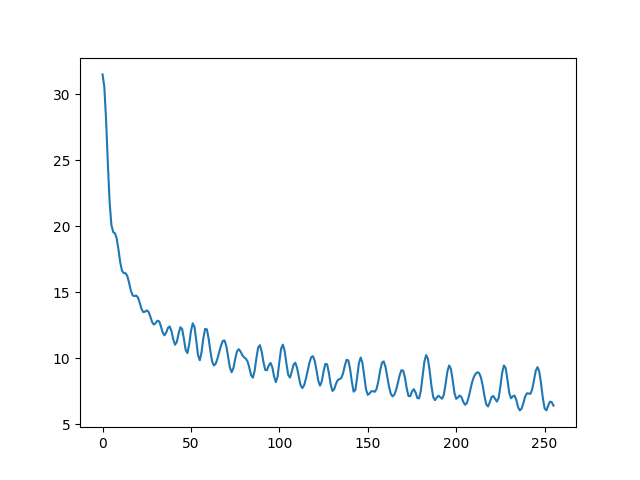

# 第19讲：apply_rotary_emb 与张量旋转

上一讲把相邻两个通道当作复数，乘单位复数完成旋转。这一讲把同样的操作放回真正的Q/K张量，逐步看清：**哪一轴是位置、哪一轴是head、两个通道怎样合成一个复数、同一位置的角度怎样用于所有head**。

先沿正文的小数字走一遍，再读[原notebook的Python注释版](代码/tutorials/llama2_src_03_RoPE_apply_rotary_emb_代码注释.py)。[全部27格说明](代码单元解释.md)按原编号查找；补充的[三个官方函数阅读版](代码/RoPE_官方函数阅读.py)解释预计算、广播与旋转，编号从0开始。

## 1. apply_rotary_emb 在整条模型路径中的位置

文本先变成token ID，再查embedding得到隐藏状态。Attention用wq、wk、wv三个线性投影生成Q、K、V，将通道分到各个head。**本讲函数接收的是投影、分head之后的Q/K。**

一个head用自己的Q与可见位置的K做点积，得到匹配分数。RoPE在这次点积之前，按位置旋转Q/K。随后才是缩放、mask、softmax与加权V。Llama把旋转后的K和原V写入cache，缓存会在第20讲展开。

`apply_rotary_emb`是模块级普通函数。输入为xq、xk、freqs_cis，返回旋转后的两个张量；频率表由配置提前算好，这个函数本身没有可学习参数。

## 2. 一张图回顾“每对通道各自旋转”

下面直接截自 [RoFormer论文v4，第5页Figure1](https://arxiv.org/pdf/2104.09864v4)。



上半部把两个分量 $(x_1,x_2)$ 转过 $m\theta_1$，得到 $(x'_1,x'_2)$。m是位置，θ₁是该通道对每前进一位置转过的弧度。下半部每行是一处位置，颜色成对标出不同频率；中间的位置编号和各对频率一起决定右侧的旋转结果。

以一对数 `[a,b]` 为例，角度α对应：

$$a'=a\cos\alpha-b\sin\alpha,\qquad
b'=a\sin\alpha+b\cos\alpha.$$

例如α=π/2，即90度，`[1,2]`变为`[-2,1]`。复数写法将 `[a,b]` 看成 $a+ib$，乘 $\cos\alpha+i\sin\alpha$，得到的实部、虚部就是新坐标。下面把这一对数放进带位置和head轴的张量里。

## 3. 准备一个能看清每一轴的小输入

【必须会】Q/K的布局为 `[B,T,H,d]`：B表示样本数，T表示本次输入的位置数，H表示head数，d表示每个head的通道数。Q与K的head数可以不同，但同一片段的T、d需要一致。

这里取B=1、T=2、d=4。Q有两个head，K有一个head：

| 输入 | shape | 每个位置包含的内容 |
|---|---|---|
| xq | `[1,2,2,4]` | head0为`[1,2,3,4]`；head1为`[5,6,7,8]` |
| xk | `[1,2,1,4]` | 一个head，为`[2,1,1,0]` |
| freqs_cis | `[2,2]` | 两个位置，各有两个通道对的旋转因子 |

两个位置使用相同内容，方便观察纯粹由位置导致的变化。d=4时通道对为 `(0,1)`、`(2,3)`，频率为 $10000^{-2j/4}$，j取0、1，得到 `[1,0.01]`。

```python
import torch

xq = torch.tensor([[
    [[1., 2., 3., 4.], [5., 6., 7., 8.]],
    [[1., 2., 3., 4.], [5., 6., 7., 8.]],
]], requires_grad=True)
xk = torch.tensor([[
    [[2., 1., 1., 0.]],
    [[2., 1., 1., 0.]],
]], requires_grad=True)
positions = torch.arange(2, dtype=torch.float32)
omega = torch.tensor([1.0, 0.01])
angles = torch.outer(positions, omega)
freqs_cis = torch.polar(torch.ones_like(angles), angles)

paired_q = xq.float().reshape(*xq.shape[:-1], -1, 2)
complex_q = torch.view_as_complex(paired_q)
print(xq.shape, paired_q.shape, complex_q.shape)
print(paired_q[0, 0, 0].tolist())  # [[1,2],[3,4]]
print(complex_q[0, 0, 0].tolist()) # [1+2j,3+4j]
```

`torch.outer`把每个位置与每个频率分别相乘：位置0的角度为`[0,0]`，位置1为`[1,.01]`。`torch.polar(半径,角度)`生成复数，这里半径全1，所以每个因子为 `cos(角度)+i*sin(角度)`。这是第18讲频率函数的计算过程。

### 3.1 reshape里的星号、−1和2分别是什么意思

`xq.shape`是描述各轴长度的元组`(1,2,2,4)`，`shape[:-1]`取除最后一轴外的部分，得到`(1,2,2)`。星号`*`把元组展开成多个参数；随后用`-1,2`将末轴拆为若干个长度2的通道对，`-1`让PyTorch根据总元素数推算为2。

因此形状依次变化：

$$[1,2,2,4]\ \longrightarrow\ [1,2,2,2,2]\ \longrightarrow\ [1,2,2,2].$$

中间两个尾轴分别是“第几对”和“一对中的两个分量”；`view_as_complex`将最后两个分量解释为实部和虚部。它保留所有数值，只是用一个复数元素表示两个实数。

`xq.float()`让这一步使用float32。`requires_grad=True`用于后面观察梯度，此时尚未更新任何输入数值。

## 4. 把完整函数放在眼前，再逐步走一遍

【必须会】下面包含原第16格的完整执行逻辑，以及固定Meta实现中的广播辅助函数。可以接在上一个代码块后直接运行。

```python
from typing import Tuple

def reshape_for_broadcast(freqs_cis: torch.Tensor, x: torch.Tensor):
    ndim = x.ndim
    assert 0 <= 1 < ndim
    assert freqs_cis.shape == (x.shape[1], x.shape[-1])
    shape = [d if i == 1 or i == ndim - 1 else 1 for i, d in enumerate(x.shape)]
    return freqs_cis.view(*shape)

def apply_rotary_emb(
    xq: torch.Tensor,
    xk: torch.Tensor,
    freqs_cis: torch.Tensor,
) -> Tuple[torch.Tensor, torch.Tensor]:
    xq_ = torch.view_as_complex(xq.float().reshape(*xq.shape[:-1], -1, 2))
    xk_ = torch.view_as_complex(xk.float().reshape(*xk.shape[:-1], -1, 2))
    freqs_cis = reshape_for_broadcast(freqs_cis, xq_)
    xq_out = torch.view_as_real(xq_ * freqs_cis).flatten(3)
    xk_out = torch.view_as_real(xk_ * freqs_cis).flatten(3)
    return xq_out.type_as(xq), xk_out.type_as(xk)

q_rotated, k_rotated = apply_rotary_emb(xq, xk, freqs_cis)
broadcast_freqs = reshape_for_broadcast(freqs_cis, complex_q)
product = complex_q * broadcast_freqs
real_product = torch.view_as_real(product)
manual_q = real_product.flatten(3)
print(broadcast_freqs.shape, product.shape, real_product.shape, manual_q.shape)
print(q_rotated[0, 0, 0].tolist())  # 位置0保持[1,2,3,4]
print(q_rotated[0, 1, 0].tolist())  # 位置1按两个频率旋转
```

`xq: torch.Tensor`是参数类型标注；箭头后的`Tuple[Tensor,Tensor]`说明返回两个张量组成的元组。`q_rotated,k_rotated=...`把这两个返回值分别取出。这两个函数没有self，输入都通过参数显式提供。

整个函数的数值工作仍是第2节的旋转，张量操作负责安排“给哪个位置、哪个head、哪对通道用哪个角度”。本例位置1的Q head0得到约`[-1.142640,1.922076,2.959851,4.029799]`，可以分别用角度1与0.01代入两维公式核对。

### 4.1 广播辅助函数怎样读

复数Q的shape为`[B,T,H,P]`，其中P=d/2是通道对数。本例为`[1,2,2,2]`。原频率表只有`[T,P]=[2,2]`，需要补成`[1,T,1,P]=[1,2,1,2]`。

这样，每个位置沿T轴选择自己的因子，所有batch和head共用该位置的同一组频率。长度为1的轴参与乘法时，可扩展到对应的batch/head长度，这叫广播。

辅助函数中，`x.ndim`给出轴数，`enumerate(x.shape)`依次给出轴编号i和长度d。列表推导保留轴1、最后轴的长度，其余改成1。`assert`检查位置数与通道对数；`view(*shape)`按新形状解释频率表，与原表共享存储。

### 4.2 复数乘法后，怎样变回原来的通道

| 步骤 | Q的shape | 读作什么 |
|---|---|---|
| 输入 | `[1,2,2,4]` | B、T、Q heads、实数通道 |
| reshape成对 | `[1,2,2,2,2]` | 最后两轴为通道对和两个分量 |
| view_as_complex | `[1,2,2,2]` | 每对成为一个复数 |
| 乘`[1,2,1,2]`频率 | `[1,2,2,2]` | 各位置、各head的每对完成旋转 |
| view_as_real | `[1,2,2,2,2]` | 拆出旋转后的实部、虚部 |
| flatten(3) | `[1,2,2,4]` | 从第3轴开始合并，回到通道轴 |

K按同样路径处理，head轴长度始终为1。Python轴编号从0开始，所以`flatten(3)`合并最后的“通道对、分量”两轴。

这里`*`是逐元素的复数乘法，不执行通道求和。函数末尾的`type_as`将各自结果转回各自输入类型。旋转后的实部、虚部已经按原通道顺序排列，直接flatten即可。

### 4.3 对照论文的实数实现

下面截自 [RoFormer v4第7页公式(34)](https://arxiv.org/pdf/2104.09864v4)。



从左向右读：原向量逐元素乘重复排列的cos；把每对`[a,b]`改成`[-b,a]`后，逐元素乘同一角度的sin；两部分相加。这与复数乘法展开后的两行公式相同，代码因此可以按通道对直接计算。

截图最后一对的第三列写成`[-x_(d−1),x_d]`；按前面各对一致的旋转规则，该处应为`[-x_d,x_(d−1)]`。本讲手算与复数代码都使用`[a,b] → [-b,a]`的配对规则。

## 5. 省掉广播reshape，会发生什么

【必须会】广播从右向左对齐轴。将`[T,P]`直接乘`[B,T,H,P]`时，P与P对齐，而表中的T会与H对齐。

一般T与H不同，乘法会报错；本例恰好T=H=2，计算可以执行，却把“按位置选角度”变成“按head选角度”。直接比较：

```python
wrong_product = complex_q * freqs_cis
wrong_q = torch.view_as_real(wrong_product).flatten(3)
print(wrong_q.shape, q_rotated.shape)  # 两个shape相同
print(wrong_q[0, 1, 0].tolist())
print(q_rotated[0, 1, 0].tolist())
print((wrong_q - q_rotated).abs().max().item())
```

位置1的head0在错误写法里取到频率表第0行，因此仍是`[1,2,3,4]`；正确写法应取第1行。同理，位置0的head1会错误地提前旋转。显式补出`[1,T,1,P]`，就是在告诉PyTorch“第1轴才是位置”。

调用方需要准备四维Q/K、正偶数d、相同的位置长度、匹配的频率行与设备。Hq/Hkv可以不同。辅助函数围绕Q检查频率形状，完整输入关系还需由调用方保证。

## 6. 两个绝对位置怎样组合成位置差

【必须会】对一对通道，旋转矩阵记为R，位置m的q、位置n的k得到：

$$(R(m\omega)q)^\top(R(n\omega)k)
=q^\top R((n-m)\omega)k.$$

上标 $\top$ 表示转置。因为先逆转m步，再转n步，合起来是n−m步。复数写法对应：

$$\operatorname{Re}\left[z_q\overline{z_k}e^{i(m-n)\omega}\right].$$

横线表示共轭，也就是虚部变号；Re表示取实部。它让 `(a+ib)(c−ie)` 的实部变成实数点积ac+be。内容和位置差一起决定结果。

用本例中位置0的Q head0和位置1的K做点积，再将两个位置一起后移7：

```python
score = torch.dot(q_rotated[0, 0, 0], k_rotated[0, 1, 0])
shifted_angles = torch.outer(positions + 7, omega)
shifted_freqs = torch.polar(torch.ones_like(shifted_angles), shifted_angles)
shifted_q, shifted_k = apply_rotary_emb(xq, xk, shifted_freqs)
shifted_score = torch.dot(shifted_q[0, 0, 0], shifted_k[0, 1, 0])
print(score.item(), shifted_score.item())

score.backward()
print(xq.grad[0, 0, 0].tolist())
print(xk.grad[0, 1, 0].tolist())
```

本例两次点积均约为7.725471497。q/k内容固定、两个位置共同平移，位置差仍为1，所以结果在浮点容差内一致。进入attention时通常还会将点积除以 $\sqrt d$；本例打印的是未缩放值。

`backward()`计算分数对输入的梯度，保存到`.grad`；梯度表示输入的微小改变怎样影响分数。它可以经过旋转继续回到Q/K投影权重。函数前向与反向都在计算张量值，参数更新由训练流程的optimizer负责。

## 7. 对上真实模型的大小和位置切片

Llama 2 7B的隐藏宽度D=4096、Q头数32，因此每head宽度d=128。原第15格给出的Q例子为`[1,8,32,128]`：一条样本、8个位置、32个head、每head128通道。频率切片为`[8,64]`，广播后`[1,8,1,64]`，输出恢复原Q形状。

固定 [Meta model.py](https://github.com/meta-llama/llama/blob/7565eb6fee2175b2d4fe2cfb45067a61b35d7f5e/llama/model.py)在Transformer初始化时预计算表，在forward中取：`freqs_cis[start_pos:start_pos+seqlen]`。例如当前片段从位置3开始、长度2，就用第3、4行；生成下一片段时继续使用它在整条序列中的绝对位置。

Attention先算wq/wk/wv并分head，然后调用本函数；接着写缓存、按需重复K/V head，再做QK点积。旋转的K和原V进入cache，这条数据路径在第20–21讲继续展开。

【建议会】原函数内部先`.float()`，因此FP16/BF16在旋转中使用float32/complex64，末尾再转换回来；float64输入也经过float32中间计算。切片还可能改变张量的存储步长，`view_as_complex`要求每对的两个分量在内存中按规定相邻。遇到不满足布局的输入，可先用`.contiguous()`整理存储，再进行配对。

## 8. 读懂原末尾的“远距衰减”曲线

【建议会】原第22–25格把多个频率的单位复数累加，观察它们随距离怎样相互抵消。设相对距离为Δ，通道对数P=d/2：

$$S_j(\Delta)=\sum_{r=0}^{j-1}e^{i\Delta\omega_r},\qquad S_0=0.$$

这里r数通道对；每项都是一个单位复数。$S_j$是前j项的和，$|S_j|$是和的模长。下面是论文第8页的Figure2，直接放在相关解释旁边。



横轴是相对距离，纵轴是论文远距分析中的relative upper bound。图展示由相位部分和得到的相对量，整体随距离下降并有振荡。这里画的是数学统计量，任务评测在论文第4节。

把图附近的式(35)–(37)也写在这里：令第r对的内容乘积为 $h_r=z_{q,r}\overline{z_{k,r}}$，并设边界 $h_P=0$，则

$$\left|\sum_{r=0}^{P-1}h_r e^{i\Delta\omega_r}\right|
\le \left(\max_{0\le r<P}|h_{r+1}-h_r|\right)
\sum_{j=1}^{P}|S_j(\Delta)|.$$

左侧包含Q/K内容；右侧第一项取相邻内容乘积差的最大模长，第二项累加相位部分和的模长。这个关系把内容与位置部分分开分析。图附近讨论的平均量是第二项除以P，下面用课程d=128的配置把它算出来。

### 8.1 论文和课程的求和范围分别是什么

| 写法 | 平均哪些部分和 | Δ=0且P=64时 |
|---|---|---|
| 论文图2附近的表达式 | $S_1,\ldots,S_P$的模长 | 32.5 |
| 课程第23–24格 | $S_0,\ldots,S_{P-1}$的模长 | 31.5 |

Δ=0时，每项单位复数都是1，所以 $S_j=j$，上表可以直接由等差数列求和算出。两种均值的差为 $|S_P|/P$，来自末尾是否包含第P项。

下面保留第23格的完整函数，并同时计算这两个范围。显式传入d，让函数的宽度与除数保持一致。

```python
import numpy as np

def s(m, d=128):
    theta_i = lambda i: 10000**(-2*i/d)
    return np.sum([np.abs(np.sum(np.exp(1j*m*theta_i(np.arange(0, j))))) for j in range(0, d//2)])

d = 128
P = d // 2
distances = np.arange(256)
course_curve = np.array([s(delta, d=d) / P for delta in distances])
phase_steps = np.exp(1j * np.outer(distances, 10000.0 ** (-2 * np.arange(P) / d)))
partial_sums = np.cumsum(phase_steps, axis=1)
paper_range_curve = np.abs(partial_sums).mean(axis=1)
print(course_curve[0], paper_range_curve[0])  # 31.5, 32.5
print(course_curve[-1])
print(np.count_nonzero(np.diff(course_curve) > 0))
```

`lambda`定义短函数；这里给定通道对索引i，返回频率。原函数内层`np.sum`先求复数和，`np.abs`取模，外层再把不同j的模长相加。`np.cumsum`沿频率轴依次累加，另一种写法一次得到所有部分和。

这张课程第25格的既有运行图使用课程范围：



距离0–255内，它从31.5到约6.41262，中间有113个相邻区间上升。理解“整体变小”的趋势时，也要保留这些局部振荡。


左侧是课程统计量；右侧固定q=k=`[1,0]`、频率1时，点积为cosΔ。右图随距离反复振荡，帮助区分相位部分和的界与某一对内容向量的实际分数。注意力概率还要结合其他key、mask和softmax共同计算。

## 9. 原 notebook 的27格怎样串起来

第6格的`R(theta)`先用`np.radians`把度数转为弧度，再返回二维旋转矩阵；第7–11格比较先转30度再转60度与直接转90度，以及先逆转30度再转60度与转30度。原生RoPE频率表中的角度直接以弧度表示。

第16格定义了apply函数，调用到`reshape_for_broadcast`；辅助函数需要从同提交官方实现补入。原notebook后续没有调用apply，因此阅读时将本讲的完整函数放在一起，就能实际执行旋转。

第18–19格用SentencePiece读取本地`tokenizer.model`，将`I believe the meaning of life is`变为8个ID：`[1,306,4658,278,6593,310,2834,338]`。开头1是BOS。ID还要经过embedding与Q/K投影，才成为本讲处理的浮点向量。

| 单元 | 内容 | 上文位置 |
|---|---|---|
| 0–5 | 位置信息、复数旋转与相对点积 | 第1–2、6节 |
| 6–11 | NumPy旋转矩阵、合成与逆转 | 本节 |
| 12–15 | 模型尺寸、输入Q/K与频率shape | 第3、7节 |
| 16–17 | apply函数与配置注释 | 第4、7节 |
| 18–19 | SentencePiece与prompt ID | 本节 |
| 20–25 | 部分和公式、函数与曲线 | 第8节 |
| 26 | 空代码格 | 单元索引 |

<details>
<summary>第二遍阅读：原讲解中的源码细节与历史运行记录</summary>

# 第 19 讲：apply_rotary_emb 与相对位置

`apply_rotary_emb` 接受已经投影、分 head 的 Q/K，把相邻两通道组成复数，乘以按绝对位置预计算的单位复数，再还原实数通道。显式位置在两向量的点积中合并成位置差。它不计算 softmax、不更新 KV cache，也没有自己的可学习参数。

本篇配套[全部27格单元说明](代码单元解释.md)、[代码注释notebook](代码/tutorials/代码注释.ipynb)及[Python阅读版](代码/tutorials/llama2_src_03_RoPE_apply_rotary_emb_代码注释.py)，覆盖15代码格（含仅注释17与空26）和12个Markdown格。两种派生版各55格，原单元/历史输出保留；公式、模型表、来源及核心调用缺口均有说明。

## 1. 版本、论文与仓库地图

课程为 [llama2_src_03_RoPE_apply_rotary_emb.ipynb](https://github.com/chunhuizhang/personal_chatgpt/blob/7fbc29824171fd07dc2c30fe922e61ebc018ad1d/tutorials/llama2_src_03_RoPE_apply_rotary_emb.ipynb)，提交 `7fbc29824171fd07dc2c30fe922e61ebc018ad1d`，27个单元，编号从0开始。相关论文 [RoFormer v4](https://arxiv.org/html/2104.09864v4) 为2022-08-09版本：§3.1 提出相对位置条件，§3.2 分二维和多维旋转，§3.3–3.4 讨论性质，§4 为实验。本讲重点是旋转在 Q/K 张量上的应用，不复现整套论文评测。

实现固定为 [Meta model.py](https://github.com/meta-llama/llama/blob/7565eb6fee2175b2d4fe2cfb45067a61b35d7f5e/llama/model.py)，提交 `7565eb6fee2175b2d4fe2cfb45067a61b35d7f5e`。原课程没有锁定依赖，本次使用 torch 2.5.1+cpu。同一notebook的旧本地CRLF与上游LF哈希分别记录，公开原件按上游43654bytes精确保留，见 [来源清单](来源清单.json)。原论文与完整源码保存在本地；独立字幕尚待补充。

| 位置 | 数据或职责 |
|---|---|
| 示例、generation.py、tokenizer.py | 文本编码、配置/检查点加载和生成循环；第15讲已读 |
| Transformer.__init__ | 按 head_dim 预计算频率表 |
| Transformer.forward | 按 start_pos 取当前频率段 |
| Attention.forward | wq/wk/wv 投影、分 head、调用旋转、写缓存、计算注意力 |
| precompute_freqs_cis | 每个位置和通道对的单位复数；第18讲已读 |
| reshape_for_broadcast / apply_rotary_emb | 本讲核心 |
| tokenizer.model | 课程分词示例需要，不是神经网络检查点 |
| 训练入口、loss、optimizer | 本讲及这版 Meta 推理代码中未找到 |

执行链为 `tokens → embedding → block → attention_norm → wq/wk/wv → reshape → apply_rotary_emb → cache/repeat_kv → QKᵀ/√d → mask → softmax → 加权V → 输出投影`。新验证实际导入整个未修改固定Meta model.py，真实运行tokenizer、数学示例与三个RoPE函数，不将它标为整个 Attention 前向成功。

## 2. 数学：绝对旋转到相对位置

【必须会】对一个 head 的二通道列向量 q=[q0,q1]，位置 m，固定频率 ω，旋转为

$$f(q,m)=R(m\omega)q,\quad
R(\alpha)=\begin{bmatrix}\cos\alpha&-\sin\alpha\\\sin\alpha&\cos\alpha\end{bmatrix}.$$

α=mω 为弧度。q `[2]`、R `[2,2]`、输出 `[2]`，都为实数；使用复数时 zq=q0+iq1，乘 `exp(imω)` 即得到相同两分量。R 正交，长度保持，转置 Rᵀ(α)=R(−α)。例如 q=[1,0]、mω=π/2，输出[0,1]。

位置 n 的 k 同样旋转，得到

$$f(q,m)^\top f(k,n)=q^\top R(m\omega)^\top R(n\omega)k
=q^\top R((n-m)\omega)k.$$

这是单元3–5的核心关系。单元6–11用30°/60°矩阵作数值示范，但函数内部将度转换成弧度；实际 RoPE 相位直接是弧度。公式中 q/k 已投影，不能将 Wq/Wk 再乘一次。多维情况将偶数 head_dim=d 配成 d/2 个子向量，各自使用 `ωj=10000^(-2j/d)`，j从0开始，再对各对贡献求和。

复数点积必须取 `Re(zq conj(zk))`。旋转后可写为 `Re(zq conj(zk) exp(i(m−n)ω))`，与上面的 n−m 矩阵写法等价：一个把共轭与位置差放在乘积中，另一个把相对旋转作用于 k。不能在同一表达式中随意更换差值符号。

【建议会】公式只消除了固定 q/k 的显式绝对位置因子；真实多层内容表示、causal mask、上下文边界仍会影响输出。绝对位置旋转本身存在，只有形成点积时才表现为相对差值，并不是函数提前对每对 token 生成了一张相对位置表。

## 3. 输入 shape 和变量轨迹

【必须会】B 为batch，T为当前输入片段长度，Hq为query头数，Hkv为key/value头数，d为每头通道数；D为模型总宽度。7B例中D=4096、Hq=32，d=128。模型并行时本地head数可能少于逻辑总数。

| 变量 | 来源/含义 | dtype与shape，以7B示例说明 |
|---|---|---|
| xq | wq 投影后按head reshape | 浮点 `[1,8,32,128]` |
| xk | wk 投影后按head reshape | 浮点 `[1,8,Hkv,128]` |
| freqs_cis | 预计算表按当前位置切片 | complex64 `[8,64]` |
| q配对视图 | 通道两两分组 | float32 `[1,8,32,64,2]` |
| xq_ | 配对的复数视图 | complex64 `[1,8,32,64]` |
| 广播频率 | 插入batch/head单例轴 | complex64 `[1,8,1,64]` |
| 乘积 | 单位复数乘法 | complex64 `[1,8,32,64]` |
| 恢复实数 | 实部/虚部末轴 | float32 `[1,8,32,64,2]` |
| xq_out | flatten 后转回原dtype | 原输入dtype `[1,8,32,128]` |

xk轨迹相同，只需把32换成Hkv。Hq不必等于Hkv：频率的head轴为1，所以可以给不同头数广播相同相位。后续 GQA 的K/V重复在另外函数里完成，第21讲继续解释。

## 4. apply_rotary_emb 的每一步

完整原始单元逐段说明见[代码单元16](代码单元解释.md#单元-16定义-apply_rotary_emb)，缺失helper与precompute也有[官方函数源码注释](代码/RoPE_官方函数阅读.py)。它是模块级普通函数，不是类的方法；输入xq、xk、freqs_cis都没有默认值；返回两个Tensor的tuple，没有参数注册或持久状态。

【必须会】第一步对Q/K各做 `.float().reshape(*shape[:-1],−1,2)`：将数值转float32，保留前三轴，将末轴d拆成d/2对。`shape[:-1]` 是去掉最后轴的tuple，星号将其展开为多个参数，−1根据元素总数推断长度。类型注解不会帮用户验证输入，d必须偶数。

第二步 `view_as_complex` 把每对 `[a,b]` 看成a+ib，减少一个长度2的shape轴，底层仍有两个实数分量。第三步辅助函数把频率补成 `[1,T,1,d/2]`，第四步逐元素复数乘法进行旋转。第五步 `view_as_real` 恢复末轴2，`.flatten(3)` 合并第3轴起的维度，最后各自 `.type_as` 返回输入dtype。

【必须会】这里的 `*` 是广播复数乘法，不是矩阵乘；没有求和，不在此处计算 QKᵀ。`flatten(3)` 使用0起始索引，隐含预期四维Q/K输入。不要把这个函数称为适用于任意rank的通用旋转器。第18讲为重建 `[sin,cos]` 表加的flip，在这里不应加入。

函数不原地改变xq/xk/freqs_cis；本次实际保存调用前后的输入作比较，确认为不变。局部变量freqs_cis重新绑定到广播视图，不会把调用方的属性改成新的shape。参数更新、cache写入都由外部完成。

## 5. reshape_for_broadcast：为何必须显式对齐轴

【必须会】该辅助函数接收频率表 `[T,P]` 和复数张量 `[B,T,H,P]`，其中P=d/2。它没有默认参数、不修改输入数值、返回频率表的视图。

`ndim=x.ndim` 为4。第一条assert确认第1轴存在，第二条确认 `freqs.shape==(x.shape[1],x.shape[-1])`，即位置长度与复数通道对数一致。列表推导用 `enumerate(x.shape)` 遍历轴编号和长度：只保留轴1以及最后轴，其余变1。因此 `[B,T,H,P]` 导出目标shape `[1,T,1,P]`，`view(*shape)` 将频率表解释为这个shape。

广播从右向左对齐，维度长度相等或为1才兼容。省略reshape、直接用 `[T,P]` 乘 `[B,T,H,P]` 时，T会对齐到H，通常报错；若恰好T=H则可能静默成功，却按head而不是位置选择角度。早期T=H=3反例最大误差约3.839912；新验证使用另一个随机样本得到2.904993：两种写法输出shape相同，但角度沿不同轴分配。

assert不是完整输入验证：它主要围绕xq检查频率，xk若不满足同样的T/P条件可能到乘法时才报错；在Python优化模式中assert也可能被移除。新验证还直接提供K[2,1,2,8]与Q[2,4,4,8]，K位置轴长度1被静默广播成输出[2,4,2,8]，没有报错，却已不满足调用方的同片段含义。三维Q[2,4,8]也不会自动拒绝，flatten(3)返回[2,4,4,2]而不是原shape。可靠调用方需保证四维输入、同设备、相同d和相同位置段，不能把helper的两条assert视为完整合同。

## 6. dtype、stride 与真实反向传播

【建议会】`.float()`使旋转内部使用 float32/complex64，最后再转回输入类型。因此，FP16/BF16 输出还会经历一次舍入；float64 输入也会在内部降到 float32。验证中给 FP32 样本转成的 double 输入加入 1e-10 扰动，输出仍与原 FP32 结果转 double 一致。

本次独立sin/cos参考与官方输出相同；对固定随机样本，输出长度相对输入的最大误差约为：float32 4.77e-7、FP16 7.85e-4、BF16 6.77e-3。数学上旋转保长，有限精度实际输出只近似保长。这些是小样本CPU数据，不是精度格式在大模型中优劣的评测。

`view_as_complex` 还需要符合布局条件：末轴长度2、stride=1，其他stride为偶数；它不只是查看shape。[PyTorch v2.5.1 官方定义](https://github.com/pytorch/pytorch/blob/v2.5.1/torch/_torch_docs.py) 可核对这些条件。reshape可能返回视图或复制，而`.float()`在已经float32时不保证复制成连续布局。本次 `[...,::2]` 输入末stride=2，真实报错；先 `.contiguous()` 后成功；另一个切片只跨head轴、末轴stride1的非连续输入也真实成功。但不是所有非连续Tensor都会失败，关键是上述stride约束。

【建议会】二维旋转y=Rx的输入梯度为 `∂L/∂x=Rᵀ ∂L/∂y`。对每对上游梯度[u,v]，输出梯度为 `[u cos+v sin,−u sin+v cos]`。本次Q/K同时参与标量损失，真实autograd与独立逆旋转参考最大差0；这是对本样本运算路径的验证，不是训练收敛复现。

## 7. 调用方：投影、位置切片和缓存

【必须会】Transformer初始化生成 `[2*max_seq_len,d/2]` 表，forward按 `start_pos:start_pos+seqlen` 切出 `[T,d/2]`。end是非包含的右端位置数量；预留两倍行数不构成两倍上下文质量保证。

Attention先wq/wk/wv，再reshapeQ/K/V，之后仅旋转Q/K，才将旋转后的K和原V写入cache。此版V不应用RoPE。相同token在位置3的相位不应在增量推理时重新用位置0的行。对应本次样本，把非零start的表错换成从0起的表，Q输出最大差约7.085379。缓存完整行为留给第20讲验证。

本次Q为`[2,4,4,8]`、K为`[2,4,2,8]`，heads不同而d/T相同，验证函数支持GQA形状；没有执行完整Attention或repeat_kv。对固定内容，旋转点积与独立float64相对旋转参考最大差约7.47e-7，共同平移位置后的点积最大差约4.77e-7。

## 8. notebook的执行缺口与tokenizer

【必须会】单元16引用但未定义`reshape_for_broadcast`，而原 notebook 没有调用`apply_rotary_emb`。本次所有原代码单元执行成功后，明确调用原函数首先得到NameError。补入同提交官方helper后，原函数与官方函数结果一致。这里要区分“定义成功”“原代码单元运行成功”与“核心函数调用成功”。

单元18的SentencePiece需要相对路径[原tokenizer.model](https://github.com/chunhuizhang/personal_chatgpt/blob/7fbc29824171fd07dc2c30fe922e61ebc018ad1d/tutorials/tokenizer.model)。早期在ASCII临时目录放原文件；新验证直接从正式代码/tutorials目录读取同字节499723bytes原tokenizer.model，不改写单元，并恢复cwd；单元19真实编码得到8个ID，与上游历史一致。分词只是构造输入ID，不是运行embedding或旋转。原单元17全是注释、26为空，也纳入代码覆盖统计。

## 9. 远距曲线不是任意attention分数的单调下降

【建议会】单元23定义频率相位的部分和。令Δ为相对距离，P=d/2，

$$S_j(\Delta)=\sum_{r=0}^{j-1}e^{i\Delta\omega_r},\qquad
C(\Delta)=\frac1P\sum_{j=0}^{P-1}|S_j(\Delta)|.$$

S_j为复数标量，S_0=0；r是通道对索引，i是虚数单位，不能混用。d=128时P=64，代码包含j=0但不包含S_64。它与论文的远距分析有关，但未包含q/k内容，没有softmax，不能视为实际attention概率。

原单元24的全局d与函数s的默认d=128是两处配置，s(x)没有显式传d。本例都为128，因此正确；单独改全局d为64会使C(0)变63，而显式s(0,d=64)/32为15.5。要改统计宽度须同步传参，不能只改除数。

Δ=0时S_j=j，C(0)=31.5。距离0–255末点约6.412620，总体下降且有振荡：本次相邻256点中有113步上升。单个通道对q=k=[1,0]、ω=1的点积为cosΔ，更直接反驳“每个分数必须随距离严格下降”。


左图按原代码重绘，横轴为距离，纵轴为部分和模长之和除64；右图给出同距离范围内的未缩放点积。两图展示数学量随距离的变化，模型长文本表现见论文§4的任务实验。

## 10. 学习优先级与 Paper ↔ Code

**必须掌握**：先投影再旋转Q/K；相邻通道配成复数；每一步shape与广播轴；共轭与位置差；非零start_pos；原notebook缺helper且未调用核心函数。

**第二遍**：星号解包、列表推导、tuple类型注解；dtype往返；stride与视图；GQA不同head数；逆旋转梯度；曲线统计量与attention区别。

**可以暂时不掌握的工程细节**：FairScale通信、CUDA融合kernel、量化长上下文、论文全量训练。cache与GQA完整实现分属第20、21讲。

| Paper ↔ Code | 原单元或官方对象 | 核对结果 |
|---|---|---|
| §3.2二维旋转 | 单元3–11 | 度制演示，实际相位为弧度 |
| 多维配对旋转 | 单元16；apply_rotary_emb | d/2对子空间，不需构造完整矩阵 |
| 按位置与head广播 | reshape_for_broadcast | 原notebook未找到；从官方版本补足验证 |
| 相对点积性质 | 单元5；本文独立参考 | n−m作用于k的公式与复数共轭形式等价 |
| 远距部分和 | 单元22–25 | 代码统计量C，不是任意实际点积单调衰减 |
| 输入分词 | 单元18–19 | 真实ID复核，不等于模型前向 |
| 训练入口与评测 | 本讲/Meta推理代码中未找到 | 未复现RoFormer全量实验 |
| 独立字幕、中文论文译本 | 未找到 | 保留检查范围 |

## 11. 复现状态和未解决问题

**复现状态：部分成功。** 新公开原件、tokenizer与两种55格派生版、Python阅读版及三个官方函数的中文源码阅读已交付。全部27格说明/15代码格、3schema、comment-only token/AST、原单元元数据/执行计数/历史输出与阅读版AST通过；官方阅读版省去英文docstring、保留执行语句，三函数执行AST核对一致。

原版与注释版各15格真正执行，同一格的数组/曲线/返回值摘要精确一致，分词实际得到历史8个ID。此阶段核心函数只被定义，缺helper的原始调用错误在两版中分别真实捕获。仅在全部原格执行完后显式补入官方helper，再调用两版与完整未修改Meta模块：输出和输入梯度逐项精确相同，独立sin/cos前向与逆旋转梯度误差均0。四种dtype真实前向/反向有限，FP64内部FP32、有效/无效非连续输入、静默错轴、K长度与rank3边界均有新证据。

相对点积独立float64参考最大差7.47e-7，共同位移差4.77e-7，位置重置改变Q约7.08538。原部分和曲线由独立累积和验证，最大差5.33e-15，包含113个上升间隔，不把它当attention概率或模型质量指标。新原曲线已保存并视觉检查，没有覆盖历史输出。

证据见[完整复现命令](复现/README.md)、[新脚本](复现/scripts/verify_delivery.py)和[完整交付验证](复现/outputs/完整交付验证.json)。[早期教学验证](复现/outputs/教学验证.json)、[旧43格覆盖记录](复现/outputs/code_unit_coverage.json)和旧builder保留；那份早期脚本只AST提取官方三函数，不以旧报告证明新完整官方文件导入和注释版运行。

本讲完成 tokenizer、数学算例和三个 RoPE 函数的 CPU 验证；完整 Attention、KV缓存、原模型检查点及论文任务评测留待后续。讲师依赖版本、独立字幕与整模型配置尚待补充。


</details>

## 必须掌握

Q/K进入函数时已投影并分head；四个轴分别是什么；相邻两通道组成复数；频率补成[1,T,1,P]；逐元素复数乘法与flatten；位置切片按绝对位置取；相对点积在内容固定时怎样形成。

## 第二遍再看

星号解包和列表推导、dtype往返、存储步长、不同Q/K头数、旋转梯度；相位部分和与内容点积的区别，以及论文/课程求和端点。

## 可以暂时不掌握的工程细节

CUDA融合kernel、FairScale通信、长上下文扩展、完整论文训练。接下来先读第20讲cache，再读第21讲GQA。

## Paper ↔ Code

| 论文内容 | 代码位置 | 本文位置 |
|---|---|---|
| Figure1成对旋转 | apply_rotary_emb的reshape/complex乘法 | 第2–4节 |
| 第7页公式34的逐元素实现 | 复数乘法的实部/虚部展开 | 第4.3节 |
| 相对位置进入点积 | 原3–5格，正文共同位移例 | 第6节 |
| 模型中的多head旋转 | reshape_for_broadcast及Attention调用点 | 第3–7节 |
| 第8页公式37与Figure2 | 原23–25格，课程与论文求和边界各自说明 | 第8节 |
| 论文训练与任务评测 | 本notebook中未找到对应实验入口 | 论文第4节 |

## 复现状态

**部分成功。** 正文五个代码块在CPU顺序执行，固定官方完整模块的三个RoPE函数参与核对。数值、形状、广播反例、梯度、位置切片与两种部分和范围见[基础讲解验证](复现/outputs/基础讲解验证.json)和[复现记录](复现/README.md)。三张论文原截图的页码与裁剪信息见[图片来源](复现/outputs/论文截图来源.json)。原notebook、注释代码及旧运行记录保留。

## 资料与后续问题

讲师依赖、独立第19讲字幕与实际整模型配置尚待补充。本次运行频率/旋转函数、分词与数学算例；完整Attention、cache、原模型检查点、GPU和论文任务实验留待后续。
