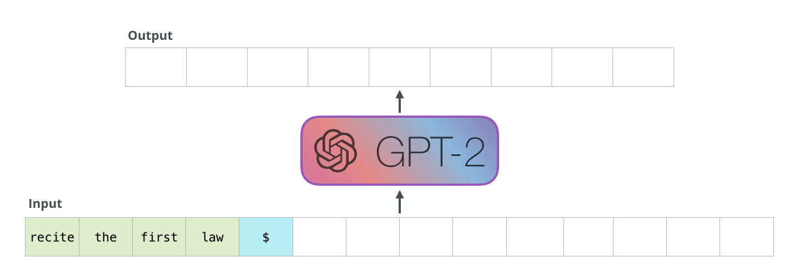
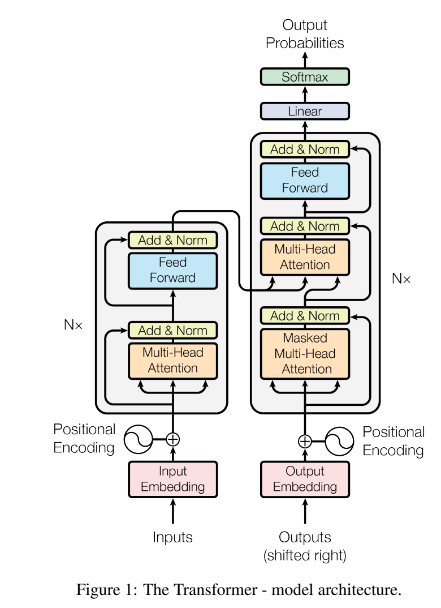
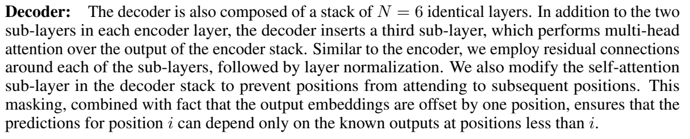
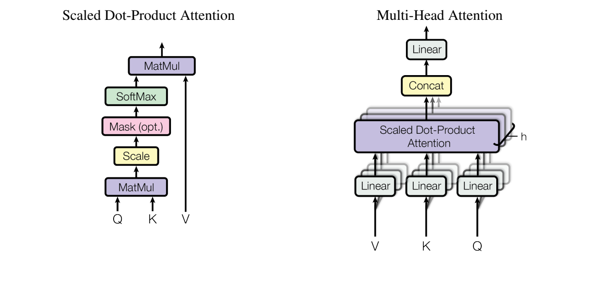
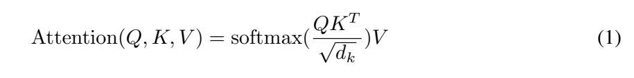
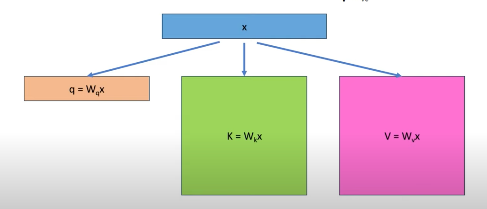

# 第20讲：KV cache 与增量推理

模型读完“我 喜欢 喝”，准备接着写“茶”。前三个位置已经计算过，下一步能保存哪些结果、少算哪些步骤？这一讲沿着**文字 → 编号 → Q/K/V → 缓存槽位 → 下一次注意力**走一遍。

[原notebook的Python注释版](代码/tutorials/llama2_src_cache_kv_代码注释.py)可配合阅读；[单元说明](代码单元解释.md)按原编号查找；[完整Attention阅读版](代码/tutorials/Attention官方源码_代码注释.py)补齐课程摘录的上下文。单元编号从0开始。

## 1. 模型生成一个词后，怎样继续写

先把三个中文片段当作三个教学token，假设它们的编号是`[1,2,3]`。**token**是分词器处理的文本片段；真实分词器可能把一个词拆成多项。这里用三个编号方便跟踪位置。下文的位置从0开始计数，所以这三项位于0、1、2。

模型的embedding将每个编号变成一排浮点数，后续网络不断处理这些数，最后给词表中的候选token打分。分数叫**logits**。从最后一个位置的logits选出编号4，再将它放回输入，模型就能继续预测编号5。

| 时刻 | 已有编号 | 最后位置的输出用来预测 |
|---|---|---|
| 读完提示 | `[1,2,3]` | 第四个编号4 |
| 继续一步 | `[1,2,3,4]` | 第五个编号5 |
| 再继续一步 | `[1,2,3,4,5]` | 第六个编号 |

这种“用已有内容预测下一项，再把结果接回去”的方式叫**自回归生成**。新选出的4，要到下一次forward才成为模型的输入。



原图从下方输入出发，经GPT-2向上得到新token，再把它接回输入。一次次变长的是已有文本；每轮最后一个位置负责下一项预测。课程第4格的Output列也按累计文本展示这个过程。

## 2. 为什么每一层都要保存 K 和 V

一层Attention接收各位置的隐藏状态。**隐藏状态**就是经过网络处理后的一排数，表示该位置当前携带的信息。从同一个隐藏状态出发，三组线性投影产生：

- **Query，Q**：当前位置用来匹配信息的向量。
- **Key，K**：各位置提供的匹配向量。
- **Value，V**：按匹配程度加权汇总的内容向量。


图中的x沿三个箭头分别乘Wq、Wk、Wv，得到q、k、v。W是训练得到的参数，表示“怎样变换”；K/V是当前文本经过变换得到的结果。保存K/V，就是保存这次文本的中间计算。

对位置3的新token，Q需要与位置0、1、2、3的K做匹配，再把这四个位置的V加权汇总。下一步位置4会有新的Q，也会产生自己的K/V。此前位置的K/V可以继续使用。


顺着红色箭头看，当前末位置提供一行q；绿色和粉色箭头表示K/V覆盖可见的整个前缀，包含当前位置。V先保存各位置的内容，最终加权和要等注意力概率算出后再求。

深层网络也遵循这条路径，只是x已经是前面各层处理后的隐藏状态。因此**每一层分别保存自己的K/V**。

## 3. 旧位置为什么能保持原值：因果注意力



出处：[Attention Is All You Need，v5第3页Figure1](https://arxiv.org/pdf/1706.03762v5)。右侧从底部的输出embedding向上走，首先经过**Masked Multi-Head Attention**：带遮罩的多头自注意力。图中的N×表示重复堆叠的层，左右弯曲箭头表示残差连接。

这张原图是encoder-decoder结构：左侧编码输入，右侧生成输出，中间还有读取encoder结果的注意力。Llama沿decoder-only路径组织网络；本讲关注其中“当前位置只读取已知前缀”的自注意力条件。

原论文紧接着这样说明decoder的可见性：



出处：同论文第3页§3.1。段落的要点是：decoder自注意力遮住后续位置，再配合输入与预测目标错开一个位置，使每次预测只依赖已知输出。以`[1,2,3,4]`为输入时：位置0看0，位置1看0–1，位置2看0–2，位置3看0–3。

现在追加位置4。位置0–3的可见范围保持原样，它们在这一层的输出也保持原值；下一层输入仍相同，于是后续各层旧位置的K/V也相同。这个结论沿层逐步成立，前提是模型参数、前缀、位置和推理设置固定。

保存这些K/V的空间叫**KV cache**。新位置仍要读取旧内容，只是直接读取已算好的结果。旧Q对应旧位置的查询；当前只需要算新位置的输出，所以缓存保留K/V。

## 4. 一次新查询怎样汇总四行 V



出处：同论文第4页Figure2。左图从底部Q、K开始：MatMul求点积 → Scale缩放 → Mask遮住不可见位置 → SoftMax变成概率 → 与右侧V再做MatMul。右图将这套计算分到多个head，Concat拼接结果，再经过Linear投影。

对应的原公式就在这里：



出处：同论文第4页公式(1)。将它写成带有因果遮罩的形式：

$$A=\operatorname{softmax}\left(\frac{QK^\mathsf T}{\sqrt d}+M\right),\qquad O=AV.$$

Q是当前查询，K的每行是一个位置的键；$K^\mathsf T$交换行列，方便一次算出Q与各K的点积。d是每个head的通道数；除以$\sqrt d$调节点积幅度。M在可见位置取0、未来位置取负无穷。softmax沿key所在轴把分数变成总和为1的非负权重，O是按这些权重汇总V得到的输出。

先看单个head、一个新位置、每行两个数的例子。所有四个位置都已可见：

```python
import math
import torch

q = torch.tensor([[1., 0.]])
k_all = torch.tensor([[1., 0.], [0., 1.], [1., 1.], [1., -1.]])
v_all = torch.tensor([[2., 0.], [0., 4.], [2., 2.], [4., 0.]])
scores = q @ k_all.T / math.sqrt(2)
probabilities = scores.softmax(dim=-1)
output = probabilities @ v_all
print(scores)
print(probabilities)
print(output)
```

四个点积分别是1、0、1、1。缩放后，权重约为`[0.2863,0.1412,0.2863,0.2863]`：第一、三、四行相同，第二行稍小。最后一行代码用这四个权重乘V的四行，再按列相加，得到约`[2.2902,1.1372]`。

这里的K/V包含前三个旧位置和一个当前位置。接下来把它们真正放进缓存，就能看清“复用”发生在哪一行。

## 5. 先写三个槽位，再写第四个

Tensor是按轴组织的数字数组，**shape**记录各轴长度。Llama缓存的轴顺序为：`[batch, 容量, KV头数, 每头通道数]`。batch表示同时处理几条独立序列。

取`B=1`、最大容量8、1个KV头、每头2个数。K、V各分配一个`[1,8,1,2]`张量。**容量8**表示最多容纳8个位置；读完前三个token时，**有效长度为3**。

下面这个小类只接收已经得到的K/V，用来观察缓存的读写。`__init__`创建缓存；`write`将当前片段写入并返回有效前缀；`self`指当前缓存对象。

```python
class KVSlots:
    def __init__(self):
        self.cache_k = torch.zeros(1, 8, 1, 2)
        self.cache_v = torch.zeros(1, 8, 1, 2)

    def write(self, xk, xv, start_pos):
        bsz, seqlen, _, _ = xk.shape
        self.cache_k[:bsz, start_pos:start_pos + seqlen] = xk
        self.cache_v[:bsz, start_pos:start_pos + seqlen] = xv
        keys = self.cache_k[:bsz, :start_pos + seqlen]
        values = self.cache_v[:bsz, :start_pos + seqlen]
        return keys, values

slots = KVSlots()
k4 = k_all.reshape(1, 4, 1, 2)
v4 = v_all.reshape(1, 4, 1, 2)
slots.write(k4[:, :3], v4[:, :3], start_pos=0)
old_k = slots.cache_k[:, :3].clone()
keys, values = slots.write(k4[:, 3:4], v4[:, 3:4], start_pos=3)
cache_output = (q @ keys[0, :, 0].T / math.sqrt(2)).softmax(-1) @ values[0, :, 0]
assert torch.equal(old_k, slots.cache_k[:, :3])
assert torch.equal(cache_output, output)
print(slots.cache_k.shape, keys.shape)
print(keys[0, :, 0])
```

第一次`start_pos=0,seqlen=3`，赋值范围`0:3`写入0、1、2。第二次`start_pos=3,seqlen=1`，范围`3:4`只写索引3。Python切片包含左端、不包含右端；`3:4`因此只有一行。

第二次读取`:4`，拿到0–3共四行。容量shape仍是`[1,8,1,2]`，有效keys为`[1,4,1,2]`；索引4–7留给以后使用。`[:bsz]`取当前有效的batch行，最后两个轴保持不变。

`reshape`将同一组数按新shape组织；`clone`复制一份数值，便于比较写入前后。这个例子中，前三行保持原样，从缓存算出的输出与上节直接计算一致。

## 6. 把槽位读写放回真正的 Attention

课程第18格给出了Attention的部分源码。完整计算可以沿这条路径读：

```text
x [B,S,D]
  → wq / wk / wv：三路投影
  → view：拆出各自的head轴
  → apply_rotary_emb：按绝对位置旋转Q/K
  → 写入当前K/V，读出有效前缀
  → repeat_kv：将KV组对应到查询头
  → transpose：变为[B,H,S,d]
  → QKᵀ / √d + mask → softmax → 乘V
  → 合并head → wo → [B,S,D]
```

D是隐藏宽度，S是本次输入的token数，H是head数，d是每个head的宽度。多head把一排数分成几组分别匹配，最后再组合。GQA允许多个查询头共享一组K/V，第21讲会展开这个分组。

用下节的小模型举例：B=1、D=8、2个查询头、1个KV头，每头d=4。已经有3个旧位置，再输入1个新位置时：

| 对象 | shape | 这一步在做什么 |
|---|---|---|
| x | `[1,1,8]` | 当前一个位置的隐藏状态 |
| wq(x) / wk(x) / wv(x) | `[1,1,8]` / `[1,1,4]` / `[1,1,4]` | 三路投影各自输出通道 |
| 拆head后的Q / 新K/V | `[1,1,2,4]` / `[1,1,1,4]` | 每个查询头和KV头各有4个数 |
| 读出的K/V | `[1,4,1,4]` | 3个旧位置加1个当前位置 |
| repeat_kv后的K/V | `[1,4,2,4]` | 一组KV供两个查询头使用 |
| 转置后的Q / K/V | `[1,2,1,4]` / `[1,2,4,4]` | 将head轴放在位置轴之前 |
| scores / 每头输出 | `[1,2,1,4]` / `[1,2,1,4]` | 一个查询匹配4个位置，再汇总成4通道 |
| 合并head、wo之后 | `[1,1,8]` | 两头结果接起来并投影回隐藏宽度 |

上表中scores最后一维的4表示key位置数，每头输出最后一维的4表示通道数。这次碰巧相同，序列继续增长后，前者会增长，后者仍为4。

原源码的`self.cache_k = self.cache_k.to(xq)`让缓存的设备和dtype与当前计算匹配。**dtype**是元素的数值格式，例如float32；device表示CPU或GPU。随后进行的四条切片读写，与上节`KVSlots.write`使用同样的结构。

第18–19讲讲过，RoPE按绝对位置旋转Q/K。因此写进cache的K已经旋转过，V则保持普通投影结果。读旧K时直接使用它；每次只对新位置的Q/K应用本次位置的角度。

`start_pos`把这些步骤连在一起：若本次起点为3，频率表取`[3:4]`，缓存写入`[3:4]`，有效前缀读取`[:4]`。三处都指向同一个绝对位置。



课程图把新q画成一行，把K/V画成多行。它概括的是读取前缀后的注意力输入；代码中追加到缓存的K/V本次只有新位置对应的行。

## 7. Prefill 和 decode 少算了哪些位置

**Prefill**先处理整段提示，建立各层前缀缓存；**decode**随后逐次处理选出的新token，继续生成。用3个提示token，接着再处理3个新token：

| 调用 | 每次重算整个前缀 | 缓存路径本次输入 | start_pos | 可读取KV长度 |
|---|---:|---:|---:|---:|
| prefill | 3 | 3 | 0 | 3 |
| decode 1 | 4 | 1 | 3 | 4 |
| decode 2 | 5 | 1 | 4 | 5 |
| decode 3 | 6 | 1 | 5 | 6 |

投影和逐位置FFN累计处理的位置数，从`3+4+5+6=18`变成`3+1+1+1=6`。新Q每次仍要与有效前缀的K/V做注意力，因此随前缀变长，读取的内容也变多。


动画上半部展示前缀重算，下半部标出复用的内容。顺着Q与K的乘法走到V的汇总，注意观察：旧K/V保留，新Q这一行的匹配分数仍在每一步计算。图中的紫色表示读取cache，灰色表示被遮住的位置。

下面使用固定Meta源码的完整Transformer，运行同一组编号的两条路径。`cpu_llama_session`准备本地FairScale运行环境，并将原源码中两处缓存分配改到CPU；其余模型计算使用原实现。准备方法见[复现说明](复现/README.md)。

```python
from pathlib import Path
import sys

scripts = Path("lessons/20 KV cache 与增量推理/复现/scripts")
sys.path.insert(0, str(scripts))
from verify_foundation_examples import cpu_llama_session

with cpu_llama_session() as llama:
    args = llama.ModelArgs(dim=8, n_layers=2, n_heads=2, n_kv_heads=1,
                           vocab_size=16, multiple_of=4,
                           max_batch_size=1, max_seq_len=8)
    torch.manual_seed(20)
    cached = llama.Transformer(args).eval()
    with torch.no_grad():
        for parameter in cached.parameters():
            if parameter.ndim == 1:
                parameter.fill_(1)
            else:
                parameter.normal_(0, 0.1)
    reference = llama.Transformer(args).eval()
    reference.load_state_dict(cached.state_dict())
    ids = torch.tensor([[1, 2, 3, 4, 5, 6]])
    cached_lengths, reference_lengths, errors = [], [], []
    hc = cached.layers[0].attention.wk.register_forward_pre_hook(
        lambda module, inputs: cached_lengths.append(inputs[0].shape[1]))
    hr = reference.layers[0].attention.wk.register_forward_pre_hook(
        lambda module, inputs: reference_lengths.append(inputs[0].shape[1]))
    for end in (3, 4, 5, 6):
        start = 0 if end == 3 else end - 1
        new_logits = cached(ids[:, start:end], start)
        full_logits = reference(ids[:, :end], 0)[:, start:end]
        errors.append((new_logits - full_logits).abs().max().item())
        assert torch.allclose(new_logits, full_logits, atol=1e-6, rtol=1e-5)
    hc.remove()
    hr.remove()
    print(cached_lengths, reference_lengths)
    print(errors)
```

这里的模型有2层、隐藏宽度8、2个查询头、1个KV头。全部矩阵显式填入随机数，归一化增益设为1；两份模型用相同权重，便于比较计算路径。`eval()`切换到推理模式；`load_state_dict`把参数复制给参考模型；hook在真实投影执行前记录输入的序列长度。

输出长度分别是`[3,1,1,1]`和`[3,4,5,6]`。参考模型每次从0重算整个前缀，缓存模型只输入新增片段。固定Meta接口返回本次所有位置的logits，shape是`[B,S,Vocab]`；比较时参考结果也切到相同位置。生成循环再取最后位置的logits，选下一个ID。

原Meta接口通过`start_pos`控制读写；课程后面的GPT-2例子则使用`generate(use_cache=True/False)`切换生成路径。

## 8. 新片段含两个token时，mask怎样补上历史

前三个位置已缓存，再一次送入两个新token：本次Q有2行，可用K有5行，注意力分数的shape为`[B,H,2,5]`。第一个新位置在绝对位置3，能看0–3；第二个在4，能看0–4。

设P为已有长度，S为本次输入长度，本次第i行Q的绝对位置是P+i。key的位置为j：

$$M_{ij}=\begin{cases}0,&j\le P+i,\\-\infty,&j>P+i.\end{cases}$$

```python
def make_causal_mask(start_pos, seqlen):
    query_positions = start_pos + torch.arange(seqlen)
    key_positions = torch.arange(start_pos + seqlen)
    visible = key_positions[None, :] <= query_positions[:, None]
    return torch.where(visible, 0.0, -float("inf"))

chunk_mask = make_causal_mask(3, 2)
print(chunk_mask)
```

`None`增加一个轴，让query位置成为`[S,1]`、key位置成为`[1,P+S]`；广播比较后得到`[S,P+S]`。`torch.where`按布尔条件选择0或负无穷。P=3、S=2时，两行分别是`[0,0,0,0,-∞]`、`[0,0,0,0,0]`。

固定课程所对应的旧Meta版本在`Transformer.forward`中建立`[1,1,S,S]`的mask，再用`triu(diagonal=start_pos+1)`处理。P=0的prefill正常；S=1时也可直接读取全部前缀。P>0且S>1时，旧mask末轴S与分数末轴P+S不匹配，需改为上面这种覆盖历史加新片段的矩形mask。复现说明保留了原报错和单条mask赋值的修正对照。

每条会话还要保持自己的前缀、位置和batch行对应关系。新会话从0写入提示；读取范围由当前有效长度决定，旧尾部不会进入这个前缀。切换模型参数或替换已有前缀后，应重新建立与新输入匹配的缓存。

## 9. 缓存需要多少空间

K和V各保存一份张量，再乘层数：

$$\text{bytes}=2\times L\times B\times T\times H_{kv}\times d\times w.$$

L是层数，B是batch，T是保存的token数，$H_{kv}$是KV头数，d是每头通道数，w是每元素字节数。float32每个数4字节，FP16每个数2字节。

上节小模型按容量预分配：`2×2×1×8×1×4×4=512 bytes`。只读完3个token时，有效部分是`2×2×1×3×1×4×4=192 bytes`，分配容量仍为512 bytes。空间预算要分别看“预留多少”和“当前使用多少”。

Llama 2 7B的32层、32个KV头、每头128通道，若B=1、T=1024、每数2字节，KV约为512MiB；B=8时约4GiB。这里计算的是KV本身，运行时还需要权重和临时张量等空间。GQA减少KV头数，也就缩小这一项。

缓存是随文本变化的运行状态；模型参数在推理中保持原值。固定Meta实现将cache放在普通Tensor属性中，保存`state_dict`时保存参数及已注册buffer；会话cache不在其中。

## 10. 原 notebook 的25格怎样串起来

| 单元 | 内容 | 上文位置 |
|---|---|---|
| 0–4 | 导入、注意力公式、自回归任务与逐步生成表 | 第1–4节 |
| 5–6 | 自回归动画与历史价格图 | 第1节；价格图按课程当时资料阅读 |
| 7–13 | QKV投影、单步解码与缓存动画 | 第2、6–7节 |
| 14–15 | Llama型号、层数与维度表 | 第6、9节 |
| 16–17 | SentencePiece与实际prompt分词 | 第1节的ID入口 |
| 18–19 | Attention摘录及上下文 | 第5–6、8节 |
| 20–22 | 本机网络设置、GPT-2加载与tokenizer展示 | 下段 |
| 23–24 | 两种缓存设置的计时循环与空单元 | 下段 |

第17格将`I believe the meaning of life is`编码成`[1,306,4658,278,6593,310,2834,338]`，其中1是BOS。真实模型再把这些ID经过embedding和各层网络处理，才得到缓存中的浮点K/V。

第21格用AutoTokenizer和AutoModelForCausalLM加载GPT-2。第23格遍历`use_cache=True/False`，每种运行10次，新增token上限1000，再用NumPy计算平均时间和标准差。`**tokenizer(...)`把分词结果字典展开为模型参数，`.to(device)`将输入移动到对应设备。

这个计时循环适合联系“缓存开关”和生成调用。比较速度时，需要同时记录实际生成长度、硬件、dtype和运行方式；GPU计时还要处理异步执行。原notebook中的秒数按历史输出保留，当前小模型的例子主要观察计算路径与数值。

## 必须掌握

1. 自回归生成把选出的新ID接回输入，继续预测下一项。
2. 因果可见性使旧位置的K/V可复用，每层保存自己的结果。
3. start_pos控制位置角度、缓存写入和有效前缀读取。
4. 缓存容量与有效长度分别表示预留空间和当前可读取范围。
5. 新Q仍要与整个有效前缀计算注意力，mask必须覆盖所有key位置。

## 第二遍学习

继续看GQA的head共享、不同dtype的缓存、矩形因果mask、普通Tensor属性与buffer的区别，以及完整生成循环怎样管理每条序列的有效长度。

## 可以暂时不掌握的工程细节

多rank并行、分页缓存、连续批处理、beam重排、量化缓存和具体GPU内核，可在学习推理服务时再展开。

## Paper ↔ Code

| 概念 | 论文与代码位置 |
|---|---|
| 自回归与因果可见性 | Transformer §3.1、Figure1；课程第4格与Transformer.forward的mask |
| 点积、缩放、softmax、加权V | Transformer公式(1)、Figure2；Attention.forward的scores与output |
| 保存旧K/V | 课程第18格、Attention.cache_k/cache_v与切片读写 |
| 位置旋转 | apply_rotary_emb、freqs_cis起点切片；见第18–19讲 |
| KV头数与共享 | n_kv_heads、repeat_kv；见第21讲 |
| GPT-2缓存开关 | 原第23格model.generate(use_cache=...) |

## 复现状态与后续问题

**部分成功。** 本页四个代码块已经执行，实际小模型的缓存输出与前缀重算一致，位置、K/V内容和多token mask另有对照。环境、数值与重做命令见[复现说明](复现/README.md)。

原预训练模型、课程完整计时及GPU/多rank实验留待后续。历史计时的生成长度与硬件条件尚待补充。论文截图的版本、页码与裁剪位置见[原图来源](复现/outputs/论文截图来源.json)。

<details>
<summary>第二遍阅读：原讲解中的源码细节与历史运行记录</summary>

# 第20讲：KV cache 与增量推理

自回归模型每生成一个新 token，都要读取此前的上下文。KV cache 把每一层已经算过的 key/value 留下来，让下一步只对新增 token 计算投影与该位置的隐藏状态。本讲读清三个动作：写入本次 KV、读取有效前缀、让新 Q 与整个有效前缀做注意力。

## 1. 论文与源码地图

课程对应[固定版 llama2_src_cache_kv.ipynb](https://github.com/chunhuizhang/personal_chatgpt/blob/7fbc29824171fd07dc2c30fe922e61ebc018ad1d/tutorials/llama2_src_cache_kv.ipynb)，共25格：14代码、11 Markdown。源码、六张图和 tokenizer 位于本讲目录；[单元说明](代码单元解释.md)按原编号解释每格，[来源清单](来源清单.json)记录文件版本。

这是一节实现课，没有指定独立的“KV cache 论文”。理论基础对应 [Attention Is All You Need，arXiv v5（2017-12-06）](https://arxiv.org/pdf/1706.03762v5)：§3.1 的 masked decoder 与 §3.2.1 式(1)的 scaled dot-product attention。论文讨论模型结构、计算及翻译实验；本讲只读取与因果注意力有关的部分，没有复现论文训练或翻译指标。工程对象是 Llama 2 的缓存切片和 Transformers GPT-2 的生成开关。

完整 Meta 模型固定为 [meta-llama/llama 的 model.py，提交7565eb6](https://github.com/meta-llama/llama/blob/7565eb6fee2175b2d4fe2cfb45067a61b35d7f5e/llama/model.py)，源码 SHA256=`56a45f1833eedb70dd94d31dfe9d9be378a9f33458f2f5137e681873a7603754`。官方完整快照仍在本地来源材料中，公开阅读入口提供[完整 Attention 类的中文注释](代码/tutorials/Attention官方源码_代码注释.py)，其 AST 和非注释 token 与固定原类相同。

| 路径或对象 | 作用与本讲范围 |
|---|---|
| 上游 README、依赖配置 | 定位历史教程；课程没有锁定老师当时的完整运行环境 |
| notebook 0–15 | 自回归、QKV 图、模型维度表；不构建 Llama 模型 |
| notebook 16–17 / tokenizer.model | SentencePiece 真实分词，产生 token ID |
| Markdown18 / Attention | 不完整源码摘录；只写到读取 keys/values |
| ModelArgs / Transformer.forward | 完整源码的容量配置、embedding、位置切片、mask 和逐层调用 |
| TransformerBlock.forward | attention_norm → Attention → 残差 → ffn_norm/MLP → 残差 |
| Attention.forward | QKV → RoPE → 写/读缓存 → attention → 输出投影 |
| notebook 21–23 | AutoTokenizer/AutoModelForCausalLM → generate → 计时 |
| 数据集、loss、optimizer、训练入口 | 本 notebook 未提供；本次是推理验证，不额外发明训练任务 |
| 原 Llama 2 / GPT-2 权重 | 未用于本次验证；真实随机小模型与原权重区分记录 |

实际数据路径：文本 → tokenizer → `int64[B,S]` token IDs → embedding → 各层隐藏状态 → Attention cache → 最后归一化与词表投影 → logits → 取最后位置预测下一 token。固定 Meta `Transformer.forward` 返回 **`[B,S,Vocab]` 全部本次位置的 logits**，调用方才取最后位置，不能把模型返回值误写成已经只有一行。

## 2. 为什么旧的 KV 可以复用

训练中的 next token prediction 把目标向左错一位：输入 `SOS, Love, that`，目标 `Love, that, can`。每个位置只能看到自己和更早的位置。训练可用 mask 并行计算各位置；推理还不知道未来 token，必须先确定一个 token 再继续。课程单元4表格的 Output 列是累计文本，不是一次 forward 预测整句话。

在参数、前缀、位置和推理模式固定时，因果注意力使旧位置的隐藏状态不受后来追加 token 影响。因此每层旧位置的 K/V 也保持不变。下一次新增位置只需要自己的 Q，再读取所有可见 K/V。未来查询不会使用旧 Q，所以这里不缓存 Q。

要把“缓存”与“删除历史上下文”分开：历史仍参与注意力，只是读取以前算好的 K/V。它也不是把整张 attention score 矩阵保存下来，新 query 对历史的分数每步都要计算。

普通双向 encoder 追加后文可能改变旧位置的表示，不能直接套这个条件。课程关于 BERT 的句子指常规非自回归用法；T5 的 decoder 还可复用 encoder cross-attention 的投影状态。这里没有验证这些模型的全部特殊配置。

## 3. 把公式变成形状

本节使用本地变量 $B$=batch，$P$=已经缓存的长度，$S$=本次新增输入长度，$D$=隐藏通道，$H_q$=Q head 数，$H_{kv}$=KV head 数，$d=D/H_q$。省略 head 轴时，每个 head 的注意力写成：

$$
Q=XW_Q,\quad K_{\rm new}=XW_K,\quad V_{\rm new}=XW_V,
$$

$$
K_{\rm all}=[K_{\rm past};K_{\rm new}],\quad
V_{\rm all}=[V_{\rm past};V_{\rm new}],
$$

$$
A=\operatorname{softmax}_{j}\left(\frac{QK_{\rm all}^{\mathsf T}}{\sqrt d}+M\right),\quad O=AV_{\rm all}.
$$

这是 attention 式(1)加上明确的因果 mask $M$；分号表示 token 轴逻辑拼接，不要求实现一定使用 `torch.cat`。单 head `Q:[B,S,d]`，`K/V:[B,P+S,d]`，`A:[B,S,P+S]`，`O:[B,S,d]`。$j$ 是被关注的 key 索引，softmax 沿该轴归一化；除以 $\sqrt d$ 缩放点积，不是做向量单位化。

$W_Q/W_K/W_V$ 是训练得到的投影参数。本段行向量记法下，单head每个W为 `[D,d]`；全head合并的Wq为 `[D,Hq*d]`，Wk/Wv为 `[D,Hkv*d]`。PyTorch Linear存储weight的轴顺序相反，forward使用转置。$X:[B,S,D]$ 是本层输入，$A$ 是注意力权重，$O$ 是每head输出；投影权重与cache的内容不是同一种状态。

数字例子：取 `B=S=1,d=2`，`q=[1,0]`，两行 `K=[[1,0],[0,1]]`，`V=[[2,0],[0,4]]`。若两个位置均可见，分数为 `[1/√2,0]`，权重约 `[0.6698,0.3302]`，输出约 `[1.3395,1.3210]`。V 只是被聚合的原材料；`A@V` 才是加权和。

多 head 的完整轨迹为：

| 变量 | dtype / shape | 下一步 |
|---|---|---|
| tokens | int64 `[B,S]` | embedding lookup |
| x | 浮点 `[B,S,D]` | Q/K/V 投影，深层 x 是归一化后的隐藏状态 |
| xq | `[B,S,Hq_local,d]` | RoPE，转置为 `[B,Hq_local,S,d]` |
| xk / xv | `[B,S,Hkv_local,d]` | K做RoPE，V不做；写入各自cache |
| cache_k/v | `[Bmax,Tmax,Hkv_local,d]` | 预分配容量，普通 Tensor 属性 |
| keys/values | `[B,P+S,Hkv_local,d]` | 只读有效前缀；GQA时展开到Q heads |
| scores | `[B,Hq_local,S,P+S]` | 加mask、沿最后轴softmax |
| output | `[B,S,Hq_local*d]` | wo投影回 `[B,S,D]` |

`local` 是模型并行 rank 的本地 head 数。本次 world_size=1，local 等于全局。下一讲再展开 GQA；本讲要先记住缓存用 KV heads 计数。

## 4. Prefill 与 decode 各算哪些 token

假设提示词是3个 token，要再处理3个新 token：

| 调用 | 无复用的完整前缀重算 | 使用缓存的本次输入 | 本次 start_pos | 读取有效KV长度 |
|---|---:|---:|---:|---:|
| 提示词 prefill | 3 | 3 | 0 | 3 |
| 下一步 | 4 | 1 | 3 | 4 |
| 再下一步 | 5 | 1 | 4 | 5 |
| 再下一步 | 6 | 1 | 5 | 6 |

每层每个 Q/K/V 投影处理的 token 长度之和，重算为18，缓存为6；batch=2时对应36与12个 token 行。本次真实 forward hook 观测到 `[3,4,5,6]` 与 `[3,1,1,1]`，不是只根据示意图猜测。

缓存减少投影、MLP 等旧位置计算。单 token 新 query 仍读取越来越长的历史，注意力乘法与内存流量不会消失。对生成总长 N，朴素每步完整前缀注意力重复累计可到 $O(N^3d)$，缓存每步只算新行累计为 $O(N^2d)$；这是忽略固定 head/batch 等系数的运算量比较，不能直接当作端到端延迟比。真实速度还取决于硬件、序列长度、内核与内存。

## 5. 顺着课程图读一次


上方 x 沿三条箭头经过 Wq/Wk/Wv 变成 Q/K/V；三组权重可训练，cache 的切片索引不可训练。图中写 $W x$ 是列向量约定；前文 $XW$ 是行向量记法，对应到 PyTorch Linear 时权重存储还有转置，不能只凭图中左右顺序判断矩阵 shape。


看上方句子向下的箭头：新位置提供一行 q，历史加当前位置提供 K/V 的多行。红色箭头没有让 query 跳过当前 token；它只是强调单 token decode 的新查询。每层 x 已携带此前层处理过的信息，不只是原始词嵌入。


动画上半部是不复用的路径，下半部是缓存路径；沿 Q → 与 Kᵀ 相乘 → 与 V 聚合的方向阅读。图例区分被mask的区域和缓存复用区域。图省略或压缩了缩放、softmax、heads 等细节，精确运算以本讲公式与完整类为准。另两张原图分别展示自回归逐步生成和单次 decoding 的 QKV。

单元6的 `gpt4-price.png` 记录课程当时的价格。理解缓存时，重点看前面的计算流程图。

## 6. 课程源码摘录：逐步理解状态变化

先看[摘录注释](代码/tutorials/Attention摘录_代码注释.py)，再对照[完整官方类](代码/tutorials/Attention官方源码_代码注释.py)。`class Attention(nn.Module)` 定义一个模型类；`self` 是当前实例，`__init__` 建立权重和缓存，`forward` 接收输入并更新缓存。类型注解帮助读者理解，不会自动检查所有 shape。课程摘录少了 `super().__init__()`、head属性计算、`bsz,seqlen` 解包与最终 attention/return，不能直接运行。

### 6.1 先分配容量，再逐步写入

```python
self.cache_k = torch.zeros((Bmax, Tmax, Hkv_local, d)).cuda()
self.cache_v = torch.zeros((Bmax, Tmax, Hkv_local, d)).cuda()
```

这里用简写变量展示原语句的结构，完整原变量名在注释版。`torch.zeros` 分配固定大小的零张量，`.cuda()` 把它放到 CUDA。它是普通属性，没有作为 `nn.Parameter` 训练，也没有用 `register_buffer` 注册。真实检查中 `state_dict` 与 `named_buffers` 都不含 cache；保存权重不会自动保存本次会话状态。

### 6.2 投影与 RoPE

完整类先从 x 读 B/S，再用 `self.wq(x)` 等调用子模块。`ColumnParallelLinear` 切输出通道，`RowParallelLinear` 切输入通道；本讲仅测试真实 FairScale 的单 rank 路径。`view` 把通道拆成 head 轴，形状见上表。`apply_rotary_emb` 使用本次绝对位置的频率旋转 Q/K；V 不旋转。缓存 K 已带位置，后续不要再次旋转整份旧 K。

### 6.3 `.to(xq)` 与切片赋值

```python
self.cache_k = self.cache_k.to(xq)
self.cache_v = self.cache_v.to(xq)
self.cache_k[:bsz, start_pos:start_pos + seqlen] = xk
self.cache_v[:bsz, start_pos:start_pos + seqlen] = xv
keys = self.cache_k[:bsz, :start_pos + seqlen]
values = self.cache_v[:bsz, :start_pos + seqlen]
```

`.to(xq)` 让 cache 匹配 xq 的设备与 dtype，不是保存 Q。若无需转换可以返回原对象，若需要转换可能重新分配。普通 Tensor 属性不随 `model.to(...)` 自动注册迁移，forward 里的显式转换因此有实际作用。

假设 P=3,S=1，赋值只覆盖索引3，即第四个 token 的槽；读取0到3共4个 token。Python 切片右端不包含在内。`[:bsz]` 选有效 batch，省略后两轴表示全部 KV heads 与通道。读取通常得到共享存储的 view，不是把完整 cache 复制一次。原文“append”指有效长度增加，实际语句没有重新拼接扩容。

### 6.4 摘录之后的完整计算

完整类还用 `repeat_kv` 对齐 Q/KV head 数，将序列轴和 head 轴交换，计算 score、加 mask，FP32 softmax 后转回输入 dtype，再乘 V、合并 heads、wo 投影回D。返回值 `[B,S,D]` 供上层加残差；同时 cache 被更新，这就是“有状态”的前向。

## 7. 位置、mask 和固定旧版的边界

第 i 行本次 query 的绝对位置是 $P+i$，key 的索引为 j。正确因果 mask 为：

$$
M_{ij}=\begin{cases}0,&0\le j\le P+i\\-\infty,&j>P+i\end{cases},\qquad
0\le i<S,\quad 0\le j<P+S.
$$

例子 P=3,S=2，需要 `[2,5]`：首行 `[0,0,0,0,-∞]`，次行 `[0,0,0,0,0]`。已有历史都可见，新 chunk 内部只看到不晚于自己的位置。

**固定旧版 `Transformer.forward` 在这个情形有问题。** 它先建立 `[1,1,S,S]`，再 `triu(diagonal=start_pos+1)`，但 attention scores 末轴是 P+S。实际先 prefill3再送2，报 `The size of tensor a (5) must match the size of tensor b (2)`。首段P=0正常；后续S=1时不建mask，也正常。不能把这个版本边界推广成所有 Llama 实现都有同一错误。

独立教学变体只把原 `mask = torch.triu(...).type_as(h)` 这一条赋值换成“左侧 P 列零 + 新块 S×S 的上三角”后，分块 `[3,2,1]` 的 logits 与完整重算相符。两处 CPU 设备适配和一处 mask 修改均记入报告，原 notebook 与完整官方类阅读版未被修正改写。

有效复用还要求相同模型参数、前缀、位置、batch 行对应关系；不能把另一个会话的前缀或空洞当作已有历史。本次实际错误前缀产生最大logit差约0.422，跳过前三个槽直接从3开始产生约0.682；这两个数来自本节的小模型。新会话从0写入前缀且读取范围正确时，旧尾部即使有脏数据也不会被读取。

## 8. 缓存占多少内存

$$
\text{bytes}_{\rm cache}=2\times L\times B\times T\times H_{kv}\times d\times w.
$$

2表示K和V，L是层数，B是batch，T是缓存token数，Hkv是KV head数，d是每head通道，w是每元素字节数。估计“使用量”用有效B/T；固定预分配的“分配量”用Bmax/Tmax。在模型并行估计当前rank时换成本地KV heads，不能同时按全局heads又重复乘rank数。

以7B的32层、32个KV heads、d=128、B=1、T=1024、FP16每元素2字节为例，缓存为536870912字节，即512MiB；B=8则4GiB。这里只算KV，不含权重、attention临时结果和其他内存。原模型表只列 query heads，不足以推出70B的KV内存。

本次 tiny Meta 配置L=2、Bmax=2、Tmax=16、Hkv=2、d=4、FP32：真实分配4096字节；两条序列有效长度6时有效前缀占1536字节。即使只解码一个token，也已经预留了最大容量。

## 9. Transformers 原代码怎么读

单元21先导入 NumPy/time/torch，再用两个 Auto 类加载 GPT-2 tokenizer与模型；原版可能访问网络。`device = "cuda" if ... else "cpu"` 是条件表达式。单元20的代理变量是讲师本地网络设置，和缓存算法无关，本次跳过该格。单元22的 repr 展示 tokenizer 类型、词表和相关配置。

单元23外层遍历 `use_cache=True/False`；内层重复10次，`**tokenizer(...)` 把 input_ids/attention_mask 等字段解包为关键字参数。`.to(device)` 移动输入张量。`max_new_tokens=1000` 表示新增上限，EOS仍可提前终止；返回通常包含提示词+生成部分，原代码没有保存返回值。

`times.append` 收集秒数，`np.mean` 是均值，`np.std` 默认ddof=0，打印的+-是总体标准差形式，不是置信区间。历史输出为开缓存 `6.636±0.023` 秒、关缓存 `8.283±0.049` 秒；原硬件、实际生成长度、warmup与同步条件没有完整留下，不能拿它当当前机器或任意大模型的速度结论。

本次锁定 Transformers4.44.2，使用真实 GPT-2 类的 legacy `tuple[layer][K,V]`；每层张量为 `[B,H,T,d]`，与 Meta `[B,T,H,d]` 不同。GPT-2 使用自己的绝对位置处理，不能直接接入前文的 Llama RoPE 缓存。自行传入past时，输入只送尚未缓存的token，attention_mask长度覆盖P+S；4.44.2 的 [KV cache 文档](https://huggingface.co/docs/transformers/v4.44.2/kv_cache)说明了这一长度约束。文档中 Cache 类的 `cache_position` 不能不分模型地套到旧 GPT-2 tuple 接口。

## 10. 小模型中的缓存变化

在两层、隐藏宽度16的小模型中，先输入3个token，再逐次输入1个。两种计算方式处理的位置数如下：

| 生成步骤 | 使用缓存，本次输入长度 | 每次重算完整前缀，输入长度 |
|---|---|---|
| 读入提示 | 3 | 3 |
| 第一次续写 | 1 | 4 |
| 第二次续写 | 1 | 5 |
| 第三次续写 | 1 | 6 |

两条路径的logits最大差约6.08e-7，四步greedy生成的ID相同。缓存路径每次只计算新位置的投影，再读取整个有效前缀参与注意力；旧位置的K/V保持原值，未来槽位留待后续写入。

逐层查看缓存还能看到：K保存的是RoPE旋转后的结果，V保存的是普通投影结果。GQA配置为Q4/KV2时，持久缓存仍只有2个KV头，计算注意力时才对齐到4个查询头。

这个例子使用随机参数，便于观察计算和状态。模型配置、CPU适配及完整数值见[复现说明](复现/README.md)。

## 11. 必须掌握

- 每层缓存什么：带位置的K与未旋转V，不是旧Q或attention权重。
- P/S、prefill/decode、写切片与读有效前缀，以及当前token也进入KV。
- `QKᵀ`、softmax、乘V各自shape；单token与多token情形的区别。
- 正确的绝对位置、mask长度和会话/batch对应关系是复用条件。
- 原源码、教学变体、历史输出与本次结果分别是什么。

## 12. 第二遍建议掌握

理解因果不变性如何跨多层成立；亲手算一次KV内存；读完完整Attention的head对齐、FP32 softmax和输出投影；对照Meta与HF的不同缓存布局和API。

## 13. 可以暂时不掌握的工程细节

多rank模型并行通信、paged/sliding/quantized cache、连续批处理与beam重排、具体GPU内核性能。这些内容可在学习推理服务部署时继续展开。

## 14. Paper ↔ Code

| 理论/工程概念 | 代码位置 | 对应程度 |
|---|---|---|
| Transformer式(1) scaled attention | 完整Attention的scores/softmax/matmul | 核心对应，额外带head/缓存/位置处理 |
| §3.1 masked decoder | Transformer.forward mask与Attention加mask | 因果条件对应；固定旧版多token增量边界见实测 |
| 旧KV复用 | Markdown18写切片/读前缀，完整Attention.cache_k/cache_v | 工程实现，原论文没有本讲的固定容量代码 |
| RoPE | apply_rotary_emb 与 freqs_cis[P:P+S] | 关联第18/19讲，不是原Transformer正弦位置相加 |
| GQA | n_kv_heads/repeat_kv | 本讲用于形状与小模型，详细推导在第21讲 |
| HF缓存开关 | 原单元23 model.generate(use_cache=...) | 真实GPT2路径验证，非Meta同一API |
| 原论文翻译实验/原Llama训练 | 未找到本notebook对应实现或实验记录 | 待后续开展 |

## 15. 资料与后续问题

复现状态：**部分成功**。本讲用随机小模型验证缓存与增量推理。原GPT-2/Llama2检查点、CUDA、多rank和任务评测留待后续。历史benchmark的生成长度、计时条件及讲师硬件尚待补充；课程截图保留当时的API价格。

</details>
