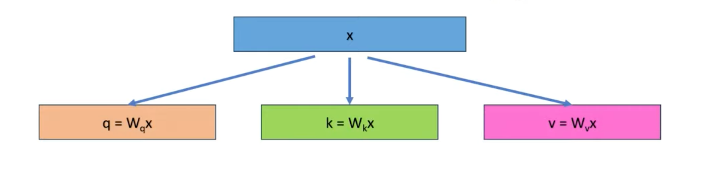
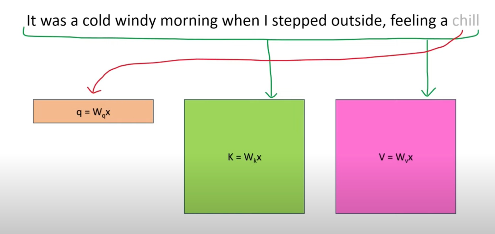
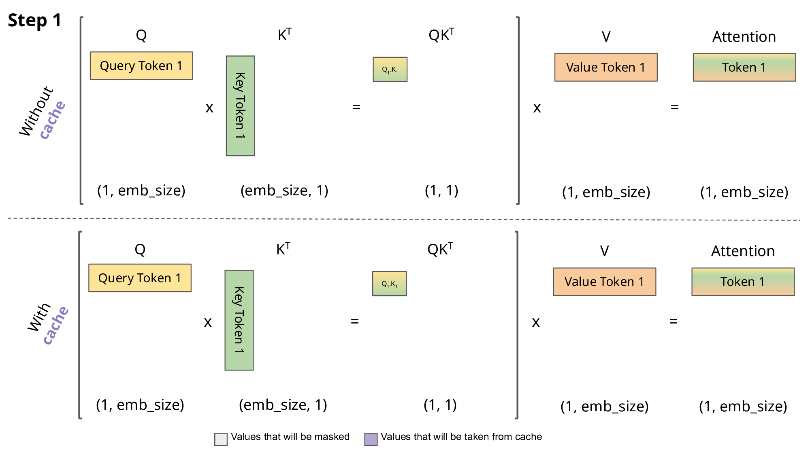

# 第20讲：KV cache 与增量推理

自回归模型每生成一个新 token，都要读取此前的上下文。KV cache 把每一层已经算过的 key/value 留下来，让下一步只对新增 token 计算投影与该位置的隐藏状态。本讲读清三个动作：写入本次 KV、读取有效前缀、让新 Q 与整个有效前缀做注意力。

## 1. 论文与源码地图

课程对应[固定版 llama2_src_cache_kv.ipynb](https://github.com/chunhuizhang/personal_chatgpt/blob/7fbc29824171fd07dc2c30fe922e61ebc018ad1d/tutorials/llama2_src_cache_kv.ipynb)，共25格：14代码、11 Markdown。源码、六张图和 tokenizer 位于本讲目录；[单元说明](代码单元解释.md)按原编号解释每格，[来源清单](来源清单.json)记录文件版本。

这是一节实现课，没有指定独立的“KV cache 论文”。理论基础对应 [Attention Is All You Need，arXiv v5（2017-12-06）](https://arxiv.org/pdf/1706.03762v5)：§3.1 的 masked decoder 与 §3.2.1 式(1)的 scaled dot-product attention。论文讨论模型结构、计算及翻译实验；本讲只读取与因果注意力有关的部分，没有复现论文训练或翻译指标。工程对象是 Llama 2 的缓存切片和 Transformers GPT-2 的生成开关。

完整 Meta 模型固定为 [meta-llama/llama 的 model.py，提交7565eb6](https://github.com/meta-llama/llama/blob/7565eb6fee2175b2d4fe2cfb45067a61b35d7f5e/llama/model.py)，源码 SHA256=`56a45f1833eedb70dd94d31dfe9d9be378a9f33458f2f5137e681873a7603754`。官方完整快照仍在本地来源材料中，公开阅读入口提供[完整 Attention 类的中文注释](代码/tutorials/Attention官方源码_代码注释.py)，其 AST 和非注释 token 与固定原类相同。

| 路径或对象 | 作用与本讲范围 |
|---|---|
| 上游 README、依赖配置 | 定位历史教程；课程没有锁定老师当时的完整运行环境 |
| notebook 0–15 | 自回归、QKV 图、模型维度表；不构建 Llama 模型 |
| notebook 16–17 / tokenizer.model | SentencePiece 真实分词，产生 token ID |
| Markdown18 / Attention | 不完整源码摘录；只写到读取 keys/values |
| ModelArgs / Transformer.forward | 完整源码的容量配置、embedding、位置切片、mask 和逐层调用 |
| TransformerBlock.forward | attention_norm → Attention → 残差 → ffn_norm/MLP → 残差 |
| Attention.forward | QKV → RoPE → 写/读缓存 → attention → 输出投影 |
| notebook 21–23 | AutoTokenizer/AutoModelForCausalLM → generate → 计时 |
| 数据集、loss、optimizer、训练入口 | 本 notebook 未提供；本次是推理验证，不额外发明训练任务 |
| 原 Llama 2 / GPT-2 权重 | 未用于本次验证；真实随机小模型与原权重区分记录 |

实际数据路径：文本 → tokenizer → `int64[B,S]` token IDs → embedding → 各层隐藏状态 → Attention cache → 最后归一化与词表投影 → logits → 取最后位置预测下一 token。固定 Meta `Transformer.forward` 返回 **`[B,S,Vocab]` 全部本次位置的 logits**，调用方才取最后位置，不能把模型返回值误写成已经只有一行。

## 2. 为什么旧的 KV 可以复用【必须会】

训练中的 next token prediction 把目标向左错一位：输入 `SOS, Love, that`，目标 `Love, that, can`。每个位置只能看到自己和更早的位置。训练可用 mask 并行计算各位置；推理还不知道未来 token，必须先确定一个 token 再继续。课程单元4表格的 Output 列是累计文本，不是一次 forward 预测整句话。

在参数、前缀、位置和推理模式固定时，因果注意力使旧位置的隐藏状态不受后来追加 token 影响。因此每层旧位置的 K/V 也保持不变。下一次新增位置只需要自己的 Q，再读取所有可见 K/V。未来查询不会使用旧 Q，所以这里不缓存 Q。

要把“缓存”与“删除历史上下文”分开：历史仍参与注意力，只是读取以前算好的 K/V。它也不是把整张 attention score 矩阵保存下来，新 query 对历史的分数每步都要计算。

普通双向 encoder 追加后文可能改变旧位置的表示，不能直接套这个条件。课程关于 BERT 的句子指常规非自回归用法；T5 的 decoder 还可复用 encoder cross-attention 的投影状态。这里没有验证这些模型的全部特殊配置。

## 3. 把公式变成形状【必须会】

本节使用本地变量 $B$=batch，$P$=已经缓存的长度，$S$=本次新增输入长度，$D$=隐藏通道，$H_q$=Q head 数，$H_{kv}$=KV head 数，$d=D/H_q$。省略 head 轴时，每个 head 的注意力写成：

$$
Q=XW_Q,\quad K_{\rm new}=XW_K,\quad V_{\rm new}=XW_V,
$$

$$
K_{\rm all}=[K_{\rm past};K_{\rm new}],\quad
V_{\rm all}=[V_{\rm past};V_{\rm new}],
$$

$$
A=\operatorname{softmax}_{j}\left(\frac{QK_{\rm all}^{\mathsf T}}{\sqrt d}+M\right),\quad O=AV_{\rm all}.
$$

这是 attention 式(1)加上明确的因果 mask $M$；分号表示 token 轴逻辑拼接，不要求实现一定使用 `torch.cat`。单 head `Q:[B,S,d]`，`K/V:[B,P+S,d]`，`A:[B,S,P+S]`，`O:[B,S,d]`。$j$ 是被关注的 key 索引，softmax 沿该轴归一化；除以 $\sqrt d$ 缩放点积，不是做向量单位化。

$W_Q/W_K/W_V$ 是训练得到的投影参数。本段行向量记法下，单head每个W为 `[D,d]`；全head合并的Wq为 `[D,Hq*d]`，Wk/Wv为 `[D,Hkv*d]`。PyTorch Linear存储weight的轴顺序相反，forward使用转置。$X:[B,S,D]$ 是本层输入，$A$ 是注意力权重，$O$ 是每head输出；投影权重与cache的内容不是同一种状态。

数字例子：取 `B=S=1,d=2`，`q=[1,0]`，两行 `K=[[1,0],[0,1]]`，`V=[[2,0],[0,4]]`。若两个位置均可见，分数为 `[1/√2,0]`，权重约 `[0.6698,0.3302]`，输出约 `[1.3395,1.3210]`。V 只是被聚合的原材料；`A@V` 才是加权和。

多 head 的完整轨迹为：

| 变量 | dtype / shape | 下一步 |
|---|---|---|
| tokens | int64 `[B,S]` | embedding lookup |
| x | 浮点 `[B,S,D]` | Q/K/V 投影，深层 x 是归一化后的隐藏状态 |
| xq | `[B,S,Hq_local,d]` | RoPE，转置为 `[B,Hq_local,S,d]` |
| xk / xv | `[B,S,Hkv_local,d]` | K做RoPE，V不做；写入各自cache |
| cache_k/v | `[Bmax,Tmax,Hkv_local,d]` | 预分配容量，普通 Tensor 属性 |
| keys/values | `[B,P+S,Hkv_local,d]` | 只读有效前缀；GQA时展开到Q heads |
| scores | `[B,Hq_local,S,P+S]` | 加mask、沿最后轴softmax |
| output | `[B,S,Hq_local*d]` | wo投影回 `[B,S,D]` |

`local` 是模型并行 rank 的本地 head 数。本次 world_size=1，local 等于全局。下一讲再展开 GQA；本讲要先记住缓存用 KV heads 计数。

## 4. Prefill 与 decode 各算哪些 token【必须会】

假设提示词是3个 token，要再处理3个新 token：

| 调用 | 无复用的完整前缀重算 | 使用缓存的本次输入 | 本次 start_pos | 读取有效KV长度 |
|---|---:|---:|---:|---:|
| 提示词 prefill | 3 | 3 | 0 | 3 |
| 下一步 | 4 | 1 | 3 | 4 |
| 再下一步 | 5 | 1 | 4 | 5 |
| 再下一步 | 6 | 1 | 5 | 6 |

每层每个 Q/K/V 投影处理的 token 长度之和，重算为18，缓存为6；batch=2时对应36与12个 token 行。本次真实 forward hook 观测到 `[3,4,5,6]` 与 `[3,1,1,1]`，不是只根据示意图猜测。

缓存减少投影、MLP 等旧位置计算。单 token 新 query 仍读取越来越长的历史，注意力乘法与内存流量不会消失。对生成总长 N，朴素每步完整前缀注意力重复累计可到 $O(N^3d)$，缓存每步只算新行累计为 $O(N^2d)$；这是忽略固定 head/batch 等系数的运算量比较，不能直接当作端到端延迟比。真实速度还取决于硬件、序列长度、内核与内存。

## 5. 顺着课程图读一次



上方 x 沿三条箭头经过 Wq/Wk/Wv 变成 Q/K/V；三组权重可训练，cache 的切片索引不可训练。图中写 $W x$ 是列向量约定；前文 $XW$ 是行向量记法，对应到 PyTorch Linear 时权重存储还有转置，不能只凭图中左右顺序判断矩阵 shape。



看上方句子向下的箭头：新位置提供一行 q，历史加当前位置提供 K/V 的多行。红色箭头没有让 query 跳过当前 token；它只是强调单 token decode 的新查询。每层 x 已携带此前层处理过的信息，不只是原始词嵌入。



动画上半部是不复用的路径，下半部是缓存路径；沿 Q → 与 Kᵀ 相乘 → 与 V 聚合的方向阅读。图例区分被mask的区域和缓存复用区域。图省略或压缩了缩放、softmax、heads 等细节，精确运算以本讲公式与完整类为准。另两张原图分别展示自回归逐步生成和单次 decoding 的 QKV。

单元6 `gpt4-price.png` 只是历史价格截图，本讲不把图中数字当作现价。图片和历史计时都不是本次实测的模型服务指标。

## 6. 课程源码摘录：逐步理解状态变化【必须会】

先看[摘录注释](代码/tutorials/Attention摘录_代码注释.py)，再对照[完整官方类](代码/tutorials/Attention官方源码_代码注释.py)。`class Attention(nn.Module)` 定义一个模型类；`self` 是当前实例，`__init__` 建立权重和缓存，`forward` 接收输入并更新缓存。类型注解帮助读者理解，不会自动检查所有 shape。课程摘录少了 `super().__init__()`、head属性计算、`bsz,seqlen` 解包与最终 attention/return，不能直接运行。

### 6.1 预分配不等于每步扩容

```python
self.cache_k = torch.zeros((Bmax, Tmax, Hkv_local, d)).cuda()
self.cache_v = torch.zeros((Bmax, Tmax, Hkv_local, d)).cuda()
```

这里用简写变量展示原语句的结构，完整原变量名在注释版。`torch.zeros` 分配固定大小的零张量，`.cuda()` 把它放到 CUDA。它是普通属性，没有作为 `nn.Parameter` 训练，也没有用 `register_buffer` 注册。真实检查中 `state_dict` 与 `named_buffers` 都不含 cache；保存权重不会自动保存本次会话状态。

### 6.2 投影与 RoPE

完整类先从 x 读 B/S，再用 `self.wq(x)` 等调用子模块。`ColumnParallelLinear` 切输出通道，`RowParallelLinear` 切输入通道；本讲仅测试真实 FairScale 的单 rank 路径。`view` 把通道拆成 head 轴，形状见上表。`apply_rotary_emb` 使用本次绝对位置的频率旋转 Q/K；V 不旋转。缓存 K 已带位置，后续不要再次旋转整份旧 K。

### 6.3 `.to(xq)` 与切片赋值

```python
self.cache_k = self.cache_k.to(xq)
self.cache_v = self.cache_v.to(xq)
self.cache_k[:bsz, start_pos:start_pos + seqlen] = xk
self.cache_v[:bsz, start_pos:start_pos + seqlen] = xv
keys = self.cache_k[:bsz, :start_pos + seqlen]
values = self.cache_v[:bsz, :start_pos + seqlen]
```

`.to(xq)` 让 cache 匹配 xq 的设备与 dtype，不是保存 Q。若无需转换可以返回原对象，若需要转换可能重新分配。普通 Tensor 属性不随 `model.to(...)` 自动注册迁移，forward 里的显式转换因此有实际作用。

假设 P=3,S=1，赋值只覆盖索引3，即第四个 token 的槽；读取0到3共4个 token。Python 切片右端不包含在内。`[:bsz]` 选有效 batch，省略后两轴表示全部 KV heads 与通道。读取通常得到共享存储的 view，不是把完整 cache 复制一次。原文“append”指有效长度增加，实际语句没有重新拼接扩容。

### 6.4 摘录之后的完整计算

完整类还用 `repeat_kv` 对齐 Q/KV head 数，将序列轴和 head 轴交换，计算 score、加 mask，FP32 softmax 后转回输入 dtype，再乘 V、合并 heads、wo 投影回D。返回值 `[B,S,D]` 供上层加残差；同时 cache 被更新，这就是“有状态”的前向。

## 7. 位置、mask 和固定旧版的边界【必须会】

第 i 行本次 query 的绝对位置是 $P+i$，key 的索引为 j。正确因果 mask 为：

$$
M_{ij}=\begin{cases}0,&0\le j\le P+i\\-\infty,&j>P+i\end{cases},\qquad
0\le i<S,\quad 0\le j<P+S.
$$

例子 P=3,S=2，需要 `[2,5]`：首行 `[0,0,0,0,-∞]`，次行 `[0,0,0,0,0]`。已有历史都可见，新 chunk 内部只看到不晚于自己的位置。

**固定旧版 `Transformer.forward` 在这个情形有问题。** 它先建立 `[1,1,S,S]`，再 `triu(diagonal=start_pos+1)`，但 attention scores 末轴是 P+S。实际先 prefill3再送2，报 `The size of tensor a (5) must match the size of tensor b (2)`。首段P=0正常；后续S=1时不建mask，也正常。不能把这个版本边界推广成所有 Llama 实现都有同一错误。

独立教学变体只把原 `mask = torch.triu(...).type_as(h)` 这一条赋值换成“左侧 P 列零 + 新块 S×S 的上三角”后，分块 `[3,2,1]` 的 logits 与完整重算相符。两处 CPU 设备适配和一处 mask 修改均记入报告，原 notebook 与完整官方类阅读版未被修正改写。

有效复用还要求相同模型参数、前缀、位置、batch 行对应关系；不能把另一个会话的前缀或空洞当作已有历史。本次实际错误前缀产生最大logit差约0.422，跳过前三个槽直接从3开始产生约0.682；这些值只证明当前小模型的反例，不是通用误差界。新会话从0写入前缀且读取范围正确时，旧尾部即使有脏数据也不会被读取。

## 8. 缓存占多少内存【建议会】

$$
\text{bytes}_{\rm cache}=2\times L\times B\times T\times H_{kv}\times d\times w.
$$

2表示K和V，L是层数，B是batch，T是缓存token数，Hkv是KV head数，d是每head通道，w是每元素字节数。估计“使用量”用有效B/T；固定预分配的“分配量”用Bmax/Tmax。在模型并行估计当前rank时换成本地KV heads，不能同时按全局heads又重复乘rank数。

以7B的32层、32个KV heads、d=128、B=1、T=1024、FP16每元素2字节为例，缓存为536870912字节，即512MiB；B=8则4GiB。这里只算KV，不含权重、attention临时结果和其他内存。原模型表只列 query heads，不足以推出70B的KV内存。

本次 tiny Meta 配置L=2、Bmax=2、Tmax=16、Hkv=2、d=4、FP32：真实分配4096字节；两条序列有效长度6时有效前缀占1536字节。即使只解码一个token，也已经预留了最大容量。

## 9. Transformers 原代码怎么读【必须会】

单元21先导入 NumPy/time/torch，再用两个 Auto 类加载 GPT-2 tokenizer与模型；原版可能访问网络。`device = "cuda" if ... else "cpu"` 是条件表达式。单元20的代理变量是讲师本地网络设置，和缓存算法无关，本次跳过该格。单元22的 repr 展示 tokenizer 类型、词表和相关配置。

单元23外层遍历 `use_cache=True/False`；内层重复10次，`**tokenizer(...)` 把 input_ids/attention_mask 等字段解包为关键字参数。`.to(device)` 移动输入张量。`max_new_tokens=1000` 表示新增上限，EOS仍可提前终止；返回通常包含提示词+生成部分，原代码没有保存返回值。

`times.append` 收集秒数，`np.mean` 是均值，`np.std` 默认ddof=0，打印的+-是总体标准差形式，不是置信区间。历史输出为开缓存 `6.636±0.023` 秒、关缓存 `8.283±0.049` 秒；原硬件、实际生成长度、warmup与同步条件没有完整留下，不能拿它当当前机器或任意大模型的速度结论。

本次锁定 Transformers4.44.2，使用真实 GPT-2 类的 legacy `tuple[layer][K,V]`；每层张量为 `[B,H,T,d]`，与 Meta `[B,T,H,d]` 不同。GPT-2 使用自己的绝对位置处理，不能直接接入前文的 Llama RoPE 缓存。自行传入past时，输入只送尚未缓存的token，attention_mask长度覆盖P+S；4.44.2 的 [KV cache 文档](https://huggingface.co/docs/transformers/v4.44.2/kv_cache)说明了这一长度约束。文档中 Cache 类的 `cache_position` 不能不分模型地套到旧 GPT-2 tuple 接口。

## 10. 实际验证与能证明什么

完整证据与重做命令见[复现说明](复现/README.md)和[报告](复现/outputs/完整交付验证.json)。状态：**部分成功**，实现与CPU小模型路径通过，原模型与原性能实验未复现。

| 验证对象 | 实际结果与范围 |
|---|---|
| 原始与派生文件 | 8项来源字节哈希，3份schema，两派生各51格，全部原元数据/历史输出、14代码AST与非注释token相等 |
| Markdown18与阅读版 | 摘录AST/token相等；完整官方Attention类也只增加注释 |
| 原/注释notebook执行 | 每版13格执行：11格整格原代码，21两字符串与23两整数为明确变体，20代理格跳过 |
| SentencePiece与图片 | 六图实际读取；真实词表得到历史8个ID，两版输出契约一致 |
| Meta真实CPU/Gloo/FairScale | 随机6864参数、2层D16、Q4/KV2；完整模块仅两.cuda改CPU，原CUDA失败另行捕获 |
| 增量与完整前缀重算 | [3,1,1,1] 对 [3,4,5,6]，最大logit差约6.08e-7；旧缓存不变，逐层有效KV一致，未来槽未写 |
| K/V内容及注意力 | K等于当前投影后RoPE结果，V等于未旋转投影；独立repeat_interleave/矩阵乘法路径吻合 |
| 自回归与因果性 | 4步greedy新ID一致；改变未来token不改变旧位置logits；脏尾部不进入新会话有效前缀 |
| 边界反例 | 旧版多token增量mask报错；一赋值修正通过；错误前缀、位置空洞、容量越界实际捕获 |
| Transformers真实GPT2 | 随机811728参数、2层H16、真实50257词表；两模式各2次新增16，四次ID相同 |
| HF缓存结构 | 两层past形状[1,2,6,8]；新增一步与无缓存重算logit差约4.48e-8，关闭缓存不返回past |
| 投影观测 | 开缓存每次 `[6,1,…,1]`，关缓存 `[6,7,…,21]`；两版观察相同 |

小模型验证输入/输出、缓存状态和实现条件，不建立预训练模型的语言能力结论。两版计时打印可不同，验证没有强求墙钟数值一致，也没有据此声称加速百分比。

## 11. 必须掌握

- 每层缓存什么：带位置的K与未旋转V，不是旧Q或attention权重。
- P/S、prefill/decode、写切片与读有效前缀，以及当前token也进入KV。
- `QKᵀ`、softmax、乘V各自shape；单token与多token情形的区别。
- 正确的绝对位置、mask长度和会话/batch对应关系是复用条件。
- 原源码、教学变体、历史输出与本次结果分别是什么。

## 12. 第二遍建议掌握

理解因果不变性如何跨多层成立；亲手算一次KV内存；读完完整Attention的head对齐、FP32 softmax和输出投影；对照Meta与HF的不同缓存布局和API。

## 13. 可以暂时不掌握的工程细节

多rank模型并行通信、paged/sliding/quantized cache、连续批处理与beam重排、具体GPU内核性能。这里没有完成这些路径，不能把单rank验证扩展成分布式正确性证明。

## 14. Paper ↔ Code

| 理论/工程概念 | 代码位置 | 对应程度 |
|---|---|---|
| Transformer式(1) scaled attention | 完整Attention的scores/softmax/matmul | 核心对应，额外带head/缓存/位置处理 |
| §3.1 masked decoder | Transformer.forward mask与Attention加mask | 因果条件对应；固定旧版多token增量边界见实测 |
| 旧KV复用 | Markdown18写切片/读前缀，完整Attention.cache_k/cache_v | 工程实现，原论文没有本讲的固定容量代码 |
| RoPE | apply_rotary_emb 与 freqs_cis[P:P+S] | 关联第18/19讲，不是原Transformer正弦位置相加 |
| GQA | n_kv_heads/repeat_kv | 本讲用于形状与小模型，详细推导在第21讲 |
| HF缓存开关 | 原单元23 model.generate(use_cache=...) | 真实GPT2路径验证，非Meta同一API |
| 原论文翻译实验/原Llama训练 | 未找到本notebook对应实现或实验记录 | 待后续开展 |

## 15. 资料与后续问题

本讲用随机小模型验证缓存与增量推理。原GPT-2/Llama2检查点、CUDA、多rank和任务评测留待后续。历史benchmark的生成长度、计时条件及讲师硬件尚待补充；课程截图保留当时的API价格。
