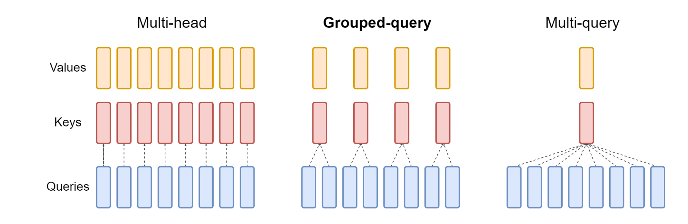
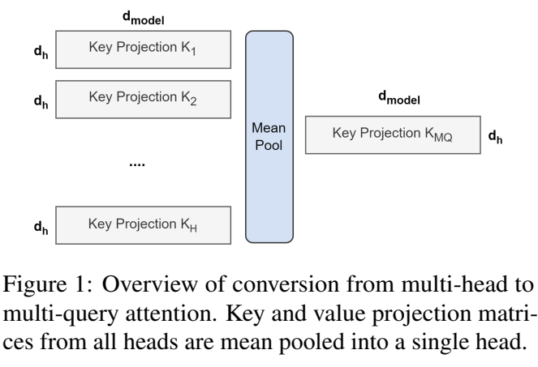
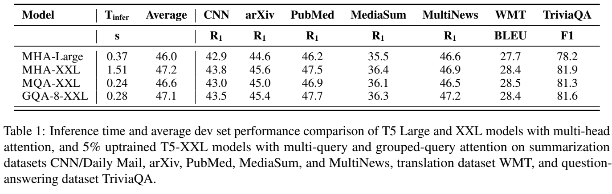

# 第21讲：GQA 与分组查询注意力

上一讲把每层K/V保存在缓存里。生成越长的文本，要读取的K/V越多。**GQA让几个查询头共用一组K/V，在保留多个查询的同时，缩小K/V投影和缓存。**

这一讲用四个查询头、两组K/V讲清共享方向，再对照原函数、完整Attention和论文实验。[核心源码中文注释版](代码/tutorials/GQA核心源码_代码注释.py)可配合阅读；[单元说明](代码单元解释.md)按原notebook编号查找。

## 1. 先分清位置、向量和 head

token经过embedding和前面各层，变成一排浮点数，叫**隐藏状态**。Attention将它分别投影成Q、K、V：Q用于查询，K用于匹配，V用于最后的信息汇总。

**head，注意力头**把投影后的通道分成几组，各自计算注意力。例如隐藏宽度D=8、查询头数H=4，每个查询头有d=8/4=2个数。同一个token因此有四个不同的Q向量。

一段文本有多个位置，每个位置都会生成这四个Q。下面说的“head0、head1”是通道组的编号，位置则是文本中的先后顺序；两者各有一个轴。

普通多头注意力给每个Q头配一组K/V。现在保留四个Q头，将K/V减少到两组：

| 查询头 | 使用的K/V组 |
|---|---|
| Q0、Q1 | K0、V0 |
| Q2、Q3 | K1、V1 |

Q0与Q1各自保留自己的投影参数，只是读同一组键值。这里的共享关系，就是Grouped-Query Attention，简称GQA。

## 2. 沿论文原图看 MHA、GQA 和 MQA


出处：[GQA，arXiv v3第2页Figure2](https://arxiv.org/pdf/2305.13245v3)。从下往上看：蓝色是Queries，红色是Keys，黄色是Values。

左侧**MHA，Multi-Head Attention**有8个Q头、8个K头、8个V头，一一配对。中间**GQA**把8个Q头分成4组，每组两个相邻Q头共用一组K/V。右侧**MQA，Multi-Query Attention**让全部8个Q头共用唯一一组K/V。

图中的虚线连接查询头与对应KV组。每个蓝块代表一个head，该head在文本的各位置都参与计算。三种结构都保留多个Q头，变化的是K/V头数。

论文§2.2将Q头数记作H，组数记作G。每组有R=H/G个Q头；GQA-1就是MQA，GQA-H就是MHA。

| 本讲小例子 | Q头H | KV组G | 每组Q数量R |
|---|---:|---:|---:|
| MHA | 4 | 4 | 1 |
| GQA | 4 | 2 | 2 |
| MQA | 4 | 1 | 4 |

课程也展示了同一幅共享关系图：



原Markdown第4格把共享方向写成“multiple key-value heads share the same query”。按图和代码，应读成**多个Q头共享K/V头**。往后遇到`n_kv_heads`时，就沿这个方向理解。

## 3. 共用 K/V，为什么两个头还能给出不同输出

假设两个可见位置的K为`[1,0]`、`[0,1]`，对应V为`[2,0]`、`[0,4]`。当前同一个位置有两个查询头，Q0是`[1,0]`，Q1是`[0,1]`。下面Q的两行表示两个头，K/V的两行表示两个可见位置。

Q0与两个K的点积为1、0；Q1则为0、1。分别除以√2再做softmax，两个查询就会偏向不同位置。

```python
import math
import torch

queries = torch.tensor([[1., 0.], [0., 1.]])
shared_keys = torch.tensor([[1., 0.], [0., 1.]])
shared_values = torch.tensor([[2., 0.], [0., 4.]])
probabilities = (queries @ shared_keys.T / math.sqrt(2)).softmax(-1)
outputs = probabilities @ shared_values
print(probabilities)
print(outputs)
```

两行概率约为`[.6698,.3302]`、`[.3302,.6698]`，输出约为`[1.3395,1.3210]`、`[.6605,2.6790]`。同组查询使用相同的信息来源，但各自决定怎样加权。

将这个过程写成公式。head编号h从0开始，连续分组时，它使用的组编号为：

$$g(h)=\left\lfloor h/R\right\rfloor,\qquad R=H/G.$$

H=4、G=2时，g(0)=g(1)=0，g(2)=g(3)=1。⌊·⌋表示向下取整。接着每个head各算一次：

$$O_h=\operatorname{softmax}\left(\frac{Q_hK_{g(h)}^{\mathsf T}}{\sqrt d}+M\right)V_{g(h)}.$$

Q_h来自该查询头的投影；K、V来自它所属的组。d是每头通道数；M是因果遮罩，可见位置加0，未来位置加负无穷；softmax沿key位置求概率。最后把H个O_h按通道拼起来，经过输出投影Wo，回到原隐藏宽度。

## 4. 原代码怎样把宽度拆成 head 轴

输入x的shape为`[B,S,D]`，B是同时处理的样本数，S是本次输入位置数。取B=1、S=3、D=8、H=4、G=2、d=2：

| 变量 | 投影后的shape | 拆head后的shape |
|---|---|---|
| xq | `[1,3,8]` | `[1,3,4,2]` |
| xk | `[1,3,4]` | `[1,3,2,2]` |
| xv | `[1,3,4]` | `[1,3,2,2]` |

Q投影产生H×d=8个数，K/V各产生G×d=4个数。`view`将最后一维拆成“头数、每头宽度”，总元素数保持不变。

课程第4格的六条语句就在做这些准备：从配置读取KV头数，计算本地查询头数和KV头数，再对Q/K/V分别执行view。`self`表示当前Attention实例，`args`保存配置；`n_local_heads`和`n_local_kv_heads`是当前模型并行进程负责的头数。本讲单进程时，它们分别等于H和G。

完整实现用`n_rep = n_local_heads // n_local_kv_heads`计算每组查询头数。`//`是整数除法；使用这个实现时，H与G应满足整除关系，让所有查询头完整分组。

## 5. repeat_kv 为什么得到 [K0,K0,K1,K1]

做批量矩阵乘法时，可以把共享的K/V排列到与Q相同的head轴。固定Meta实现使用这个函数：

```python
def repeat_kv(x: torch.Tensor, n_rep: int) -> torch.Tensor:
    """torch.repeat_interleave(x, dim=2, repeats=n_rep)"""
    bs, slen, n_kv_heads, head_dim = x.shape
    if n_rep == 1:
        return x
    return (
        x[:, :, :, None, :]
        .expand(bs, slen, n_kv_heads, n_rep, head_dim)
        .reshape(bs, slen, n_kv_heads * n_rep, head_dim)
    )

kv = torch.tensor([[[[10., 11.], [20., 21.]],
                    [[12., 13.], [22., 23.]]]])
expanded = kv[:, :, :, None, :].expand(1, 2, 2, 2, 2)
repeated = repeat_kv(kv, 2)
print(kv.shape, expanded.shape, repeated.shape)
print(repeated[0, 0])
```

这个普通函数接收一个四维Tensor和重复次数。类型注解`torch.Tensor`说明输入与输出类型；`x.shape`将四个维度解包给四个变量，分别表示batch、有效位置数、KV头数和每头通道。

1. `None`插入一个新轴：`[B,N,G,d] → [B,N,G,1,d]`。N是本次读出的有效KV长度。
2. `expand`将长度1的轴扩展到R：`[B,N,G,R,d]`。同一个KV组在这个轴上被多个查询头使用。
3. `reshape`合并G和R：`[B,N,G×R,d]`。先保留组0的两个副本，再放组1的两个副本。

本例shape依次为`[1,2,2,2] → [1,2,2,2,2] → [1,2,4,2]`。第一个位置的四行是`[10,11]、[10,11]、[20,21]、[20,21]`，对应Q0、Q1、Q2、Q3。

`repeat(1,1,2,1)`会得到交错的`[K0,K1,K0,K1]`，让Q1读到组1、Q2读到组0。按本实现的连续分组，应使用上面的函数或`repeat_interleave(..., dim=2)`。

`expand`通过共享存储建立视图；后续合并轴的reshape可能分配新存储，取决于shape和stride。这里的G=2、R=2例子最终产生重复后的存储；持久cache仍按原来的G个KV头保存。n_rep=1时函数直接返回x。

## 6. 接回完整 Attention：先存两组，再供四头读取

完整前向沿着这条路径：

```text
x → Q/K/V投影 → 拆head → 按位置旋转Q/K
  → 新K/V写入cache → 读取有效前缀
  → repeat_kv将每组对应到查询头
  → QKᵀ / √d + mask → softmax → 乘V
  → 拼接各head → Wo输出
```

已经缓存P=3个位置，再处理S=1个新位置时：

| 对象 | shape | 含义 |
|---|---|---|
| 新Q | `[1,1,4,2]` | 当前token的4个查询头 |
| 新K/V | `[1,1,2,2]` | 当前token的2组键值 |
| 有效缓存K/V | `[1,4,2,2]` | 历史与当前共4个位置，每位置2组 |
| repeat后K/V | `[1,4,4,2]` | 对应到4个查询头 |
| 转置后Q / K/V | `[1,4,1,2]` / `[1,4,4,2]` | head轴在前，位置轴在后 |
| 注意力分数 | `[1,4,1,4]` | 每个查询头对4个位置打分 |
| 最终输出 | `[1,1,8]` | 4个头的结果拼接并投影 |

缓存维度始终用G计数。读取之后的repeat是计算安排，下一次写入缓存时仍只写两组新K/V。第20讲的start_pos与因果mask规则在这里继续使用。

下面运行完整Meta Attention，分别使用4、2、1个KV头。CPU加载器复用第20讲的准备方式，将两处缓存分配改到CPU，其余前向按固定源码执行；详细环境见[复现说明](复现/README.md)。

```python
from pathlib import Path
import sys

scripts = Path("lessons/21 GQA 与分组查询注意力/复现/scripts")
sys.path.insert(0, str(scripts))
from verify_foundation_examples import cpu_llama_session

with cpu_llama_session() as llama:
    torch.manual_seed(21)
    x = torch.randn(1, 3, 8)
    mask = torch.triu(torch.full((3, 3), -float("inf")), diagonal=1)
    frequencies = llama.precompute_freqs_cis(2, 8)
    attention_rows = []
    for groups in (4, 2, 1):
        args = llama.ModelArgs(dim=8, n_heads=4, n_kv_heads=groups,
                               max_batch_size=1, max_seq_len=8)
        attention = llama.Attention(args).eval()
        with torch.no_grad():
            for parameter in attention.parameters():
                parameter.normal_(0, 0.1)
        with torch.inference_mode():
            y = attention(x, 0, frequencies[:3], mask)
        parameters = sum(p.numel() for p in attention.parameters())
        cache_bytes = sum(t.numel() * t.element_size()
                          for t in (attention.cache_k, attention.cache_v))
        attention_rows.append((groups, list(y.shape), parameters, cache_bytes))
    print(attention_rows)
```

`ModelArgs`保存配置，`Attention(args)`构造真实模块；权重逐项显式填入随机数。`eval()`设置推理模式，`inference_mode()`让本次计算专注于推理。三种结构的输出都是`[1,3,8]`：改变KV组数后，输出接口保持一致。

四个投影的参数量分别合计256、192、160；单层缓存预分配字节数分别是512、256、128。下面用公式将这两项拆开。

## 7. 减少的是哪些参数、哪些缓存

本实现的Attention投影没有bias。Wq和Wo各有D×D个参数；Wk和Wv各有D×G×d个参数：

$$N_{\rm attention}=2D^2+2DGd.$$

代入D=8、d=2，得到128+32G：G=4是256，G=2是192，G=1是160。查询与输出投影保持原大小，减少的是K/V投影。

KV缓存的空间沿用上一讲的公式：

$$\text{bytes}_{KV}=2\times L\times B\times T\times G\times d\times w.$$

2表示K和V，L是层数，B是batch，T是容量，w是每个数的字节数。小例子是一层、batch1、容量8、每头2通道、float32每数4字节，因此是128G bytes。

相同条件下，GQA-2的持久KV缓存为MHA的1/2，MQA为1/4。较少的KV头也减少解码时需要读取的键值；每个Q头仍要计算自己的匹配和加权输出。

## 8. 同一组被两个头使用，梯度怎样合并

反向传播沿每条使用路径回到原参数。若一个K/V头供两个Q头使用，这两条路径对它的梯度会相加。

```python
source = torch.tensor([[[[10.], [20.]]]], requires_grad=True)
weights = torch.tensor([[[[1.], [2.], [3.], [4.]]]])
loss = (repeat_kv(source, 2) * weights).sum()
loss.backward()
print(source.grad)
```

输出梯度是`[3,7]`：组0的两个副本乘1和2，导数合计1+2=3；组1乘3和4，合计7。`requires_grad=True`让PyTorch记录求导路径，`backward()`将导数累积到source.grad。

完整Attention里，梯度先经过softmax、点积等计算，再按共享路径汇入同一组Wk/Wv。这样，一组键值参数能同时接收组内多个查询头的训练信号。

## 9. 已有 MHA 权重怎样变成 GQA



出处：同论文第1页Figure1与§2.1。左边是原来各头的Key投影矩阵，中间Mean Pool按对应元素取平均，右边得到一份共享Key投影；Value投影也按相同方式处理。图示合成唯一一组，即MHA转MQA。

转成GQA时，论文§2.2按组平均：先把原头分到G组，再将每组内的K投影取平均，V投影也取平均。Q与输出投影保持原安排。

下面用4个头、每头2个输出通道、输入宽8的K投影展示：

```python
w_k_heads = torch.arange(64, dtype=torch.float32).reshape(4, 2, 8)
w_k_grouped = w_k_heads.reshape(2, 2, 2, 8).mean(dim=1)
w_k_pooled = w_k_grouped.reshape(4, 8)
print(w_k_heads.shape, w_k_grouped.shape, w_k_pooled.shape)
print(w_k_grouped[:, 0])
```

`[4,2,8]`按“组数2、每组头数2、每头输出2、输入8”重排成`[2,2,2,8]`。mean沿每组头数轴取平均，得到`[2,2,8]`；再合并组与输出通道，得到GQA所需的`[4,8]`权重。两组第一行的首项分别为8和40。

原组内各头通常不同，平均会改变模型计算。论文将转换分为两步：**先转换checkpoint，再继续预训练，使模型适应新的共享结构**，后一步称uptraining。论文主要设置使用原预训练步数的5%，沿用原预训练方案和数据；T5-XXL的这一阶段约用600 TPUv3 chip-days。

因此，在Llama配置里设置n_kv_heads，表示选择网络结构；对已有MHA checkpoint完成转换，还需要相应的权重处理与训练。

## 10. 把论文结果放在这里一起读



出处：同论文第3页Table1。实验基于T5.1.1，MQA-XXL与GQA-8-XXL经过5% uptraining。表中T_infer是每样本、每TPUv4 chip的报告耗时，单位秒，越低越好；Average综合摘要的ROUGE-1、翻译BLEU和问答F1，越高越好。

对照三行XXL：MHA为1.51秒、47.2分；MQA为0.24秒、46.6分；GQA-8为0.28秒、47.1分。GQA比MHA平均低0.1分，耗时少1.23秒；比MQA平均高0.5分，耗时多0.04秒。这呈现了论文所讨论的质量与解码成本权衡。

计时使用8个TPU，按每个模型选择可容纳的batch和并行方式。阅读这些数值时，要连同任务、设备和配置一起比较。论文的实验对象为encoder-decoder模型，GQA用于decoder自注意力和交叉注意力；本文的Llama代码则展示decoder-only自注意力里的同一分组思想。

## 11. 原 notebook 的五格怎样读

| 单元 | 内容 | 正文对应 |
|---|---|---|
| 0 | 导入Image | 为单元2展示图片准备类 |
| 1 | 论文链接和主题 | 第2、9–10节 |
| 2 | 展示gqa.png，width=600 | 第2节的课程原图 |
| 3 | MHA/MQA/GQA简介 | 第1–3节 |
| 4 | 六条head配置与view语句 | 第4节 |

课程的核心是图示与shape摘录。上文补入固定Meta实现的repeat_kv与完整Attention，把这些语句接成实际可执行的计算。按行查代码时，可分别看[Markdown源码阅读版](代码/tutorials/Markdown源码_代码注释.py)和[完整核心源码阅读版](代码/tutorials/GQA核心源码_代码注释.py)。

## 必须掌握

1. H个查询头分成G组，每组R=H/G个查询头共用K/V。
2. 查询各自计算匹配权重，同组头可以给出不同输出。
3. 本实现按连续组重复KV，顺序为K0、K0、K1、K1。
4. cache按G个KV头保存，计算时才对齐到H个查询头。
5. MHA checkpoint转换包含权重平均与后续uptraining。

## 第二遍学习

继续看共享梯度求和、expand的stride与reshape存储、绑定MHA与一般权重平均的区别，以及配置如何满足head整除与并行划分。

## 可以暂时不掌握的工程细节

多rank通信、专用分组注意力内核、分页缓存和完整T5训练调度，可在学习部署或训练框架时展开。

## Paper ↔ Code

| 概念 | 论文与代码位置 |
|---|---|
| 每组共享一组K/V | GQA §2.2、Figure2；n_kv_heads、n_rep |
| Q/K/V头数与投影 | 原Markdown4；Attention.__init__、forward中的view |
| 连续分组的计算排列 | repeat_kv的None、expand、reshape |
| KV缓存缩小 | Attention.cache_k/cache_v按n_local_kv_heads分配 |
| checkpoint按组平均 | Figure1、§2.1–2.2；上文权重平均例子 |
| uptraining与T5评测 | §3、Table1；训练入口在本课程notebook中未找到 |

## 复现状态与后续问题

**部分成功。** 正文五个代码块已执行，官方Attention的三种分组另与逐头参考比较前向、输入及投影梯度。配置与数值见[复现说明](复现/README.md)，截图页码与位置见[原图来源](复现/outputs/论文截图来源.json)。

原Llama检查点、论文T5 uptraining、任务评测及GPU/多rank运行留待后续。讲师的精确依赖和独立字幕尚待补充。

<details>
<summary>第二遍阅读：原讲解中的源码细节与历史运行记录</summary>

# 第21讲：GQA 与分组查询注意力

GQA 让一组不同的 query heads 共用一份 key/value head。Q的数量保持不变，K/V投影及持久缓存的head数减少。本讲把这个共享关系对应到 `n_kv_heads`、`n_rep`、`view` 和 `repeat_kv`，再用真实官方Attention验证输出与梯度。

## 1. 论文与代码入口

课程是[固定原 notebook](https://github.com/chunhuizhang/personal_chatgpt/blob/7fbc29824171fd07dc2c30fe922e61ebc018ad1d/tutorials/llama2_src_grouped_query_attention.ipynb)，共 **5格：2代码、3Markdown**。代码格只导入Image并展示配图，**没有实现GQA forward**；关键shape语句写在Markdown4中。原版、图片、两份11格派生版、三份Python阅读材料和[全部单元说明](代码单元解释.md)均已交付。

主论文为 Ainslie 等的 [GQA: Training Generalized Multi-Query Transformer Models from Multi-Head Checkpoints，arXiv:2305.13245v3，2023-12-23](https://arxiv.org/pdf/2305.13245v3)。阅读地图：§1问题为解码时KV带宽；§2.1是checkpoint转换和继续预训练，§2.2定义分组；Figure2画共享关系，Table1比较质量与推理时间，Limitations界定实验范围。本文贡献包括从已有MHA转换后uptraining，以及介于MHA/MQA的GQA。原论文PDF保存在本地资料目录，文件信息见[来源清单](来源清单.json)。

本讲沿[Meta model.py，提交7565eb6](https://github.com/meta-llama/llama/blob/7565eb6fee2175b2d4fe2cfb45067a61b35d7f5e/llama/model.py)解释 Llama 2 中的分组、缓存与梯度。GQA 论文使用 T5/JAX 进行训练实验，两种实现共享分组思想。

来源文件和版本见[来源清单](来源清单.json)。

## 2. 仓库地图与实际数据路径

| 对象 | 本讲用途 |
|---|---|
| 上游README、notebook与gqa.png | 固定原内容及共享关系图 |
| ModelArgs | dim、n_heads、n_kv_heads、batch/sequence容量 |
| TransformerBlock.forward | 归一化后把隐藏状态交给Attention，再加残差 |
| Attention.__init__ | 计算本地heads、R，构造四投影与少量KV缓存 |
| Attention.forward | QKV投影、RoPE、写/读cache、重复KV、注意力、wo |
| repeat_kv | 把逻辑共享的KV对齐到Q head轴；不是可训练层 |
| 数据集、loss、optimizer、训练脚本 | 本notebook聚焦分组结构，训练流程见论文 |
| 预训练checkpoint与评估数据 | 本次未加载；使用随机小模块和合成隐藏状态验证 |

完整模型的调用链是token IDs → embedding → 归一化的隐藏状态 `x[B,S,D]` → Attention → 残差/MLP → logits。当前实验从隐藏状态x进入真实Attention，输出也是隐藏状态，不经过词表头，所以报告中的误差是 **Attention输出差，不是logits或生成质量**。

阅读顺序建议：先理解下一节图，再读[官方核心代码中文注释](代码/tutorials/GQA核心源码_代码注释.py)。原notebook的[文本版](代码/tutorials/llama2_src_grouped_query_attention_代码注释.py)只有两格展示语句，不能从它推断课程已经提供了完整实现。

## 3. 看图理解共享方向


按图从下往上看：蓝色块是Q，红色是K，黄色是V。左边8个Q各有自己的K/V；中间8个Q分为4组，每两个相邻Q共用一对K/V；右边所有8个Q共用一对K/V。虚线表达对应关系，不是数据移动方向，也不是先把Q平均。黄色和红色分别是不同投影，没有把K/V合成一个张量。

图没有画batch、token和每head通道，也省略RoPE、mask、softmax和输出投影。不要把8个蓝块理解成8个token：每个head都对当前输入位置执行投影，并关注相应历史位置。

| 机制 | Q heads | KV heads | 每组Q数量 |
|---|---:|---:|---:|
| MHA | H | H | 1 |
| GQA中间情形 | H | G，1<G<H | R=H/G |
| MQA | H | 1 | H |

原Markdown4说“multiple key-value heads share the same query”把方向说反了。正确的是 **不同Q heads共享K/V**。因为Q不同，哪怕使用同一K，算出的注意力权重也可能不同，最终输出不必相同。

原Markdown3中的MHA“computationally low”也不能按字面当成效率结论。同等H/d/序列长度下，MHA保留更多KV投影及缓存；实际端到端速度和质量必须结合训练与硬件测量，不能只凭名字排序。

## 4. 用公式表达分组

沿用论文§2.2的H表示query head数，G表示KV组数，对应代码的Hq与Hkv。论文§2.2用文字定义分组；下面将这个定义展开成与源码对应的公式。

设B=batch，S=本次输入token数，N=有效key/value长度，D=隐藏通道，d=每head通道，R=H/G。head编号h从0到H−1，连续分组映射为：

$$
g(h)=\left\lfloor\frac{h}{R}\right\rfloor,\qquad R=\frac HG.
$$

每个Q有自己的投影，共享组使用自己的K/V投影：

$$
Q_h=XW_h^Q,\quad K_g=XW_g^K,\quad V_g=XW_g^V,
$$

$$
O_h=\operatorname{softmax}\left(\frac{Q_hK_{g(h)}^{\mathsf T}}{\sqrt d}+M\right)V_{g(h)}.
$$

X是浮点`[B,S,D]`隐藏状态；行向量记法下单head W为`[D,d]`，PyTorch参数实际存储为`[d,D]`。缓存场景中K/V包含历史与本次位置，所以Q为`[B,S,d]`、K/V为`[B,N,d]`。M是因果mask，能广播到`[B,S,N]`；softmax沿key位置轴N进行。输出O_h为`[B,S,d]`，把H个输出拼起来再经Wo回到`[B,S,D]`。

例子取H=4,G=2,R=2：head0/1读取组0，head2/3读取组1。假设组0有两行key `[[1,0],[0,1]]`，value `[[2,0],[0,4]]`，两条可见query分别为`[1,0]`与`[0,1]`。除√2后softmax，两个query的权重分别约`[0.6698,0.3302]`与`[0.3302,0.6698]`，输出约`[1.3395,1.3210]`与`[0.6605,2.6790]`。同组共享KV仍能产生不同输出。

## 5. 源码中的六条shape语句

课程六条语句的完整注释见[Markdown源码阅读版](代码/tutorials/Markdown源码_代码注释.py)。`self`指当前Attention实例，`args`是ModelArgs配置。`view`只重解释形状，不计算新的投影、不平均heads，元素数必须守恒。

| 变量 | 投影后 | view后 |
|---|---|---|
| xq | `[B,S,H_local*d]` | `[B,S,H_local,d]` |
| xk | `[B,S,G_local*d]` | `[B,S,G_local,d]` |
| xv | `[B,S,G_local*d]` | `[B,S,G_local,d]` |

`n_rep = n_local_heads // n_local_kv_heads` 得到每组Q数量，不是组数。`//`会向下取整，不会替你检查合法性。当前实现的GQA配置需满足H能被G整除；实际构造H=6,G=4得到R=1，随后matmul才因6与4个heads不匹配报错。

`n_local_heads = args.n_heads // model_parallel_size` 和KV对应语句按模型并行rank划分heads。`model_parallel_size`不是batch大小。固定实现要能均匀划分；例如H=64,G=8,并行度8的算术结果为本地H=8,G=1,R=8，但本次只实际执行world_size=1，算出这个例子不证明8rank通信运行过。

## 6. repeat_kv逐步拆解

下面是固定官方函数本体，完整中文注释已写入核心阅读版：

```python
def repeat_kv(x: torch.Tensor, n_rep: int) -> torch.Tensor:
    """torch.repeat_interleave(x, dim=2, repeats=n_rep)"""
    bs, slen, n_kv_heads, head_dim = x.shape
    if n_rep == 1:
        return x
    return (
        x[:, :, :, None, :]
        .expand(bs, slen, n_kv_heads, n_rep, head_dim)
        .reshape(bs, slen, n_kv_heads * n_rep, head_dim)
    )
```

这是普通函数，不属于Attention实例，没有self、可训练参数或默认参数；输入x通常是从cache读出的浮点`[B,N,G_local,d]`。它不改写cache，返回与H_local对齐的KV。类型注解说明期望，不执行正整数检查。

1. `x.shape`返回四个维度，解包到bs/slen/n_kv_heads/head_dim；这里slen是已经读取的有效长度N。
2. R=1直接返回x，连对象都相同，MHA不需要复制。
3. `None`插入新轴：`[B,N,G,d] → [B,N,G,1,d]`。冒号表示保留该轴的全部元素。
4. `expand`把长度1的重复轴广播到R，得到`[B,N,G,R,d]`；这一步用stride=0共享数据。
5. `reshape`合并G/R，得到`[B,N,G*R,d]`。按G优先、R连续的顺序排列，因此同组Q拿到相同KV。

G=2,R=4时，输入head标签`[0,1]`变为`[0,0,0,0,1,1,1,1]`。`x.repeat(1,1,4,1)`却是`[0,1,0,1,0,1,0,1]`，会改变Q与KV的配对；它不能直接替代这个函数。正确的参考是`repeat_interleave(...,dim=2)`。

`expand`创建共享存储的视图，接下来的`reshape`是否复制取决于 shape 和 stride。G=2、R=4 的 CPU 样例中，输入存储384字节，reshape后1536字节，二者不共享；G=1、R=4 时仍共享192字节，head轴stride为0。

## 7. 把函数接回完整Attention

`Attention.__init__`先设置H/G/local计数，再构造Wq/Wk/Wv/Wo和cache。`nn.Module`让子层权重参与参数管理；原初始化的`init_method=lambda x:x`不填充矩阵，因此教学实验显式随机初始化，不能把未初始化内容当模型权重。

前向顺序为：

```text
x [B,S,D]
  -> Q [B,S,Hlocal,d]，K/V [B,S,Glocal,d]
  -> Q/K做RoPE，V不旋转
  -> 将少量K/V写入cache的当前token切片
  -> 读取有效前缀K/V [B,N,Glocal,d]
  -> repeat_kv -> [B,N,Hlocal,d]
  -> 转置 -> QKᵀ/√d -> mask -> softmax
  -> 权重乘V -> 拼heads -> wo -> [B,S,D]
```

cache保留G_local个heads，重复发生在读出之后。共享KV不是在完整MHA的所有KV已经投影后再取平均；GQA投影矩阵本来就只有G*d个输出通道。每个Q head的softmax独立，score仍为`[B,Hlocal,S,N]`。

函数返回当前位置的隐藏状态，另有副作用是覆写本次KV缓存。调用方负责正确的start_pos、位置频率、mask和会话对应关系；GQA不自动解决第20讲讨论的缓存对齐问题。

## 8. 内存与参数究竟少了多少

持久KV字节数是：

$$
2LBTGdw,
$$

2代表K/V，L是层数，B是batch，T是token数，G是KV heads，d是通道，w是每元素字节。与相同H/d的MHA相比，KV缓存比例为G/H。固定预分配应使用最大B/T，有效占用则用当前B/T。

若D=H*d、无bias，四投影总参数为：

$$
\underbrace{DHd}_{W_q}+\underbrace{DGd}_{W_k}+\underbrace{DGd}_{W_v}+\underbrace{HdD}_{W_o}
=2D^2+2DGd.
$$

这里Q/Wo未缩小，MLP、embedding等也未缩小，所以G/H不是总参数比例。即使KV缓存减为一半，也不能说模型总内存或总计算减少一半。

本次真实小Attention，D=16,H=4,d=4，Bmax=2,Tmax=8，前向后缓存为float64：

| 配置 | G | 四投影参数 | K/V持久分配字节 |
|---|---:|---:|---:|
| MHA | 4 | 1024 | 4096 |
| GQA | 2 | 768 | 2048 |
| MQA | 1 | 640 | 1024 |

通用 repeat 版可能产生临时展开的 K/V。按组写出的 einsum 参考可直接使用共享 K/V，得到相同输出；两者的实际速度还取决于内核与运行设备。

## 9. Llama2型号与课程原句校正

课程表中7B/13B/70B的query heads是32/40/64，每head均128通道。发布型号中7B/13B采用MHA，KV heads分别32/40；70B采用8个KV heads，R=8。默认`n_kv_heads=None`在官方类中令G=H，本次真实构造也验证了这一分支。

“只有70B有GQA”要限定在课程列举的发布型号内；[Llama2论文Table1及附录A.2.1](https://arxiv.org/html/2307.09288v2)还讨论研究用34B，并说明8 KV投影的GQA设置。因此不能把8当作GQA定义，也不能把原文第一张表的query heads误当KV heads。

以70B配置L=80,G=8,d=128、B=1、T=1024、FP16为例，KV为320MiB；若同样80层/64Q heads改成64KV heads的假设MHA，则2.5GiB。比例是1/8；这是配置算术，不是本机加载70B的显存测量。

## 10. 梯度、绑定MHA与checkpoint转换

同组KV被多个Q使用，反向传播会把这些分支的梯度相加。若展开后的上游梯度记为U，则：

$$
\frac{\partial\mathcal L}{\partial K_g}
=\sum_{r=0}^{R-1}U_{g,r}.
$$

g是组索引，r是组内重复索引，求和只沿重复轴，保留batch/token/d。V同理。这个式子是共享变量的链式法则，不是把Q的输出先平均。实际随机非均匀cotangent验证求和精确相等，独立float64 `repeat_kv`数值gradcheck通过。

还可把GQA写成特殊的MHA：组内多份K/V权重绑定为同一份，Q/Wo不变。实际复制分组权重后，两个真实官方Attention前向相等；GQA的WK/WV梯度等于对应MHA分支梯度求和。WK最大差约2.12e-8，源于完整路径内部RoPE/softmax使用FP32，所以这里没有声称整块是纯float64数值gradcheck。

论文的MHA→GQA转换在组内对K/V投影权重mean-pool，再uptrain。PyTorch存储WK为`[H*d,D]`时，相邻分组的操作是`[G,R,d,D] → mean(dim=1) → [G*d,D]`，不是沿输入D轴平均。若原本组内heads相同，平均后可恢复；一般不同heads平均会改变输出。本次随机MHA转换后的输出最大变化约0.351，说明**只改配置或均值转换不能宣称无损**；没有实际执行论文uptraining。

## 11. 论文结果应怎样解读

[GQA论文Table1](https://arxiv.org/pdf/2305.13245v3)给T5-XXL的MHA/MQA/GQA-8报告如下；转换模型使用5% uptraining：

| 配置 | Tinfer（秒）↓ | 平均dev分数↑ |
|---|---:|---:|
| MHA-XXL | 1.51 | 47.2 |
| MQA-XXL | 0.24 | 46.6 |
| GQA-8-XXL | 0.28 | 47.1 |

平均包含摘要ROUGE-1、翻译BLEU和问答F1，不是单一准确率；GQA比MHA均分低0.1、比MQA高0.5，表内延迟分别少1.23秒、多0.04秒。计时为每样本每TPUv4 chip的报告口径，使用8TPU、适配各模型的并行和可容纳batch，因此不能直接解释为CPU/GPU通用倍数，也不是Llama2的实验。作者局限包括ROUGE不完整反映质量、未对比同规模从头训练GQA，实验仅encoder-decoder；这些结果不保证任意decoder-only模型都保持同样质量差。

## 12. 小模型中的分组注意力

固定4个查询头，分别设置4、2、1个KV头，就能得到MHA、GQA、MQA。小模型中，这三种计算都与逐个head计算再拼接的结果一致，输入和四个投影矩阵的梯度也一致。

对GQA的2个KV头，正确排列为`[K0,K0,K1,K1]`。若误排成`[K0,K1,K0,K1]`，查询头就会读到另一组K/V；本例输出最大差约0.575。这说明重复顺序属于计算定义。

先输入3个token，再逐次输入1个时，增量输出与完整前缀重算最大差约6.94e-17。缓存一直保存2个KV头，查询头所需的重复在读出后进行。具体配置与运行方法见[复现说明](复现/README.md)。

## 13. 必须掌握

- 多个Q heads共享K/V，Q不被平均；H、G、R分别是什么。
- 从投影宽度到四维head张量，再到score/output的shape。
- `repeat_kv`的连续分组顺序、expand/reshape、反向求和。
- KV缓存仍存少量heads；参数、临时激活、持久缓存和延迟不是同一指标。
- 原课程只有两展示格；真正官方实现和本次小模型验证是明确补充。

## 14. 第二遍建议掌握

把一个GQA写成绑定KV权重的MHA，推导权重梯度求和；理解checkpoint组内mean-pooling为何改变一般模型；核对本地head划分、默认None与非法整除。跟随实际脚本观察缓存、数据类型和存储，而不是只记一行repeat函数。

## 15. 可以暂时不掌握的工程细节

多rankKV分片/复制策略、融合GQA内核、paged cache、连续批处理与带宽profile。这些内容涉及专门硬件与完整服务配置，可在掌握单rank流程后继续学习。

## 16. Paper ↔ Code

| 论文/概念 | 固定实现 | 对应范围 |
|---|---|---|
| §2.2 / Figure2的H query、G groups | n_heads、n_kv_heads、n_rep | H/G共享关系 |
| 每组共用KV | Wk/Wv较小宽度、cache按G、repeat_kv | 真正官方forward验证 |
| GQA-1/MQA、GQA-H/MHA边界 | G1与G4、None默认分支 | 实际构造与前向 |
| §2.1 mean-pooling转换 | 本讲verify_delivery.py的tied_and_pooling | 本地矩阵转换教学；不是原论文训练代码 |
| uptraining训练循环、T5/JAX配置 | 本课程notebook未找到 | 原训练流程留待后续 |
| Table1质量与计时 | 本讲未运行对应权重/数据/TPU | 原论文报告与本机验证分开 |
| RoPE及因果缓存 | apply_rotary_emb、cache切片、mask | Llama2实现背景，不是GQA新提出的位置编码 |

## 17. 资料与后续问题

复现状态：**部分成功**。本讲验证分组关系、小模块输出与梯度。原 Llama 2 检查点、GQA uptraining、任务质量、GPU延迟和多rank运行留待后续；讲师依赖和独立字幕尚待补充。

</details>
