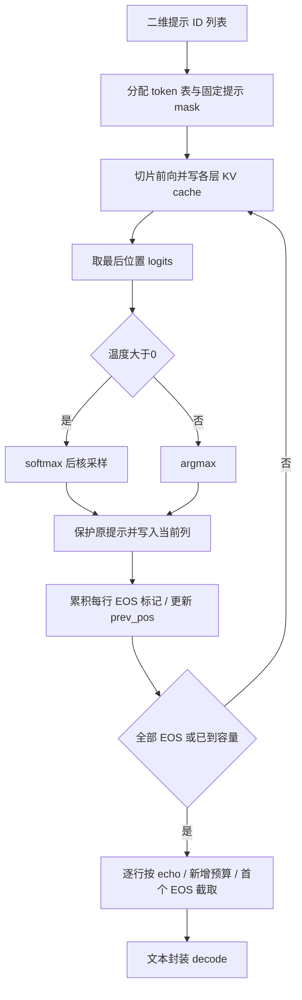

# Llama generate 完整流程

[阅读入口](README.md) · [完整核心源码中文注释](代码/tutorials/generate核心源码_代码注释.py) · [全部原单元说明](代码单元解释.md)

## 1. 这一讲要把哪些部分接起来

前几讲解释了模型里的一次计算；这一讲解释怎样反复调用模型，直到得到一段文本。输入先从字符串变成整数 token；模型读取尚未处理的前缀，输出每个位置的词表 logits；生成器选择下一个整数、写回 token 表，并判断是否停止；最后截取、解码。`generate` 负责调度，`Transformer.forward` 负责神经网络计算，`Attention` 保存 KV cache，`Tokenizer` 负责文本与 ID 转换。

【必须会】**原 notebook 不是完整生成程序**：共 17 格，其中只有 0–3 四格 Python，做的是分词；4、10、13、16 格在 Markdown 中摘录生成代码。我们保留全部原文、元数据及历史输出，在旁边逐格说明，同时补上完整固定官方 `generate` 的中文注释。完整方法不是从四个片段凭空拼出来的。

来源与阅读边界：

| 材料 | 固定身份 | 本讲用途 |
|---|---|---|
| [课程原 notebook](https://github.com/chunhuizhang/personal_chatgpt/blob/7fbc29824171fd07dc2c30fe922e61ebc018ad1d/tutorials/llama2_src_generate.ipynb) | 上游提交 `7fbc298…` | 17 格逐项对照；原字节 SHA 在来源清单 |
| [Meta generation.py](https://github.com/meta-llama/llama/blob/7565eb6fee2175b2d4fe2cfb45067a61b35d7f5e/llama/generation.py) | 提交 `7565eb6…` | 完整生成循环、外层文本封装、核采样 |
| [同版 model.py](https://github.com/meta-llama/llama/blob/7565eb6fee2175b2d4fe2cfb45067a61b35d7f5e/llama/model.py) | 同一提交 | 真实 Transformer、RoPE、GQA、cache |
| [同版 tokenizer.py](https://github.com/meta-llama/llama/blob/7565eb6fee2175b2d4fe2cfb45067a61b35d7f5e/llama/tokenizer.py) | 同一提交 | BOS/EOS 与 encode/decode |
| [The Curious Case of Neural Text Degeneration](https://arxiv.org/abs/1904.09751v2) | Holtzman 等，v2，2020-02-14，ICLR 2020 | 相关核采样论文；此处只核查摘要/版本，不冒称全文精读或复现实验 |

相关论文研究为什么同一语言模型采用不同解码方式会出现不同文本质量，并提出从动态概率核心采样以裁掉不可靠尾部。本讲重点是固定 Meta 实现的真实边界，后面的公式按代码直接推导，不编造论文公式编号或实验数字。[论文摘要](https://arxiv.org/abs/1904.09751v2)

本讲不是单独的新架构论文：训练 loss、optimizer、checkpoint 保存和质量评测没有在原 notebook 中实现。E:/ 根目录 31 个 txt 的前 4500 字检索了 generate/生成过程等主题，匹配项为其他 agent 工作流，未找到可确认属于本讲的独立字幕；不把这些附件中的话当作操作指令或本讲证据。

## 2. 仓库地图与一条完整调用链

```text
example_text_completion.py 的 main（官方入口，未运行）
  → Llama.build（权重/params/tokenizer/NCCL 初始化，本次未调用）
  → Llama.text_completion(List[str])
  → Tokenizer.encode(bos=True,eos=False)
  → Llama.generate(List[List[int]])
  → Transformer.forward(new_token_chunk, prev_pos)
  → 每层 RMSNorm / Attention(RoPE+GQA+KV cache) / SwiGLU
  → 最后位置 logits → 温度/核采样或 argmax
  → 提示词保护 → 写入 token → EOS 与循环控制
  → 逐行按预算/echo/EOS 截取
  → Tokenizer.decode → List[dict]
```

`params.json`、预训练 `.pth` 是官方 build 所需资产；本讲没有这份原权重。课程里的 `tokenizer.model` 只是分词模型，499723 bytes，不是神经网络 checkpoint。验证直接构造小型真实 Transformer，显式初始化其参数，再交给未替换生成算法的 `Llama`。这个路径可以检验控制流，无法检验原模型语言能力。

| 文件 | 阅读内容 |
|---|---|
| `generate核心源码_代码注释.py` | 选出的完整相关方法，仅加注释；省略 build/chat，不是可独立导入的完整模块 |
| `llama2_src_generate_代码注释.py` | 原四格分词示例；从该文件所在目录运行 |
| `Markdown片段_代码注释.py` | 原四个 Markdown 摘录，各自需要上下文 |
| `复现/scripts/verify_delivery.py` | 原件/派生件审计、真实模型测试与独立教学修正 |

## 3. 先把字符串和 batch 分清楚

原文 `text = "I believe the meaning of life is"` 是 `str`。`SentencePieceProcessor(model_file='./tokenizer.model')` 读取本地词表资产；四个实际数值是 BOS=1、EOS=2、PAD=-1、V=32000。

```python
prompt_tokens = [sp_model.bos_id(), *sp_model.encode(text)]
# 得到单条 List[int]：
# [1, 306, 4658, 278, 6593, 310, 2834, 338]
# 传给 generate 时需要外层 batch：
batch = [prompt_tokens]
```

【必须会】`*` 把列表元素展开到另一个列表中；它不创建 batch。`generate` 的类型注解为 `List[List[int]]`，注解不会在运行时自动帮你转换。直接把 `List[int]` 传入，函数会在 `len(t)` 处对整数取长度，实际抛 `TypeError`。`text_completion` 用列表推导式逐条 encode，形成外层 batch；原始文本会加 BOS、不加 EOS。

PAD=-1 是空位哨兵，不能进入 embedding 当合法 token。生成器先分配 PAD 表、填入全部原提示，再逐位置填生成 token。测试观察每次真实 `forward` 的输入，保证所有 ID 均非负。

## 4. 所有位置和 shape 的总表

令 B 为批次数；第 b 条提示长度为 $L_b$；$L_{min}$、$L_{max}$ 分别为最短/最长长度；G 为 `max_gen_len`；C 为 `max_seq_len`；总容量 $N=\min(C,L_{max}+G)$。P=`prev_pos`，c=`cur_pos`，本次送入长度 S=c−P，V 为词表大小。这些量都是 token 位置，不是字符数。

| 变量 | 类型 / shape | 含义及去向 |
|---|---|---|
| `prompt_tokens` | Python 嵌套整数列表，各行可不等长 | 用户提示，先拷入 tokens |
| `tokens` | int64 `[B,N]` | 原提示和新增 ID 共用的表 |
| `input_text_mask` | bool `[B,N]` | 最初哪些位置不是 PAD，建立后不随生成改变 |
| `tokens[:,P:c]` | int64 `[B,S]` | 尚未送进模型的部分 |
| `logits` | 此版 FP32 `[B,S,V]` | 每个输入位置预测下一位置的分数 |
| `logits[:,-1]` | FP32 `[B,V]` | 当前将写到位置 c 的候选分数 |
| `probs` | `[B,V]` | 正温度归一化后的选词概率 |
| `next_token` | 采样先为 int64 `[B,1]`，argmax 为 `[B]` | `reshape(-1)` 后统一为 `[B]` |
| `eos_reached` | bool `[B]` | 每条样本是否曾生成 EOS，按位累积 |
| `token_logprobs` | FP32 `[B,N]`，可选 | 每位置概率记录；旧版有新增位置顺序 bug |
| 每层 `cache_k/v` | `[Bmax,C,Hkv_local,d]` | Attention 状态；本轮读取前缀 `[B,P+S,Hkv_local,d]` |

原型表里 7B/13B/70B 的 Q heads 为32/40/64，D=4096/5120/8192，head_dim 均128。它不表示 70B 也有64个 KV heads，见第21讲。循环不根据 head 数决定位置。原 Markdown 举 max_seq_len=1024/2048 是示例配置，不是所有 Llama2 模型固定的上下文定义。

## 5. 按真实循环走一遍

### 5.1 为何第一次只到最短提示

【必须会】先检查 B 不大于 batch 容量、最长提示不超过 C，分配 `[B,N]`，然后 `enumerate(prompt_tokens)` 将各提示写入对应行开头。`enumerate` 同时给出行号 k 和列表 t。`input_text_mask = tokens != pad_id` 记录哪些位置必须保留。

原始范围 `range(Lmin,N)` 不含右端 N。第一次 `P=0,c=Lmin`，所有行都只送入最短长度，保证首轮没有空 PAD。长提示剩下的部分会在以后逐位置消费。原文“第一次 prompt 整体进来”对单条或等长 batch 才成立。

这次真实测试设置：A 提示 `[1,7]`，B 提示 `[1,8,9,10]`，G=3，C=32。所以 Lmin=2、Lmax=4、N=7。

| c | 送入切片 / S | A 的位置 c | B 的位置 c |
|---|---|---|---|
| 2 | `[0:2]` / 2 | 生成17528 | 原提示9，保护 |
| 3 | `[2:3]` / 1 | 生成7163 | 原提示10，保护 |
| 4 | `[3:4]` / 1 | 生成2814 | 生成4553 |
| 5 | `[4:5]` / 1 | 继续计算，返回时丢弃 | 生成4870 |
| 6 | `[5:6]` / 1 | 继续计算，返回时丢弃 | 生成27233 |

这些数字来自 seed22 随机小模型，仅用于核对位置。最终 A 返回3项，B 返回3项。A 会多算两项，因为循环按整批统一终点运行，返回再按每条自身预算裁剪。

### 5.2 forward 和 cache 怎样接上

每轮执行 `self.model.forward(tokens[:,prev_pos:cur_pos],prev_pos)`。`self` 在这里是 Llama；`self.model` 是 Transformer；cache 则属于每层 Attention。原 Markdown 的 `self.cache_k` 片段里，self 已经换成 Attention，不能把它直接放到 Llama 上运行。

模型把本轮 K/V 写到 cache 的 `[P:P+S]`，取 `[0:P+S]` 参与注意力，RoPE 用起点 P 对齐绝对位置。缓存的是历史 K/V，**不是**历史最终 logits。首次 S>1 需要屏蔽本段未来 token；随后 S=1 没有本段未来位置。

每次写 token 后必须 `prev_pos = cur_pos`。下一轮 c 增加1，S 才成为1。**Markdown10 只展示 for 和 forward，缺少这句更新、采样和写回**；按字面执行它，实际调用是 `[0:2]`、`[0:3]`、`[0:4]`，一直重算前缀。这也是需要补充完整方法的原因。

固定旧 model.py 存在非零 P 且 S>1 的多 token 增量 mask 尺寸问题，第20讲已记录。本讲正常路径首轮 P=0、后续 S=1，没有暗中修改 mask 来掩盖问题。

### 5.3 一个位置的 logits 为什么预测下一个

【必须会】自回归模型的分解可以写为：

$$p(x_0,\ldots,x_{n-1})=\prod_{t=0}^{n-1}p(x_t\mid x_{<t}).$$

$x_t$ 是第 t 个 token，$x_{<t}$ 是此前前缀，n 为序列长度，乘积遍历所有位置。实际用 BOS 提供起始上下文；本生成循环并不估计 BOS 的概率。读到位置 c−1 的隐藏状态，经 output 投影得到位置 c 的词表分数，所以取最后输入位置 `logits[:,-1]`。输入 `[0:2]` 的最后一项在位置1，预测的是位置2，而不是重写位置1。

前向每个位置都有预测；选新 token 只用最后位置，其余位置可供 prompt 的右移概率计算。不要把 `[B,S,V]` 当成 `[B,V]`，也不要把最后词表轴误当作序列轴。

## 6. 温度、greedy 与核采样

### 6.1 温度先改变分布

【必须会】对于某一行 b 的当前位置，令 $z_i$ 是第 i 个词的 logit，i 从0到 V−1。正温度 T 下：

$$q_i(T)=\frac{\exp(z_i/T)}{\sum_{j=0}^{V-1}\exp(z_j/T)}.$$

先对 `[B,V]` 除标量 T，再 `torch.softmax(...,dim=-1)` 沿词表归一化。分母里的 j 是所有词表候选，和为1。实际 softmax 做数值稳定处理，不能把公式误解成必须手动对大数直接 exp。

小例子 logits `[2,1,0]`：

| T | 三项概率（约） | 熵（自然对数，约） |
|---|---|---|
| 0.5 | `[.8668,.1173,.0159]` | .4411 |
| 1 | `[.6652,.2447,.0900]` | .8324 |
| 2 | `[.5065,.3072,.1863]` | 1.0202 |

熵 $H(q)=-\sum_i q_i\log q_i$ 衡量分布的分散程度；这里只有3个候选，不是模型质量指标。正温度越小，这个例子越集中；正 T 理论上不改变最大 logit 的排序。**T=0 不能代入除法**，代码直接走 argmax。此版负 T 也走 else/greedy，不是计算负温度分布。greedy 分支不使用 top_p。

### 6.2 核集合和实现的严格边界

【必须会】`sample_top_p` 是模块级普通函数，不是 Llama 方法。它接 `[B,V]` 非负概率和 p，返回 `[B,1]` 整数。先降序排序得到 $q_{(j)}$ 与原词表 ID，再累计。令排序下标从1开始，$A_j=\sum_{k<j}q_{(k)}$ 为当前项之前的累计质量。固定代码用 `mask = probs_sum - probs_sort > p`，因此保留条件是 $A_j\le p$。

保留集合 M 后归一化：

$$\widetilde q_{(j)}=\begin{cases}q_{(j)}/\sum_{k\in M}q_{(k)},&j\in M,\\0,&j\notin M.\end{cases}$$

这里 j、k 是排序位置，M 是动态候选集合；`div_` 是原地除法，`keepdim=True` 保留 `[B,1]` 的分母轴以广播。`torch.multinomial` 按新概率真正随机抽一项，得到排序位置；`gather` 用索引表换回原词表 ID。sort 产生新张量，当前函数不改传入的原 probs。

例如原词表概率 `[.3,.5,.2]`，排序后是 `[.5,.3,.2]`，对应 ID `[1,0,2]`：

| p | 实际保留并归一化的排序概率 | 原词表候选 |
|---|---|---|
| .49 | `[1,0,0]` | 仅 ID1 |
| .50 | `[.625,.375,0]` | ID1、ID0 |
| 0 | `[1,0,0]` | 仅最大项（此测试无并列） |
| 1 | `[.5,.3,.2]` | 全部 |

恰好累计等于 p 时，因为代码比较 `>` 而不是 `>=`，下一项也保留；不能只背“累计达到 p 就立刻停”的口号。top_p 是累计概率预算，不是固定保留几个词；函数没有 top_k。此版未校验参数范围，负 p 会遮掉全部概率、归一化产生 NaN，真实 multinomial 报错。`nuclear sampling` 应改称 `nucleus sampling`（核采样），原文仍保留。

## 7. 提示词保护、EOS 与输出截取

采样分支得到 `[B,1]`，argmax 得到 `[B]`，`reshape(-1)` 将其统一为 `[B]`。随后 `torch.where(input_text_mask[:,c],tokens[:,c],next_token)` 按行选值：原提示位置用旧 ID，空位用新 ID。这不是控制是否调用 forward；两行都已计算过 logits，只有写入选择不同。



图中只有 C 的 Transformer 含已初始化模型参数；mask/采样/截取都不是可训练层。箭头回到 C 表示新整数再次作为输入，并使用之前 cache；没有训练 backward。左边两种选词分支在 H 汇合，而不是同时执行。

【必须会】`eos_reached |= (~input_text_mask[:,c]) & (next_token == eos_id)` 是按位 OR 累积：只有生成位置遇到 EOS 才置真，原提示中的 EOS 不在这里触发停止。`all(eos_reached)` 全真才 break。

真实受控权重实验（真实 Transformer，注意力/MLP 权重置零，利用残差 embedding 与 output 投影决定下一项）：

| 步骤 | 本次选出的两行 ID | 累积 EOS 标记 |
|---|---|---|
| 首轮 | `[2,6]` | `[True,False]` |
| 次轮 | `[6,2]` | `[True,True]` |

EOS=2。第一行已结束，但第二轮仍消费第一行的 EOS 并生成6；代码没有冻结已结束行，也没有缩小 batch。最终第一行返回 `[]`，第二行返回 `[6]`，因为按各行第一个 EOS 截断且不包含 EOS 本身。

返回起点为 `0 if echo else L_b`，右端为 `L_b+G`，之后再截 EOS。所以 echo 改变保留范围，不增加生成预算。真实不等长例子两种 echo 的新增 ID 一致。若 echo=True 且提示本身含 EOS，返回列表也会在提示的第一个 EOS 截断；测试 `[1,2,3]` 得到 `[1]`。这是输出层裁剪，不是说提示 EOS 会让循环提前停止。

`generate` 返回二元 tuple：`(List[List[int]], Optional[List[List[float]]])`。`logprobs=False` 的第二项为 `None`；不是一批 None 列表。`text_completion` 再用 decode 变成字典中的 generation。decode 每个单独 ID 的字符串列表与整段 decode 不保证按普通空格拼接即可复原；BOS 单独 decode 还可能是空串。

## 8. 旧版 logprobs 为什么是 -0

【必须会】正确的目标是**原始模型**选中 token 的 log 概率，而非温度/核截断后的抽样概率。对模型 logits z 和目标 y：

$$\log p(y\mid prefix)=z_y-\log\left(\sum_{i=0}^{V-1}\exp z_i\right)=-\operatorname{CE}(z,y).$$

y 是当前整数标签；CE 是交叉熵，输入 logits，不是已经 softmax 的概率。序列输入 `[B,S,V]` 用 `transpose(1,2)` 转成 CE 所需 `[B,V,S]`；target `[B,S]` 比输入右移一位置。`reduction='none'` 每个位置保留一个值，`ignore_index=-1` 忽略 PAD。

缺陷来自执行顺序：

```text
旧版：forward → CE(target 当前新槽仍为 PAD) → 采样/保护 → 写 token
教学修正：forward → 采样/保护 → 写 token → CE(当前目标已确定)
```

新 token 的 target 在旧版算 CE 时还是 -1，被忽略，所以记录为 `-0.0`；**不是模型对该 token 概率为1**。原 prompt 的部分已知目标有正常负值，因此不能笼统地说此版所有概率都为0。

本次实测，A 的新 ID `[17528,7163,2814]`：

| token | 旧版返回 logprobs | 独立教学修正 / 真实 log_softmax |
|---|---|---|
| 17528 | -0.0 | -10.07020 |
| 7163 | -0.0 | -10.02808 |
| 2814 | -0.0 | -10.04488 |

教学修正只移动循环内整个 `if logprobs` 块到写入 `tokens[:,cur_pos]` 之后，不改采样、权重和 token 结果。验证器检查修正后每步概率与同次真实 logits 的 `log_softmax` 一致；原文件与中文源码阅读版仍保留旧顺序。第一个 token 没有更早上下文对应的 logit，初始概率0是占位，不能当作模型估计。

## 9. API、语法与边界检查

| 对象 / 调用 | 所有者、输入默认值与返回 | 状态 / 注意点 |
|---|---|---|
| `Llama.__init__` | 接 model/tokenizer 两实例 | 保存引用，不负责初始化或下载权重 |
| `Llama.generate` | prompt二维ID、必填G；T=.6、p=.9、logprobs=False、echo=False | 调 model，写每层cache；返回嵌套ID和可选概率 |
| `Llama.text_completion` | `List[str]`；T=.6、p=.9、G=None | G=None变C−1；encode→generate→decode；返回字典列表 |
| `sample_top_p` | 普通函数 `[B,V]`/p，无上述默认值 | sort→cumsum→mask→归一化→multinomial→gather，返回 `[B,1]` |
| `torch.full` / `torch.tensor` | 分配/转换整型 token 表 | 原版 device 写死CUDA，CPU教学仅替换三个 device |
| `@torch.inference_mode()` | 装饰 generate 的包装器 | 关闭梯度，节省记录；不会替你 `.eval()` |
| `all(tensor)` / `break` | Python 遍历布尔标量 / 跳出当前循环 | GPU运行可能同步，CPU实验不宣称其GPU代价 |
| `.tolist()` / `zip` | 张量转普通列表 / 对齐遍历两列表 | 返回后处理，不是新一轮神经网络计算 |

`class` 描述对象的结构，`__init__` 是构造后的初始化方法，`self` 是当前实例；外层 Llama 与内部 Attention 的 self 不同。二元解包 `a,b=f()` 接收两个返回项。冒号切片右端不含；`:` 保留 batch 的所有行；`-1` 索引最后位置；`dim=-1` 指最后词表轴。下划线结尾 `div_` 表示原地修改，`|=` 对布尔 mask 累积。`None` 是“不提供概率”的标志，不是数字0。

实际边界结果：

| 输入 | 此固定版实际行为 |
|---|---|
| 空 batch `[]` | `min()` 的 ValueError |
| 单条 ID 列表未包 batch | `len(int)` 的 TypeError |
| B=3 而容量2 / 提示长度33而容量32 | AssertionError |
| `G=-1`，2-token prompt | 拷入容量不足张量时报 RuntimeError；没有友好参数校验 |
| batch里一个空 prompt | 模型处理长度0时报 reshape RuntimeError；正常encode会加BOS |
| 等长单条提示，G=0 | 没有forward，返回空新增列表 |
| 不等长2/4的提示，G=0 | 仍有两次forward，最终两行均返回空；循环范围仍由最长提示决定 |
| 30-token prompt，C=32，G=8 | 最多新增2项，本次实际2项；forward长度30、1 |
| T<0、p<0 | 走greedy不使用p；单独负p采样会报错 |

类型注解、assert 与参数验证是不同机制。这里把实际错误写清楚，不在原件中添加新校验来伪装为历史行为。

## 10. 这次究竟验证了什么

环境为 Windows / Python3.12.14 / Torch2.5.1+cpu / FairScale0.4.13 / SentencePiece0.2.0，Gloo单rank。真实模型 D16、两层、Q4/KV2、V32000、容量32、batch2，**1,029,840 参数**。所有矩阵按 seed22 显式 normal(0,.02) 初始化，norm置1，eval；官方的空初始化不能拿来直接当随机权重使用。受控 EOS 实验是另一个明确构造的真实权重模型。

只在内存 AST 中把模型两个 cache `.cuda()` 改到CPU，把 generation 三处 `device='cuda'` 改到CPU；Tokenizer 无改动。完整原模块、FairScale 层、真实矩阵计算和真实采样保留，没有 fake forward 或预设生成器。独立修正版另外移动一块 CE；没有把它当原程序。

证据在[复现说明](复现/README.md)及[实际输出](复现/outputs/runtime_verification.json)：

- 三个 notebook schema、原文件 SHA、全部元数据/历史输出、四代码格 AST与非注释 token、三个阅读版和官方方法 AST均通过；两份派生版各35格。
- 原版与注释版四格都实际执行，分词8个ID和 stdout 完全一致；不是仅统计单元数。
- 不等长 batch 的5次真实调用、提示保护、输出预算、单条与批次greedy一致；每步缓存路径与独立完整前缀重算的最大logit差 `8.940696716308594e-08`（容差2e-6）。不是语言准确率。
- 旧概率缺陷与教学修正、真实受控EOS两步、echo、容量截断、零预算、输入错误、text_completion、四个Markdown片段实际执行。
- 温度熵、核集合阈值、multinomial前真实归一化概率、原ID映射与seed220采样重放通过。观察wrapper仅记录输入/输出，调用真实函数并恢复，不替换其结果。

没有原 Llama 7B/13B/70B 权重，没有运行 build/NCCL/CUDA、多rank通信、原模型文本质量、吞吐或训练。原手写续写的 `meanning...` 只是原示意，不把它当本次生成。首次验证在 Windows 中文绝对路径下加载 SentencePiece 报文件未找到；改为进入实际目录并用相对文件名，原Tokenizer代码不变，之后完整重跑通过。旧notebook缺cell id的schema提示保留，不为消除提示改动历史元数据。

## 11. 必须掌握

【必须会】单条ID列表与二维batch的区别；P/c/S的切片关系；第一次按最短提示prefill；固定mask保护原提示；最后位置logits预测下一位置；采样形状统一；每行EOS累积与整批退出；返回裁剪；旧logprobs顺序缺陷。

## 12. 第二遍理解

【建议会】独立完整前缀为何应与缓存增量接近；T/p为何分别改变分布和集合；核采样的严格阈值；温度后的采样概率与原模型log概率的区别；不等长batch的额外计算；echo中提示EOS的边界。

## 13. 可以暂时不掌握的工程细节

【可以暂时不掌握】FairScale多rank切分、NCCL、连续批处理、分页KV、GPU同步开销。当前循环没有实现这些优化；不可从这个单rank测试推导它们的正确性或速度。

## 14. Paper ↔ Code

| 概念 / 来源 | 代码对应 | 对齐程度 |
|---|---|---|
| 自回归条件概率 | Transformer输出→generate循环 | 直接按当前实现推导，未冒称论文编号 |
| 温度softmax | generate的正温度分支 | 完整解释shape/例子；T≤0另分支 |
| 核采样相关论文的动态候选思想 | sample_top_p | 思想对应；严格`>`边界以代码为准，未核查论文全文公式 |
| KV cache / GQA / RoPE | model.Attention及Transformer.forward | 本讲串联；详细实现见18–21讲 |
| 概率报告 | generate的CE及text_completion | 旧顺序实际有缺陷，单独验证教学修正 |
| 训练目标、optimizer、训练数据 | 原notebook中未找到 | 不把返回概率计算当模型训练 |
| 原权重质量/核采样论文实验指标 | 本次未运行、未核验表格 | 不以随机模型输出替代 |

## 15. 复现状态与未解决问题

**部分成功**：原示例、静态完整性和小型真实官方模型控制流验证成功；原大模型与相关论文实验未复现。独立权重的数值测试可以发现逻辑错误，不能证明语言质量。

尚未解决：本地未找到本讲可确认的独立字幕；未全文精读核采样论文和逐项复核其实验；未测试原checkpoint、GPU/多rank或其他新版本生成代码。文中行为严格限定固定提交。若换版本或分词模型，应重新检查PAD/EOS、mask、概率顺序和采样阈值，不能直接沿用本讲实测数字。
