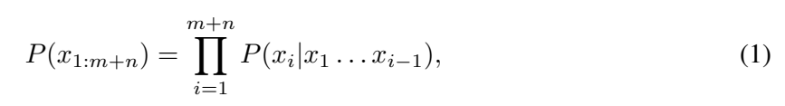
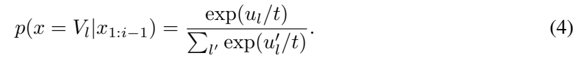
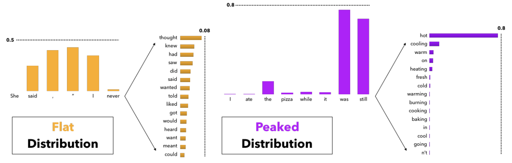
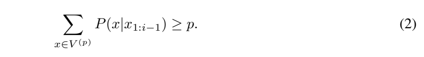
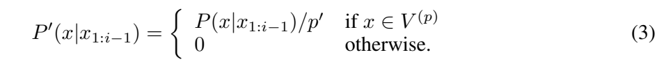
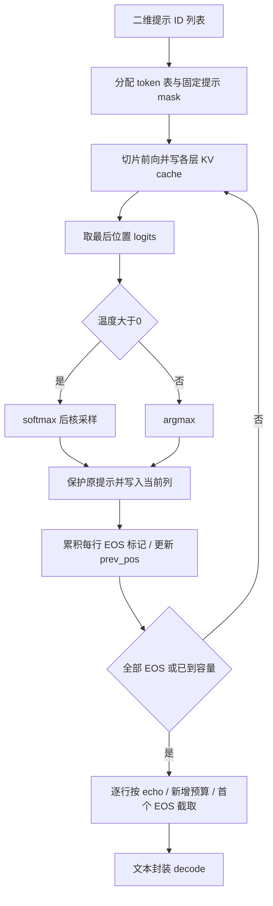

# 第22讲：Llama怎样把提示词接成一段文字

输入一句话，模型先预测下一个token；把选中的token接到末尾，再预测下一个。`generate`负责反复完成这件事：准备输入、调用模型、选词、写回，直到结束。

这一讲用两条长度分别为2和4的提示词，沿着同一张token表看完整个过程。前几讲的RoPE、KV cache和GQA，都在这里接上了实际的生成循环。

## 1. 一轮生成，模型和生成器各做什么？

假设提示词是“我想喝一杯”。分词器把它变成整数编号，模型根据这些编号，为词表里的每个候选计算一个分数。生成器从分数中选出一个编号，例如对应“茶”的编号，再把它接到提示词后面。

下一轮的上下文就包含“茶”。模型会重新预测接下来是什么。**模型的一次调用提供候选分数，生成器的循环负责把这些单步预测接起来。**

```text
提示词 → tokenizer → token编号
                         ↓
              Transformer.forward
                         ↓
                  候选分数logits
                         ↓
                  选一个token编号
                         ↓
             写入末尾 → 继续下一轮
                         ↓ 满足结束条件
                  截取结果 → decode
```

`Llama`是外层接口类，持有`self.model`和`self.tokenizer`两个对象。`self.model`是Transformer；每层Attention内部保存KV缓存。`text_completion`接收文字，`generate`接收已经编码的整数列表。

## 2. 先读懂原notebook的四格分词代码

原课使用的文字是`I believe the meaning of life is`。`text`是Python字符串，分词器的`encode`把它变成编号列表。

```python
from pathlib import Path
from sentencepiece import SentencePieceProcessor
import torch

# 读取本讲自带的分词模型，再把文本转换成编号。
sp = SentencePieceProcessor(
    model_proto=Path('代码/tutorials/tokenizer.model').read_bytes()
)
text = 'I believe the meaning of life is'
encoded = [sp.bos_id(), *sp.encode(text)]
batch = [encoded]
print(encoded)
print(sp.bos_id(), sp.eos_id(), sp.pad_id(), sp.vocab_size())
```

输出为：

```text
[1, 306, 4658, 278, 6593, 310, 2834, 338]
1 2 -1 32000
```

`Path(...).read_bytes()`读取分词模型文件的字节，`model_proto`用这些字节创建分词器。`bos_id()`返回起始标记BOS的编号1；`*sp.encode(text)`把编码列表中的各项展开，接在1后面。

这时`encoded`是一条提示词，类型为`list[int]`。外面再包一层`[]`得到`batch`，类型为`list[list[int]]`，表示“一批提示词”。两条提示词就写成`[第一条列表, 第二条列表]`，各自的长度可以不同。

`text_completion`内部逐条调用`tokenizer.encode(...,bos=True,eos=False)`：给提示词加BOS，把结束位置留给生成过程决定。

| 名称 | 本讲编号 | 在生成过程中的作用 |
|---|---:|---|
| BOS | 1 | 放在提示词开头，提供起始上下文 |
| EOS | 2 | 模型选中它时，标记这一条生成结束 |
| PAD | -1 | 生成器用来表示还没填入token的空位 |
| 词表大小V | 32000 | 合法词表编号为0到31999 |

PAD=-1只用来管理空位。Embedding需要合法词表编号，所以生成器每次交给模型的片段都必须已经填好。

## 3. 把两条提示词放进同一张表

接下来用两条很短的编号列表跟踪位置：A是`[1,7]`，B是`[1,8,9,10]`。每条最多返回3个新增token，模型容量为32。

源码中的几个长度可以这样读：

| 名字 | 本例值 | 含义 |
|---|---:|---|
| `bsz` | 2 | 同时处理两条提示词 |
| `min_prompt_len` | 2 | 最短提示词长度 |
| `max_prompt_len` | 4 | 最长提示词长度 |
| `max_gen_len` | 3 | 每条允许返回的新增token数 |
| `total_len` | 7 | 整张表每行预留的位置数 |

总长度的计算是：

$$N=\min(C,L_{\max}+G)=\min(32,4+3)=7.$$

$C$是模型序列容量，$L_{\max}$是最长提示词长度，$G$是新增token预算。位置从0开始，因此七个位置的编号是0、1、2、3、4、5、6。

```python
prompts = [[1, 7], [1, 8, 9, 10]]
tokens = torch.full((2, 7), -1, dtype=torch.long)
for row, prompt in enumerate(prompts):
    tokens[row, :len(prompt)] = torch.tensor(prompt)
input_text_mask = tokens != -1

# 假设模型这一步分别选中了21和22，看看位置2最终保留谁。
candidates = torch.tensor([21, 22])
kept = torch.where(input_text_mask[:, 2], tokens[:, 2], candidates)
print(tokens.tolist())
print(input_text_mask.tolist())
print(kept.tolist())
```

`torch.full((2,7),-1)`创建两行七列的整数张量，并先把每个空位填成-1。`enumerate`同时给出行号和该行提示词；`tokens[row,:len(prompt)]`选中这一行开头的相应位置。

填入提示词后，表是这样的：

| 行 / 位置 | 0 | 1 | 2 | 3 | 4 | 5 | 6 |
|---|---:|---:|---:|---:|---:|---:|---:|
| A | 1 | 7 | -1 | -1 | -1 | -1 | -1 |
| B | 1 | 8 | 9 | 10 | -1 | -1 | -1 |

`input_text_mask`是一张同样大小的布尔表。原提示词所在位置为True，空位为False。它在开始时建立一次，用来记住哪些位置属于用户原输入。

`torch.where(条件, 条件为真时的值, 条件为假时的值)`逐项选择。位置2上，A的条件为False，采用新候选21；B的条件为True，保留原编号9。所以输出是`[21,9]`。

**同一个位置，对短提示词可以是“生成新内容”，对长提示词仍然是“读取原输入”。**

## 4. 为什么第一次只读到最短提示词的末尾？

源码从`cur_pos=min_prompt_len`开始循环。本例第一轮`cur_pos=2`，`prev_pos=0`，交给模型的是`tokens[:,0:2]`。

Python切片`0:2`取位置0和1，右端2不包含在内。两行这些位置都有真实token，因此这一轮可以同时读取它们。后面较长的提示词会逐个位置进入模型。

`prev_pos`记录“本轮从哪里开始读”，`cur_pos`记录“准备写入哪个位置”。因此本轮输入长度为：

$$S=\text{cur\_pos}-\text{prev\_pos}.$$

| 本轮准备写的位置 | 送给模型的片段 | 输入长度S | A在该位置做什么 | B在该位置做什么 |
|---:|---|---:|---|---|
| 2 | `[:,0:2]` | 2 | 写入第1个新token | 保留原提示词9 |
| 3 | `[:,2:3]` | 1 | 写入第2个新token | 保留原提示词10 |
| 4 | `[:,3:4]` | 1 | 写入第3个新token | 写入第1个新token |
| 5 | `[:,4:5]` | 1 | 继续计算 | 写入第2个新token |
| 6 | `[:,5:6]` | 1 | 继续计算 | 写入第3个新token |

每轮写入后执行`prev_pos=cur_pos`，下一轮的起点随之向前移动。第一轮读取已有上下文，叫**prefill**；后续逐个读入token并预测下一项，叫**decode**。

A比B先凑齐3个新token，但这一版循环采用整批统一的终点。A在后两轮仍参与计算，最后截取输出时才保留自己的前3个新token。

### KV cache在这里接上前几讲

第一次送入两个token，Attention会计算它们的K/V并写入缓存。第二次只送入位置2的新token，算出它的K/V，再连同缓存里位置0和1的K/V一起参加注意力计算。

例如第二轮`start_pos=2`、`seqlen=1`：写入缓存切片`[2:3]`，读取前缀`[:3]`。RoPE也从位置2取旋转角度，和缓存位置保持一致。

| 数据 | 本例shape | 中文读法 |
|---|---|---|
| 整张token表 | `[2,7]` | 两条序列，各预留七个位置 |
| 首轮输入 | `[2,2]` | 两条序列，各读两个token |
| 首轮logits | `[2,2,32000]` | 每条、每个输入位置，对词表中32000项打分 |
| 首轮最后位置的logits | `[2,32000]` | 两条序列，各自预测下一个token |
| 后续单轮输入 | `[2,1]` | 每条只读入一个新token |

最后一个输入位置是`cur_pos-1`，它输出的分数用来预测位置`cur_pos`。所以代码取`logits[:,-1]`：`-1`沿序列轴选最后一个位置，保留整个词表轴。

这里第一个`:`表示取所有行。`softmax(...,dim=-1)`则沿最后的词表轴归一化，每条序列各自得到一组候选概率。

## 5. 论文里的“逐个生成”公式怎样读？



出处：[The Curious Case of Neural Text Degeneration，v2，第3页公式1](https://arxiv.org/pdf/1904.09751v2#page=3)。下面用本讲的编号解释图中符号。

$x_i$是第$i$个token；$x_{1:i-1}$是它前面的所有token。竖线表示“已知前面的内容时”，$P(x_i\mid x_{1:i-1})$就是当前候选的条件概率。$m$为提示词长度，$n$为续写长度；大符号$\prod$表示把各位置的概率相乘。

例如提示词已有两个token，后面生成三个token。生成时依次使用：

$$P(x_3\mid x_1,x_2),\quad P(x_4\mid x_1,x_2,x_3),\quad P(x_5\mid x_1,x_2,x_3,x_4).$$

选出$x_3$后，它成为预测$x_4$时的上下文。KV缓存保存这段已有上下文的中间结果，让后续调用能够接着算。

论文公式描述完整序列概率。本讲给定提示词后的续写概率，是新增位置这些条件概率的乘积。

## 6. 温度：先改变各个候选的概率

模型输出的logits是分数。假设三个候选分别是“茶”“水”“咖啡”，分数为`[2,1,0]`。softmax把分数变成非负、相加为1的概率。



出处：[同篇论文，第6页公式4](https://arxiv.org/pdf/1904.09751v2#page=6)。图中的$u_l$是候选$l$的分数，$t$是温度；$V_l$表示词表中第$l$个token。用代码变量改写为：

$$q_i(T)=\frac{\exp(z_i/T)}{\sum_j\exp(z_j/T)},\qquad T>0.$$

分子先把第$i$个分数除以温度，再取指数；分母把所有候选的相应结果相加；最后相除得到该候选的概率。

| 温度T | 茶 | 水 | 咖啡 |
|---:|---:|---:|---:|
| 0.5 | 0.8668 | 0.1173 | 0.0159 |
| 1 | 0.6652 | 0.2447 | 0.0900 |
| 2 | 0.5065 | 0.3072 | 0.1863 |

这个例子里，温度较低时，“茶”占得更多；温度较高时，另外两个候选也更容易被抽到。正温度保持候选的分数排序，改变的是抽样概率。

`temperature=0`走单独的`argmax`分支：直接取分数最大项，叫**贪心选择greedy**。这时跳过温度除法和top-p采样。当前固定版本对负温度也进入这个分支。

## 7. top-p：这一步从哪些候选里抽？

温度处理后，还可以把概率很低的一批候选裁掉。top-p按概率从高到低累加，保留达到阈值所需的高概率部分，再从中抽样。



出处：[同篇论文，第5页Figure 5，图形部分](https://arxiv.org/pdf/1904.09751v2#page=5)。左边橙色部分举出较平坦的分布：下一个词有许多相近的候选；右边紫色部分举出较尖锐的分布：少数词占据大部分概率。

图中每组大柱子表示一句话走到不同位置时，下一个真实token得到的概率；放大的横条图则展示某个位置上各候选词的分布。左侧横条中许多候选都有一定质量，右侧`hot`一项特别高。

因此，采用同一个概率阈值时，不同位置可以保留不同数量的词。和固定保留k项的top-k相比，top-p会随当前分布调整候选数。当前`generate`接口提供的是`top_p`。

### 7.1 用四个数读懂论文公式



出处：[同篇论文，第4页公式2](https://arxiv.org/pdf/1904.09751v2#page=4)。$V$是完整词表，$V^{(p)}$是按高概率项构成、累计质量达到阈值$p$的最小候选集合。

假设四项概率已从大到小排好：

| 候选 | 概率 | 累计概率 |
|---|---:|---:|
| A | 0.50 | 0.50 |
| B | 0.25 | 0.75 |
| C | 0.15 | 0.90 |
| D | 0.10 | 1.00 |

当$p=0.70$时，A一项还不够，加上B就达到0.75。因此保留A、B。它们原来的概率加起来是0.75，接着要除以这个和，让留下的候选重新加起来为1。



出处：[同篇论文，第5页公式3](https://arxiv.org/pdf/1904.09751v2#page=5)。$p'$表示保留候选原概率的总和。本例$p'=0.75$，所以A的新概率是$0.50/0.75=2/3$，B是$0.25/0.75=1/3$，C、D为0。

### 7.2 完整`sample_top_p`与一个具体输入

下面是固定Meta源码的完整函数，补上中文注释。候选原ID依次为0、1、2，其概率为`[0.3,0.5,0.2]`。

`sample_top_p`是模块级函数。输入`probs`为`[B,V]`浮点概率张量，`p`为概率阈值；返回`[B,1]`整数编号张量。B表示这批有几条输入，V表示每条有多少个词表候选。

```python
def sample_top_p(probs, p):
    # 排序后同时保留“概率”和“它原来的词表ID”。
    probs_sort, probs_idx = torch.sort(probs, dim=-1, descending=True)
    probs_sum = torch.cumsum(probs_sort, dim=-1)
    # 当前项之前的累计概率超过p时，才去掉当前项。
    mask = probs_sum - probs_sort > p
    probs_sort[mask] = 0.0
    probs_sort.div_(probs_sort.sum(dim=-1, keepdim=True))
    # 先抽到排序后的位置，再换回原词表ID。
    next_token = torch.multinomial(probs_sort, num_samples=1)
    next_token = torch.gather(probs_idx, -1, next_token)
    return next_token

probabilities = torch.tensor([[0.3, 0.5, 0.2]], dtype=torch.float64)
torch.manual_seed(22)
print(sample_top_p(probabilities, 0.6).tolist())
for temperature in [0.5, 1.0, 2.0]:
    print(temperature, torch.softmax(torch.tensor([2., 1., 0.]) / temperature, -1).tolist())
```

逐行跟这个输入：

| 操作 | 本例结果 | shape |
|---|---|---|
| 原概率 | `[0.3,0.5,0.2]` | `[1,3]` |
| `sort`后的概率 | `[0.5,0.3,0.2]` | `[1,3]` |
| 同时返回的原ID | `[1,0,2]` | `[1,3]` |
| `cumsum` | `[0.5,0.8,1.0]` | `[1,3]` |
| 减去当前项后的累计 | `[0,0.5,0.8]` | `[1,3]` |
| 大于0.6的mask | `[False,False,True]` | `[1,3]` |
| 裁剪、重新归一化 | `[0.625,0.375,0]` | `[1,3]` |

`sum(...,keepdim=True)`保留一个长度为1的末轴，产生`[1,1]`分母，方便逐行广播相除。`div_`末尾的下划线表示就地修改排序后的概率张量。

`multinomial`根据概率抽一个**排序位置**，得到`[1,1]`整数张量。若抽到位置0，它对应排序表里的原ID1；`gather`正是完成这次索引映射。返回的编号随后交给词表解码。

固定源码的比较符号是`>`。当阈值恰好等于累计概率时，它会再保留一项。例如`[0.5,0.25,0.125,0.125]`、`p=0.5`，源码保留前两项；论文公式按“达到阈值的最小集合”读取时只需第一项。读这一版函数时按表中“当前项之前的累计概率”判断即可。

## 8. EOS怎样结束一条生成？

每行有一个`eos_reached`标记，开始都是False。新选中的token为EOS，并且当前位置属于生成区域时，把该行标记设为True。

源码用`|=`累积标记：一旦变成True，后续轮次会保留True。整批所有标记都为True时，`all(eos_reached)`才成立，循环退出。

条件里的`~input_text_mask`把True/False反转，选出生成区域；`&`要求“属于生成区域”和“选中了EOS”同时成立。这样，原提示词位置只参与上下文读取。

下面用两行真实受控权重模型的结果看这个区别，EOS编号为2：

| 轮次 | 本轮A选中 | 本轮B选中 | 累积结束标记 | 整批是否退出 |
|---|---:|---:|---|---|
| 第1轮 | 2 | 6 | `[True,False]` | 继续 |
| 第2轮 | 6 | 2 | `[True,True]` | 退出 |

A第一轮已经结束，这一版实现仍让它参加第二轮计算。最后处理输出时，在每一行找到第一个EOS，并截掉它及其后面的内容。因此A返回空列表，B返回`[6]`。

## 9. `echo`和长度预算决定最后返回哪一段

假设A提示词有2项，后面最多返回3项：

- `echo=False`从位置2开始，取`tokens[2:5]`，只返回续写。
- `echo=True`从位置0开始，取`tokens[0:5]`，返回提示词加续写。

对于提示词长4的B，右端变成`4+3=7`。所以同一张表虽然按统一长度计算，**每行的输出仍按自己的提示词长度截取**。

另外，模型容量限制整张表的长度。若提示词已有30项，容量只有32项，即使请求新增8项，也只剩两个位置可用。完成长度截取后，还会按第一个EOS进一步截短。

`text_completion`最后对这些编号调用`tokenizer.decode`，返回含`generation`字段的字典列表。带着`echo=True`时，解码后的文字也包含原提示词。

## 10. `logprobs`是在记录什么？

log probability就是概率的自然对数。例如概率0.5对应$\log(0.5)\approx-0.6931$。概率越接近1，对数越接近0；概率很小时，对数更负。

对位置$i$上已经选中的编号$x_i$，记录的量是：

$$\log P(x_i\mid x_{<i})=\operatorname{logsoftmax}(z_{i-1})_{x_i}.$$

`cross_entropy(logits,target)`计算目标编号对应的负对数概率，所以源码前面加负号，再把结果放到`token_logprobs`中。下标右移一位：输入位置$i-1$的分数，用来评价目标位置$i$。

这份固定旧版有一个顺序问题：先算概率记录，后把刚选中的token写进表。新增位置此时仍是PAD=-1；而`ignore_index=-1`让交叉熵忽略该目标，记成0。

```python
import torch.nn.functional as F

scores = torch.tensor([[2., 1., 0.]])
target = torch.tensor([-1])
ignored = F.cross_entropy(scores, target, ignore_index=-1, reduction='none')
target[0] = 0
written = F.cross_entropy(scores, target, ignore_index=-1, reduction='none')
print('目标仍是PAD时：', -ignored.item())
print('写入选中的ID0后：', -written.item())
```

输出分别约为`-0.0`和`-0.407606`。把整块交叉熵计算移到写token之后，才能记录刚生成编号的真实对数概率。本讲另行执行了这个教学修正，并和`log_softmax`逐步核对。

这里记录的是原模型logits对应的概率；温度和top-p处理后用于抽样的概率，要沿第6、7节的操作另外计算。

## 11. 把这些步骤放回完整源码

现在可以把完整`generate`连起来读。下面保留固定版本的签名和执行语句；三个CUDA位置在下一节的CPU运行中做设备适配。`@torch.inference_mode()`表示调用这个函数时采用推理模式，避免为这些计算建立反向传播记录。

源码出处：[Meta generation.py，固定提交7565eb6](https://github.com/facebookresearch/llama/blob/7565eb6fee2175b2d4fe2cfb45067a61b35d7f5e/llama/generation.py)。本讲的[完整中文注释阅读版](代码/tutorials/generate核心源码_代码注释.py)还可以逐行对照。

| 参数 | 默认值 | 读法 |
|---|---|---|
| `self` | 调用时由对象提供 | 当前Llama对象，从它读取model与tokenizer |
| `prompt_tokens` | 调用时传入 | 一批提示词的整数列表 |
| `max_gen_len` | 调用时传入 | 每条最多返回多少个新token |
| `temperature` | 0.6 | 正温度时先调整概率，0时走greedy |
| `top_p` | 0.9 | 采样候选的概率质量阈值 |
| `logprobs` | False | 是否同时返回逐token对数概率 |
| `echo` | False | 是否把原提示词一起返回 |

返回值是一个二元组：第一项为每条的输出编号列表；第二项为相应概率列表，关闭`logprobs`时为None。类型注解`List`表示列表，`Tuple`表示元组，`Optional[...]`表示该项也允许为None。

```python
# Copyright (c) Meta Platforms, Inc. and affiliates.
# This software may be used and distributed according to the terms of the Llama 2 Community License Agreement.
from typing import List, Optional, Tuple

@torch.inference_mode()
def generate(
    self,
    prompt_tokens: List[List[int]],
    max_gen_len: int,
    temperature: float = 0.6,
    top_p: float = 0.9,
    logprobs: bool = False,
    echo: bool = False,
) -> Tuple[List[List[int]], Optional[List[List[float]]]]:
    # 读取模型容量，准备整批输入。
    params = self.model.params
    bsz = len(prompt_tokens)
    assert bsz <= params.max_batch_size, (bsz, params.max_batch_size)
    min_prompt_len = min((len(t) for t in prompt_tokens))
    max_prompt_len = max((len(t) for t in prompt_tokens))
    assert max_prompt_len <= params.max_seq_len
    total_len = min(params.max_seq_len, max_gen_len + max_prompt_len)
    pad_id = self.tokenizer.pad_id
    tokens = torch.full((bsz, total_len), pad_id, dtype=torch.long, device='cuda')
    for k, t in enumerate(prompt_tokens):
        tokens[k, :len(t)] = torch.tensor(t, dtype=torch.long, device='cuda')
    if logprobs:
        token_logprobs = torch.zeros_like(tokens, dtype=torch.float)
    prev_pos = 0
    eos_reached = torch.tensor([False] * bsz, device='cuda')
    # 记住哪些位置属于原提示词。
    input_text_mask = tokens != pad_id
    for cur_pos in range(min_prompt_len, total_len):
        # 只读取本轮新增加的片段，旧K/V从缓存取得。
        logits = self.model.forward(tokens[:, prev_pos:cur_pos], prev_pos)
        if logprobs:
            # 固定旧版的概率记录在写回之前，顺序问题见第10节。
            token_logprobs[:, prev_pos + 1:cur_pos + 1] = -F.cross_entropy(
                input=logits.transpose(1, 2),
                target=tokens[:, prev_pos + 1:cur_pos + 1],
                reduction='none',
                ignore_index=pad_id,
            )
        if temperature > 0:
            probs = torch.softmax(logits[:, -1] / temperature, dim=-1)
            next_token = sample_top_p(probs, top_p)
        else:
            next_token = torch.argmax(logits[:, -1], dim=-1)
        next_token = next_token.reshape(-1)
        # 原提示词的位置保留原ID，其余位置写模型选中的ID。
        next_token = torch.where(input_text_mask[:, cur_pos], tokens[:, cur_pos], next_token)
        tokens[:, cur_pos] = next_token
        # 按行累积结束标记；所有行结束才退出。
        eos_reached |= ~input_text_mask[:, cur_pos] & (next_token == self.tokenizer.eos_id)
        prev_pos = cur_pos
        if all(eos_reached):
            break
    if logprobs:
        token_logprobs = token_logprobs.tolist()
    out_tokens, out_logprobs = ([], [])
    # 按每条自己的提示词长度、预算和EOS截取结果。
    for i, toks in enumerate(tokens.tolist()):
        start = 0 if echo else len(prompt_tokens[i])
        toks = toks[start:len(prompt_tokens[i]) + max_gen_len]
        probs = None
        if logprobs:
            probs = token_logprobs[i][start:len(prompt_tokens[i]) + max_gen_len]
        if self.tokenizer.eos_id in toks:
            eos_idx = toks.index(self.tokenizer.eos_id)
            toks = toks[:eos_idx]
            probs = probs[:eos_idx] if logprobs else None
        out_tokens.append(toks)
        out_logprobs.append(probs)
    return (out_tokens, out_logprobs if logprobs else None)
```

其中`self.model.forward(...)`的两个参数分别是本次新读的token片段和它的起始位置。`reshape(-1)`把采样的`[B,1]`与greedy的`[B]`统一成一维，方便按行写入`tokens[:,cur_pos]`。

生成过程中，KV缓存和token表会逐步更新；模型参数继续用于相同的前向计算。`max_gen_len`控制循环的长度预算，`temperature/top_p`控制怎样选候选，`logprobs/echo`控制返回内容。

原notebook的Markdown第10格摘录了`for`和`forward`两句；完整方法补上了`prev_pos`推进、选词、保护原提示词、写回和停止，因此适合放在一起对照。

## 12. 用完整Meta模型走一次

下面调用的是固定Meta源码中的完整`Transformer`、`Llama.generate`和`Tokenizer`。辅助脚本准备CPU设备、单进程运行环境，并记录真实调用。

```python
import sys
sys.path.insert(0, str(Path('复现/scripts').resolve()))
from verify_foundation_examples import generation_session, make_model, trace_generate

with generation_session() as (meta, generation, repaired_generation, tokenizer):
    model = make_model(meta)
    llama = generation.Llama(model, tokenizer)
    result, calls, steps = trace_generate(
        llama, prompt_tokens=[[1, 7], [1, 8, 9, 10]],
        max_gen_len=3, temperature=0, echo=False
    )
    print('每轮起点、输入长度：', [(c['start'], c['shape'][1]) for c in calls])
    print('每轮保护标记：', [s['protected'] for s in steps])
    print('两条续写编号：', result[0])
```

得到：

```text
每轮起点、输入长度： [(0, 2), (2, 1), (3, 1), (4, 1), (5, 1)]
每轮保护标记： [[False, True], [False, True], [False, False], [False, False], [False, False]]
两条续写编号： [[17528, 7163, 2814], [4553, 4870, 27233]]
```

可以回到第4节表格核对：两轮保护B的原提示词，随后两行一起生成；最后每条返回3个新增编号。首轮输入长度为2，后面四轮均为1。

这次模型用显式初始化的小参数配置，适合观察生成流程。运行环境、参数配置、完整检查结果和重做命令集中放在[复现说明](复现/README.md)。

## 13. Paper ↔ Code：公式落在哪一步？

| 论文或机制 | 这讲的具体代码 | 读法 |
|---|---|---|
| 论文公式1：从左到右分解 | `generate`循环与`logits[:,-1]` | 根据已有上下文预测下一项 |
| 论文公式4：温度softmax | `torch.softmax(logits[:,-1]/temperature,dim=-1)` | 先调整每个候选的概率 |
| Figure 5：平坦/尖锐分布 | 每步重新计算的`probs` | 候选分布随当前上下文变化 |
| 论文公式2、3：top-p与重新归一化 | `sample_top_p`的sort、cumsum、mask、div、multinomial | 动态保留高概率候选，再抽样 |
| KV缓存、RoPE、GQA | `Transformer.forward`→每层Attention | 用绝对位置读取新片段、复用前缀K/V；详见18–21讲 |
| EOS、echo、逐行预算 | `eos_reached`和循环后的切片 | 管理结束条件及输出范围 |
| 论文完整实验代码与当前Meta实现的直接关系 | 未找到直接调用关系 | 本讲用论文解释解码方法，用固定Meta源码解释具体执行顺序 |

论文与本讲使用的Meta文件是两份独立来源。论文讨论开放式文本续写中的解码选择；本讲通过Llama的实现，观察这些选词步骤怎样接到缓存、batch和输出处理上。

## 14. 读完以后，先掌握哪些内容？

**必须掌握：** 一条提示词与一批提示词的列表层次；token表与固定保护mask；`prev_pos/cur_pos`切片；最后位置预测下一项；温度、top-p、greedy；EOS累积；echo和每行长度截取。

**第二遍：** 对照完整函数跟踪五次真实forward；手算top-p的原ID映射；检查缓存增量与完整前缀重算；理解旧版logprobs计算的先后顺序。

**工程细节可以稍后读：** checkpoint加载、多GPU模型并行、连续批处理和缓存分页。先把这张两行七列的表跟完，再读这些扩展会更顺畅。

## 15. 复现状态与剩余问题

状态：**部分成功**。正文六个代码块均执行；完整固定Meta源码采用CPU设备适配，真实小模型覆盖不等长提示、缓存增量、采样、EOS、echo、容量和概率记录。源码与图像来源、数值结果见[基础讲解验证](复现/outputs/基础讲解验证.json)和[论文截图来源](复现/outputs/论文截图来源.json)。

本次采用随机初始化的小模型，结果用于讲清计算与控制流程；原Llama权重的语言质量、论文任务评测以及GPU多进程运行仍待验证。后面换模型或版本时，应结合对应实现重新检查特殊token和接口行为。

<details>
<summary>第二遍阅读：原讲解中的源码细节与历史运行记录</summary>

# Llama generate 完整流程

[阅读入口](README.md) · [完整核心源码中文注释](代码/tutorials/generate核心源码_代码注释.py) · [全部原单元说明](代码单元解释.md)

## 1. 这一讲要把哪些部分接起来

前几讲解释了模型里的一次计算；这一讲解释怎样反复调用模型，直到得到一段文本。输入先从字符串变成整数 token；模型读取尚未处理的前缀，输出每个位置的词表 logits；生成器选择下一个整数、写回 token 表，并判断是否停止；最后截取、解码。`generate` 负责调度，`Transformer.forward` 负责神经网络计算，`Attention` 保存 KV cache，`Tokenizer` 负责文本与 ID 转换。

**原 notebook 不是完整生成程序**：共 17 格，其中只有 0–3 四格 Python，做的是分词；4、10、13、16 格在 Markdown 中摘录生成代码。我们保留全部原文、元数据及历史输出，在旁边逐格说明，同时补上完整固定官方 `generate` 的中文注释。完整方法不是从四个片段凭空拼出来的。

来源与阅读内容：

| 材料 | 固定身份 | 本讲用途 |
|---|---|---|
| [课程原 notebook](https://github.com/chunhuizhang/personal_chatgpt/blob/7fbc29824171fd07dc2c30fe922e61ebc018ad1d/tutorials/llama2_src_generate.ipynb) | 上游提交 `7fbc298…` | 17 格逐项对照；原字节 SHA 在来源清单 |
| [Meta generation.py](https://github.com/meta-llama/llama/blob/7565eb6fee2175b2d4fe2cfb45067a61b35d7f5e/llama/generation.py) | 提交 `7565eb6…` | 完整生成循环、外层文本封装、核采样 |
| [同版 model.py](https://github.com/meta-llama/llama/blob/7565eb6fee2175b2d4fe2cfb45067a61b35d7f5e/llama/model.py) | 同一提交 | 真实 Transformer、RoPE、GQA、cache |
| [同版 tokenizer.py](https://github.com/meta-llama/llama/blob/7565eb6fee2175b2d4fe2cfb45067a61b35d7f5e/llama/tokenizer.py) | 同一提交 | BOS/EOS 与 encode/decode |
| [The Curious Case of Neural Text Degeneration](https://arxiv.org/abs/1904.09751v2) | Holtzman 等，v2，2020-02-14，ICLR 2020 | 相关核采样论文；此处只核查摘要/版本，实验部分留待后续阅读 |

相关论文研究为什么同一语言模型采用不同解码方式会出现不同文本质量，并提出从动态概率核心采样以裁掉不可靠尾部。本讲重点是固定 Meta 实现的真实边界，后面的公式按代码直接推导，不编造论文公式编号或实验数字。[论文摘要](https://arxiv.org/abs/1904.09751v2)

本讲聚焦生成流程：读入 prompt、复用缓存、采样新 token 并处理结束条件。训练 loss、optimizer 和 checkpoint 保存分别由训练流程负责。

## 2. 仓库地图与一条完整调用链

```text
example_text_completion.py 的 main（官方入口，未运行）
  → Llama.build（权重/params/tokenizer/NCCL 初始化，本次未调用）
  → Llama.text_completion(List[str])
  → Tokenizer.encode(bos=True,eos=False)
  → Llama.generate(List[List[int]])
  → Transformer.forward(new_token_chunk, prev_pos)
  → 每层 RMSNorm / Attention(RoPE+GQA+KV cache) / SwiGLU
  → 最后位置 logits → 温度/核采样或 argmax
  → 提示词保护 → 写入 token → EOS 与循环控制
  → 逐行按预算/echo/EOS 截取
  → Tokenizer.decode → List[dict]
```

`params.json`、预训练 `.pth` 是官方 build 所需资产；本讲没有这份原权重。课程里的 `tokenizer.model` 只是分词模型，499723 bytes，不是神经网络 checkpoint。验证直接构造小型真实 Transformer，显式初始化其参数，再交给未替换生成算法的 `Llama`。这个路径可以检验控制流，无法检验原模型语言能力。

| 文件 | 阅读内容 |
|---|---|
| `generate核心源码_代码注释.py` | 选出的完整相关方法，仅加注释；省略 build/chat，不是可独立导入的完整模块 |
| `llama2_src_generate_代码注释.py` | 原四格分词示例；从该文件所在目录运行 |
| `Markdown片段_代码注释.py` | 原四个 Markdown 摘录，各自需要上下文 |
| `复现/scripts/verify_delivery.py` | 原件/派生件审计、真实模型测试与独立教学修正 |

## 3. 先把字符串和 batch 分清楚

原文 `text = "I believe the meaning of life is"` 是 `str`。`SentencePieceProcessor(model_file='./tokenizer.model')` 读取本地词表资产；四个实际数值是 BOS=1、EOS=2、PAD=-1、V=32000。

```python
prompt_tokens = [sp_model.bos_id(), *sp_model.encode(text)]
# 得到单条 List[int]：
# [1, 306, 4658, 278, 6593, 310, 2834, 338]
# 传给 generate 时需要外层 batch：
batch = [prompt_tokens]
```

`*` 把列表元素展开到另一个列表中；它不创建 batch。`generate` 的类型注解为 `List[List[int]]`，注解不会在运行时自动帮你转换。直接把 `List[int]` 传入，函数会在 `len(t)` 处对整数取长度，实际抛 `TypeError`。`text_completion` 用列表推导式逐条 encode，形成外层 batch；原始文本会加 BOS、不加 EOS。

PAD=-1 是空位哨兵，不能进入 embedding 当合法 token。生成器先分配 PAD 表、填入全部原提示，再逐位置填生成 token。测试观察每次真实 `forward` 的输入，保证所有 ID 均非负。

## 4. 所有位置和 shape 的总表

令 B 为批次数；第 b 条提示长度为 $L_b$；$L_{min}$、$L_{max}$ 分别为最短/最长长度；G 为 `max_gen_len`；C 为 `max_seq_len`；总容量 $N=\min(C,L_{max}+G)$。P=`prev_pos`，c=`cur_pos`，本次送入长度 S=c−P，V 为词表大小。这些量都是 token 位置，不是字符数。

| 变量 | 类型 / shape | 含义及去向 |
|---|---|---|
| `prompt_tokens` | Python 嵌套整数列表，各行可不等长 | 用户提示，先拷入 tokens |
| `tokens` | int64 `[B,N]` | 原提示和新增 ID 共用的表 |
| `input_text_mask` | bool `[B,N]` | 最初哪些位置不是 PAD，建立后不随生成改变 |
| `tokens[:,P:c]` | int64 `[B,S]` | 尚未送进模型的部分 |
| `logits` | 此版 FP32 `[B,S,V]` | 每个输入位置预测下一位置的分数 |
| `logits[:,-1]` | FP32 `[B,V]` | 当前将写到位置 c 的候选分数 |
| `probs` | `[B,V]` | 正温度归一化后的选词概率 |
| `next_token` | 采样先为 int64 `[B,1]`，argmax 为 `[B]` | `reshape(-1)` 后统一为 `[B]` |
| `eos_reached` | bool `[B]` | 每条样本是否曾生成 EOS，按位累积 |
| `token_logprobs` | FP32 `[B,N]`，可选 | 每位置概率记录；旧版有新增位置顺序 bug |
| 每层 `cache_k/v` | `[Bmax,C,Hkv_local,d]` | Attention 状态；本轮读取前缀 `[B,P+S,Hkv_local,d]` |

原型表里 7B/13B/70B 的 Q heads 为32/40/64，D=4096/5120/8192，head_dim 均128。它不表示 70B 也有64个 KV heads，见第21讲。循环不根据 head 数决定位置。原 Markdown 举 max_seq_len=1024/2048 是示例配置，不是所有 Llama2 模型固定的上下文定义。

## 5. 按真实循环走一遍

### 5.1 为何第一次只到最短提示

先检查 B 不大于 batch 容量、最长提示不超过 C，分配 `[B,N]`，然后 `enumerate(prompt_tokens)` 将各提示写入对应行开头。`enumerate` 同时给出行号 k 和列表 t。`input_text_mask = tokens != pad_id` 记录哪些位置必须保留。

原始范围 `range(Lmin,N)` 不含右端 N。第一次 `P=0,c=Lmin`，所有行都只送入最短长度，保证首轮没有空 PAD。长提示剩下的部分会在以后逐位置消费。原文“第一次 prompt 整体进来”对单条或等长 batch 才成立。

这次真实测试设置：A 提示 `[1,7]`，B 提示 `[1,8,9,10]`，G=3，C=32。所以 Lmin=2、Lmax=4、N=7。

| c | 送入切片 / S | A 的位置 c | B 的位置 c |
|---|---|---|---|
| 2 | `[0:2]` / 2 | 生成17528 | 原提示9，保护 |
| 3 | `[2:3]` / 1 | 生成7163 | 原提示10，保护 |
| 4 | `[3:4]` / 1 | 生成2814 | 生成4553 |
| 5 | `[4:5]` / 1 | 继续计算，返回时丢弃 | 生成4870 |
| 6 | `[5:6]` / 1 | 继续计算，返回时丢弃 | 生成27233 |

这些数字来自 seed22 随机小模型，仅用于核对位置。最终 A 返回3项，B 返回3项。A 会多算两项，因为循环按整批统一终点运行，返回再按每条自身预算裁剪。

### 5.2 forward 和 cache 怎样接上

每轮执行 `self.model.forward(tokens[:,prev_pos:cur_pos],prev_pos)`。`self` 在这里是 Llama；`self.model` 是 Transformer；cache 则属于每层 Attention。原 Markdown 的 `self.cache_k` 片段里，self 已经换成 Attention，不能把它直接放到 Llama 上运行。

模型把本轮 K/V 写到 cache 的 `[P:P+S]`，取 `[0:P+S]` 参与注意力，RoPE 用起点 P 对齐绝对位置。缓存的是历史 K/V，**不是**历史最终 logits。首次 S>1 需要屏蔽本段未来 token；随后 S=1 没有本段未来位置。

每次写 token 后必须 `prev_pos = cur_pos`。下一轮 c 增加1，S 才成为1。**Markdown10 只展示 for 和 forward，缺少这句更新、采样和写回**；按字面执行它，实际调用是 `[0:2]`、`[0:3]`、`[0:4]`，一直重算前缀。这也是需要补充完整方法的原因。

固定旧 model.py 存在非零 P 且 S>1 的多 token 增量 mask 尺寸问题，第20讲已记录。本讲正常路径首轮 P=0、后续 S=1，没有暗中修改 mask 来掩盖问题。

### 5.3 一个位置的 logits 为什么预测下一个

自回归模型的分解可以写为：

$$p(x_0,\ldots,x_{n-1})=\prod_{t=0}^{n-1}p(x_t\mid x_{<t}).$$

$x_t$ 是第 t 个 token，$x_{<t}$ 是此前前缀，n 为序列长度，乘积遍历所有位置。实际用 BOS 提供起始上下文；本生成循环并不估计 BOS 的概率。读到位置 c−1 的隐藏状态，经 output 投影得到位置 c 的词表分数，所以取最后输入位置 `logits[:,-1]`。输入 `[0:2]` 的最后一项在位置1，预测的是位置2，而不是重写位置1。

前向每个位置都有预测；选新 token 只用最后位置，其余位置可供 prompt 的右移概率计算。不要把 `[B,S,V]` 当成 `[B,V]`，也不要把最后词表轴误当作序列轴。

## 6. 温度、greedy 与核采样

### 6.1 温度先改变分布

对于某一行 b 的当前位置，令 $z_i$ 是第 i 个词的 logit，i 从0到 V−1。正温度 T 下：

$$q_i(T)=\frac{\exp(z_i/T)}{\sum_{j=0}^{V-1}\exp(z_j/T)}.$$

先对 `[B,V]` 除标量 T，再 `torch.softmax(...,dim=-1)` 沿词表归一化。分母里的 j 是所有词表候选，和为1。实际 softmax 做数值稳定处理，不能把公式误解成必须手动对大数直接 exp。

小例子 logits `[2,1,0]`：

| T | 三项概率（约） | 熵（自然对数，约） |
|---|---|---|
| 0.5 | `[.8668,.1173,.0159]` | .4411 |
| 1 | `[.6652,.2447,.0900]` | .8324 |
| 2 | `[.5065,.3072,.1863]` | 1.0202 |

熵 $H(q)=-\sum_i q_i\log q_i$ 衡量分布的分散程度；这里只有3个候选，不是模型质量指标。正温度越小，这个例子越集中；正 T 理论上不改变最大 logit 的排序。**T=0 不能代入除法**，代码直接走 argmax。此版负 T 也走 else/greedy，不是计算负温度分布。greedy 分支不使用 top_p。

### 6.2 核集合和实现的严格边界

`sample_top_p` 是模块级普通函数，不是 Llama 方法。它接 `[B,V]` 非负概率和 p，返回 `[B,1]` 整数。先降序排序得到 $q_{(j)}$ 与原词表 ID，再累计。令排序下标从1开始，$A_j=\sum_{k<j}q_{(k)}$ 为当前项之前的累计质量。固定代码用 `mask = probs_sum - probs_sort > p`，因此保留条件是 $A_j\le p$。

保留集合 M 后归一化：

$$\widetilde q_{(j)}=\begin{cases}q_{(j)}/\sum_{k\in M}q_{(k)},&j\in M,\\0,&j\notin M.\end{cases}$$

这里 j、k 是排序位置，M 是动态候选集合；`div_` 是原地除法，`keepdim=True` 保留 `[B,1]` 的分母轴以广播。`torch.multinomial` 按新概率真正随机抽一项，得到排序位置；`gather` 用索引表换回原词表 ID。sort 产生新张量，当前函数不改传入的原 probs。

例如原词表概率 `[.3,.5,.2]`，排序后是 `[.5,.3,.2]`，对应 ID `[1,0,2]`：

| p | 实际保留并归一化的排序概率 | 原词表候选 |
|---|---|---|
| .49 | `[1,0,0]` | 仅 ID1 |
| .50 | `[.625,.375,0]` | ID1、ID0 |
| 0 | `[1,0,0]` | 仅最大项（此测试无并列） |
| 1 | `[.5,.3,.2]` | 全部 |

恰好累计等于 p 时，因为代码比较 `>` 而不是 `>=`，下一项也保留；不能只背“累计达到 p 就立刻停”的口号。top_p 是累计概率预算，不是固定保留几个词；函数没有 top_k。此版未校验参数范围，负 p 会遮掉全部概率、归一化产生 NaN，真实 multinomial 报错。`nuclear sampling` 应改称 `nucleus sampling`（核采样），原文仍保留。

## 7. 提示词保护、EOS 与输出截取

采样分支得到 `[B,1]`，argmax 得到 `[B]`，`reshape(-1)` 将其统一为 `[B]`。随后 `torch.where(input_text_mask[:,c],tokens[:,c],next_token)` 按行选值：原提示位置用旧 ID，空位用新 ID。这不是控制是否调用 forward；两行都已计算过 logits，只有写入选择不同。



图中只有 C 的 Transformer 含已初始化模型参数；mask/采样/截取都不是可训练层。箭头回到 C 表示新整数再次作为输入，并使用之前 cache；没有训练 backward。左边两种选词分支在 H 汇合，而不是同时执行。

`eos_reached |= (~input_text_mask[:,c]) & (next_token == eos_id)` 是按位 OR 累积：只有生成位置遇到 EOS 才置真，原提示中的 EOS 不在这里触发停止。`all(eos_reached)` 全真才 break。

真实受控权重实验（真实 Transformer，注意力/MLP 权重置零，利用残差 embedding 与 output 投影决定下一项）：

| 步骤 | 本次选出的两行 ID | 累积 EOS 标记 |
|---|---|---|
| 首轮 | `[2,6]` | `[True,False]` |
| 次轮 | `[6,2]` | `[True,True]` |

EOS=2。第一行已结束，但第二轮仍消费第一行的 EOS 并生成6；代码没有冻结已结束行，也没有缩小 batch。最终第一行返回 `[]`，第二行返回 `[6]`，因为按各行第一个 EOS 截断且不包含 EOS 本身。

返回起点为 `0 if echo else L_b`，右端为 `L_b+G`，之后再截 EOS。所以 echo 改变保留范围，不增加生成预算。真实不等长例子两种 echo 的新增 ID 一致。若 echo=True 且提示本身含 EOS，返回列表也会在提示的第一个 EOS 截断；测试 `[1,2,3]` 得到 `[1]`。这是输出层裁剪，不是说提示 EOS 会让循环提前停止。

`generate` 返回二元 tuple：`(List[List[int]], Optional[List[List[float]]])`。`logprobs=False` 的第二项为 `None`；不是一批 None 列表。`text_completion` 再用 decode 变成字典中的 generation。decode 每个单独 ID 的字符串列表与整段 decode 不保证按普通空格拼接即可复原；BOS 单独 decode 还可能是空串。

## 8. 旧版 logprobs 为什么是 -0

正确的目标是**原始模型**选中 token 的 log 概率，而非温度/核截断后的抽样概率。对模型 logits z 和目标 y：

$$\log p(y\mid prefix)=z_y-\log\left(\sum_{i=0}^{V-1}\exp z_i\right)=-\operatorname{CE}(z,y).$$

y 是当前整数标签；CE 是交叉熵，输入 logits，不是已经 softmax 的概率。序列输入 `[B,S,V]` 用 `transpose(1,2)` 转成 CE 所需 `[B,V,S]`；target `[B,S]` 比输入右移一位置。`reduction='none'` 每个位置保留一个值，`ignore_index=-1` 忽略 PAD。

缺陷来自执行顺序：

```text
旧版：forward → CE(target 当前新槽仍为 PAD) → 采样/保护 → 写 token
教学修正：forward → 采样/保护 → 写 token → CE(当前目标已确定)
```

新 token 的 target 在旧版算 CE 时还是 -1，被忽略，所以记录为 `-0.0`；**不是模型对该 token 概率为1**。原 prompt 的部分已知目标有正常负值，因此不能笼统地说此版所有概率都为0。

本次实测，A 的新 ID `[17528,7163,2814]`：

| token | 旧版返回 logprobs | 独立教学修正 / 真实 log_softmax |
|---|---|---|
| 17528 | -0.0 | -10.07020 |
| 7163 | -0.0 | -10.02808 |
| 2814 | -0.0 | -10.04488 |

教学修正只移动循环内整个 `if logprobs` 块到写入 `tokens[:,cur_pos]` 之后，不改采样、权重和 token 结果。验证器检查修正后每步概率与同次真实 logits 的 `log_softmax` 一致；原文件与中文源码阅读版仍保留旧顺序。第一个 token 没有更早上下文对应的 logit，初始概率0是占位，不能当作模型估计。

## 9. API、语法与边界检查

| 对象 / 调用 | 所有者、输入默认值与返回 | 状态 / 注意点 |
|---|---|---|
| `Llama.__init__` | 接 model/tokenizer 两实例 | 保存引用，不负责初始化或下载权重 |
| `Llama.generate` | prompt二维ID、必填G；T=.6、p=.9、logprobs=False、echo=False | 调 model，写每层cache；返回嵌套ID和可选概率 |
| `Llama.text_completion` | `List[str]`；T=.6、p=.9、G=None | G=None变C−1；encode→generate→decode；返回字典列表 |
| `sample_top_p` | 普通函数 `[B,V]`/p，无上述默认值 | sort→cumsum→mask→归一化→multinomial→gather，返回 `[B,1]` |
| `torch.full` / `torch.tensor` | 分配/转换整型 token 表 | 原版 device 写死CUDA，CPU教学仅替换三个 device |
| `@torch.inference_mode()` | 装饰 generate 的包装器 | 关闭梯度，节省记录；不会替你 `.eval()` |
| `all(tensor)` / `break` | Python 遍历布尔标量 / 跳出当前循环 | GPU运行可能同步，CPU实验不宣称其GPU代价 |
| `.tolist()` / `zip` | 张量转普通列表 / 对齐遍历两列表 | 返回后处理，不是新一轮神经网络计算 |

`class` 描述对象的结构，`__init__` 是构造后的初始化方法，`self` 是当前实例；外层 Llama 与内部 Attention 的 self 不同。二元解包 `a,b=f()` 接收两个返回项。冒号切片右端不含；`:` 保留 batch 的所有行；`-1` 索引最后位置；`dim=-1` 指最后词表轴。下划线结尾 `div_` 表示原地修改，`|=` 对布尔 mask 累积。`None` 是“不提供概率”的标志，不是数字0。

实际边界结果：

| 输入 | 此固定版实际行为 |
|---|---|
| 空 batch `[]` | `min()` 的 ValueError |
| 单条 ID 列表未包 batch | `len(int)` 的 TypeError |
| B=3 而容量2 / 提示长度33而容量32 | AssertionError |
| `G=-1`，2-token prompt | 拷入容量不足张量时报 RuntimeError；没有友好参数校验 |
| batch里一个空 prompt | 模型处理长度0时报 reshape RuntimeError；正常encode会加BOS |
| 等长单条提示，G=0 | 没有forward，返回空新增列表 |
| 不等长2/4的提示，G=0 | 仍有两次forward，最终两行均返回空；循环范围仍由最长提示决定 |
| 30-token prompt，C=32，G=8 | 最多新增2项，本次实际2项；forward长度30、1 |
| T<0、p<0 | 走greedy不使用p；单独负p采样会报错 |

类型注解、assert 与参数验证是不同机制。这里把实际错误写清楚，不在原件中添加新校验来伪装为历史行为。

## 10. 小模型中的完整生成过程

环境为 Windows / Python3.12.14 / Torch2.5.1+cpu / FairScale0.4.13 / SentencePiece0.2.0，Gloo单rank。真实模型 D16、两层、Q4/KV2、V32000、容量32、batch2，**1,029,840 参数**。所有矩阵按 seed22 显式 normal(0,.02) 初始化，norm置1，eval；官方的空初始化不能拿来直接当随机权重使用。受控 EOS 实验是另一个明确构造的真实权重模型。

只在内存 AST 中把模型两个 cache `.cuda()` 改到CPU，把 generation 三处 `device='cuda'` 改到CPU；Tokenizer 无改动。完整原模块、FairScale 层、真实矩阵计算和真实采样保留，没有 fake forward 或预设生成器。独立修正版另外移动一块 CE；没有把它当原程序。

证据在[复现说明](复现/README.md)及[实际输出](复现/outputs/runtime_verification.json)：

- 三个 notebook schema、原文件 SHA、全部元数据/历史输出、四代码格 AST与非注释 token、三个阅读版和官方方法 AST均通过；两份派生版各35格。
- 原版与注释版四格都实际执行，分词8个ID和 stdout 完全一致；不是仅统计单元数。
- 不等长 batch 的5次真实调用、提示保护、输出预算、单条与批次greedy一致；每步缓存路径与独立完整前缀重算的最大logit差 `8.940696716308594e-08`（容差2e-6）。不是语言准确率。
- 旧概率缺陷与教学修正、真实受控EOS两步、echo、容量截断、零预算、输入错误、text_completion、四个Markdown片段实际执行。
- 温度熵、核集合阈值、multinomial前真实归一化概率、原ID映射与seed220采样重放通过。观察wrapper仅记录输入/输出，调用真实函数并恢复，不替换其结果。

没有原 Llama 7B/13B/70B 权重，没有运行 build/NCCL/CUDA、多rank通信、原模型文本质量、吞吐或训练。原手写续写的 `meanning...` 只是原示意，不把它当本次生成。首次验证在 Windows 中文绝对路径下加载 SentencePiece 报文件未找到；改为进入实际目录并用相对文件名，原Tokenizer代码不变，之后完整重跑通过。旧notebook缺cell id的schema提示保留，不为消除提示改动历史元数据。

## 11. 必须掌握

单条ID列表与二维batch的区别；P/c/S的切片关系；第一次按最短提示prefill；固定mask保护原提示；最后位置logits预测下一位置；采样形状统一；每行EOS累积与整批退出；返回裁剪；旧logprobs顺序缺陷。

## 12. 第二遍理解

独立完整前缀为何应与缓存增量接近；T/p为何分别改变分布和集合；核采样的严格阈值；温度后的采样概率与原模型log概率的区别；不等长batch的额外计算；echo中提示EOS的边界。

## 13. 可以暂时不掌握的工程细节

FairScale多rank切分、NCCL、连续批处理、分页KV、GPU同步开销。当前循环没有实现这些优化；不可从这个单rank测试推导它们的正确性或速度。

## 14. Paper ↔ Code

| 概念 / 来源 | 代码对应 | 对齐程度 |
|---|---|---|
| 自回归条件概率 | Transformer输出→generate循环 | 直接按当前实现推导，未冒称论文编号 |
| 温度softmax | generate的正温度分支 | 完整解释shape/例子；T≤0另分支 |
| 核采样相关论文的动态候选思想 | sample_top_p | 思想对应；严格`>`边界以代码为准，未核查论文全文公式 |
| KV cache / GQA / RoPE | model.Attention及Transformer.forward | 本讲串联；详细实现见18–21讲 |
| 概率报告 | generate的CE及text_completion | 旧顺序实际有缺陷，单独验证教学修正 |
| 训练目标、optimizer、训练数据 | 原notebook中未找到 | 不把返回概率计算当模型训练 |
| 原权重质量/核采样论文实验指标 | 本次未运行、未核验表格 | 不以随机模型输出替代 |

## 15. 复现状态与未解决问题

原示例、静态完整性和随机小型官方模型的生成控制流已验证。原大模型的语言质量与相关论文实验留待后续。

尚未解决：本地未找到本讲可确认的独立字幕；未全文精读核采样论文和逐项复核其实验；未测试原checkpoint、GPU/多rank或其他新版本生成代码。文中行为严格限定固定提交。若换版本或分词模型，应重新检查PAD/EOS、mask、概率顺序和采样阈值，不能直接沿用本讲实测数字。

</details>
