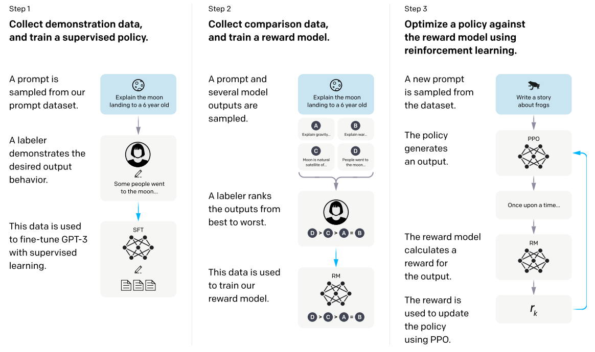
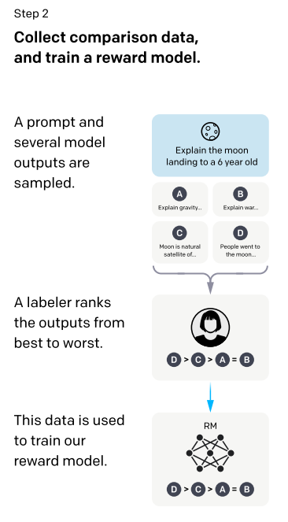
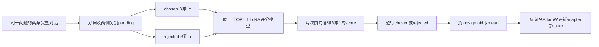

# 第23讲：从两个回答的比较，到RewardTrainer训练

同一个问题有两个回答，标注者说“我更喜欢第一个”。奖励模型要学习的就是这种比较：给问题和回答打分，让较受偏好的回答排在前面。

这一讲先用两个数解释分数差、概率和损失，再把两条短文本变成token、补齐成batch，最后运行一个小型OPT奖励模型。论文原图和公式直接放在相关段落旁边。

## 1. 训练数据到底告诉了模型什么？

看一条自己编的训练样本：

| 内容 | 文本 |
|---|---|
| 问题 | 2加2等于几？ |
| chosen | 2加2等于4。 |
| rejected | 等于5。 |

`chosen`是这一对里更受偏好的回答，`rejected`是另一条。数据提供了两条回答的相对顺序。

模型接收的每一侧都包含问题和回答：

```text
问题 + chosen回答   → 同一个奖励模型 → chosen分数
问题 + rejected回答 → 同一个奖励模型 → rejected分数
```

这里的“同一个”很重要：两次调用使用同一组参数。训练要让第一条的分数比第二条高。

用论文记号写成$r_\theta(x,y)$：$x$是问题或提示词，$y$是回答，$\theta$是模型里可学习的参数，$r$是输出的一个实数。例如模型可以输出2.0、-0.4或0.1，分数范围由模型当前参数决定。

## 2. 放回论文的三阶段流程看



出处：[Training language models to follow instructions with human feedback，v1，第3页Figure 2](https://arxiv.org/pdf/2203.02155v1#page=3)。图从左到右读：

1. **SFT监督微调：** 标注者写出示范回答，模型学习怎样回答问题。
2. **RM奖励模型：** 同一问题采样多个回答，标注者排序，模型学习怎样给回答打分。
3. **PPO：** 回答模型生成新回答，奖励模型评分，再用奖励调整回答模型。

蓝色箭头指向用数据训练模型的环节。右侧的回路表示：生成回答、评分、更新回答策略，然后继续采样。当前`RewardTrainer`接在中间这一栏，训练供后续使用的打分器。



同图第二栏放大后，可以按竖直方向跟踪：问题→A/B/C/D四个回答→标注者排序→训练RM。图中的排序是`D > C > A = B`，相等符号表示这一处标注给了平局。

课程数据直接提供chosen/rejected两侧，每一行表示一次严格偏好比较。论文§3.5还讨论同一个问题下4到9个回答的排名：K个回答能组成$\binom K2=K(K-1)/2$个比较对。四个回答共有6个无序对；训练如何处理平局，要结合数据和具体损失定义。

## 3. 把“单个分数”和“偏好概率”分开

假设模型给chosen打2分，rejected打0分。分数差为：

$$\Delta=r_w-r_l=2-0=2.$$

下标$w$对应更受偏好的回答，$l$对应另一条。先做相减，再用sigmoid把差值映射到0到1：

$$P(w\succ l)=\sigma(\Delta)=\frac{1}{1+e^{-\Delta}}.$$

$w\succ l$读作“这一对里w胜过l”。$e$是自然指数的底数，约为2.718。差值为2时，$\sigma(2)\approx0.8808$；差值为0时为0.5。

| chosen分数 | rejected分数 | 差值 | 预测chosen胜出的概率 |
|---:|---:|---:|---:|
| -1 | 1 | -2 | 0.1192 |
| 0 | 0 | 0 | 0.5000 |
| 2 | 0 | 2 | 0.8808 |
| 102 | 100 | 2 | 0.8808 |

最后两行表明：共同加100分，差值和成对概率都不变。**比较时看两个分数的差。** 对单个分数做`sigmoid(score)`得到的数，随这种共同平移而改变，所以解释人类偏好时，要使用对应的成对概率及其评估条件。

## 4. 损失：怎样奖励正确的排序？

样本已经告诉我们chosen应该胜出，因此训练希望$P(w\succ l)$变大。把这个概率取负对数，得到单对损失：

$$\ell=-\log\sigma(r_w-r_l).$$

`log`是自然对数。若概率接近1，负对数接近0；若概率很小，负对数就大。这让“把rejected排在前面”的情况受到更大惩罚。

| 差值 | 成对概率 | 损失 |
|---:|---:|---:|
| -2 | 0.1192 | 2.1269 |
| 0 | 0.5000 | 0.6931 |
| 2 | 0.8808 | 0.1269 |


出处：[同篇论文，第8页§3.5公式1](https://arxiv.org/pdf/2203.02155v1#page=8)。从公式中间读起：先算两个回答的奖励差，再过sigmoid、log，最后取负并做平均。

$D$是比较数据集；$\mathbb E$表示按样本求平均。图中的$\binom K2$对应论文把同一问题下多个回答组成比较对的训练组织。课程每个batch直接装B个偏好对，因此源码用下面这条均值：

$$L=-\frac1B\sum_{b=1}^{B}\log\sigma(r_{w,b}-r_{l,b}).$$

`RewardTrainer.compute_loss`中对应的核心语句为`-F.logsigmoid(rewards_chosen-rewards_rejected).mean()`。`logsigmoid`把两步稳定地合在一起，适合计算很大或很小的差值。

### 梯度为什么朝这个方向调整？

先把两个分数当作可调的数，初始都为0，做一步梯度下降：

```python
import torch
import torch.nn.functional as F

chosen_score = torch.tensor(0., requires_grad=True)
rejected_score = torch.tensor(0., requires_grad=True)
loss = -F.logsigmoid(chosen_score - rejected_score)
scalar_before = loss.item()
loss.backward()
scalar_gradients = [chosen_score.grad.item(), rejected_score.grad.item()]
with torch.no_grad():
    chosen_score -= 0.1 * chosen_score.grad
    rejected_score -= 0.1 * rejected_score.grad
scalar_after = (-F.logsigmoid(chosen_score - rejected_score)).item()
print(scalar_gradients)
print(chosen_score.item(), rejected_score.item())
print(scalar_before, scalar_after)
```

梯度为`[-0.5,0.5]`。梯度下降的规则是“当前值减去学习率乘梯度”，所以chosen变成0.05，rejected变成-0.05，差值增至0.1，损失从约0.6931降到0.6444。

`requires_grad=True`要求PyTorch记录这个数怎样参与运算；`backward()`沿运算关系计算导数；`.grad`读取导数。`torch.no_grad()`中的减法执行实际更新。

一般差值下，单对的两个导数是：

$$\frac{\partial\ell}{\partial r_w}=-\sigma(-\Delta),\qquad
\frac{\partial\ell}{\partial r_l}=+\sigma(-\Delta).$$

真实模型里，这两个分数由同一网络计算，导数会继续传到共享参数上。下面运行的Trainer更新LoRA和打分头，便是把这条链继续接到模型内部。

## 5. 文本怎样变成四个输入字段？

课程使用完整对话字符串，例如：

```text
\n\nHuman: What is two plus two?
\n\nAssistant: Two plus two is four.
```

`\n`表示换行，Human和Assistant标记对话角色。chosen与rejected各自保留相同的问题前缀，接上自己的回答。

分词之后，每一侧有两项：

- `input_ids`：token整数编号。
- `attention_mask`：真实token位置为1，padding位置为0。

因此一个偏好对需要四个字段：`input_ids_chosen`、`attention_mask_chosen`、`input_ids_rejected`、`attention_mask_rejected`。

下面先用两条自编的英文短样本，以便直接使用本讲的OPT分词器。第一题让模型比较“红色是一种原色”和“我不知道”；第二题比较“2加2等于4”和“等于5”。

```python
from pathlib import Path
import sys
sys.path.insert(0, str(Path('复现/scripts').resolve()))
from verify_foundation_examples import load_tokenizer
from trl.trainer.utils import RewardDataCollatorWithPadding

tokenizer = load_tokenizer()
tokenizer.model_max_length = 1024
examples = {
    'chosen': [
        '\n\nHuman: Name a primary color.\n\nAssistant: Red is a primary color.',
        '\n\nHuman: What is two plus two?\n\nAssistant: Two plus two is four.',
    ],
    'rejected': [
        '\n\nHuman: Name a primary color.\n\nAssistant: I do not know.',
        '\n\nHuman: What is two plus two?\n\nAssistant: It is five.',
    ],
}

# 保留原notebook第14格的完整预处理函数。
def preprocess(examples):
    new_examples = {
        'input_ids_chosen': [],
        'attention_mask_chosen': [],
        'input_ids_rejected': [],
        'attention_mask_rejected': [],
    }
    for chosen, rejected in zip(examples['chosen'], examples['rejected']):
        tokenized_j = tokenizer(chosen, truncation=True)
        tokenized_k = tokenizer(rejected, truncation=True)
        new_examples['input_ids_chosen'].append(tokenized_j['input_ids'])
        new_examples['attention_mask_chosen'].append(tokenized_j['attention_mask'])
        new_examples['input_ids_rejected'].append(tokenized_k['input_ids'])
        new_examples['attention_mask_rejected'].append(tokenized_k['attention_mask'])
    return new_examples

features = preprocess(examples)
rows = [{key: values[i] for key, values in features.items()} for i in range(2)]
rows = [row for row in rows if len(row['input_ids_chosen']) <= 512
        and len(row['input_ids_rejected']) <= 512]
collator = RewardDataCollatorWithPadding(tokenizer=tokenizer, max_length=512)
batch = collator(rows)
print({key: tuple(value.shape) for key, value in batch.items()
       if torch.is_tensor(value)})
```

`examples`是“字段→列表”的字典，`examples['chosen']`包含这一批的所有chosen字符串。`zip`按相同位置取出chosen和rejected；两次tokenizer调用返回各自的编号与mask，`append`把结果追加到相应字段。

原课的`Dataset.map(preprocess,batched=True)`就是把这样的列式批次交给函数。示例中的第一条列表推导式把它转回“每行一个字典”，供collator接收；第二条按两侧长度一起过滤。

示例显式把`tokenizer.model_max_length`设为1024，`truncation=True`才有确定的截断上限；512过滤发生在截断之后。仅写`truncation=True`时，还要确认分词器确实配置了长度上限。原课的16进程参数`num_proc=16`用于并行预处理；这两条短样本直接调用函数即可看清数据变化。

## 6. padding：两侧可以有不同的长度

一批两条chosen需要补到chosen侧最长长度；两条rejected另补到rejected侧最长长度。**这两个最长长度可以不同。**

假设某一侧有两条长度为3和5的编号列表，PAD编号为1，右补齐后：

| 行 | 编号 | attention_mask |
|---|---|---|
| 第1条 | `[2,17,24,1,1]` | `[1,1,1,0,0]` |
| 第2条 | `[2,18,19,20,21]` | `[1,1,1,1,1]` |

这一张小表中的编号用于说明补齐规则。实际代码会使用分词器输出的完整编号。shape`[B,L]`表示B条序列、每条补齐后L个位置；它们的dtype为`torch.long`。

`RewardDataCollatorWithPadding`分别调用两次`tokenizer.pad`，返回四个张量，另附`return_loss=True`供训练器使用。这里的padding负责补齐；实际长度筛选在上节完成。

本次两条短样本实际得到chosen侧`[2,21]`、rejected侧`[2,19]`。两侧长度不同，后面仍可逐行比较各自的分数。OPT分词器在这里使用PAD=1、BOS/EOS=2。

## 7. OPT怎样从一串token得到一个分数？

上一讲的生成模型对每个位置输出整个词表的分数。这一讲把每个位置的隐藏向量送进一个单输出线性层，得到打分结果：

```text
input_ids                    [B,L]
   ↓ embedding、OPT各层
hidden_states                [B,L,H]
   ↓ score线性层：H个数 → 1个数
每个位置的score               [B,L,1]
   ↓ 每条选择最后一个非padding位置
整条问题与回答的score          [B,1]
```

H是隐藏向量的长度。小例子用H=8，`score.weight`的shape是`[1,8]`，相当于八个可学习的加权系数。课程OPT的这个打分头不含bias，因此一共有8个参数。

取最后一个有效位置，是因为该位置已通过因果注意力读到了前面的问题和回答。右补齐时要跳过末尾PAD；左补齐时最后一个位置仍然可以是有效token。

`AutoModelForSequenceClassification(...,num_labels=1)`会按模型配置选择这样的实现。这里`num_labels=1`控制每条输出一个数。RewardTrainer随后对两个数做成对比较，训练目标在`compute_loss`中定义。

## 8. 两次前向怎样得到一个loss？

以两对样本为例：

| 阶段 | chosen侧 | rejected侧 |
|---|---|---|
| 补齐后的输入 | `[2,L_c]` | `[2,L_r]` |
| 调用同一个模型 | `[2,1]`分数 | `[2,1]`分数 |
| 相减 | 每行一个差值，合起来`[2,1]` | |
| 负logsigmoid | 每行一个损失，仍为`[2,1]` | |
| `mean()` | 所有项平均，得到一个标量 | |

当前[完整RewardTrainer源码阅读版](代码/tutorials/reward_model/RewardTrainer核心源码_代码注释.py)的`compute_loss`按这个顺序执行。`model(...)`先读chosen的两列，再读rejected的两列；`['logits']`取出各自的单输出分数。

`compute_loss(...,return_outputs=True)`返回`(loss,outputs)`，方便同时查看损失和两侧分数；默认False只返回loss。

## 9. LoRA和score头，分别学什么？

OPT基础参数提供文本表示；LoRA在选定投影旁学习修正；score头学习怎样从最终表示给出一个分数。

原课配置`task_type='SEQ_CLS'`、`modules_to_save=['score']`。前者声明序列分类任务，后者要求score模块一起训练并保存。固定PEFT版本会按OPT的默认映射为`q_proj`和`v_proj`注入LoRA。

下面小模型用H=8、秩r=2。每个8→8投影的LoRA有$8\times2+2\times8=32$个参数，q/v两处共64个；加score头的8个，共72个可训练参数。

`lora_alpha=4`、`r=2`给出增量缩放$\alpha/r=2$。原课的350M模型使用r=16、alpha=16；下面把结构缩小，让训练过程能在CPU上直接观察。

## 10. 真实训练两步，再保存、重载

下面继续使用第5节得到的`rows`、`batch`和`tokenizer`。临时目录用于保存本次adapter和score头，重载核对后自动回收。

```python
import tempfile
from datasets import Dataset
from transformers import OPTConfig, OPTForSequenceClassification, TrainingArguments
from peft import LoraConfig, PeftModel
from trl import RewardTrainer
from safetensors.torch import load_file

torch.manual_seed(23)
config = OPTConfig(
    vocab_size=50272, hidden_size=8, word_embed_proj_dim=8,
    ffn_dim=16, num_hidden_layers=1, num_attention_heads=2,
    max_position_embeddings=64, pad_token_id=1, bos_token_id=2,
    eos_token_id=2, num_labels=1, dropout=0., attention_dropout=0.,
    activation_dropout=0., layerdrop=0., do_layer_norm_before=False,
)
config.use_cache = False
model = OPTForSequenceClassification(config)
base_count = sum(p.numel() for p in model.parameters())
base_state = {name: value.clone() for name, value in model.state_dict().items()}
peft_config = LoraConfig(
    r=2, lora_alpha=4, bias='none', task_type='SEQ_CLS',
    modules_to_save=['score'],
)

with tempfile.TemporaryDirectory(prefix='lesson23-') as directory:
    args = TrainingArguments(
        output_dir=str(Path(directory) / 'logs'), max_steps=2,
        per_device_train_batch_size=2, gradient_accumulation_steps=1,
        learning_rate=0.01, optim='adamw_torch', use_cpu=True,
        report_to=[], remove_unused_columns=False,
        save_strategy='no', logging_strategy='no', disable_tqdm=True,
        seed=23, data_seed=23, dataloader_num_workers=0,
    )
    trainer = RewardTrainer(
        model=model, tokenizer=tokenizer, args=args,
        train_dataset=Dataset.from_list(rows), peft_config=peft_config,
        max_length=512,
    )
    trainer.model.eval()
    before_state = {name: value.clone() for name, value in trainer.model.state_dict().items()}
    with torch.no_grad():
        training_loss_before = trainer.compute_loss(trainer.model, batch).item()
    trainer.train()
    trainer.model.eval()
    after_training_state = {name: value.clone() for name, value in trainer.model.state_dict().items()}
    with torch.no_grad():
        training_loss_after = trainer.compute_loss(trainer.model, batch).item()

    save_dir = Path(directory) / 'reward_adapter'
    trainer.model.save_pretrained(save_dir)
    checkpoint_keys = sorted(load_file(save_dir / 'adapter_model.safetensors'))
    matching_base = OPTForSequenceClassification(config)
    matching_base.load_state_dict(base_state)
    reloaded = PeftModel.from_pretrained(matching_base, save_dir).eval()
    with torch.no_grad():
        inputs = {'input_ids': batch['input_ids_chosen'],
                  'attention_mask': batch['attention_mask_chosen']}
        reload_error = (trainer.model(**inputs).logits - reloaded(**inputs).logits).abs().max().item()
    print('可训练参数：', sum(p.numel() for p in trainer.model.parameters() if p.requires_grad))
    print('训练前后loss：', training_loss_before, training_loss_after)
    print('重载分数最大差：', reload_error)
```

`RewardTrainer`继承`transformers.Trainer`。父类组织DataLoader、反向传播、优化器和训练步数；RewardTrainer提供偏好数据的collator、损失和预测方式。

| 小模型配置 | 作用 |
|---|---|
| `vocab_size=50272` | embedding表预留50272行，本地分词器实际有50265项 |
| `hidden_size=8`、`num_hidden_layers=1` | 每个位置用8个数表示，只通过一层OPT块 |
| `num_attention_heads=2` | 两个注意力头，每头4维 |
| `ffn_dim=16` | 前馈网络的中间宽度为16 |
| `max_position_embeddings=64` | 模型处理的序列容量为64；本次最长21个token |
| 各项`dropout=0` | 本例前向不随机丢弃激活，便于比较更新和重载结果 |

如果换成长文本，需要同时协调分词、筛选与模型容量。当前512筛选保留原课的设置，这两条短样本都在小模型容量64以内。

这里每批2对、累计步数1、`max_steps=2`，因此执行两次优化器更新。`remove_unused_columns=False`保留四个带chosen/rejected后缀的输入列。`use_cpu=True`选择CPU；`report_to=[]`关闭外部日志报告。

这次运行得到72个可训练参数；同两条训练样本上的loss从约0.680935降到0.631137。q/v的四个LoRA权重和score权重都发生了更新，基础参数保持不变。

保存的是LoRA和score头。重载时先恢复**相同基础模型参数**，再加载adapter；这保证比较的是同一套基础权重上的修正。上面代码在同一批chosen输入上得到最大分数差0。

## 11. 看评估输出时，再回到分数差

```python
with torch.no_grad():
    pair_loss, outputs = trainer.compute_loss(trainer.model, batch, return_outputs=True)
    difference = outputs['rewards_chosen'] - outputs['rewards_rejected']
    chosen_probability = torch.sigmoid(difference)
    _, probabilities, labels = trainer.prediction_step(trainer.model, batch, False)
print('每对的分数差：', difference.flatten().tolist())
print('chosen胜出的概率：', chosen_probability.flatten().tolist())
print('评估输出的shape：', tuple(probabilities.shape))
print('标签：', labels.tolist())
```

`prediction_step`把两侧分数放到一起，对两个候选做softmax，得到`[B,2]`概率表。第一列是chosen，第二列是rejected，第一列的值等于`sigmoid(chosen分数-rejected分数)`。

标签全为0，表示正确候选固定放在第0列。默认accuracy检查哪一列概率更高；恰好平分时argmax会选择第一列，因此阅读这个指标时还要看平分约定和评估数据。

原notebook末尾分别对0.1196、0.9642做sigmoid，演示单个数的映射。实际成对偏好计算应把相同问题下两侧分数放在一起：先减，再sigmoid。

## 12. Paper ↔ Code：从数据一路跟到更新

| 论文概念或步骤 | 本讲的代码位置 | 输入与输出 |
|---|---|---|
| Figure 2中的人类比较 | chosen/rejected字段 | 同一问题的两条完整对话 |
| §3.5的$r_\theta(x,y)$ | OPTForSequenceClassification及score头 | `[B,L]`→`[B,1]` |
| 公式1的分数差与log-sigmoid | RewardTrainer.compute_loss | 两个`[B,1]`→标量loss |
| 模型参数优化 | Trainer.train与AdamW | 梯度更新LoRA和score |
| 比较概率 | prediction_step | 两侧分数→`[B,2]` |
| 保存与继续使用打分器 | save_pretrained、匹配基础上的PeftModel重载 | adapter/score参数→同值打分 |
| 论文私有比较数据与课程HH数据的逐条对应 | 未找到 | 两者使用各自的数据来源和训练组织 |

论文中的RM从SFT模型继续训练；课程选择OPT序列打分模型和HH偏好数据来展示成对训练。当前小例子使用两条自编样本，沿用同一个损失计算和训练器调用过程。

## 13. 读完以后，先掌握哪些内容？

**必须掌握：** chosen/rejected是一对；模型两次调用共享参数；每条输出一个分数；比较要用分数差；负logsigmoid损失；四个输入字段；两侧独立padding；score pooling；LoRA与score头一起保存。

**第二遍：** 对照完整源码读`__init__`、`compute_loss`、`prediction_step`；手算两侧导数；检查最后有效token的选择；理解同分、margin广播和截断顺序。这些细节在下方原讲解中继续展开。

**工程细节可以稍后读：** 原350M模型的4bit加载、批处理性能、多进程数据预处理和长期checkpoint调度。先把两条样本从文字跟到更新与重载。

## 14. 复现状态与剩余问题

状态：**部分成功**。四块正文代码已执行：手算分数更新、原预处理函数、真实collator、小型OPT/LoRA的两次RewardTrainer更新及保存重载。核对真实分数梯度、pooling、padding和成对预测，结果见[复现说明](复现/README.md)与[基础讲解验证](复现/outputs/基础讲解验证.json)。

论文截图页码和裁剪来源见[论文截图来源](复现/outputs/论文截图来源.json)。本次使用随机初始化小模型和自编偏好对；原OPT-350M权重、完整HH训练、4bit/GPU与人类持出评价仍待验证。

<details>
<summary>第二遍阅读：原讲解中的源码细节与历史运行记录</summary>

# TRL Reward Model 与 RewardTrainer

[阅读入口](README.md) · [原代码中文注释](代码/tutorials/reward_model/trl_reward_trainer_代码注释.py) · [训练器核心源码中文注释](代码/tutorials/reward_model/RewardTrainer核心源码_代码注释.py)

## 1. 这一讲学的是什么

同一个问题有两个回答，人类只告诉我们“这一条比另一条更好”，没有给每条回答一个绝对分数。Reward Model（RM）要从这样的比较中学习一个打分函数：输入问题及回答，输出一个实数。训练时要求 chosen 的分数比 rejected 高；以后它可以给策略模型的回答提供奖励。本讲训练这个打分器，没有在这里训练 PPO 策略，也没有运行文本生成。

奖励模型的三个对象必须分开：单个回答的 score、两个回答的 score 差、把差值经过 sigmoid 得到的成对偏好概率。`sigmoid(score)` 虽然也落在0–1，但不能自动解释为回答正确率或人类认可率。

原 notebook 共37格，29代码、8Markdown；每格均在[单元说明](代码单元解释.md)中覆盖。原版保留下载字节，说明版只插说明，注释版只加中文注释、保留原语句/历史输出。`model.forward??` 仍保留为IPython语法；纯文本阅读版提供等价可解析的pinfo2调用。

### 来源、版本和阅读内容

| 来源 | 固定版本 | 本讲怎么用 |
|---|---|---|
| [课程 notebook](https://github.com/chunhuizhang/personal_chatgpt/blob/7fbc29824171fd07dc2c30fe922e61ebc018ad1d/tutorials/reward_model/trl_reward_trainer.ipynb) | 上游 `7fbc298…` | 全37格、原输出、参数和远程图引用 |
| [TRL RewardTrainer](https://github.com/huggingface/trl/blob/e90e8d91d2265e484f229c45a5eb8982f94a2936/trl/trainer/reward_trainer.py) | TRL0.8.6 / `e90e8d9…` | 完整类逐段中文注释，安装版与该源文件字节相同 |
| [TRL trainer.utils](https://github.com/huggingface/trl/blob/e90e8d91d2265e484f229c45a5eb8982f94a2936/trl/trainer/utils.py) | 同提交 | 默认collator和compute_accuracy完整注释 |
| [OPT-350M 分词资产](https://huggingface.co/facebook/opt-350m/tree/08ab08cc4b72ff5593870b5d527cf4230323703c) | 固定 `08ab08c…` | 只下载config/词表/merges/tokenizer配置，无神经网络权重 |
| [Training language models to follow instructions with human feedback](https://arxiv.org/abs/2203.02155v1) | Ouyang等，2022-03-04，v1 | 精读边界为Fig.2、§3.5 RM与Eq.(1)；不是本讲复现整篇InstructGPT |
| [Anthropic/hh-rlhf 数据卡](https://huggingface.co/datasets/Anthropic/hh-rlhf/blob/main/README.md) | 在线数据卡，未下载全语料 | 说明偏好对用途，与InstructGPT私有比较集区分 |

原历史输出时间为2024-03-21，包含旧TrainingArguments/max_length弃用提示，但没有完整依赖锁文件。我们选择可验证的固定参考版本，本文以TRL0.8.6作为源码对照版本，运行环境列在复现说明中。

E:/根目录txt前2500字中检索RewardTrainer/奖励模型等，匹配到第16讲概述、第27讲PPO，以及第30讲对“过去第23期”的回顾，未找到能确认是本讲独立字幕的文本。回顾不能当本讲逐句字幕，附件中的话也不是执行指令。

### 论文地图

论文Fig.2区分SFT、RM与PPO三步；§3.5的RM从同一prompt的回答排名学习标量奖励，Eq.(1)使用分数差的log-sigmoid。论文会把一个prompt下多个回答的比较组织在一起；课程则用HH偏好对与OPT实现相同的基本比较思想，数据、模型和训练组织并非逐项相同。[论文Fig.2与§3.5](https://arxiv.org/pdf/2203.02155)

§3.2/3.4的数据采集、§3.6评估、§4结果和§5限制是理解完整论文的后续位置；本讲不抄录未精读表格、不声称重现论文人类评估。后面的梯度、shape与小例子按本项目实际代码推导。

## 2. 先认识项目中的文件与真实调用链

```text
原 notebook
  → load_dataset：每行chosen/rejected完整对话
  → AutoTokenizer：文本变ID/mask列表
  → preprocess → Dataset.map → filter
  → AutoModelForSequenceClassification：OPT + 单输出score头
  → LoraConfig + TrainingArguments
  → RewardTrainer.__init__
      → get_peft_model：注入q/v LoRA，开放score副本
      → RewardDataCollatorWithPadding：两侧分别补齐
      → 父Trainer：DataLoader/优化器/checkpoint调度
  → RewardTrainer.compute_loss
      → 同一个模型分别前向chosen/rejected
      → logits差 → -logsigmoid → mean
  → backward → AdamW → scheduler
  → save_pretrained：adapter + score
  → 匹配基础模型重载 → eval打分
```

| 模块 | 原课程中在哪里 | 本次实际情况 |
|---|---|---|
| 配置与入口 | 20/21/28/29格 | 原4bit/350M/1000步保留，明确CPU教学变体另执行 |
| 数据 | 9–17格 | 没下载原160800行；8条自建对，过滤后6条 |
| 模型 | 21/24格 | 真实OPTConfig/OPTForSequenceClassification，随机小配置 |
| loss/优化器 | Trainer内部 | 固定TRL类，真实autograd与AdamW，两版各两次更新 |
| checkpoint | 31格 | 临时目录真实保存adapter/score，并重载核对 |
| 评估 | 33–36格为示例打分 | 另检查pair概率、预测shape与padding，未做人类评价 |

`RewardTrainer核心源码_代码注释.py` 选出完整类和默认collator/accuracy函数，保留Apache许可声明。它依赖原模块imports，是阅读材料，不是独立包；可以直接运行的是[复现验证器](复现/scripts/verify_delivery.py)，会加载真实安装的固定版本类。

## 3. 偏好数据：一行不是一个普通分类标签

一行原数据形如：

```python
{
    'chosen': '\n\nHuman: 同一个问题\n\nAssistant: 较偏好的回答',
    'rejected': '\n\nHuman: 同一个问题\n\nAssistant: 另一个回答',
}
```

这里用完整对话字符串评分，输入同时包含 prompt 与回答。chosen/rejected 表示标注者在这一对回答中的偏好；训练目标让 chosen 的得分更高。跨 prompt 的绝对分数和不同标注者的一致性需要另行评估。

`Dataset[0]` 返回单行字典；`Dataset[:20]` 返回字典，每个字段是前20行值的列表。`map(batched=True)` 给preprocess的也是列式批次：`examples['chosen']` 是多条字符串列表。`zip` 逐对取出同一行的两侧；若列表长度不等，zip会静默只走较短的一侧，因此数据构造本身必须保证配对。

0格的http代理7890只设置进程环境，不会创建代理服务。本次跳过它和9格的远程全量下载。11/12格原历史包含不当内容，属于数据中的反例，保留供查证，不将其当成用户要求执行的请求。

### 分词、截断、过滤是三件事

固定OPT资产给出PAD=1、BOS/EOS=2，分词器实际词表50265项；模型embedding配置50272行，多余行并不表示本次新训练了7个特殊token。`AutoTokenizer.from_pretrained` 在13格只加载词表，21格才涉及神经网络权重。

preprocess每次tokenizer调用没有 `return_tensors`，所以输出是Python变长整数列表。新增四列名称是训练器契约：

| 列 | 类型 | 内容 |
|---|---|---|
| input_ids_chosen | `list[list[int]]`（批量） | 较优完整对话的token ID |
| attention_mask_chosen | 同结构整数列表 | 有效位置1，稍后padding位置0 |
| input_ids_rejected | 同结构整数列表 | 较差完整对话的token ID |
| attention_mask_rejected | 同结构整数列表 | 对应有效位置 |

`truncation=True` 按**分词器自身的max_length默认规则**截断，原函数没有写512。随后的filter只接受两侧长度均≤512的行，它是删除整行，不是截短。先截到512再filter512，可能让原来很长的行全留下；先截到1024再filter512，则这些行仍会被筛掉。

真实教学实验用同一原preprocess：分词器上限1024时，8对中2个600词级长对被filter删除，剩6对；上限先改512再跑，两侧被截到512，全部8对保留。这个差异实际执行过，不能只凭一处 `truncation=True` 推断数据处理意图。

`num_proc=16` 是数据预处理进程数，不是训练batch。Windows教学只将两处改1；原代码中16完整保留。map默认保留原chosen/rejected字符串列，再增加四列；remove_unused_columns的处理见后文。

## 4. 一个序列如何得到一个score

CausalLM的头给每个位置输出词表分布 `[B,L,V]`；这里的 `OPTForSequenceClassification` 评分头输出每条序列一个标量 `[B,1]`，没有生成文字。

令 B 为偏好对的批量数，L 为本侧padding长度，H 为模型hidden维，E 为word_embed_proj_dim。原OPT350M中H=1024、E=512；小模型均为16。OPT内部hidden可以有project_in/project_out，最终score输入维度是E，不能只看H就把原score头说成 `[1,1024]`。

```text
input_ids int64[B,L] + attention_mask int64[B,L]
 → token embedding + learned position embedding
 → OPT decoder layers
 → 最终序列hidden [B,L,E]
 → score线性头 [B,L,1]
 → 按input_ids中的pad_token_id找有效末位置
 → 每条一个logit [B,1]
```

score头可写为 $r_b=w^T h_{b,t_b}$：b是样本行，$t_b$是有效末位置，$h_{b,t_b}\in\mathbb R^E$，$w\in\mathbb R^E$。这不是将所有token得分简单求平均。mask控制attention，正确的PAD配置还影响最终pooling位置；两者都需要正确。

当前环境真实检查左/右padding：chosen `[2,21]`，rejected `[2,19]`，两侧长度不同也能训练；左右补齐后的chosen分数都与单条无padding前向在1e-6内一致。不能仅因四个字段存在就认为padding语义一定正确。

`num_labels=1` 不是自动学到二分类概率。普通序列分类模型若传浮点labels，可能计算回归MSE；RewardTrainer没有传labels，取 `.logits` 自己计算比较loss。原格35没有labels，当前真实输出的 `loss is None`；历史输出却把dict放在loss字段，那是当时环境的异常记录，不能作为标准返回契约。

33格的 `.unsqueeze(0)` 把 `[L]` 增加batch轴成 `[1,L]`；默认整数Tensor是int64。原格没有`.eval()`、`no_grad()`或显式device移动：训练dropout和GPU映射下可能有额外影响。教学模型是CPU且dropout=0；另做可靠比较时明确eval/no_grad，原格与教学例的运行方式分别记录在复现说明中。

## 5. 从“哪个更好”推导pairwise loss

### 5.1 成对概率

定义同一prompt x 的winner/loser回答为 $y_w,y_l$。共享参数theta的两个分数为 $r_w=r_\theta(x,y_w)$、$r_l=r_\theta(x,y_l)$，分数差 $\Delta=r_w-r_l$。模型用：

$$P_\theta(y_w\succ y_l\mid x)=\sigma(\Delta)=\frac{1}{1+e^{-\Delta}}.$$

符号 $\succ$ 表示更偏好，不表示事实必然正确。概率只在这一对里描述选择；互换候选时概率变成 $1-\sigma(\Delta)$。差值0给.5；chosen分数更高给大于.5。

例子 `r_w=2,r_l=0`：差2，偏好概率约.8808。把两分数都加100后为102/100，差仍2，成对概率不变；但sigmoid(2)与sigmoid(102)大不相同。**只看单个score的sigmoid没有固定的概率基准**。代码真实检查了共同平移的loss不变及单个sigmoid改变。

### 5.2 负对数似然与稳定实现

每条数据都把preferred放chosen侧，相当于“选chosen”的目标标签为1。对B个偏好对：

$$\mathcal L(\theta)=-\frac1B\sum_{b=1}^{B}\log\sigma(\Delta_b)
=\frac1B\sum_{b=1}^{B}\operatorname{softplus}(-\Delta_b).$$

b从1遍历批次，B是对数不是文本数，$\operatorname{softplus}(u)=\log(1+e^u)$。在数值计算中调用稳定API，不能照着数学式直接对极大数exp。TRL实现是 `-nn.functional.logsigmoid(rewards_chosen-rewards_rejected).mean()`。

Eq.(1)把同一 prompt 的多个回答组成比较对。课程的 batch 直接由偏好对组成，代码因此对 batch 中各对的损失取均值。

| 差值Delta | 成对概率（约） | 单对loss（约） | 含义 |
|---|---|---|---|
| -2 | .1192 | 2.1269 | 把rejected打得更高，惩罚较大 |
| 0 | .5 | .6931 | 无法区分 |
| 2 | .8808 | .1269 | 正确方向，仍非数学上的精确0 |

原文说高chosen/低rejected时loss会0，需要补充：有限实数差值下loss>0，趋于无穷大间隔时才趋于0；浮点饱和可能提前变0。本次用差值[-1000,0,1000]验证稳定实现有限，直接 `-log(sigmoid(-1000))` 会溢成Inf。实现中的loss正负不是判断训练好坏的任意约定；它有这个明确概率推导。

### 5.3 梯度为什么推高chosen、压低rejected

单对损失 $\ell=-\log\sigma(\Delta)$ 的导数：

$$\frac{\partial\ell}{\partial\Delta}=\sigma(\Delta)-1=-\sigma(-\Delta),\qquad
\frac{\partial\ell}{\partial r_w}=-\sigma(-\Delta),\quad
\frac{\partial\ell}{\partial r_l}=+\sigma(-\Delta).$$

梯度下降减去梯度，因而推动r_w增加、r_l减小；B对均值需再除B。它们来自同一个网络，更新参数后两侧会一起变化，不保证每步每个样本分数都单调。当前测试对真实模型输出求autograd，检查两侧梯度与上式一致。

同加一个共同常数不改变差，说明绝对分数平移不可辨识；把两者乘倍数却会改变差与loss，**尺度并非也随意不变**。没有额外约束/正则时，单个可分样本的偏好loss会继续鼓励间隔变大，不能因此推断更高分必然代表更真实可靠。

## 6. RewardTrainer做了什么

`RewardTrainer` 是 `transformers.Trainer` 的子类。`class`定义对象结构，`__init__`初始化实例，`self`指当前训练器；`super().__init__`调用父类，将loader、optimizer、调度、保存等接起来。子类重写 `compute_loss` 和 `prediction_step`，不是复制一个独立训练框架。

### 6.1 初始化：PEFT与默认collator

传入peft_config且model还不是PeftModel时，训练器会先按需准备kbit模型，再 `get_peft_model`；普通FP32小模型不走量化准备支路。随后创建 `RewardDataCollatorWithPadding`，设置默认accuracy，再把模型/配置交给父Trainer。旧TrainingArguments与max_length入口有兼容警告，当前参考还有RewardConfig入口；不要用今天的API替换原格后说原件没变。

`remove_unused_columns=False` 保留四个偏好字段。普通模型forward只知道input_ids/attention_mask，默认列删除可能把chosen/rejected后缀字段删掉；训练器的默认collator分支也会尝试关闭这项。它不是用来禁用padding。

### 6.2 collator的两条独立长度轴

输入是B个单行dict。collator把chosen侧重新打包为常规input_ids/mask，rejected另建一组，然后各调用一次tokenizer.pad：

| 阶段 | chosen侧 | rejected侧 |
|---|---|---|
| preprocess后 | B条变长列表 | B条变长列表 |
| 动态padding后 | int64 `[B,L_c]` | int64 `[B,L_r]` |
| 各自前向后 | FP32 `[B,1]` | FP32 `[B,1]` |
| 对应行相减 | 两侧score均为 `[B,1]` | 差值 `[B,1]` |

两侧不同L也能比较，因为score的L轴已经被pool掉。collator额外给return_loss=True供Trainer流程判断；不是普通“labels=1”的张量。缺少四列之一时真实抛ValueError。

原29格 `max_length=512` 传给collator，而默认padding=True只补到当前批最长，不调用truncation。真实给它600-token的一行，返回仍长600，并出现max_length被忽略警告。筛长度要在预处理阶段明确做，不能把collator的max_length当成安全截断阀。

### 6.3 loss与评估的shape流

compute_loss先同一个model算chosen，再算rejected，分别得到 `[B,1]`。它们共享权重；两次前向不等于两个独立RM。然后按差值logsigmoid得到均值标量loss。`return_outputs=True`时返回 `(loss, {'rewards_chosen':..., 'rewards_rejected':...})`；否则只返回loss。



图里M是同一组可训练参数被调用两次，T/G/L没有模型参数。U更新M的adapter与score，基础冻结；此处没有生成策略或PPO更新箭头。两侧的序列长度可不同，打分后均只剩每条一个数。

prediction_step准备device后，在no_grad里调用这个loss，再：

```text
stack两个[B,1] → [2,B,1]
mean(dim=2) → [2,B]
softmax(dim=0) → 两候选概率[2,B]
.T → [B,2]，第0列chosen、第1列rejected
```

因为最后一轴只有1，mean不会改变标量score。两候选softmax的第0项恰等于sigmoid(r_w−r_l)。labels全0表示chosen位于第0列，不是说chosen标签为“坏”。真实评估两对的第0列约 `[.51188,.48341]`，不是对每个单score做sigmoid。

默认compute_accuracy对 `[B,2]` 做argmax；平分时NumPy选第一列，而标签也全0。本次 `[.5,.5]` 与 `[.8,.2]` 两行会返回accuracy=1，并给平分可能误导的警告；若严格要求chosen>rejected，只有一行通过。因此这个指标需要交代平分约定，也不能把训练对上的accuracy当人类总体偏好率。

### 6.4 可选margin的固定版本广播边界

原课程没有启用margin；参考TRL类含此支路，所以额外解释。margin希望要求较优项至少领先m：$\ell_m=-\log\sigma(r_w-r_l-m)$。m越大，同样分数差下惩罚越大。

默认collator0.8.6把每行margin收成 `[B]`；两个score差是 `[B,1]`，直接相减按广播变成 `[B,B]`，每一行会与所有margin混合。正确逐行对齐应为 `[B,1]−[B,1]`。这不是“PyTorch自动知道哪一行”的情况。

| 实际两对模型分数 | 结果 |
|---|---|
| 原margin `[.2,1.3]`，shape `[2]` | 旧loss约1.176224，中间shape `[2,2]` |
| 独立输入改成margin `[:,None]` | 逐对loss约1.182922，中间shape `[2,1]` |

为排除随机模型两对恰好接近造成不明显差异，独立数值例子Delta=`[[2],[-1]]`、m=`[.2,1.3]`：错误交叉广播loss1.103748，正确逐行1.274262。原类、collator和中文源码阅读版均保留原行为；只在独立教学输入中加列轴，不暗改包来让测试通过。B=1会掩盖这类错误，所以必须用不相同margin的多对测试。

## 7. OPT、四位加载和LoRA要分开看

20格BitsAndBytesConfig是配置描述，21格加载器才尝试构造量化模型。`device_map={'':0}` 指整个模型放设备0，不是CPU；`trust_remote_code=True`允许模型仓库提供自定义代码，标准OPT不靠这个才能运行。`use_cache=False`是训练时不返回past缓存，不是关闭attention。

当前CPU环境未安装bitsandbytes，原20格创建4bit配置就抛PackageNotFoundError。因此教学变体关闭4bit，并将21格整个from_pretrained调用换成明确随机小OPT构造，原use_cache=False继续执行。这不是“用CPU复现了原4bit训练”。没有下载OPT350M预训练权重，也没有用原数据训练1000步。

### LoRA参数怎样进入模型

对某个线性映射 $W_0\in\mathbb R^{d_{out}\times d_{in}}$：

$$W=W_0+\frac{\alpha}{r}BA,\qquad
A\in\mathbb R^{r\times d_{in}},\quad B\in\mathbb R^{d_{out}\times r}.$$

这里r是秩，alpha是缩放，A/B是可训练矩阵；与偏好批次的B符号复用，要按上下文区分。原r16/alpha16令缩放1，bias=none不开放额外基础bias，SEQ_CLS采用序列分类包装。OPT默认目标q_proj/v_proj，各有一对A/B；不是所有线性层都被注入。

`modules_to_save=['score']` 使评分头也训练并保存。评分头在原预训练加载时是新初始化的，只有adapter没有score不能还原同一个打分器。当前PEFT保存了一个score可训练副本，保留original_module但冻结；重载时它们的职责不能混淆。

小模型D16、r16，没有形成维度上的低秩压缩，A/B参数甚至比对应基础投影多；这里沿用原r16，观察A/B怎样注入投影。原350M的D1024才是另一种比例。

### 原历史计数和本次计数为什么不同

| 位置 | 原历史 / 当前实测 | 解释 |
|---|---|---|
| 原25格，注入前requires_grad计数 | 27,937,280 | 不等于模型总参数，更不是显存字节 |
| 原30格，LoRA之后 | 1,573,888 | 24层×2目标×(16×1024+1024×16)=1,572,864，再加两份score各512 |
| 当前一层D16/r16 | 1,040 | 两目标×(16×16+16×16)=1024，加一个score16 |
| 当前小OPT基础模型 | 807,648 | 1层、V50272、H/E16等全部基础参数，非350M |

**原历史确实同时列出了score.original_module与modules_to_save各一份可训练512权重**；不能为了符合当前版本预期删除这一项或改成“原来一直冻结”。讲师精确PEFT版本未找到，本次PEFT0.12.0实际只训练副本，original冻结。我们分别说明两者，而不推断未验证版本的内部原因。

## 8. 训练、保存与重载的实际闭环

原参数含义：max_steps=1000是optimizer更新步数；per_device_train_batch_size=4是每微批4对（两侧各前向4条）；累积1表示每微批更新一次；AdamW lr1.41e-5；每50步日志/保存；report_to=tensorboard需要日志依赖。这些都保留在原notebook和注释阅读版。

本次明确CPU教学配置：两步、每批2对、累积1、lr.001、seed/data_seed23、worker0、关闭外部日志、临时目录。验证使用原Trainer构造语句的AST变体，并逐项列出改了哪些字段。训练不是由自写循环伪装成RewardTrainer；真实调用 `trainer.train()`。

原版与注释版在同数据/同初始化下分别训练两步：

- 所有冻结参数逐元素不变；优化器只包含requires_grad参数。
- 两个q/v的A、B和score副本都实际更新；B初始为0，初始增量也为0；反向传播和更新后增量开始改变。
- 两版全部模型参数状态精确相同；固定前两对的loss从.7043679953变为.6982839108，下降约.00609。
- 日志两步loss为.6886、.7605，来自不同抽样批次，不能说“训练每步单调下降”。固定对比较与训练日志是不同观察。
- save_pretrained实际保存4个LoRA矩阵和score.weight，不含完整基础模型；同一基础初始state重载后，logits最大差0。

`PeftModel.from_pretrained` 需要匹配基础模型；仅凭adapter文件名相同不足以保证评分一致。当前验证保存到TemporaryDirectory并核对文件内容/重载，结束后自动回收临时checkpoint，证据记录在[运行结果](复现/outputs/runtime_verification.json)，阅读时可直接查看运行记录。

### 怎样读原历史训练表

原31格HTML显示1000/1000、09:13，表中50步loss.8431、1000步.7520，差−.0911（约−10.8%）。中间有反复，例如100步.8194后150步.8411；这是不同训练日志窗口，不是同一个持出集，更没有人类偏好胜率。历史还提示多个checkpoint目录已存在非空。我们保留记录，不能将它当这次干净运行或把09:13当本机测速。

## 9. 用分差概率检查回答排序

原33格chosen实际历史score=.6126，35格rejected=1.4780。chosen反而较低，成对概率应为：

$$\sigma(.6126-1.4780)=\sigma(-.8654)\approx .29621.$$

34/36格却手写常数.1196/.9642，sigmoid约.52986/.72396，它们既不是上格实际分数，也不是两侧差值。检查模型排序时，应读取实际分数并计算 chosen 与 rejected 的差。

两对回答的分数为 chosen `[.04662675,-.06717557]`、rejected `[-.00088796,-.00078002]`，对应偏好概率约 `[.511876,.483407]`。第一对排序正确，第二对仍把 rejected 排在前面。这个两步小模型例子串起了数据处理、参数更新和保存流程。

## 10. Python / PyTorch / API对照

| 写法或对象 | 作用 / 输入输出 / 状态 |
|---|---|
| `def preprocess(examples)` | 普通函数，批量字符串列→四个变长ID/mask列；读取外部tokenizer |
| dict与`.append()` | 四列表作为收集器，逐行保持配对；append修改列表本身 |
| `lambda x: ... and ...` | 单行filter条件，两侧均通过才保留 |
| `map(len, ...)` / `list(...)` | 惰性长度迭代转列表，纯查看数据，不训练 |
| `torch.tensor` / `unsqueeze(0)` | Python整数列表→int64[L]→[1,L] |
| `.requires_grad` / `.numel()` | 允许求梯度的标志 / 参数元素个数；当前梯度可查看参数的 `.grad` |
| `named_parameters()` | 迭代名字和Parameter，用来审计冻结与adapter目标 |
| `model.forward??` | IPython pinfo2检查真实源码，不是合法独立Python语法 |
| `model(...).logits` | 调nn.Module的调用路径，输出SequenceClassifierOutput字段[B,1] |
| `RewardTrainer.compute_loss(model,inputs,return_outputs=False)` | 接四字段Tensor，可选margin；输出标量或带score的tuple |
| `prediction_step(model,inputs,prediction_loss_only,ignore_keys=None)` | 准备设备、无梯度前向，输出loss、[B,2]概率和全0标签 |
| `RewardDataCollatorWithPadding(tokenizer,padding=True,max_length=None,...)` | 对象通过__call__可像函数调用；两侧分别补齐，不隐式截断 |
| `.train()` / `.eval()` / `no_grad()` | 注意区分Trainer.train的优化过程、模型模式切换和梯度记录；eval不等于不求梯度 |
| `.save_pretrained()` | PEFT模型保存adapter+指定额外模块，重载需相同基础 |

装饰器@dataclass为collator生成参数初始化等样板；不是把数据集变成Tensor。`with`管理暂时上下文（如关闭梯度/临时目录）；列表推导式是在一个表达式中构造列表；`**dict`把字典展开成关键字参数；broadcast从最后一维对齐，`[B]`与`[B,1]`的margin例子说明不能凭变量名判断逐行语义。

## 11. 小模型中的成对训练

用随机初始化的807648参数小模型，可以把成对数据、LoRA、打分头和训练接起来。每条样本的chosen与rejected分别得到一个分数，训练损失由两分数之差计算。

运行两步训练后，LoRA参数和score头发生变化，冻结的基础参数保持原值。将adapter和score头一起保存，再加载到相同基础模型，得到相同的参数与logits。这样就把“哪些参数参与训练”和“重载需要保存什么”连了起来。

这个CPU例子使用全精度小模型。原课程的OPT350M四位加载配置与本地例子的差异、完整环境及运行命令见[复现说明](复现/README.md)。

## 12. 必须掌握

一个score与一个pair概率的区别；同prompt两侧共享评分模型；四字段数据契约；preprocess截断/filter/padding分工；[B,L]→[B,1]→差值→mean loss；LoRA与score都要训练/保存；原历史与本次结果分开。

## 13. 第二遍理解

loss梯度方向、分数共同平移不可辨识；二候选softmax为何等于差值sigmoid；padding位置与pooling；margin广播；PEFT不同版本score副本的冻结差异；如何审计训练参数和优化器。

## 14. 可以暂时不掌握的工程细节

四位后端、量化存储布局、分布式训练、人类标注平台和大规模PPO。先掌握偏好对、分差损失和可训练参数；这里的随机小模型取 r=H，用于观察更新过程。

## 15. Paper ↔ Code

| 方法或概念 | 代码对象 | 对齐与缺失 |
|---|---|---|
| InstructGPT §3.5 / Eq.(1)偏好差值loss | RewardTrainer.compute_loss | 单pair思想对应；本实现是HH逐pair批次，不是完整论文分组训练 |
| prompt+回答→标量reward | OPTForSequenceClassification的score/pooling | 真实模型结构，非论文GPT3权重与数据 |
| 分数差→成对概率 | prediction_step的stack/softmax | 真实[B,2]验证；单score的sigmoid不是该概率 |
| 参数高效适配 | LoraConfig / get_peft_model / modules_to_save | 课程用LoRA适配基础模型 |
| 偏好数据与padding | preprocess / map / filter / RewardDataCollatorWithPadding | 四列与两侧长度流已实测；默认margin有广播边界 |
| 原论文SFT/PPO全流程 | 本notebook中未找到完整实现 | 本讲只训练RM，见16/27等讲再串联 |
| 原论文人类评价及比较集 | 本地未运行、私有数据未获得 | 不以训练loss或手写sigmoid替代评估 |

## 16. 复现状态与未解决问题

**部分成功**：原文件与代码注释完整交付，真实小模型的成对训练和保存重载成功；原OPT350M四位加载、全HH语料和1000步训练留待后续，课程配置见本讲代码。

尚未解决：讲师精确依赖版本、原score.original_module可训练和异常loss字段的具体版本原因未确认；两远程图片的当前内容未核验；本讲独立字幕未找到；未测试GPU/4bit/多卡、持出偏好质量或概率校准。固定版本margin边界只在独立输入中修正，原文件保持可追溯。后续换TRL/PEFT版本，应重新检查签名、collator形状、score保存和预测约定。

</details>
