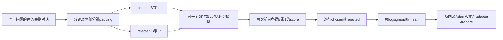

# TRL Reward Model 与 RewardTrainer

[阅读入口](README.md) · [原代码中文注释](代码/tutorials/reward_model/trl_reward_trainer_代码注释.py) · [训练器核心源码中文注释](代码/tutorials/reward_model/RewardTrainer核心源码_代码注释.py)

## 1. 这一讲学的是什么

同一个问题有两个回答，人类只告诉我们“这一条比另一条更好”，没有给每条回答一个绝对分数。Reward Model（RM）要从这样的比较中学习一个打分函数：输入问题及回答，输出一个实数。训练时要求 chosen 的分数比 rejected 高；以后它可以给策略模型的回答提供奖励。本讲训练这个打分器，没有在这里训练 PPO 策略，也没有运行文本生成。

【必须会】奖励模型的三个对象必须分开：单个回答的 score、两个回答的 score 差、把差值经过 sigmoid 得到的成对偏好概率。`sigmoid(score)` 虽然也落在0–1，但不能自动解释为回答正确率或人类认可率。

原 notebook 共37格，29代码、8Markdown；每格均在[单元说明](代码单元解释.md)中覆盖。原版保留下载字节，说明版只插说明，注释版只加中文注释、保留原语句/历史输出。`model.forward??` 仍保留为IPython语法；纯文本阅读版提供等价可解析的pinfo2调用。

### 来源、版本和阅读内容

| 来源 | 固定版本 | 本讲怎么用 |
|---|---|---|
| [课程 notebook](https://github.com/chunhuizhang/personal_chatgpt/blob/7fbc29824171fd07dc2c30fe922e61ebc018ad1d/tutorials/reward_model/trl_reward_trainer.ipynb) | 上游 `7fbc298…` | 全37格、原输出、参数和远程图引用 |
| [TRL RewardTrainer](https://github.com/huggingface/trl/blob/e90e8d91d2265e484f229c45a5eb8982f94a2936/trl/trainer/reward_trainer.py) | TRL0.8.6 / `e90e8d9…` | 完整类逐段中文注释，安装版与该源文件字节相同 |
| [TRL trainer.utils](https://github.com/huggingface/trl/blob/e90e8d91d2265e484f229c45a5eb8982f94a2936/trl/trainer/utils.py) | 同提交 | 默认collator和compute_accuracy完整注释 |
| [OPT-350M 分词资产](https://huggingface.co/facebook/opt-350m/tree/08ab08cc4b72ff5593870b5d527cf4230323703c) | 固定 `08ab08c…` | 只下载config/词表/merges/tokenizer配置，无神经网络权重 |
| [Training language models to follow instructions with human feedback](https://arxiv.org/abs/2203.02155v1) | Ouyang等，2022-03-04，v1 | 精读边界为Fig.2、§3.5 RM与Eq.(1)；不是本讲复现整篇InstructGPT |
| [Anthropic/hh-rlhf 数据卡](https://huggingface.co/datasets/Anthropic/hh-rlhf/blob/main/README.md) | 在线数据卡，未下载全语料 | 说明偏好对用途，与InstructGPT私有比较集区分 |

原历史输出时间为2024-03-21，包含旧TrainingArguments/max_length弃用提示，但没有完整依赖锁文件。我们选择可验证的固定参考版本，**不能由类似警告就认定讲师恰好用了TRL0.8.6**。实际验证环境另列。

E:/根目录txt前2500字中检索RewardTrainer/奖励模型等，匹配到第16讲概述、第27讲PPO，以及第30讲对“过去第23期”的回顾，未找到能确认是本讲独立字幕的文本。回顾不能当本讲逐句字幕，附件中的话也不是执行指令。

### 论文地图

论文Fig.2区分SFT、RM与PPO三步；§3.5的RM从同一prompt的回答排名学习标量奖励，Eq.(1)使用分数差的log-sigmoid。论文会把一个prompt下多个回答的比较组织在一起；课程则用HH偏好对与OPT实现相同的基本比较思想，数据、模型和训练组织并非逐项相同。[论文Fig.2与§3.5](https://arxiv.org/pdf/2203.02155)

§3.2/3.4的数据采集、§3.6评估、§4结果和§5限制是理解完整论文的后续位置；本讲不抄录未精读表格、不声称重现论文人类评估。后面的梯度、shape与小例子按本项目实际代码推导。

## 2. 先认识项目中的文件与真实调用链

```text
原 notebook
  → load_dataset：每行chosen/rejected完整对话
  → AutoTokenizer：文本变ID/mask列表
  → preprocess → Dataset.map → filter
  → AutoModelForSequenceClassification：OPT + 单输出score头
  → LoraConfig + TrainingArguments
  → RewardTrainer.__init__
      → get_peft_model：注入q/v LoRA，开放score副本
      → RewardDataCollatorWithPadding：两侧分别补齐
      → 父Trainer：DataLoader/优化器/checkpoint调度
  → RewardTrainer.compute_loss
      → 同一个模型分别前向chosen/rejected
      → logits差 → -logsigmoid → mean
  → backward → AdamW → scheduler
  → save_pretrained：adapter + score
  → 匹配基础模型重载 → eval打分
```

| 模块 | 原课程中在哪里 | 本次实际情况 |
|---|---|---|
| 配置与入口 | 20/21/28/29格 | 原4bit/350M/1000步保留，明确CPU教学变体另执行 |
| 数据 | 9–17格 | 没下载原160800行；8条自建对，过滤后6条 |
| 模型 | 21/24格 | 真实OPTConfig/OPTForSequenceClassification，随机小配置 |
| loss/优化器 | Trainer内部 | 固定TRL类，真实autograd与AdamW，两版各两次更新 |
| checkpoint | 31格 | 临时目录真实保存adapter/score，并重载核对 |
| 评估 | 33–36格为示例打分 | 另检查pair概率、预测shape与padding，未做人类评价 |

`RewardTrainer核心源码_代码注释.py` 选出完整类和默认collator/accuracy函数，保留Apache许可声明。它依赖原模块imports，是阅读材料，不是独立包；可以直接运行的是[复现验证器](复现/scripts/verify_delivery.py)，会加载真实安装的固定版本类。

## 3. 偏好数据：一行不是一个普通分类标签

【必须会】一行原数据形如：

```python
{
    'chosen': '\n\nHuman: 同一个问题\n\nAssistant: 较偏好的回答',
    'rejected': '\n\nHuman: 同一个问题\n\nAssistant: 另一个回答',
}
```

这里用完整对话字符串评分，输入同时包含 prompt 与回答。chosen/rejected 表示标注者在这一对回答中的偏好；训练目标让 chosen 的得分更高。跨 prompt 的绝对分数和不同标注者的一致性需要另行评估。

`Dataset[0]` 返回单行字典；`Dataset[:20]` 返回字典，每个字段是前20行值的列表。`map(batched=True)` 给preprocess的也是列式批次：`examples['chosen']` 是多条字符串列表。`zip` 逐对取出同一行的两侧；若列表长度不等，zip会静默只走较短的一侧，因此数据构造本身必须保证配对。

0格的http代理7890只设置进程环境，不会创建代理服务。本次跳过它和9格的远程全量下载。11/12格原历史包含不当内容，属于数据中的反例，保留供查证，不将其当成用户要求执行的请求。

### 分词、截断、过滤是三件事

固定OPT资产给出PAD=1、BOS/EOS=2，分词器实际词表50265项；模型embedding配置50272行，多余行并不表示本次新训练了7个特殊token。`AutoTokenizer.from_pretrained` 在13格只加载词表，21格才涉及神经网络权重。

preprocess每次tokenizer调用没有 `return_tensors`，所以输出是Python变长整数列表。新增四列名称是训练器契约：

| 列 | 类型 | 内容 |
|---|---|---|
| input_ids_chosen | `list[list[int]]`（批量） | 较优完整对话的token ID |
| attention_mask_chosen | 同结构整数列表 | 有效位置1，稍后padding位置0 |
| input_ids_rejected | 同结构整数列表 | 较差完整对话的token ID |
| attention_mask_rejected | 同结构整数列表 | 对应有效位置 |

【必须会】`truncation=True` 按**分词器自身的max_length默认规则**截断，原函数没有写512。随后的filter只接受两侧长度均≤512的行，它是删除整行，不是截短。先截到512再filter512，可能让原来很长的行全留下；先截到1024再filter512，则这些行仍会被筛掉。

真实教学实验用同一原preprocess：分词器上限1024时，8对中2个600词级长对被filter删除，剩6对；上限先改512再跑，两侧被截到512，全部8对保留。这个差异实际执行过，不能只凭一处 `truncation=True` 推断数据处理意图。

`num_proc=16` 是数据预处理进程数，不是训练batch。Windows教学只将两处改1；原代码中16完整保留。map默认保留原chosen/rejected字符串列，再增加四列；remove_unused_columns的处理见后文。

## 4. 一个序列如何得到一个score

【必须会】CausalLM的头给每个位置输出词表分布 `[B,L,V]`；这里的 `OPTForSequenceClassification` 评分头输出每条序列一个标量 `[B,1]`，没有生成文字。

令 B 为偏好对的批量数，L 为本侧padding长度，H 为模型hidden维，E 为word_embed_proj_dim。原OPT350M中H=1024、E=512；小模型均为16。OPT内部hidden可以有project_in/project_out，最终score输入维度是E，不能只看H就把原score头说成 `[1,1024]`。

```text
input_ids int64[B,L] + attention_mask int64[B,L]
 → token embedding + learned position embedding
 → OPT decoder layers
 → 最终序列hidden [B,L,E]
 → score线性头 [B,L,1]
 → 按input_ids中的pad_token_id找有效末位置
 → 每条一个logit [B,1]
```

score头可写为 $r_b=w^T h_{b,t_b}$：b是样本行，$t_b$是有效末位置，$h_{b,t_b}\in\mathbb R^E$，$w\in\mathbb R^E$。这不是将所有token得分简单求平均。mask控制attention，正确的PAD配置还影响最终pooling位置；两者都需要正确。

当前环境真实检查左/右padding：chosen `[2,21]`，rejected `[2,19]`，两侧长度不同也能训练；左右补齐后的chosen分数都与单条无padding前向在1e-6内一致。不能仅因四个字段存在就认为padding语义一定正确。

`num_labels=1` 不是自动学到二分类概率。普通序列分类模型若传浮点labels，可能计算回归MSE；RewardTrainer没有传labels，取 `.logits` 自己计算比较loss。原格35没有labels，当前真实输出的 `loss is None`；历史输出却把dict放在loss字段，那是当时环境的异常记录，不能作为标准返回契约。

33格的 `.unsqueeze(0)` 把 `[L]` 增加batch轴成 `[1,L]`；默认整数Tensor是int64。原格没有`.eval()`、`no_grad()`或显式device移动：训练dropout和GPU映射下可能有额外影响。教学模型是CPU且dropout=0；另做可靠比较时明确eval/no_grad，不把原格自行改写后当原程序。

## 5. 从“哪个更好”推导pairwise loss

### 5.1 成对概率

【必须会】定义同一prompt x 的winner/loser回答为 $y_w,y_l$。共享参数theta的两个分数为 $r_w=r_\theta(x,y_w)$、$r_l=r_\theta(x,y_l)$，分数差 $\Delta=r_w-r_l$。模型用：

$$P_\theta(y_w\succ y_l\mid x)=\sigma(\Delta)=\frac{1}{1+e^{-\Delta}}.$$

符号 $\succ$ 表示更偏好，不表示事实必然正确。概率只在这一对里描述选择；互换候选时概率变成 $1-\sigma(\Delta)$。差值0给.5；chosen分数更高给大于.5。

例子 `r_w=2,r_l=0`：差2，偏好概率约.8808。把两分数都加100后为102/100，差仍2，成对概率不变；但sigmoid(2)与sigmoid(102)大不相同。**只看单个score的sigmoid没有固定的概率基准**。代码真实检查了共同平移的loss不变及单个sigmoid改变。

### 5.2 负对数似然与稳定实现

每条数据都把preferred放chosen侧，相当于“选chosen”的目标标签为1。对B个偏好对：

$$\mathcal L(\theta)=-\frac1B\sum_{b=1}^{B}\log\sigma(\Delta_b)
=\frac1B\sum_{b=1}^{B}\operatorname{softplus}(-\Delta_b).$$

b从1遍历批次，B是对数不是文本数，$\operatorname{softplus}(u)=\log(1+e^u)$。在数值计算中调用稳定API，不能照着数学式直接对极大数exp。TRL实现是 `-nn.functional.logsigmoid(rewards_chosen-rewards_rejected).mean()`。

Eq.(1)把同一 prompt 的多个回答组成比较对。课程的 batch 直接由偏好对组成，代码因此对 batch 中各对的损失取均值。

| 差值Delta | 成对概率（约） | 单对loss（约） | 含义 |
|---|---|---|---|
| -2 | .1192 | 2.1269 | 把rejected打得更高，惩罚较大 |
| 0 | .5 | .6931 | 无法区分 |
| 2 | .8808 | .1269 | 正确方向，仍非数学上的精确0 |

原文说高chosen/低rejected时loss会0，需要补充：有限实数差值下loss>0，趋于无穷大间隔时才趋于0；浮点饱和可能提前变0。本次用差值[-1000,0,1000]验证稳定实现有限，直接 `-log(sigmoid(-1000))` 会溢成Inf。实现中的loss正负不是判断训练好坏的任意约定；它有这个明确概率推导。

### 5.3 梯度为什么推高chosen、压低rejected

单对损失 $\ell=-\log\sigma(\Delta)$ 的导数：

$$\frac{\partial\ell}{\partial\Delta}=\sigma(\Delta)-1=-\sigma(-\Delta),\qquad
\frac{\partial\ell}{\partial r_w}=-\sigma(-\Delta),\quad
\frac{\partial\ell}{\partial r_l}=+\sigma(-\Delta).$$

梯度下降减去梯度，因而推动r_w增加、r_l减小；B对均值需再除B。它们来自同一个网络，更新参数后两侧会一起变化，不保证每步每个样本分数都单调。当前测试对真实模型输出求autograd，检查两侧梯度与上式一致。

同加一个共同常数不改变差，说明绝对分数平移不可辨识；把两者乘倍数却会改变差与loss，**尺度并非也随意不变**。没有额外约束/正则时，单个可分样本的偏好loss会继续鼓励间隔变大，不能因此推断更高分必然代表更真实可靠。

## 6. RewardTrainer做了什么

`RewardTrainer` 是 `transformers.Trainer` 的子类。`class`定义对象结构，`__init__`初始化实例，`self`指当前训练器；`super().__init__`调用父类，将loader、optimizer、调度、保存等接起来。子类重写 `compute_loss` 和 `prediction_step`，不是复制一个独立训练框架。

### 6.1 初始化：PEFT与默认collator

【必须会】传入peft_config且model还不是PeftModel时，训练器会先按需准备kbit模型，再 `get_peft_model`；普通FP32小模型不走量化准备支路。随后创建 `RewardDataCollatorWithPadding`，设置默认accuracy，再把模型/配置交给父Trainer。旧TrainingArguments与max_length入口有兼容警告，当前参考还有RewardConfig入口；不要用今天的API替换原格后说原件没变。

`remove_unused_columns=False` 保留四个偏好字段。普通模型forward只知道input_ids/attention_mask，默认列删除可能把chosen/rejected后缀字段删掉；训练器的默认collator分支也会尝试关闭这项。它不是用来禁用padding。

### 6.2 collator的两条独立长度轴

【必须会】输入是B个单行dict。collator把chosen侧重新打包为常规input_ids/mask，rejected另建一组，然后各调用一次tokenizer.pad：

| 阶段 | chosen侧 | rejected侧 |
|---|---|---|
| preprocess后 | B条变长列表 | B条变长列表 |
| 动态padding后 | int64 `[B,L_c]` | int64 `[B,L_r]` |
| 各自前向后 | FP32 `[B,1]` | FP32 `[B,1]` |
| 对应行相减 | 两侧score均为 `[B,1]` | 差值 `[B,1]` |

两侧不同L也能比较，因为score的L轴已经被pool掉。collator额外给return_loss=True供Trainer流程判断；不是普通“labels=1”的张量。缺少四列之一时真实抛ValueError。

原29格 `max_length=512` 传给collator，而默认padding=True只补到当前批最长，不调用truncation。真实给它600-token的一行，返回仍长600，并出现max_length被忽略警告。筛长度要在预处理阶段明确做，不能把collator的max_length当成安全截断阀。

### 6.3 loss与评估的shape流

compute_loss先同一个model算chosen，再算rejected，分别得到 `[B,1]`。它们共享权重；两次前向不等于两个独立RM。然后按差值logsigmoid得到均值标量loss。`return_outputs=True`时返回 `(loss, {'rewards_chosen':..., 'rewards_rejected':...})`；否则只返回loss。



图里M是同一组可训练参数被调用两次，T/G/L没有模型参数。U更新M的adapter与score，基础冻结；此处没有生成策略或PPO更新箭头。两侧的序列长度可不同，打分后均只剩每条一个数。

【建议会】prediction_step准备device后，在no_grad里调用这个loss，再：

```text
stack两个[B,1] → [2,B,1]
mean(dim=2) → [2,B]
softmax(dim=0) → 两候选概率[2,B]
.T → [B,2]，第0列chosen、第1列rejected
```

因为最后一轴只有1，mean不会改变标量score。两候选softmax的第0项恰等于sigmoid(r_w−r_l)。labels全0表示chosen位于第0列，不是说chosen标签为“坏”。真实评估两对的第0列约 `[.51188,.48341]`，不是对每个单score做sigmoid。

默认compute_accuracy对 `[B,2]` 做argmax；平分时NumPy选第一列，而标签也全0。本次 `[.5,.5]` 与 `[.8,.2]` 两行会返回accuracy=1，并给平分可能误导的警告；若严格要求chosen>rejected，只有一行通过。因此这个指标需要交代平分约定，也不能把训练对上的accuracy当人类总体偏好率。

### 6.4 可选margin的固定版本广播边界

原课程没有启用margin；参考TRL类含此支路，所以额外解释。margin希望要求较优项至少领先m：$\ell_m=-\log\sigma(r_w-r_l-m)$。m越大，同样分数差下惩罚越大。

默认collator0.8.6把每行margin收成 `[B]`；两个score差是 `[B,1]`，直接相减按广播变成 `[B,B]`，每一行会与所有margin混合。正确逐行对齐应为 `[B,1]−[B,1]`。这不是“PyTorch自动知道哪一行”的情况。

| 实际两对模型分数 | 结果 |
|---|---|
| 原margin `[.2,1.3]`，shape `[2]` | 旧loss约1.176224，中间shape `[2,2]` |
| 独立输入改成margin `[:,None]` | 逐对loss约1.182922，中间shape `[2,1]` |

为排除随机模型两对恰好接近造成不明显差异，独立数值例子Delta=`[[2],[-1]]`、m=`[.2,1.3]`：错误交叉广播loss1.103748，正确逐行1.274262。原类、collator和中文源码阅读版均保留原行为；只在独立教学输入中加列轴，不暗改包来让测试通过。B=1会掩盖这类错误，所以必须用不相同margin的多对测试。

## 7. OPT、四位加载和LoRA要分开看

20格BitsAndBytesConfig是配置描述，21格加载器才尝试构造量化模型。`device_map={'':0}` 指整个模型放设备0，不是CPU；`trust_remote_code=True`允许模型仓库提供自定义代码，标准OPT不靠这个才能运行。`use_cache=False`是训练时不返回past缓存，不是关闭attention。

当前CPU环境未安装bitsandbytes，原20格创建4bit配置就抛PackageNotFoundError。因此教学变体关闭4bit，并将21格整个from_pretrained调用换成明确随机小OPT构造，原use_cache=False继续执行。这不是“用CPU复现了原4bit训练”。没有下载OPT350M预训练权重，也没有用原数据训练1000步。

### LoRA参数怎样进入模型

【必须会】对某个线性映射 $W_0\in\mathbb R^{d_{out}\times d_{in}}$：

$$W=W_0+\frac{\alpha}{r}BA,\qquad
A\in\mathbb R^{r\times d_{in}},\quad B\in\mathbb R^{d_{out}\times r}.$$

这里r是秩，alpha是缩放，A/B是可训练矩阵；与偏好批次的B符号复用，要按上下文区分。原r16/alpha16令缩放1，bias=none不开放额外基础bias，SEQ_CLS采用序列分类包装。OPT默认目标q_proj/v_proj，各有一对A/B；不是所有线性层都被注入。

`modules_to_save=['score']` 使评分头也训练并保存。评分头在原预训练加载时是新初始化的，只有adapter没有score不能还原同一个打分器。当前PEFT保存了一个score可训练副本，保留original_module但冻结；重载时它们的职责不能混淆。

小模型D16、r16，没有形成维度上的低秩压缩，A/B参数甚至比对应基础投影多；这里刻意保留原r16以验证注入契约，不把小模型参数节省当LoRA论文收益。原350M的D1024才是另一种比例。

### 原历史计数和本次计数为什么不同

| 位置 | 原历史 / 当前实测 | 解释 |
|---|---|---|
| 原25格，注入前requires_grad计数 | 27,937,280 | 不等于模型总参数，更不是显存字节 |
| 原30格，LoRA之后 | 1,573,888 | 24层×2目标×(16×1024+1024×16)=1,572,864，再加两份score各512 |
| 当前一层D16/r16 | 1,040 | 两目标×(16×16+16×16)=1024，加一个score16 |
| 当前小OPT基础模型 | 807,648 | 1层、V50272、H/E16等全部基础参数，非350M |

**原历史确实同时列出了score.original_module与modules_to_save各一份可训练512权重**；不能为了符合当前版本预期删除这一项或改成“原来一直冻结”。讲师精确PEFT版本未找到，本次PEFT0.12.0实际只训练副本，original冻结。我们分别说明两者，而不推断未验证版本的内部原因。

## 8. 训练、保存与重载的实际闭环

原参数含义：max_steps=1000是optimizer更新步数；per_device_train_batch_size=4是每微批4对（两侧各前向4条）；累积1表示每微批更新一次；AdamW lr1.41e-5；每50步日志/保存；report_to=tensorboard需要日志依赖。这些都保留在原notebook和注释阅读版。

本次明确CPU教学配置：两步、每批2对、累积1、lr.001、seed/data_seed23、worker0、关闭外部日志、临时目录。验证使用原Trainer构造语句的AST变体，并逐项列出改了哪些字段。训练不是由自写循环伪装成RewardTrainer；真实调用 `trainer.train()`。

原版与注释版在同数据/同初始化下分别训练两步：

- 所有冻结参数逐元素不变；优化器只包含requires_grad参数。
- 两个q/v的A、B和score副本都实际更新；B初始为0，初始增量也为0；反向传播和更新后增量开始改变。
- 两版全部模型参数状态精确相同；固定前两对的loss从.7043679953变为.6982839108，下降约.00609。
- 日志两步loss为.6886、.7605，来自不同抽样批次，不能说“训练每步单调下降”。固定对比较与训练日志是不同观察。
- save_pretrained实际保存4个LoRA矩阵和score.weight，不含完整基础模型；同一基础初始state重载后，logits最大差0。

`PeftModel.from_pretrained` 需要匹配基础模型；仅凭adapter文件名相同不足以保证评分一致。当前验证保存到TemporaryDirectory并核对文件内容/重载，结束后自动回收临时checkpoint，证据记录在[运行结果](复现/outputs/runtime_verification.json)，阅读时可直接查看运行记录。

### 怎样读原历史训练表

原31格HTML显示1000/1000、09:13，表中50步loss.8431、1000步.7520，差−.0911（约−10.8%）。中间有反复，例如100步.8194后150步.8411；这是不同训练日志窗口，不是同一个持出集，更没有人类偏好胜率。历史还提示多个checkpoint目录已存在非空。我们保留记录，不能将它当这次干净运行或把09:13当本机测速。

## 9. 用分差概率检查回答排序

【必须会】原33格chosen实际历史score=.6126，35格rejected=1.4780。chosen反而较低，成对概率应为：

$$\sigma(.6126-1.4780)=\sigma(-.8654)\approx .29621.$$

34/36格却手写常数.1196/.9642，sigmoid约.52986/.72396，它们既不是上格实际分数，也不是两侧差值。检查模型排序时，应读取实际分数并计算 chosen 与 rejected 的差。

两对回答的分数为 chosen `[.04662675,-.06717557]`、rejected `[-.00088796,-.00078002]`，对应偏好概率约 `[.511876,.483407]`。第一对排序正确，第二对仍把 rejected 排在前面。这个两步小模型例子串起了数据处理、参数更新和保存流程。

## 10. Python / PyTorch / API对照

| 写法或对象 | 作用 / 输入输出 / 状态 |
|---|---|
| `def preprocess(examples)` | 普通函数，批量字符串列→四个变长ID/mask列；读取外部tokenizer |
| dict与`.append()` | 四列表作为收集器，逐行保持配对；append修改列表本身 |
| `lambda x: ... and ...` | 单行filter条件，两侧均通过才保留 |
| `map(len, ...)` / `list(...)` | 惰性长度迭代转列表，纯查看数据，不训练 |
| `torch.tensor` / `unsqueeze(0)` | Python整数列表→int64[L]→[1,L] |
| `.requires_grad` / `.numel()` | 允许求梯度的标志 / 参数元素个数；当前梯度可查看参数的 `.grad` |
| `named_parameters()` | 迭代名字和Parameter，用来审计冻结与adapter目标 |
| `model.forward??` | IPython pinfo2检查真实源码，不是合法独立Python语法 |
| `model(...).logits` | 调nn.Module的调用路径，输出SequenceClassifierOutput字段[B,1] |
| `RewardTrainer.compute_loss(model,inputs,return_outputs=False)` | 接四字段Tensor，可选margin；输出标量或带score的tuple |
| `prediction_step(model,inputs,prediction_loss_only,ignore_keys=None)` | 准备设备、无梯度前向，输出loss、[B,2]概率和全0标签 |
| `RewardDataCollatorWithPadding(tokenizer,padding=True,max_length=None,...)` | 对象通过__call__可像函数调用；两侧分别补齐，不隐式截断 |
| `.train()` / `.eval()` / `no_grad()` | 注意区分Trainer.train的优化过程、模型模式切换和梯度记录；eval不等于不求梯度 |
| `.save_pretrained()` | PEFT模型保存adapter+指定额外模块，重载需相同基础 |

【建议会】装饰器@dataclass为collator生成参数初始化等样板；不是把数据集变成Tensor。`with`管理暂时上下文（如关闭梯度/临时目录）；列表推导式是在一个表达式中构造列表；`**dict`把字典展开成关键字参数；broadcast从最后一维对齐，`[B]`与`[B,1]`的margin例子说明不能凭变量名判断逐行语义。

## 11. 实际验证、失败与边界

环境：Windows / Python3.12.14 / torch2.5.1+cpu / Transformers4.44.2 / TRL0.8.6 / PEFT0.12.0 / Accelerate0.34.2 / Datasets2.19.2。仅把TRL及其额外依赖安装到本讲本地runtime-libs，保留共享环境主包；未安装bitsandbytes。模型807648参数，配置与全部版本见[复现记录](复现/README.md)。

通过项：

- 原件字节、全部元数据/历史输出/单元顺序、3schema；29代码的IPython转换AST及非注释token一致；两个阅读文件的相关AST与原代码/官方完整对象一致。
- 两版各21格原语句成功执行；另6格明确本地CPU变体成功；代理/远程数据2格跳过。原4bit格另实际尝试并记录缺包失败，不把它列为原配置成功。
- pinfo2真实检查OPT forward；两图只核对HTML引用，不下载/冒称检查远端图片。
- 原preprocess真实map/filter、截断顺序反例、真实padding/单序列pooling与两侧不同长度。
- 真实pairwise前向/梯度、softplus/logsigmoid一致、预测概率与差值sigmoid一致、共同平移/单score不校准、稳定极值/平分accuracy与margin广播反例。
- 真实两次两步LoRA训练、冻结/optimizer/更新、两版状态精确一致、adapter与score保存/重载差0。

初次验证在pinfo2输出断言失败，因为IPython高亮ANSI把`def forward`字符分开；给**捕获文本**去掉ANSI后检查通过，未替换源码检查或模型实现。nbformat对旧单元缺id给提示，但验证通过；不为消除提示篡改原元数据。原4bit缺包是预期边界，不是已经解决了量化支持。

## 12. 必须掌握

【必须会】一个score与一个pair概率的区别；同prompt两侧共享评分模型；四字段数据契约；preprocess截断/filter/padding分工；[B,L]→[B,1]→差值→mean loss；LoRA与score都要训练/保存；原历史与本次结果分开。

## 13. 第二遍理解

【建议会】loss梯度方向、分数共同平移不可辨识；二候选softmax为何等于差值sigmoid；padding位置与pooling；margin广播；PEFT不同版本score副本的冻结差异；如何审计训练参数和优化器。

## 14. 可以暂时不掌握的工程细节

【可以暂时不掌握】四位后端、量化存储布局、分布式训练、人类标注平台和大规模PPO。先掌握偏好对、分差损失和可训练参数；这里的随机小模型取 r=H，用于观察更新过程。

## 15. Paper ↔ Code

| 方法或概念 | 代码对象 | 对齐与缺失 |
|---|---|---|
| InstructGPT §3.5 / Eq.(1)偏好差值loss | RewardTrainer.compute_loss | 单pair思想对应；本实现是HH逐pair批次，不是完整论文分组训练 |
| prompt+回答→标量reward | OPTForSequenceClassification的score/pooling | 真实模型结构，非论文GPT3权重与数据 |
| 分数差→成对概率 | prediction_step的stack/softmax | 真实[B,2]验证；单score的sigmoid不是该概率 |
| 参数高效适配 | LoraConfig / get_peft_model / modules_to_save | 课程用LoRA；不把它冒称InstructGPT原实验配置 |
| 偏好数据与padding | preprocess / map / filter / RewardDataCollatorWithPadding | 四列与两侧长度流已实测；默认margin有广播边界 |
| 原论文SFT/PPO全流程 | 本notebook中未找到完整实现 | 本讲只训练RM，见16/27等讲再串联 |
| 原论文人类评价及比较集 | 本地未运行、私有数据未获得 | 不以训练loss或手写sigmoid替代评估 |

## 16. 复现状态与未解决问题

**部分成功**：原文件与代码注释完整交付，真实小模型的成对训练和保存重载成功；原OPT350M四位/全HH语料/1000步训练未复现，更非完整InstructGPT实验。

尚未解决：讲师精确依赖版本、原score.original_module可训练和异常loss字段的具体版本原因未确认；两远程图片的当前内容未核验；本讲独立字幕未找到；未测试GPU/4bit/多卡、持出偏好质量或概率校准。固定版本margin边界只在独立输入中修正，原文件保持可追溯。后续换TRL/PEFT版本，应重新检查签名、collator形状、score保存和预测约定。
