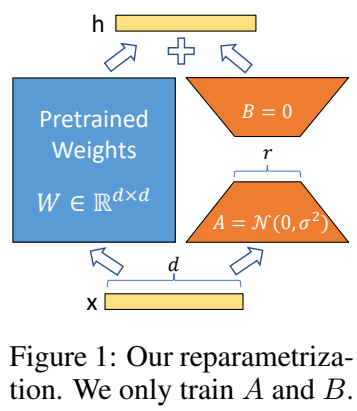
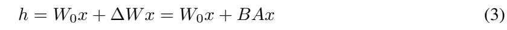

# PEFT LoRA 注入、合并与 SVD

一个基础模型可以配几套 LoRA：一套写广告，一套写 SQL，一套回答指令。每套 LoRA 保存一组小矩阵，用来调整基础模型的运算。本讲沿着一件事往下读：**这些小矩阵怎样接进模型，怎样组合，又怎样压缩成一套新的 LoRA。**

先用两个数字算清楚，再回到老师的三个 notebook。论文中的图和公式已放在对应段落，顺着这份笔记读即可。

## 1. 从一个线性层开始：矩阵怎样改变输入

假设输入是两个数，写成一行：$x=[1,2]$。一个线性层有两行权重：

$$
W_0=\begin{bmatrix}1&2\\3&4\end{bmatrix}.
$$

第一行权重计算第一个输出，第二行计算第二个输出：

$$
y_1=1\times1+2\times2=5,\qquad
y_2=1\times3+2\times4=11.
$$

所以输出是 $[5,11]$。PyTorch 的 `nn.Linear(2,2)` 把权重存为 `[输出宽度,输入宽度]`，这里是 `[2,2]`。输入采用行向量时，代码写 `x @ W0.T`：`@` 是矩阵乘法，`.T` 把矩阵的行与列互换，使每一行输入分别与每一行权重做点积。线性层还可以有偏置，本节先用 `bias=False` 把计算看清楚。

如果任务训练得到一个权重改变量 $\Delta W$，新权重就是 $W_0+\Delta W$。LoRA 把这个改变量拆成两块：

$$
\Delta W=sBA,\qquad s=\frac{\alpha}{r}.
$$

$A$ 先把输入压到较窄的中间维度，$B$ 再把它映射到输出宽度；$r$ 是中间宽度，称为 LoRA 的秩配置；$\alpha$ 控制支路缩放，$s$ 是实际乘上的系数。若输入宽度为 $i$、输出宽度为 $o$，则 $A:[r,i]$、$B:[o,r]$，乘积 $BA:[o,i]$ 正好与基础权重同形状。这里的 $B$ 是矩阵名字；后文的 batch 大小另写为 $N$。

## 2. 对着论文原图读两条支路



图来自 [LoRA v2，第1页 Figure 1](https://arxiv.org/abs/2106.09685v2)。从下向上跟着箭头看：输入 $x$ 同时走左右两路，左边经过蓝色的基础权重 $W$，右边先经过橙色的 $A$，再经过 $B$，顶部的加号逐坐标相加。蓝色权重在 LoRA 训练期间固定，橙色因子参与训练。输入到中间层的宽度由 $d$ 缩为 $r$，再回到输出宽度 $d$；加号本身没有需要训练的参数。

图里的 $A=\mathcal N(0,\sigma^2)$ 表示从高斯分布随机初始化；$B=0$ 表示全部置零。因此开始时 $BA=0$，刚加上 LoRA 的模型能保持基础模型的输出。随后训练改变这两个因子，让右路逐渐提供任务需要的修正。



这是原论文第4页的公式(3)。$h$ 是输出，$W_0$ 是基础权重，$x$ 是输入，$\Delta W$ 是权重增量。公式中的 $W_0x+BAx$ 把两路输出相加；公式下方进一步说明用 $\alpha/r$ 缩放增量。合起来就是 $h=W_0x+sBAx$。论文采用列向量，下面的 Python 采用行向量，转置后计算为 `x @ W0.T + s * (x @ A.T) @ B.T`。

取 $r=1$、$\alpha=2$，则 $s=2$。先给第一套 adapter 取这两个因子：

$$
A_1=\begin{bmatrix}1&0\end{bmatrix},\qquad
B_1=\begin{bmatrix}0.5\\0.25\end{bmatrix},\qquad
\Delta W_1=2B_1A_1=\begin{bmatrix}1&0\\0.5&0\end{bmatrix}.
$$

`x @ A1.T` 得到 $[1]$，乘 $B_1^\top$ 得到 $[0.5,0.25]$，再乘缩放系数2，右路输出为 $[1,0.5]$。加到基础输出上，最终得到 $[6,11.5]$。

```python
import torch

# float64保留更多小数精度；每个[]内列表是一行。
x = torch.tensor([[1., 2.]], dtype=torch.float64)
W0 = torch.tensor([[1., 2.], [3., 4.]], dtype=torch.float64)
A1 = torch.tensor([[1., 0.]], dtype=torch.float64)
B1 = torch.tensor([[0.5], [0.25]], dtype=torch.float64)
scale = 2.0

delta1 = scale * (B1 @ A1)
base_output = x @ W0.T
branch_output = base_output + scale * (x @ A1.T) @ B1.T
folded_output = x @ (W0 + delta1).T
print("基础输出:", base_output.tolist())
print("双支路输出:", branch_output.tolist())
print("写回权重后的输出:", folded_output.tolist())
torch.testing.assert_close(branch_output, folded_output)
```

三行输出依次为 `[[5.0,11.0]]`、`[[6.0,11.5]]`、`[[6.0,11.5]]`。`torch.tensor` 从列表创建张量，`dtype` 指定浮点类型；`tolist()` 把张量转成便于查看的列表。`assert_close` 检查两种计算得到的数是否足够接近。

这也解释了**折叠权重**：计算好 $\Delta W_1$，直接加进 $W_0$。在推理模式关闭 dropout 后，普通线性层可用 $W_0+\Delta W_1$ 完成原来两路的计算。训练时保留 $A$、$B$，才能只更新这组小参数。

## 3. 两套 adapter 相加，为什么还要压缩

再取第二套 rank1 adapter：

$$
A_2=\begin{bmatrix}0&1\end{bmatrix},\qquad
B_2=\begin{bmatrix}0.25\\0.5\end{bmatrix},\qquad
\Delta W_2=2B_2A_2=\begin{bmatrix}0&0.5\\0&1\end{bmatrix}.
$$

两套改变量各取一份，就得到：

$$
M=\Delta W_1+\Delta W_2
=\begin{bmatrix}1&0.5\\0.5&1\end{bmatrix}.
$$

这里用 $M$ 表示合并后的完整增量。它的两行相互独立，秩为2。每个来源的秩为1，相加以后秩可以增大；如果仍想只保存一个 rank1 的 $BA$，就需要近似。

一般的加权组合写成：

$$
M=\sum_{j=1}^{m}c_j\Delta W_j
=\sum_{j=1}^{m}c_js_jB_jA_j.
$$

$j$ 是来源编号，$m$ 是来源个数，$c_j$ 是人为选定的合并系数，$s_j$ 是该 adapter 自身的缩放。两者分开记录：**$c_j$ 决定这套改变量取多少份，$s_j$ 已经属于改变量本身。** 系数可以大于1，也可以为负；基础权重只保留一份，新模型权重为 $W_0+M$。

课程主代码按 `norobots、adcopy、sql` 的顺序取系数 `[2.0,0.3,0.7]`。第一个来源的增量取两份，第二个取0.3份，第三个取0.7份。这些系数的和为3，按线性组合直接计算即可。

## 4. SVD：把矩阵拆成几个有强弱之分的方向

**矩阵的秩**可以理解为它需要多少个独立方向来表达。SVD（Singular Value Decomposition，奇异值分解）把这些方向拆开，并为每个方向配一个非负强度，称为奇异值。奇异值从大到小排序，保留前几个，就得到一个较低秩的近似。

对上面的 $M$，两个方向分别为 $(1,1)$ 和 $(1,-1)$。先除以 $\sqrt2$ 使长度为1，记为 $q_+$、$q_-$：

$$
q_+=\frac1{\sqrt2}\begin{bmatrix}1\\1\end{bmatrix},\qquad
q_-=\frac1{\sqrt2}\begin{bmatrix}1\\-1\end{bmatrix}.
$$

直接相乘可得 $Mq_+=1.5q_+$、$Mq_-=0.5q_-$，所以这个例子的两个奇异值是1.5和0.5。它可以写成：

$$
M=1.5q_+q_+^\top+0.5q_-q_-^\top.
$$

保留第一项，得到 rank1 近似：

$$
M_1=1.5q_+q_+^\top
=\begin{bmatrix}0.75&0.75\\0.75&0.75\end{bmatrix}.
$$

原来两行不同，现在两行相同，一个方向就能表达。代价是丢掉第二项。逐元素相减，四个误差都是 $\pm0.25$，平方相加再开方得到 $0.5$。

```python
A2 = torch.tensor([[0., 1.]], dtype=torch.float64)
B2 = torch.tensor([[0.25], [0.5]], dtype=torch.float64)
delta2 = scale * (B2 @ A2)
M = delta1 + delta2

# U的列是输出侧方向，S记录强度，Vh的行是输入侧方向。
U, S, Vh = torch.linalg.svd(M, full_matrices=False)
new_rank = 1
A_small = Vh[:new_rank, :]                 # [1,2]
B_small = U[:, :new_rank] * S[:new_rank]   # [2,1]，按列乘奇异值
M_rank1 = B_small @ A_small
error = torch.linalg.vector_norm(M - M_rank1)
print("合并增量:", M.tolist())
print("奇异值:", S.tolist())
print("rank1近似:", M_rank1.tolist())
print("误差:", float(error))
torch.testing.assert_close(U @ torch.diag(S) @ Vh, M)
torch.testing.assert_close(error, S[1:].square().sum().sqrt())

# 矩形矩阵还能看出full_matrices选项对返回形状的影响。
wide = torch.arange(10., dtype=torch.float64).reshape(2, 5)
_, _, vh_full = torch.linalg.svd(wide, full_matrices=True)
_, _, vh_reduced = torch.linalg.svd(wide, full_matrices=False)
print("完整/精简Vh:", list(vh_full.shape), list(vh_reduced.shape))
```

输出的奇异值约为 `[1.5,0.5]`，rank1 近似的四项约为0.75，误差约为0.5。奇异向量可以整体变号，因此阅读时比较重建乘积，而不用逐项要求 $A$、$B$ 与某次打印相同。

把这段代码与通用式子对照：

$$
M=U\operatorname{diag}(S)V^\top,\qquad
M_r=U_{:,:r}\operatorname{diag}(S_{:r})V^\top_{:r,:}.
$$

`torch.linalg.svd` 返回的 `Vh` 已经是实数矩阵的 $V^\top$。若 $M:[o,i]$，记 $k=\min(o,i)$，精简分解的 `U:[o,k]`、`S:[k]`、`Vh:[k,i]`。Python 切片 `:r` 取前 $r$ 项；`U[:, :r]` 保留所有行和前 $r$ 列。`* S[:r]` 通过广播，让第 $j$ 列乘第 $j$ 个奇异值。最后把带强度的左半部分当作 $B_{new}$，右半部分当作 $A_{new}$，新支路缩放取1即可。

对于实矩阵、Frobenius 范数和普通截断 SVD，误差为：

$$
\|M-M_r\|_F
=\sqrt{\sum_{j=r+1}^{k}\sigma_j^2}.
$$

$\|\cdot\|_F$ 表示全部元素平方和再开方，$\sigma_j$ 是第 $j$ 个奇异值。上例只丢掉 $\sigma_2=0.5$，误差正好是0.5。保留全部两个方向，就能在浮点舍入范围内重建原矩阵。

老师的 `lora_svd_basics.ipynb` 把同一件事放大到 `[100,100]`：先用 `[100,20] @ [20,100]` 构造低秩矩阵，再取前20项重建；随后改用满秩随机矩阵，仍取20项，观察压缩误差。记住“小因子之积的秩受中间宽度限制”，就能理解这两组实验。

## 5. 回到原代码：给一个现有模型注入 LoRA

先读老师 `lora_inject.ipynb` 中完整的 `DummyModel`：

```python
from peft import LoraConfig, inject_adapter_in_model

class DummyModel(torch.nn.Module):
    def __init__(self):
        super().__init__()
        self.embedding = torch.nn.Embedding(100, 1000)
        self.linear = torch.nn.Linear(1000, 1000)
        self.lm_head = torch.nn.Linear(1000, 100)

    def forward(self, input_ids):
        x = self.embedding(input_ids)
        x = self.linear(x)
        x = self.lm_head(x)
        return x

torch.manual_seed(24)
dummy = DummyModel().eval()
ids = torch.arange(8).reshape(1, 8)
with torch.no_grad():
    before_inject = dummy(ids)

old_linear = dummy.linear
old_embedding = dummy.embedding
old_head = dummy.lm_head
lora_config = LoraConfig(
    lora_alpha=16,
    lora_dropout=0.1,
    r=64,
    bias="none",
    target_modules=["linear"],
)
injected = inject_adapter_in_model(lora_config, dummy)
dummy.eval()
with torch.no_grad():
    after_inject = dummy(ids)

assert injected is dummy
assert dummy.linear.base_layer is old_linear
assert dummy.embedding is old_embedding and dummy.lm_head is old_head
torch.testing.assert_close(before_inject, after_inject)
trainable_count = sum(p.numel() for p in dummy.parameters() if p.requires_grad)
print("输出形状:", list(after_inject.shape))
print("A/B形状:", list(dummy.linear.lora_A["default"].weight.shape),
      list(dummy.linear.lora_B["default"].weight.shape))
print("可训练参数:", trainable_count)
```

`class` 定义模型的结构，`DummyModel()` 创建一个实例。括号里的 `torch.nn.Module` 表示继承 PyTorch 的模块基类；`super().__init__()` 初始化模块管理机制。把层写成 `self.embedding` 等属性后，PyTorch 就能找到它们的参数。`self` 指当前模型实例，`forward` 描述输入怎样逐层流动；调用 `dummy(ids)` 时由 PyTorch 调用这个方法。

这次输入 `ids` 是 int64 张量，形状 `[1,8]`，内容是0到7。数据依次经过：

| 步骤 | 输入 → 输出形状 | 这一层做什么 |
|---|---|---|
| `embedding` | `[1,8] → [1,8,1000]` | 在100行词向量表中查找8个ID |
| `linear` | `[1,8,1000] → [1,8,1000]` | 对每个位置的1000维向量做线性变换 |
| `lm_head` | `[1,8,1000] → [1,8,100]` | 把每个位置变成100个候选词分数 |

配置中的 `target_modules=["linear"]` 按名字选中中间层。注入后，`dummy.linear` 成为带 LoRA 的层，原来的线性层保存在其 `base_layer` 中；`is` 检查是否为同一个对象。因此 `old_linear` 并未被丢弃，另外两层也保持原来的对象。

这组配置取 $r=64$、$\alpha=16$，所以缩放为0.25。新增 $A:[64,1000]$、$B:[1000,64]$，共 $64\times1000+1000\times64=128000$ 个可训练参数。`bias="none"` 使基础偏置也保持冻结。`parameters()` 遍历参数，`requires_grad` 标记是否需要求梯度，`numel()` 统计张量里的元素数量。

输出显示 `[1,8,100]`、`[64,1000]`、`[1000,64]` 和 `128000`。初始 $B=0$，注入前后输出相同。`eval()` 关闭 dropout 等训练行为；`with torch.no_grad()` 让这段查看输出的过程不建立反向传播图。训练时 `lora_dropout=0.1` 会随机丢弃部分支路输入。

低层函数 `inject_adapter_in_model` 返回同一个模型，适合观察“替换子层”的机制。主教程使用的 `PeftModel` 还在外层管理 adapter 名字、配置、加载与保存。可把它理解为：内层负责数值运算，外层负责管理多套可切换的小矩阵。

## 6. 创建一个新 adapter，先看清它存了什么

下面把第2–4节的数字放进真实 PEFT 层。`TwoNumbers` 只有一个名为 `proj` 的线性层；`left`、`right` 对应前面的两套因子。代码使用本讲固定的 PEFT 0.12.0。

```python
from peft import get_peft_model

class TwoNumbers(torch.nn.Module):
    def __init__(self):
        super().__init__()
        self.proj = torch.nn.Linear(2, 2, bias=False)

    def forward(self, x):
        return self.proj(x)

base = TwoNumbers().double()
with torch.no_grad():
    base.proj.weight.copy_(W0)

def make_config(alpha=2):
    return LoraConfig(r=1, lora_alpha=alpha, lora_dropout=0.0,
                      bias="none", target_modules=["proj"])

mix = get_peft_model(base, make_config(), adapter_name="left")
mix.add_adapter("right", make_config())
layer = mix.base_model.model.proj
with torch.no_grad():
    layer.lora_A["left"].weight.copy_(A1)
    layer.lora_B["left"].weight.copy_(B1)
    layer.lora_A["right"].weight.copy_(A2)
    layer.lora_B["right"].weight.copy_(B2)

mix.add_weighted_adapter(["left", "right"], [1., 1.], "cat_exact",
                         combination_type="cat")
mix.add_weighted_adapter(["left", "right"], [1., 1.], "svd_old",
                         combination_type="svd", svd_rank=1,
                         svd_full_matrices=False)

# 独立按M做一次SVD，写入缩放为1的新adapter。
mix.add_adapter("svd_once", make_config(alpha=1))
with torch.no_grad():
    layer.lora_A["svd_once"].weight.copy_(A_small)
    layer.lora_B["svd_once"].weight.copy_(B_small)

mix.eval()
print("创建后仍在用:", mix.active_adapter)
for name in ["cat_exact", "svd_old", "svd_once"]:
    print(name, layer.get_delta_weight(name).tolist())
```

`.double()` 把浮点参数转为 float64，便于与前面的小矩阵对照。`copy_()` 把数值写进已有权重，末尾下划线表示原地修改。`lora_A`、`lora_B` 按 adapter 名字保存对应的模块；`["left"]` 先选中一套，再用 `.weight` 取其参数。

`get_peft_model` 包装基础模型并创建 `left`；`add_adapter` 添加另一套因子；`add_weighted_adapter` 读取来源因子，生成一套新因子。`get_delta_weight(name)` 返回该 adapter 对基础权重的完整改变量，**已经包含它的缩放系数**。

这三套新结果分别是：

| 名字 | 完整增量 | 秩 | 含义 |
|---|---|---:|---|
| `cat_exact` | $\begin{bmatrix}1&0.5\\0.5&1\end{bmatrix}$ | 2 | 拼接两个来源，精确表达 $M$ |
| `svd_old` | $\begin{bmatrix}1.5&1.5\\1.5&1.5\end{bmatrix}$ | 1 | 这个旧版路径对 $2M$ 做 rank1 压缩 |
| `svd_once` | $\begin{bmatrix}0.75&0.75\\0.75&0.75\end{bmatrix}$ | 1 | 按目标 $M$ 做 rank1 压缩 |

### `cat` 怎样保持精确

把两个 $A$ 沿行堆叠，把两个 $B$ 沿列拼接：

$$
A_{cat}=\begin{bmatrix}c_1s_1A_1\\c_2s_2A_2\end{bmatrix},\qquad
B_{cat}=\begin{bmatrix}B_1&B_2\end{bmatrix}.
$$

相乘时得到 $c_1s_1B_1A_1+c_2s_2B_2A_2=M$。新中间宽度等于两个来源宽度之和：这个例子从两个 rank1 变成一个 rank2。来源原本的秩也可以不同。这是 [PEFT 合并方法说明](https://huggingface.co/blog/peft_merging) 中 `cat` 的含义。

### 旧版 SVD 为什么多一倍

PEFT 0.12.0 的这条调用链里，`get_delta_weight` 已计算 $s_jB_jA_j$，SVD 合并方法随后又用 `c_j * scaling[j]` 作为系数。因此它实际分解：

$$
\sum_j(c_js_j)\,\underbrace{(s_jB_jA_j)}_{\text{get\_delta\_weight}}
=\sum_jc_js_j^2B_jA_j.
$$

本例两个 $s_j$ 都为2，实际矩阵便是 $2M$，rank1 结果也成为 $2M_1$。`svd_once` 从已经定义好的 $M$ 直接分解，新 adapter 配置 $r=\alpha=1$，缩放为1，因而精确表达前面的 $M_1$。

老师主代码第35格先写 `valid_weights=[4,0.6]`，第37格的两个增量已经各乘2，第41格再加权，走的也是重复缩放路径。因此手写代码能与这一旧版库对应。读到这一段时，把“来源自身的缩放”和“用户选择的合并系数”分别记在纸上，就能跟住每一步。

### `linear` 为什么又是另一种结果

`linear` 先分别加 $A$ 和 $B$，再相乘。展开 $(B_1+B_2)(A_1+A_2)$ 时，除了 $B_1A_1+B_2A_2$，还多出 $B_1A_2+B_2A_1$ 两个交叉项。因此它通常与完整增量的加权和不同。这条旧版实现要求来源秩相同，并对非负系数使用平方根配权；负系数会在开平方处报错。

## 7. 激活、创建与写回基础权重是三步

前一格打印的活动名字仍为 `left`。添加新的矩阵后，要调用 `set_adapter`，推理才会使用对应结果。依次运行：

```python
import copy

source_deltas = {n: layer.get_delta_weight(n).detach().clone()
                 for n in ["left", "right"]}
outputs = {}
with torch.no_grad():
    for name in ["left", "cat_exact", "svd_old", "svd_once"]:
        mix.set_adapter(name)
        outputs[name] = mix(x).detach().clone()
        print(name, outputs[name].tolist())

# 深拷贝后折叠，保留mix供继续切换阅读。
folding_copy = copy.deepcopy(mix)
plain_model = folding_copy.merge_and_unload(safe_merge=True)
with torch.no_grad():
    folded = plain_model(x)
torch.testing.assert_close(folded, outputs["svd_once"])
torch.testing.assert_close(plain_model.proj.weight, W0 + M_rank1)
for name, saved in source_deltas.items():
    torch.testing.assert_close(layer.get_delta_weight(name), saved)
print("折叠后层类型:", type(plain_model.proj).__name__)
```

四个输出依次约为：

| 当前 adapter | 最终输出 | 计算来源 |
|---|---|---|
| `left` | `[6,11.5]` | 基础输出加第一套改变量 |
| `cat_exact` | `[7,13.5]` | 基础输出加完整组合 $M$ |
| `svd_old` | `[9.5,15.5]` | 基础输出加 $2M_1$ |
| `svd_once` | `[7.25,13.25]` | 基础输出加 $M_1$ |

`detach().clone()` 留下一份独立的数值副本，便于稍后比较；字典 `outputs` 按名字保存结果。`copy.deepcopy` 复制整个模型，复制品随后使用当前活动的 `svd_once` 执行 `merge_and_unload`：将增量加进基础权重，并移除 LoRA 包装。返回层类型为 `Linear`，输出与折叠前对应。

| 操作 | 调用 | 结果 |
|---|---|---|
| 挂载一套 | `add_adapter` / `load_adapter` | 模型中多一组命名因子 |
| 从多套创建一套 | `add_weighted_adapter` | 模型中多一组组合后的因子 |
| 选择要使用的套装 | `set_adapter` | 前向改用所选因子 |
| 写回基础权重 | `merge_and_unload` | 当前增量进入 $W_0$，移除 LoRA 层 |

课程主 notebook 创建 `merge` 后直接调用 `generate`，中间没有 `set_adapter("merge")`，活动 adapter 仍是原来的 `norobots`。阅读生成例子时，要先检查活动名字。显式切换后，新的矩阵组合才会影响生成的 token 分数。

## 8. 主教程的词表、Embedding 和 SVD 形状

现在把小例子换回主教程的对象关系：

1. 加载同一 TinyLlama 基础模型与 tokenizer，给词表补上特殊 token。
2. 用 `resize_token_embeddings` 把基础词表从32000行扩为32005行。
3. 挂载 `norobots`、`adcopy`、`sql`，按来源名字找到每层的因子。
4. 选择该层实际存在的来源，组合增量，再生成名为 `merge` 的新因子。
5. 激活 `merge`，把提示词编码为ID，调用 `generate`，最后解码输出。

**词表扩展**为什么要在挂载前处理？Embedding 每一行对应一个 token ID。若 tokenizer 允许ID32004，而模型只有32000行，就无法查到这行向量。新增五个 token 后，输入词表与输出候选维度都要与模型配置对齐。多套 adapter 还要共享同一套 token 含义、同一基础权重和新增行，增量相加才有一致的坐标。

原历史模型的隐藏宽度是 $H=2048$，词表大小 $V=32005$，LoRA 秩 $r=8$。普通 Linear 的 `lora_A`、`lora_B` 是模块；Embedding 的 `lora_embedding_A`、`lora_embedding_B` 则直接保存参数。两者可沿下表比较：

| 对象 | 存储形状 | 如何得到与基础权重同形状的增量 |
|---|---|---|
| Linear 基础权重 | `[o,i]` | $sBA:[o,i]$ |
| Embedding 基础词向量表 | `[V,H]` | $(sBA)^\top:[V,H]$ |
| Embedding 的 A | `[r,V]=[8,32005]` | 先构成 $BA:[H,V]$ |
| Embedding 的 B | `[H,r]=[2048,8]` | 再转置为 `[V,H]` |

所以主代码第37格先得到 `[32005,2048]` 的词表增量，第42格再 `.T` 回到 `[2048,32005]` 做 SVD。分解后取 `Vh[:8,:]` 当作新 $A$，取 `U[:,:8] @ diag(S[:8])` 当作新 $B$，形状便与 Embedding 因子相符。

`norobots` 与 `adcopy` 的目标包括输入 Embedding 和输出 `lm_head`，`sql` 的目标只有注意力和前馈投影。因此合并 Embedding 时，只使用前两套来源；合并共有的投影层时，才会用到三套。

### `full_matrices=True` 为什么会耗费大量内存

第4节的矩形例子显示，输入 `[2,5]` 时，完整 `Vh` 为 `[5,5]`，精简 `Vh` 为 `[2,5]`。两种都能用于重建，区别是完整形式还补出了额外的正交方向。

原代码对 `[2048,32005]` 使用 `full_matrices=True`，会返回 `[32005,32005]` 的 `Vh`。仅这一张FP32矩阵就约占3.82 GiB；精简形式返回 `[2048,32005]`，约250 MiB。实际分解还需要输入、`U` 和工作空间。若目标只保留前8项，可以使用 `full_matrices=False` 获取所需方向。

原变量 `U = U @ torch.diag(S)` 执行后，`U` 已经包含奇异值；与 `Vh` 相乘时直接重建即可。`density=0.2` 用于部分裁剪类方法，固定版本的纯 `svd` 分支不读取它；SVD 的压缩强度由保留的秩控制。更多 TIES、DARE 分支放在第二遍源码阅读中。

## 9. 从哪里接着读原代码

| 本文概念 | 原 notebook / 单元 | 对应对象 |
|---|---|---|
| 原模型三层数据流 | `lora_inject.ipynb` 2 | `DummyModel.forward` |
| 配置与原位注入 | 同文件3、10 | `LoraConfig`、`inject_adapter_in_model` |
| 低秩与满秩压缩 | `lora_svd_basics.ipynb` | `torch.linalg.svd`、前20项重建 |
| 来源顺序与合并系数 | `lora_merge.ipynb` 25 | `add_weighted_adapter` |
| Embedding 的 A/B | 同文件33 | `lora_embedding_A/B` |
| 来源缩放与加权 | 同文件35、37、41 | `scaling`、`valid_weights`、`delta_lora` |
| 截断后重新构成因子 | 同文件42–47 | `U`、`S`、`Vh` |
| 生成与活动 adapter | 同文件51、54、57 | `generate`；原路径缺少显式切换 |

需要看完整代码时，可打开[注入阅读版](代码/tutorials/peft/lora_inject_代码注释.py)、[SVD阅读版](代码/tutorials/peft/lora_svd_basics_代码注释.py)、[主教程阅读版](代码/tutorials/peft/lora_merge_代码注释.py)。所有原单元按编号保存在[逐格说明](代码单元解释.md)，库方法放在[PEFT核心源码读本](代码/tutorials/peft/PEFT合并核心源码_代码注释.py)。

## 10. 阅读要点与运行记录

**必须掌握**：`Linear` 的行列约定；$\Delta W=sBA$；来源缩放与用户系数；合并后秩可能增大；SVD取前几项的含义；创建、激活和折叠 adapter 的区别。

**第二遍阅读**：Embedding 的转置、初始零B的梯度、`linear` 的交叉项、旧版SVD的重复缩放，以及目标层缺少某个来源时的筛选。

**可以暂缓的工程细节**：量化权重折叠、GPU上的大矩阵分解、TIES/DARE剪枝、多设备分派与多adapter文件管理。

| Paper ↔ Code | 本文对应 | 来源 |
|---|---|---|
| LoRA Figure1、公式(3)、$\alpha/r$ | 第2、5节两支路、因子与配置 | LoRA v2，第1、4页 |
| 训练后将增量写回基础权重 | 第2、7节 | LoRA §4.1；PEFT `merge_and_unload` |
| 多adapter拼接与SVD组合 | 第3、4、6节 | PEFT官方合并说明与固定版本源码 |
| 课程训练集、优化器、训练loss | 未找到 | 本讲三个notebook主要演示注入与合并 |

**复现状态：部分成功。** 本文五段Python在CPU执行，包含原 `DummyModel`、真实PEFT小矩阵合并与权重折叠；另外用含新增词表行和三套不同目标的随机小Llama检查主教程的数据路径。具体环境、输出和重做命令见[复现说明](复现/README.md)。原TinyLlama训练权重、4bit/GPU运行与任务效果仍待验证；模型合并后的任务质量需要用相应任务数据评估。旧版行为的结论限定在本讲固定的PEFT 0.12.0。

下面保留此前的源码细节与历史运行记录，第二遍阅读时再展开。

<details>
<summary>第二遍阅读：原讲解中的源码细节与历史运行记录</summary>

# PEFT LoRA 注入、合并与 SVD

本讲回答三个相连的问题：怎样把 LoRA 分支放进已有模型；怎样把多个 adapter 组成一个新 adapter；怎样把矩阵压回指定的秩。先沿着一个张量走完流程，再看库的对象管理。

这里必须分清“挂载 adapter”“激活 adapter”“合并多个 adapter”和“把增量折叠到基础权重”。原教程演示了前三者中的挂载与创建新 adapter，却没有显式切换到新结果。新增说明把这个缺口标出来，保留原语句和历史输出。

## 1. 来源与阅读地图

课程源自 [chunhuizhang/personal_chatgpt](https://github.com/chunhuizhang/personal_chatgpt/tree/7fbc29824171fd07dc2c30fe922e61ebc018ad1d/tutorials/peft)，固定提交 7fbc29824171fd07dc2c30fe922e61ebc018ad1d。本讲交付三个原 notebook，而非只有主讲的标题摘要。

| 文件 | 作用 | 原单元数 | 主要阅读入口 |
|---|---|---:|---|
| lora_inject.ipynb | 原位注入、继承、前向与导出 | 18 | [注入代码](代码/tutorials/peft/lora_inject_代码注释.py) |
| lora_svd_basics.ipynb | 数值秩、完整重建、截断误差 | 21 | [SVD 代码](代码/tutorials/peft/lora_svd_basics_代码注释.py) |
| lora_merge.ipynb | 词表调整、三个 adapter、SVD、生成 | 59 | [主讲代码](代码/tutorials/peft/lora_merge_代码注释.py) |

每个原单元的用途、依赖、变量和输出见 [全部单元说明](代码单元解释.md)。原 Markdown 中的 Linear 权重、RSLoRA 缩放和正则片段也已补注；安装注释、源码查询和空格均保留。

相关论文为 Hu 等人的 [LoRA: Low-Rank Adaptation of Large Language Models](https://arxiv.org/abs/2106.09685)，对应论文 §4.1 的低秩重参数化与缩放说明。论文要解决的是微调大模型时的可训练参数与存储成本；本讲关注训练结束后的 adapter 管理和矩阵组合。SVD 合并用于训练后的矩阵组合与压缩。

原教程还链接 [PEFT 合并方法博客](https://huggingface.co/blog/peft_merging) 以及 TIES 论文。TIES 的裁剪、符号选择、合并和 DARE 的随机丢弃/重缩放在本讲只定位入口，没有实现、训练或评测它们的论文实验。不能用 SVD 验证结果代替那些方法。

运行库明确选定 PEFT 0.12.0、Transformers 4.44.2、Torch 2.5.1+cpu，无法确定讲师的精确依赖版本。实际读取的发行文件与安装包 RECORD 中的 SHA256 一致；本讲 [来源清单](来源清单.json) 固定了 mapping.py、LoRA model.py、layer.py 和保存函数文件的摘要。在线固定 tag 的补充下载遇到 TLS EOF，未声称完成远端逐字节比对。

对应字幕已经找到：E: 下 435af888-0796-42aa-bbe5-64d38f6d91c3.txt。其开头、DummyModel 三层、1×8×100 输出、三种 adapter 和 32000→32005 的描述与本讲对应；字幕副本留在本地资料，不公开重复发布附件。口述中 LAURA/LAO、SBD/SPD、skin、shift、lower march 分别按上下文校正为 LoRA、SVD、scaling、shape、LoRA merge。字幕只作参考，判断算法以原代码和实际运行证据为准。

## 2. 用一条数据流区分四种操作

~~~mermaid
flowchart TD
    A[基础模型与词表] --> B[resize 对齐新增 token]
    B --> C[挂载 norobots sql adcopy]
    C --> D[按层取有效来源与增量]
    D --> E[加权矩阵和 SVD]
    E --> F[注册新 merge 因子]
    F --> G[显式 set_adapter]
    G --> H[generate]
    G --> I[可选 merge_and_unload]
    I --> J[基础 W 加增量并移除分支]
~~~

基础模型的参数在 A→H 阶段仍存在，三个来源 adapter 共享这一份基础参数。F 增加的是第四组因子，不会自动执行 G，也不会自动执行 I。原代码走到 F 后直接生成；新增运行另外显式执行 G 和 I，验证二者的行为。

这是推理与矩阵运算课程，没有数据加载、分类标签、训练集损失或奖励模型。在主 notebook 中导入 load_dataset 并不等于读取了数据集。三个输入分别是指令、商品描述和表结构问题；它们是定性示例，不是持出评测集。

## 3. 一个普通 Linear 怎样多出 LoRA 分支

先看原 DummyModel。class 定义结构，model = DummyModel() 创建实例；继承 nn.Module 使子层和参数可被递归注册。__init__ 中 super().__init__() 初始化注册机制。调用 model(input_ids) 经由 nn.Module.__call__ 进入 forward，不是调用模型构造方法。

| 变量/层 | 类型与形状 | 维度意义 |
|---|---|---|
| input_ids | int64 [B,L] | B 个样本，每个 L 个词 ID |
| embedding.weight | float32 [100,1000] | 100 词，每词 1000 维 |
| embedding 输出 x | float32 [B,L,1000] | 每个词的向量 |
| linear.weight | float32 [1000,1000] | 输入和输出均 1000 维 |
| lm_head.weight | float32 [100,1000] | 隐藏维映射回 100 个分数 |
| 最终输出 | float32 [B,L,100] | 未归一化 logits |

原输入 [1,8] 的 0–7 词 ID 合法，输出 [1,8,100]。模型没有 softmax、训练目标和学到的语言能力，维度正确只证明程序数据通路可用。

把输入末维记为 i、输出末维记为 o，普通 Linear 的行向量计算是：

$$
Y=XW_0^\top+b,\qquad
X\in\mathbb R^{B\times L\times i},\quad W_0\in\mathbb R^{o\times i}.
$$

这里矩阵乘法在最后两维发生；batch 和长度轴保留。PyTorch Linear 存储顺序是 out×in，fan_in_fan_out=False 不表示输入输出顺序可以忽略。

LoRA 在旁边加两个更小的矩阵：

$$
Y=XW_0^\top+b+s\,\bigl(\operatorname{Dropout}(X)A^\top\bigr)B^\top,
\qquad A\in\mathbb R^{r\times i},\ B\in\mathbb R^{o\times r},\ s=\alpha/r.
$$

r 是中间秩，alpha 是缩放超参数，s 是实际支路系数。先 A 降维，再 B 升维，输出才能与基础分支相加。dropout 在训练模式起作用，eval 时关闭，不能把训练中的随机丢弃当作永久剪枝。

本例 r=64、alpha=16，所以 s=.25；A[64,1000]、B[1000,64]，新增参数 64×1000+1000×64=128000。基础 Linear 的 1000000 个权重和 1000 个偏置仍存在且冻结。bias="none" 表示不额外训练基础偏置。只有名字 linear 匹配，embedding 和 lm_head 不增加 LoRA。

普通初始化令 B=0。于是初始增量严格为零；即使 A 非零，模型初始输出也与基础模型相同。第一次反传中 A 的梯度经过 B 而为零，B 通常有非零梯度。这不表示 A 永远不会学习，B 更新后 A 就可能得到梯度。本次另用合成 squared-logit loss 做一小步 SGD，仅验证这一机制，不把它写成原 notebook 的训练过程。

RSLoRA 使用 alpha/sqrt(r)，在主 Markdown 中出现，但本次原配置没有开启 use_rslora。不能将两个公式混用。

### 低层注入、包装与导出

| 对象/调用 | 输入与返回 | 主要状态变化 |
|---|---|---|
| inject_adapter_in_model(config, model, adapter_name="default") | 配置与 nn.Module → 同一个原模型 | 替换匹配子层，保留旧层为 base_layer |
| PeftModel.from_pretrained(base, path, adapter_name=...) | 基础模型与权重路径 → PeftModel | 外层管理配置、命名、加载与保存 |
| get_peft_model_state_dict(model) | 模型 → dict[str,Tensor] | 筛选权重，不自动保存完整基础模型 |

实际验证中低层注入后 model 仍为 DummyModel，model.linear.base_layer 就是注入前的 linear 对象；embedding、lm_head 的对象身份也未变。isinstance(...,nn.Module) 为真，说明包装层仍符合模块接口。inspect.getmro 展示类的继承解析顺序，不是网络前向顺序。

导出的两个键为 linear.lora_A.weight 和 linear.lora_B.weight，分别 [64,1000]、[1000,64]，没有完整基础权重。只发这两块张量，无法重建原模型全部功能。原 forward?? 是 IPython 源码检查语法；文本阅读版用它的 Python 转换，不误写成 Python 运算符。

## 4. 加权合并的目标究竟是什么

令来源 adapter 索引 j=1,…,m，第 j 个在某层的低秩因子为 A_j、B_j，缩放为 s_j，合并系数为 c_j。为避免原文的符号歧义，这里把物理增量定义为：

$$
\Delta W_j=s_jB_jA_j,\qquad
D=\sum_{j=1}^{m}c_j\Delta W_j
 =\sum_{j=1}^{m}c_js_jB_jA_j.
$$

Delta W_j 和 D 均与该 Linear 的 W_0 同为 [o,i]；c_j 只是用户选择的线性组合系数，不是概率，也不要求和为 1。基础 W_0 只加一次：新层目标是 W_0+D，而不是把三份基础权重都加起来。

极小例子：若两组未缩放 BA 分别为标量 1 和 3，s_1=s_2=2，c_1=2、c_2=.3，则正确增量 D=2×2×1+.3×2×3=5.8。若在已经含 s 的增量外又乘 s，会得到 11.6。数值相差两倍，与 SVD 截断误差是两件事。

主格 25 的来源顺序为 norobots、adcopy、sql，系数 2、.3、.7；每个源 r8/alpha16，所以 s=2。SQL 的目标只有 q/k/v/o/gate/up/down 七个投影，不含 embed_tokens、lm_head。Embedding 层只能组合另外两个来源，不能凭空为 SQL 填一组随机因子。

### 这个固定 PEFT 版本的重复缩放

本次实际 PEFT 0.12.0 源码中：

1. Linear.get_delta_weight / Embedding.get_delta_weight 已返回含 s_j 的增量；
2. LoraModel._svd_generalized_task_arithmetic_weighted_adapter 又把 valid_weights 设为 c_j*s_j；
3. 该分支实际分解的是 sum(c_j*s_j²*B_j*A_j)，偏离上面的目标 D。

这是固定版本下通过真实库路径核对到的行为；不推广到所有 PEFT 版本，也不猜测最新版本是否已修复。完整方法保留在 [核心源码读本](代码/tutorials/peft/PEFT合并核心源码_代码注释.py)，原算法没有被我们暗中改正。

主 notebook 手写格 35 把 valid_weights 设为 [4,.6]，格 37 的两个 delta 又已乘 2，格 41 再相乘，同样重复缩放。因此它能够与这个旧库的 SVD 结果对应；“与库一致”不能独立证明合并系数实现了预期数学定义。三源缩放相同为 2 时，实际分解矩阵是 2D。若各源 s 不同，则不是一个全局两倍关系，而是每个来源都被额外重加权。

新增验证分别比较旧库重建、理想 D 的独立 SVD、cat 精确组合和直接 linear 组合。没有通过把 alpha 改成 r 来掩盖这个问题。

## 5. Embedding 为什么再转置

主格 33 读到的词嵌入因子：

$$
A_j\in\mathbb R^{r\times V},\quad
B_j\in\mathbb R^{H\times r},\quad
E_0\in\mathbb R^{V\times H},\quad
\Delta E_j=(s_jB_jA_j)^\top .
$$

V 是词表长度，H 是每个词的隐藏维，r 是低秩。BA 的 [H,V] 与 Embedding.weight 的 [V,H] 相反，因此 get_delta_weight 在内部转置。这与 LoraConfig.fan_in_fan_out=False 同时成立：Embedding 的内部存储处理不由这个 Linear 配置字段直接决定。

原历史 V=32005、H=2048、r=8。格 37 后 delta_lora_i 为 [32005,2048]，格 42 再转到 [2048,32005]，才能分解回新 B[2048,8] 和 A[8,32005]。

格 36 自定义 transpose(weight,fan_in_fan_out) 的 False 支路返回同一对象；Tensor 的 .T 通常是共享存储视图。Parameter 的特殊支路额外包装新 Parameter，可能改变叶节点与梯度归属。本例参数相乘产生的是 Tensor，实际走最后一行 return weight.T，不走 Parameter 包装分支。

## 6. SVD 压缩与重建误差

SVD 把实矩阵 D[o,i] 分解为正交方向和非负强度：

$$
D=U\Sigma V^\top,\qquad
\widehat D_r=U_{:,1:r}\operatorname{diag}(\sigma_1,\ldots,\sigma_r)V^\top_{1:r,:}.
$$

这里 U 是左奇异向量矩阵，sigma_k 按从大到小排列；Sigma 是由奇异值组成的对角矩阵，V 是右奇异向量矩阵，r 是保留的项数。Torch 返回 U、S、Vh：S 是向量而非对角阵，Vh 已是 V 的转置；对复数是共轭转置。本讲输入均为实数。

把新 B 定为 U_r diag(S_r)，新 A 定为 Vh_r，新 scaling 设为 1，就有 B_new A_new = D_hat_r。原代码 U = U @ torch.diag(S) 会覆盖变量 U，此后它已包含奇异值，不再是纯正交矩阵。若重建时再乘一次 S，会重复缩放。

在实矩阵、Frobenius 范数、未做额外 clamp 的条件下：

$$
\|D-\widehat D_r\|_F
 =\sqrt{\sum_{k=r+1}^{\min(o,i)}\sigma_k^2}.
$$

Frobenius 范数就是全部元素平方和再开方。这个等式衡量被丢弃方向的总能量，不等于语言任务错误率。例 D=diag(5,2,1)，保留 r=2 得 diag(5,2,0)，误差恰为 1。保留秩不能超过矩阵有效维度；多个秩 r 的来源之和也可能超过 r，因而默认 rank8 合并通常有信息损失。

原 SVD basics 构造 W[100,100]=随机[100,20]@随机[20,100]，数值秩20；保留20项可在 float32 误差内恢复。W2 是普通独立随机 [100,100]，本次数值秩100；仍只保留20项便有明显误差。原有两条完整/截断路径都实际执行，不只跑了一条易通过的例子。

### full_matrices 与资源

令 k=min(o,i)。full=True 返回 U[o,o]、S[k]、Vh[i,i]；False 返回 U[o,k]、S[k]、Vh[k,i]。以 [3,5] 为例，完整 Vh[5,5]，reduced Vh[3,5]。

原 Embedding SVD 输入 [2048,32005]，full=True 仅 Vh 的 FP32 存储就有 32005²×4=4097280100 bytes，约 3.82 GiB，尚不含工作区、模型和其余张量。截取前8行发生在分解之后，并不会避免先创建完整 Vh。原大尺寸未执行；教学小模型保留 True 跑原表达式，独立验证再使用 False。

奇异向量的符号不唯一：同时把某一列 U 和对应一行 Vh 乘 -1，乘积不变；重复奇异值还允许子空间旋转。应比较 BA 的重建、误差与实际输出，不要求两个程序的 A 逐元素完全相同。原格 44/47 只展示 A，没有提供完整相等证明；手写结果也未赋回模型。

## 7. 不同“merge”API 的差异

| 调用/方法 | 本次版本的重要参数与返回 | 行为 |
|---|---|---|
| load_adapter(path,adapter_name) | 路径和命名 | 挂载另一组因子，保留原基础模型 |
| add_weighted_adapter(adapters,weights,name,combination_type="svd",svd_rank=None) | 名称列表、系数；返回 None | 默认 rank 取最大源 rank；新 alpha=rank；新增结果 |
| svd_full_matrices=True | 控制中间 U/Vh 形状 | 不改变“最终只保留 r 项”的意图 |
| density=.2 | 剪枝密度参数 | 本次纯 svd 不使用，不是 dropout 概率 |
| set_adapter("merge") | 结果名字 | 显式选择其参与后续 forward/generate |
| merge_and_unload(safe_merge=True,adapter_names=None) | 默认当前活跃项；返回基础模型 | 把选定增量加到基础权重，移除 LoRA 层 |

PeftModel 通过属性委托访问底层 LoraModel 的合并方法，主代码 model.model/base_model.model 的路径是包装层关系，不代表复制了多个基础模型。get_submodule 是 nn.Module 的路径查找方法，不是按打印文本搜索。

cat 的精确构造为：

$$
A_{\rm cat}=\begin{bmatrix}c_1s_1A_1\\ \vdots\\c_ms_mA_m\end{bmatrix},
\quad B_{\rm cat}=\begin{bmatrix}B_1&\cdots&B_m\end{bmatrix},
\quad B_{\rm cat}A_{\rm cat}=\sum_jc_js_jB_jA_j.
$$

A 按行、B 按列拼接，没有交叉乘积。代价是总秩变成来源秩之和。本例三源总 rank24；Embedding 仅两源贡献，剩余分配位置为零。本次实际比较了 cat 的逐层增量与理想 D，而非仅比较 shape。

本版本 linear 分别把 A、B 按 sqrt(c_j*s_j) 加权再相乘。展开会出现 B_1 A_2、B_2 A_1 等交叉项，一般不等于 sum(c_j*Delta W_j)，且要求源 rank 相同。由于 math.sqrt(c_j*s_j)，负权重还会触发 math domain error；这是本次版本支路的限制，不能从其他版本博客推断它一定支持负权重。

默认 svd 的 rank8 有截断损失；教学中将 svd_rank 改为16，可恢复该小模型的完整被分解矩阵，但恢复的是旧库的双缩放矩阵，而不是自动修正成理想 D。减少误差与修正缩放约定必须分别处理。

## 8. 词表、选择 adapter 与生成

原 tokenizer 长度32005，基础模型 vocab_size32000，新增五个字符串为 pad、im_end，以及 assistant/system/user 三种角色起始标记。resize 必须在加载含词表层权重的 adapter 之前完成，且输入 embedding 与输出 lm_head 都要兼容。两个词表长度相同仍不证明相同 ID 代表相同 token，也不证明基础 checkpoint 相同。

本次离线 fixture 使用真实 SentencePiece BPE 和 LlamaTokenizer，自建小语料训练128词，再加入同样五个字符串得到133词；随机单层 Llama 的 H16、r8、alpha16，三个来源的目标集合与原配置一致。新增 token 和角色模板是明确的教学资产，不声称下载了讲师 Hub 的 tokenizer。输入 IDs 为 int64[1,T]，查表后 float32[1,T,16]，经注意力/MLP 和输出头得到 float32[1,T,133]。

原主代码有七个需要本地变体的单元：10/12/16/18 替换路径、设备、量化加载；51/54/57 把 cuda 改 cpu、续写预算256/64改为4。格1代理/GPU环境跳过，其余代码原样执行。4bit 不参与本次 CPU 运行。

apply_chat_template(tokenize=False) 返回字符串；add_generation_prompt=True 追加助手起始提示。随后 tokenizer 返回 input_ids/attention_mask，字典推导式逐个张量移动设备。generate 返回的序列包含 prompt，所以 decode(outputs[0]) 不是只解码新增回答。

指令和广告示例用 do_sample=True、top_p=.95、temperature=.2；SQL 默认 greedy。adapter 由 set_adapter 选择，更换 messages 或任务标题会继续使用当前 adapter。原代码创建 merge 后仍激活 norobots；显式 set_adapter("merge") 后，同输入的 logits 随之变化。

原 regex 片段对 str(model.modules) 匹配括号内 Linear 名称；它面对的是绑定方法 repr，可能连带完整模型文本，实际能抓到 norobots、merge 等分支名。可靠做法是遍历 named_modules 并用真实层类型和路径做选择，同时明确目标集合；不要把这些 adapter 名拿去配置基础模型注入。

## 9. 小矩阵与小模型的运行结果

完整记录见 [复现说明](复现/README.md) 和 [实测报告](复现/outputs/delivery_verification.json)。原 notebook 的所有历史输出原样保留；本次输出单独放在复现目录。

两版分别运行原 DummyModel 和原 SVD basics 的全部代码；主讲在上述明确 CPU 变体下运行，逐格 trace 与全部模型参数对照一致。验证还包括初始注入同值、基础冻结与一次补充梯度更新、SVD 尾部误差、九个目标层、缺失 SQL 词表层、density 不生效、cat 精确组合、linear 交叉项、负权重报错、显式激活和最终 fold 的前向等价。

| 本次实际测量 | 结果 | 可以推出什么 |
|---|---:|---|
| 构造秩20矩阵、保留20项的重建距离 | 0.00040664 | float32数值重建误差很小 |
| 满秩矩阵、只保留20项的重建距离 | 69.20798 | 截断确实损失剩余方向 |
| cat与理想加权增量最大逐层距离 | 9.63×10⁻⁸ | 该小模型中精确拼接符合一次缩放公式 |
| 显式切换norobots→merge的最大logit变化 | 0.79173 | 选择adapter影响前向，反映adapter切换结果 |
| 激活merge再fold后的最大logit误差 | 1.79×10⁻⁷ | FP32容差内保持同一前向 |
| 理想Embedding矩阵秩8近似误差/奇异值尾部范数 | 两者均0.13135859 | 正确缩放公式下也存在秩截断损失 |

原模型的历史英文文章、广告、SQL 输出属于旧运行。没有原 TinyLlama1.1B 权重和三个任务训练后的 adapter，不能复现原答案、评价生成质量、给出 GPU 加速结论或声称完成 LoRA/TIES 论文实验。

## 10. 必须掌握

- 区分原位注入、外层包装、挂载、激活、创建合并 adapter 和最终折叠。
- 跟踪 Linear 的 [o,i]、Embedding 的 [V,H] 与两种 A/B 的方向。
- 明确 Delta W 是否已含 alpha/r；核对真正执行的版本和源函数。
- SVD 的 U/S/Vh 含义、Sigma 吸收位置与截断误差，比较重建乘积。
- 词表大小、token ID 语义、基础 checkpoint 和 adapter 必须共同兼容。

## 11. 第二遍再看

- named_modules、get_submodule、多继承 MRO、Parameter 引用与 .T view。
- 初始 B0 时 A/B 梯度的不对称性；state_dict 导出边界。
- cat 的总秩、linear 的交叉项、默认 rank8 与 rank16 的差别。

## 12. 可以暂时放下的工程细节

4bit 后端、跨 GPU 加载、Conv2d 合并、DoRA、TIES/DARE、cuSOLVER driver、量化后折叠精度与大模型峰值测量。这些分支未在本次运行，不把仅导入或提到它们当成完成验证。

## 13. Paper ↔ Code

| 原理/边界 | 本讲代码 | 验证范围 |
|---|---|---|
| LoRA §4.1 低秩更新与缩放 | inject格3/10/14；Linear.forward/get_delta_weight | 真实普通Linear注入与一小步机制验证 |
| 训练时冻结基础、仅学低秩分支 | inject配置/导出；基础参数requires_grad | 128000可训练，基础不变 |
| 多适配器矩阵加权目标 | merge格25/35–42；LoraModel SVD helper | 暴露PEFT0.12.0重复scaling，不掩盖差异 |
| 截断SVD最优Frobenius近似 | SVD basics格10–20；merge格42 | 完整/截断、尾部范数、矩形shape |
| 命名管理/生成/折叠 | load_adapter/set_adapter/merge_and_unload | 真实随机小Llama logits与层结构 |
| LoRA论文数据集/基准、TIES指标 | 未找到本讲对应实现 | 未复现 |
| 原任务评测脚本与持出集 | 未找到 | 原定性历史输出不足以证明改进 |

## 14. 复现状态与未解决问题

**部分成功。** 原注入和 SVD 数值单元执行成功，主讲的实际 PEFT 流程在明确的小模型 CPU 变体中验证成功；原大模型/4bit/CUDA与任务质量未复现。

讲师精确依赖、远程图片及跨版本合并行为尚待补充。当前验证使用本机 PEFT0.12.0 发行文件与 RECORD；远端 tag 下载失败。Conv2d、TIES、DARE 和大模型量化折叠留待后续。

</details>
