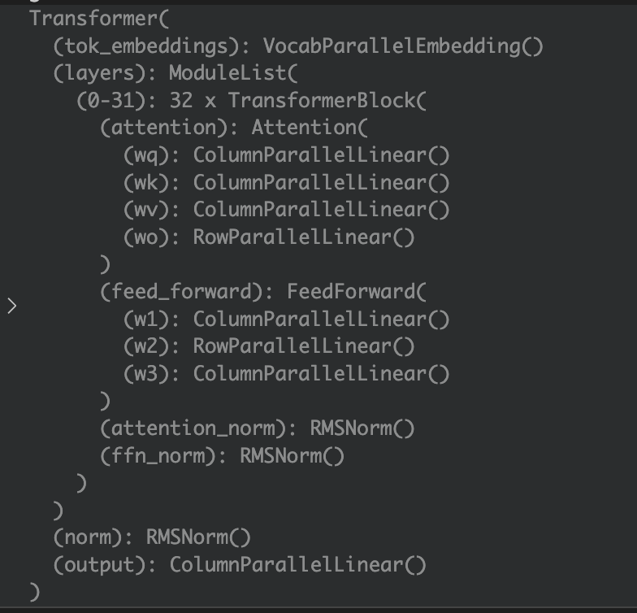

# Llama 3：模型结构、分词与推理接口

这一讲介绍2024年4月首发的 Llama 3 8B。先记住三个不同的对象：**分词器把文字变成编号，模型把编号变成下一步的分数，生成程序按分数选编号，再交给分词器还原成文字。** 我们先用四个词看清这条路线，再读原 notebook 的参数统计、词表和聊天接口。

## 1. 输入一句话，模型究竟收到了什么

先做一张教学词表：`猫→0，吃→1，鱼→2，。→3`。数字只是编号，例如编号2表示“鱼”，并不表示“鱼的特征等于2”。模型用编号去查 **Embedding（嵌入表）**，每行保存一个词的向量。

假设每个向量只有两个数，四行分别是 `[1,0]、[0,1]、[1,1]、[0,0]`。输入编号0，查到 `[1,0]`。输出层再为四个候选词各算一个分数，称为 **logit**；softmax 把分数转成总和为1的概率，argmax 选择分数最大的编号。

```python
import torch

toy_words = ["猫", "吃", "鱼", "。"]
toy_embedding = torch.nn.Embedding(4, 2)
toy_head = torch.nn.Linear(2, 4, bias=False)
with torch.no_grad():
    toy_embedding.weight.copy_(torch.tensor([[1., 0.], [0., 1.],
                                             [1., 1.], [0., 0.]]))
    toy_head.weight.copy_(torch.tensor([[0., 0.], [3., 0.],
                                       [1., 0.], [0., 0.]]))
    toy_ids = torch.tensor([[0]])
    toy_hidden = toy_embedding(toy_ids)
    toy_logits = toy_head(toy_hidden)
    toy_probabilities = toy_logits.softmax(dim=-1)
    toy_next = toy_logits[:, -1, :].argmax(dim=-1).item()
print("输入/向量/分数形状:", list(toy_ids.shape),
      list(toy_hidden.shape), list(toy_logits.shape))
print("分数:", toy_logits.tolist())
print("接着选择:", toy_words[toy_next])
```

输出形状是 `[1,1] → [1,1,2] → [1,1,4]`，四个分数是 `[0,3,1,0]`，所以选中编号1，对应“吃”。这里的数字由我们直接填写，用来观察查表与选词。真实模型会在两张表之间加入许多 Transformer 层，使隐藏向量包含前文信息。

`torch.tensor` 创建张量；`nn.Embedding(4,2)` 创建四行、每行两维的表；`nn.Linear(2,4)` 将两维向量映射为四个分数，存储权重形状为 `[4,2]`。`weight` 是模块参数，`copy_` 将数值写入已有参数。`with torch.no_grad()` 表示这段运算只查看结果，不建立梯度图。

后文统一用 $N$ 表示样本数，$T$ 表示输入 token 数，$D$ 表示隐藏宽度，$V$ 表示词表大小。刚才的例子是 $N=T=1,D=2,V=4$。真实 tokenizer 的 token 还可能是一个单词的片段、若干字符或字节，具体切法由它自己的词表和规则决定。

## 2. 把小例子换成 Llama 3 的尺寸

首发 Llama 3 8B 的基本路线是：

```text
文字
  ↓ tokenizer
整数ID [N,T]
  ↓ 词向量表 [128256,4096]
隐藏向量 [N,T,4096]
  ↓ 32个Transformer块
隐藏向量 [N,T,4096]
  ↓ 最后一次RMSNorm、输出投影
词表分数 [N,T,128256]
  ↓ 选取下一ID，追加到输入
继续生成 → 解码文字
```

模型名字里的 **8B** 是约80亿个参数，B 是 billion，十亿。**32层**指32个 Transformer 块。**4096维**指每个位置在层间传递4096个浮点数。**128256词表**指编号可以取0到128255。层数、向量宽度和编号上限分别回答不同的问题。



这是原 notebook 第5格显示的模块树。顶部 `tok_embeddings` 是输入查表；`layers` 下面的 `(0-31)` 表示32个块。每个块的 `attention` 包含 `wq/wk/wv/wo`，`feed_forward` 包含 `w1/w2/w3`，两处 `RMSNorm` 调整向量尺度。最后 `norm`、`output` 把结果送到词表分数。图中的 `ColumnParallelLinear`、`RowParallelLinear` 是支持模型并行的线性层名字。

一个块大体做两次修正：先把标准化后的输入交给 Attention，结果加回输入；再把标准化后的中间结果交给前馈网络，结果再次加回去。这种“结果加回输入”叫**残差连接**，让每层沿现有表示继续修正。

## 3. 32层同样是4096维，为什么从7B变成8B

原代码先加载 Llama 2 7B，再加载 Llama 3 8B，分别遍历参数求数量。两者主要尺寸如下：

| 配置 | Llama 2 7B | 首发 Llama 3 8B |
|---|---:|---:|
| 输入/输出词表大小 $V$ | 32000 | 128256 |
| 块数 $L$ | 32 | 32 |
| 隐藏宽度 $D$ | 4096 | 4096 |
| Query头数 $H$ | 32 | 32 |
| Key/Value头数 $G$ | 32 | 8 |
| 每个头的宽度 $d=D/H$ | 128 | 128 |
| 前馈中间宽度 $M$ | 11008 | 14336 |
| 训练上下文长度 | 4096 token | 8192 token |
| RoPE基数 | 10000 | 500000 |
| RMSNorm的epsilon | 1e-6 | 1e-5 |

**词表变大**：输入查表和输出投影都变大。**前馈中间层变宽**：每块的三个矩阵变大。**KV头变少**：Key、Value投影变小。这三项一起决定参数变化。输入表和输出头在这两个配置中分别保存权重，所以要各计一次。

先分块数。每块的 Query、输出投影各有 $D^2$ 项；Key、Value投影各有 $DGd$ 项；前馈三矩阵共 $3DM$ 项；两处RMSNorm各有 $D$ 个可训练增益。再加输入、输出与最后一次RMSNorm，总数为：

$$
P=2VD+L\left(2D^2+2DGd+3DM+2D\right)+D.
$$

$P$ 是参数元素数量；$2VD$ 是两张词表矩阵；$L$ 乘上括号里的单块参数；最后的 $D$ 属于模型末尾的RMSNorm。这些配置的线性层不带偏置，公式按这个条件统计。

```python
from transformers import LlamaConfig, LlamaForCausalLM

def make_full_config(llama3):
    return LlamaConfig(
        vocab_size=128256 if llama3 else 32000,
        hidden_size=4096, intermediate_size=14336 if llama3 else 11008,
        num_hidden_layers=32, num_attention_heads=32,
        num_key_value_heads=8 if llama3 else 32,
        max_position_embeddings=8192 if llama3 else 4096,
        rms_norm_eps=1e-5 if llama3 else 1e-6,
        rope_theta=500000.0 if llama3 else 10000.0,
        tie_word_embeddings=False, attention_bias=False, mlp_bias=False)

full_models = {}
for label, use_llama3 in [("Llama2", False), ("Llama3", True)]:
    cfg = make_full_config(use_llama3)
    # meta设备记录形状，适合查看大模型的参数结构。
    with torch.device("meta"):
        structure = LlamaForCausalLM(cfg)
    count = sum(p.numel() for p in structure.parameters())
    full_models[label] = structure
    print(label, count)

# 原补充notebook第6/8格的宽度计算。
hidden_dim = 4*4096
hidden_dim = int(2*hidden_dim / 3)
hidden_dim = int(1.3 * hidden_dim)
hidden_dim = 1024 * ((hidden_dim + 1024 - 1) // 1024)
print("前馈中间宽度:", hidden_dim)
print("Llama3半精度权重GiB:", 8030261248 * 2 / 1024**3)
```

输出分别为 `6738415616`、`8030261248`，中间宽度 `14336`，半精度权重约 `14.96 GiB`。`sum` 累加所有参数张量的 `numel()`；`meta` 设备只建立形状和结构，适合统计，后面做实际前向时另建有数值的小模型。

从7B到8B，词表两矩阵增加788529152项，Attention减少805306368项，前馈增加1308622848项，合计增加1291845632项。FP16/BF16每项2字节，因此权重容量按参数数乘2；再除 $1024^3$ 换成GiB。实际运行还会使用KV缓存、激活和临时内存。

## 4. GQA：让几组查询共享Key和Value

Attention（注意力）让当前位置按照相关程度读取已有位置的信息。**Query** 是当前在找什么，**Key** 用来与查询比较，**Value** 是按比较结果读取的内容。每个 head（头）有自己的投影，分别计算一组注意力结果。


图来自 [GQA v3，第2页 Figure 2](https://arxiv.org/abs/2305.13245v3)。底部蓝色是Query，红色是Key，黄色是Value。左边MHA每个Query配一套KV；右边MQA全部Query共享一套KV；中间GQA将Query分组，每组共享一套KV。沿虚线看谁读取哪套数据，就能理解共享关系。

图中间画了8个Query与4组KV，每2个Query共享一组；Llama 3 8B 则是32个Query头对应8组KV，每4个Query头共享一组。若头编号从0开始，头0–3使用KV0，头4–7使用KV1，以此类推。每头128维，因此单层投影形状为：

| 投影 | 权重形状 `[输出宽,输入宽]` | 投影后形状 |
|---|---|---|
| Query | `[4096,4096]` | `[N,T,32,128]` |
| Key | `[1024,4096]` | `[N,T,8,128]` |
| Value | `[1024,4096]` | `[N,T,8,128]` |
| 输出投影 | `[4096,4096]` | 合并各Query结果后回到 `[N,T,4096]` |

同组Query仍可产生不同的注意力权重，因为查询向量不同。若第 $h$ 个Query属于组 $g(h)=\lfloor h/4\rfloor$，其计算为：

$$
\operatorname{Attention}_h
=\operatorname{softmax}\!\left(
\frac{Q_hK_{g(h)}^\top}{\sqrt{128}}+\text{mask}
\right)V_{g(h)}.
$$

$Q_h$ 是这组查询，$K_{g(h)}$、$V_{g(h)}$ 是共享的键和值。先做点积，除以每头宽度的平方根调整尺度；`mask` 把未来位置的分数设为负无穷；softmax 沿“可读取的位置”归一化，再用这些权重对Value加权求和。此处沿位置求概率；最终输出头则沿词表求下一token概率。

生成时缓存每个旧位置的K/V，下一步可以直接复用。全部层的缓存元素占用可按 $2LNTGds$ 字节估算，其中2对应K和V，$s$ 为每元素字节数。单样本、4096 token、半精度时，Llama 2 7B 为2 GiB，首发 Llama 3 8B 为0.5 GiB；后者读到8192 token时为1 GiB。

## 5. SwiGLU：前馈网络为什么有三块权重

回到模块树中的 `w1、w2、w3`。输入同时走两路：一路经过 `w1` 和SiLU，另一路经过 `w3`；两路逐元素相乘，再通过 `w2` 回到原宽度。这种门控前馈称为 **SwiGLU**。


这是 [GLU Variants Improve Transformer v1，第2页公式(6)](https://arxiv.org/abs/2002.05202v1) 的各类门控前馈，其中最后一行是SwiGLU。论文用行向量右乘矩阵，核心结构是“激活后的一路乘另一路，再做输出投影”。图下说明：三矩阵结构需调整中间宽度，以与普通两矩阵前馈匹配参数规模。

Llama 的PyTorch写法为：

$$
\operatorname{FFN}(x)
=\left[\operatorname{SiLU}(xW_1^\top)
\odot(xW_3^\top)\right]W_2^\top,
\qquad \operatorname{SiLU}(z)=\frac{z}{1+e^{-z}}.
$$

$x:[N,T,D]$，$W_1,W_3:[M,D]$，$W_2:[D,M]$；$\odot$ 表示对应元素相乘。两个分支的中间结果都是 `[N,T,M]`，投影后回到 `[N,T,D]`。例如门控输入为1时，SiLU约为0.731；另一分支若为2，相乘就得到约1.462。

第3节代码算的是 $M$：先取 $4D=16384$，乘 $2/3$ 后向下取整为10922，再乘1.3取整为14198，最后向上对齐到1024的倍数，得到14336。`int` 对正数截去小数，`//` 做整除，`(n+k-1)//k*k` 将正整数 $n$ 向上补齐为 $k$ 的倍数。

原补充 notebook 第7格的完整 `FeedForward` 类中，`__init__` 创建三个子层，`forward` 只有核心一行：`self.w2(F.silu(self.w1(x)) * self.w3(x))`。`class` 定义结构，`self` 指当前实例，`super().__init__()` 启动PyTorch的模块注册；`forward` 在调用模块时执行。`F.silu` 对每个元素计算SiLU，`*` 在这里对应 $\odot$。本讲复现资料另外用完整官方类核对前向与梯度，完整中文注释放在[核心源码阅读版](代码/tutorials/llama/Llama3核心源码_代码注释.py)。

## 6. 真实词表：同一句话怎样变成两代模型的ID

Llama 2 使用SentencePiece，首发 Llama 3 使用tiktoken的字节BPE词表。虽然课程文件都以 `.model` 结尾，它们需要对应的读取程序。下面读取课程随附的两份真实词表：

```python
from pathlib import Path
import importlib.util
from sentencepiece import SentencePieceProcessor

code_dir = Path("代码/tutorials/llama")
spec = importlib.util.spec_from_file_location("lesson25_tokenizer", code_dir / "tokenizer.py")
tokenizer_module = importlib.util.module_from_spec(spec)
spec.loader.exec_module(tokenizer_module)

t2 = SentencePieceProcessor(model_proto=(code_dir / "llama2_tokenizer.model").read_bytes())
t3 = tokenizer_module.Tokenizer(str(code_dir / "llama3_tokenizer.model"))
sample_text = "Hello, world!"
ids2 = t2.encode(sample_text)
ids3 = t3.encode(sample_text, bos=False, eos=False)
print("词表大小:", t2.vocab_size(), t3.n_words)
print("Llama2:", ids2, t2.decode(ids2))
print("Llama3:", ids3, t3.decode(ids3))
print("BOS/EOS/EOT:", t3.bos_id, t3.eos_id, t3.special_tokens["<|eot_id|>"])
```

`Path` 表示路径，`read_bytes()` 读取文件字节；这里把SentencePiece模型字节直接交给它的解析器。`importlib` 的几行代码从指定文件加载课程自己的 `tokenizer.py`；其中的 `Tokenizer` 与本讲固定的Meta源码对应。`encode` 返回Python整数列表，`decode` 接收列表还原字符串。

这里的词表总数分别为32000和128256。同一句 `Hello, world!` 在Llama 2中为 `[15043,29892,3186,29991]`，在Llama 3中为 `[9906,11,1917,0]`；两串编号都能解码回原文。Llama 3 的128256已经包括128000个普通项与256个特殊项。`bos=False,eos=False` 表示这次仅比较正文的切分；用来开始一段模型输入时，可以显式添加BOS。

| 特殊标记 | Llama 3 ID | 用途 |
|---|---:|---|
| `<|begin_of_text|>` | 128000 | 一整段输入的起点，BOS |
| `<|end_of_text|>` | 128001 | 全文结束，EOS |
| `<|start_header_id|>` | 128006 | 角色头开始 |
| `<|end_header_id|>` | 128007 | 角色头结束 |
| `<|eot_id|>` | 128009 | 一条对话消息结束，EOT |

一个中文字符可能拆成多个token，一个英文单词也可能拆成片段。词表数量决定可用的基本单元，具体文本长度要实际编码后数。token编号与向量维度也分开看：ID128009有效，是因为词表超过128009行；查到的向量仍只有4096维。

## 7. 聊天模板：让模型知道谁在说话

基础模型接着一段文本生成；Instruct模型还经过指令与偏好训练，用角色标记组织多轮对话。老师的第36格构造 `messages`，再调用 `apply_chat_template`。其中每条消息是一个字典，`role` 表示角色，`content` 表示正文；列表表示对话顺序。

以下用简短的system与user消息，直接调用完整Meta `ChatFormat`。再把同一份真实词表转换为Transformers的fast tokenizer，给它写出相同的模板，比较两条路径的ID。

```python
from transformers import PreTrainedTokenizerFast
from transformers.convert_slow_tokenizer import TikTokenConverter

messages = [{"role": "system", "content": "Be brief."},
            {"role": "user", "content": "Who are you?"}]
chat_ids = tokenizer_module.ChatFormat(t3).encode_dialog_prompt(messages)
prompt = t3.decode(chat_ids)
print(prompt)

backend = TikTokenConverter(vocab_file=str(code_dir / "llama3_tokenizer.model"),
                           pattern=t3.pat_str).converted()
fast = PreTrainedTokenizerFast(tokenizer_object=backend,
                               bos_token="<|begin_of_text|>",
                               eos_token="<|end_of_text|>", model_max_length=8192,
                               clean_up_tokenization_spaces=False)
fast.add_special_tokens({"additional_special_tokens": list(t3.special_tokens)})
fast.pad_token = fast.eos_token
fast.chat_template = (
    "{{ bos_token }}"
    "{{ '<|start_header_id|>' + m['role'] + '<|end_header_id|>\n\n' + "
    "(m['content']|trim) + '<|eot_id|>' }}"
    ""
    "{{ '<|start_header_id|>assistant<|end_header_id|>\n\n' }}")
hf_chat_ids = fast.apply_chat_template(messages, tokenize=True, add_generation_prompt=True)
assert hf_chat_ids == chat_ids
assert len(fast) == 128256
for token, token_id in t3.special_tokens.items():
    assert fast.convert_tokens_to_ids(token) == token_id
print("聊天ID数量:", len(chat_ids))
```

打印出的模板按顺序包含：

```text
<|begin_of_text|><|start_header_id|>system<|end_header_id|>

Be brief.<|eot_id|><|start_header_id|>user<|end_header_id|>

Who are you?<|eot_id|><|start_header_id|>assistant<|end_header_id|>

```

角色头后有两个真实换行。每条已有消息末尾有EOT；最后只补assistant头，空出的正文由模型生成。BOS在开头出现一次，消息结束标记可以出现多次。

模板字符串使用Jinja语法：`{{ ... }}` 写入文字，`` 按消息循环，`trim` 去掉正文两端空白，`add_generation_prompt=True` 添加待生成角色的头部。这是本地显式模板，保留Meta类的拼接顺序。`tokenize=True` 直接返回编号；老师使用 `tokenize=False` 先得到字符串，再交给pipeline处理。

`terminators=[EOS,EOT]` 表示遇到其中任何一个就结束生成。在这一代协议中，EOS与消息结束的EOT承担不同角色。模板本身增加的是消息结构，回答内容由模型权重决定。

## 8. 真正做一次forward，再做generate

`forward` 给定一批编号，计算每个位置的词表分数；`generate` 在它外面循环，选择新编号、追加输入、检查结束条件。现在保留真实词表与聊天ID，把模型宽度与层数缩小，观察完整数据流：

```python
import transformers

torch.manual_seed(25)
tiny_cfg = LlamaConfig(vocab_size=128256, hidden_size=8, intermediate_size=32,
                       num_hidden_layers=1, num_attention_heads=2, num_key_value_heads=1,
                       max_position_embeddings=128, rope_theta=500000.0, rms_norm_eps=1e-5,
                       bos_token_id=t3.bos_id, eos_token_id=t3.eos_id,
                       pad_token_id=t3.eos_id, tie_word_embeddings=False)
tiny_cfg._attn_implementation = "eager"
tiny = LlamaForCausalLM(tiny_cfg).eval()
input_ids = torch.tensor([chat_ids])
attention_mask = torch.ones_like(input_ids)
with torch.no_grad():
    result = tiny(input_ids, attention_mask=attention_mask, use_cache=True,
                  output_hidden_states=True)
    next_id = result.logits[:, -1, :].argmax(dim=-1, keepdim=True)
    one_more = tiny(next_id, attention_mask=torch.ones(1, len(chat_ids)+1, dtype=torch.long),
                    past_key_values=result.past_key_values, use_cache=True)
    full = tiny(torch.cat([input_ids, next_id], dim=1), use_cache=False)
    torch.testing.assert_close(one_more.logits[:, -1], full.logits[:, -1], rtol=1e-4, atol=1e-6)
    generated = tiny.generate(input_ids, attention_mask=attention_mask,
                              max_new_tokens=3, do_sample=False,
                              eos_token_id=[t3.eos_id, t3.special_tokens["<|eot_id|>"]])

print("输入形状:", list(input_ids.shape))
print("隐藏/分数形状:", list(result.hidden_states[-1].shape), list(result.logits.shape))
print("缓存K形状:", list(result.past_key_values[0][0].shape))
print("新增ID:", generated[0, len(chat_ids):].tolist())

# pipeline封装分词、生成与解码；这里传入上面已经建立的本地模型。
pipe = transformers.pipeline("text-generation", model=tiny, tokenizer=fast, device=-1)
pipeline_outputs = pipe(prompt, max_new_tokens=3, do_sample=False,
                         add_special_tokens=False,
                         eos_token_id=[t3.eos_id, t3.special_tokens["<|eot_id|>"]])
full_text = pipeline_outputs[0]["generated_text"]
continuation = full_text[len(prompt):]
print("pipeline返回字段:", list(pipeline_outputs[0]))
```

这次真实模型有一层、每位置8维、2个Query头和1组KV。上面两条消息加模板共22个token，所以形状依次是 `[1,22] → [1,22,8] → [1,22,128256]`。生成的三个新ID为 `[62446,9649,50490]`。最后一个位置 `[:, -1, :]` 提供下一token分数。`argmax(...,keepdim=True)` 保留宽度为1的轴，得到 `[1,1]`，适合直接送入下一步。

缓存K的形状为 `[1,1,T,4]`：一个样本、一组KV、$T$ 个位置、每头4维。下一步只传新编号，模型读取旧缓存；代码又将完整前缀重新计算一次，两种下一步分数相符。缓存的具体推导可接着看第20–22讲。

`torch.cat(...,dim=1)` 沿长度轴追加编号；`ones_like` 创建同形状的全1掩码，表示所有输入位置都有效；`max_new_tokens=3` 限制新增编号数量。原教程使用随机采样 `do_sample=True`、`temperature=0.6`、`top_p=0.9`：先用温度调整分数，再从累计概率覆盖约90%的候选集合采样。上面用贪心选择，使两条接口的结果便于比较。

`pipeline` 返回列表，列表首项是字典，其中 `generated_text` 默认包含提示词。`[len(prompt):]` 用字符串字符数切下续写部分。切token张量时则用输入token数量；这两个长度分别对应字符串与整数序列。

老师主教程第34格给pipeline传入基础模型ID，第36格换成Instruct模型ID，并设置CUDA和BF16加载。`torch_dtype` 控制权重的浮点格式，`device_map` 决定模块放在哪里；`device="cuda"` 指定GPU。本文的小模型与分词器已在本地，因此直接把对象传给pipeline。首发模型的权重下载、Meta接口和HF接口的配置入口见原阅读版。

## 9. 把原 notebook 的各段连起来

| 原代码位置 | 作用 | 先看懂什么 |
|---|---|---|
| 主5 | 展示模型模块树 | 输入表、32块、输出头的顺序 |
| 主8、18、21、22 | 内存估算与参数计数 | 元素数量、每项字节、GiB |
| 主15、19 | 分别加载两代基础模型 | 模型ID、dtype、设备配置 |
| 主25–28 | 读取两份词表、查看大小与特殊项 | token、ID、词表与特殊标记 |
| 主34 | 基础模型pipeline | prompt→token→generate→字符串 |
| 主36–37 | Instruct聊天与显示模板 | 消息字典、角色、EOT、assistant头 |
| 补充3、5–9 | 配置、完整FFN与14336宽度计算 | hidden_dim、三矩阵、整数对齐 |

原代码完整保存在[主教程Python阅读版](代码/tutorials/llama/llama3_0419_代码注释.py)、[补充配置阅读版](代码/tutorials/llama/llama3_supp_data_config_代码注释.py)、[Tokenizer/ChatFormat源码阅读版](代码/tutorials/llama/tokenizer_代码注释.py)；[逐格说明](代码单元解释.md)可按原编号查找。主教程有38格，补充配置11格，共49格。

本讲代际信息以 [Meta 2024年4月首发介绍](https://ai.meta.com/blog/meta-llama-3/) 和[固定版模型卡](https://github.com/meta-llama/llama3/blob/cf3ea595be1edfb019d21b14d8b215a39161c860/MODEL_CARD.md)为准。GQA和GLU的论文截图解释所用模块；首发模型的词表、宽度和上下文配置按本讲原资料列出。

## 10. 阅读要点与运行记录

**必须掌握**：文字、token ID、Embedding、隐藏向量、logits、生成ID之间的区别；$[N,T]\to[N,T,D]\to[N,T,V]$；参数量的组成；GQA共享KV；聊天模板与结束标记；forward与generate的分工。

**第二遍阅读**：SwiGLU门控和14336的整数路径、KV缓存形状、RoPE基数、Meta与HF两种接口，以及模板字符串与特殊ID的一一对应。

**可以暂缓的工程细节**：FairScale多rank并行、权重分片下载、设备分派、大规模预训练和长文本切块保护。Tokenizer里的字符切块上限与模型的token上下文长度分别属于分词和模型两层。

| Paper ↔ Code | 本讲位置 | 对应资料 |
|---|---|---|
| GQA Figure2 | 第4节共享关系与缓存 | 完整官方Attention / HF LlamaAttention |
| GLU公式(6) | 第5节SwiGLU、补充第7格完整类 | `FeedForward.forward`、`w1/w2/w3` |
| 首发Llama 3规格 | 第2、3、6节 | 官方首发介绍、模型卡与原配置 |
| 本讲训练数据读取、loss、optimizer | 未找到 | 两份notebook以结构查看、分词与推理为主 |

**复现状态：部分成功。** 本文五段代码在CPU执行，使用原词表与完整Meta Tokenizer/ChatFormat；完整两代参数配置在meta设备计数，另用真实随机小Llama检查前向、缓存和pipeline，完整官方FFN另作数值与梯度比较。环境与结果见[复现说明](复现/README.md)。原7B/8B预训练权重、GPU运行与语言质量评测仍待验证；当前小模型输出用于观察数据流。Built with Meta Llama 3；原代码许可保留在本讲源码目录。

下面保留此前的源码细节与历史运行记录，第二遍阅读时再展开。

<details>
<summary>第二遍阅读：原讲解中的源码细节与历史运行记录</summary>

# Llama 3 整体介绍：模型结构、分词与推理接口

这讲回答一个具体问题：Llama 2 7B 与首发 Llama 3 8B 都是32层、隐藏宽度4096，为什么参数量、分词结果和使用方式仍然不同？关键要同时看词表、KV头数、SwiGLU中间宽度和聊天协议。会调用生成接口以后，还要能顺着字符串、词ID、隐藏状态、logits和生成ID找到每一步。

先读本文，再看 [主 notebook Python 注释阅读版](代码/tutorials/llama/llama3_0419_代码注释.py) 与 [补充配置阅读版](代码/tutorials/llama/llama3_supp_data_config_代码注释.py)。原单元从0编号；[全部49个单元说明](代码单元解释.md) 用来按编号查找。原GPU加载语句与历史输出用于对照课程；当前运行条件见文末。

## 1. 来源与代码入口

本讲介绍2024年4月18日首发的 Llama 3 8B/70B，重点是8B。依据为[首发官方介绍](https://ai.meta.com/blog/meta-llama-3/)和[固定版本模型卡](https://github.com/meta-llama/llama3/blob/cf3ea595be1edfb019d21b14d8b215a39161c860/MODEL_CARD.md)，配置按这一代模型说明。

| 来源 | 固定版本与用途 |
|---|---|
| chunhuizhang/personal_chatgpt | 提交7fbc29824171fd07dc2c30fe922e61ebc018ad1d；两原notebook、PNG、两tokenizer模型及tokenizer.py |
| Meta官方llama3 | 提交cf3ea595be1edfb019d21b14d8b215a39161c860；ModelArgs、FeedForward、Tokenizer、ChatFormat、generation与模型卡 |
| 本次环境 | Torch2.5.1+cpu、Transformers4.44.2、tiktoken0.7.0、FairScale0.4.13；不推测讲师精确版本 |
| 字幕 | 检查E盘根目录现有字幕，未找到本讲独立文本；已找到的7B/8B对比字幕属于第29讲 |

发布原件的字节、SHA256及官方快照SHA见 [来源清单](来源清单.json)。原教程tokenizer.py与固定官方tokenizer.py字节完全相同。Built with Meta Llama 3；第三方源码保留版权、[LICENSE](代码/tutorials/llama/LICENSE) 和 [Notice](代码/tutorials/llama/Notice)。

先建立两条仓库路线：

~~~text
Meta: example_text_completion.py → Llama.build → ModelArgs/Transformer
      → Tokenizer/ChatFormat → generate → decode
HF: model_id → AutoModelForCausalLM.from_pretrained / pipeline
      → HF tokenizer → model.generate → generated_text
~~~

前者使用Meta的FairScale层与checkpoint，后者使用Transformers适配；checkpoint格式、字段名和接口不能随意互换。训练数据加载器、loss、optimizer、训练checkpoint保存及在线服务都不是这两份notebook实现的内容。数据声明不等于配套训练数据已发布。

## 2. 一条输入怎样走到输出

统一符号：\(B\)为batch样本数，\(T\)为本次输入token数，\(D\)为隐藏宽度，\(V\)为词表大小，\(L\)为层数，\(H\)为Q头数，\(G\)为KV头数，\(d=D/H\)为每头宽度，\(M\)为MLP中间宽度。不要把整数词ID的值与向量维数混淆。

| 变量/对象 | 类型、shape | 来源与去向 |
|---|---|---|
| messages | list[dict[str,str]] | system/user等角色与正文 |
| prompt | str | 套模板后的完整文本，含角色头与标记 |
| prompt_tokens / input_ids | list[int] / int64[B,T] | 分词得到查表行号 |
| tok_embeddings / embed_tokens | 权重float[V,D] | 查表得到float[B,T,D] |
| 层内x | float[B,T,D] | RMSNorm、Attention、残差，再RMSNorm、MLP、残差 |
| Q / K / V | [B,T,H,d] / 两个[B,T,G,d] | Q/K带位置旋转；KV可缓存 |
| lm_head输出 | float[B,T,V] | 每位置预测下一token的未归一化分数 |
| 新生成ID | int64[B,N] | 从最后位置采样，追加后继续生成 |
| generated_text | str，封装在list[dict] | 默认包含prompt，用字符切片取得续写 |

list是Python容器，Tensor才有dtype/device；分词不会直接产生[B,T,D]向量。nn.Module注册子层，让named_parameters()能够递归找权重；forward定义一次前向，generate反复调用前向、选择下一token并检查结束条件。本节沿推理路径读取这些对象。

因果语言建模的背景目标仍是

\[
\mathcal L=-\sum_{t=1}^{T-1}\log p_\theta(x_{t+1}\mid x_{\le t}).
\]

\(x_t\)是第t个词ID，\(\theta\)是参数，\(p_\theta\)由第t个位置logits做softmax得到。若三个ID为[10,20,30]，前两位置分别预测20和30。这是训练背景，不是本讲已执行的训练。训练与推理共用权重层，推理不反向传播。

## 3. 结构比较与参数量

| 字段 | Llama 2 7B | 首发Llama 3 8B |
|---|---:|---:|
| 词表V | 32000 | 128256 |
| 层数L / 宽度D | 32 / 4096 | 32 / 4096 |
| Q头H / KV头G | 32 / 32 | 32 / 8 |
| 每头d | 128 | 128 |
| SwiGLU中间宽M | 11008 | 14336 |
| RMSNorm epsilon | 1e-6 | 1e-5 |
| RoPE theta | 10000 | 500000 |
| 训练上下文长度 | 4096 | 8192 |
| 输入/输出嵌入 | 两矩阵不共享 | 两矩阵不共享 |
| 精确参数数 | 6,738,415,616 | 8,030,261,248 |

实际用Transformers完整配置在meta设备构造，核对了shape和计数。meta张量有shape/dtype而没有物理权重数据，能准确回答参数数，不能回答模型会生成什么。上下文长度来自各代官方说明，不是由ModelArgs.max_seq_len=2048这个运行默认值推断。CLI能覆盖运行容量，也不意味着任意扩长都保持质量。

不带bias、未共享embedding的这些Llama，总量为

\[
P=2VD+L\left(2D^2+2DGd+3DM+2D\right)+D.
\]

\(2VD\)为输入嵌入与输出头；\(2D^2\)为Q和O；\(2DGd\)为K和V；\(3DM\)为SwiGLU三矩阵；每层两处RMSNorm增益共\(2D\)，最后RMSNorm另有D。每项数的是参数元素，不是bytes。

从2-7B到3-8B：

| 部分 | 参数变化 |
|---|---:|
| 输入嵌入+输出头 | +788,529,152 |
| 32层Attention | −805,306,368 |
| 32层MLP | +1,308,622,848 |
| RMSNorm | 0 |
| 合计 | +1,291,845,632 |

词表变大与MLP变宽增加参数，GQA缩小KV投影减少参数；不是因为层数更多。两个嵌入/头矩阵shape相同，但tie_word_embeddings=False，不能只计一次。主18/21的named_parameters()循环逐个numel求和，与公式一致。

BF16和FP16都是2bytes/元素，但指数、尾数分配不同。精确权重下界：

\[
\frac{8{,}030{,}261{,}248\times2}{1024^3}
=14.957527160644531\ {\rm GiB}.
\]

主8标签写GB，因为分母1024³应读GiB，且它用的是四舍五入的8.03B。实际推理还要KV缓存、激活和临时buffer；训练另有梯度/优化器。

主Markdown10的is_bf16_supported()判断CUDA BF16能力，else仍选择torch.cuda.HalfTensor，并无CPU回退。本次隔离子进程执行原片段实际失败，记录原错误，不污染验证进程的全局默认类型。set_default_tensor_type全局生效且已弃用；torch_dtype是加载精度，device_map是放置策略，device="cuda"明确要求GPU，不能互相替代。

## 4. GQA缩小的是KV头数

~~~text
x[B,T,4096]
Q: Linear(4096,4096) → [B,T,32,128]
K: Linear(4096,1024) → [B,T,8,128]
V: Linear(4096,1024) → [B,T,8,128]
按组供32个Q头使用 → 拼回[B,T,4096] → O投影
~~~

H/G=4，四个Q头共享一组KV。若Q头索引h从0开始，所属组\(g(h)=\lfloor h/4\rfloor\)，则

\[
A_h=\operatorname{softmax}\left(
\frac{Q_hK_{g(h)}^\mathsf T}{\sqrt d}+\text{causal mask}\right)V_{g(h)}.
\]

Q/K进行RoPE，mask遮住未来。这里softmax沿key时间轴，输出对过去位置的权重；不同于输出头沿词表轴的采样softmax。小例子H4、G2时，Q头0/1用KV0，头2/3用KV1。

所有层KV缓存的元素存储估算为

\[
\text{KV bytes}=2LBTGds,
\]

2代表K与V，s为每元素bytes。缓存保存G头，不是展开后的H头。B1、T4096、s2时，2-7B约2GiB，3-8B约0.5GiB；3-8B T8192约1GiB。这是shape算术，不是GPU分配器峰值，更不能直接换算成四倍速度。

本次真实随机小Llama取D16/H4/G1，一次输入3token得到[1,3,128256]logits与[1,1,3,4]的K缓存，实际经过GQA模型路径。完整缓存/分组推导可回看20/21讲。

## 5. SwiGLU宽度怎样得到14336

完整官方类与配置见 [核心源码注释](代码/tutorials/llama/Llama3核心源码_代码注释.py)。FeedForward继承nn.Module，__init__注册w1/w2/w3；super().__init__()先初始化父类注册机制。self指向层对象。forward(x)接收float[B,T,D]并返回同shape，本类没有自己做残差相加。

\[
\operatorname{FFN}(x)=W_2\left[\operatorname{SiLU}(W_1x)\odot(W_3x)\right],
\qquad\operatorname{SiLU}(z)=\frac{z}{1+e^{-z}}.
\]

式子写列向量，PyTorch存[out,in]权重；输入最后一维右乘转置。w1/w3都是[M,D]，w2为[D,M]。门控分支经过SiLU，与内容分支逐元素相乘，再投影回D。\(\odot\)不是矩阵乘。SiLU(0)=0，SiLU(1)≈0.731；它不只是sigmoid(1)。

本次B2/T3/D16的小例子是[2,3,16]→两个[2,3,56]→[2,3,16]，2688参数。完整D4096宽度按补充6/8的原顺序：

~~~text
初值：4×4096                                   = 16384
int(2×hidden_dim/3)                            = 10922
int(1.3×hidden_dim)                            = 14198
1024×((hidden_dim+1024-1)//1024)                = 14336
~~~

int对正数向下截断，//为整除；最后实现向1024倍数上取整。ffn_dim_multiplier=None才跳过倍率，multiple_of是对齐倍数，不是并行进程数。最终3.5D，三矩阵每层参数\(3DM=176160768\)。不要先随意约分再认为与这条整数路径完全相同。

ColumnParallelLinear按输出宽切w1/w3，gather_output=False保留rank局部输出；RowParallelLinear接受分片输入，input_is_parallel=True避免重复切分。init_method=lambda x:x只返回原张量，没有初始化有意义的数值；正式模型通常随后加载checkpoint。本次显式正态初始化小层，用真实FairScale单进程Gloo验证；完整宽仅meta构造。未运行多rank通信。

## 6. 词表和完整分词实现

主25调用SentencePiece的vocab_size()得32000；主27读取Meta Tokenizer.n_words属性得128256。方法调用带括号，属性读取不带。两文件都以.model结尾，但内部格式不同：SentencePiece模型与tiktoken字节token/rank文件不能交叉加载。

[完整Tokenizer/ChatFormat中文注释](代码/tutorials/llama/tokenizer_代码注释.py) 保留所有逻辑。load_tiktoken_bpe读128000项普通词表，pat_str正则先切分文本，再做字节BPE；固定顺序添加256个特殊token，总量128256已包含特殊token，不能再加256。

| 标记/属性 | ID | 用途 |
|---|---:|---|
| begin_of_text / bos_id | 128000 | 整段开始 |
| end_of_text / eos_id | 128001 | 全文结束 |
| start_header_id | 128006 | 角色头开始 |
| end_header_id | 128007 | 角色头结束 |
| eot_id | 128009 | 一轮消息结束 |
| pad_id | −1 | 辅助哨兵，不是有效查表行 |

encode(s, *, bos, eos, ...)是实例方法；星号后bos/eos必须写关键字，没有默认值。返回list[int]，后续才转int64 Tensor。主24列表推导对每条prompt调用bos=True/eos=False，避免给待续写内容先加全文结束。decode把ID变回Unicode字符串，不意味着理解文本。词表ID只属于该模型，不能把Llama2 ID直接当Llama3 ID使用。

默认allowed_special空集、disallowed_special空元组时，特殊字符串按普通文本编码；allowed_special="all"把EOT字符串映射单个128009；disallowed_special="all"会拒绝特殊标记。本次实际检查三种分支。拼模板后要检查最终ID，不能只看文本相似。

400000字符分块和25000连续空白/非空白限制，是tokenizer工程保护，不是模型8192token上下文。yield让函数逐段产出，布尔^检查空白属性是否改变；Literal/TypedDict只是类型提示，并不会替类自动完成运行时角色校验。

本次原词表真实测试英文、中文、数字、组合音符、emoji、空白和空串，两版ID/解码相同。另测50001连续字母、50001空格、420000字符文本往返。为了运行HF pipeline，采用真实TikTokenConverter转换同一rank文件，保留特殊ID顺序并明确写出本地Jinja模板；这是CPU适配，没有下载原Hub tokenizer_config。普通及聊天样例逐ID对齐，不推广为所有Unicode输入全等，也不用token更少直接推断模型能力。

## 7. 对话模板、EOT与采样

主36先构造messages，再用apply_chat_template(messages, tokenize=False, add_generation_prompt=True)得到str：

~~~text
<|begin_of_text|>
<|start_header_id|>system<|end_header_id|>\n\n系统正文<|eot_id|>
<|start_header_id|>user<|end_header_id|>\n\n用户正文<|eot_id|>
<|start_header_id|>assistant<|end_header_id|>\n\n
~~~

为看清结构分了行；实际没有额外展示换行，\n\n代表两个真实换行。末尾只有assistant头，正文留给模型生成。ChatFormat.encode_header组角色头，encode_message对正文.strip()后追加EOT，encode_dialog_prompt只在整段首部加一次BOS，最后补assistant头。空对话在Meta类中仍得到BOS+assistant头；HF模板接口还可能有额外的输入校验。

terminators=[eos_id,eot_id]表示任意一个出现即结束，不要求连续生成两种标记。主37打印的是输入prompt，主36才生成。max_new_tokens=256是新增预算；temperature=0.6将logits除以温度，top_p=0.9筛出累计概率达到阈值的候选，再归一化采样。预算内不保证会出现结束符。

默认outputs[0]["generated_text"]包含输入，使用[len(prompt):]按Python字符长度取续写；不能把这个长度拿来切token张量。若return_full_text=False后仍这样切会误删回答。模板文本再分词时要防止重复BOS；本地适配实际核对只有一份，不能替未知Hub配置作保证。

Base与Instruct涉及训练数据和目标差异，不只是后缀变化。原海盗system提示属于Instruct用法。随机CPU小模型仅验证格式、生成与返回链条，不具备原模型知识、对齐或海盗口吻能力。

## 8. 原图、分片嵌入与配置


这是打印模块树的截图，不是箭头架构图。从tok_embeddings进入32个TransformerBlock，再走末尾norm与output。每块打印attention的wq/wk/wv/wo、feed_forward的w1/w2/w3，以及attention_norm/ffn_norm两处RMSNorm。截图没显示残差、RoPE、mask、softmax与缓存，不能当成这些运算不存在。查表后[B,T,D]经过各块仍宽D，输出头变[B,T,V]。这些参数层训练/推理都用，反向传播只在训练需要时执行。

完整 embedding 为[V,D]。ParallelEmbedding 沿D列切，每rank保存所有词的部分向量；VocabParallelEmbedding 沿V行切，每rank保存部分词行，并汇总非本地ID的结果。首发官方Transformer使用后者。单rank测试中，两种类的查表与权重梯度均与普通embedding一致；多rank时还会发生分片和通信。

| Meta字段 | HF对应/含义 |
|---|---|
| dim / n_layers | hidden_size / num_hidden_layers |
| n_heads / n_kv_heads | num_attention_heads / num_key_value_heads |
| vocab_size | 输入嵌入与输出头行数 |
| multiple_of / ffn_dim_multiplier | 推导得到intermediate_size |
| norm_eps | rms_norm_eps，分母稳定项 |
| rope_theta | 同名旋转频率底数 |

RoPE频率为\(\omega_i=\theta^{-2i/d}\)，i从0到d/2−1，每个二维对在位置p转角\(p\omega_i\)。theta从10000到500000改变除首对外的频率尺度；i=0时都为1。这不单独构成长上下文质量证明，训练长度和评估也重要。复数布局见18/19讲。

主Markdown32的launch.json允许//注释，属于JSONC，不能直接严格JSON解析。module="torch.distributed.launch"运行旧分布式启动器，--nproc_per_node 1启一个worker，后面脚本名才是目标。ckpt_dir为Meta分片目录，tokenizer_path为词表；max_seq_len512是本次运行序列上限，max_batch_size6为容量而非必有六条输入。justMyCode=false便于跟入库源码，console选择终端，不影响数学。本次仅解析字段，未启动原CLI/NCCL/checkpoint。

## 9. 官方数据和评测怎样阅读

固定卡声明15T+预训练token、10M+人工标注样例，并声明预训练/微调不含Meta用户数据。token不是样例或字数，不能据10M推出token总量。我们没有完整语料、比例、清洗去重流水线与人工审计材料；公开可获取也不等于没有使用条件。

原课“最强小模型、略低于Llama2 70B”应落实到2024年的具体测评。官方预训练表的MMLU 5-shot是多学科选择题知识测试，分数越高越好，5-shot表示提示给五个示例：

| 模型 | 官方MMLU 5-shot |
|---|---:|
| Llama2 7B | 45.7 |
| Llama3 8B | 66.6 |
| Llama2 70B | 69.7 |

3-8B比2-7B高20.9个百分点，比2-70B低3.1个百分点。这支持该任务与评测实现下的差异；不同模型大小、训练语料与污染控制没有被本地消融隔离。不能推出所有任务略低、今天仍最强或每个7B都被超过。我们未重跑MMLU，也未测Gemma/Mistral；官方分数与随机CPU结果分开。

## 10. 小模型的结构与推理

完整7B/8B结构用meta张量计算参数量；meta张量记录shape与dtype，适合检查网络尺寸。实际前向则使用隐藏宽度16、1层、保留128256词表的随机小模型，并将新增token预算设为4。

SwiGLU的小模型例子把真实FairScale层与独立NumPy公式对照，输入和权重梯度一致。两种embedding查表方式也得到相同结果：普通查表按token取行，分片查表再按分片方式组合。

这些例子接起了尺寸表、模块公式与实际接口。配置、源码版本与运行命令见[复现记录](复现/README.md)。

## 必须掌握

- 相同层数/隐藏宽度不等于相同模型；V、G、M共同决定参数量与缓存。
- 128256已包含256特殊token；BOS/EOS/EOT/角色头各有不同用途。
- SwiGLU三矩阵与整数对齐路径，不只背14336。
- 原权重加载、meta结构验证与随机CPU运行各能证明什么。
- 模板str、整数词ID、logits与返回文本切片分别在哪一步。

## 第二遍学习

手算参数分项与KV存储，追踪ChatFormat的方法，比较RoPE频率、RMSNorm eps与BF16数值范围。结合20–22讲，把GQA、KV缓存与自回归循环连到完整模型调用。

## 可以暂时不掌握

多rank嵌入/线性层通信布局、tiktoken超长文本分块、旧调试启动器兼容与加载器设备调度，真正部署或多卡实验时再深入。

## Paper ↔ Code

| 公式/官方说明 | 本讲对象/单元 | 对应内容 |
|---|---|---|
| 首发规模与上下文 | 固定模型卡；主9/15–22 | meta结构计数，不含训练 |
| GQA 32Q/8KV | HF LlamaAttention投影；官方Attention | 小模型真实forward/cache，无多rank |
| SwiGLU与14336 | 补充3/5/7/8；完整FeedForward | 类AST、单rank数值/梯度，完整宽仅meta |
| 128256词表 | 主25–28；完整Tokenizer | 原文件真实读取，有限样例逐ID |
| 角色头/EOT | ChatFormat；主36/37 | 本地明确模板逐ID比对 |
| 分片嵌入 | 官方tok_embeddings；主30 | 单rank；多卡性能证据未找到 |
| SFT/偏好训练、loss/optimizer | 本讲训练代码未找到 | 只有官方数据/方法概述 |
| 2024年MMLU | 固定MODEL_CARD | 官方报告，不是本地测评 |
| 独立首发论文PDF/完整训练语料 | 本讲材料未找到 | 不以后续版本论文替代 |

## 资料与后续问题

复现状态：**部分成功**。本讲采用已锁定的 Transformers/tiktoken 版本和明确的本地聊天模板，验证文件、结构计数、分词及随机小模型。历史HF模板、讲师依赖、独立字幕和原语料尚待补充；原8B检查点的质量与GPU速度留待后续。

</details>
