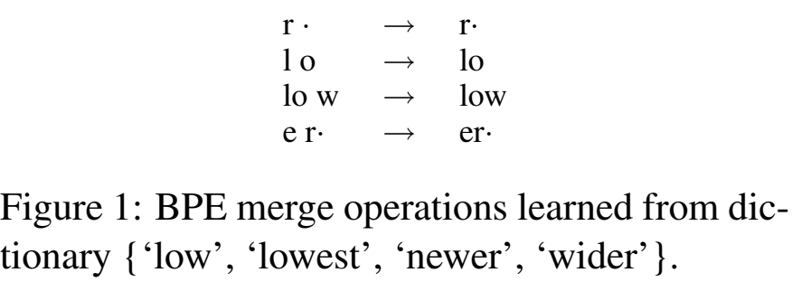
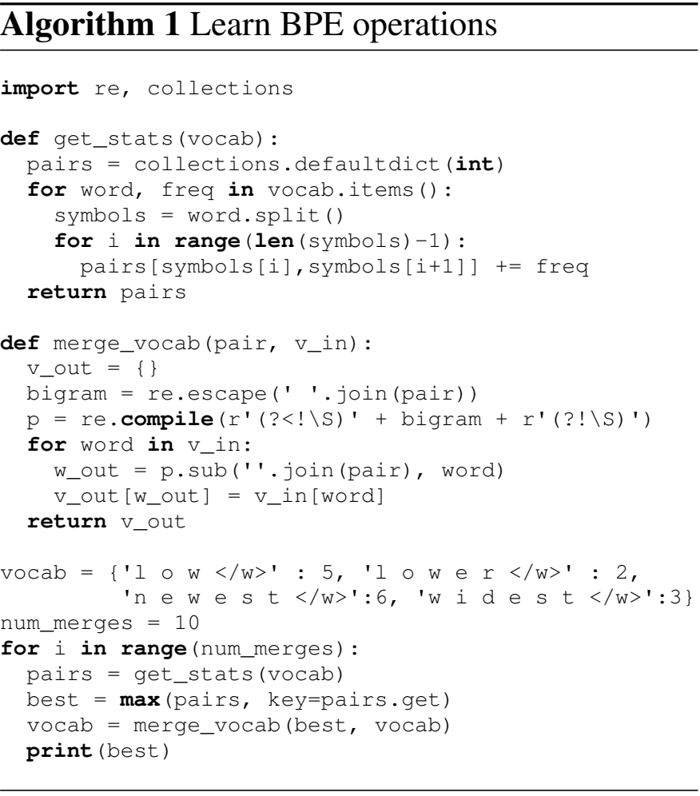

# GPT-4o tokenizer：字节、BPE与词表检查

同一句中文可以分成34个token，也可以分成24个。文字没有变，变的是“把哪些片段收作一个编号”的规则。本讲先从字符和字节讲起，再看BPE怎样合并片段，最后逐段读原 notebook 的编码、全文计数和词表扫描。

## 1. 字符、字节、token与ID分别是什么

看到“你好”时，先分清三个层次：

| 层次 | 例子 | 用来做什么 |
|---|---|---|
| Unicode字符串 | `"你好"` | Python中保存文字 |
| UTF-8字节 | `e4 bd a0 e5 a5 bd` | 把文字表示成可存储和传输的数字 |
| token ID列表 | 由具体词表决定 | 给语言模型作为输入编号 |

一个byte（字节）包含8个bit，可以表示0到255。UTF-8用一个或多个字节表示一个Unicode码点。例如“你”有三个字节，十六进制写成 `e4 bd a0`，对应十进制228、189、160。

```python
text = "你好"
raw = text.encode("utf-8")
print("Python字符数:", len(text))
print("UTF-8字节数:", len(raw))
print("十进制字节:", list(raw))
print("十六进制字节:", raw.hex(" "))
print("还原文字:", raw.decode("utf-8"))
```

输出是字符数2、字节数6、字节列表 `[228,189,160,229,165,189]`，再解码得到“你好”。`encode("utf-8")` 是Python字符串转字节的方法；`decode("utf-8")` 进行反向转换。后文的 `Encoding.encode(text)` 则是tiktoken的分词方法，返回token编号，两者根据所属对象区分。

**token** 是词表中的一个片段，可以包含完整词语、词语的一部分、空格或若干字节。**token ID** 是该片段的编号。编号只是查表索引：ID1000无需包含1000个字符，ID更大也无需代表更长的片段。模型后来会用这些编号查Embedding；本讲先把编号怎样产生讲清楚。

## 2. BPE怎样把小片段合成大一些的片段

BPE是Byte Pair Encoding，字节对编码。在tiktoken的字节BPE里，最小单位可以退回单个byte，共256种；词表还会保存一些较长的组合。例如原来需要依次发出 `a、b` 两个编号，如果词表收了 `ab`，便能用一个编号表达同样的两个字节。

### 对照论文，看合并规则怎样学出来



这是 [Neural Machine Translation of Rare Words with Subword Units，ACL 2016，第4页Figure 1](https://aclanthology.org/P16-1162/)。每行左边是相邻片段，箭头右边是合并后的片段：`l o → lo`，接着 `lo w → low`。`·` 是图中词末标记，提醒算法保留词边界。

为什么优先合并某些相邻片段？学习规则时，先统计它们在语料中一起出现多少次。高频组合被合成一个单位，随后重新统计，继续合并。比如 `low` 出现5次、`lower` 出现2次，`l o` 在这两类词中就贡献7次相邻出现。



同页Algorithm 1把这个学习过程写成Python。`vocab` 保存拆开的词与频次；`get_stats` 遍历每个词的相邻符号，并加上该词频次；`max(pairs,key=pairs.get)` 选出现最多的一对；`merge_vocab` 将它在所有词中合并。最下方循环重复这些操作，输出学到的规则。

这篇论文用字符与词末标记演示子词BPE；本讲tiktoken从UTF-8字节出发，并先做正则切段。两者共有的思路是把经常一起出现的小片段组合为较大的单位。

### 使用现成词表时，按已经学好的优先级合并

拿到词表后，每个可合并的字节片段有一个整数 **rank**，数值越小越优先。编码新文本时，重复选择当前可合并的相邻片段中rank最小的一对。训练阶段负责学习规则，使用阶段按固定规则编码。

用 `abc` 做一个能手算的例子：词表中收了 `ab`、`bc`，却没有 `abc`。若 `ab` 排在 `bc` 前面，先合成 `[ab,c]`；若 `bc` 更优先，就先合成 `[a,bc]`。

```python
import tiktoken
from tiktoken._educational import bpe_encode

# 所有单字节都能回退，字节本身的数值作为这里的初始ID。
toy_ranks = {bytes([value]): value for value in range(256)}
toy_ranks.update({b"ab": 256, b"bc": 257})
print("ab优先的合并过程:")
ab_ids = bpe_encode(toy_ranks, b"abc", visualise="simple")
toy_ab = tiktoken.Encoding(name="toy_ab", pat_str=r".+",
                           mergeable_ranks=toy_ranks, special_tokens={})
assert toy_ab.encode("abc") == ab_ids
print("ab优先的ID:", ab_ids)

toy_ranks[b"ab"], toy_ranks[b"bc"] = 257, 256
bc_ids = bpe_encode(toy_ranks, b"abc", visualise=None)
toy_bc = tiktoken.Encoding(name="toy_bc", pat_str=r".+",
                           mergeable_ranks=toy_ranks, special_tokens={})
assert toy_bc.encode("abc") == bc_ids
print("bc优先的ID:", bc_ids)
```

第一条路径打印 `[b'a',b'b',b'c'] → [b'ab',b'c']`，返回 `[256,99]`；交换优先级后返回 `[97,256]`。99与97是这里单字节 `c`、`a` 的编号。`b"ab"` 创建字节串；字典推导式创建256个基础项；`update` 追加组合项。

`bpe_encode` 是官方可读的Python教育版，`Encoding` 连接实际Rust实现；这个小词表的两条路径逐ID相同。真实编码还包含**正则预切分**：先把文本分成若干段，再在段内BPE合并。段落的边界、空格和数字规则都会影响最终切分。

## 3. 把词表换成cl100k_base和o200k_base

原 notebook 中 `T1`、`T2` 是两套编码规则的对象。`get_encoding(name)` 按名字返回对象，其中包括普通字节词表、特殊标记以及预切分正则；`encode` 将字符串转为整数列表，`decode` 将整数列表还原成字符串。后面的例子按本讲固定的tiktoken 0.7.0解释。

```python
T1 = tiktoken.get_encoding('cl100k_base')
T2 = tiktoken.get_encoding('o200k_base')

english = "i love chatgpt"
chinese = "你好，我的名字是GPT-4o。我是一种新型的语言模型，很高兴见到你!"
comparisons = {}
for name, encoding in [("cl100k", T1), ("o200k", T2)]:
    english_ids = encoding.encode(english)
    chinese_ids = encoding.encode(chinese)
    comparisons[name] = {"english": english_ids, "chinese": chinese_ids}
    assert encoding.decode(english_ids) == english
    assert encoding.decode(chinese_ids) == chinese
    print(name, "英文ID:", english_ids)
    print(name, "中文token数量:", len(chinese_ids))
    print(name, "数字分块:", [encoding.decode([i]) for i in encoding.encode("1234+4567")])

print("world与空格world:", T1.encode("world"), T1.encode(" world"))
print("AIM:", T1.encode("AIM"), T2.encode("AIM"))
```

指定英文在两套编码中都是5个token，但编号不同；指定中文则从34个变为24个。数字表达式的片段为 `123、4、+、456、7`：这里编码的是字符串，`+` 也作为文本的一部分。两套预切分正则都有最多三位数字一组的分支。

`world` 在cl100k中是 `[14957]`，`" world"` 是 `[1917]`。后者的字节中已经包含前导空格，因此解码 `[1917,14957]` 会得到 `" worldworld"`。保留原空格和换行，才是在比较同一份输入。

### “压缩”说的是token个数

这里的中文例子也出现在 [GPT-4o首发介绍的Language tokenization部分](https://openai.com/index/hello-gpt-4o/)：

| 同一段原文 | cl100k token数 | o200k token数 | 旧/新倍率 |
|---|---:|---:|---:|
| 上面的指定中文 | 34 | 24 | 约1.42 |
| `i love chatgpt` | 5 | 5 | 1 |
| `AIM` | 1 | 2 | 0.5 |

设旧编码数量为 $N_{old}$，新编码数量为 $N_{new}$，则：

$$
R=\frac{N_{old}}{N_{new}},\qquad
q=1-\frac{N_{new}}{N_{old}}.
$$

$R$ 表示旧编码需要多少倍token，$q$ 表示减少比例。中文例子 $R=34/24\approx1.4167$，$q=10/34\approx29.41\%$。意思是表达相同文本所需编号减少10个，UTF-8原文字节保持相同。

`AIM` 是实际反例：cl100k为 `[14660]`，o200k为 `[32,2833]`。两套词表及预切分规则各自调整，比较时应对具体文本编码。更长的片段收为一个token，可以缩短相应文本的序列；某些旧片段在新词表中拆开，又可能使另一些输入变长。

## 4. 原代码怎样统计整部《西游记》

主第11格用同一份文本逐行编码，累计每行的token数量。`with open` 打开文件并在离开代码块时关闭；`readlines()` 返回行字符串列表；`for line` 逐行取出；`+=` 在已有计数上继续加。

```python
from pathlib import Path

novel_path = Path("代码/tutorials/tokenizer/xyj.txt")
token_ids_len1 = 0
token_ids_len2 = 0
with open(novel_path, 'r', encoding='utf-8') as f:
    for line in f.readlines():
        token_ids_len1 += len(T1.encode(line))
        token_ids_len2 += len(T2.encode(line))

print("逐行累计:", token_ids_len1, token_ids_len2)
print("旧/新倍率:", token_ids_len1 / token_ids_len2)
print("减少比例:", 1 - token_ids_len2 / token_ids_len1)

# 同一文件按同样的文本读取方式，一次性编码全文，再比较边界。
with open(novel_path, 'r', encoding='utf-8') as f:
    whole_text = f.read()
whole_counts = [len(T1.encode(whole_text)), len(T2.encode(whole_text))]
print("全文一次编码:", whole_counts)
```

逐行累计结果为 `990508、703303`，旧/新约1.4084，减少约29%。这条计数公式是：

$$
N_e=\sum_{\ell=1}^{K}|\operatorname{encode}_e(x_\ell)|.
$$

$e$ 指编码规则，$K$ 是文件行数，$x_\ell$ 是第 $\ell$ 行字符串，$|\cdot|$ 取返回列表长度。行末换行也进入编码。原文件按UTF-8文本模式读取时，Python会处理通用换行；因此我们直接使用课程文件与相同读取方式。

全文一次编码得到 `989904、702799`，比逐行累计分别少604和504。逐行处理在每行末尾结束本次编码；全文处理时，预切分可以同时看到两行交界处的字符，片段边界可能不同。统计时先确定“逐行”还是“整篇”，就能解释这组差异。

## 5. 一个token为什么可能显示为替换字符

回到第1节：一个汉字或emoji可能需要多个字节。token又可能只保存其中一部分，因此单个token未必能独立解码为完整Unicode字符。完整还原的顺序是：**先取所有token的原始字节，拼好，再整体UTF-8解码。**

```python
emoji = "🧑🏽‍💻"
emoji_checks = {}
for encoding in [T1, T2]:
    ids = encoding.encode(emoji)
    chunks = [encoding.decode_single_token_bytes(i) for i in ids]
    joined_bytes = b"".join(chunks)
    per_token_display = "".join(encoding.decode([i]) for i in ids)
    whole_display = encoding.decode(ids)
    assert joined_bytes == emoji.encode("utf-8")
    assert whole_display == emoji
    emoji_checks[encoding.name] = {"ids": ids, "bytes": [b.hex() for b in chunks],
                                    "per_token": per_token_display, "whole": whole_display}
    print(encoding.name, ids)
    print("逐token显示:", per_token_display)
    print("整体解码:", whole_display)

marker = "<|endoftext|>"
special_ids = T2.encode(marker, allowed_special="all")
ordinary_ids = T2.encode(marker, disallowed_special=())
print("作为控制标记:", special_ids)
print("作为普通文本:", ordinary_ids)
```

组合emoji `🧑🏽‍💻` 包含人物、肤色、连接符与电脑几个码点。逐token默认解码会在不完整字节处放入 `�`，整体解码则能正确还原。`b"".join(chunks)` 拼接字节，`"".join(...)` 拼接字符串，两者保留的信息不同。

`decode_single_token_bytes(i)` 返回原始bytes；`decode(ids)` 将所有ID的bytes先拼接再解码。主扫描中的 `len(T2.decode([i]))` 测量的是单token按默认替换策略显示后的Python字符数，分析该长度时要记住这个显示过程。

### 普通词条与特殊标记

`<|endoftext|>` 属于人工指定的控制标记。`allowed_special="all"` 将它识别为单个特殊ID199999；`disallowed_special=()` 则按普通文本编码，通常拆成几个ID。默认直接编码这段特殊字符串会抛 `ValueError`，调用者需明确选择它在当前输入中的用途。

原第15–16格的长中文片段在o200k中是一个普通token，在cl100k中拆成12个；原字符串与ID对照保留在逐格说明中。它属于普通词条的观察，和库中定义的特殊标记分开统计。下一节遍历时也会把普通与特殊ID分开。

## 6. `n_vocab`、有效ID和词表中间的空位

想遍历词表时，容易写出 `for i in range(T2.n_vocab)`。这里的 `n_vocab` 是最大ID加1；如果某些中间编号没分配，循环仍会走到它们。

| tiktoken 0.7.0编码 | 普通词条数 | 特殊词条数 | 有效ID数 | `n_vocab` | 未分配编号数 |
|---|---:|---:|---:|---:|---:|
| cl100k_base | 100256 | 5 | 100261 | 100277 | 16 |
| o200k_base | 199998 | 2 | 200000 | 200019 | 19 |

o200k的普通ID是0到199997，随后199998为空位，199999分配给endoftext，200000到200017为空位，200018分配给endofprompt。于是最大值加1是200019，有效数量却是200000。

对空位调用 `decode_single_token_bytes` 会抛 `KeyError`；有效ID的bytes若不是完整UTF-8，严格解码则会抛 `UnicodeDecodeError`。两类情况可以分别处理。下面直接检查完整o200k词表，并按长度找出含汉字的普通词条：

```python
import regex as re

rows = []
holes = []
incomplete_utf8 = 0
control_ids = set(T2._special_tokens.values())
for token_id in range(T2.n_vocab):
    try:
        token_bytes = T2.decode_single_token_bytes(token_id)
    except KeyError:
        holes.append(token_id)
        continue
    try:
        token_text = token_bytes.decode("utf-8", errors="strict")
    except UnicodeDecodeError:
        incomplete_utf8 += 1
        continue
    if token_id not in control_ids and re.search(r"\p{Script=Han}", token_text):
        rows.append((len(token_text), token_id, token_text))

rows.sort(key=lambda row: (-row[0], row[1]))
print("n_vocab/有效ID:", T2.n_vocab, T2.n_vocab-len(holes))
print("未分配编号:", holes)
print("单独不完整UTF-8的有效token:", incomplete_utf8)
print("最长5项的ID与字符数:", [(row[1], row[0]) for row in rows[:5]])

pattern = r'^[\s\W_=+\\-]*$'
print("原符号正则:", {s: bool(re.match(pattern, s)) for s in ["abc", "123", "中文", "___", "🙂"]})
```

输出给出19个未分配编号，以及1562个无法单独严格UTF-8解码的有效token。后者仍有合法字节，可以与前后片段一起组成完整文字。`continue` 跳过当前编号，继续下一轮；`rows` 中每项保存“字符数、编号、文字”的三元组；`lambda` 提供排序键，负长度使长项排在前面，长度相同时按ID升序。

`_special_tokens` 的前导下划线表示内部实现字段，这里按固定版本读取；`\p{Script=Han}` 检查是否出现汉字码点。这个筛选回答“片段里是否含汉字”。原代码的 `langdetect.detect(...)` 则估计一小段文字属于哪种语言，两者采用的条件不同。

## 7. 现在回读原第17–19格

三个扫描单元的前半段都做同一件事：遍历编号，解码后统计显示长度，再按长度排序。后半段筛选并打印，`tot` 只在打印时加1，到20就 `break`。注释里的“top100”与实际停止值20，要按可执行条件阅读。

| 代码 | Python层面的作用 | 在扫描中影响什么 |
|---|---|---|
| `length_dict[i] = ...` | 用编号作为字典key | 每个成功解码的ID保存一个长度 |
| `length_dict.items()` | 取 `(ID,长度)` 二元组 | 交给排序函数 |
| `key=lambda item: -item[1]` | 长度取负作为排序键 | 从长到短 |
| `for item in length_dict` | 取排序后字典的key | `item` 是ID |
| `langdetect.detect(text) == "zh-cn"` | 语言分类筛选 | 决定这一项是否打印 |
| `tot += 1` / `tot == 20` | 计数并停止 | 打印20项后退出 |

第19格改用 `pattern=r'^[\s\W_=+\\-]*$'`。`^`、`$` 约束整段字符串；方括号是允许的字符集合，`\s` 表示空白，`\W` 表示非word字符，`*` 允许出现零次或多次。`not re.match(...)` 保留“并非全由这些符号构成”的项。

所以上面的短测试里，`abc`、`123`、`中文` 都不能整串匹配符号正则，都会通过原来的 `not` 条件；`___`、emoji则能匹配，会被排除。这条条件筛的是符号组成，与识别中文各自解决不同问题。

原代码使用裸 `except:` 忽略所有异常，包括中断；固定旧版对未分配ID走整句Rust `decode` 时，还可能触发 `PanicException`。第6节按异常类型区分“编号空位”和“有效字节片段”，便于读到每一种实际情况。原代码、原输出与历史扫描日志完整留在原件及复现资料中。

## 8. 原代码与论文、库接口怎样对应

| 概念 | 本讲位置 | 原代码/来源 |
|---|---|---|
| 学习BPE合并 | 第2节两张原图 | ACL BPE论文Figure1、Algorithm1 |
| 按固定rank编码 | 第2节小词表 | 完整官方 `_educational.bpe_encode` 与Rust CoreBPE |
| 读两套编码、比较切分 | 第3节 | 主2–10；`get_encoding`、`encode` |
| 《西游记》逐行累计 | 第4节 | 主11–12，使用原 `xyj.txt` |
| 普通长词条 | 第5节及逐格说明 | 主15–16，普通ID177431 |
| 排序、分类、正则 | 第6、7节 | 主17–19 |
| 数字、前导空格 | 第3节 | 补充3–10 |

完整代码可在[主教程Python阅读版](代码/tutorials/tokenizer/tokenizer_gpt4o_代码注释.py)、[数字/空格补充阅读版](代码/tutorials/tokenizer/tokenizer_supply_代码注释.py)中顺着读。[全部33格说明](代码单元解释.md)按原编号定位；[tiktoken核心源码阅读版](代码/tutorials/tokenizer/tiktoken核心源码_代码注释.py)解释完整 `get_encoding`、构造器、编码/解码方法与BPE函数。

## 9. 阅读要点与运行记录

**必须掌握**：字符串、UTF-8 bytes、token与ID；BPE合并优先级；encode/decode；token数量的比较口径；空格与换行；整体解码和逐token显示的差别。

**第二遍阅读**：两套预切分正则、词表空位与特殊ID、排序键与打印计数、汉字筛选与语言分类的区别。

**可以暂缓的工程细节**：Rust分词内核优化、词表下载缓存、完整语言检测概率模型与大规模tokenizer训练。

| Paper ↔ Code | 对应内容 | 需要区分的层次 |
|---|---|---|
| BPE Figure1 / Algorithm1 | 相邻片段与高频合并 | 论文字符子词示例；本讲实际为字节BPE |
| GPT-4o首发中文34→24 | 相同文本的实际编码比较 | 具体样例与本地真实词表 |
| tiktoken 0.7.0 | 两套Encoding、BPE、原扫描 | Python接口与完整Rust实现 |
| GPT-4o模型结构、loss、训练日志 | 未找到 | 原notebook主要进行tokenizer操作 |

**复现状态：部分成功。** 本文六段Python实际执行，包含完整两套词表、原《西游记》数据与全o200k扫描；小样例也用官方Python教育版和Rust实现对齐。环境、结果与运行命令见[复现说明](复现/README.md)。原第14格提出了长词条与模型训练语料的原因猜想，相关训练语料及权重更新记录未找到；本轮验证词表与编码行为，GPT-4o模型回答和训练原因仍待验证。

下面保留此前的源码细节与历史运行记录，第二遍阅读时再展开。

<details>
<summary>第二遍阅读：原讲解中的源码细节与历史运行记录</summary>

# GPT-4o tokenizer：o200k_base、文本压缩与词表检查

本讲解释字符串怎样变成 token ID，并用相同文本比较 cl100k_base 与 o200k_base 的切分结果。再从字节、特殊标记和解码方式出发，读懂词表检查代码。

先看本文，再读 [主notebook Python注释版](代码/tutorials/tokenizer/tokenizer_gpt4o_代码注释.py)。[配套接口补充](代码/tutorials/tokenizer/tokenizer_supply_代码注释.py) 解释数字与前导空格；[全部33格说明](代码单元解释.md) 按原编号检索。主讲21格、配套12格，可按单元编号查阅。

## 1. 来源、版本与代码地图

原教程固定提交7fbc29824171fd07dc2c30fe922e61ebc018ad1d，主文件是tutorials/tokenizer/tokenizer_gpt4o.ipynb，补充为tokenizer_supply.ipynb，数据为同目录xyj.txt。此文本是《西游记》，原文件2177760bytes，按上游字节发布；它不是本次训练GPT-4o的数据。

本讲使用 tiktoken0.7.0、langdetect1.0.9 和 regex。[GPT-4o首发介绍](https://openai.com/index/hello-gpt-4o/)展示多语言文本压缩例子；[tiktoken0.7.0源码](https://github.com/openai/tiktoken/tree/0.7.0)解释分词算法、预切分正则与特殊ID。

| 位置 | 在本讲中负责什么 |
|---|---|
| notebook主2–6 | 导入、构造两套Encoding、比较英文ID与n_vocab |
| 主9–12 | 指定中文句、完整《西游记》逐行计数 |
| 主15–19 | 异常普通token、按解码字符长度排序、语言/正则过滤 |
| 配套3–10 | 数字分块，world与前导空格world |
| tiktoken/registry.py:get_encoding | 按名称找构造器、锁和缓存 |
| tiktoken_ext/openai_public.py | 两套rank文件、预切分正则、特殊ID |
| tiktoken/core.py:Encoding | Python接口、特殊标记策略、调用Rust CoreBPE |
| tiktoken/_educational.py:bpe_encode | 可读的纯Python教学BPE，与Rust短样例比对 |
| GPT-4o模型、loss、optimizer、checkpoint | 本讲实现未找到；本次不调用API、不训练模型 |

完整相关对象见 [tiktoken核心源码注释](代码/tutorials/tokenizer/tiktoken核心源码_代码注释.py)，保留函数/方法全文及原docstring，仅加中文注释。它是源码阅读摘录，依赖原模块的import与注册表全局对象，不是可独立替代库的文件。MIT许可见 [LICENSE-tiktoken](代码/tutorials/tokenizer/LICENSE-tiktoken)。

本讲独立字幕及微信正文尚待补充；[第三方gist](https://gist.github.com/ctlllll/4451e94f3b2ca415515f3ee369c8c374) 是2024年的扫描观察脚本，不是官方训练日志。原ChatGPT分享链接对应的历史模型行为未复现。

## 2. 分词到底做什么

tokenizer把文本压成可查表的整数序列：

~~~text
Python str
 → 处理允许/禁止的特殊标记
 → Unicode正则预切分
 → 每段UTF8 bytes
 → 按固定rank做BPE合并
 → list[int]词ID
 → 后续模型才可能转int64[B,T]并查embedding
~~~

这里没有神经网络权重、forward、梯度或生成采样。T1/T2只是Encoding实例，不是语言模型。对相同版本、词表与输入，编码是确定性的；langdetect判断语言的随机性是另一回事。

| 变量 | Python类型/shape | 含义与去向 |
|---|---|---|
| T1 / T2 | Encoding对象 | 分别持有cl100k/o200k的正则、rank和特殊词表 |
| line / text | str | Unicode文本，包括空格与换行 |
| 文本字节 | bytes，长度U | UTF8编码，一个字符可占多个bytes |
| mergeable_ranks | dict[bytes,int] | 字节片段→rank/普通ID |
| ids | list[int]，长度T | 编码序列，T与字符数、bytes数不同 |
| length_dict | dict[int,int] | 原扫描的ID→单token解码后字符数 |
| tot | int | 已打印条数，不是遍历条数 |
| token_ids_len1/2 | int | 所有文本行的token数之和 |

ASCII字符常占1byte，常见汉字占3bytes，单个emoji码点常占4bytes；组合emoji又可含多个码点。Python len(str)数码点，不数UTF8字节或用户感知字形。模型中的token向量维数D则是另一轴，不能从token文本长度推断D。

### BPE编码看rank，不在输入上重新训练

设正则切出的某段UTF8字节，初始分片为\(s_1,\ldots,s_m\)，每片一个byte。若拼接\(s_i\Vert s_{i+1}\)在词表中，就有rank \(r(s_i\Vert s_{i+1})\)。每轮选

\[
i^*=\mathop{\arg\min}_{i:\,s_i\Vert s_{i+1}\in\mathcal V}
r(s_i\Vert s_{i+1}),
\]

把这一对替换成拼接后的片段，直到没有候选。这里\(\mathcal V\)是普通字节token集合，\(\Vert\)表示拼接，i为相邻位置。固定训练好的rank决定优先级；不是在每次encode时重新统计字频。

本次用官方教育版实测：初始bytes为a、b、c，词表含ab rank256、bc rank257但没有abc，先并ab，结果[256,99]；交换这两rank后先并bc，变[97,256]。字符相同，rank不同就会改分块。完整真实词表还要先正则切段，BPE不能跨段随意合并。

o200k并非只把词条数翻倍。两套正则对Unicode大小写、附加符号、英文词尾及换行等的组织不同；数字都有最多三位一段的分支。词表集合也不简单嵌套，所以不能从“旧词可用更多新词补充”推导对任意输入长度单调降低。本次短文本先用真实正则切段，再调用完整官方纯Python bpe_encode，与Rust生产实现逐ID对齐。

## 3. get_encoding、encode和decode

get_encoding(name)是模块函数，参数为编码名字符串，返回Encoding对象。先查ENCODINGS缓存，未命中时加可重入锁，找注册构造器，再用Encoding(**constructor())展开配置；随后缓存同一对象。本次配套T与主T1实际是同一实例。首次读取rank文件可能下载，随后可走本地缓存；这不是下载GPT-4o权重。

构造器中mergeable_ranks给普通token，special_tokens给人工控制符，pat_str给预切分规则；三者共同确定行为。直接拿o200k ID去索引一个用cl100k训练的模型，不会因为都是整数就语义相同。

Encoding.encode(text, *, allowed_special=..., disallowed_special=...)是实例方法，self是编码对象。星号后参数必须按关键字传。默认禁止把实际特殊标记字符串意外当成控制符：

| 以endoftext标记为例 | 行为 |
|---|---|
| 默认encode | 抛ValueError |
| allowed_special="all" | 识别为单个特殊ID |
| disallowed_special=() | 按普通文本编码，通常拆多个token |

不要混淆“罕见/奇怪的普通中文token”和库定义的special token。0.7.0的o200k_base真正特殊映射只有endoftext199999与endofprompt200018，原课观察的177431属于普通mergeable token。本次分别验证默认拒绝、显式允许与按普通文本编码三条分支。

decode(ids, errors="replace")先把所有ID对应bytes拼起来，再做UTF8解码。默认replace可能在不完整字节序列处显示替换字符。decode_single_token_bytes(id)返回原始bytes，不做Unicode转换；对不存在ID抛KeyError。前者适合恢复整句，后者适合检查单token。

## 4. n_vocab为什么不等于有效词条数

Encoding.n_vocab是@property属性，返回max_token_value+1，不带调用括号。最大ID来自普通与特殊ID的最大值：

| 编码 | 普通词条 | 特殊词条 | 有效ID合计 | n_vocab | 中间无效洞位 |
|---|---:|---:|---:|---:|---:|
| cl100k_base | 100256 | 5 | 100261 | 100277 | 16 |
| o200k_base | 199998 | 2 | 200000 | 200019 | 19 |

cl的洞位为100256及100261–100275，o的洞位为199998及200000–200017。名字cl100k/o200k是编码名，不是“所有0到n_vocab−1都可decode”的承诺。

因此原17–19的range(T.n_vocab)会走到无效ID。固定版本的decode走Rust路径，对洞位触发PanicException并向原生stderr打印panic，虽然Python裸except捕获了它，终端仍会出现错误日志。原两次o扫描和一次cl扫描合计19+16+19=54次洞位触发；这是原行为，本次完整执行并记录。

安全扫描改用decode_single_token_bytes，再只except KeyError，另用UnicodeDecodeError处理合法但不完整的字节token。不要为了终端安静而把原扫描改掉、再声称原代码成功；本项目把 [独立安全诊断](复现/scripts/tokenizer_diagnostics.py) 与原课执行分开。

本版本PanicException属于BaseException但不属于Exception，裸except连它和KeyboardInterrupt都吞。一般except Exception反而不能捕获它；正确解决方式是避免把洞位交给原Rust decode，而不是扩大捕获范围。

## 5. 压缩率怎样计算

同一句指定中文，旧编码34token，新编码24token：

\[
R=\frac{N_{\rm old}}{N_{\rm new}}=\frac{34}{24}\approx1.4167,
\qquad
q=1-\frac{N_{\rm new}}{N_{\rm old}}\approx29.41\%.
\]

\(N_{\rm old/new}\)为同一完整原文的token数量，R为旧/新倍率，q为减少比例。1.4167倍不等于减少141.67%，也不是每个整数ID少占29.41%的存储。

原课英文i love chatgpt在两编码下都是5token，但ID分别不同；这已证明不是每句都严格减少。独立诊断还从真实旧词表寻找ASCII子词反例，记录新编码反而更长的具体ID序列，结果见复现报告。词表大小不保证任意语言、领域或子串的单调改善。

实际反例AIM：cl100k为[14660]，o200k为[32,2833]，从1个变2个token；AMY与APO也各从1个变2个。这些是固定真实词表的完整输入编码，不是用自造小词表替代的结论。

### 《西游记》统计范围

主11使用with open(..., encoding="utf-8")，上下文退出时关闭文件；readlines一次读全部行，再逐行encode。它不是迭代式流式训练，也不是模型推理：

\[
N_e=\sum_{\ell=1}^{K}\left|\operatorname{encode}_e(x_\ell)\right|.
\]

K为读取的行数，\(x_\ell\)含该行末换行，e为某个Encoding。原文件中存在特殊换行字节组合，Python文本模式会做通用换行规范化；不能用编辑器另存后还说输入完全相同。发布字节和SHA保留，计算则按原Python文本读取方式。

历史计数为cl990508、o703303，对应旧/新1.4083659532、新/旧0.7100427256，减少约29%。本次完整数据重算与历史是否相同、以及一次编码全文的数量，都单独记在报告。逐行编码与整篇一次编码的边界不同，不应默认两者相同；不能把这一个古典小说当作所有中文分布。

本次两版逐行计数都与历史完全一致；同一份Python规范化后的727731字符全文若一次编码，则cl989904、o702799，分别比逐行和少604/504。这是预切分与跨行边界引起的可观察差异，比较必须明确采用哪种统计方式。

API成本还取决于模型和输入/输出单价，若简化为每百万token单价\(p_{\rm in},p_{\rm out}\)，则

\[
C=\frac{N_{\rm in}p_{\rm in}+N_{\rm out}p_{\rm out}}{10^6}.
\]

只有其他条件明确时，token数下降才对应此项成本下降；真实计费还可能涉及缓存与服务规则。这里的encode统计纯文本token；聊天模板和多模态请求还要按各自的编码与计费规则计算。

更大V也可能增加模型嵌入/输出层参数、softmax计算，与更短序列形成取舍。但GPT-4o的实际内部权重/嵌入结构未公开于本讲，不能用tiktoken.n_vocab反推它的精确参数量或GPU显存。

## 6. 单token解码不一定是完整字符

一个汉字或emoji可由多个字节token共同组成。设ID序列为\(i_1,\ldots,i_T\)，每个ID对应字节\(b(i_t)\)，保真恢复应为

\[
\operatorname{UTF8Decode}\big(b(i_1)\Vert\cdots\Vert b(i_T)\big),
\]

不是先对每个不完整片段用replace解码，再拼损失后的字符串。独立实验对组合emoji分别记录两套ID、逐token替换后的字符串与整句正确decode；全部token字节拼接与原UTF8 bytes完全相同。

所以原length_dict的len(T.decode([i]))是“默认替换后Python字符数”，不一定是token真实完整字符数。替换字符出现不代表词表坏了，可能只是字节边界落在字符内部。按这个长度排名还有控制符、空白、URL、代码、数字等混杂，不能把榜单称为中文词频排行榜。

安全遍历实际发现cl773项、o1562项有效ID的bytes不能单独严格UTF8解码。它们与无效ID洞位不同：ID存在，字节也可读取，但不是独立有效UTF8文本，不能一概当完整汉字或单词。

## 7. 原扫描三段代码怎样读

主17/18构建length_dict，再sorted(..., key=lambda item:-item[1])：lambda接收(id,length)二元组，取负长度实现降序；Python稳定排序使长度相同时保留原来的ID顺序。dict保持插入顺序，for item in length_dict拿到key即ID，而不是二元组。

之后langdetect.detect(decoded)返回zh-cn时print并tot+=1，tot==20时break。原注释写top100但实际只打印20；tot只数已打印，不数扫描总量。字符串自身可能有换行，所以20条不一定显示20行。短词/标点被判断zh-cn并不证明它是中文，中文汉字也可能属于日文文本。

langdetect有随机初始化，本次在外置验证上下文固定DetectorFactory.seed=26，再分别执行原版与注释版。固定seed用于比较两份同逻辑代码，不保证语言判别正确，也不要求与讲师未知随机状态的20条名单逐项相同。空文本识别错误另实际检查；原bare except忽略的原因不会因此消失。

这个调用也不是一次廉价的字符匹配：langdetect1.0.9每次detect创建Detector，提取字符n-gram，再迭代估计语言概率；源码单次迭代上限为1000。按长度榜逐个试到20条命中，可能要分类大量非中文短串，所以原扫描会显著慢于单纯把词表decode一遍。Han字符过滤直接检查字符范围，langdetect则估计语言概率；两者回答的问题、开销和结果都不同。

主19用的是

~~~python
pattern = r'^[\s\W_=+\\-]*$'
~~~

两个锚点要求匹配整个字符串；字符类允许空白、非word字符，以及显式加入的下划线/等号/加号/反斜杠/减号，星号允许零个或多个。not re.match保留“并非全由这些符号构成”的文本，英文abc、数字123、中文都可通过，所以这不是筛中文的算法。

独立诊断先检查合法ID和严格UTF8，再明确排除真正特殊ID，用Unicode Han属性筛“含汉字的普通token”。Han字符也出现在日文等文本中，因此这里筛选的是字符范围。程序只维护最长20项，节省保存全部解码文本所需的内存。原版全量扫描与这个补充筛选分别执行。

## 8. 数字与前导空格

配套notebook原样演示：

| 输入/操作 | cl100k结果 | 含义 |
|---|---|---|
| 1234+4567 | [4513,19,10,10961,22] | 依次为123、4、+、456、7 |
| world | [14957] | 无前导空格 |
| 空格world | [1917] | 空格已经在该token字节内 |
| hello world | [15339,1917] | 第二token已含空格 |
| decode([1917,14957]) | 空格worldworld | 不按词自动补空格 |

数字分块来自预切分与BPE，不是Python计算1234+4567，也不是每个十进制位独立编码。token ID是任意词表行号，ID大小不表示数值大小或语义距离。对代码缩进、自然语言词首、换行敏感任务，擅自strip或手动补空格会改变输入。

## 9. 异常词表观察能证明什么

原课某个中文片段在o中为单个普通ID177431，在cl中为12个ID。这能通过公开词表直接验证；普通词表确有某些广告/低质量网站风格的长片段，也能由本次扫描重复观察。

要研究异常 token 与训练的关系，需要知道 tokenizer 和 Transformer 各自使用的语料、训练频次与权重，并设计受控比较。本 notebook 提供的是词表观察，适合用来提出这些问题。

这份榜单展示词表中较长的字符串。按长度筛选会突出特定片段，langdetect的语言标签也可能出错；分析时应同时看字符串本身、筛选条件和编码结果。

## 10. 复现状态

状态：**部分成功**。原课公开tokenizer操作与全文统计、全词表扫描在固定版本下实际运行；GPT-4o模型行为、训练原因、API计费没有复现。

来源与校验见 [来源清单](来源清单.json)，实际运行范围/错误见 [复现记录](复现/README.md)，逐ID、扫描顺序摘要、原生panic和独立反例见 [验证结果](复现/outputs/delivery_verification.json)。原件和派生版保留全部元数据与历史输出，代码只加注释，AST与非注释token一致。原扫描遇到的panic及触发ID也记录在运行报告中。

最终两版各25格原代码，无替换/无跳过；可比显示、打印及三份排序字典摘要完全一致。每版原生panic计54次。两套完整真实词表的安全统计、特殊标记策略、UTF8拼接、十种短样例的教育版/Rust逐ID比较、数字/空格和词表非嵌套反例均通过。

## 必须掌握

- 字符、UTF8字节、token、词ID与模型向量是不同层次。
- BPE在预切分内按固定rank合并；两套编码不能只按V大小比较。
- n_vocab是最大ID加一，洞位与UTF8部分片段是两种不同问题。
- 压缩率的分子分母、逐行/整篇边界和成本条件。
- 普通异常token不等于特殊控制token，词表事实不等于训练因果证据。

## 第二遍学习

跟读get_encoding缓存、两构造器正则、encode特殊标记分支，手算玩具rank例子。逐ID检查bytes后再恢复Unicode，比较稳定排序和语言检测seed对观察结果的影响。

## 可以暂时不掌握

Rust BPE性能优化、插件注册机制和并发锁、langdetect内部概率估计、API消息封装的服务端token开销。需要性能/部署/计费实验时再核查对应版本。

## Paper ↔ Code

| 说明/公式 | 对应代码 | 边界 |
|---|---|---|
| 官方2024多语言压缩例子 | 主9/10；指定句34→24 | 同一句公开编码，不是全语言保证 |
| BPE固定rank合并 | 官方bpe_encode与Rust CoreBPE | 短样例逐ID相同；不重训词表 |
| n_vocab与洞位 | Encoding.n_vocab；原17–19 | 全部位置扫描，安全版本精确异常 |
| 逐行压缩率 | 主11/12，原xyj.txt | 完整上游文本，不推断通用中文比例 |
| 普通/特殊token策略 | 构造器special_tokens；Encoding.encode | 实际标记三条分支 |
| 数字/空格 | 配套3–10 | 固定编码实测 |
| 长中文token观察 | 第三方gist、原17、诊断 | 不支持闭源训练流水线因果结论 |
| GPT-4o训练公式/权重/全语料 | 本讲材料未找到 | 未复现模型质量与历史分享回答 |

## 资料与后续问题

运行使用 tiktoken0.7.0、langdetect1.0.9、seed26。词表经镜像下载，SHA与官方 expected_hash 相同。独立字幕、讲师版本和微信正文尚待补充。分词结果与文本压缩率按文中样例理解；模型训练、质量和计费另有各自的条件。

</details>
