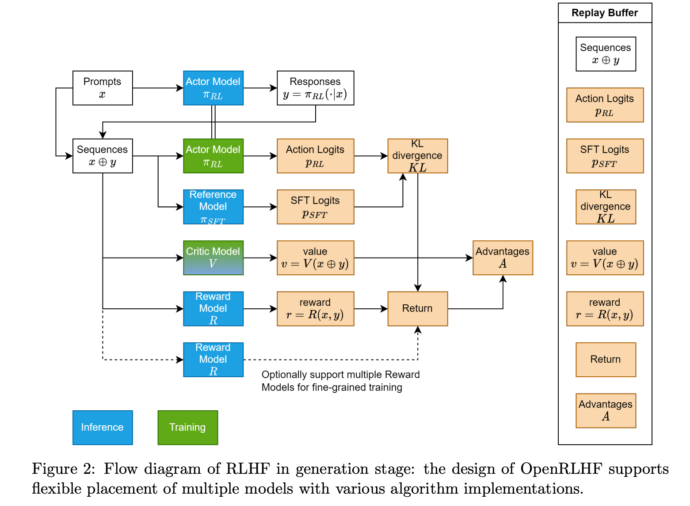
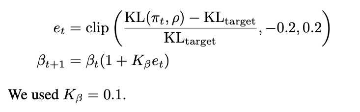
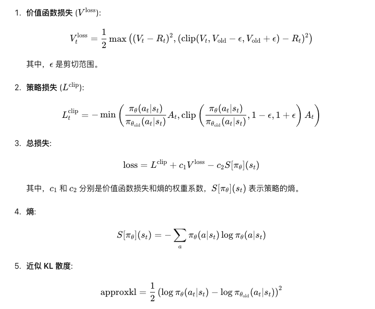

# TRL RLHF PPOTrainer 与 OpenRLHF：策略、奖励、优势与更新

本讲要看懂的不是一个新的语言模型结构，而是：语言模型生成一句话之后，怎样用一个外部分数真正更新参数。主线是原课程的33格notebook；其中25格为代码，含空格和仅注释格，均有说明。原文件、历史输出和原文错误都保留，新增分析与实际验证另列。

先打开 [Python注释代码](代码/tutorials/trl_hf/trl_ppotrainer_helloworld_代码注释.py)，再对照 [完整TRL核心类源码](代码/tutorials/trl_hf/PPOTrainer核心源码_代码注释.py)。[所有单元的原文与解释](代码单元解释.md) 包括Markdown中的不完整函数摘录；源码阅读版给出完整PPOTrainer类及支持函数，避免把摘录误当成可运行实现。

## 1. 阅读边界、论文与代码地图

固定课程仓库提交为7fbc29824171fd07dc2c30fe922e61ebc018ad1d，主文件是tutorials/trl_hf/trl_ppotrainer_helloworld.ipynb。本讲没有把同目录的IMDB实战、DPO或前面第16讲重复收为新讲。找到对应字幕cfebaaee-f078-4e1d-9bbe-374686097bf3.txt，仅在本地保存；自动字幕中的术语和数学口述不能替代源码。

| 原始材料 | 本讲读哪里 | 解决的问题 |
|---|---|---|
| [PPO论文v2](https://arxiv.org/abs/1707.06347v2)，2017 | §2背景、§3式(7) clip surrogate、§4 penalty、§5训练循环 | 同一批经验多次更新时，如何限制过大的策略变化 |
| [Fine-Tuning Language Models from Human Preferences v2](https://arxiv.org/abs/1909.08593v2)，2020修订 | §2.2奖励与相对固定语言模型的KL、自适应系数 | 把外部偏好分数和语言分布约束结合 |
| [OpenRLHF技术报告v1](https://arxiv.org/abs/2405.11143v1)，2024 | §2、Figure 1/2、Table 2与Appendix A | 四个模型如何调度、生成与训练怎样拆开 |
| [TRL v0.8.6](https://github.com/huggingface/trl/tree/v0.8.6) | trainer/ppo_trainer.py、ppo_config.py、models/modeling_value_head.py、core.py | 原notebook旧接口的实际行为 |
| [OpenRLHF历史提交](https://github.com/OpenRLHF/OpenRLHF/tree/fbc1eab137c18651b28e1fa8d9b01c592e130b41) | trainer/ppo_utils/experience_maker.py、models/utils.py、models/loss.py | 与TRL同一数学骨架的另一套工程实现 |

OpenRLHF提交选择规则是2024-06-01之前最后一个提交，日期2024-05-25；用于与v1报告的时代背景对照，**没有证据证明它就是讲师运行的版本**。TRL0.8.6是本次明确锁定的可验证旧接口版本，也不能反推讲师当时精确依赖。下载的三篇PDF保存在本地资料，不冒充课程自带论文或译本；没有生成中文论文PDF。

TRL仓库入口可以从examples/hello_world.py理解；本课程入口是notebook本身，没有单独CLI训练脚本、配置YAML或真实偏好数据集。数据是一条手写prompt，奖励是常数1。模型从GPT2构造；真正的loss、optimizer和checkpoint机制藏在库里。执行链应这样读：

~~~text
notebook导入与配置
  -> 两份CausalLMWithValueHead + tokenizer
  -> PPOTrainer.__init__ / Accelerate准备Adam
  -> tokenizer.encode(prompt)
  -> PPOTrainer.generate -> base language model.generate
  -> 外部score（这里人工给1）
  -> step -> prepare_model_inputs -> batched_forward_pass
  -> compute_rewards -> compute_advantages
  -> 固定rollout数据 -> ppo_epochs循环
  -> 新前向 -> loss -> train_minibatch -> backward/optimizer.step
  -> 统计/更新beta -> 下一轮新rollout
~~~

OpenRLHF的入口与数据流为examples/train_ppo.py或train_ppo_ray.py → prompts dataset → Actor/Critic/Reward/initial model → ExperienceMaker → ReplayBuffer → PPOTrainer更新。其tokenizer、模型构造、Ray、DeepSpeed、vLLM和分布式配置是工程层；本讲保留并注释完整make_experience，但没有在Windows CPU启动这条分布式训练链。不能因纯数学函数通过，就声称OpenRLHF框架训练已经复现。

## 2. 为什么需要四个角色【必须会】

一条生成轨迹的状态是prompt与已生成前缀，动作是下一个token。令prompt为$x$，response为$y=(y_1,\ldots,y_T)$，则$s_t=(x,y_{<t})$、$a_t=y_t$。语言模型每一步给一个词表分布，抽样后把新token接到前缀上。

| 角色 | 输出与shape | 是否训练 | 旧TRL中的对象 |
|---|---|---|---|
| Actor / policy | logits，float32 $[B,L,V]$ | 是 | model.pretrained_model |
| Critic / value | 每个状态的标量，$[B,L]$ | 是 | model.v_head，复用Actor hidden states |
| Reference / SFT | 同一序列的logits/logprob | 在此更新中不优化 | model_ref；其value head不用 |
| Reward Model | 每条完整回答的score，$[B]$ | PPO中通常固定 | 本例未建模型，外部list里的常数tensor替代接口 |

四个角色不必等于四份完全独立的参数。TRL此例将actor和critic共享语言模型骨干，另加value head；OpenRLHF可以将actor、critic分成不同模型/设备。分数告诉模型这次回答怎么样；value估计从当前前缀出发将得到多少后续收益，两者不能互换。

**还要单独区分old policy与reference policy。** Reference通常在整个RLHF阶段固定，是SFT基准。old policy是本轮生成这些样本时的策略；在一次step的多个PPO epoch内，用缓存old_logprobs表示它，而不是再维持一份每个epoch拷贝的模型。下一批rollout的old又会变。

本次在第一轮4次更新之后，重算同一输入：当前策略与固定ref的最大logprob差约0.004940；把当前策略当下一轮行为策略时，new/old概率比严格为1。若错误拿ref作分母，概率比偏离1约0.004952。两者第一轮初始参数相同时看似相同，更新后就分开了。

## 3. 从Python语法到模型对象【必须会】

class表示定义有状态的对象，__init__初始化属性；nn.Module会登记子模块及Parameter，供优化器与state_dict遍历。super().__init__()先初始化父类。包装器包含pretrained_model和v_head，而不是把语言模型原输出换成分数。调用model(...)会进入Module的调用机制，再调用forward。

ValueHead用Linear(H,1)，先对每个位置的hidden state做相同线性变换：

$$v_{b,i}=w^T h_{b,i}+c,\quad h\in\mathbb R^{B\times L\times H},\ w\in\mathbb R^H.$$

其参数有$H+1$个。**输入是hidden states，不是50257维词表概率。** 线性层先得到$[B,L,1]$，squeeze(-1)只去掉最后单例轴；即使$B=1$也保留batch维。包装器的forward返回(logits, loss, values)；无labels时LM loss通常为None。本例的PPO不直接使用这个loss。

with torch.no_grad()关闭自动微分记录；eval()关闭dropout等训练行为，两者作用不同。detach()把旧优势或target从计算图分离，不是将数值变零。装饰器@torch.no_grad()把同样的上下文应用到函数调用。源码里的**kwargs是关键字字典解包，*args是位置参数解包；不要把它们当tensor广播。

原第15格的PPOConfig(**ppo_config)等价于显式传mini_batch_size=1和batch_size=1。其余配置未写，依然生效：

| 字段 | TRL0.8.6默认值 | 本例的意义 |
|---|---|---|
| learning_rate | 1.41e-5 | Adam更新步长 |
| ppo_epochs | 4 | 同一条rollout经验反复优化4轮 |
| gamma / lam | 1 / 0.95 | GAE折扣与衰减 |
| cliprange / cliprange_value | 0.2 / 0.2 | policy概率比裁剪、value相对旧value裁剪 |
| vf_coef | 0.1 | critic loss权重 |
| init_kl_coef / target / horizon | 0.2 / 6 / 10000 | 初始偏离惩罚系数、目标KL、调节时间尺度 |
| whiten_rewards | False | 默认不对白化奖励启用额外支路 |
| log_with | None | 本notebook无需登录wandb |

这里batch_size=1是1条经验，不是每条只有1个token。本次有20个response token，优势白化仍能有多个有效元素；若只有1个有效动作，旧masked_var的无偏校正会出现NaN。

### 本讲核心API怎样调用

下表的方法均归PPOTrainer所有；self指保存config/model/optimizer等状态的实例，不是额外手动传入的tensor。

| 方法/函数 | 输入、默认值与返回 | 状态与调用位置 |
|---|---|---|
| PPOTrainer.generate | query_tensor可为一维tensor或一维tensor列表；旧API return_prompt默认True，本例显式False；另有length_sampler=None、batch_size=4等参数 | 使用actor生成，返回ID或ID列表；本例list路径，不优化参数 |
| step | queries/responses为等长的外层list，内层int64[Q]/[T]；scores为tensor列表；response_masks=None | 返回统计dict，修改actor/optimizer/beta；主训练入口 |
| prepare_model_inputs | queries/responses列表 → input_ids、attention_mask等字典 | 拼接/补齐并搬到当前device，不更新权重 |
| batched_forward_pass | model、queries、responses、model_inputs；return_logits=False、response_masks=None | 返回(logprobs,logits或None,values,masks)，按mini_batch切块；内部model.eval改变模式 |
| compute_rewards | scores[B]、两份logprob[B,L-1]、masks同形 | 返回(rewards,non_score_rewards,kls)；读当前beta，不做optimizer更新 |
| compute_advantages | values/rewards/mask均[B,L-1] | 返回(masked旧values,白化且detach的advantages,未白化returns) |
| loss | old_logprobs、旧values、新logits、新vpreds、新logprobs、mask、advantages、returns | 返回policy loss、已加权value loss及诊断dict；只构图不调用step |
| train_minibatch | 上述本mini batch的旧/新量和target | backward、可选梯度裁剪、Adam step、清梯度，返回统计 |
| AdaptiveKLController.update | current标量KL、n_steps经验条数 | 修改控制器value即beta；返回None |
| ValueHead.forward | hidden_states浮点[B,L,H] | 返回[B,L,1]；包装器再squeeze成[B,L] |
| core.logprobs_from_logits | logits[B,N,V]、labels[B,N]，gather=True | 纯函数；gather=False返回全词表log分布 |

源码阅读版保留完整类的其他方法和分支；本表覆盖主例路径，不把未执行的PEFT/encoder-decoder/DeepSpeed分支列成已验证接口。

## 4. 编码、生成与shape流【必须会】

主例字符串末尾带空格：This morning I went to the 。真实GPT2 BPE编码为7个ID；tokenizer.pad_token=tokenizer.eos_token仅让padding复用EOS ID 50256，词表仍50257。padding与真实EOS同ID时，靠attention_mask区分，不能简单把所有50256位置清零。

~~~text
str prompt
 -> GPT2Tokenizer.encode(return_tensors='pt') : int64[1,7]
 -> list(query_tensor)                       : list长度1，元素int64[7]
 -> PPOTrainer.generate(return_prompt=False): list长度1，元素int64[T]
 -> 本次T=20（不保证其他seed总是20）
 -> cat(query,response)                      : int64[27]
 -> collator                                 : input_ids/attention_mask[1,27]
 -> wrapped model                            : logits[1,27,50257], values[1,27]
 -> shift + log_softmax + gather              : logprobs[1,26]
 -> values[:,:-1] 与 response mask            : [1,26]
~~~

generate的max_new_tokens=20是上限，EOS可能提前结束。do_sample=True随机抽样，top_k=0、top_p=1关闭两种截断。生成用当前actor，不用ref，不执行optimizer.step。return_prompt=False的返回内容已经排除prompt；本讲再拼接一次query是正确的，与第16讲return_prompt=True导致重复query的情况不同。

第21格list(query_tensor)沿batch维拆成一维tensor列表。query_tensor[0]依然是一维Tensor，而不是标量ID。step外层list是为了容纳不等长序列。

### 为什么要shift？

模型位置$i$的hidden state已经看过input_ids[i]，它预测下一个ID。因此取logits[:,:-1,:]对input_ids[:,1:]。令$z_{b,i,v}$是预测第$i+1$个token的logit，先做：

$$\ell_{b,i,v}=z_{b,i,v}-\log\sum_{u=0}^{V-1}\exp z_{b,i,u},\quad
\ell_{b,i}=\operatorname{gather}_v(\ell_{b,i,v},\mathrm{ID}_{b,i+1}).$$

第一个$\ell$是$[B,L-1,V]$，gather之后是$[B,L-1]$。例如概率[0.25,0.75]且下个ID为1，选出的logprob为$\log0.75$，不是返回整个概率向量。代码对应TRL core.logprobs_from_logits。本次手算log_softmax/gather与库输出逐元素相同。

当Q=7时，第一个response动作在shift数组第Q-1=6位。mask有效区间是[6,26)，共20个位置；前面的prompt预测、末尾padding都不进PPO损失。源码docstring有时把它概括成response_length，但实际返回保留整个L-1轴，必须结合mask理解。

### 左右padding不是只有mask一件事【建议会】

用两条不同长度的样本实测，两侧padding的有效动作数都是[5,3]。右padding时batch与逐条运行logprob相同；旧TRL0.8.6这条forward路径没有显式补position_ids，GPT2的左padding使短样本位置编号偏移，差约0.058259。独立补充用attention_mask.cumsum(-1)-1构造有效位置编号，padding位置设0，再前向核对恢复一致（具体误差见验证记录）。这是对原路径的另一个诊断，未偷偷修改原notebook，也不代表所有模型/新版TRL都有同一行为。

## 5. score怎样变成逐token reward【必须会】

Reward Model通常只给整个回答一个分数$S_b$，但policy按动作更新；同时我们希望限制它远离固定reference。默认kl分支先算：

$$k_{b,t}=\log\pi_{\mathrm{old}}(a_{b,t}|s_{b,t})-\log\pi_{\mathrm{ref}}(a_{b,t}|s_{b,t}),$$
$$r_{b,t}=-\beta k_{b,t}+\mathbf1[t=t_b^{\mathrm{last}}]S_b.$$

所有token项shape均为$[B,L-1]$，$S$是$[B]$，$\beta$是标量。scores是step的外部输入，PPOTrainer不要求内部持有一个Reward Model。本例用[torch.tensor(1.0)]，只验证接口，没有学到“哪种回答更好”。

这个$k$只是已采样动作的log比，**逐项可以为负**。对当前/rollout策略采样、在相应条件下求期望才对应KL；它不是每条样本非负的精确分布KL。full分支才传全词表log分布并对词表求和；abs、mse则是另外的惩罚选择，不能统称相同的KL估计。

数值例：某个有效动作old logprob=-1，ref=-0.7，则k=-0.3、beta=0.2，非score奖励为+0.06。最后有效动作old=-0.5、ref=-0.6，k=0.1，加整句S=1后reward=0.98。**分数只注入最后一个有效动作一次**，不是每个token都加1；否则长回答会平白得到更多外部分数。实现是compute_rewards中的mask.nonzero()[-1]。

注意：TRL compute_rewards的返回数组在mask外仍可能有非零KL奖励；随后compute_advantages乘mask，统计/损失也用mask。OpenRLHF所选历史compute_approx_kl在更早一步就乘action_mask，因此只有有效位置的结果可以直接对照。

自适应控制器调节下一轮beta：

$$e=\operatorname{clip}(\mathrm{KL}/\mathrm{target}-1,-0.2,0.2),\quad
\beta_{\mathrm{new}}=\beta\left(1+e\frac{n_{\mathrm{steps}}}{\mathrm{horizon}}\right).$$

target=6、horizon=10000、beta=0.2，观测KL=12、n_steps=100时，相对误差1被截成0.2，beta变为0.2004。再给KL=0和100步，beta约0.1999992。截断的是相对误差，beta自身不是KL值；目标不是强制每次精确等于6。原2019论文图的$K_\beta=0.1$与TRL此处n_steps/horizon的尺度约定应分开读。

## 6. GAE把末尾分数传回前面的动作【必须会】

如果只给最后一个token分数，前面的选择如何得到训练信号？Critic估计前缀状态的未来价值；TD残差与GAE把后续收益传回来：

$$\delta_t=r_t+\gamma V_{t+1}-V_t,\qquad
\hat A_t=\delta_t+\gamma\lambda\hat A_{t+1},\qquad
\hat R_t=\hat A_t+V_t.$$

$r_t$是上节形状奖励；$V_t$是rollout阶段的旧value；$\gamma$折扣未来收益，$\lambda$衰减更远的TD残差。逐时刻项是$[B]$，堆叠后$[B,L-1]$。最后一个有效终止动作的后继value设为0。若处理的是环境截断而非真正终止，bootstrap策略要另行设计；本例不能直接证明任意截断任务处理正确。

取三动作V=[0.2,0.4,0.1]、r=[0,0,1]、gamma=1、lambda=0.95。delta=[0.2,-0.3,0.9]。从右往左：A3=0.9，A2=-0.3+0.95×0.9=0.555，A1=0.2+0.95×0.555=0.72725。于是returns=[0.92725,0.955,1]。即使前两个即时reward为0，仍能得到正优势。

旧TRL先用**未白化**A算returns，再masked_whiten(A)供policy loss使用，最后detach优势。白化近似$(A-\bar A)/\sqrt{\mathrm{Var}(A)+10^{-8}}$，只统计有效token，并使用无偏方差校正。不能先白化再把它当critic回归目标。本次独立手算、真实TRL以及抽取的完整OpenRLHF GAE方法核对一致；OpenRLHF此方法返回raw A，标准化位于其他流程。

原代码先把mask外value/reward归零再沿完整轴递推；mask外优势不一定为0，真正的目标仍靠mask筛选。目标是当前这批经验的数据，不是经过反传继续更新的另一个网络。

## 7. PPO的loss究竟在限制什么【必须会】

将rollout固定之后，mini batch会用正在变化的actor重新前向，得到new logprob。定义概率比：

$$\rho_t(\theta)=\exp(\log\pi_\theta(a_t|s_t)-\log\pi_{\mathrm{old}}(a_t|s_t)).$$

这里分母是**缓存old_logprobs**，不是ref。这是同一动作的新旧概率比，shape仍$[B,L-1]$，不是一整句概率直接相除。log差有助于数值稳定，但exp依然可能溢出，不是万能防溢出方法。

PPO论文式(7)最大化clip surrogate；代码用负号改为最小化：

$$L_{\mathrm{policy}}=-\operatorname{masked\_mean}\left[
\min\left(\rho_t\hat A_t,\operatorname{clip}(\rho_t,1-\epsilon,1+\epsilon)\hat A_t\right)\right].$$

实现先算两份负loss，再取max；与先min再取负号等价。正优势时希望提高这个动作的概率，过上界后这条奖励支路变平；负优势时希望降低概率，过下界后变平。不是无论优势正负都单独裁掉ratio后直接使用。

令epsilon=0.2，有四个有效动作：

| rho | A | 单动作policy loss | 对new logprob的导数（未除4） |
|---|---|---|---|
| 1.3 | +1 | -1.2 | 0 |
| 0.7 | +1 | -0.7 | -0.7 |
| 1.3 | -1 | +1.3 | +1.3 |
| 0.7 | -1 | +0.8 | 0 |

平均loss=0.05，梯度=[0,-0.175,0.325,0]，已由真实TRL loss.backward核对。clip只是目标的一部分变平，**没有硬保证所有动作的新策略KL或概率比都留在区间内**；共享参数、其他动作和value loss仍会影响模型。

critic使用裁剪回归：

$$\tilde V_t=\operatorname{clip}(V_\theta(s_t),V_t^{\mathrm{old}}-\epsilon_v,V_t^{\mathrm{old}}+\epsilon_v),$$
$$L_{\mathrm{value}}=\tfrac12\operatorname{masked\_mean}\max\left[(V_\theta-\hat R)^2,(\tilde V-\hat R)^2\right],\quad
L=L_{\mathrm{policy}}+c_vL_{\mathrm{value}}.$$

$\hat R$固定，$V_\theta$来自新前向；c_v=0.1。比如旧value=0、target=1、新value=0.9，普通平方误差0.01，而clip value=0.2的平方误差0.64，所以加权loss=0.1×0.5×0.64=0.032。这条悲观目标阻止“仅靠越过裁剪边界”获得过低value loss。

loss方法返回的第二项**已经乘vf_coef**；train_minibatch只把两个返回loss相加，不能再乘一次。代码另记录entropy、approxkl、clipfrac等统计；原图片展示含熵bonus的一般形式，**本版本的实际loss没有默认再加entropy bonus**。ratio过大时还有ratio_threshold跳过支路，这是工程保护，不是公式自带严格保证。

train_minibatch调用accelerator.backward、optimizer.step、zero_grad。一个step按照ppo_epochs=4，实际执行4次Adam更新；actor骨干和value head都变了，reference的全部state不变。这里显式传入的ref参数requires_grad属性实测仍为True，但ref前向在no_grad下、optimizer里没有ref参数，梯度未用于更新。不能仅看requires_grad推断“ref被训练”。

## 8. 三张原图怎样读【建议会】

从左上prompt开始，蓝色Actor生成response；接着把x与y拼接。拼接序列分别送入Actor、Reference、Critic、Reward四条支路。橙色框是中间量，无需训练独立“KL网络”或“advantages网络”。KL和整句score形成token reward，再结合value算GAE与returns；图用Return概括收益处理，不等于TRL变量rewards与returns可以互换。虚线Reward表示可选多个评分器，不是默认每个实验一定有多个。

右侧Replay Buffer保存sequence、旧action logprob、value、reward、returns、advantages等经验，供当前若干PPO epoch复用。图上写Action Logits，实际缓存动作logprob时要区分原始词表logits与gather后的数值。RLHF PPO通常需要不断刷新行为策略数据，不能据“Replay”一词推断能无限使用陈旧离线回答。

蓝/绿分别表示图里的推理/训练角色；actor在生成和优化两处画出并不意味着默认有两份互不相干、无需同步的权重。OpenRLHF为了vLLM生成可有另一个引擎，需要同步训练权重。TRL本例则是同一个包装器调用generate/forward。

先算相对target误差，clip到±0.2，再乘增益更新beta。这不是反向传播网络；没有可训练的KL head。

第一支critic回归，第二支clip policy，第三行是可能带熵奖励的一般总目标，最后是诊断量。看图必须回到本版本loss：该实现总目标只有policy和加权value两支，不能把图里所有项自动加入代码。

## 9. OpenRLHF对应关系与框架差异【建议会】

完整历史函数见 [OpenRLHF核心源码注释](代码/tutorials/trl_hf/OpenRLHF核心源码_代码注释.py)。阅读副本省略imports，不作为替代库执行；验证脚本把**原AST中的纯数学函数/类**放入真实torch命名空间执行，没有伪造ray、deepspeed或模型。含CUDA和模型调度的make_experience仅静态核对，未执行。

| TRL0.8.6 | 所选OpenRLHF历史源码 | 共同作用/差别 |
|---|---|---|
| prepare_model_inputs/generate | NaiveExperienceMaker.make_experience | 后者独立Actor/Critic/RM/initial_model，且原函数硬编码cuda |
| ref_model | initial_model | 固定SFT基准 |
| batch_dict.logprobs | Experience.action_log_probs | 本轮rollout旧概率，用于PPO ratio |
| compute_rewards | compute_approx_kl / compute_reward | 默认都是sample log比；OpenRLHF更早mask，且score截到[-10,10] |
| compute_advantages | get_advantages_and_returns | raw GAE和returns一致，白化位置不同 |
| loss | PolicyLoss / ValueLoss | 单序列或等长条件可核对；batch归约方式有差别 |

不能因为公式相同就断言训练完全等价。本次score=20时OpenRLHF截到10，TRL默认保留20；末位置差10。再给长度2、1两条response，单token损失分别[1,3]和[9]：TRL全有效token平均得13/3≈4.3333；历史OpenRLHF先每序列平均再batch平均得(2+9)/2=5.5。长短样本的权重不同，即使其余参数都一致，梯度也会改变。两个差异都有真实函数执行证据。

OpenRLHF v1的系统贡献是将生成与训练引擎及四模型调度拆开。其Table 2按1024 prompts、1 PPO epoch统计秒数，7B在16张A800上：DSChat 855.09s、OpenRLHF 471.11s，减少383.98s，约44.9%，比值约1.82。Appendix A记录两系统的分配/offload/微批配置并不完全相同，因此是所报告工程配置的端到端性能比较，不能拿来证明CPU数学函数更快、语言质量更高或任意硬件都1.82倍；本次完全未复现该性能实验。

PPO原论文的MuJoCo/Atari任务用于比较策略优化，不是语言模型RLHF成绩。本讲没有把那些分数移植到GPT2，也不凭一次常数奖励更新声称偏好质量提升。2019语言偏好论文同时指出人类反馈可能鼓励表面行为；score可优化不等于真实质量已对齐。

## 10. 实际验证与错误定位

结果见 [复现说明](复现/README.md)。本次执行使用Python3.12.14、torch2.5.1+cpu、Transformers4.44.2、TRL0.8.6和真实GPT2词表50257。一层、H=16、2 heads、上下文64的随机GPT2加17参数value head，共808465参数；外置seed27，checkpoint初始化seed270。不是预训练GPT2权重。

每版25代码格中，22格按原语句执行（含空/仅注释格），7/12两格仅三个gpt2加载字符串替换为同一个临时本地资产路径；0格代理/NCCL设置跳过，其Image导入在外部提供。**没有声称25格原样全部执行**。两版输出、训练统计（排除墙钟耗时）及最终全部active/ref状态相同；两版各4次真实Adam更新，骨干与value head变化、ref不变、optimizer参数只含active可训练参数。checkpoint实际保存重载后，基础权重/value head以及logits/value精确相同，临时权重不公开。

额外诊断覆盖shift/gather、mask边界、old/ref区别、sample/full KL、末token score、GAE/白化、policy/value裁剪和梯度、beta更新、不同长度padding、OpenRLHF归约/score裁剪差异。注意以下真实边界：

- B=1时ppo/std_scores、queries_len_std和responses_len_std使用无偏样本标准差，得到NaN；这些是统计量，不是证明本次训练loss为NaN。记录保留含义，JSON用明确字符串表示未定义统计。
- 有效mask全零时compute_rewards找不到最后位置，实际IndexError；scores写Python float而非tensor时安全检查报ValueError。
- masked_var只有1个有效token时N/(N-1)导致NaN；不能因为batch有一条样本，就假定必失败，关键是有效token数。
- 左padding实际差异与独立position_ids修正分开记录；原文件没有悄悄修正。
- 保存含value head的checkpoint重新加载时，基础GPT2加载阶段会提示v_head键不用；随后TRL包装器恢复head。已实际比较全部状态，不能只据这条提示判断head丢失。

初次整理复制了上游工作树CRLF notebook，字节审计发现它与固定Git blob不同；改为直接读取Git对象原字节后通过。源码方法抽取时也修复了会改变docstring内部空格的通用dedent；随后用AST核对完整对象。验证工具最初误认为基础state_dict键都带pretrained_model前缀，以及beta断言混用float32/float64，这些是验证器错误，已更正并重新完整执行，不是模型或论文错误。没有删掉失败边界，也没有把原训练效果夸大为完整复现。

## 必须掌握

1. 固定reference与本轮old policy各做什么，ratio和KL各自用哪个分母。
2. query/response拼接、next-token shift、gather和response mask的Q-1边界。
3. 整句score只加到最后有效动作，sample log比可负。
4. Critic从hidden state预测value，GAE递推、returns先于优势白化。
5. clip loss的正负优势分支、value loss加权、一次step多次optimizer更新。

## 第二遍知识

【建议会】自适应beta、sample/full KL区别、原图中的熵项与本版本实际目标的区别、非等长样本的token平均/序列平均、左padding位置编号、checkpoint包装器恢复，以及统计NaN与训练失败的区别。

## 可以暂时不掌握的工程细节

【可以暂时不掌握】Ray资源放置、DeepSpeed ZeRO/offload、vLLM engine与训练Actor权重同步、多机NCCL、PEFT禁用adapter作为ref的支路。源码保留这些分支，但本次没有运行或声称验证所有分支。

## Paper ↔ Code

| 论文/概念 | 精确代码对象 | 验证边界 |
|---|---|---|
| PPO v2 §3式(7) | PPOTrainer.loss；OpenRLHF PolicyLoss.forward | 四分支、真实梯度通过 |
| PPO §5 actor/critic联合优化 | PPOTrainer.train_minibatch / step | 小GPT2各4次Adam，非论文任务实验 |
| 2019语言偏好KL-shaped reward | compute_rewards / _kl_penalty | sample可负、full手算、终止score通过 |
| 2019 §2.2 beta控制 | AdaptiveKLController.update | 高/低KL真实更新通过 |
| GAE | compute_advantages / get_advantages_and_returns | 三步手算与真实函数通过；GAE独立论文全文未在本讲精读 |
| OpenRLHF v1 Figure 2 | NaiveExperienceMaker.make_experience / Experience | 完整源码/图对照；完整方法未运行 |
| OpenRLHF性能调度 | Ray/vLLM/DeepSpeed训练入口 | 未复现分布式运行与Table 2 |
| 真实RM/人类偏好质量 | 原notebook未提供训练RM/偏好评测 | 未找到该主例对应实现，不能用常数score替代结果 |

## 复现状态

**部分成功。** 原件及派生版保真、完整核心源码核对、真实小模型CPU PPO训练和数学诊断成功。原GPT2预训练权重/语言效果、学习到的Reward Model、人类偏好数据、OpenRLHF分布式框架与论文性能/质量实验均未复现。详细命令、配置与证据以复现目录为准。

## 未解决问题与置信边界

没有找到讲师精确环境锁文件，历史权重、随机种子和依赖不能由notebook输出唯一确定。OpenRLHF历史提交是明确选择的对照版本，不是讲师版本认证。源码阅读复制完整对象但省略模块导入，不是可直接替代pip库的工程。没有证明各GPU/混合精度/PEFT/encoder-decoder路径，未评价多轮RLHF质量或长期稳定性。常数1评分不会证明模型变得更符合人类偏好。
