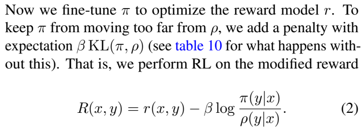
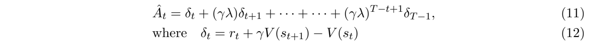
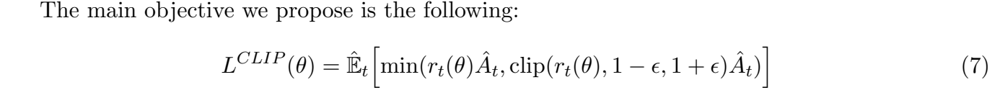
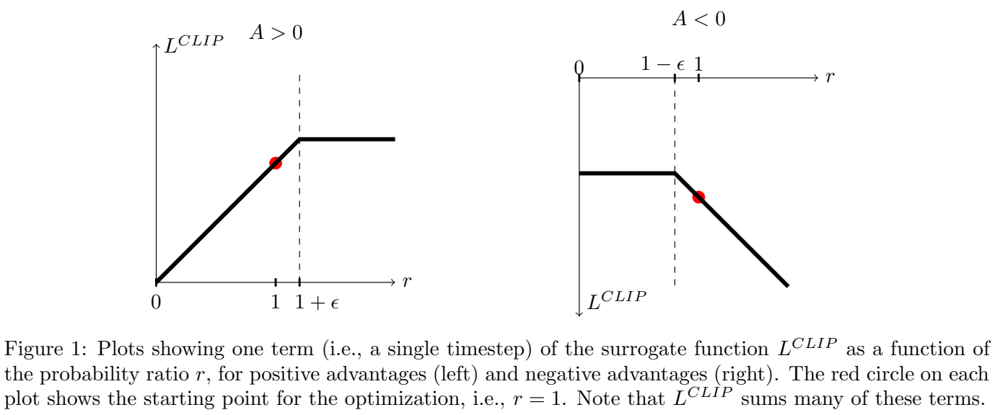
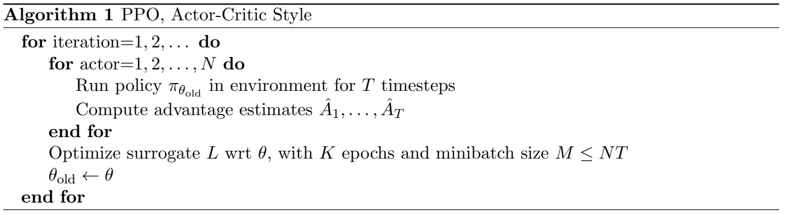
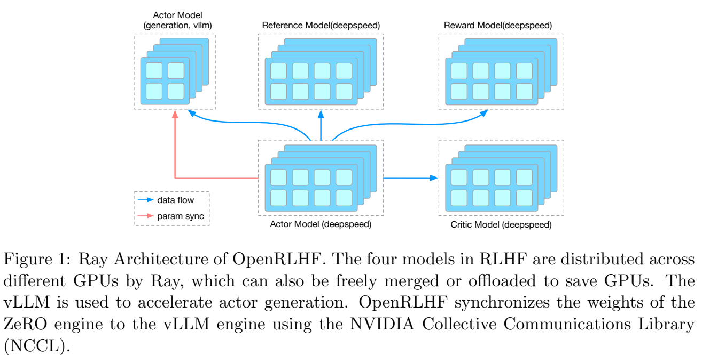

# TRL PPOTrainer 与 OpenRLHF：从回答分数到参数更新

语言模型写出一段回答以后，我们希望它下次更容易写出得分高的回答。PPO负责把“这个回答得了多少分”转换成模型参数的更新。这一讲先看三个生成位置怎样分到训练信号，再对应到原notebook的`generate`和`step`。

## 1. 先看一段回答怎样生成

假设提示词是“今天的天气”，模型接着生成“很”“晴朗”“。”。这里把三个片段当作三个token，便于讨论；真实切分由分词器决定。

| 生成位置 | 模型已经读到的内容，称为状态state | 本次选择的token，称为动作action |
|---|---|---|
| 1 | 今天的天气 | 很 |
| 2 | 今天的天气很 | 晴朗 |
| 3 | 今天的天气很晴朗 | 。 |

模型每次给词表中的候选token计算分数，再用softmax转成概率。例如“很”的概率是0.2，“不”的概率是0.1。**策略policy就是给定当前状态后，选择各个token的概率分布。** 记作$\pi_\theta(a_t\mid s_t)$：$s_t$是第$t$步已读前缀，$a_t$是这一步选中的token，$\theta$是模型参数。

让策略按自己的概率生成回答，并保存各步信息，叫一次**rollout，采样过程**。随后给整段回答一个分数，例如1.0，称为score。这个分数可以来自奖励模型、人类评分或规则。原notebook直接写`torch.tensor(1.0)`，所以这段代码展示的是“怎样把分数接入更新”。要按回答好坏学习，需要把它换成能区分回答的评分方法。

接下来会用到四个角色：

| 角色 | 它回答什么问题 | 输出 | PPO阶段怎样使用 |
|---|---|---|---|
| Actor，策略模型 | 下一步写哪个token？ | 各候选的概率 | 生成回答，随后更新参数 |
| Reference，固定参考模型 | 原来的语言模型给这个token多大概率？ | 同一动作的参考概率 | 为策略偏移提供基准，参数固定 |
| Reward Model，奖励模型 | 整段回答得多少分？ | 每段回答一个score | 评分；本notebook用常数代替它 |
| Critic，价值估计器 | 从当前前缀继续写，预计还能得多少奖励？ | 每个位置一个value | 学习估计收益，帮助actor判断表现 |

TRL本例给actor的隐藏状态接一个value head，因此actor和critic共享语言模型主干。假设隐藏向量宽度为$H$，value head用一个$H\to1$线性层输出一个数。生成token的语言模型头则输出词表大小$V$个分数。两者分别负责“怎样选”和“预计得多少分”。

## 2. 旧策略和固定参考模型，各比较什么

想象我们让模型写出一批回答，然后拿这一批回答练习4轮。回答生成完时，保存每个已选token的概率，称为**old policy概率**。练习中参数逐渐改变，再计算这些相同token的概率，称为**new policy概率**。

例如某个token生成时概率为0.20，更新后是0.26，新旧概率比就是$0.26/0.20=1.3$。它说明：对于同一个前缀，这次更新把该动作的概率提高了30%。old随每一批新rollout刷新；这4轮内部保存的old概率保持固定。

Reference用于另一种比较：现在的策略相对训练起点偏离了多少。它贯穿多批rollout保持固定。把两个比较放到时间线上：

```text
训练起点：保存固定reference
第1批：actor生成 → 保存old概率 → 同批优化4轮
第2批：更新后的actor生成 → 重新保存old概率 → 同批优化4轮
……
reference一直固定；每批old来自生成该批回答时的actor。
```

因此PPO的概率比用new/old；参考模型出现在奖励中的偏移惩罚里。原代码分别把它们保存在`old_logprobs`和`ref_logprobs`中。

## 3. 整句分数怎样成为逐token奖励

先看原论文把偏好分数与参考模型结合的方式。



来源：[Fine-Tuning Language Models from Human Preferences，v2，第3页公式(2)](https://arxiv.org/abs/1909.08593v2)。上面一段话的意思是：优化奖励模型给出的分数时，同时惩罚策略离初始模型太远。式中$x$是提示词、$y$是整段回答，$r(x,y)$是奖励模型分数，$\pi$是正在训练的策略，$\rho$是固定参考分布，$\beta$控制惩罚强度。

自回归模型中，整句概率是各步条件概率的乘积；取log后，整句的log概率比成为逐步log概率比之和。因此代码可以给各个生成位置分配奖励：

$$k_t=\log\pi_{\mathrm{old}}(a_t\mid s_t)-\log\pi_{\mathrm{ref}}(a_t\mid s_t),$$
$$r_t=-\beta k_t+\mathbf1[t=T]S.$$

这里$T$是回答的token数，$S$是整句score，$\mathbf1[t=T]$表示“只有最后一个生成位置取1，其余取0”。$r_t$是每一步的reward。论文式(2)的$r(x,y)$与这里的$r_t$分别表示整句评分和逐步奖励，阅读时按对象区分。

为什么要有log？例如概率从0.1变成0.2，log概率差就是$\log2$；整句中多个动作的变化可以相加。代码默认的`kl`分支用已采样动作的这个log比估计偏离。**单个$k_t$可以为负**；在策略分布下对动作取期望，才得到非负的KL散度。负的一项意味着这一步参考模型反而更偏向所选token。

下面直接用三组log概率计算。`zip`把两个列表按位置配对；`rewards[-1]`访问最后一项。

```python
# 三项分别对应三个生成位置；log概率是概率取自然对数的结果。
old_logp = [-0.2, -1.0, -0.5]
reference_logp = [-0.4, -0.7, -0.6]
beta, score = 0.2, 1.0
sample_log_ratios = [p - q for p, q in zip(old_logp, reference_logp)]
rewards = [-beta * k for k in sample_log_ratios]
rewards[-1] += score  # 整句分数只加在最后一个生成位置。
print([round(x, 3) for x in sample_log_ratios])
print([round(x, 3) for x in rewards])
```

输出为`[0.2, -0.3, 0.1]`与`[-0.04, 0.06, 0.98]`。三项reward之和是1：外部分数1，加上这一例总和恰为0的偏移项。如果每个位置都加一次score，外部分数会变成3，回答长度也会影响分数含义。

原课程还展示了自适应$\beta$：测得偏移大时，提高下一批的惩罚；偏移小时，降低惩罚。


图中的$e_t$先计算实际KL相对目标KL的误差，再截到$[-0.2,0.2]$；下一行乘到原系数上。TRL中对应`AdaptiveKLController.update`，更新形式为$\beta\leftarrow\beta(1+e\,n/\mathrm{horizon})$，其中$n$是这次经验条数。以$\beta=0.2$、目标6、实际12、$n=100$、horizon=10000为例，误差截成0.2，得到新系数0.2004。这是逐批调节的反馈过程。

## 4. Value、return和advantage，用三个位置算一遍

只有最后一步加整句分数，前面的动作怎样得到信号？关键在于把“后面可能拿到的奖励”传回当前位置。

**Value，价值估计**是critic给当前前缀的预计收益。**Return，收益目标**是由这批实际奖励算出的训练目标。**Advantage，优势**衡量这次收益相对原价值估计好多少。比如原本预计0.4分，这次形成的目标是0.955分，优势就是0.555分。

为了先看清传递过程，这里让参考惩罚为0，三步reward取`[0,0,1]`，旧value取`[0.2,0.4,0.1]`。这与上一节带惩罚的例子分开计算。



来源：[PPO，v2，第5页公式(11)–(12)](https://arxiv.org/abs/1707.06347v2)。式(12)先算一步差值：

$$\delta_t=r_t+\gamma V_{t+1}-V_t.$$

$V_t$是采取当前动作前的估计，$V_{t+1}$是进入下一个前缀后的估计，$\gamma$是未来收益的折扣。最后一个位置按这段序列结束处理，后继value取0。$\delta_t$比较“这一步收到的奖励加下一状态估计”和“原先估计”。

式(11)把当前与后续差值按$(\gamma\lambda)$的幂次加起来。写成递推式更适合实现：

$$A_t=\delta_t+\gamma\lambda A_{t+1},\qquad R_t=A_t+V_t.$$

$\lambda$控制更远的差值传回多大比例，末尾的$A_{T+1}=0$。取原配置的$\gamma=1,\lambda=0.95$：

| 位置$t$ | $r_t$ | $V_t$ | $V_{t+1}$ | $\delta_t$ | 从右往左得到$A_t$ | $R_t=A_t+V_t$ |
|---|---|---|---|---|---|---|
| 1 | 0 | 0.2 | 0.4 | 0.2 | $0.2+0.95\times0.555=0.72725$ | 0.92725 |
| 2 | 0 | 0.4 | 0.1 | −0.3 | $-0.3+0.95\times0.9=0.555$ | 0.955 |
| 3 | 1 | 0.1 | 0 | 0.9 | 0.9 | 1.0 |

第2步的即时差值虽然为负，末尾的好结果传回来后，其优势仍为正。GAE是Generalized Advantage Estimation，广义优势估计，正是在做这件事。

```python
import math

values = [0.2, 0.4, 0.1]
terminal_rewards = [0.0, 0.0, 1.0]
gamma, lam = 1.0, 0.95
raw_advantages = [0.0] * 3
last_advantage = 0.0
for t in reversed(range(3)):  # 按2、1、0的顺序，从末尾计算。
    next_value = values[t + 1] if t < 2 else 0.0
    delta = terminal_rewards[t] + gamma * next_value - values[t]
    last_advantage = delta + gamma * lam * last_advantage
    raw_advantages[t] = last_advantage
returns = [a + v for a, v in zip(raw_advantages, values)]
# TRL用原始优势构造return，再标准化优势供策略损失使用。
mean_a = sum(raw_advantages) / 3
sample_var = sum((a - mean_a) ** 2 for a in raw_advantages) / 2
whitened = [(a - mean_a) / math.sqrt(sample_var + 1e-8)
            for a in raw_advantages]
print([round(a, 5) for a in raw_advantages])
print([round(r, 5) for r in returns])
print([round(a, 5) for a in whitened])
```

前两行是`[0.72725,0.555,0.9]`与`[0.92725,0.955,1.0]`。标准化，又称这里的whitening，是减去均值、除以标准差，使有效位置的优势尺度比较稳定。该版本用无偏样本方差，所以分母是$3-1=2$。标准化后的正负号表达相对这批动作均值的高低。

`compute_advantages`最后对优势调用`detach()`，将它作为本批固定目标。Actor更新时根据这份目标调整概率；critic则拟合未标准化的return。它们共享主干，但各自有对应的损失。

## 5. PPO怎样控制同一批回答的多次更新

先算相同动作的新旧概率比：

$$\rho_t=\frac{\pi_\theta(a_t\mid s_t)}{\pi_{\mathrm{old}}(a_t\mid s_t)}
=\exp(\mathrm{new\_logprob}_t-\mathrm{old\_logprob}_t).$$

这里用$\rho_t$表示概率比，以便和reward的$r_t$区分；原PPO论文把概率比写作$r_t(\theta)$。

优势为正时，提升动作概率会提高$\rho_t A_t$；优势为负时，降低动作概率会改善这个目标。如果反复沿同一个方向优化，变化可能过大。PPO用clip给这个目标增加平坦的一段。



来源：[PPO，v2，第3页公式(7)](https://arxiv.org/abs/1707.06347v2)。$\hat{\mathbb E}_t$表示对本批采样位置求平均；$\hat A_t$是估计优势；$\epsilon$为裁剪范围，这里取0.2。`clip(x,0.8,1.2)`将小于0.8的数改为0.8、大于1.2的数改为1.2，中间保留。公式比较原目标和裁剪目标，取较小者，整体希望越大越好。



同页Figure 1的横轴是概率比，纵轴是希望最大化的目标，红点表示更新起点$\rho=1$。左图$A>0$时，超过$1+\epsilon$后曲线变平；右图$A<0$时，低于$1-\epsilon$的一侧变平。这样，沿已经足够有利的方向继续改变概率，这一项就不再提供额外收益。

PyTorch优化器通常最小化loss，因此代码在公式前加负号。四种情况放在一起看：

| 概率比 | 优势 | 原目标$\rho A$ | 裁剪目标 | 取min，再取负得到单项loss |
|---|---|---|---|---|
| 1.3 | +1 | 1.3 | 1.2 | −1.2 |
| 0.7 | +1 | 0.7 | 0.8 | −0.7 |
| 1.3 | −1 | −1.3 | −1.2 | +1.3 |
| 0.7 | −1 | −0.7 | −0.8 | +0.8 |

```python
import torch

# requires_grad=True让PyTorch记录后续计算，供backward求导。
new_logp = torch.tensor([[0.26, 0.14, 0.26, 0.14]], dtype=torch.float64).log()
new_logp.requires_grad_()
old_logp_tensor = torch.full_like(new_logp, math.log(0.2))
advantage_tensor = torch.tensor([[1., 1., -1., -1.]], dtype=torch.float64)
ratios = (new_logp - old_logp_tensor).exp()
surrogate = torch.minimum(ratios * advantage_tensor,
                          ratios.clamp(0.8, 1.2) * advantage_tensor)
policy_loss = -surrogate.mean()
policy_loss.backward()
print(round(policy_loss.item(), 6))
print(new_logp.grad.tolist())
```

平均loss为0.05，对new logprob的导数为`[[0,-0.175,0.325,0]]`。负导数使梯度下降提高该log概率，正导数使它下降；两处平坦分支导数为0。Clip作用于目标函数；模型还会受到其他动作及value损失的共同影响，更新后的全部概率比仍可能越过0.8或1.2。

Critic的损失沿类似思路限制value变化。设$V^{old}$是本批采样时的旧估计，$V_\theta$是新估计，$R$是上节收益目标：

$$\widetilde V=\operatorname{clip}(V_\theta,V^{old}-\epsilon_v,V^{old}+\epsilon_v),$$
$$L_V=\tfrac12\operatorname{mean}_{\mathrm{valid}}
\max\big((V_\theta-R)^2,(\widetilde V-R)^2\big).$$

取两种误差中较大的一项，让过大的value变化受到约束。例如旧value为0、目标1、新value0.9，普通平方误差为0.01；裁剪到0.2后误差为0.64，因此这项用0.64。TRL默认总损失为$L_{policy}+0.1L_V$，value裁剪范围为0.2。

## 6. 把模型缩小，沿真实PPOTrainer走一轮

现在让库完成生成、打分接口和更新。下面使用真实GPT2词表、随机初始化的8维小GPT2及TRL 0.8.6。先认识这些对象的职责：

- `GPT2Config`保存结构参数；`GPT2LMHeadModel(config)`按配置建立模型并随机初始化。
- `AutoModelForCausalLMWithValueHead`包装语言模型，增加value head；`create_reference_model`复制并冻结参考模型。
- `PPOConfig`保存训练配置，`PPOTrainer(...)`创建管理模型、分词器、优化器的实例。后续通过`trainer.generate(...)`和`trainer.step(...)`调用它的方法。

在本讲目录运行时，`GPT2_TOKENIZER_JSON`可指向本地GPT2的`tokenizer.json`；默认路径为`资料/gpt2-tokenizer/tokenizer.json`。环境和文件准备见[复现说明](复现/README.md)。

```python
import os
from pathlib import Path
from transformers import GPT2Config, GPT2LMHeadModel, GPT2TokenizerFast
from trl import AutoModelForCausalLMWithValueHead, PPOConfig, PPOTrainer
from trl import create_reference_model

torch.set_num_threads(1)
torch.manual_seed(27)
tokenizer_json = Path(os.environ.get(
    "GPT2_TOKENIZER_JSON", "资料/gpt2-tokenizer/tokenizer.json"))
tokenizer = GPT2TokenizerFast(tokenizer_file=str(tokenizer_json),
    eos_token="<|endoftext|>", pad_token="<|endoftext|>")
model_config = GPT2Config(vocab_size=50257, n_positions=64, n_ctx=64,
    n_embd=8, n_layer=1, n_head=2, resid_pdrop=0., embd_pdrop=0.,
    attn_pdrop=0., summary_dropout_prob=0.,
    eos_token_id=50256, bos_token_id=50256, pad_token_id=50256)
model = AutoModelForCausalLMWithValueHead.from_pretrained(
    GPT2LMHeadModel(model_config))
reference = create_reference_model(model)
config = PPOConfig(batch_size=1, mini_batch_size=1, ppo_epochs=4,
    learning_rate=1.41e-5, seed=27, log_with=None)
trainer = PPOTrainer(config, model, reference, tokenizer)
query = tokenizer.encode("This morning I went to the ", return_tensors="pt")[0]
query = query.to(trainer.accelerator.device)  # 单条int64[7]编号。
response = trainer.generate([query], return_prompt=False,
    min_new_tokens=3, max_new_tokens=3, do_sample=True,
    top_k=0, top_p=1., pad_token_id=50256)[0]
inputs = trainer.prepare_model_inputs([query], [response])
with torch.no_grad():  # 保存本批旧策略数据，不构建反向图。
    rollout_logp, _, rollout_values, response_mask = trainer.batched_forward_pass(
        trainer.model, [query], [response], inputs)
print(query.tolist(), response.tolist())
print(list(inputs["input_ids"].shape), list(rollout_logp.shape))
print(response_mask[0].nonzero().flatten().tolist())
```

这里`[query]`是只有一个张量的列表。不同回答可有不同长度，外层list容纳这些序列。`return_prompt=False`让返回值只包含回答；`prepare_model_inputs`再把提示和回答拼接一次。`with torch.no_grad()`关闭这段计算的梯度记录，保存的张量供同批更新使用。

本例提示有7个token、回答有3个，总输入为`[1,10]`。完整模型返回logits`[1,10,50257]`和values`[1,10]`。取下一个实际token的概率时，要把预测和目标错开一格：

```text
input_ids   : q0 q1 q2 q3 q4 q5 q6 a0 a1 a2
预测位置     :  0  1  2  3  4  5  6  7  8
对应目标     : q1 q2 q3 q4 q5 q6 a0 a1 a2
response_mask:  0  0  0  0  0  0  1  1  1
```

所以`rollout_logp`、`rollout_values`、`response_mask`都为`[1,9]`，mask的有效索引为`[6,7,8]`。Mask是参加计算的位置标记：1参与，0忽略。每个有效logprob通过`log_softmax(logits[:,:-1])`转成log分布，再用`gather`按`input_ids[:,1:]`选出真实动作的那一个。

一般记batch条数为$B$、总输入长度为$L$、词表大小为$V$。形状沿$[B,L]\to[B,L,V]\to[B,L-1,V]\to[B,L-1]$变化。这里value head读的是隐藏向量$[B,L,H]$，而非词表分数。

## 7. `step`内部发生了什么

先看原PPO论文把循环放在哪里。



来源：[PPO，v2，第5页Algorithm 1](https://arxiv.org/abs/1707.06347v2)。外层iteration每次收集一批新经验；中间几行用旧策略采样并计算优势；随后在同一批经验上优化$K$轮，最后刷新旧策略。图中的$N$是并行采样者数、$T$是每个采样片段步数、$M$是mini batch大小。语言模型场景把采样动作换成生成token，原notebook设置一条回答，并使用默认4个PPO epoch。

在TRL里，这条链藏在`step`中：

```text
queries、responses、scores
  → 拼接输入，准备mask
  → 当前actor/reference前向，保存old logprob、old value
  → compute_rewards：参考惩罚＋末尾score
  → compute_advantages：GAE、return、优势标准化
  → 同一批数据循环4轮
      → actor重新前向得到new logprob和new value
      → loss：policy loss＋0.1×value loss
      → train_minibatch：backward、Adam更新、清梯度
  → 统计结果，调节下一批的beta
```

`backward`计算loss对可训练参数的梯度；Adam利用梯度及历史统计调整参数；`zero_grad`清理本次梯度。`ppo_epochs=4`表示重复利用这批数据4轮；`batch_size=1`表示一条回答，这一条仍包含三个动作。

下面用hook记录底层Adam实际执行次数。Hook是在某操作完成后调用的函数；这里每次优化器更新后向列表追加1。保存参数时用`detach().clone()`取独立数值副本，便于前后比较。

```python
actor_before = {k: p.detach().clone() for k, p in model.named_parameters()}
reference_before = {k: p.detach().clone() for k, p in reference.named_parameters()}
optimizer_steps = []
hook = trainer.optimizer.optimizer.register_step_post_hook(
    lambda *args: optimizer_steps.append(1))
stats = trainer.step([query], [response], [torch.tensor(1.0)])
hook.remove()
changed = [k for k, p in model.named_parameters()
           if not torch.equal(p, actor_before[k])]
reference_same = all(torch.equal(p, reference_before[k])
                     for k, p in reference.named_parameters())
with torch.no_grad():
    current_logp, _, _, current_mask = trainer.batched_forward_pass(
        model, [query], [response], inputs)
    reference_logp, _, _, _ = trainer.batched_forward_pass(
        reference, [query], [response], inputs)
valid = current_mask.bool()
new_old_ratio = (current_logp - rollout_logp).exp()[valid]
print(len(optimizer_steps), len(changed), reference_same)
print(round((current_logp - reference_logp)[valid].abs().max().item(), 6))
```

一次`step`产生4次Adam更新，actor主干和value head都改变，reference保持固定。`new_old_ratio`比较更新后和这批采样时的策略。下一批重新生成时，old刷新为当时的actor，所以刚开始优化、模型尚未变化时new/old又为1。

在前面的手算与库方法之间再搭一座桥。以下直接调用同一个真实trainer，检查三步GAE以及四种裁剪情况。

```python
v = torch.tensor([values], dtype=torch.float64)
r = torch.tensor([terminal_rewards], dtype=torch.float64)
mask = torch.ones_like(v)
_, actual_adv, actual_returns = trainer.compute_advantages(v, r, mask)
torch.testing.assert_close(actual_returns, torch.tensor([returns], dtype=torch.float64))
torch.testing.assert_close(actual_adv, torch.tensor([whitened], dtype=torch.float64))
zeros = torch.zeros_like(new_logp)
pg, vf, _ = trainer.loss(old_logp_tensor, zeros,
    torch.zeros(1, 4, 2, dtype=torch.float64), zeros,
    new_logp.detach(), torch.ones_like(zeros), advantage_tensor, zeros)
torch.testing.assert_close(pg, policy_loss.detach())
print(round(pg.item(), 6), round(vf.item(), 6))
```

这里的`zeros`让value目标和预测都为0，因此value loss是0；policy loss仍为0.05。真正的小GPT2更新使用前一段`step`根据采样计算的value和return。

## 8. 原notebook怎样对照读

原课程加载预训练GPT2，最多生成20个新token；上面的CPU算例把模型缩小、回答固定为3个新token，方便展开各个位置。原代码入口保持在[原notebook](代码/tutorials/trl_hf/trl_ppotrainer_helloworld.ipynb)，逐行可看[Python注释版](代码/tutorials/trl_hf/trl_ppotrainer_helloworld_代码注释.py)，每格说明见[代码单元解释](代码单元解释.md)。

| 原单元 | 这一段要看什么 | 对应上面的概念 |
|---|---|---|
| 7 | 两次`from_pretrained("gpt2")` | actor/value包装器与reference包装器；参考value head在PPO比较中不用 |
| 12 | 设置`pad_token=eos_token` | 复用编号50256做补齐，由attention_mask区分补齐和真实内容 |
| 15 | `PPOConfig(**ppo_config)`、`PPOTrainer(...)` | 字典用`**`展开为关键字参数，配置和模型交给trainer |
| 18、21 | encode、`list(query_tensor)` | 文本→int64编号；按batch拆为一维序列 |
| 22 | generation kwargs与`return_prompt=False` | actor采样，返回回答部分 |
| 25 | reward张量列表 | 整句score，交给step作为外部评分 |
| 27 | `ppo_trainer.step(...)` | 收集旧概率、算奖励/优势、同批4轮更新 |

原配置只显式写`batch_size=1`与`mini_batch_size=1`。TRL 0.8.6默认值还包括`ppo_epochs=4`、`gamma=1`、`lam=0.95`、`cliprange=0.2`、`cliprange_value=0.2`、`vf_coef=0.1`、`init_kl_coef=0.2`。这些数分别决定复用次数、优势传递、更新目标及参考惩罚。完整实现可在[TRL核心源码注释](代码/tutorials/trl_hf/PPOTrainer核心源码_代码注释.py)按方法名查阅。


图里第1项是value的裁剪平方误差，第2项是policy的裁剪目标，第3项把两个损失加在一起。第4项的熵衡量分布有多分散：分布越集中，熵通常越低；总loss中的负熵项可鼓励探索。TRL 0.8.6这条路径把熵作为统计量记录，训练loss使用前面两项。第5项的approxkl用新旧策略log概率差的平方估计更新幅度；奖励中的参考惩罚则比较策略与固定reference。

对应实现时，沿`ratio → pg_losses/pg_losses2 → max → masked_mean`看：两份负目标取max，与公式(7)先取min再加负号相同。`vpredclipped`和两份平方误差对应critic损失，`vf_coef`控制它对共享主干的影响。

## 9. OpenRLHF把这些角色怎样放到多张GPU

数学步骤确定后，工程上还要安排生成、评分和训练分别在哪里执行。生成每次只续写少量token，训练则要保存反向传播所需信息；不同角色的算力与显存需求不同。OpenRLHF使用Ray调度这些角色，使用DeepSpeed训练，使用vLLM加速生成。



来源：[OpenRLHF技术报告，v1，第3页Figure 1](https://arxiv.org/abs/2405.11143v1)。图注说明：Ray把actor、critic、reward、reference分配到不同GPU；角色也可按资源合并或卸载。左上的vLLM引擎负责生成，训练actor的权重通过NCCL同步给生成引擎。

沿一次回答看图：左上的actor生成ID，数据流送入各角色；reference计算参考log概率，reward输出整句score，critic输出逐步value，训练actor计算新log概率并更新。蓝箭头表示数据传递，红箭头表示参数同步。图中叠放的方块表示分布式部署资源，actor在上下两处分别承担生成与训练。

与本例TRL共享主干的value head相比，图中的critic是单独部署的模型角色。无论怎样部署，策略更新仍需要同一批回答的old logprob、reference logprob、value、score与mask。

阅读代码时沿`NaiveExperienceMaker.make_experience`找到这些量，再看reward和GAE，最后到`PolicyLoss`和`ValueLoss`。本讲选取的历史OpenRLHF实现还有两个具体差异：

- 它会把传入score截到`[-10,10]`。同一个score=20，在这里先变成10；本讲TRL默认路径直接使用20。
- PolicyLoss先对每条回答的有效位置求平均，再对回答求平均；TRL这一路对全批有效token求平均。回答长度不同，就会给样本不同的相对权重。例如两条回答的单项loss为`[1,3]`与`[9]`：全token平均是$13/3$，逐回答平均是$(2+9)/2=5.5$。

这些方法的完整定义在[OpenRLHF核心源码注释](代码/tutorials/trl_hf/OpenRLHF核心源码_代码注释.py)。先按数据量的名称找对应公式，再读分布式调度，会更容易把调用链连起来。

## 10. 读完后怎样回到代码

**必须掌握**：score给整段回答评分，reward给各位置训练信号；value估计后续收益，advantage比较本次目标与旧估计；old随每批刷新，reference保持固定；mask决定哪些动作进入损失。

**第二遍阅读**：从右向左重算三步GAE，给正负优势各算一次clip，再沿`step → compute_rewards → compute_advantages → loss → train_minibatch`查完整实现。

**可以稍后掌握的工程细节**：Ray角色放置、DeepSpeed参数分片、vLLM权重同步、多卡通信和吞吐配置。

### Paper ↔ Code

| 论文内容 | 输入→输出 | 本讲代码对象 |
|---|---|---|
| Human Preferences式(2)，参考约束 | score`[B]`与两份logprob`[B,L-1]`→reward同形 | `PPOTrainer.compute_rewards` |
| PPO式(11)–(12)，GAE | old value、reward、mask`[B,L-1]`→优势及return | `PPOTrainer.compute_advantages` |
| PPO式(7)与Figure 1，裁剪 | new/old logprob、优势→policy loss标量 | `PPOTrainer.loss`、OpenRLHF `PolicyLoss` |
| PPO式(9)，策略/价值联合优化 | policy loss和value loss→总loss | `loss`、`train_minibatch` |
| PPO Algorithm 1，同批多轮更新 | 一批queries/responses/scores→更新参数与统计 | `PPOTrainer.step` |
| OpenRLHF Figure 1，角色数据流 | 生成序列→多角色评分与训练 | `NaiveExperienceMaker.make_experience`及训练调度 |
| 人类偏好评分学习 | 偏好比较→Reward Model | 本notebook未找到；第23、30讲展开 |

复现状态：**部分成功**。正文六段代码已在CPU执行，真实小GPT2通过完整TRL进行生成和四次Adam更新；计算结果及环境见[本讲复现说明](复现/README.md)。OpenRLHF核对的是固定历史源码及其中的数学函数，分布式训练、原预训练GPT2的回答质量与论文任务指标尚待验证。当前参考实现对应TRL 0.8.6及OpenRLHF的2024年历史提交；讲师的完整环境仍未找到。

<details>
<summary>第二遍阅读：原讲解中的源码细节与历史运行记录</summary>

# TRL RLHF PPOTrainer 与 OpenRLHF：策略、奖励、优势与更新

语言模型生成一句话之后，怎样用外部分数更新参数？这一讲沿生成、打分、优势估计和PPO损失走一遍。主线是原课程的33格notebook；其中25格为代码，含空格和仅注释格，均有说明。各单元说明与代码阅读版可配合正文查阅。

先打开 [Python注释代码](代码/tutorials/trl_hf/trl_ppotrainer_helloworld_代码注释.py)，再对照 [完整TRL核心类源码](代码/tutorials/trl_hf/PPOTrainer核心源码_代码注释.py)。[所有单元的原文与解释](代码单元解释.md) 包括Markdown中的不完整函数摘录；源码阅读版给出完整PPOTrainer类及支持函数，避免把摘录误当成可运行实现。

## 1. 论文与代码地图

固定课程仓库提交为7fbc29824171fd07dc2c30fe922e61ebc018ad1d，主文件是tutorials/trl_hf/trl_ppotrainer_helloworld.ipynb。本讲没有把同目录的IMDB实战、DPO或前面第16讲重复收为新讲。找到对应字幕cfebaaee-f078-4e1d-9bbe-374686097bf3.txt，仅在本地保存；自动字幕中的术语和数学口述不能替代源码。

| 原始材料 | 本讲读哪里 | 解决的问题 |
|---|---|---|
| [PPO论文v2](https://arxiv.org/abs/1707.06347v2)，2017 | §2背景、§3式(7) clip surrogate、§4 penalty、§5训练循环 | 同一批经验多次更新时，如何限制过大的策略变化 |
| [Fine-Tuning Language Models from Human Preferences v2](https://arxiv.org/abs/1909.08593v2)，2020修订 | §2.2奖励与相对固定语言模型的KL、自适应系数 | 把外部偏好分数和语言分布约束结合 |
| [OpenRLHF技术报告v1](https://arxiv.org/abs/2405.11143v1)，2024 | §2、Figure 1/2、Table 2与Appendix A | 四个模型如何调度、生成与训练怎样拆开 |
| [TRL v0.8.6](https://github.com/huggingface/trl/tree/v0.8.6) | trainer/ppo_trainer.py、ppo_config.py、models/modeling_value_head.py、core.py | 原notebook旧接口的实际行为 |
| [OpenRLHF历史提交](https://github.com/OpenRLHF/OpenRLHF/tree/fbc1eab137c18651b28e1fa8d9b01c592e130b41) | trainer/ppo_utils/experience_maker.py、models/utils.py、models/loss.py | 与TRL同一数学骨架的另一套工程实现 |

对照使用2024-06-01之前最后一次 OpenRLHF 提交，日期为2024-05-25，与v1报告时间相近；TRL 使用0.8.6。版本选择用于说明当时的接口，论文与来源文件收在本地资料目录，讲师的精确环境尚待补充。

TRL仓库入口可以从examples/hello_world.py理解；本课程入口是notebook本身，没有单独CLI训练脚本、配置YAML或真实偏好数据集。数据是一条手写prompt，奖励是常数1。模型从GPT2构造；真正的loss、optimizer和checkpoint机制藏在库里。执行链应这样读：

~~~text
notebook导入与配置
  -> 两份CausalLMWithValueHead + tokenizer
  -> PPOTrainer.__init__ / Accelerate准备Adam
  -> tokenizer.encode(prompt)
  -> PPOTrainer.generate -> base language model.generate
  -> 外部score（这里人工给1）
  -> step -> prepare_model_inputs -> batched_forward_pass
  -> compute_rewards -> compute_advantages
  -> 固定rollout数据 -> ppo_epochs循环
  -> 新前向 -> loss -> train_minibatch -> backward/optimizer.step
  -> 统计/更新beta -> 下一轮新rollout
~~~

OpenRLHF的入口与数据流为examples/train_ppo.py或train_ppo_ray.py → prompts dataset → Actor/Critic/Reward/initial model → ExperienceMaker → ReplayBuffer → PPOTrainer更新。其tokenizer、模型构造、Ray、DeepSpeed、vLLM和分布式配置是工程层；本讲保留并注释完整make_experience，但没有在Windows CPU启动这条分布式训练链。不能因纯数学函数通过，就声称OpenRLHF框架训练已经复现。

## 2. 为什么需要四个角色

一条生成轨迹的状态是prompt与已生成前缀，动作是下一个token。令prompt为$x$，response为$y=(y_1,\ldots,y_T)$，则$s_t=(x,y_{<t})$、$a_t=y_t$。语言模型每一步给一个词表分布，抽样后把新token接到前缀上。

| 角色 | 输出与shape | 是否训练 | 旧TRL中的对象 |
|---|---|---|---|
| Actor / policy | logits，float32 $[B,L,V]$ | 是 | model.pretrained_model |
| Critic / value | 每个状态的标量，$[B,L]$ | 是 | model.v_head，复用Actor hidden states |
| Reference / SFT | 同一序列的logits/logprob | 在此更新中不优化 | model_ref；其value head不用 |
| Reward Model | 每条完整回答的score，$[B]$ | PPO中通常固定 | 本例未建模型，外部list里的常数tensor替代接口 |

四个角色不必等于四份完全独立的参数。TRL此例将actor和critic共享语言模型骨干，另加value head；OpenRLHF可以将actor、critic分成不同模型/设备。分数告诉模型这次回答怎么样；value估计从当前前缀出发将得到多少后续收益，两者不能互换。

**还要单独区分old policy与reference policy。** Reference通常在整个RLHF阶段固定，是SFT基准。old policy是本轮生成这些样本时的策略；在一次step的多个PPO epoch内，用缓存old_logprobs表示它，而不是再维持一份每个epoch拷贝的模型。下一批rollout的old又会变。

本次在第一轮4次更新之后，重算同一输入：当前策略与固定ref的最大logprob差约0.004940；把当前策略当下一轮行为策略时，new/old概率比严格为1。若错误拿ref作分母，概率比偏离1约0.004952。两者第一轮初始参数相同时看似相同，更新后就分开了。

## 3. 从Python语法到模型对象

class表示定义有状态的对象，__init__初始化属性；nn.Module会登记子模块及Parameter，供优化器与state_dict遍历。super().__init__()先初始化父类。包装器包含pretrained_model和v_head，而不是把语言模型原输出换成分数。调用model(...)会进入Module的调用机制，再调用forward。

ValueHead用Linear(H,1)，先对每个位置的hidden state做相同线性变换：

$$v_{b,i}=w^T h_{b,i}+c,\quad h\in\mathbb R^{B\times L\times H},\ w\in\mathbb R^H.$$

其参数有$H+1$个。**输入是hidden states，不是50257维词表概率。** 线性层先得到$[B,L,1]$，squeeze(-1)只去掉最后单例轴；即使$B=1$也保留batch维。包装器的forward返回(logits, loss, values)；无labels时LM loss通常为None。本例的PPO不直接使用这个loss。

with torch.no_grad()关闭自动微分记录；eval()关闭dropout等训练行为，两者作用不同。detach()把旧优势或target从计算图分离，不是将数值变零。装饰器@torch.no_grad()把同样的上下文应用到函数调用。源码里的**kwargs是关键字字典解包，*args是位置参数解包；不要把它们当tensor广播。

原第15格的PPOConfig(**ppo_config)等价于显式传mini_batch_size=1和batch_size=1。其余配置未写，依然生效：

| 字段 | TRL0.8.6默认值 | 本例的意义 |
|---|---|---|
| learning_rate | 1.41e-5 | Adam更新步长 |
| ppo_epochs | 4 | 同一条rollout经验反复优化4轮 |
| gamma / lam | 1 / 0.95 | GAE折扣与衰减 |
| cliprange / cliprange_value | 0.2 / 0.2 | policy概率比裁剪、value相对旧value裁剪 |
| vf_coef | 0.1 | critic loss权重 |
| init_kl_coef / target / horizon | 0.2 / 6 / 10000 | 初始偏离惩罚系数、目标KL、调节时间尺度 |
| whiten_rewards | False | 默认不对白化奖励启用额外支路 |
| log_with | None | 本notebook无需登录wandb |

这里batch_size=1是1条经验，不是每条只有1个token。本次有20个response token，优势白化仍能有多个有效元素；若只有1个有效动作，旧masked_var的无偏校正会出现NaN。

### 本讲核心API怎样调用

下表的方法均归PPOTrainer所有；self指保存config/model/optimizer等状态的实例，不是额外手动传入的tensor。

| 方法/函数 | 输入、默认值与返回 | 状态与调用位置 |
|---|---|---|
| PPOTrainer.generate | query_tensor可为一维tensor或一维tensor列表；旧API return_prompt默认True，本例显式False；另有length_sampler=None、batch_size=4等参数 | 使用actor生成，返回ID或ID列表；本例list路径，不优化参数 |
| step | queries/responses为等长的外层list，内层int64[Q]/[T]；scores为tensor列表；response_masks=None | 返回统计dict，修改actor/optimizer/beta；主训练入口 |
| prepare_model_inputs | queries/responses列表 → input_ids、attention_mask等字典 | 拼接/补齐并搬到当前device，不更新权重 |
| batched_forward_pass | model、queries、responses、model_inputs；return_logits=False、response_masks=None | 返回(logprobs,logits或None,values,masks)，按mini_batch切块；内部model.eval改变模式 |
| compute_rewards | scores[B]、两份logprob[B,L-1]、masks同形 | 返回(rewards,non_score_rewards,kls)；读当前beta，不做optimizer更新 |
| compute_advantages | values/rewards/mask均[B,L-1] | 返回(masked旧values,白化且detach的advantages,未白化returns) |
| loss | old_logprobs、旧values、新logits、新vpreds、新logprobs、mask、advantages、returns | 返回policy loss、已加权value loss及诊断dict；只构图不调用step |
| train_minibatch | 上述本mini batch的旧/新量和target | backward、可选梯度裁剪、Adam step、清梯度，返回统计 |
| AdaptiveKLController.update | current标量KL、n_steps经验条数 | 修改控制器value即beta；返回None |
| ValueHead.forward | hidden_states浮点[B,L,H] | 返回[B,L,1]；包装器再squeeze成[B,L] |
| core.logprobs_from_logits | logits[B,N,V]、labels[B,N]，gather=True | 纯函数；gather=False返回全词表log分布 |

源码阅读版保留完整类的其他方法和分支；本表沿主例的生成与更新路径展开。

## 4. 编码、生成与shape流

主例字符串末尾带空格：This morning I went to the 。真实GPT2 BPE编码为7个ID；tokenizer.pad_token=tokenizer.eos_token仅让padding复用EOS ID 50256，词表仍50257。padding与真实EOS同ID时，靠attention_mask区分，不能简单把所有50256位置清零。

~~~text
str prompt
 -> GPT2Tokenizer.encode(return_tensors='pt') : int64[1,7]
 -> list(query_tensor)                       : list长度1，元素int64[7]
 -> PPOTrainer.generate(return_prompt=False): list长度1，元素int64[T]
 -> 本次T=20（不保证其他seed总是20）
 -> cat(query,response)                      : int64[27]
 -> collator                                 : input_ids/attention_mask[1,27]
 -> wrapped model                            : logits[1,27,50257], values[1,27]
 -> shift + log_softmax + gather              : logprobs[1,26]
 -> values[:,:-1] 与 response mask            : [1,26]
~~~

generate的max_new_tokens=20是上限，EOS可能提前结束。do_sample=True随机抽样，top_k=0、top_p=1关闭两种截断。生成用当前actor，不用ref，不执行optimizer.step。return_prompt=False的返回内容已经排除prompt；本讲再拼接一次query是正确的，与第16讲return_prompt=True导致重复query的情况不同。

第21格list(query_tensor)沿batch维拆成一维tensor列表。query_tensor[0]依然是一维Tensor，而不是标量ID。step外层list是为了容纳不等长序列。

### 为什么要shift？

模型位置$i$的hidden state已经看过input_ids[i]，它预测下一个ID。因此取logits[:,:-1,:]对input_ids[:,1:]。令$z_{b,i,v}$是预测第$i+1$个token的logit，先做：

$$\ell_{b,i,v}=z_{b,i,v}-\log\sum_{u=0}^{V-1}\exp z_{b,i,u},\quad
\ell_{b,i}=\operatorname{gather}_v(\ell_{b,i,v},\mathrm{ID}_{b,i+1}).$$

第一个$\ell$是$[B,L-1,V]$，gather之后是$[B,L-1]$。例如概率[0.25,0.75]且下个ID为1，选出的logprob为$\log0.75$，不是返回整个概率向量。代码对应TRL core.logprobs_from_logits。本次手算log_softmax/gather与库输出逐元素相同。

当Q=7时，第一个response动作在shift数组第Q-1=6位。mask有效区间是[6,26)，共20个位置；前面的prompt预测、末尾padding都不进PPO损失。源码docstring有时把它概括成response_length，但实际返回保留整个L-1轴，必须结合mask理解。

### 左右padding不是只有mask一件事

用两条不同长度的样本实测，两侧padding的有效动作数都是[5,3]。右padding时batch与逐条运行logprob相同；旧TRL0.8.6这条forward路径没有显式补position_ids，GPT2的左padding使短样本位置编号偏移，差约0.058259。独立补充用attention_mask.cumsum(-1)-1构造有效位置编号，padding位置设0，再前向核对恢复一致（具体误差见验证记录）。该差异来自这里固定的GPT2位置编号与TRL0.8.6前向路径。

## 5. score怎样变成逐token reward

Reward Model通常只给整个回答一个分数$S_b$，但policy按动作更新；同时我们希望限制它远离固定reference。默认kl分支先算：

$$k_{b,t}=\log\pi_{\mathrm{old}}(a_{b,t}|s_{b,t})-\log\pi_{\mathrm{ref}}(a_{b,t}|s_{b,t}),$$
$$r_{b,t}=-\beta k_{b,t}+\mathbf1[t=t_b^{\mathrm{last}}]S_b.$$

所有token项shape均为$[B,L-1]$，$S$是$[B]$，$\beta$是标量。scores是step的外部输入，PPOTrainer不要求内部持有一个Reward Model。本例用[torch.tensor(1.0)]，只验证接口，没有学到“哪种回答更好”。

这个$k$只是已采样动作的log比，**逐项可以为负**。对当前/rollout策略采样、在相应条件下求期望才对应KL；它不是每条样本非负的精确分布KL。full分支才传全词表log分布并对词表求和；abs、mse则是另外的惩罚选择，不能统称相同的KL估计。

数值例：某个有效动作old logprob=-1，ref=-0.7，则k=-0.3、beta=0.2，非score奖励为+0.06。最后有效动作old=-0.5、ref=-0.6，k=0.1，加整句S=1后reward=0.98。**分数只注入最后一个有效动作一次**，不是每个token都加1；否则长回答会平白得到更多外部分数。实现是compute_rewards中的mask.nonzero()[-1]。

注意：TRL compute_rewards的返回数组在mask外仍可能有非零KL奖励；随后compute_advantages乘mask，统计/损失也用mask。OpenRLHF所选历史compute_approx_kl在更早一步就乘action_mask，因此只有有效位置的结果可以直接对照。

自适应控制器调节下一轮beta：

$$e=\operatorname{clip}(\mathrm{KL}/\mathrm{target}-1,-0.2,0.2),\quad
\beta_{\mathrm{new}}=\beta\left(1+e\frac{n_{\mathrm{steps}}}{\mathrm{horizon}}\right).$$

target=6、horizon=10000、beta=0.2，观测KL=12、n_steps=100时，相对误差1被截成0.2，beta变为0.2004。再给KL=0和100步，beta约0.1999992。截断的是相对误差，beta自身不是KL值；目标不是强制每次精确等于6。原2019论文图的$K_\beta=0.1$与TRL此处n_steps/horizon的尺度约定应分开读。

## 6. GAE把末尾分数传回前面的动作

如果只给最后一个token分数，前面的选择如何得到训练信号？Critic估计前缀状态的未来价值；TD残差与GAE把后续收益传回来：

$$\delta_t=r_t+\gamma V_{t+1}-V_t,\qquad
\hat A_t=\delta_t+\gamma\lambda\hat A_{t+1},\qquad
\hat R_t=\hat A_t+V_t.$$

$r_t$是上节形状奖励；$V_t$是rollout阶段的旧value；$\gamma$折扣未来收益，$\lambda$衰减更远的TD残差。逐时刻项是$[B]$，堆叠后$[B,L-1]$。最后一个有效终止动作的后继value设为0。若处理的是环境截断而非真正终止，bootstrap策略要另行设计；本例不能直接证明任意截断任务处理正确。

取三动作V=[0.2,0.4,0.1]、r=[0,0,1]、gamma=1、lambda=0.95。delta=[0.2,-0.3,0.9]。从右往左：A3=0.9，A2=-0.3+0.95×0.9=0.555，A1=0.2+0.95×0.555=0.72725。于是returns=[0.92725,0.955,1]。即使前两个即时reward为0，仍能得到正优势。

旧TRL先用**未白化**A算returns，再masked_whiten(A)供policy loss使用，最后detach优势。白化近似$(A-\bar A)/\sqrt{\mathrm{Var}(A)+10^{-8}}$，只统计有效token，并使用无偏方差校正。不能先白化再把它当critic回归目标。本次独立手算、真实TRL以及抽取的完整OpenRLHF GAE方法核对一致；OpenRLHF此方法返回raw A，标准化位于其他流程。

原代码先把mask外value/reward归零再沿完整轴递推；mask外优势不一定为0，真正的目标仍靠mask筛选。目标是当前这批经验的数据，不是经过反传继续更新的另一个网络。

## 7. PPO的loss究竟在限制什么

将rollout固定之后，mini batch会用正在变化的actor重新前向，得到new logprob。定义概率比：

$$\rho_t(\theta)=\exp(\log\pi_\theta(a_t|s_t)-\log\pi_{\mathrm{old}}(a_t|s_t)).$$

这里分母是**缓存old_logprobs**，不是ref。这是同一动作的新旧概率比，shape仍$[B,L-1]$，不是一整句概率直接相除。log差有助于数值稳定，但exp依然可能溢出，不是万能防溢出方法。

PPO论文式(7)最大化clip surrogate；代码用负号改为最小化：

$$L_{\mathrm{policy}}=-\operatorname{masked\_mean}\left[
\min\left(\rho_t\hat A_t,\operatorname{clip}(\rho_t,1-\epsilon,1+\epsilon)\hat A_t\right)\right].$$

实现先算两份负loss，再取max；与先min再取负号等价。正优势时希望提高这个动作的概率，过上界后这条奖励支路变平；负优势时希望降低概率，过下界后变平。不是无论优势正负都单独裁掉ratio后直接使用。

令epsilon=0.2，有四个有效动作：

| rho | A | 单动作policy loss | 对new logprob的导数（未除4） |
|---|---|---|---|
| 1.3 | +1 | -1.2 | 0 |
| 0.7 | +1 | -0.7 | -0.7 |
| 1.3 | -1 | +1.3 | +1.3 |
| 0.7 | -1 | +0.8 | 0 |

平均loss=0.05，梯度=[0,-0.175,0.325,0]，已由真实TRL loss.backward核对。clip只是目标的一部分变平，**没有硬保证所有动作的新策略KL或概率比都留在区间内**；共享参数、其他动作和value loss仍会影响模型。

critic使用裁剪回归：

$$\tilde V_t=\operatorname{clip}(V_\theta(s_t),V_t^{\mathrm{old}}-\epsilon_v,V_t^{\mathrm{old}}+\epsilon_v),$$
$$L_{\mathrm{value}}=\tfrac12\operatorname{masked\_mean}\max\left[(V_\theta-\hat R)^2,(\tilde V-\hat R)^2\right],\quad
L=L_{\mathrm{policy}}+c_vL_{\mathrm{value}}.$$

$\hat R$固定，$V_\theta$来自新前向；c_v=0.1。比如旧value=0、target=1、新value=0.9，普通平方误差0.01，而clip value=0.2的平方误差0.64，所以加权loss=0.1×0.5×0.64=0.032。这条悲观目标阻止“仅靠越过裁剪边界”获得过低value loss。

loss方法返回的第二项**已经乘vf_coef**；train_minibatch只把两个返回loss相加，不能再乘一次。代码另记录entropy、approxkl、clipfrac等统计；原图片展示含熵bonus的一般形式，**本版本的实际loss没有默认再加entropy bonus**。ratio过大时还有ratio_threshold跳过支路，这是工程保护，不是公式自带严格保证。

train_minibatch调用accelerator.backward、optimizer.step、zero_grad。一个step按照ppo_epochs=4，实际执行4次Adam更新；actor骨干和value head都变了，reference的全部state不变。这里显式传入的ref参数requires_grad属性实测仍为True，但ref前向在no_grad下、optimizer里没有ref参数，梯度未用于更新。不能仅看requires_grad推断“ref被训练”。

## 8. 三张原图怎样读


从左上prompt开始，蓝色Actor生成response；接着把x与y拼接。拼接序列分别送入Actor、Reference、Critic、Reward四条支路。橙色框是中间量，无需训练独立“KL网络”或“advantages网络”。KL和整句score形成token reward，再结合value算GAE与returns；图用Return概括收益处理，不等于TRL变量rewards与returns可以互换。虚线Reward表示可选多个评分器，不是默认每个实验一定有多个。

右侧Replay Buffer保存sequence、旧action logprob、value、reward、returns、advantages等经验，供当前若干PPO epoch复用。图上写Action Logits，实际缓存动作logprob时要区分原始词表logits与gather后的数值。RLHF PPO通常需要不断刷新行为策略数据，不能据“Replay”一词推断能无限使用陈旧离线回答。

蓝/绿分别表示图里的推理/训练角色；actor既参与生成，也参与优化，这两处使用的策略权重需要保持同步。OpenRLHF为了vLLM生成可有另一个引擎，需要同步训练权重。TRL本例则是同一个包装器调用generate/forward。


先算相对target误差，clip到±0.2，再乘增益更新beta。这不是反向传播网络；没有可训练的KL head。


第一支critic回归，第二支clip policy，第三行是可能带熵奖励的一般总目标，最后是诊断量。看图必须回到本版本loss：该实现总目标只有policy和加权value两支，不能把图里所有项自动加入代码。

## 9. OpenRLHF对应关系与框架差异

完整历史函数见 [OpenRLHF核心源码注释](代码/tutorials/trl_hf/OpenRLHF核心源码_代码注释.py)。阅读副本省略imports，不作为替代库执行；验证脚本把**原AST中的纯数学函数/类**放入真实torch命名空间执行，没有伪造ray、deepspeed或模型。含CUDA和模型调度的make_experience仅静态核对，未执行。

| TRL0.8.6 | 所选OpenRLHF历史源码 | 共同作用/差别 |
|---|---|---|
| prepare_model_inputs/generate | NaiveExperienceMaker.make_experience | 后者独立Actor/Critic/RM/initial_model，且原函数硬编码cuda |
| ref_model | initial_model | 固定SFT基准 |
| batch_dict.logprobs | Experience.action_log_probs | 本轮rollout旧概率，用于PPO ratio |
| compute_rewards | compute_approx_kl / compute_reward | 默认都是sample log比；OpenRLHF更早mask，且score截到[-10,10] |
| compute_advantages | get_advantages_and_returns | raw GAE和returns一致，白化位置不同 |
| loss | PolicyLoss / ValueLoss | 单序列或等长条件可核对；batch归约方式有差别 |

比较两份实现时，还要看奖励裁剪与损失归约。本次score=20时OpenRLHF截到10，TRL默认保留20；末位置差10。再给长度2、1两条response，单token损失分别[1,3]和[9]：TRL全有效token平均得13/3≈4.3333；历史OpenRLHF先每序列平均再batch平均得(2+9)/2=5.5。长短样本的权重不同，即使其余参数都一致，梯度也会改变。两个差异都有真实函数执行证据。

OpenRLHF v1的系统贡献是将生成与训练引擎及四模型调度拆开。其Table 2按1024 prompts、1 PPO epoch统计秒数，7B在16张A800上：DSChat 855.09s、OpenRLHF 471.11s，减少383.98s，约44.9%，比值约1.82。Appendix A记录两系统的分配/offload/微批配置并不完全相同，这些时间对应论文列出的工程配置。理解差距时，需要连同资源分配、offload和微批设置一起比较。

PPO原论文的MuJoCo/Atari任务用于比较策略优化，不是语言模型RLHF成绩。本节GPT2例子用常数奖励演示参数更新。2019语言偏好论文同时指出人类反馈可能鼓励表面行为；score可优化不等于真实质量已对齐。

## 10. 一次小模型 PPO 更新

例子使用真实GPT2词表50257和随机初始化的小模型：1层、隐藏宽度16、2个注意力头，再加一个17参数value head，共808465个参数。

生成回答后，外部分数进入逐token reward；GAE根据reward和value计算优势；PPO损失再更新当前策略和value head。四次Adam更新后，当前模型的骨干与value head发生变化，参考模型保持原值。优化器只接收当前模型的可训练参数。

保存并重载后，基础权重、value head、logits和value都与保存前一致。这里也说明了为什么保存PPO模型时需要同时保存价值头。

实现中还要留意有效token数：只有1个有效token时，无偏方差中的`N/(N-1)`会遇到除零；全零response mask则找不到最后一个回答位置。这些条件直接影响白化和奖励放置，应在整理batch时检查。完整运行配置见[复现说明](复现/README.md)。

## 必须掌握

1. 固定reference与本轮old policy各做什么，ratio和KL各自用哪个分母。
2. query/response拼接、next-token shift、gather和response mask的Q-1边界。
3. 整句score只加到最后有效动作，sample log比可负。
4. Critic从hidden state预测value，GAE递推、returns先于优势白化。
5. clip loss的正负优势分支、value loss加权、一次step多次optimizer更新。

## 第二遍知识

自适应beta、sample/full KL区别、原图中的熵项与本版本实际目标的区别、非等长样本的token平均/序列平均、左padding位置编号、checkpoint包装器恢复，以及统计NaN与训练失败的区别。

## 可以暂时不掌握的工程细节

Ray资源放置、DeepSpeed ZeRO/offload、vLLM engine与训练Actor权重同步、多机NCCL、PEFT禁用adapter作为ref的支路。学习完整训练系统时，可以沿这些分支继续阅读。

## Paper ↔ Code

| 论文/概念 | 精确代码对象 | 验证边界 |
|---|---|---|
| PPO v2 §3式(7) | PPOTrainer.loss；OpenRLHF PolicyLoss.forward | 四分支、真实梯度通过 |
| PPO §5 actor/critic联合优化 | PPOTrainer.train_minibatch / step | 小GPT2各4次Adam，非论文任务实验 |
| 2019语言偏好KL-shaped reward | compute_rewards / _kl_penalty | sample可负、full手算、终止score通过 |
| 2019 §2.2 beta控制 | AdaptiveKLController.update | 高/低KL真实更新通过 |
| GAE | compute_advantages / get_advantages_and_returns | 三步手算与真实函数通过；GAE独立论文全文未在本讲精读 |
| OpenRLHF v1 Figure 2 | NaiveExperienceMaker.make_experience / Experience | 完整源码/图对照；完整方法未运行 |
| OpenRLHF性能调度 | Ray/vLLM/DeepSpeed训练入口 | 未复现分布式运行与Table 2 |
| 真实RM/人类偏好质量 | 原notebook未提供训练RM/偏好评测 | 未找到该主例对应实现，不能用常数score替代结果 |

## 复现状态

**部分成功。** 原件及派生版保真、完整核心源码核对、真实小模型CPU PPO训练和数学诊断成功。原GPT2预训练权重/语言效果、学习到的Reward Model、人类偏好数据、OpenRLHF分布式框架与论文性能/质量实验均未复现。详细命令、配置与证据以复现目录为准。

## 资料与后续问题

本讲采用明确锁定的 TRL 与 OpenRLHF 对照版本。阅读版保留完整对象，实际运行仍使用安装库及其导入环境。讲师环境、历史权重和种子尚待补充；GPU、混合精度、encoder-decoder 与长期RLHF效果留待后续。常数1评分例子用于观察 PPO 的数据流和更新过程。

</details>
