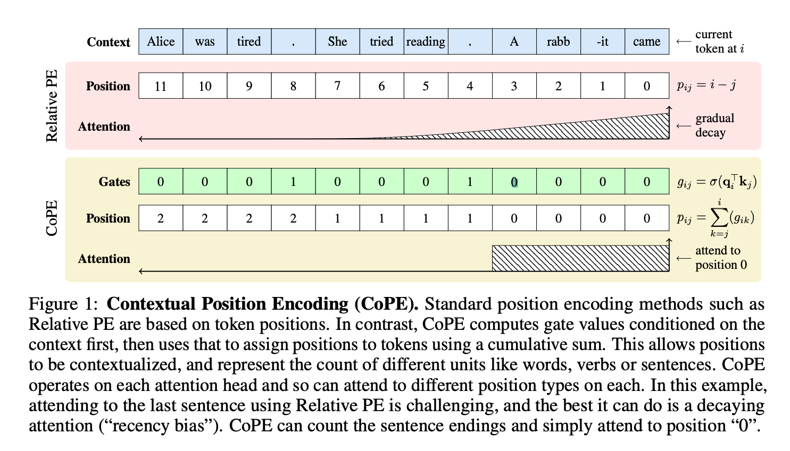

# 从 RoPE 到 CoPE：位置、旋转与上下文计数

本讲沿原课程的40个单元解释：attention为何需要顺序信息、绝对位置如何加到embedding、RoPE怎样在点积中得到相对位移，最后看CoPE怎样让“距离”由内容决定。原notebook有25格代码，**真正的CoPE实现却在最后的Markdown第39格**，因此不能只筛选cell_type=code。

先看[原代码的Python详注](代码/tutorials/position_encoding/rope_cope_代码注释.py)，再看[可直接导入的完整CoPE/SelfAttn注释代码](代码/tutorials/position_encoding/CoPE核心源码_代码注释.py)。[全部单元说明](代码单元解释.md)包含原Markdown、公式、代码摘录和图片链接；原代码及历史输出没有被新验证替换。

## 1. 材料与阅读地图

课程固定来源是chunhuizhang/personal_chatgpt提交7fbc29824171fd07dc2c30fe922e61ebc018ad1d中的tutorials/position_encoding/rope_cope.ipynb。原件和六张本地图按Git对象字节保存，避免Windows换行转换。找到匹配字幕05717ac9-bf18-46c2-b4c4-3ea2f2c1a2ca.txt，仅本地保存；字幕识别错词不当作技术结论。

核心论文是[Contextual Position Encoding: Learning to Count What's Important，arXiv v2](https://arxiv.org/abs/2405.18719v2)，Olga Golovneva、Tianlu Wang、Jason Weston、Sainbayar Sukhbaatar，2024-05-30版本。这里的CoPE不是其他论文的Clipped RoPE或Complex Position Encoding。

| 阅读部分 | 目的 | 代码落点 |
|---|---|---|
| §1与Figure1 | 用词、句子等单位而不只用token计数 | 第36/38格与CoPE.forward |
| §2背景 | absolute / relative位置的不同加入位置 | 第5/7/9格 |
| §3简化动机与计数例 | 为什么独立的内容和token距离寻址可能失效 | 对照内容寻址与距离寻址的具体例子 |
| §4式(3)–(9) | gate、累积位置、插值与高效点积 | 第38/39格 |
| §5、Appendix C及表格 | toy任务、语言/代码建模与泛化 | 本次不复现完整任务训练 |
| Appendix B Listing1 | 两个完整PyTorch类 | 第39格，与论文PDF文本逐行核对 |

论文 Appendix B Listing1 给出完整最小实现，本讲据此解释 CoPE 与 SelfAttn。固定v2论文已通过网页PDF文本读取；本地下载的网络问题和其他来源状态见复现记录。

本讲仓库入口就是notebook，不存在本讲配套的训练CLI、YAML、模型checkpoint或数据集加载器。数据是手写角度/向量；CoPE类直接收Q/K/V，不创建tokenizer、embedding或QKV投影。执行链为：

~~~text
原代码格：导入 -> 预计算RoPE相位 -> 构造4维旋转 -> 点积比较
原Markdown39：导入真实torch.nn -> CoPE / SelfAttn类
教学验证：小Q/K/V和因果mask -> SelfAttn.forward
  -> qk/sqrt(D) -> 先mask
  -> CoPE.forward -> sigmoid -> 反向cumsum -> clamp
  -> query乘整数位置表 -> gather/插值 -> 返回位置logit偏置
  -> 加回内容logit -> softmax -> 权重乘V
  -> 独立参考/梯度检查 -> 仅位置表的5步Adam教学更新
~~~

## 2. 不带位置的attention究竟少了什么

设输入$X\in\mathbb R^{L\times D_{model}}$，投影矩阵$W_Q,W_K\in\mathbb R^{D_{model}\times D}$、$W_V\in\mathbb R^{D_{model}\times D_v}$。于是Q/K为$[L,D]$，V为$[L,D_v]$。一个head计算：

$$S=\frac{QK^T}{\sqrt D},\quad A=\operatorname{softmax}_{key}(S),\quad O=AV.$$

S是未经归一化的logits/scores，A才是attention weights，二者都是$[L,L]$；输出O是$[L,D_v]$。Q/K最后维必须相同才能内积，V的特征维可以不同。softmax沿每个query对应的key行归一化，不是对整个矩阵求一个总和。

没有位置信息且没有mask时，对所有token施加同一个置换矩阵P，有：

$$\operatorname{Attn}(PQ,PK,PV)=P\operatorname{Attn}(Q,K,V).$$

这叫**置换等变**，不是整个输出与置换前完全相同。它知道哪些内容相似，却没有直接的token顺序坐标。本次真实double张量独立验证该关系。自回归三角mask本身引入可见前缀的顺序约束，因此不能把“无位置的无mask attention”结论不加条件地套到所有decoder上。

RoPE的角度表只由位置与频率决定，不由内容决定；但旋转的Q/K来自内容，最终attention当然仍有语义信息。“RoPE与上下文无关”应限定位置信号的构造，不能说整个注意力与上下文无关。

## 3. 绝对位置：可学习与固定是另一个维度

第5格BERT/GPT风格摘录把位置向量直接加到token embedding。BERT还加token_type embedding；其position_embeddings是可学习表。GPT2风格wte是token表，wpe是position表，可选token_type项。这两段实现都按绝对position ID查向量；后续模型还可以采用RoPE等位置编码。

固定sin/cos也使用绝对位置，只是没有可训练位置参数：

$$PE(t,2r)=\sin(t\omega_r),\quad PE(t,2r+1)=\cos(t\omega_r),\quad
\omega_r=10000^{-2r/D_{model}}.$$

t是序列位置，r是通道对编号，范围$0\le r<D_{model}/2$。相邻sin/cos共享同一个频率；不能把通道i误当序列位置。D_model=4时omega=[1,0.01]：t=0的向量[0,1,0,1]，t=1为[sin1,cos1,sin.01,cos.01]。因为相位差与位移相关，绝对编码也可能让网络利用相对关系；“绝对”不是“不包含任何相对信息”。

第5格是两个不完整模型片段，不具备独立forward上下文；本交付对它们加注释与AST核对，没有假称运行了完整预训练BERT/GPT。

## 4. RoPE为什么从绝对角度得到相对点积

二维旋转矩阵为：

$$R(\alpha)=\begin{bmatrix}\cos\alpha&-\sin\alpha\\\sin\alpha&\cos\alpha\end{bmatrix}.$$

它不改变向量长度，逆矩阵等于转置。给query位置m、key位置n分别旋转：

$$\tilde q_m=R(m\omega)q_m,\quad\tilde k_n=R(n\omega)k_n,$$
$$\tilde q_m^T\tilde k_n=q_m^TR(m\omega)^TR(n\omega)k_n=q_m^TR((n-m)\omega)k_n.$$

只要使用同一组频率与一致的坐标配对，位置项就通过**带符号n-m**进入点积，不是$|n-m|$。共同把两个位置都加c会抵消，但q/k内容仍可能随其真实上下文变化；这里的代数等式是在固定向量下讨论旋转。

在D维中把D/2个二维旋转组成块对角矩阵，频率$\omega_r=\theta^{-2r/D}$。这里D通常是head_dim，不是整个模型hidden_size。非学习的标准RoPE不新增位置训练参数，模型的Q/K投影仍可学习；变体的频率缩放等不能从本例默认theta=10000泛化。

### 相邻配对和半区配对不能直接混用

第20格的R12/R34是完整4×4嵌入矩阵，在(1,2)、(3,4)平面分别旋转，构成相邻配对。两个小2×2矩阵本身不能相乘后就得到4维旋转；应block_diag，或像原例先嵌入4维再相乘。

第23格get_rope_matrix把cos/sin放入四个半区：

$$R_{half}=\begin{bmatrix}\operatorname{diag}(c)&-\operatorname{diag}(s)\\\operatorname{diag}(s)&\operatorname{diag}(c)\end{bmatrix}.$$

这时配对坐标是(0,2)、(1,3)，与前面不同。令P把向量从[x0,x1,x2,x3]改排为[x0,x2,x1,x3]，就有$R_{half}=PR_{adjacent}P^T$。本次按原角pi/6、pi/3真实核对。两种写法通过这个坐标重排对应起来；若只换旋转矩阵不换向量/权重布局，输出会改变。

第21格先检验RR^T=R^TR，这只说明该矩阵满足一种交换关系，不足证明正交。例如diag(2,3)也满足，但RR^T不等于I。原第二个比较与单位阵相同才是当前数值例子的正交检查；它仍不代替一般证明。

### precompute_freqs_cis逐步看

| 变量/API | 含义、dtype与shape |
|---|---|
| dim / end / theta=10000.0 | head维D、位置数量L、基础常数 |
| arange(0,D,2).float()/D | 通道指数[0,2/D,...]，float32[D/2] |
| freqs（第一次） | 倒数角频率omega，float32[D/2] |
| t=arange(end) | 0到L-1，整数[L] |
| outer(t,freqs).float() | 角度表，float32[L,D/2] |
| polar(ones_like(angle),angle) | 单位复数cos+i sin，complex64[L,D/2] |

D=4、L=3得到角度[[0,0],[1,.01],[2,.02]]，复数表第一行全1。freqs_cis不是显式D×D旋转矩阵；把每对实通道视为一个复数后与它相乘才实现旋转。原Markdown9的wq/wk/wv、apply_rotary_emb以及xq_等来自不同步骤，没有完整类上下文，不能整块照抄就宣称运行了Attention。

原get_rope_matrix用torch.zeros(D,D)默认CPU float32。即使输入double角度，结果也是float32；本次明确观测。dim为奇数时precompute可能静默只生成floor(D/2)组，另一矩阵函数可能尺寸错误。调用者应满足偶数维/频率长度契约；本交付保留缺少显式校验的原函数，在验证中记录边界。

尤其D=3、theta只有1个元素时，切片赋值会广播，函数居然返回3×3矩阵而不是报错；实测只有rank2、非正交，不能当合法旋转。角度长度过大才在另一例实际尺寸报错。因此“没有抛异常”远不足证明输入被正确支持。

原第31格result_1那行其实被注释，没有算出第一种dot。新增验证真正比较三种点积，并用独立double旋转检查共同平移与q/k梯度，不能把原打印看作已经完成这些检查。

## 5. CoPE改变的是距离的计数单位

普通token相对距离告诉你“向左几个token”，但句长不固定；“最后一句话”不是一个固定token窗口。CoPE的思路是先决定当前query在计数时要数哪些key，再把这些软计数累计成位置。

论文式(3)、(4)写作：

$$g_{ij}=\sigma(q_i^Tk_j),\quad p_{ij}=\sum_{u=j}^{i}g_{iu}.$$

i是当前query位置，j是被关注的key位置；g为gate，值通常在0与1之间。**不是每个key都有一个与query无关的固定gate**：不同i可以选择不同计数单位，层/head也可不同。若所有有效门为1，则p_ij=i-j+1，含当前项，比常见i-j多1；这只是索引约定差异。

以同一query的一行gate=[0,.25,.5,.75]为例，从右向左和得到position=[1.5,1.5,1.25,.75]。第一个0门不增加距离，两个不同token因此可以共享一个位置。图里只把句号的门设为1，就能让同句token共享“距离当前第几句”的位置；它是理想示意，训练前不会自动出现这样的句号检测器。

实现里的attn_logits已经先做qk/sqrt(D)，再加mask.log，然后sigmoid。因此Listing1门控实际接收**缩放后且已mask的内容分数**；对照公式时，sqrt(D)的缩放已包含在attn_logits中。它没有单独的gate MLP，gate的可学习能力也依靠上游Q/K及训练。

### 为什么flip两次？

~~~python
gates = torch.sigmoid(attn_logits)
pos = gates.flip(-1).cumsum(dim=-1).flip(-1)
~~~

flip(-1)先逆转key方向，cumsum在逆序上从左累加，再翻回来，就得到每个key到最右侧的后缀和。完整形状是[B,Q,K]；cumsum不是在query轴，也不是对batch求和。

自回归mask要**先**作用于logits，使未来key分数为-inf，sigmoid(-inf)=0，后缀和里的未来项才不污染过去位置。代码允许对角线时，求和包括当前token；若改成严格只看过去的mask，位置约定也会变。本次验证完整因果序列与各长度前缀重算输出一致，并检查改动未来Q/K/V不改变过去输出；没有实现或验证CoPE KV cache。

## 6. 小数位置怎样查可训练表

设可训练整数槽表为e[0],...,e[P-1]，每个向量长度D。代码保存为pos_emb[1,D,P]，前导1让不同batch共享参数；一共DP个参数。Parameter(torch.zeros(...))会注册成可训练参数，普通torch.zeros本身不会；它虽不是nn.Embedding对象，却同样可被Module.parameters与optimizer发现。

论文式(5)线性插值：

$$f=\lfloor p\rfloor,\quad c=\lceil p\rceil,\quad w=p-f,\quad
e[p]=(1-w)e[f]+we[c].$$

例如p=1.25，取e1=[2,0]、e2=[6,4]，得到e[p]=.75e1+.25e2=[3,1]。floor/ceil后转long形成不可微整数索引，但小数权重w仍有浮点梯度；因此不能说“一转long整个CoPE就不可训练”。

为避免p超出表范围，代码clamp(max=P-1)。P是表槽数，最大合法索引P-1；论文写整数0到T时，对应P=T+1。表可以小于token长度，但饱和后较远位置会合并到末槽，不能因此宣称无损支持无限上下文。P=1时所有位置相同，位置bias对一个query的所有key是常数，在softmax中抵消，无法区分距离。

### 为什么先点积再插值更省？

若先为每对query/key构造e[p_ij]，会形成[B,Q,K,D]中间量。利用点积线性，先算论文式(7)–(9)：

$$z_i[r]=q_i^Te[r],\qquad
z_i[p_{ij}]=(1-w_{ij})z_i[f_{ij}]+w_{ij}z_i[c_{ij}],$$
$$a_{ij}=\operatorname{softmax}_{j}\left(s_{ij}+z_i[p_{ij}]\right).$$

z_int为[B,Q,P]，两个gather的索引与输出是[B,Q,K]，最后得到的只是**位置logit偏置**，不是attention权重或输出hidden state。上面数值例再取q=[1,2]，先插值得q·[3,1]=5；先算整数点积q·e1=2、q·e2=14，再.75×2+.25×14也等于5。

位置部分不再保存[B,Q,K,D]向量，但内容attention仍有[B,Q,K]矩阵和QK^T乘法。因此这不是线性复杂度attention，也不能仅凭公式就宣称实际峰值显存下降了多少。本次只做前向/梯度等价，没有跑速度或显存benchmark。

## 7. 把两个类从Python读到张量

class CoPE(nn.Module)表示继承PyTorch模块；__init__构造参数，super().__init__先初始化父类才能正常登记子Module/Parameter。self是对象实例，保存表与槽数；调用model(...)经过Module机制进入forward。SelfAttn把CoPE作为子模块，所以其parameters也包含位置表。

| 对象/方法 | 输入、参数与默认值 | 返回/状态 |
|---|---|---|
| precompute_freqs_cis | dim:int、end:int、theta:float=10000.0 | complex64[end,D/2]，不修改模型 |
| get_rope_matrix | d、theta[D/2]，无默认值 | CPU float32[D,D]半区矩阵 |
| CoPE.__init__ | npos_max=P、head_dim=D，均必填 | 注册零表[1,D,P]，DP参数 |
| CoPE.forward | query[B,Q,D]、attn_logits[B,Q,K] | 位置bias[B,Q,K]，不在forward里更新参数 |
| SelfAttn.__init__ | P、D，均必填 | 建立CoPE子模块，保存D |
| SelfAttn.forward | query[B,Q,D]、key[B,K,D]、val[B,K,Dv]、mask可广播至[B,Q,K] | 输出[B,Q,Dv]；QKV投影与output投影均不在类中 |

本次实测B=2、Q=K=4、D=3、Dv=2、P=8。这里CoPE的head_dim可以是奇数3，因为它不做RoPE二维配对；不能把RoPE偶数维约束硬套到CoPE。

~~~text
Q[2,4,3] @ K.transpose[2,3,4]       -> content logits[2,4,4]
/sqrt(3) + log(mask[4,4])           -> masked logits[2,4,4]
sigmoid / 后缀累计 / clamp          -> pos[2,4,4]
Q @ pos_emb[1,3,8]                 -> z_int[2,4,8]
gather(ceil/floor) / 小数插值        -> bias[2,4,4]
softmax(masked logits + bias)      -> A[2,4,4]
A @ V[2,4,2]                      -> O[2,4,2]
~~~

torch.bmm仅接受3维batch矩阵，不像matmul自动广播batch。query乘位置表使用matmul，前导1可广播。transpose(-1,-2)交换key的最后两轴；gather(-1,index)在位置表轴选分数，不是沿head_dim选特征。ceil/floor、long和clamp各自的作用要分开。

该mask接口要求允许=1、屏蔽=0，mask.log才会产生0/-inf；**不要直接传通常的0/-inf加性mask**，否则再次log会产生NaN，转long后成为非法负索引，本次实际RuntimeError。它没有显式验证mask契约。若一整行都屏蔽，最终softmax全-inf得到NaN；调用者要保证每个query有合法key，或另行实现安全的全屏蔽处理。

## 8. CoPE的梯度从哪里来

在非整数p、未饱和区间，插值对位置的导数为：

$$\frac{\partial z[p]}{\partial p}=z[c]-z[f],\quad
\frac{\partial p_{ij}}{\partial g_{iu}}=\mathbf1[j\le u\le i],\quad
\frac{\partial g}{\partial s}=g(1-g).$$

三者连起来，误差可以经过小数权重、累计和、sigmoid回到Q/K。索引本身不用求导。对整数结点，分段线性函数通常没有唯一两侧导数；原代码ceil=floor时两分数相同，会选择0的门控导数。本次用两个sigmoid(0)=.5、后缀和恰为1的构造实际测到0；gradcheck专门避开这些结点与饱和边界，结点处的行为需要单独分析。

零初始化位置表意味着z全0，初始CoPE bias为0，与普通masked attention完全相同。这时**位置支路**对gate的梯度为0，但位置表自身通常有非零梯度；更新表后gate路径开始有非零梯度。SelfAttn的内容qk支路仍会给Q/K梯度，不能说第一步整个attention都不能训练。本次单独核对零表/非零表两种情况。

clamp饱和也会切断该位置对gate的局部梯度；P=1的例子实际为0。解释这类训练行为，比只看一个forward打印值更能判断公式是否真正实现。

## 9. 原图与论文实验如何理解

从上到下看：当前query是最右侧came；普通相对位置按11到0数token。CoPE理想门只在两个句号处开，于是从右累加出[2,2,2,2,1,1,1,1,0,0,0,0]；最后四个token共享位置0。这个计数是每个query的一行，不能把它当作整个序列只有一个全局位置ID。rab/-it拆词也说明token单位与词/句单位不同。图的阴影是示意，真实softmax不是先确定整句后硬裁剪成精确0/1。

其余五张本地图的用途：rope_paper.png是RoFormer一般块对角旋转及相对点积式；4d_rotation.png列出四维空间六种坐标平面旋转，原例只用其中R12与R34；rope_1.png展示相邻配对矩阵；rope_2.png仍是相邻配对的逐元素sin/cos形式，不是后面半区函数的同序实现；rel_position_matrix.png对照固定i-j下三角距离与每个query内容相关的累计矩阵。六图均已实际查看。第4格远程BERT图片只保留URL，未验证其内容。

论文Table1是计数失败的定性例子，不能推出所有标准位置模型在所有提示上不可能计数。§3简化推导也有键表示/寻址假设，不能升级成一般不可表达性定理。

Appendix C Table7报告 Flip-Flop 任务错误率，越低越好。在dimension256、4层/4heads的配置下，RoPE分布内为1.8%（std3.1），OOD为20.3%（2.9）；CoPE分别为0.03%（0.06）和4.9%（4.4）。OOD错误率降低15.4个百分点。论文附录还列出8GPU、batch16、10000步等实验条件。

论文还测试 selective copy、counting 及语言/代码建模，分别报告离散任务错误率与 perplexity。本讲用5步随机目标更新，展示 CoPE 参数如何经真实 optimizer 改变；任务结果按论文中的数据与训练设置阅读。

## 10. 小张量中的位置与梯度

把CoPE的“先算各位置分数再插值”和“先插值完整向量再点积”并排计算，double精度下前向最大差约1.11e-16；Q、K、V和位置表的梯度最大差不超过4.45e-16。两种写法表达了同一条计算路径。

再固定随机Q/K/V与MSE目标，只训练原类的24个位置参数。用学习率0.02执行5次Adam更新，loss从1.2536735降至1.2374721。误差通过插值权重回到位置表，说明这张表能够跟随目标学习。

这组随机张量用于观察公式和参数更新；运行方法及数值输出见[复现说明](复现/README.md)。

## 必须掌握

1. score与weight、query轴与key轴、无mask置换等变的准确含义。
2. 可学习/固定与绝对/相对是不同维度，RoPE角度表不等于整个attention。
3. Rm转置Rn的带符号位移、相邻/半区配对必须一致。
4. CoPE的gate后缀和、先mask后计数、浮点位置和插值。
5. 先query点积再插值为什么等价，以及CoPE返回的是bias。

## 第二遍知识

零表初始化与gate梯度、整数结点与clamp饱和、不同P的容量、Parameter登记、matmul广播与bmm限制、无效mask边界、原代码中的float32分配和被注释掉的比较。

## 可以暂时不掌握的工程细节

多head/多层的位置表共享、全模型数据流水线、FlashAttention、KV cache和CUDA并行cumsum。先顺着最小类读清门值、累计位置、插值与位置偏置。

## Paper ↔ Code

| 论文概念 | 原单元/对象 | 本次证据 |
|---|---|---|
| 正弦位置相位 | 7、11–15/precompute_freqs_cis | 独立cos/sin与polar核对 |
| RoPE相对旋转 | 20–33/get_rope_matrix | 三种dot、布局置换、独立double梯度与共同平移 |
| CoPE式(3) gate | 38–39/CoPE.forward sigmoid | 真torch执行、mask与梯度 |
| 式(4)累计 | flip/cumsum/flip | 独立后缀求和参考与因果前缀 |
| 式(5)插值 | floor/ceil/weight | 完整向量参考、整数结点边界 |
| 式(7)–(9)高效分数 | matmul/gather/加bias | 前向四路梯度及gradcheck |
| Appendix B Listing1 | 原Markdown39两个完整类 | PDF文本逐行核对、原/注释AST与Python导入 |
| 全模型训练入口/数据/checkpoint | 未找到本讲对应完整官方工程 | 完整训练工程尚待补充 |
| Table7及语言建模结果 | 本最小类没有实验runner | 未复现，不以5步随机目标代替 |

## 复现状态

**部分成功。** 原件/注释保真、全部原代码、完整CoPE核心前向/梯度及教学参数更新成功；原论文完整任务、模型质量、资源/性能、GPU或分布式均未复现。具体配置、输出和报错见复现记录。

## 资料与后续问题

本讲验证论文附录中的最小类、数学前向、梯度和教学更新。完整LM、缓存和论文任务训练留待后续。讲师环境、独立官方训练工程和第4格远程图尚待补充；固定v2 PDF在线可读，本地下载失败。
