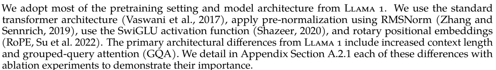
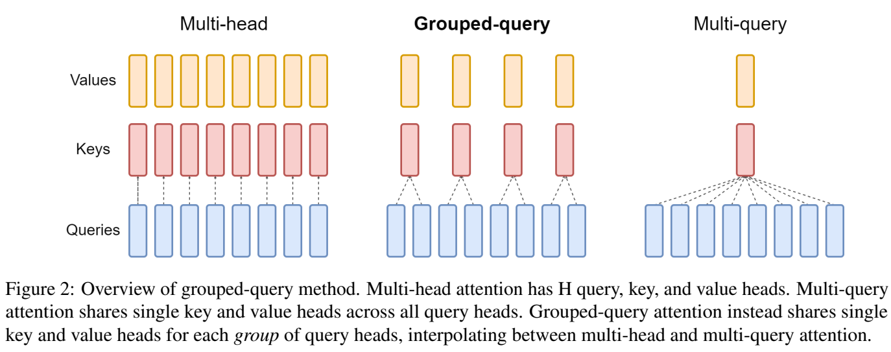

# Llama 2 7B 与 Llama 3 8B：参数到底增加在哪里

模型名称里的 B 是 billion，也就是十亿。Llama 2 7B 约有 67.38 亿个参数，首发 Llama 3 8B 约有 80.30 亿个参数。本讲把增加的 12.92 亿个参数逐项算出来，再用小模型观察这些结构怎样处理输入。

这里比较 `meta-llama/Llama-2-7b-hf` 和 **2024 年 4 月首发**的 `meta-llama/Meta-Llama-3-8B` 基础模型。先顺着本文阅读，再打开 [原 notebook 的 Python 注释版](代码/tutorials/llama/llama2_7b_llama3_8b_代码注释.py)。[完整核心实现注释版](代码/tutorials/llama/Llama核心实现_代码注释.py) 展开了注意力、MLP、归一化及其辅助函数；[全部 24 格说明](代码单元解释.md) 对应原 notebook 的单元编号。

## 1. 一个参数就是一个存下来的数

假设线性层接收两个数 `[3, 4]`，权重是 `[2, -1]`，输出就是 `3×2 + 4×(-1) = 2`。这里的两个权重是参数，输入和输出是本次计算产生的数据。训练会调整权重；处理下一条输入时，仍使用这组权重。

如果一层把 4096 个输入数变成 4096 个输出数，每个输出都需要一组 4096 个权重，权重矩阵便有 `4096×4096` 个参数。代码中的 `numel()` 就是统计张量里一共有多少个数。

先看语言模型入口和出口。分词器把文本变成 token 编号，embedding 按编号取出一行向量；最后的 `lm_head` 给词表中的每个 token 算一个分数。下面用 4 个 token、每个向量 2 维的小例子观察这两步。

```python
import torch
from torch import nn

embedding = nn.Embedding(4, 2)        # 4 行，每行存一个 token 的 2 维向量。
head = nn.Linear(2, 4, bias=False)    # 用 2 维向量计算 4 个候选 token 的分数。
with torch.no_grad():
    embedding.weight.copy_(torch.tensor([[1., 0.], [0., 1.], [1., 1.], [-1., 0.]]))
    head.weight.copy_(torch.tensor([[1., 0.], [0., 1.], [1., 1.], [-1., -1.]]))
ids = torch.tensor([[1, 2]])          # 1 条输入，2 个 token。
hidden = embedding(ids)
logits = head(hidden)
print(hidden.tolist(), list(hidden.shape))
print(logits.tolist(), list(logits.shape))
print(embedding.weight.numel(), head.weight.numel())
print(embedding.weight is head.weight)
```

编号 1 查到 `[0, 1]`，编号 2 查到 `[1, 1]`，因此 `hidden` 的形状是 `[1, 2, 2]`：批量大小、序列长度、向量维度。两行输出分数分别是 `[0, 1, 1, -1]` 和 `[1, 1, 2, -2]`，`logits` 形状变为 `[1, 2, 4]`。对分数做 softmax，才能得到四个候选的概率。

两个权重矩阵各有 8 个参数，合计 16。两代 Llama 的输入 embedding 和输出 head 也各自保存权重，配置中的 `tie_word_embeddings=False` 表示这件事。词表大小记作 $V$，向量维度记作 $D$，这两处合计就有 $2VD$ 个参数。一次输入几个 token 会改变中间张量的长度，参数数量仍由这两个矩阵的尺寸决定。

## 2. 中间的 32 层在做什么

一条输入在模型里沿下面的顺序计算：

~~~text
token 编号 → embedding 查表
           → 第 1 个 decoder layer
           → ……
           → 第 32 个 decoder layer
           → 最后一次 RMSNorm → lm_head → 每个候选 token 的分数

每个 decoder layer：
x → RMSNorm → Attention → 加回 x
  → RMSNorm → MLP       → 加回这一段的输入
~~~

Attention 让当前位置读取前面各位置的信息；MLP 对每个位置的向量做非线性变换；“加回输入”是残差连接，让本层学习在原向量上增加什么。RMSNorm 根据当前向量各分量平方的平均值调整尺度，再乘上可学习的逐维权重。

例如 `[3, 4]` 的均方根是 $\sqrt{(9+16)/2}=\sqrt{12.5}$。先除以它，得到约 `[0.8485, 1.1314]`；随后分别乘上两个可学习权重。代码还在根号里加一个很小的 `eps`，保证数值计算稳定。一个 $D$ 维 RMSNorm 因而有 $D$ 个参数。



出处：[Llama 2，v2，第 5 页 §2.2](https://arxiv.org/abs/2307.09288v2)。上面原文指出了 pre-normalization、RMSNorm、SwiGLU 和 RoPE。Pre-normalization 对应流程图里“先归一化，再进 Attention/MLP”；SwiGLU 对应下面要展开的三矩阵 MLP；RoPE 用旋转把位置信息加入 Q/K。原段落介绍整个 Llama 2 家族，具体到本讲的 7B，要使用下面的 32 个 K/V 头。

## 3. 先把两代模型的尺寸摆出来

| 符号与含义 | Llama 2 7B | 首发 Llama 3 8B |
|---|---:|---:|
| $V$：词表大小 | 32,000 | 128,256 |
| $D$：每个位置的隐藏向量维度 | 4,096 | 4,096 |
| $L$：decoder layer 数量 | 32 | 32 |
| $H$：Q 的头数 | 32 | 32 |
| $d_h=D/H$：每个头的维度 | 128 | 128 |
| $G$：K/V 的头数 | 32 | 8 |
| $F$：MLP 中间宽度 | 11,008 | 14,336 |

层数和隐藏维度相同；变化集中在词表、K/V 头数和 MLP 宽度。下面用实际的 Hugging Face 模型结构统计参数。`meta` 设备只保存张量的形状与类型，适合在普通电脑上查看完整尺寸的结构。

```python
from transformers import LlamaConfig, LlamaForCausalLM

def print_trainable_parameters(model):
    """
    Prints the number of trainable parameters in the model.
    """
    trainable_params = 0
    all_params = 0
    for _, param in model.named_parameters():
        all_params += param.numel()
        if param.requires_grad:
            trainable_params += param.numel()
    print(f"trainable params: {trainable_params} || all params: {all_params} || trainable%: {100 * trainable_params / all_params}")

full_models = {}
for name, vocab, width, kv_heads in [
    ("Llama2", 32000, 11008, 32),
    ("Llama3", 128256, 14336, 8),
]:
    config = LlamaConfig(
        vocab_size=vocab, hidden_size=4096, intermediate_size=width,
        num_hidden_layers=32, num_attention_heads=32,
        num_key_value_heads=kv_heads, tie_word_embeddings=False,
        attention_bias=False, mlp_bias=False,
    )
    with torch.device("meta"):
        full_models[name] = LlamaForCausalLM(config)
    print(name)
    print_trainable_parameters(full_models[name])
```

统计函数保留了原 notebook 第 11 格的完整实现。`named_parameters()` 遍历模型参数，`requires_grad` 表示训练时是否为这个参数计算梯度。这里新建的模型参数都可训练，所以打印的两种数量相等：`6,738,415,616` 与 `8,030,261,248`。这段代码用于数参数，实际前向计算使用第 8 节的小模型。

## 4. 为什么 K/V 头少了，Q 头还可以保持 32 个

每个注意力头里，Q 是当前位置发出的查询，K 用来计算匹配分数，V 提供按分数加权读取的内容。一个头的计算是：

$$
A_h=\operatorname{softmax}\left(\frac{Q_hK_{g(h)}^\top}{\sqrt{d_h}}+M\right),\qquad
O_h=A_hV_{g(h)}.
$$

$M$ 是遮住未来位置的因果 mask；$g(h)$ 表示第 $h$ 个 Q 头使用哪一组 K/V。softmax 沿被读取的位置归一化，因此每个查询读到的是各位置 V 的加权和。



出处：[GQA，v3，第 2 页 Figure 2](https://arxiv.org/abs/2305.13245v3)。从左到右，图中分别给每个 Q 配独立 K/V、给一组 Q 配一份 K/V、给所有 Q 配一份 K/V。Llama 2 7B 对应左边的 MHA；首发 Llama 3 8B 对应中间的 GQA。

Llama 3 里每 4 个连续的 Q 头共享一组 K/V：头 0–3 使用组 0，头 4–7 使用组 1，依次排列。不同 Q 仍然可以从共享内容里读出不同结果。下面两个 Q 分别是 `+1` 和 `-1`，共用 K `[0, 1]`、V `[10, 20]`。

```python
from transformers.models.llama.modeling_llama import repeat_kv

q = torch.tensor([[[[1.]], [[-1.]]]])   # [批量1, Q头2, 查询长度1, 头维度1]
k = torch.tensor([[[[0.], [1.]]]])     # [批量1, KV组1, 被读取长度2, 头维度1]
v = torch.tensor([[[[10.], [20.]]]])
expanded_k = repeat_kv(k, 2)            # 在头维度把同一组内容提供给两个 Q。
expanded_v = repeat_kv(v, 2)
attention_weights = torch.softmax(q @ expanded_k.transpose(-2, -1), dim=-1)
shared_outputs = attention_weights @ expanded_v
print(attention_weights.flatten().tolist())
print(shared_outputs.flatten().tolist())
```

两个头对第二个位置的权重分别约为 `0.7311`、`0.2689`，输出约为 `17.3106`、`12.6894`。Q 不同，匹配分数就不同，虽然读取的是同一份 K/V。

在完整模型里，Q 投影把 4096 维变成 `32×128=4096` 维；Llama 3 的 K、V 投影各自只需输出 `8×128=1024` 维。Q 和最后的 O 投影各有 $D^2$ 个权重，K 和 V 各有 $DGd_h$ 个权重，每层 Attention 合计：

$$P_{\text{attn/layer}}=2D^2+2DGd_h.$$

Llama 2 每层是 `67,108,864`，Llama 3 每层是 `41,943,040`。32 层合计减少 `805,306,368` 个参数。单看 K/V，两者减少了 75%；把保持原尺寸的 Q/O 也加上，Attention 总参数减少 37.5%。

在 [完整实现](代码/tutorials/llama/Llama核心实现_代码注释.py) 中，`num_key_value_groups` 保存的是每组共享的 Q 头数 $H/G=4$。前向先投影、给 Q/K 加 RoPE、写入 cache，再调用 `repeat_kv` 为各 Q 头准备匹配的 K/V；缓存本身保存 8 组。

## 5. MLP 为什么有三个矩阵

Llama 的 MLP 先把 $D$ 维分别投影到两个 $F$ 维向量。一条支路经过 SiLU，作为逐元素的门；另一条支路提供内容。两者逐元素相乘后，再投影回 $D$ 维：

$$\operatorname{MLP}(x)=W_{\rm down}\left[\operatorname{SiLU}(W_{\rm gate}x)\odot(W_{\rm up}x)\right],\quad
\operatorname{SiLU}(z)=z\,\sigma(z).$$


出处：[GLU Variants Improve Transformer，v1，第 2 页公式组 6](https://arxiv.org/abs/2002.05202v1)。最后一行是 SwiGLU，图中的 $\mathrm{Swish}_1$ 就是 SiLU，$\odot$ 表示对应元素相乘。论文把输入写成行向量，在右边乘矩阵；上面的公式按列向量写，PyTorch 则把线性层权重保存为 `[输出维度, 输入维度]`。

因此 `gate_proj`、`up_proj` 的权重形状都是 `[F, D]`，`down_proj` 是 `[D, F]`，合计 $3DF$ 个参数。下面直接使用完整的 Hugging Face `LlamaMLP`，把三个矩阵都缩到一个数：

```python
from transformers.models.llama.modeling_llama import LlamaMLP

scalar_mlp = LlamaMLP(LlamaConfig(
    hidden_size=1, intermediate_size=1, num_attention_heads=1,
    num_key_value_heads=1, mlp_bias=False, hidden_act="silu",
)).double()
with torch.no_grad():
    scalar_mlp.gate_proj.weight.fill_(1.)
    scalar_mlp.up_proj.weight.fill_(2.)
    scalar_mlp.down_proj.weight.fill_(3.)
scalar_x = torch.tensor([[[1.]]], dtype=torch.float64)
scalar_y = scalar_mlp(scalar_x)
print(scalar_y.item(), sum(p.numel() for p in scalar_mlp.parameters()))
```

输入 1，gate 支路得到 `SiLU(1)≈0.7311`，up 支路得到 2，相乘再乘 down 权重 3，结果约为 `4.386351`。这个例子共有 3 个参数。

原图下方说明了论文控制参数量的方法：普通两矩阵 FFN 若宽度为 $4D$，有 $8D^2$ 个参数；三矩阵结构取宽度 $8D/3$，也能达到同一数量级。两代 Llama 的实际宽度分别配置为 11008 和 14336，比例为 `2.6875D`、`3.5D`。参数统计直接代入这些具体数值。Llama 3 的 MLP 在全部 32 层里增加了 `1,308,622,848` 个参数。

## 6. 现在把整张参数账加起来

每个 decoder layer 有两次 RMSNorm，最后还有一次 RMSNorm，合计 $(2L+1)D$ 个参数。以上各部分相加：

$$
P=2VD+L\left(2D^2+2DGd_h+3DF+2D\right)+D.
$$

| 部分 | Llama 2 7B | 首发 Llama 3 8B | 增加量（负数表示减少） |
|---|---:|---:|---:|
| 输入 embedding | 131,072,000 | 525,336,576 | +394,264,576 |
| 输出 lm_head | 131,072,000 | 525,336,576 | +394,264,576 |
| 32 层 Attention | 2,147,483,648 | 1,342,177,280 | −805,306,368 |
| 32 层 MLP | 4,328,521,728 | 5,637,144,576 | +1,308,622,848 |
| 全部 RMSNorm | 266,240 | 266,240 | 0 |
| **总计** | **6,738,415,616** | **8,030,261,248** | **+1,291,845,632** |

```python
def parameter_ledger(vocab, width, kv_heads):
    dim, layers, head_dim = 4096, 32, 128
    return {
        "embedding": vocab * dim,
        "lm_head": vocab * dim,
        "attention": layers * (2 * dim**2 + 2 * dim * kv_heads * head_dim),
        "mlp": layers * 3 * dim * width,
        "norms": (2 * layers + 1) * dim,
    }

ledgers = [parameter_ledger(32000, 11008, 32), parameter_ledger(128256, 14336, 8)]
for ledger in ledgers:
    total = sum(ledger.values())
    print(ledger, total)
    print("BF16 权重 GB / GiB:", total * 2 / 10**9, total * 2 / 1024**3)
for kv_heads in [32, 8]:
    kv_bytes = 2 * 1 * 32 * kv_heads * 4096 * 128 * 2
    print("长度 4096 的 BF16 KV cache GiB:", kv_bytes / 1024**3)
```

增加量可以概括为：词表两端增加约 7.89 亿，MLP 增加约 13.09 亿，Attention 减少约 8.05 亿，加起来净增约 12.92 亿。参数分配同时发生了扩张和节省。

## 7. 参数量怎样换算成存储量

BF16 每个数占 2 bytes。仅存权重时，Llama 2 7B 约需 `13.477 GB / 12.551 GiB`，Llama 3 8B 约需 `16.061 GB / 14.958 GiB`。GB 按 $10^9$ bytes 计算，GiB 按 $1024^3$ bytes 计算。

生成时还要保存 KV cache。批量大小为 $B$、层数为 $L$、K/V 头数为 $G$、已缓存长度为 $S$、头维度为 $d_h$、每个数占 $s$ bytes 时：

$$\text{KV bytes}=2BLGSd_hs.$$

最前面的 2 对应 K 和 V。在同样的 `B=1、S=4096、BF16` 条件下，两代模型的缓存分别是 2 GiB 和 0.5 GiB。若首发 Llama 3 使用 8192 长度，缓存为 1 GiB。实际运行还会占用中间激活、临时计算空间等内存；上面的权重和缓存是两项可以分别计算的开销。

## 8. 用真实小模型走一遍前向和缓存

完整模型的尺寸已经在第 3、6 节统计过。下面把层数设为 2、隐藏维度设为 16，保留两种结构中 MHA/GQA 和 MLP 宽度的差异，在 CPU 上真正计算一遍。这里的 token ID 是直接给定的整数。

```python
tiny_results = {}
for seed, name, vocab, width, kv_heads in [
    (29, "MHA", 32, 43, 4),
    (30, "GQA", 64, 56, 1),
]:
    torch.manual_seed(seed)
    cfg = LlamaConfig(
        vocab_size=vocab, hidden_size=16, intermediate_size=width,
        num_hidden_layers=2, num_attention_heads=4,
        num_key_value_heads=kv_heads, tie_word_embeddings=False,
        attention_bias=False, mlp_bias=False,
        pad_token_id=0, eos_token_id=None,
    )
    model = LlamaForCausalLM(cfg).eval()
    tokens = torch.tensor([[1, 4, 7, 9]])
    with torch.inference_mode():
        full = model(tokens, use_cache=False).logits
        prefix = model(tokens[:, :3], use_cache=True)
        step = model(tokens[:, 3:], past_key_values=prefix.past_key_values, use_cache=True)
        generated = model.generate(tokens[:, :3], max_new_tokens=3, do_sample=False)
    cache_shape = list(step.past_key_values[0][0].shape)
    difference = (full[:, -1:] - step.logits).abs().max().item()
    tiny_results[name] = {
        "model": model, "tokens": tokens, "generated": generated,
        "parameters": sum(p.numel() for p in model.parameters()),
        "logits_shape": list(full.shape), "cache_shape": cache_shape,
        "cache_difference": difference,
    }
    print(name, tiny_results[name]["parameters"], list(full.shape), cache_shape)
    print("缓存误差:", difference, "生成编号:", generated.tolist())
```

两次前向得到 `[1, 4, 32]` 和 `[1, 4, 64]` 的 logits：一条输入、四个位置、每个位置分别给 32 或 64 个候选打分。第一层缓存形状分别是 `[1, 4, 4, 4]`、`[1, 1, 4, 4]`，四个轴依次是批量、K/V 头、缓存长度、头维度。GQA 在第二个轴上少存了三份。

完整前缀一次计算和“先算前三个，再接最后一个”得到近似相同的最后位置分数。`generate` 则反复取当前位置的分数，选择下一个 token，再继续前向。本例用随机初始化权重观察张量流动，生成结果以整数编号展示。

## 9. 回到原 notebook 逐格看

| 原单元 | 代码与阅读重点 |
|---|---|
| 0–4 | 导入工具，定义两个 Hub 模型标识符。字符串指定要找哪个 checkpoint。 |
| 5、7 | `AutoModelForCausalLM.from_pretrained` 根据配置选择具体模型类、加载权重；`torch_dtype=torch.bfloat16` 指定权重类型，`device_map='auto'` 自动安排模块的设备。 |
| 11–13 | 定义并调用完整统计函数；`numel()` 数权重元素，`requires_grad` 判断可训练状态。 |
| 14–15 | 打印模型树。先找 embedding/head，再进入某一层看 Q/K/V/O 和三个 MLP 投影的尺寸。 |
| 16 | 单独数输入 embedding，得到 131,072,000 与 525,336,576。输出 head 也各有同样数量。 |
| 17 | 算 `11008/4096` 与 `14336/4096`，对应 MLP 的两个宽度比例。 |
| 18–21 | 展开 Attention、GQA 和 MLP 的公式与源码。结合第 4、5 节的实际输入输出阅读。 |
| 其余单元 | 图片、文字和留白的逐格说明见 [代码单元解释](代码单元解释.md)。 |

第一次阅读，先掌握三件事：权重矩阵按形状数参数；词表大小同时影响输入与输出；GQA 通过共享 K/V 改变注意力参数和缓存。第二遍再沿 [完整实现注释版](代码/tutorials/llama/Llama核心实现_代码注释.py) 追踪 `view/transpose`、RoPE、cache 更新、softmax 和输出投影。

本讲尺寸来自 [原 notebook](https://github.com/chunhuizhang/personal_chatgpt/blob/7fbc29824171fd07dc2c30fe922e61ebc018ad1d/tutorials/llama/llama2_7b_llama3_8b.ipynb) 的历史模型结构；[首发模型卡](https://github.com/meta-llama/llama3/blob/cf3ea595be1edfb019d21b14d8b215a39161c860/MODEL_CARD.md) 说明 8B/70B 两档、GQA 和 8k 上下文。参数账解释结构和存储，回答质量需要结合训练数据与评测理解。

本文六块代码的执行结果、完整模块的前向/梯度对照及原图来源见 [复现记录](复现/README.md)。本轮使用 Transformers 4.44.2，在 CPU 上运行教学小模型，并以 meta 结构统计完整尺寸；原 7B/8B checkpoint 的加载、质量和 GPU 开销留待相应设备与权重环境验证。

<details>
<summary>第二遍阅读：原讲解中的源码细节与历史运行记录</summary>

# Llama 2 7B 与 Llama 3 8B：词表、Attention 和 MLP

这讲要把“7B变成8B”拆成一张能自己算出来的参数账。两者都使用32层、4096维隐藏状态和32个query heads，但Llama 3的词表更大、MLP更宽，K/V投影却更小。只看模型层数，解释不了这约13亿参数的差别。

阅读顺序是本文 → [原代码 Python 注释版](代码/tutorials/llama/llama2_7b_llama3_8b_代码注释.py) → [完整核心实现注释版](代码/tutorials/llama/Llama核心实现_代码注释.py)。需要逐格对照时打开 [注释 notebook](代码/tutorials/llama/代码注释.ipynb)，不要用文本编辑器阅读它的JSON。原单元从0编号，[全部24格说明](代码单元解释.md)覆盖15个代码格、重要Markdown源码、公式和空格。

## 1. 这讲比较什么，依据是什么

比较对象是 `meta-llama/Llama-2-7b-hf` 与2024年4月首发的 `meta-llama/Meta-Llama-3-8B` 基础模型。它们不是Chat/Instruct，也不是后续Llama 3.1。基础自回归模型与对话微调模型的角色格式、停止符和能力不能混为一谈。

| 来源地图 | 本讲阅读内容 |
|---|---|
| [原教程](https://github.com/chunhuizhang/personal_chatgpt/blob/7fbc29824171fd07dc2c30fe922e61ebc018ad1d/tutorials/llama/llama2_7b_llama3_8b.ipynb) | 固定提交7fbc29824171fd07dc2c30fe922e61ebc018ad1d，全部24格；历史结构和参数数值是本讲主要对照对象 |
| [Llama 2论文v2](https://arxiv.org/abs/2307.09288v2)，Hugo Touvron等 | §2.2的pre-norm、RMSNorm、SwiGLU、RoPE，及家族中GQA的使用范围；本次读取已有本地PDF相关章节，不重述整篇RLHF/安全实验 |
| [首发Llama 3模型卡](https://github.com/meta-llama/llama3/blob/cf3ea595be1edfb019d21b14d8b215a39161c860/MODEL_CARD.md) | 固定Meta提交cf3ea595be1edfb019d21b14d8b215a39161c860，本地已有快照；确认8B/70B和GQA，避免混入后代配置 |
| [GQA论文v3](https://arxiv.org/abs/2305.13245v3)，Joshua Ainslie等 | §2.2、Figure 2：分组共享KV；§3实验是T5体系的uptraining，不是本讲两代Llama权重的直接消融 |
| [Transformers 4.44.2源码](https://github.com/huggingface/transformers/blob/v4.44.2/src/transformers/models/llama/modeling_llama.py) | 本次安装源文件与包RECORD相符；完整摘出7个实际对象，不推断讲师精确软件版本 |
| 本讲字幕 | E盘ff65f590开头文本，确实讲7B/8B比较，已完整阅读、本地保存；ASR中的“44GB/34GB”“M2P”等按代码与算式校正，不当作新指令 |

本讲结合 Llama 2 论文与 Llama 3 首发模型卡比较结构。完整尺寸的meta配置依据原notebook打印的矩阵尺寸构建；官方HF配置请求因TLS失败，其他配置字段尚待逐项核对。

先建立仓库执行地图：

~~~text
原4格 Hub标识符
 → 原5/7格 AutoModelForCausalLM.from_pretrained
 → config解析 → LlamaForCausalLM构造 → checkpoint分片加载 → 设备分配
 → 原11–17格：参数统计、结构展示、embedding与MLP宽度比较
 → Markdown18/21：Attention、GQA与SwiGLU公式及源码摘录

补充验证的数据路径：
自建整数token IDs → Embedding → 2层随机LlamaDecoderLayer
 → RMSNorm → lm_head → logits → shift交叉熵 → AdamW三步
 → 保存/重载 → greedy生成与KV cache对照
~~~

原notebook没有数据集、loss、optimizer、训练loop或generate。它的目标是加载和比较结构。补充训练只验证真实模块能正确工作，不能称作原教程训练实验。

## 2. 先分清模型对象、权重和设备

`llama2_id`是一个Python字符串。`AutoModelForCausalLM`是按配置选择具体类的工厂；`from_pretrained`是类方法，返回真正的模型对象。在本例得到的是`LlamaForCausalLM`。名字里的`CausalLM`表示根据已有前缀预测下一个token。

原5/7格传入`torch_dtype=torch.bfloat16`，要求以BF16加载；一个BF16元素占2 bytes。`device_map='auto'`由Transformers/Accelerate安排模型各部分所在设备，可能涉及GPU、CPU或磁盘offload，具体受可用内存及选项影响。它不是自动创建多份模型做数据并行，也不意味着每张GPU严格各放一半，更不等于张量并行或训练optimizer分片。

原Markdown9只截取`get_balanced_memory`调用：它计算内存预算，之后还要推导device map并dispatch。`low_zero=(device_map == 'balanced_low_0')`只有指定该策略才为True。`model`、`target_dtype`、`max_memory`和`device_map_kwargs`在摘录中没有定义，不能独立执行这个代码块。本次小模型保留原`device_map='auto'`，真实得到`{'': 'cpu'}`；没有复现讲师两张4090的行为。

Meta原生路径是`torch.load → Transformer(model_args) → load_state_dict`。HF路径封装了配置、键名、分片与设备处理。`pytorch_model.bin.index.json`之类文件把**张量名映射到checkpoint分片文件**，并不决定GPU分配。`.bin`和`safetensors`都可能用于权重，文件格式不能单独证明结构。`strict=False`允许missing/unexpected keys，但同名参数尺寸不对仍会报错，本次做了真实反例。

原Markdown乱码未擅自覆盖；新说明解释其可核对语义。原14/15格末尾只写`llama2`、`llama3`，Jupyter会展示对象的`repr`，不会执行forward；同一表达式放在普通.py脚本中也不会自动打印。

## 3. 两个模型的尺寸表

用`B`表示batch，`T`表示本次query长度，`S`表示可见key长度，`D`表示隐藏宽度，`H`表示query头数，`G`表示KV头数，`d_h=D/H`表示每头宽度，`F`表示MLP中间宽度，`V`表示词表行数，`L`表示层数。`G`在这里是组数/KV头数，和GB单位无关。

| 配置 | Llama 2 7B | 首发Llama 3 8B | 对应代码 |
|---|---:|---:|---|
| 隐藏宽度D | 4096 | 4096 | `hidden_size` |
| 层数L | 32 | 32 | `num_hidden_layers` |
| query头H | 32 | 32 | `num_attention_heads` |
| KV头G | 32 | 8 | `num_key_value_heads` |
| 单头宽d_h | 128 | 128 | D/H |
| MLP中间宽F | 11008 | 14336 | `intermediate_size` |
| 词表行数V | 32000 | 128256 | `vocab_size` |
| 共享输入/输出权重 | 否 | 否 | `tie_word_embeddings=False` |

原Markdown22的heads列是query头数，不能拿它推断KV头数。Llama 2 7B用32个KV头，但不能据此说整个Llama 2家族都没有GQA；70B配置不同。本讲只比较明确的两个型号。

## 4. 词表扩大，为什么会算两次

输入token IDs是`int64[B,T]`。`nn.Embedding(V,D)`用每个ID索引一行，输出浮点`[B,T,D]`。权重`embed_tokens.weight`的shape为`[V,D]`，不是`[B,T,D]`，参数数目为：

\[
P_{\mathrm{emb}}=VD.
\]

例如V=5、D=3，输入`[[1,4]]`取出第1和第4行，输出shape`[1,2,3]`；参数表仍只有15个元素，batch或句长不会改变参数量。

模型最后的`lm_head=nn.Linear(D,V,bias=False)`把隐藏状态变成`logits[B,T,V]`。PyTorch的Linear保存`weight[out_features,in_features]`，所以它的权重也是`[V,D]`。logits尚未归一化，不能直接称为词表概率；沿V做softmax才得到概率。

两模型输入embedding和输出head**没有权重绑定**。相同shape和“镜像”用途不表示同一Parameter。因此词表相关总数为`2VD`。若某个其他模型绑定两者，就不能重复计算同一参数；原统计函数的`named_parameters()`默认会去重。

| 一张表 | Llama2 | Llama3 | 差值 |
|---|---:|---:|---:|
| VD | 131,072,000 | 525,336,576 | +394,264,576 |
| 输入与输出合计2VD | 262,144,000 | 1,050,673,152 | +788,529,152 |

128256/32000=4.008，因此单张表略大于原来的4倍。原16格返回带千位分隔的两个字符串，仅统计输入表。更大的词表改变分词粒度和输出类别数，但不自动证明中文能力或速度更好。这里没有重新训练tokenizer；实际两套分词器与特殊token对照见 [第25讲](../25%20Llama%203%20introduction/README.md)。

## 5. GQA：Q是4096维，K是1024维，为何还能点积

先拆头，再比较每个头的维度。输入`X[B,T,D]`先过线性投影：

\[
Q_{\rm flat}\in\mathbb R^{B\times T\times Hd_h},\qquad
K_{\rm flat},V_{\rm flat}\in\mathbb R^{B\times T\times Gd_h}.
\]

Llama3中Q的拼接总宽是`32×128=4096`，K/V总宽是`8×128=1024`。reshape并transpose后，Q是`[B,32,T,128]`，K/V是`[B,8,S,128]`。参与每个点积的最后一维都为128，不会拿4096与1024直接点积。

设`R=H/G=4`，零起始query头h使用的KV头为：

\[
g(h)=\left\lfloor\frac{h}{R}\right\rfloor.
\]

query头0、1、2、3使用KV头0；query头4、5、6、7使用KV头1，以此类推。每组共享一份K和一份V，K与V本身仍是不同矩阵。原`num_key_value_groups`这个变量实际存的是每份KV服务的query头数R，名字容易让人误以为是KV组数G。

完整每头计算为：

\[
a_{b,h,i,j}=\frac{
\exp\big(q_{b,h,i}^{\top}k_{b,g(h),j}/\sqrt{d_h}+M_{i,j}\big)}
{\sum_{u\in\mathcal K_i}\exp\big(q_{b,h,i}^{\top}k_{b,g(h),u}/\sqrt{d_h}+M_{i,u}\big)},
\quad
o_{b,h,i}=\sum_{j\in\mathcal K_i}a_{b,h,i,j}v_{b,g(h),j}.
\]

这里b是样本，i是query位置，j/u是key位置，`M`是加性mask，有效位置0、屏蔽位置负无穷；`𝒦_i`是该query的key索引集合。实际也可把全部S位置都放入softmax，由mask排除不可见项。scaled dot-product除的是单头宽的平方根`√128`。概率沿最后key轴求和为1，输出每头`[B,T,d_h]`，拼成`[B,T,D]`后通过`o_proj`。

一个算得清的小例子：单head的q=1、k=[0,1]，令d_h=1、v=[10,20]，无屏蔽时softmax=[0.26894,0.73106]，输出约17.3106。屏蔽第二个key后输出变成10。两个query头即便共享这两份k/v，因为q可以不同，softmax和输出也可以不同。

实际完整源码先对Q/K做RoPE，然后在更新cache以后用`repeat_kv`把每个KV head连续重复R次以便与H个query头对齐。不是将G个头按0,1,…循环交错。源码`expand → reshape`可能产生新内存，不能把`expand`视图特性推广为整个attention零拷贝。原cell19外链图的内容本次未验证；上述共享方向由固定源码、GQA Figure 2与真实逐头数值对照确认。

`LlamaSdpaAttention`继承`LlamaAttention`，共用Q/K/V/O参数结构，前向改用PyTorch `scaled_dot_product_attention`。SDPA默认包含缩放，不能再手工除一次。要求`output_attentions=True`时该版本会回退eager实现；打印出的类名反映本次选用的注意力计算实现。完整导出类保留这些分支，验证eager与独立逐头参考的输出及全部输入/投影梯度，再比较SDPA前向。旧`pretraining_tp`切片分支保留但未执行，和`device_map='auto'`不是一回事。

### 核心对象的调用接口

下面的“方法”由实例调用，`self`不需要调用者显式传入；辅助函数直接传入张量。完整实现都在 [核心注释代码](代码/tutorials/llama/Llama核心实现_代码注释.py)，无需从摘录中猜缺失主体。

| 对象与掌握级别 | 输入、默认值与输出 | 状态和调用位置 |
|---|---|---|
| `LlamaAttention(config, layer_idx=None)` | config为LlamaConfig，layer_idx为可选int；构造含四投影的Module | DecoderLayer创建它；登记可训练参数，未传layer_idx会警告，缓存需要明确层号 |
| `LlamaAttention.forward` | hidden_states浮点[B,T,D]；attention_mask默认None，采用可广播加性[B,1,T,S]；position_ids默认None，本验证给int64[B,T]；返回(output[B,T,D], weights或None, cache或None) | past_key_value默认None，传入真实Cache时update会改变cache；不在forward里更新权重。output_attentions/use_cache默认False，具体缓存写入由是否传入cache控制，不要把use_cache=False当作禁止已有cache.update的充分条件 |
| `LlamaSdpaAttention.forward` | 与上行相同的公开输入；默认无权重输出，返回(output,None,cache)，要求权重时走父类分支 | 用真实SDPA替换手写softmax路径；cache_position默认None，静态缓存需结合实际上下文；position_embeddings默认None，可显式传(cos,sin)避免内部生成 |
| `LlamaMLP(config).forward(x)` | x浮点[B,T,D]，返回同shape；F来自config，无额外forward开关 | DecoderLayer在attention后调用；无KV状态，三个Linear权重由optimizer更新 |
| `LlamaRMSNorm(hidden_size, eps=1e-6).forward(x)` | hidden_size为int，eps防止除零；输入输出[B,T,D]，沿D算平方均值 | 调用位置为两个pre-norm和末尾norm，weight[D]可训练，内部FP32统计；构造时可从config覆盖eps |
| `repeat_kv(hidden_states, n_rep)` | 输入[B,G,S,d_h]，n_rep=R为int，输出[B,G×R,S,d_h]；R=1直接返回输入对象 | Attention在cache更新后调用；不新增独立KV参数，不能用循环交错头顺序代替 |
| `rotate_half(x)` | 把最后一维前后半区变成[-后半,前半]，输入输出shape相同，本例d_h为偶数 | 被apply_rotary_pos_emb调用；没有可学习权重或缓存 |
| `apply_rotary_pos_emb(q,k,cos,sin,position_ids=None,unsqueeze_dim=1)` | q[B,H,T,d_h]、k[B,G,T,d_h]、cos/sin[B,T,d_h]；返回旋转后的(q,k)；position_ids在此版本仅保留为兼容参数 | unsqueeze_dim插入head广播轴，cos/sin的T要与当前Q/K对应；不旋转V、不修改传入张量或cache |

本次Attention独立检查显式传入cos/sin，避免把频率生成与分组选择混在同一项验证中；完整小模型则真实经过模型内部RoPE路径。Python的`**kwargs`接收额外命名参数，不能据此假定每个额外选项都实际生效。

## 6. Attention省了多少参数与cache

没有bias时，Q/O各有`D²`个参数，K/V各有`D×Gd_h`个。因为`D=Hd_h`：

\[
P_{\mathrm{attn,layer}}=2D^2+2DGd_h
=\left(2+2\frac GH\right)D^2.
\]

Llama2的G/H=1，每层`4D²=67,108,864`；Llama3的G/H=1/4，每层`2.5D²=41,943,040`。乘32层分别为2,147,483,648与1,342,177,280，总共减少805,306,368个参数。

**单个K/V矩阵**剩1/4，减少75%；**整块attention四投影**剩5/8，减少37.5%。两个比例不能混用。Q头数和每head的`T×S`注意力分数并没有减少为1/4，所以不能据此推断端到端计算时间也变为1/4。

解码时保存的K/V通常是`[B,G,S,d_h]`，跨L层、两类张量和每元素s bytes，容量算式为：

\[
\mathrm{KVbytes}=2BLGSd_hs.
\]

这是标准紧凑cache的元素账，不包含分配器、padding或特定实现额外临时空间。保持B/L/S/d_h/dtype相同，G从32减到8，cache变成1/4。例如B=1、L=32、S=4096、d_h=128、BF16时是2GiB和0.5GiB。如果同时把S翻倍，GQA版本就是1GiB，不能再用不同长度的结果宣称仍是1/4。

真实小模型的cache比较明确保留4个query heads：旧式4个KV头，新式1个KV头，R同样是4。完整前缀和增量推理的logits接近，cache中确实保持G头。原notebook没有KV cache实现，本段是可运行的工程补充，见验证记录。

## 7. SwiGLU的三张矩阵如何组合

两代模型都用SwiGLU，不是从普通两层MLP改成新算法。HF记号对应为：

\[
g=XW_g^\top,\quad u=XW_u^\top,\quad
z=\operatorname{SiLU}(g)\odot u,\quad
Y=zW_d^\top,
\qquad \operatorname{SiLU}(t)=t\sigma(t).
\]

X是`[B,T,D]`；`W_g`和`W_u`实际PyTorch权重为`[F,D]`，各得到`[B,T,F]`；⊙是逐元素乘法，不是矩阵乘法；`W_d[F→D]`实际权重为`[D,F]`，输出回到`[B,T,D]`。这样才能与同宽残差相加。

例如一个位置D=1、F=1，x=1、gate/up/down三个标量权重分别为1、2、3，结果是`SiLU(1)×2×3≈4.38635`。若省掉SiLU，就变成6，已经是不同函数。`gate`是可学习的数值调制，不一定处于0–1，也不是硬开关。

| 对象 | HF | Meta |
|---|---|---|
| 受SiLU的分支 | `gate_proj` | `w1` |
| 直接升维分支 | `up_proj` | `w3` |
| 降维分支 | `down_proj` | `w2` |

两条升维分支和一条降维分支都是learnable Linear；SiLU没有额外参数。原21格中`self`表示某个模块实例，`nn.Linear(in,out,bias=...)`是在构造时创建子模块，调用`self.gate_proj(x)`才真正计算。`class LlamaMLP(nn.Module)`定义类，继承使PyTorch能登记参数和子模块；`__init__`构造实例，`super().__init__()`初始化父类；`forward`由`module(x)`调用。方法有隐含的self，而原11格`print_trainable_parameters(model)`是普通函数。

无bias时一层有：

\[
P_{\mathrm{MLP,layer}}=DF+DF+FD=3DF.
\]

F由11008增至14336，每层从135,266,304增至176,160,768，32层增加1,308,622,848。原17格比值是2.6875与3.5；不能把Llama2实际11008硬写成精确`8D/3`，实际宽度包含取整等配置选择。`3DF`也解释为什么“中间宽只有约2.7D”仍可接近普通两矩阵4D FFN的参数规模。

## 8. 把精确参数总账合起来

每层有attention前与MLP前两份RMSNorm，末尾另有一份。每份只有D个缩放参数，没有LayerNorm式bias，因此norm总数是`(2L+1)D=266240`。RoPE频率不是这两模型中的可训练位置embedding表，不能额外算`context_length×D`个参数。

在本讲bias均关闭、输入输出不绑定的配置下：

\[
P=2VD+L\left[2D^2+2DGd_h+3DF+2D\right]+D.
\]

| 参数部分 | Llama2 7B | Llama3 8B | Llama3−Llama2 |
|---|---:|---:|---:|
| 输入embedding | 131,072,000 | 525,336,576 | +394,264,576 |
| 输出lm_head | 131,072,000 | 525,336,576 | +394,264,576 |
| 32层attention | 2,147,483,648 | 1,342,177,280 | −805,306,368 |
| 32层MLP | 4,328,521,728 | 5,637,144,576 | +1,308,622,848 |
| 全部RMSNorm | 266,240 | 266,240 | 0 |
| **合计** | **6,738,415,616** | **8,030,261,248** | **+1,291,845,632** |

这张表逐项统计架构的参数元素数，与原12/13格打印值一致。验证用Transformers类在meta设备构造模型：meta保存shape、dtype等元信息，可以低成本核对参数账；加载和生成则需要实际权重。

原11格的`named_parameters()`产生`(name,Parameter)`，`for _, param`用下划线忽略名字；`numel()`返回元素数；`requires_grad`是bool。函数只打印、隐式返回None、不改变模型。100%可训练指所有参数允许求梯度，并不表示它们已训练、optimizer已登记或内存已经分配梯度。本次还实测空`nn.Identity()`会因分母0产生`ZeroDivisionError`，不将此统计函数当成通用健壮工具。

按精确数量乘2 bytes，BF16纯权重约为13.477GB/12.551GiB和16.061GB/14.958GiB，两者同时约29.537GB/27.509GiB。GB按10⁹、GiB按2³⁰换算。原注释14GB/16GB是按7B/8B取整粗估，字幕中的44GB、合计34GB不能当精确事实。实际推理还要KV cache、激活、加载暂存与框架开销；训练更有梯度和optimizer状态。原模型的内存峰值需要在实际运行时测量。

## 9. 原图与论文实验

GQA Figure 2从query头箭头跟到共享KV：MHA是一一对应，MQA是所有query头共享，GQA介于两者。图中箭头表示多个query头读取同一组K、V；它们共享相应的投影参数。真实逐头参考验证H=4、G=4/2/1，对应参数1024/768/640，输出与输入及四投影梯度一致。

GQA论文在T5、uptraining及指定硬件上比较效率与质量。共享KV会改变缓存量与解码带宽需求；prefill时间、解码吞吐和训练总时间则需要分别测量。原cell19远程图的内容尚待补充。

两代Llama同时改变了词表、训练语料、训练规模和MLP宽度。因此本讲先按模块计算参数变化；研究某个部件对能力的影响，还需要控制其他变量做消融实验。

## 10. 小模型中的加载、前向与缓存

先用meta张量构造两代模型的完整尺寸，计算模块与参数总数。随后将随机小模型保存到本地，用原代码的`from_pretrained(..., torch_dtype=torch.bfloat16, device_map='auto')`重新加载，观察配置如何决定网络结构与参数dtype。

训练例子使用两层、隐藏宽度32的FP32模型，分别配置4/1个KV头、86/112的FFN中间宽度和64/128的词表。对自建的2×6整数序列执行3步AdamW更新后，参数发生变化；保存重载结果一致，逐token缓存输出也与前缀重算吻合。

逐头参考计算进一步检查了Attention的分组方向，独立SiLU公式则对应完整MLP。由此可以把前面的参数账目、前向计算和缓存大小接到同一套代码中。

配置错误也各有落点：head维不匹配会在注意力运算时报错，越界token会在embedding查表时报错，`strict=False`仍会拒绝shape不同的lm_head权重。具体配置与输出见[复现记录](复现/README.md)。

## 必须掌握

- 词表输入表和输出head各有VD个参数，本例未绑定，必须算两次。
- GQA的Q/K拼接总宽可不同，但每个head的d_h必须相同；R=H/G，按连续组共享KV。
- K/V矩阵减75%与整个attention减37.5%是两个不同口径。
- SwiGLU是`down(SiLU(gate(x))*up(x))`，中间乘法是逐元素相乘，参数数为3DF。
- 精确总数、纯权重字节数、实际内存峰值和任务能力是不同指标。

## 第二遍学习

- SDPA与eager的mask、缩放、FP32 softmax和返回attention权重分支。
- KV cache更新先于repeat，增量与完整前缀logits如何比较。
- `requires_grad`、`train/eval`、`no_grad`与optimizer四者的不同职责。
- 结合第17–22讲继续读RMSNorm、RoPE、残差与生成流程。

## 可以暂时不掌握的工程细节

多卡device map、checkpoint分片格式、offload与加载峰值；旧`pretraining_tp`分支；CUDA不同SDPA内核、缓存实现的存储细节。本次只在CPU实际运行，没有给出这些性能结论。

## Paper ↔ Code 对照

| 论文/概念 | 原notebook | 完整代码对象与本次证据 |
|---|---|---|
| 自回归Transformer、pre-norm | 原14/15格repr | 实际`LlamaForCausalLM`随机小模型；原训练数据/权重未找到于本次环境 |
| GQA §2.2、Figure 2 | Markdown18/21/22 | `LlamaAttention`、`LlamaSdpaAttention`、`repeat_kv`；独立逐头前向/梯度 |
| SwiGLU、Llama2 §2.2 | 原17格、Markdown21 | `LlamaMLP`；SiLU独立式、全梯度与实际类gradcheck |
| RMSNorm | 原14/15格repr | `LlamaRMSNorm`完整源码；小模型真实调用，本讲不重复第17讲全部单模块验证 |
| RoPE | 原14/15格repr | `rotate_half`、`apply_rotary_pos_emb`；Attention参考含显式旋转，完整频率推导见第18/19讲 |
| 参数账、词表表宽 | 原11–17格 | `named_parameters`、`numel`及meta逐项计数；这不是论文任务分数 |
| 语言质量、原双4090吞吐 | 未找到对应原评测代码 | 未复现，不从随机loss或结构打印推断 |

## 复现状态

**部分成功。** 原件保留、详注、静态核对、完整尺寸meta计数、真实随机CPU模型的本地BF16加载、前向/训练/重载与缓存验证成功。原远程7B/8B权重加载、语言生成质量、双卡设备分配和论文全实验未复现。

## 资料与后续问题

- 讲师具体Transformers/Accelerate版本和checkpoint revision未知，历史`LlamaSdpaAttention`类名不足以唯一定位版本。
- 官方HF配置请求TLS失败；本讲主参数shape由原历史打印与meta构造交叉核对，其他配置字段其余配置字段待核对。
- 远程图像内容未验证，原Markdown乱码无法逐字还原；新增解释只采用代码/论文可核对语义。
- 小模型补充输入是自建ID，无自然语言任务含义；三步loss下降只能证明训练路径工作。
- 模型能力的归因与cache变化的实际加速比例，需要进一步的消融和计时实验。

</details>
