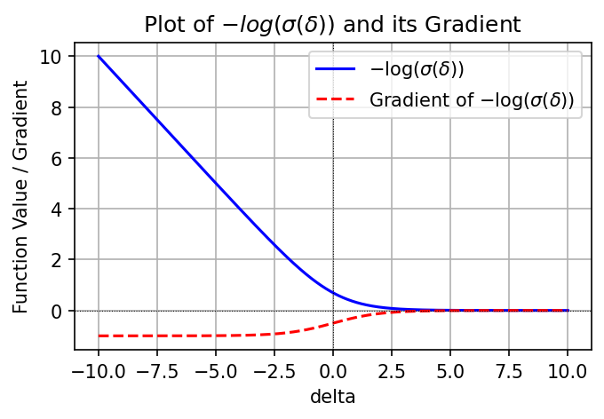
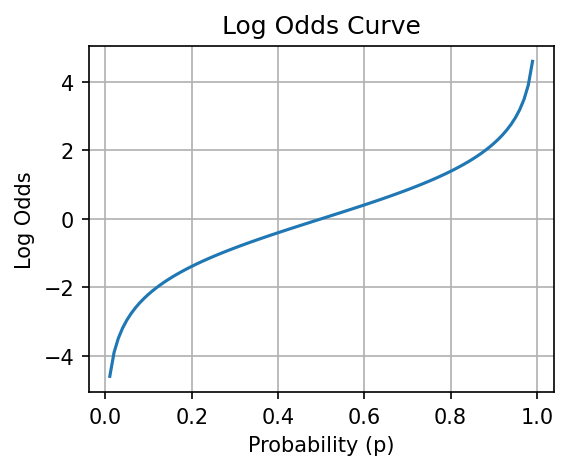

# InstructGPT 的奖励建模：概率、似然与损失函数

奖励模型如何从“这个回答比那个更好”的标签中学出一个标量？关键不是把人工名次当连续分数回归，而是让**两个分数之差决定偏好的概率**，再最大化已经观察到的比较结果的似然。本讲把这条路线推到损失、梯度、批次组织和真实代码。

先读本文，再读 [主代码详细注释](代码/tutorials/reward_model/reward_model_Bradley_Terry_model_代码注释.py)；想看参数怎样真的估计出来，再读 [SciPy补充](代码/tutorials/reward_model/bradley_terry_modeling_代码注释.py)。[全部35格说明](代码单元解释.md)覆盖主27格/12代码、补充8格/5代码，含公式、链接和空格。notebook的历史输出保留；本文的“本次”结果另有验证记录。

## 1. 论文与代码地图

论文是Long Ouyang等的 [Training language models to follow instructions with human feedback](https://arxiv.org/abs/2203.02155)，固定阅读v1，2022年3月4日。它提出的InstructGPT训练路线是本讲依据，不能称为后来ChatGPT所有实现细节的公开源码。

| 论文地图 | 阅读内容与用途 |
|---|---|
| §3.1、Figure 2图注 | SFT → reward modeling → PPO的关系；基础GPT-3预训练在这三个阶段之前 |
| §3.5、Eq.(1)、脚注5 | 标量reward、log odds、同prompt 4–9候选、相关比较一起训练 |
| §3.5的reward平移说明 | 训练RM后用bias把示范回答平均分居中；排序loss不能决定整体偏移 |
| Appendix C.2 | 6B RM、64个prompt、每prompt候选范围、ties丢弃、单epoch设置 |
| §4及Figure 1 | 人类偏好评价是整体InstructGPT系统结果，不能由本讲小模型loss替代 |

公式及相关段落依据固定v1论文PDF文本。[OpenAI介绍](https://openai.com/index/instruction-following/)可用来了解整体训练路线；图片与下载状态见文末资料说明。

| 仓库地图 | 固定内容与运行路线 |
|---|---|
| [原教程](https://github.com/chunhuizhang/personal_chatgpt/blob/7fbc29824171fd07dc2c30fe922e61ebc018ad1d/tutorials/reward_model/reward_model_Bradley_Terry_model.ipynb) | 固定提交7fbc29824171fd07dc2c30fe922e61ebc018ad1d，主notebook讲概率/曲线；没有原6B骨干、数据集或训练循环 |
| bradley_terry_modeling.ipynb | 同提交，四队/五品牌的最大似然估计；属于补充概率例子，不是InstructGPT神经模型代码 |
| 本次教学补充 | 自建ID序列 → 真实LlamaForSequenceClassification → 序列标量 → 分组BT loss → AdamW → 保存/重载 |
| 相关HF源码 | Transformers4.44.2完整LlamaForSequenceClassification类，安装RECORD核对；不是OpenAI官方RM实现 |
| 字幕 | E盘8adc33be开头文本，完整阅读，谈第16/23讲后的RM理论补充；原字幕仅本地保存，ASR措辞按公式校正 |

原checkpoint/训练数据/完整官方6B训练工程在本次材料中**未找到**。本讲不运行PPO；已有 [第23讲](../23%20TRL%20Reward%20Model%20与%20RewardTrainer/README.md)讲RewardTrainer，[第27讲](../27%20TRL%20RLHF%20PPOTrainer%20%E4%B8%8E%20OpenRLHF/README.md)讲PPO，可作为工程衔接。

## 2. 一个打分器，两个响应，同一个prompt

【必须会】设prompt为x，同一prompt的两个响应为`y_w`和`y_l`。下标w/winner表示人工更喜欢的回答，l/loser表示人工较不喜欢的回答，不是模型已经预测正确的保证。

同一个参数集合θ的reward model分别计算：

\[
r_w=r_\theta(x,y_w),\qquad r_l=r_\theta(x,y_l),\qquad \delta=r_w-r_l.
\]

reward是实数标量，可以为负；它本身不是概率。两个输入路径共享参数，类似siamese评分思路，但不表示训练两个独立模型，也不要求把两个回答一起交给一个cross-encoder。一般每条`(prompt,response)`序列独立得到一个分数，再在loss里相减。

| 变量 | 来源、类型与shape | 用途 |
|---|---|---|
| x、y | prompt/response字符串；本次补充只用自建ID | 真实应用需要tokenizer，本讲原代码未提供tokenizer流程 |
| input_ids | int64[N,T]，N条不同候选序列、右pad到T | 真实骨干输入，和“比较对数量”区分 |
| attention_mask | int64[N,T]，有效1、pad0 | 控制padding可见性 |
| hidden_states | FP32[N,T,H] | 最后一层隐藏表示 |
| score.weight | FP32[1,H] | 把每个token向量变为一个标量 |
| rewards | FP32[N] | 取各序列最后非pad位置，得到候选分数 |
| chosen/rejected索引 | 每prompt内部的整数下标 | 从同一reward向量选择要比较的分数 |
| delta | 浮点[M]，M个严格偏好对 | 进入稳定logistic loss |
| loss | 零维浮点Tensor | backward得到全部可训练参数梯度 |

论文§3.5介绍把语言模型末端词表输出替换为标量reward；C.2还说明最终6B RM初始化来自做过公开NLP任务微调的GPT-3，历史原因如此，SFT/GPT-3初始化也得到类似结果。不能把正文概述强行解读为最终checkpoint唯一初始化细节。

## 3. 从Bradley–Terry到偏好概率

【必须会】先从正的“强度”π理解：

\[
\Pr(i\succ j)=\frac{\pi_i}{\pi_i+\pi_j},\qquad \pi_i>0.
\]

令`r_i=ln π_i`，于是π_i=exp(r_i)，化简：

\[
\Pr(i\succ j)
=\frac{e^{r_i}}{e^{r_i}+e^{r_j}}
=\frac{1}{1+e^{-(r_i-r_j)}}
=\sigma(r_i-r_j).
\]

神经RM将固定队伍的r_i推广为依赖文本的`rθ(x,y)`。因此，给定prompt和两段回答，人类偏好chosen的模型概率为：

\[
p=\Pr(y_w\succ y_l\mid x,y_w,y_l)=\sigma(\delta).
\]

这里的随机性是偏好观察的建模，不是“固定分数r_w是否大于r_l”这个确定命题的概率。模型分数可以暂时排错，δ<0代表当前估计p<0.5；人工标签仍然是chosen胜出，训练就是纠正这种预测。

例子：强度π_w=3、π_l=1时，δ=ln3≈1.0986，p=3/4。反过来若给出分数3与1，分差是2，p≈0.8808，不是3/4。**正强度和log强度不能混用。**

定义odds=p/(1−p)后：

\[
\log\frac p{1-p}=\delta.
\]

所以“reward差表示log odds”是本模型的关键假设。不是先证明任意人类偏好天然满足一维分差模型；循环偏好、标注者异质性可能不符合这个假设。

## 4. 从观察到的标签得到交叉熵

【必须会】若比较标签z∈{0,1}，z=1表示前者胜出，则Bernoulli似然是`p^z(1-p)^(1-z)`。取负自然对数：

\[
\ell=-z\log p-(1-z)\log(1-p).
\]

按chosen/rejected定向存储后z恒为1，得到论文Eq.(1)每对的核心项：

\[
\ell(\delta)=-\log\sigma(\delta)
=\log(1+e^{-\delta})
=\operatorname{softplus}(-\delta).
\]

这给出4种可核对实现：`-F.logsigmoid(rw-rl)`、`F.softplus(rl-rw)`、对delta与全1标签的`binary_cross_entropy_with_logits`、对两logits `[rw,rl]`和类别0的两类交叉熵。它们应在相同reduction下相等。本次用float64张量和autograd实际验证，另对chosen/rejected输入做double gradcheck。

重要API差别：`binary_cross_entropy_with_logits`接收未sigmoid的logit；若先sigmoid再传给它，就重复变换了。`F.logsigmoid`直接稳定计算log(sigmoid)，不必先构造极小概率。看到log probability可能是在做似然或交叉熵，但不代表任意含log的式子都自动是分类交叉熵。

**原22格的两个数对数底不同。** δ=0时自然对数loss为ln2≈0.693147，而`−log10(0.5)≈0.301030`。换底会把loss及其梯度乘上`1/ln10`，不能把这两个数说成同一单位的计算误差。原代码原样保留，正确对照应统一自然对数。

## 5. 对分差、对分数、对参数求梯度

【必须会】逐步求导，先用sigmoid导数σ′=σ(1−σ)：

\[
\frac{d\ell}{d\delta}
=-\frac{\sigma'(\delta)}{\sigma(\delta)}
=\sigma(\delta)-1,
\qquad
\frac{d^2\ell}{d\delta^2}
=\sigma(\delta)(1-\sigma(\delta)).
\]

有限实数δ上，导数在(−1,0)，二阶导在(0,1/4]。loss对δ严格递减、凸；这不意味着经过深度网络参数θ后仍然凸。单个严格偏好对没有“δ=3就达到最优”的有限极小点；若没有其他约束，分差继续变大仍能减小loss，极限趋0。

| δ | p | loss | dℓ/dδ |
|---:|---:|---:|---:|
| −6 | 0.002473 | 6.002476 | −0.997527 |
| 0 | 0.5 | 0.693147 | −0.5 |
| 1 | 0.731059 | 0.313262 | −0.268941 |
| 3 | 0.952574 | 0.048587 | −0.047426 |
| 10 | 0.999955 | 0.0000454 | −0.0000454 |

这是解析函数数值表，不是模型训练效果。原24格及字幕中“3以后基本没有梯度、更新不再有益”的说法过强。δ=3仍有约0.0474的梯度幅度，是否小到可忽略要看batch归一化、网络Jacobian和优化设置。δ很负时loss近似−δ，梯度趋−1，而不是惩罚/梯度一起无界增大。

因为δ=r_w−r_l：

\[
\frac{\partial\ell}{\partial r_w}=\sigma(\delta)-1,\qquad
\frac{\partial\ell}{\partial r_l}=1-\sigma(\delta).
\]

梯度下降倾向抬高chosen分数、压低rejected分数；两个分数来自同一个网络，所以最终参数梯度为这两条共享参数路径的和，不能当成两个独立自由标量永久各走一步。原21格“loss is proportional to log odds”也不准确：**δ等于log odds，loss是δ的非线性函数。**

横轴是分差δ；蓝色实线是loss，红色虚线是解析导数，二者不共用同一物理含义。图没有训练步、验证集或模型参数轴。原代码在有限区间[−10,10]上画图，本次检查这些曲线数组，并用原版/注释版生成相同PNG。

【建议会】极端δ=−1000时，先sigmoid再log会得到inf，本次实际观察到；稳定`−F.logsigmoid`仍返回1000、梯度−1。δ=+1000时浮点结果可饱和为−0.0，这是有限精度，不是数学上有限δ已经精确达到零。

## 6. 分数的平移自由度与标注尺度

【必须会】同一prompt的全部分数都加上c(x)，任意差值不变，所以BT loss不变。本次给两个prompt分别加10和−8，loss相同，对这两个偏移的梯度约为0。单靠这种偏好loss不能确定每个prompt的绝对分数零点；论文因此在RL前用bias把示范回答平均reward居中到0。

这不表示分数缩放也不变。乘一个正数a会将δ变成aδ，虽然严格排序方向不变，偏好概率和loss会变；a等价于改变logistic尺度/温度。原9格提到不同标注人rating尺度不同，是使用比较标签的动机之一，但pairwise并不能自动解决标注人真正偏好相反的问题。

原本地图片展示的是单个Output A的1–7质量评分、指令遵循等属性和备注，并不是完整候选排序界面。原图已检查内容，保留在代码依赖路径。它能说明人工标注界面，不证明这张图中的rating就是实际RM优化目标。

## 7. K个候选的比较对，怎样组织成一个batch

【必须会】K个候选最多有`C(K,2)=K(K−1)/2`个无序比较。一个候选在K−1个pair中重复出现，这些比较高度相关，不是凭空新增独立prompt。原16/17格：K=9最多36对，64个prompt最多2304对；K=4最多6对。

若排名为D>C>A=B，无序对共有6个，A/B是tie；按论文C.2丢弃ties，剩下D>C、D>A、D>B、C>A、C>B共5个严格对。不能把A=B随意定向成A胜B。其他任务可以设计soft label或专门tie模型，但不是这篇论文此处采用的处理。

论文§3.5观察到把相关pair完全打散会过拟合；它把同prompt候选的一组比较作为一个batch元素，并复用每个候选的单次前向。这个结论来自论文实验，不能泛化成“只要pair更多就一定抗过拟合”。K从4到9组合数增加6倍，也不保证人工耗时精确只增加多少，更不保证有效信息量增加6倍。

把实现写明确：设batch含B个prompt，第b个保留严格pair集合为𝒫_b，m_b=|𝒫_b|。本次教学实现选择：

\[
\mathcal L=\frac1B\sum_{b=1}^{B}
\frac1{m_b}\sum_{(w,l)\in\mathcal P_b}
\operatorname{softplus}\big(-(r_{b,w}-r_{b,l})\big).
\]

先在每prompt的**有效pair**里取mean，再对prompt取mean。论文Eq.(1)写出1/C(K,2)与期望，实际代码还需确定采样和求和层级。这里选择上述分组均值：每个prompt等权。若已对全部pair取mean，再除一次C，会额外缩小梯度。

当各prompt的m_b不同，“每prompt等权”和“所有pair平铺mean”不等价。本次用5对与3对的示例得到1.300150和1.084456，验证了这种权重差别；二者没有脱离任务定义的绝对对错，必须写清目标。

小模型例子有7个不同序列：prompt0含4候选，prompt1含3候选，形成5+3=8个有效pair。一次评分7条候选，或按8对重复评分16条序列，在关闭dropout且prompt权重相同的条件下，loss和参数梯度一致，最大梯度误差约2.84e−8。开启随机dropout后，两种打包方式可能采到不同掩码。

## 8. 补充notebook：真正估计Bradley–Terry强度

### 四队例子

【建议会】原补充2格的`w[i,j]`是队伍i击败j的次数，shape[4,4]，对角线为0。`n=w+w.T`得到每对总比赛次数。只有i<j的无序对参与一次求和，总观测次数为22。

令θ_i=lnπ_i，则省略与参数无关的组合系数后的负对数似然为：

\[
\operatorname{NLL}(\theta)
=-\sum_{i<j}\left[
w_{ij}\theta_i+w_{ji}\theta_j
-(w_{ij}+w_{ji})\log(e^{\theta_i}+e^{\theta_j})\right].
\]

也可写成对δ_ij=θ_i−θ_j的两方向logsigmoid加权。n是次数，不是神经网络batch维。补充函数输入自由参数`theta[3]` float64，固定θ_A=0后拼成完整[4]向量，返回NumPy标量NLL；BFGS改变的是优化向量，不会在函数内部修改w。

固定一个参考队是为了消除平移不可辨识性：所有θ同加c不改变概率。第一套代码固定A，第二套品牌代码固定最后品牌，约束不同但概率不受影响。若比较图断开，或者数据完全可分，单个锚定不一定足以保证所有强度存在唯一有限MLE；本次只验证给定数据的有限解，不泛化所有数据。

真实SciPy1.13.1运行得到强度A/B/C/D约为1、1.6306、1.0312、3.5484；归一化约为0.1387、0.2262、0.1430、0.4921。**归一化强度不是一场比赛的胜率。** 例如P(D>A)=3.5484/(3.5484+1)≈0.7801，不是0.4921。

原代码外层最多10次重复调用`minimize(method='BFGS')`。本次打印“2 iterations”是外层2次，最后一次BFGS内部迭代nit为0，不能说BFGS只迭代2步。原break在`theta_opt=result.x`之前，本次两者差为0，但一般代码应留意这项更新顺序。

### 五品牌例子

原表有5个品牌，10个无序对，每对100次比较，共1000次。四元组`(i,j,n_ij,n_ji)`记录双方向次数。`brand_indices`用字典推导生成名字→下标，但本段核心计算没有用到它。第二次定义同名`neg_log_likelihood`会覆盖第一定义，阅读时应分开两任务。

输入是4个自由log强度，末品牌log强度固定0；内部用稳定的：

\[
\log(e^a+e^b)=m+\log(e^{a-m}+e^{b-m}),\quad m=\max(a,b).
\]

`minimize`未传解析jac，使用数值差分；必须检查`result.success`。本次成功，归一化强度约为Dunlop .3335、Modi .1618、Ceat .1908、GoodYear .2005、MRF .1134，BFGS内部nit为10。这些是原表的参数拟合，不是轮胎实际品质评测、也不是RM语言能力。

第一套直接exp的目标在测试极端log强度时出现非有限值；第二套max-shift目标在对应极端输入下仍有限。本次用独立Torch双精度logsigmoid似然核对两者：NLL约13.42845和657.80182，近最优点梯度小；锚定后的四队Hessian最小特征值约0.6147。稳定性是逐段的：后续若对很大log强度直接exp再归一化，也可能溢出，不能因为目标稳定就说整个任意范围流程都安全。

## 9. 核心API与PyTorch实际路径

| 对象 | 输入/返回与状态 | 学习重点 |
|---|---|---|
| `neg_log_likelihood(theta)`，普通函数 | 四队自由log强度[3]→标量NLL；固定A=0，不修改观测矩阵 | 【建议会】log强度不是正强度；双方向次数共同贡献 |
| 第二个`neg_log_likelihood(log_pis)` | 品牌自由log强度[4]→标量NLL，固定末品牌0 | 【建议会】max-shift及同名覆盖；没有模型训练状态 |
| `scipy.optimize.minimize(fun,x0,method='BFGS')` | fun为目标函数、x0为1D初值，返回OptimizeResult | 【建议会】success/message/x/nit不是同一指标；本次固定SciPy1.13.1 |
| `strict_pairs(ranks)`，本次函数 | 一维等级列表，数值越大越好→(chosen,rejected)索引列表 | 【必须会】无序对只处理一次，ties丢弃 |
| `grouped_pair_loss(rewards,groups,ranks)` | 浮点[N]、每prompt切片和等级→零维Tensor | 【必须会】双层mean；不修改权重；空严格比较组报ValueError |
| `LlamaForSequenceClassification(config)` | 真实HF骨干和`score:Linear(H,1,bias=False)` | 【必须会】num_labels=1只设置头宽，不自动选择pairwise训练目标 |
| `forward(input_ids,attention_mask,...)`方法 | IDs/mask[N,T]→输出对象，`.logits`为[N,1] | 【必须会】本次不给labels，外部计算BT；该类1-label默认labels路径可能是MSE回归 |
| `train_demo(steps=8)`，本次函数 | 默认8次更新，返回真实模型、trace与数据元组 | 【建议会】真实AdamW更新骨干和head；不是原6B训练复现 |

首次遇到Python与PyTorch语法时，抓住这些区别：`class`定义对象类型、`__init__`构造实例、`super().__init__()`初始化父类，`nn.Module`登记子模块和参数；普通函数显式收输入，方法通过self访问实例。`for i,j,...`是元组解包，`**kwargs`接收额外命名参数，字典推导构建映射。Tensor广播要核对shape，尤其[N]与[N,1]误减会变成[N,N]；本次明确`squeeze(-1)`。

`with torch.no_grad()`只在评估/核对时暂时关闭构图。`model.eval()`改变dropout等训练行为，不关闭autograd；本次为了比较不同打包方式，在eval状态下仍然`loss.backward()`、AdamW更新。`optimizer.zero_grad()`清梯度，`loss.backward()`计算梯度，`optimizer.step()`才改参数，三者不能混用。

本次实际模型：单层、H16、4个query heads、2个KV heads、MLP32、词表32，2880参数，固定seed30，输入int64[7,6]、mask同shape。分类头给每个token一个分数，再用最后非pad位置选择序列分数。已核对完整导出类与安装类的前向相同、取末位置与实际score输出一致，以及追加右padding不改变序列分数。没有宣称处理任意中间pad、截断或自然语言tokenization都已验证。

## 10. 曲线、原论文实验与本次实验的界限

横轴是p∈[.01,.99]，纵轴ln(p/(1−p))；p=.5对应0，接近0/1时趋向负/正无穷。图只是数学函数，原14格的`np.linspace`取100点，没有数据集、拟合或验证指标。

论文整体系统在其API提示分布上，以人工比较评价175B InstructGPT与175B GPT-3，报告偏好比例85±3%；相较few-shot提示的GPT-3为71±4%。这是特定人群、提示分布及完整SFT/RM/PPO过程的结果，置信区间口径依论文，不是本讲小RM的accuracy，不能归因到某个loss单独更优。此处只交代评价边界，没有重新计算论文分数。

小模型经过8步更新，loss从0.691456降至0.348109，12个state entries改变，包括score与attention骨干；保存重载后的state与logits精确一致。自建ID和人工等级让我们能看清奖励模型的训练与保存过程。

验证还覆盖：17个原代码格两版原样执行；6个notebook schema、AST/非注释token、原字节/历史输出；四种loss等价、一阶/二阶导与gradcheck；shift/scale性质、tie计数、不同归一化、SciPy真实估计、完整HF类和真实RM训练。失败/warning/依赖与未运行范围见 [复现记录](复现/README.md)。

## 必须掌握

- reward是实数，分差是log odds；sigmoid后才是偏好概率。
- chosen/rejected由人工标签确定，模型当前分差可能为负。
- BT loss、二分类BCE和两logit交叉熵怎样等价，为什么用稳定logsigmoid/softplus。
- δ=3不是梯度归零阈值；原自然对数/log10混用要纠正。
- 同prompt候选比较可复用前向；ties、prompt数、pair数和mean层级必须写清。
- 平移不影响偏好，缩放会影响概率；绝对rating与相对比较不是同一监督目标。

## 第二遍学习

- Bradley–Terry锚定、比较图、有限MLE条件和稳定log-sum-exp。
- Bernoulli标签、共享参数两分支梯度及神经网络非凸性。
- 最后非pad pooling与分类头labels默认MSE路径的差别。
- 结合第23/27讲继续看真实偏好数据、collator、reward偏移与PPO的KL约束。

## 可以暂时不掌握的工程细节

【可以暂时不掌握】BFGS的线搜索/Hessian近似内部实现、GPU分布式RM训练、6B内存优化、PPO整轮训练和生产级人类标注管线。本次没有为这些环节给出性能结论。

## Paper ↔ Code 对照

| 论文/概念 | 原单元 | 实现与证据 |
|---|---|---|
| §3.5/Eq.(1)标量差与logistic loss | 主5/12/13/21/22 | 四种损失等价、真实autograd/gradcheck；原公式保留 |
| K4–9、相关pair分组、C.2 ties | 主7/15–17 | strict_pairs/grouped_pair_loss；5对/3对与7序列复用验证 |
| RM标量head | 原实现未找到 | 完整HF LlamaForSequenceClassification为相关教学实现；真实2880参数模型训练8步 |
| BT正强度/对数强度估计 | 补充2/4/5/6 | SciPy原代码BFGS与独立Torch似然/梯度 |
| 概率与loss曲线 | 主14/23 | 原数组和两PNG实际生成、两版一致、视觉检查 |
| SFT→RM→PPO、Figure2 | 主3/6与引用 | 论文文字/图注核对；原6B数据权重和完整OpenAI训练工程未找到 |
| 人类偏好分数与泛化 | 原评测代码未找到 | 未复现，不用自建ID loss替代 |

## 复现状态

**部分成功。** 本讲原代码全部可执行部分、详注/保留性检查、数学性质、SciPy拟合和真实随机RM教学训练成功。原InstructGPT6B/GPT-3权重、数据、人类评估、完整RM/PPO和能力指标未复现。安装了仅限本讲的SciPy1.13.1，未改共享NumPy/Torch，没有模型/API费用。

## 资料与后续问题

- 未找到讲师精确环境；当前Matplotlib3.9.4、SciPy1.13.1与历史图中的3.8.0不是同版本，历史图/输出保留，不承诺像素相同于讲师历史图。
- 本文按有效pair均值、再按prompt均值定义教学目标；原OpenAI实现中可变K和ties的完整处理尚待补充。
- 主4/6/19远程图片与补充私有会话链接未读取；没有根据URL补造内容。
- 训练输入是自建ID和人工等级；真实语言偏好的泛化评估留待后续。
- 原np.exp极端溢出与有限精度饱和都已区分；有限区间曲线不能当作全实数数值稳定性证明。
